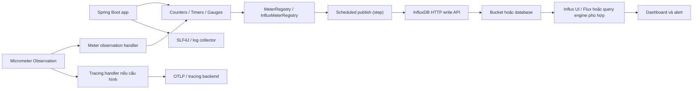
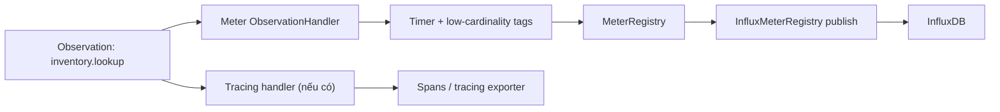
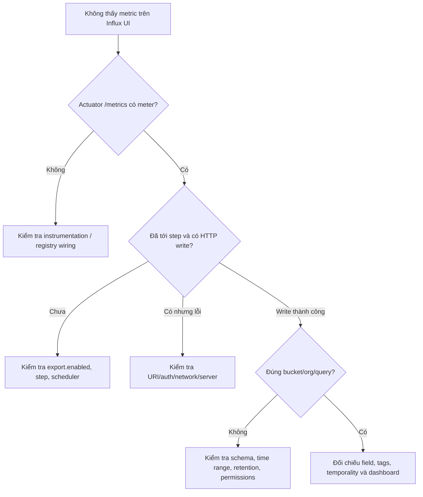

# Influx registry trong Spring Boot và Micrometer

> **Chương:** Meter registry và exporter  
> **Module:** `SPRING_BOOT_OBSERVABILITY` — Thiết lập observability cho Spring Boot bằng Micrometer Observation, metrics, logs và distributed tracing. Học propagation ngữ cảnh, tag/cardinality, exporter, sampling và liên kết tín hiệu để điều tra lỗi, độ trễ và hành vi ứng dụng trên môi trường thực.  
> **Trọng tâm:** Cấu hình `InfluxMeterRegistry` của Micrometer để đẩy metrics sang InfluxDB; hiểu cơ chế push theo chu kỳ (`step`), khác biệt InfluxDB 1.x và 2.x, cách thiết kế tags, truy vấn và chẩn đoán một pipeline có thể hoạt động tốt ở local lẫn production.

## 1. Kết quả học tập

Sau bài học, bạn có thể:

1. Phân biệt `MeterRegistry`, `InfluxMeterRegistry`, `ObservationRegistry`, backend InfluxDB và tracing exporter.
2. Giải thích tại sao Influx registry là một **metrics exporter dạng push** theo lịch, còn Prometheus registry thường phục vụ mô hình **pull/scrape**.
3. Bổ sung `micrometer-registry-influx` vào Spring Boot; dùng cấu hình Boot 3.x với `management.influx.metrics.export.*` và quản lý thông tin xác thực an toàn.
4. Lựa chọn cấu hình phù hợp với InfluxDB 1.x hoặc 2.x; biết rằng InfluxDB 3.x và các dịch vụ tương thích cần kiểm tra API/registry riêng thay vì mặc định dùng cấu hình 2.x.
5. Đăng ký Counter, Timer và Gauge bằng `MeterRegistry` đã được Spring Boot quản lý; dùng tên/tag ít biến động và tránh làm tăng số series.
6. Xác minh theo chuỗi **ứng dụng → Micrometer registry → HTTP write → bucket/database → query/dashboard**, phân biệt dữ liệu chưa đến thời điểm export với lỗi token, network, org/bucket hoặc dữ liệu sai tên.
7. Đọc và tổng hợp số liệu đúng với **kiểu meter, kiểu dữ liệu do exporter ghi và ngữ nghĩa thời gian**; không áp công thức PromQL `rate()` trực tiếp vào mọi field Influx.
8. Kết hợp metric InfluxDB với traces/logs để điều tra lỗi và latency, trong khi hiểu rằng Influx registry không tự gửi traces hoặc logs.

## 2. Vì sao cần InfluxMeterRegistry?

Giả sử một hệ thống checkout cần lưu trữ và truy vấn các chỉ số:

- Số lần gọi payment gateway và tỷ lệ thất bại theo kênh.
- Thời gian xử lý đơn hàng, thời gian mượn connection của HikariCP.
- JVM heap, GC, CPU và số thread đang chạy.
- Throughput, error ratio và p95 latency của HTTP API.

Micrometer cung cấp **API instrumentation trung lập backend**. Phần code phát sinh metrics không nhất thiết biết backend là InfluxDB, Prometheus hay nền tảng khác. Khi dùng Influx registry, Micrometer chuyển các meter thành dữ liệu tương ứng và **chủ động gửi HTTP request** tới InfluxDB theo chu kỳ.



Cùng một ứng dụng có thể có nhiều nhánh telemetry:

| Thành phần | Công việc | Có phải Influx registry làm không? |
|---|---|---|
| `MeterRegistry` | Đăng ký và đọc trạng thái các meters | Có |
| `InfluxMeterRegistry` | Chuyển đổi/đẩy metrics tới InfluxDB | Có |
| `ObservationRegistry` | Quản lý vòng đời Observation và handlers | Không, đó là registry khác |
| Tracing bridge/`Tracer` | Tạo spans, truyền trace context | Không |
| OTLP tracing exporter | Gửi spans tới collector/backend traces | Không |
| Logger và log collector | Ghi/chuyển logs | Không |
| InfluxDB | Nhận, lưu và truy vấn time-series dữ liệu | Backend độc lập |

**Có metrics trong InfluxDB không có nghĩa đã bật distributed tracing.** Tracing cần integration, sampling, propagation và exporter riêng. Log correlation cần logger/MDC và log pipeline phù hợp.

## 3. Push và pull: Influx khác Prometheus như thế nào?

| Góc nhìn | Influx registry | Prometheus registry phổ biến |
|---|---|---|
| Cách nhận dữ liệu | **Push:** ứng dụng gửi HTTP write sang backend theo chu kỳ | **Pull:** Prometheus scrape HTTP endpoint của ứng dụng |
| Lịch thu thập | Do `step`/scheduler của registry quyết định | Do `scrape_interval` ở Prometheus quyết định |
| Nơi cấu hình đích | URI InfluxDB, token/credentials, org/bucket hoặc database | Target discovery, endpoint, auth, relabeling |
| Khi backend mất kết nối | Các lần publish có thể lỗi; không phải hệ thống lưu giao dịch bền vững | Các lần scrape lỗi dẫn tới khoảng trống dữ liệu |
| Công cụ truy vấn | InfluxDB query API/Flux hoặc ngôn ngữ tùy sản phẩm và phiên bản | PromQL |
| Định dạng | Line protocol/HTTP write theo implementation của registry | Prometheus exposition/OpenMetrics |
| Security chính | Token/quyền ghi vào bucket, TLS, network | Quyền truy cập scrape endpoint, TLS/auth/network |

**Không cần mở `/actuator/prometheus` để Influx registry đẩy metrics.** Spring Boot Actuator `/actuator/metrics` hữu ích để kiểm tra meters trong process, nhưng pipeline Influx thực tế có thể hoạt động mà không expose Prometheus endpoint.

Ngược lại, nếu thêm cả `micrometer-registry-prometheus` và `micrometer-registry-influx`, Spring Boot có thể cấu hình nhiều meter registries để cùng nhận các instrumented meters. Khi đó mỗi backend có đường export, naming/temporality và chi phí riêng. Không mặc định hai backend sẽ trả cùng tên series hoặc cùng cách tính rate.

### 3.1. Step không đồng nghĩa thời điểm sự kiện xảy ra

Giả sử cấu hình `step=30s`, ứng dụng gọi `counter.increment()` lúc 10:00:07, 10:00:14 và 10:00:23. Registry ghi nhận sự kiện trong process ngay khi code chạy, nhưng **publish** có thể chỉ xảy ra ở một mốc định kỳ sau đó.

Không thấy một điểm dữ liệu ngay lập tức không có nghĩa Counter không hoạt động. Cần biết:

1. Ứng dụng thực sự đã tạo/đăng ký meter chưa.
2. Registry đang bật không, chu kỳ publish là bao lâu.
3. HTTP write đã thành công chưa.
4. Bucket/database có nhận và query được dữ liệu chưa.

Step registry có thể biểu diễn Counters/Timers theo **cửa sổ xuất dữ liệu**, không nhất thiết là raw Counter tích lũy giống mẫu Prometheus scrape. Vì vậy phải kiểm tra cách dữ liệu được ghi bởi phiên bản Micrometer đang sử dụng trước khi xây query tốc độ/tổng.

## 4. InfluxDB 1.x, 2.x và các thế hệ API

Tên “InfluxDB” bao gồm những phiên bản và dịch vụ có khác biệt rõ về mô hình xác thực, lưu trữ và truy vấn.

| Đặc điểm | InfluxDB 1.x | InfluxDB 2.x |
|---|---|---|
| Nơi lưu dữ liệu | Database (kèm retention policy, tùy cấu hình) | Bucket gắn với organization |
| Xác thực phổ biến | Username/password hoặc cơ chế xác thực được server cấu hình | API token với quyền phù hợp |
| Đường ghi HTTP điển hình | `/write?db=...` | `/api/v2/write?org=...&bucket=...` |
| Tham số Micrometer cần xem | `db`, `uri` và credentials theo deployment | `org`, `bucket`, `token`, `uri` |
| Query | InfluxQL với API/UI tương ứng | Flux hoặc những API truy vấn mà bản triển khai 2.x hỗ trợ |
| Lưu ý | Có thể tắt auth trên local, không nên làm vậy production | Token phải có quyền ghi bucket và được giữ bí mật |

**Không áp dụng rập khuôn cấu hình 2.x cho InfluxDB 3.x.** Một số dịch vụ InfluxDB 3 hỗ trợ các write protocol/API tương thích, nhưng khả năng xác thực, database/bucket mapping và query engine khác nhau. Trước khi tích hợp, cần kiểm tra **chính phiên bản Micrometer Influx registry** và **write endpoint thực tế** của sản phẩm InfluxDB 3 đang dùng.

Bài này dùng InfluxDB **2.x** làm đường triển khai chính; phần InfluxDB **1.x** là biến thể để tránh nhầm các thuộc tính `db` với `bucket`.

### 4.1. Influx line protocol là gì?

Influx write API nhận các điểm dữ liệu có dạng khái niệm:

```text
measurement,tag_key=tag_value field_key=field_value timestamp
```

Ví dụ một điểm **tự tạo bằng tay**:

```text
learning_probe,source=manual value=1i
```

Ở đây:

- `learning_probe` là measurement.
- `source=manual` là tag giúp lọc/phân nhóm.
- `value=1i` là một integer field.
- Timestamp bị lược bỏ, server có thể gán thời điểm nhận theo API và cấu hình.

**Đừng cho rằng Micrometer sẽ luôn phát ra đúng field `value`, hoặc luôn đổi dấu chấm trong meter name thành gạch dưới.** Registry map Counter, Gauge, Timer và DistributionSummary sang measurement/fields/tags theo implementation của nó. Cần **xem dữ liệu thực** trước khi viết query.

## 5. Thêm Influx registry vào Spring Boot

Ví dụ hướng đến **Spring Boot 3.x** với Spring Boot parent hoặc BOM quản lý phiên bản. Các khóa cấu hình và dependency có thể thay đổi giữa các major version; hãy đối chiếu với version được deploy.

### 5.1. Maven

```xml
<dependencies>
    <dependency>
        <groupId>org.springframework.boot</groupId>
        <artifactId>spring-boot-starter-actuator</artifactId>
    </dependency>

    <dependency>
        <groupId>io.micrometer</groupId>
        <artifactId>micrometer-registry-influx</artifactId>
    </dependency>

    <!-- Chỉ cần nếu ứng dụng dùng HTTP API. -->
    <dependency>
        <groupId>org.springframework.boot</groupId>
        <artifactId>spring-boot-starter-web</artifactId>
    </dependency>
</dependencies>
```

### 5.2. Gradle

```groovy
implementation 'org.springframework.boot:spring-boot-starter-actuator'
runtimeOnly 'io.micrometer:micrometer-registry-influx'
implementation 'org.springframework.boot:spring-boot-starter-web'
```

`micrometer-registry-influx` cung cấp registry cho backend InfluxDB. `spring-boot-starter-actuator` đưa vào cơ chế instrumentation/auto-configuration và các endpoint hữu ích để kiểm tra. Web starter chỉ cần khi ứng dụng có HTTP API; một batch worker cũng có thể xuất metrics sang InfluxDB.

**Không cần gọi `new InfluxMeterRegistry(...)` trong service nghiệp vụ** nếu Boot đã tự cấu hình registry theo dependencies và properties. Việc tự tạo registry riêng có thể khiến meter bị gửi tới hai nơi khác nhau hoặc không được registry thực sự sử dụng bởi các instrumentation mặc định.

## 6. Cấu hình InfluxDB 2.x bằng application.yml

Với Spring Boot **3.x**, namespace cấu hình thường dùng là `management.influx.metrics.export.*`:

```yaml
spring:
  application:
    name: checkout-service

management:
  influx:
    metrics:
      export:
        enabled: true
        uri: ${INFLUX_URI:http://localhost:8086}
        org: ${INFLUX_ORG:training}
        bucket: ${INFLUX_BUCKET:springboot}
        token: ${INFLUX_TOKEN}
        step: 30s

  metrics:
    tags:
      application: ${spring.application.name}
      environment: ${APP_ENVIRONMENT:local}

  endpoints:
    web:
      exposure:
        include: health,info,metrics
```

Các property quan trọng:

| Property | Vai trò | Cần chú ý |
|---|---|---|
| `enabled` | Bật/tắt export Influx theo cấu hình | Dù metrics vẫn có thể tồn tại local, chưa chắc được gửi khi tắt |
| `uri` | Base URL InfluxDB server | Không nhầm với tracing OTLP endpoint |
| `org` | Organization nhận dữ liệu của InfluxDB 2.x | Phải khớp với token/bucket và account |
| `bucket` | Bucket lưu metrics | Bucket phải có và token được phép ghi |
| `token` | Token xác thực ghi dữ liệu | Không commit token vào Git và không đưa vào logs |
| `step` | Chu kỳ registry cố gắng publish metrics | Cân nhắc độ trễ nhìn thấy dữ liệu, số request và chi phí |
| `management.metrics.tags.*` | Common tags cho meters | Chỉ dùng giá trị ít biến động như application/environment |
| `management.endpoints.web.exposure.include` | Chọn Actuator endpoints qua HTTP | Chỉ phục vụ inspection; không kích hoạt Influx write trực tiếp |

**Lưu ý cấu hình:** namespace các phiên bản Spring Boot **2.x** khác `3.x`. Nếu đang nâng cấp project, kiểm tra property migration; chỉ đổi dependency mà giữ khóa `management.metrics.export.influx.*` từ Boot 2.x có thể khiến config không được áp dụng đúng.

### 6.1. Nơi đặt secrets

Với local, inject `INFLUX_TOKEN` qua environment hoặc secret manager. Với production, dùng Kubernetes Secret / runtime secret injection / secrets service thích hợp. Ví dụ shell minh họa:

```bash
export INFLUX_URI=http://localhost:8086
export INFLUX_ORG=training
export INFLUX_BUCKET=springboot
export INFLUX_TOKEN='local-token-from-secret-store'
export APP_ENVIRONMENT=local
```

Giá trị trên là **placeholder minh họa**; không nên dùng một token thật trong tài liệu, file commit hoặc ví dụ có thể bị chia sẻ. Với một terminal thực, hãy dùng cơ chế đưa secret vào process được tổ chức phê duyệt, tránh lưu lịch sử shell chứa token.

Nếu app chạy **trong Docker Compose network**, `localhost:8086` trỏ tới chính container app. Khi InfluxDB là service cùng mạng tên `influxdb`, dùng `http://influxdb:8086` làm `INFLUX_URI`. Nếu app chạy trên host, dùng địa chỉ host có thể truy cập được như `http://localhost:8086` khi InfluxDB đã publish cổng.

### 6.2. Chu kỳ push nên chọn thế nào?

| Step | Lợi ích | Chi phí / giới hạn |
|---|---|---|
| `10s` | Dữ liệu có thể đến nhanh hơn, phù hợp chẩn đoán ngắn | Nhiều lần write hơn, overhead lớn hơn |
| `30s` | Cân bằng cho nhiều bài lab và một số workloads | Vẫn có trễ và nhiều điểm ghi |
| `1m` | Giảm tần suất ghi; hay phù hợp vận hành phổ thông | Spike ngắn có thể khó nhận diện từ Gauge |
| `5m` | Ít lần ghi hơn | Trễ cao, bỏ lỡ transient gauges, alert chậm |

Đây chỉ là những phương án để cân nhắc, không phải ngưỡng mặc định cho mọi hệ thống. Step nên dựa trên SLA phát hiện sự cố, tải hệ thống, volume metrics, số instances và đặc tính publish của registry.

Một bước quan trọng là **hiểu temporality**: với Counter/Timer từ step registry, dữ liệu theo chu kỳ có thể là các tổng của **một bước** chứ không phải giá trị tính từ lúc process start. Trước khi dùng derivative hoặc rate, hãy kiểm tra representation của series thực tế.

## 7. Local lab với InfluxDB 2.x

Một cách đơn giản để thử exporter là chạy một InfluxDB 2.x instance **trên máy local hoặc môi trường dev cô lập**. Ví dụ Docker Compose:

```yaml
services:
  influxdb:
    image: influxdb:2.7
    ports:
      - "127.0.0.1:8086:8086"
    environment:
      DOCKER_INFLUXDB_INIT_MODE: setup
      DOCKER_INFLUXDB_INIT_USERNAME: ${INFLUX_ADMIN_USER}
      DOCKER_INFLUXDB_INIT_PASSWORD: ${INFLUX_ADMIN_PASSWORD}
      DOCKER_INFLUXDB_INIT_ORG: training
      DOCKER_INFLUXDB_INIT_BUCKET: springboot
      DOCKER_INFLUXDB_INIT_ADMIN_TOKEN: ${INFLUX_BOOTSTRAP_TOKEN}
    volumes:
      - influxdb2-data:/var/lib/influxdb2
      - influxdb2-config:/etc/influxdb2

volumes:
  influxdb2-data:
  influxdb2-config:
```

Để chạy:

```bash
docker compose up -d
```

Trước khi chạy, cung cấp `INFLUX_ADMIN_USER`, `INFLUX_ADMIN_PASSWORD` và `INFLUX_BOOTSTRAP_TOKEN` qua môi trường hoặc phương án quản lý secret phù hợp. Trong local lab, có thể dùng một token thử nghiệm riêng. Trong production, **không dùng admin bootstrap token làm token thường trực cho mọi app**: tạo token **chỉ có quyền ghi bucket cần thiết**.

Bản InfluxDB 2.x cần dung lượng lưu trữ và sẽ giữ dữ liệu dưới volumes như cấu hình; xóa volumes sẽ làm mất dữ liệu local tương ứng. Cấu hình local này **không thay thế** hướng dẫn hardening, backup, TLS hoặc retention production.

**Tách biến rõ ràng:**

- `INFLUX_BOOTSTRAP_TOKEN` dùng ở bước khởi tạo InfluxDB 2.x local.
- `INFLUX_TOKEN` là token **ứng dụng Spring Boot dùng để ghi**. Trong lab có thể cấp một token phù hợp sau setup; ở production nên cấp token write-only theo nguyên tắc least privilege.

### 7.1. Kiểm tra server trước khi chạy app

InfluxDB 2.x có endpoint health tùy cấu hình:

```bash
curl -i http://localhost:8086/health
```

Health response thành công chứng minh **server có thể truy cập**, nhưng chưa chứng minh token có quyền ghi bucket. Nếu app vẫn không xuất metrics, cần kiểm tra auth/write API riêng.

### 7.2. Gửi một điểm dữ liệu thử theo Influx line protocol

Để phân biệt lỗi **InfluxDB server/token/bucket** với lỗi **Micrometer registry**, có thể dùng write API bằng một điểm thử nghiệm không nhạy cảm.

Trong môi trường dev đã thiết lập biến, ví dụ:

```bash
curl -i -X POST \
  "http://localhost:8086/api/v2/write?org=training&bucket=springboot&precision=ns" \
  -H "Authorization: Token ${INFLUX_TOKEN}" \
  -H "Content-Type: text/plain; charset=utf-8" \
  --data-binary 'learning_probe,source=manual value=1i'
```

Đây là cú pháp minh họa cho shell tương thích POSIX. **Không copy token thật vào command line được lưu trong lịch sử trên máy dùng chung**; trong thực tế dùng secret injection hoặc công cụ/CLI được tổ chức chấp thuận. Token cần có quyền **write** vào bucket. Response thành công của InfluxDB 2.x write API thường là **HTTP 204 No Content**.

Điểm thử `learning_probe` có measurement/field đã biết rõ, thuận tiện để xác minh query. Khi HTTP write thành công mà Micrometer vẫn không gửi được, lỗi nhiều khả năng nằm ở cấu hình registry, cách ứng dụng kết nối tới server, lịch publish hoặc quyền/token ứng dụng.

### 7.3. Khởi động ứng dụng

Chạy Spring Boot app với cấu hình ở phần 6, sau đó gọi vài endpoint tạo metrics:

```bash
curl -s http://localhost:8080/actuator/health
curl -s http://localhost:8080/actuator/metrics
curl -s http://localhost:8080/actuator/metrics/jvm.memory.used
```

Chờ **ít nhất một chu kỳ publish đã cấu hình** và kiểm tra log/exporter status, rồi xem InfluxDB bucket. Lưu ý: nếu app không chạy đủ lâu để registry publish, có thể chưa có điểm dữ liệu; việc shutdown registry có flush hay không còn phụ thuộc implementation và tình huống cụ thể.

## 8. Biến thể cho InfluxDB 1.x

Một deployment InfluxDB 1.x thường dùng `database` và xác thực theo cách khác:

```yaml
management:
  influx:
    metrics:
      export:
        enabled: true
        uri: ${INFLUX_V1_URI:http://localhost:8086}
        db: ${INFLUX_V1_DATABASE:metrics}
        user-name: ${INFLUX_V1_USER}
        password: ${INFLUX_V1_PASSWORD}
        auto-create-db: false
        step: 30s
```

Điểm cần hiểu:

- `db` là tên **database InfluxDB 1.x**, không phải InfluxDB 2.x bucket.
- `user-name` và `password` chỉ phù hợp khi deployment 1.x cấu hình authentication tương ứng.
- `auto-create-db: false` tránh việc exporter âm thầm tạo database khi chưa có; chuẩn bị database/quyền trước khi bật export ở production.
- InfluxDB 1.x có retention policy, authentication/proxy và write API settings riêng cần đối chiếu với server đang dùng.

Nếu deployment InfluxDB 1.x dùng gateway/compatibility API khác, đừng mặc định mọi property làm việc giống hệt. **Không ghép `db` từ cấu hình 1.x với `bucket`/`org`/`token` của 2.x một cách tùy tiện**; chọn profile phù hợp backend thực tế.

### 8.1. Nên tách profile theo backend

Ví dụ đặt thông số 1.x trong `application-influx1.yml`, thông số 2.x trong `application-influx2.yml` rồi chỉ activate profile cần thiết. Tránh bật cả hai cấu hình rồi dựa vào thứ tự override không rõ ràng.

Tên property không đủ để xác minh exporter đang gửi đúng URL: hãy xem outbound HTTP write path, response và dữ liệu Influx đã nhận được.

## 9. Dùng chung MeterRegistry cho business metrics

Một mục tiêu của Micrometer là code nghiệp vụ **không cần biết backend là InfluxDB**. Service chỉ inject `MeterRegistry` và gọi API Meter.

Ví dụ Counter và Timer cho xử lý thanh toán:

```java
package com.example.checkout.metrics;

import io.micrometer.core.instrument.Counter;
import io.micrometer.core.instrument.MeterRegistry;
import io.micrometer.core.instrument.Timer;
import java.util.Locale;
import org.springframework.stereotype.Component;

@Component
public final class CheckoutMeters {

    private final Counter approved;
    private final Counter failed;
    private final Timer paymentDuration;

    public CheckoutMeters(MeterRegistry registry) {
        approved = Counter.builder("checkout.payment.attempts")
                .description("Completed payment gateway attempts")
                .tag("outcome", "approved")
                .register(registry);

        failed = Counter.builder("checkout.payment.attempts")
                .description("Completed payment gateway attempts")
                .tag("outcome", "error")
                .register(registry);

        paymentDuration = Timer.builder("checkout.payment.duration")
                .description("Duration of a payment operation")
                .register(registry);
    }

    public <T> T recordPayment(java.util.function.Supplier<T> action) {
        return paymentDuration.record(() -> {
            try {
                T result = action.get();
                approved.increment();
                return result;
            } catch (RuntimeException exception) {
                failed.increment();
                throw exception;
            }
        });
    }
}
```

Ví dụ trên **giả định** callback trả về bình thường đồng nghĩa outcome `approved`. Với payment gateway thực tế, kết quả `declined` là một nhánh nghiệp vụ có thể trả về bình thường, nên cần kiểm tra decision và thêm label `declined` theo domain contract; không nên dựa hoàn toàn vào có exception hay không.

Những nguyên tắc trong code:

1. Registry được Spring Boot inject, không tự tạo registry rời cho từng lần gọi.
2. Counter đo **sự kiện**, Timer đo **thời gian**; Timer có count riêng.
3. Tags như `outcome=approved/error` có cardinality nhỏ, ổn định.
4. Một request gặp retry có thể tạo nhiều attempts; cần xác định ranh giới đếm rõ ràng.
5. Timer/Counters được giữ làm field singleton để tránh đăng ký động theo từng request.
6. Exporter của `InfluxMeterRegistry` sẽ chọn cách publish các meter đã đăng ký theo chu kỳ; logic nghiệp vụ không cần gọi HTTP trực tiếp tới InfluxDB.

**Không gắn** `orderId`, `userId`, `traceId`, raw URL, exception message hoặc token thành meter tags. Các giá trị này có thể tạo nhiều series và làm lộ dữ liệu. Nếu cần truy vết một giao dịch, dùng tracing/logs có correlation và chính sách dữ liệu phù hợp.

### 9.1. Dùng Gauge cho trạng thái hiện tại

Ví dụ quan sát độ dài hàng chờ in-memory do ứng dụng tự quản lý:

```java
package com.example.checkout.metrics;

import io.micrometer.core.instrument.Gauge;
import io.micrometer.core.instrument.MeterRegistry;
import java.util.concurrent.atomic.AtomicInteger;
import org.springframework.stereotype.Component;

@Component
public class LocalQueueMetrics {

    private final AtomicInteger queuedJobs = new AtomicInteger();

    public LocalQueueMetrics(MeterRegistry registry) {
        Gauge.builder("checkout.queue.pending", queuedJobs, AtomicInteger::get)
                .description("Queued jobs in the current process")
                .register(registry);
    }

    public void jobEnqueued() {
        queuedJobs.incrementAndGet();
    }

    public void jobDequeued() {
        queuedJobs.decrementAndGet();
    }
}
```

**Điểm quan trọng:** ở ví dụ này application giữ reference `queuedJobs` suốt vòng đời bean. Gauge thường đọc giá trị tại lúc publish; nếu hàng chờ tăng/giảm nhanh trong giữa hai step, spike có thể **không xuất hiện** trong dữ liệu Influx. Để theo dõi tổng số jobs đã enqueue/dequeue, dùng thêm Counters riêng có semantics rõ ràng.

Không dùng Gauge in-memory này làm nguồn dữ liệu đáng tin cậy cho distributed queue. Nếu queue là Kafka/RabbitMQ/SQS, ưu tiên metrics từ broker/consumer integration phản ánh trạng thái thực.

## 10. ObservationRegistry khác MeterRegistry khi dùng Influx

Micrometer Observation cung cấp một API ghi nhận **vòng đời công việc**, không phụ thuộc backend metrics. Ví dụ:

```java
import io.micrometer.observation.Observation;
import io.micrometer.observation.ObservationRegistry;

public String loadInventory(ObservationRegistry observationRegistry) {
    return Observation.createNotStarted(
                    "inventory.lookup", observationRegistry)
            .lowCardinalityKeyValue("dependency", "inventory")
            .observe(() -> {
                // Một operation nghiệp vụ đồng bộ.
                return "AVAILABLE";
            });
}
```

Khi Spring Boot cấu hình meter observation handler, một Observation có thể tạo Timer và tags trên `MeterRegistry`; Influx registry sau đó xuất những meters đó như các metrics khác.



Đừng nhầm:

- `ObservationRegistry`: thiết lập và xử lý lifecycle/handler.
- `MeterRegistry`: lưu trữ/đăng ký meters.
- `InfluxMeterRegistry`: một implementation của meter registry gửi metrics tới InfluxDB.
- `Observation.lowCardinalityKeyValue(...)`: thêm dimensions cho observation; handler tương ứng có thể đưa chúng vào metrics.
- `sampling probability` của tracing: quyết định lưu spans; **không** tự làm cho Influx metrics được lấy mẫu theo tỷ lệ đó.

**Không nên viết một Counter riêng để “đếm số lần chạy operation”** nếu Timer tự động của observation đã cung cấp count với cùng semantics, trừ khi Counter đại diện cho sự kiện nghiệp vụ độc lập.

## 11. Tags, fields và cardinality trong InfluxDB

InfluxDB phân biệt **measurement**, **tags**, **fields** và **timestamp**. Các giá trị tag được dùng để phân nhóm/tìm kiếm series. Thêm tag chứa một giá trị riêng ở mỗi request sẽ làm tăng số series và chi phí index/lưu trữ/truy vấn.

Ví dụ contract cho payment metrics:

| Key | Tập giá trị hợp lý | Dùng vào | Đánh giá |
|---|---|---|---|
| `application` | `checkout-service`, `inventory-service` | Lọc service | Low cardinality |
| `environment` | `local`, `staging`, `prod` | Lọc môi trường | Low cardinality |
| `channel` | `web`, `mobile`, `partner`, `other` | Nhóm business outcome | Low cardinality |
| `outcome` | `approved`, `declined`, `error` | Tỷ lệ lỗi/không thành công | Low cardinality |
| `provider` | `primary`, `backup`, `other` | Phân tích dependency | Low cardinality |
| `pod`/`instance` | Một giá trị mỗi replica | Điều tra replica | Có thể chấp nhận theo ngân sách, chú ý churn |
| `orderId` | Có thể là duy nhất mỗi order | Không dùng làm meter tag | High cardinality |
| `traceId` | Gần như duy nhất mỗi trace | Dùng cho tracing/logs | Không dùng làm meter tag |
| `user.email` | Dữ liệu cá nhân | Không đưa vào tags | Rủi ro privacy |

Với 4 `channel` × 3 `outcome` × 3 `provider` × 2 `environment` × 8 instances, tối đa **576 tổ hợp tag** có thể tồn tại cho một meter, chưa tính thêm dimensions. Nếu gắn `orderId` cho mỗi request, số series có thể tăng theo số orders.

**Tag contract nên được quản lý như một API:**

1. Định nghĩa tên key và danh sách giá trị cho phép.
2. Chuẩn hóa raw input sang enum/whitelist, có fallback `other` hoặc `unknown`.
3. Tránh đưa số phiên làm việc, URL từng request hay exception message vào tên metric hoặc tag.
4. Kiểm tra common tags từ ứng dụng có trùng metadata mà Collector/backend đã thêm không.
5. Theo dõi cardinality và retention sau khi thay đổi schema.

### 11.1. Influx tag không phải tracing baggage

Tag `channel=web` trong Influx metric giúp dashboard chia nhóm, nhưng **không tự truyền trace context** giữa service A và B. Propagation qua HTTP cần instrumented clients, traceparent/tracestate (hoặc protocol được cấu hình), tracing bridge và context propagation qua async/reactive.

Một metric Influx có thể phản ánh tỷ lệ lỗi tăng tại `channel=partner`. Để tìm request cụ thể, hãy dùng service/time window để truy xuất traces đã được lấy mẫu, rồi dùng `traceId` tìm logs. Không đưa `traceId` thành một dimension Influx chỉ để “click từ metric sang log”.

## 12. Query dữ liệu từ InfluxDB 2.x

Với InfluxDB 2.x triển khai có hỗ trợ **Flux**, bạn có thể dùng Data Explorer hoặc query API để kiểm tra dữ liệu. Mỗi InfluxDB product/version có thể hỗ trợ cách query khác; bài này chỉ dùng Flux ở phần phù hợp với **2.x**, không giả định InfluxDB 3 dùng Flux.

### 12.1. Truy vấn điểm probe có measurement và field đã biết

Sau khi ghi điểm `learning_probe,source=manual value=1i`:

```flux
from(bucket: "springboot")
  |> range(start: -1h)
  |> filter(fn: (r) => r._measurement == "learning_probe")
  |> filter(fn: (r) => r.source == "manual")
  |> filter(fn: (r) => r._field == "value")
```

Nếu truy vấn này không có dữ liệu, cần kiểm tra thời gian query, bucket, org, token permission, write status và retention trước khi tìm lỗi trong ứng dụng.

### 12.2. Tìm measurements do ứng dụng thực sự gửi

Trong Data Explorer có thể xem danh sách measurements/fields. Với Flux và package schema tương ứng:

```flux
import "influxdata/influxdb/schema"

schema.measurements(
  bucket: "springboot",
  start: -2h
)
```

Khi đã có tên measurement của meter cần xem, lọc theo tên thật. Không lấy ví dụ tên Prometheus như `http_server_requests_seconds_count` rồi mặc định Influx measurement cũng tên như vậy.

### 12.3. Mẫu query cho một meter của ứng dụng

Giả sử bạn kiểm tra thấy measurement thực tế là `checkout_payment_attempts` và Counter được ghi vào field `value`. Khi đó mới viết ví dụ:

```flux
from(bucket: "springboot")
  |> range(start: -1h)
  |> filter(fn: (r) => r._measurement == "checkout_payment_attempts")
  |> filter(fn: (r) => r._field == "value")
  |> filter(fn: (r) => r.outcome == "error")
  |> aggregateWindow(every: 5m, fn: sum, createEmpty: false)
```

**Cảnh báo:** `checkout_payment_attempts` và `value` là **giả định minh họa**, không phải schema bảo đảm của Micrometer Influx registry. Ngoài ra, phép `sum` theo cửa sổ chỉ đúng khi dữ liệu là **lượng sự kiện của từng bước** có thể cộng được. Nếu backend lưu Counter dạng cumulative, cần một phép xử lý phù hợp cho reset/temporality trước khi tổng hợp. Nếu field là Gauge, cách đọc/aggregate khác.

Đối với Timer, trước khi tính latency trung bình hoặc percentiles, cần xem trường nào biểu diễn **count**, **tổng duration**, **max**, và đơn vị của chúng. Không chia những field có đơn vị hoặc khoảng thời gian khác nhau.

### 12.4. Đừng suy luận p95 từ điểm trung bình

Nếu Influx chứa `count` và `total time` trong mỗi step, phép chia tổng thời gian cho count chỉ cho **mean latency**, không phải p95. Để có p95 toàn service, cần percentile/histogram/distribution phù hợp do instrumentation/exporter cung cấp và cách merge phân phối được backend hỗ trợ.

Không lấy trung bình p95 từ từng pod rồi gọi đó là p95 toàn hệ thống. Nếu chưa có dữ liệu phân phối, hãy diễn đạt đúng là *mean* hoặc dùng tracing để lấy ví dụ request chậm, không gắn nhãn p95 sai.

### 12.5. Timezone, retention và dữ liệu đến trễ

Influx dùng timestamps cho time-series. Dashboard phải thống nhất timezone/time window, đặc biệt khi so sánh với logs và traces. Chu kỳ publish, network retry và batch ingestion có thể làm điểm dữ liệu xuất hiện muộn so với sự kiện thật.

Bucket retention có thể xóa dữ liệu sau khoảng thời gian cấu hình. Không dùng dữ liệu telemetry làm bản ghi kế toán/audit cần bảo đảm tuyệt đối; pipeline metrics có thể có điểm bị thiếu khi app/backend restart hoặc export thất bại.

## 13. Kiểm tra exporter bằng chuỗi bằng chứng

Một bài kiểm tra Influx registry tốt không dừng ở câu “ứng dụng khởi động không báo lỗi”.

### Bước 1 — Có MeterRegistry và meter trong process?

Gọi:

```bash
curl -s http://localhost:8080/actuator/metrics
curl -s http://localhost:8080/actuator/metrics/process.uptime
```

Nếu meter `process.uptime` hoặc tên khác không có, kiểm tra Actuator, binder, filters và phiên bản. Nếu meter có, chứng minh instrumentation local có mặt; **chưa chứng minh dữ liệu đã đến Influx**.

### Bước 2 — Influx server có thể truy cập không?

Kiểm tra URI, DNS, port và health endpoint. Từ container của ứng dụng, `localhost` không phải host hoặc container InfluxDB khác. Nếu dùng HTTPS/TLS, kiểm tra CA/certificate và đúng hostname.

### Bước 3 — Token có đúng quyền ghi bucket không?

Dùng probe an toàn ở môi trường dev như phần 7. Response HTTP write thành công là bằng chứng khác với health=UP. Một token chỉ có quyền đọc thường không thể ghi, dù query UI vẫn hoạt động.

### Bước 4 — Đã qua đủ một chu kỳ publish chưa?

Với `step=30s`, ngay sau startup có thể chưa có điểm nào. Kiểm tra sau ít nhất một chu kỳ và chú ý biến động scheduler, backend load và thời gian cuối cùng ghi thành công.

### Bước 5 — Có HTTP write failures trong application logs không?

Một số nhóm lỗi hay gặp:

| HTTP/network biểu hiện | Nguyên nhân có thể | Hướng kiểm tra |
|---|---|---|
| `401 Unauthorized` | Token sai/hết hiệu lực hoặc header auth không đúng | Token/secret injection, server auth |
| `403 Forbidden` | Token không đủ quyền trên bucket/org | Token grants/permissions, org/bucket |
| `404 Not Found` | Sai endpoint, base URL, bucket hoặc API version | URI, InfluxDB version, write path |
| `429 Too Many Requests` | Hạn mức/rate limit backend | Step, số app instances, backend capacity |
| `5xx` | Lỗi backend/reverse proxy hoặc hạ tầng | Influx server logs, load/storage, proxy |
| Connection refused/timeout | Sai host/port, service down, network policy | DNS, route, container networking |
| TLS handshake/certificate error | Sai scheme, CA hoặc hostname | Trust store, TLS chain, cert rotation |
| App có metrics nhưng không có request gửi | Registry chưa bật hoặc không được wire; chưa tới step | Active config, classpath, metrics export enabled |

Không bật HTTP wire logging có thể lộ token; chỉ tăng mức logging có chọn lọc, trong thời gian ngắn và theo chính sách an toàn.

### Bước 6 — Đã có dữ liệu trong đúng org/bucket/time range?

Dùng Data Explorer hoặc API để tìm một measurement đã biết (probe hoặc metric thực tế), lọc đúng thời gian. Cân nhắc dữ liệu do retention xóa hoặc clocks/timestamps sai. Nếu Influx nhận điểm nhưng dashboard trống, nguyên nhân có thể là query/filter, quyền đọc, timezone hoặc schema mapping, không phải exporter.

### 13.1. Quy trình tối thiểu để phân tầng lỗi



Đây là thứ tự hiệu quả hơn việc sửa code nghiệp vụ khi meter đã có nhưng token/URL export đang sai.

## 14. Cấu hình production: bảo mật và vận hành

### 14.1. Token và quyền truy cập

- Tạo token chỉ có quyền ghi vào bucket metrics cần thiết; không dùng admin token dài hạn cho mọi microservice.
- Đưa token qua secret manager/Kubernetes Secret với kiểm soát RBAC và rotation.
- Không commit token, secret YAML hoặc output chứa Authorization header vào repository.
- Dùng HTTPS/TLS khi truyền qua mạng không tin cậy; chỉ mở endpoint Influx cho workloads được phép.
- Giới hạn quyền đọc query UI/dashboard riêng với quyền ghi của ứng dụng.
- Kiểm tra chi phí và quy trình rotate token để không làm gián đoạn metrics export.

### 14.2. Đặt identity và tags ổn định

Một hệ thống chạy nhiều services nên thống nhất `application`/`service`, `environment`, `region` hoặc `cluster`, nếu cần `instance`/`pod`. Các labels nên có số lượng giá trị hữu hạn. Không đưa trace ID hoặc session ID vào common tags.

Tên measurement/tag là một phần schema telemetry. Đổi tên trong một phiên bản deploy có thể khiến dashboard báo mất dữ liệu dù Influx vẫn nhận điểm dưới tên mới. Hãy coi schema change như thay đổi API: cập nhật dashboard/alerts và đối chiếu trước/sau.

### 14.3. Retention và dung lượng

InfluxDB lưu nhiều điểm theo thời gian. Tổng volume phụ thuộc:

\[
\text{Số điểm gần đúng} \propto
\text{series count} \times
\frac{\text{thời gian lưu giữ}}{\text{step}}
\]

Ví dụ 2.000 series được publish mỗi 30 giây sẽ tạo tối đa khoảng:

\[
2000 \times 2 \times 60 \times 24 = 5{,}760{,}000
\]

điểm/ngày trong trường hợp mỗi series đều xuất đều đặn. Con số là minh họa; registry có thể bỏ series rỗng, tạo nhiều fields hoặc batch theo cách khác, nên điểm thực tế có thể khác.

Bài toán lớn hơn thường nằm ở **cardinality**, retention, query cost và indexing; việc giảm step mà không giảm dynamic tags không thể giải quyết triệt để bùng nổ series.

### 14.4. Độ tin cậy và failure isolation

- Metrics export nên là công việc quan sát, không phải dependency đồng bộ của business request.
- Không tự gọi Influx HTTP write trong đường xử lý thanh toán để “chắc chắn ghi metric”.
- Theo dõi lỗi exporter, thời gian publish, network latency, backend health và quota.
- Có runbook khi metrics bị gián đoạn; phân biệt application down với chỉ mất đường telemetry.
- Không bảo đảm **exactly-once delivery** của telemetry; dùng transaction database/event log cho nhu cầu audit chính xác.
- Kiểm tra hành vi shutdown, reconnect và retry dưới traffic đại diện; không giả định không mất dữ liệu nếu process chết trước lần publish.
- Giới hạn metrics tag cardinality, logging của exporter và số lượng registries để tránh chính observability trở thành nguyên nhân tăng CPU/memory.

### 14.5. Nhiều replicas và churn

Một fleet 20 pods có thể tạo 20 nguồn publish đồng thời. Tổng điểm ghi/giây phụ thuộc số series trong mỗi registry, step và số pod. Scaling up có thể tăng write load lên InfluxDB; rolling deploy có thể tạo nhiều instance labels mới.

Đặt cấu hình identity có thể truy vết instance nhưng không gắn pod UID vào **tất cả** business tags nếu không cần. Với các giá trị hạ tầng như pod/name được thêm ở Collector/backend, kiểm soát số series trước/sau thay đổi service discovery.

## 15. Test metrics tách biệt khỏi test exporter

Đừng dùng một integration test phụ thuộc Influx thật để kiểm tra những quy tắc đơn giản như “Counter tăng một lần khi payment lỗi”. Tách hai mục tiêu:

1. **Unit test instrumentation:** xác minh business code phát đúng Counter/Timer/tags bằng `SimpleMeterRegistry`.
2. **Integration test exporter:** với InfluxDB 2.x cô lập, kiểm tra quyền ghi, write API, chu kỳ publish và query có dữ liệu; cần môi trường có cấu hình ổn định.

### 15.1. Unit test Counter/Timer

```java
import io.micrometer.core.instrument.Counter;
import io.micrometer.core.instrument.Timer;
import io.micrometer.core.instrument.simple.SimpleMeterRegistry;
import org.junit.jupiter.api.Test;

import static org.junit.jupiter.api.Assertions.assertEquals;

class CheckoutMetersTest {

    @Test
    void recordsSuccessAndFailure() {
        try (SimpleMeterRegistry registry = new SimpleMeterRegistry()) {
            CheckoutMeters meters = new CheckoutMeters(registry);

            meters.recordPayment(() -> "approved");

            try {
                meters.recordPayment(() -> {
                    throw new IllegalStateException("gateway timeout");
                });
            } catch (IllegalStateException expected) {
                // Xác minh exception vẫn được propagate.
            }

            Counter successes = registry.get("checkout.payment.attempts")
                    .tag("outcome", "approved")
                    .counter();

            Counter failures = registry.get("checkout.payment.attempts")
                    .tag("outcome", "error")
                    .counter();

            Timer latency = registry.get("checkout.payment.duration")
                    .timer();

            assertEquals(1.0, successes.count(), 0.000001);
            assertEquals(1.0, failures.count(), 0.000001);
            assertEquals(2L, latency.count());
        }
    }
}
```

Test này xác minh **logic đo** chứ không chứng minh `InfluxMeterRegistry` đã export. Với payment production, cần bổ sung trường hợp gateway trả về decline mà không ném exception và case retry, vì ví dụ `CheckoutMeters` ở phần trước mới phân biệt normal/exception.

### 15.2. Integration test với backend InfluxDB

Một kiểm thử end-to-end nên:

1. Khởi chạy InfluxDB 2.x trên môi trường test cô lập.
2. Tạo bucket/org và token chỉ có quyền ghi.
3. Khởi động Spring Boot với profile Influx 2.x, `step` ngắn có kiểm soát.
4. Gọi endpoint để phát sinh custom Counter/Timer.
5. Chờ chu kỳ publish và xác nhận HTTP write thành công.
6. Dùng query token chỉ có quyền đọc để xác minh measurement, field, tags và dữ liệu mới.
7. Kiểm tra nhánh token không hợp lệ/endpoint unavailable có logs và metrics export failure phù hợp.
8. Dọn sạch bucket/test environment, tránh ghi dữ liệu production.

Không cố kiểm tra bằng một assertion “có dữ liệu ngay sau một request” khi exporter publish theo step. Test cần hiểu lịch publish và khả năng trễ, đồng thời không suy diễn mọi lần network tạm lỗi đều có auto-retry bảo đảm không mất điểm.

## 16. Kết hợp Influx metrics với tracing và logs để điều tra lỗi

Giả sử dashboard Influx cho thấy payment error tăng sau deploy và HTTP latency cũng tăng. Influx metrics giúp biết **khi nào, ở service nào và ở nhóm request nào** có vấn đề.

Một quy trình điều tra:

1. Từ Influx query, xác định `application=checkout-service`, `environment=prod`, `outcome=error` và time window.
2. Đối chiếu request rate, Timer latency, HikariCP `pending/acquire`, JVM CPU/GC để xem có saturation.
3. Truy xuất traces theo service và thời gian, ưu tiên request slow/error nếu tracing đã được instrument và sampled.
4. Trong trace, xem outbound payment client, DB call, timeout và retry spans; xác định thời gian chờ nằm ở đâu.
5. Dùng `traceId` của một request bất thường để đọc logs có correlation, exception, status hoặc fallback.
6. Sau khi sửa, xác nhận error ratio, latency và saturation giảm trên metrics; kiểm tra exporter Influx vẫn hoạt động và không mất chu kỳ publish.

**Sampling traces không giảm Influx Counter theo cùng xác suất.** Một backend tracing lưu 10% spans vẫn có thể đi cùng Influx metrics ghi nhận toàn bộ payment attempts mà application instrumented. Ngược lại, nếu Influx export thất bại, traces/logs có thể vẫn còn; đừng hiểu “không có điểm Influx” là “không có request”.

### 16.1. Exemplar và điều kiện tương quan

Một số metrics backends hỗ trợ exemplars để liên kết sample metric với trace. **Không giả định InfluxMeterRegistry mặc định ghi traceId/spanId dưới dạng exemplar có thể click**. Muốn một trải nghiệm metrics→traces, có thể dựa trên service/time-window filters, tooling của hệ thống hoặc cơ chế exemplars nếu cả registry, collector, backend và UI thực sự hỗ trợ.

Không “khắc phục” thiếu liên kết bằng cách thêm `traceId` làm Influx tag: nó gây cardinality rất cao.

## 17. So sánh những cách chọn exporter

| Tình huống | Lựa chọn đáng cân nhắc | Vì sao |
|---|---|---|
| Đã có InfluxDB 2.x và muốn app push metrics trực tiếp | `micrometer-registry-influx` | Đường tích hợp đơn giản, cấu hình org/bucket/token |
| Đã có Prometheus scraping chuẩn trong Kubernetes | Prometheus registry | Service discovery/scrape/PromQL sẵn có |
| Muốn tách credentials/egress khỏi từng app | Collector/agent phù hợp kiến trúc | Centralize pipeline, policy và fan-out |
| Có yêu cầu trace context/spans | Micrometer Tracing + exporter | Influx metrics registry không thay tracing exporter |
| Cần logs có correlation | Structured logging + log collector | Influx metric push không thay log pipeline |
| Muốn export sang nhiều backends | Có thể cấu hình nhiều registries/collector routes | Cần đánh giá chi phí, naming và trùng lặp |

Không có một backend tối ưu cho mọi mục tiêu. Cần quyết định dựa trên hệ thống quan sát đang sử dụng, chi phí vận hành, ngôn ngữ truy vấn, retention, tenancy, security và khả năng giải thích số liệu.

## 18. Troubleshooting nhanh

| Triệu chứng | Nguyên nhân thường gặp | Bước kiểm tra |
|---|---|---|
| Không có `InfluxMeterRegistry` hoặc không thấy export | Thiếu dependency/auto-configuration, exporter bị disable | Classpath, Boot version, `management.influx.metrics.export.enabled` |
| `/actuator/metrics` có meter nhưng Influx trống | Chưa tới step, sai URI/token/org/bucket, HTTP write lỗi | Chờ publish, probe HTTP write, đọc log exporter |
| Local app ghi được, container app không ghi được | `localhost` trỏ sai, DNS/network policy | Đổi URI theo service name/route đúng |
| Influx health=UP nhưng write 401/403 | Quyền token hoặc org/bucket không khớp | Kiểm tra write grants và app token |
| HTTP write 204 nhưng UI không thấy | Query sai bucket/time window, measurement/field khác kỳ vọng | Query probe, discover measurement/fields, retention |
| Measurement xuất hiện dưới tên khác | Naming convention, registry/schema version khác | Xem dữ liệu Influx thực tế, cập nhật query |
| Biểu đồ Counter bị sai sau restart | Nhầm cumulative/delta/step, aggregate sai | Xác minh semantics và cách xử lý reset |
| Timer count có mà p95 không có | Không có histogram/percentile data | Xem fields có sẵn, không suy từ mean |
| Data gửi có độ trễ vài chục giây | Step publish theo chu kỳ | Điều chỉnh step nếu thật sự cần và phù hợp capacity |
| Số series tăng đột biến | Tag chứa raw URL/user/order/request ID | Audit tag contract, whitelist giá trị |
| API chậm cùng lúc exporter lỗi | Overhead export, backend chậm, tài nguyên ứng dụng | Profile app, logs exporter, network; xác nhận tác động |
| Metrics có nhưng logs/traces không liên kết | Chưa bật tracing/MDC/propagation | Kiểm tra tracing integration riêng |
| Hai backends có số liệu không khớp | Khác temporality, step/scrape, time-window, label mapping | So sánh raw schema và phương pháp query |

### 18.1. Khi nào phải dùng “no data”, không dùng 0?

Nếu Influx query trống vì export thất bại, không thể kết luận payment error rate bằng 0%. “Không có dữ liệu” khác “đã đo được 0 lỗi”. Dashboard/alerts nên có một tín hiệu riêng cho **pipeline health**, ví dụ availability của exporter hoặc backend write failures khi có instrumentation hỗ trợ.

Với Gauge, một giá trị 0 có ý nghĩa thật (ví dụ 0 pending jobs); nếu meter chưa phát ra series, không tự điền 0 mà không ghi chú. Với Counter step, có những chu kỳ không có event; phân biệt 0-event, không có sample và điểm bị mất.

## 19. Bài thực hành tổng hợp

**Bối cảnh:** hệ thống checkout chạy 4 replicas Spring Boot, mỗi replica xuất metrics sang InfluxDB 2.x với `step=30s`. Team muốn thấy attempts, error ratio, p95 latency và tình trạng pool trong Influx, đồng thời có tracing OTLP ở một backend riêng.

### Phần A — Thiết lập

1. Thêm `spring-boot-starter-actuator` và `micrometer-registry-influx`.
2. Cấu hình `management.influx.metrics.export.uri/org/bucket/token/step` cho InfluxDB 2.x local.
3. Gắn common tags `application` và `environment` có tập giá trị giới hạn.
4. Kiểm tra Influx health và gửi một điểm `learning_probe` qua write API có token được phép ghi.
5. Gọi endpoint tạo business Counter/Timer trong Spring Boot, kiểm tra meter có mặt qua Actuator.
6. Sau chu kỳ publish, query bucket tìm measurement/fields thật do registry ghi.

### Phần B — Thiết kế schema và truy vấn

1. Định nghĩa Counter `checkout.payment.attempts` với `outcome=approved/declined/error`.
2. Định nghĩa Timer `checkout.payment.duration` để đo thời gian.
3. Chỉ thêm `channel=web/mobile/partner/other` nếu dashboard thật sự cần.
4. Không thêm `orderId`, `userId` hay `traceId` vào meter tags.
5. Xác định dữ liệu Counter trong Influx của registry/version là **delta theo step** hay **cumulative**; từ đó chọn phép tổng hợp tốc độ theo thời gian đúng.
6. Nếu muốn p95, kiểm tra exporter có cung cấp histogram/percentile với schema phù hợp hay không; không tự tính p95 từ mean.
7. Nếu mỗi replica phát 150 series mỗi 30 giây, 4 replicas có thể tạo khoảng `4 × 150 × 2 = 1200` điểm/phút trong ví dụ giản lược mỗi series tạo một điểm mỗi step. Giải thích vì sao nhiều fields, series vắng mặt và batch có thể làm volume thật khác.

### Phần C — Sự cố giả lập

Lần lượt thay đổi một điều **chỉ trong môi trường test**:

- Đổi token thành token không có quyền ghi.
- Đổi `bucket` sang bucket không tồn tại.
- Đặt URI thành địa chỉ container không truy cập được.
- Đặt `step=1m` rồi tìm data chỉ 5 giây sau request.
- Bổ sung một tag động theo request ID trên meter giả lập và đánh giá ảnh hưởng cardinality.

Với mỗi tình huống, viết bảng gồm triệu chứng, tầng lỗi, cách xác minh và hành động khắc phục. Không dùng những thử nghiệm này trong production.

### Phần D — Điều tra lỗi liên tín hiệu

Dashboard báo `outcome=error` tăng và payment duration kéo dài, nhưng Influx không chứa trace ID. Hãy:

1. Xác định service/time window và nhóm lỗi từ Influx.
2. Dùng tracing backend theo service/time để tìm span chậm/lỗi.
3. Dùng trace ID từ tracing backend tìm logs tương ứng.
4. Kiểm tra timeout/retry/dependency và connection pool.
5. Xác nhận sau khi sửa qua error rate/latency metrics, trong khi kiểm tra exporter Influx tiếp tục publish.

### Tiêu chí hoàn thành

Bạn đạt yêu cầu khi cấu hình được Influx registry đúng backend, phân biệt push theo step với Prometheus scrape, chứng minh **meter → HTTP write → bucket → query**, bảo vệ token, thiết kế tags có cardinality phù hợp và hiểu giới hạn của dữ liệu Step/Timer trong truy vấn. Bạn cũng biết dùng metrics để khoanh vùng lỗi, rồi chuyển sang tracing/logs để phân tích từng request.

---

## 20. Checklist trước khi đưa Influx registry lên production

- [ ] Đã xác định chính xác InfluxDB 1.x/2.x hoặc product khác, xác minh write API/registry compatibility.
- [ ] Dùng artifact `micrometer-registry-influx` và namespace property đúng Spring Boot version.
- [ ] Registry hoạt động cùng `MeterRegistry` của ứng dụng; không tạo registry rời trong business service.
- [ ] Token chỉ có quyền ghi bucket cần thiết, lấy từ secret injection, có kế hoạch rotation.
- [ ] URI dùng đúng DNS/network/TLS trong container/Kubernetes; không giả định `localhost` trỏ sang service khác.
- [ ] Step phù hợp độ trễ phát hiện và ngân sách ingestion; đo chi phí theo số instances/series.
- [ ] Common tags và business tags có schema rõ, tránh user/order/trace IDs hoặc secrets.
- [ ] Đã xác minh Actuator có meter và HTTP write tới Influx thành công.
- [ ] Đã query đúng bucket, measurement, field, tags, timezone và retention.
- [ ] Dashboard dùng đúng temporality (step/delta/cumulative) và kiểu Counter/Timer/Gauge.
- [ ] Không gọi mean latency là p95; histogram/percentile cần có dữ liệu phù hợp.
- [ ] Có alert/quan sát tình trạng exporters, network và ingestion; không lấy no-data làm 0.
- [ ] Đã kiểm tra behavior khi restart, rollout, network lỗi, backend unavailable và scaling.
- [ ] Có runbook liên kết Influx metrics với traces và logs, không đưa trace ID thành metric tag.
- [ ] Phân biệt telemetry phục vụ quan sát với dữ liệu audit/giao dịch cần đúng tuyệt đối.

## Ghi nhớ

**`InfluxMeterRegistry` là cầu nối metrics dạng push từ Micrometer tới InfluxDB.** Trong Spring Boot, hãy thêm registry dependency, cấu hình endpoint cùng quyền ghi thích hợp cho InfluxDB 1.x hoặc 2.x, rồi inject `MeterRegistry` vào code nghiệp vụ để tạo Counter/Timer/Gauge. Registry gửi metrics theo `step`, vì vậy dữ liệu không nhất thiết xuất hiện ngay sau một request. Cần xác minh schema/temporality thực tế trước khi viết query.

Tags có cardinality thấp giúp phân tích theo service, environment, operation và outcome; tags động như request ID hoặc user ID có thể làm tăng số series và chi phí. Influx registry **không thay thế tracing exporter hoặc log pipeline**. Khi điều tra production, dùng Influx metrics để tìm thời điểm và nhóm lỗi, rồi truy traces và logs bằng service/time-window/trace ID để giải thích nguyên nhân — đồng thời kiểm tra exporter vẫn cung cấp dữ liệu đầy đủ.
