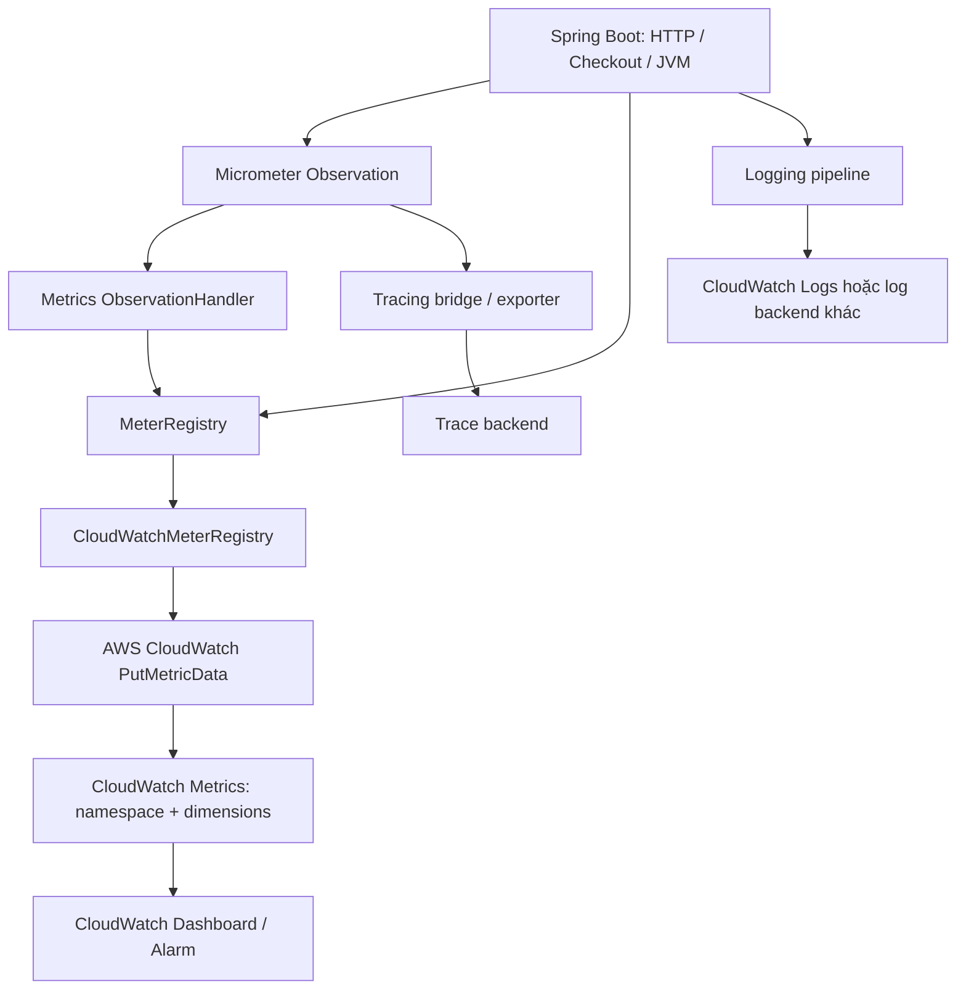
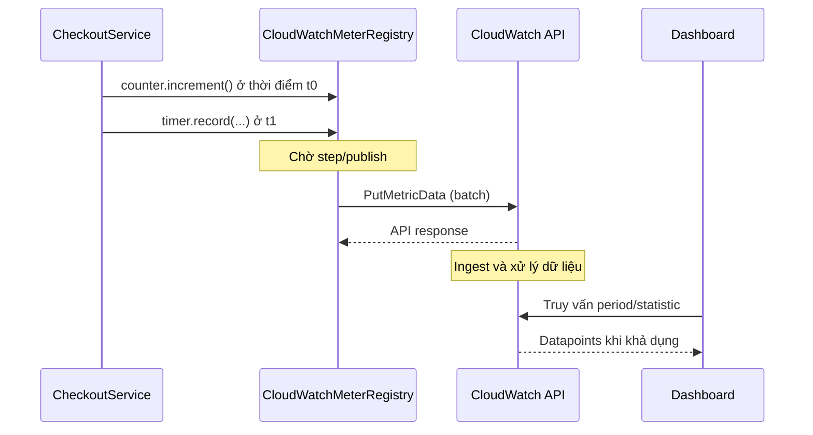
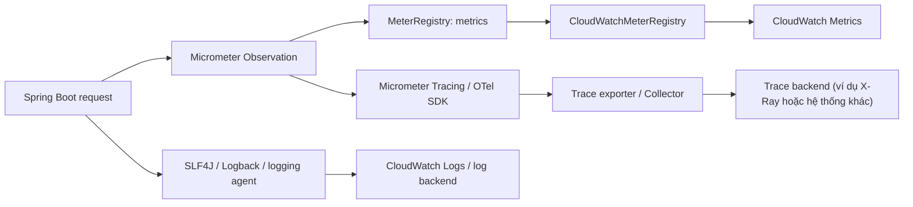

# CloudWatch registry: xuất Micrometer metrics từ Spring Boot lên Amazon CloudWatch

Một ứng dụng Spring Boot có thể ghi nhận `Counter`, `Timer` và `Gauge` bằng Micrometer, nhưng những giá trị trong `MeterRegistry` chỉ tồn tại trong tiến trình cho đến khi một hệ thống bên ngoài thu thập chúng. Khi triển khai trên AWS, một lựa chọn là **CloudWatch registry**: registry/exporter của Micrometer gửi custom metrics vào **Amazon CloudWatch** để tạo biểu đồ, dashboard và alarm mà không phải tự vận hành một Prometheus server.

Bài **CloudWatch registry** thuộc chương **Meter registry và exporter** trong module **SPRING_BOOT_OBSERVABILITY**. Phạm vi của module gồm Micrometer Observation, metrics, logs và distributed tracing, đặc biệt là context propagation, tag/cardinality, exporter, sampling và cách liên kết các tín hiệu để điều tra lỗi và độ trễ trong môi trường thực.

Mục tiêu của bài: hiểu CloudWatch registry hoạt động thế nào, cấu hình đúng dependency/namespace/region/credentials, biết **metric nào được xuất và khi nào**, kiểm soát dimensions để tránh tăng chi phí, đọc dữ liệu và alarm đúng nghĩa, kiểm thử tại các tầng, đồng thời phân biệt CloudWatch Metrics với CloudWatch Logs và distributed tracing.

## 1. CloudWatch registry là gì?

Trong Micrometer, `MeterRegistry` tiếp nhận các meter mà application hoặc instrumentation đăng ký, ví dụ:

- `Counter` đếm số lần thanh toán thất bại.
- `Timer` đo thời lượng của `checkout.payment.authorize`.
- `Gauge` đọc số tác vụ đang chờ trong queue.
- Các binder thu thập trạng thái JVM, CPU, HTTP server/client, connection pool hoặc cache, tùy ứng dụng.

**CloudWatch registry** là một implementation đưa metrics của Micrometer vào dịch vụ **Amazon CloudWatch Metrics**. Với AWS SDK for Java v2, module thường được sử dụng là `micrometer-registry-cloudwatch2`. Nó khác với `SimpleMeterRegistry` chạy trong bộ nhớ và `PrometheusMeterRegistry` xuất endpoint để Prometheus scrape.

| Khái niệm | Vai trò |
| --- | --- |
| `MeterRegistry` | Nơi application đăng ký và cập nhật các phép đo |
| `CloudWatchMeterRegistry` | Registry/exporter gửi các phép đo Micrometer tới CloudWatch |
| `CloudWatchAsyncClient` | AWS SDK client gọi CloudWatch API, sử dụng credentials và region đã cấu hình |
| **CloudWatch namespace** | Nhóm logic để tìm custom metrics, ví dụ `Checkout/Backend` |
| **Metric name** | Tên phép đo; có thể được ánh xạ từ tên Micrometer |
| **Dimensions** | Các cặp tên/giá trị tương đương nhóm tag của metric trong CloudWatch |
| **Statistic/period** | Cách CloudWatch lưu/truy vấn số liệu theo thời gian |
| **CloudWatch alarm** | Theo dõi metric hoặc biểu thức metric math và báo động theo điều kiện |

CloudWatch registry **không đồng nghĩa với Amazon CloudWatch Logs hoặc AWS X-Ray**. Nó chỉ giải quyết đường xuất **metrics**. Muốn truy vấn application logs hoặc distributed traces phải có logging/tracing pipeline riêng.

## 2. Kiến trúc: từ ứng dụng tới CloudWatch



Sơ đồ là cách nhìn khái quát: với ứng dụng dùng `CloudWatchMeterRegistry` làm registry chính, các meter có thể được đăng ký **trực tiếp trong registry này**, không cần đi qua hai registry độc lập. `MeterRegistry` trong sơ đồ là abstraction; `CloudWatchMeterRegistry` là một implementation cụ thể. Trong cấu hình nhiều registry, có thể có `CompositeMeterRegistry` chuyển phép đo tới nhiều đích.

Các bước chính:

1. Ứng dụng đăng ký meter hoặc tạo một observation.
2. Code nghiệp vụ hoặc metrics observation handler ghi `increment()`, `record(...)` hay cập nhật trạng thái gauge.
3. CloudWatch registry gom phép đo theo cơ chế xuất **định kỳ** của step registry.
4. AWS SDK sử dụng region và credentials phù hợp để gửi yêu cầu `PutMetricData` tới CloudWatch.
5. CloudWatch tiếp nhận metric thuộc namespace, tên và dimensions; dữ liệu có thể được xem trong Metrics, dashboard hoặc dùng làm alarm.

**`Counter.increment()` không đồng nghĩa dữ liệu xuất hiện tức thì trên CloudWatch.** Độ trễ đến từ chu kỳ xuất, lời gọi API, xử lý phía CloudWatch và nhịp refresh của dashboard.

## 3. Pull và push: CloudWatch khác Prometheus thế nào?

| Thuộc tính | CloudWatch registry | Prometheus registry |
| --- | --- | --- |
| Cách đưa dữ liệu ra ngoài | **Push** qua AWS CloudWatch API theo chu kỳ | **Pull**: Prometheus scrape endpoint |
| Cần `/actuator/prometheus`? | Không | Thường cần nếu dùng Spring Boot Actuator |
| Đích | AWS account, region và namespace | Prometheus server hoặc hệ thống scrape tương thích |
| Xác thực chính | AWS credentials/IAM permissions | Kết nối/authorization của scrape endpoint |
| Metadata phân nhóm | CloudWatch dimensions | Prometheus labels |
| Chu kỳ | Step/export interval và thời gian backend tiếp nhận | Scrape interval và nhịp truy vấn |
| Truy vấn thường gặp | CloudWatch console, metric math, Metrics Insights hoặc API | PromQL trên Prometheus-compatible backend |
| Chi phí nổi bật | Số custom metrics/dimensions, tần suất/API, alarms, retention theo biểu phí | Hạ tầng lưu trữ, ingest, series cardinality và truy vấn |

Một ứng dụng có thể xuất đồng thời sang nhiều backend nếu thực sự cần, nhưng điều này tăng chi phí, độ phức tạp và khả năng số liệu khác nhau do thời điểm thu thập, aggregation hoặc temporality. Không nên bật cả hai chỉ vì “càng nhiều registry càng tốt”.

## 4. Thêm dependency trong Spring Boot

Ví dụ Gradle cho một ứng dụng Spring Boot 3.x dùng dependency management của Spring Boot:

```groovy
dependencies {
    implementation 'org.springframework.boot:spring-boot-starter-actuator'
    runtimeOnly 'io.micrometer:micrometer-registry-cloudwatch2'

    testImplementation 'org.springframework.boot:spring-boot-starter-test'
}
```

Module `cloudwatch2` sử dụng AWS SDK v2, khác các integration CloudWatch đời cũ. Dùng BOM/dependency management tương thích với dòng Spring Boot đang chạy; **không tự ghép ngẫu nhiên** phiên bản Micrometer, AWS SDK và Actuator.

Trong các phiên bản Spring Boot có hỗ trợ CloudWatch metrics auto-configuration, việc thêm registry dependency cùng cấu hình hợp lệ có thể tạo `CloudWatchMeterRegistry` như bean và dùng nó để xuất metrics. Tuy nhiên, **điều kiện auto-configuration và cách tạo `CloudWatchAsyncClient` thay đổi theo version**. Nếu ứng dụng có custom beans hoặc không dùng auto-configuration, cần cấu hình client/registry một cách tường minh. Phải kiểm tra bean `MeterRegistry` thực tế thay vì chỉ nhìn dependency.

### Ví dụ cấu hình `application.yml`

```yaml
management:
  cloudwatch:
    metrics:
      export:
        enabled: true
        namespace: Checkout/Backend
        step: 1m
```

Ở các dòng Spring Boot 3.x thường dùng prefix `management.cloudwatch.metrics.export`. Cần đối chiếu tên property và điều kiện hỗ trợ trong phiên bản đang triển khai; một số phiên bản cũ sử dụng cách đặt cấu hình khác.

Ý nghĩa:

- `enabled`: cho phép đường export CloudWatch nếu registry và auto-configuration đã có đủ điều kiện.
- `namespace`: nhóm custom metrics theo ứng dụng/hệ thống. Tên ví dụ `Checkout/Backend` chỉ mang tính minh họa.
- `step`: chu kỳ tổng hợp/xuất dữ liệu, ở đây một phút. Không có nghĩa CloudWatch luôn hiển thị điểm dữ liệu chính xác mỗi 60 giây sau khi request xảy ra.

Không thiết lập một `step` quá ngắn chỉ để dashboard “nhanh hơn”: tăng tần suất API và chi phí/độ tải, đồng thời phải tương thích với độ phân giải và cách xử lý thống kê trong CloudWatch. Đọc tài liệu registry và giới hạn AWS hiện hành trước khi tối ưu.

## 5. Region, credentials và quyền IAM

Khác một registry trong bộ nhớ, CloudWatch registry phải **gọi AWS API**. Việc kết nối thành công phụ thuộc ít nhất ba yếu tố:

1. **AWS region**: nơi metric được gửi đến và cần được tìm trong Console/API.
2. **AWS credentials**: nhận dạng workload hoặc tài khoản được cấp quyền.
3. **IAM policy**: cho phép lời gọi `cloudwatch:PutMetricData` trong phạm vi phù hợp.

Ví dụ minh họa một IAM policy tối thiểu cho đường gửi custom metrics:

```json
{
  "Version": "2012-10-17",
  "Statement": [
    {
      "Effect": "Allow",
      "Action": "cloudwatch:PutMetricData",
      "Resource": "*",
      "Condition": {
        "StringEquals": {
          "cloudwatch:namespace": "Checkout/Backend"
        }
      }
    }
  ]
}
```

Đây là policy **minh họa** cho ghi metric. CloudWatch `PutMetricData` không sử dụng resource-level ARN theo cách nhiều API AWS khác thực hiện, vì thế thường thấy `Resource: "*"`; điều kiện namespace giúp thu hẹp phạm vi theo khả năng IAM của dịch vụ. Chính sách thật phải được review theo tổ chức, workload role, region, permission boundaries và yêu cầu audit.

**Không nhúng AWS access key hoặc secret key vào mã nguồn, `application.yml`, metric tags hay logs.** Ưu tiên cơ chế AWS SDK default credentials provider chain và định danh workload:

- IAM role cho EC2 khi ứng dụng chạy trên instance phù hợp.
- Task role cho Amazon ECS.
- Workload identity/role được cấu hình phù hợp cho EKS.
- Profile/SSO hay credentials ngắn hạn trong môi trường phát triển khi được tổ chức cho phép.

SDK có thể tìm region từ cấu hình môi trường, profile hoặc môi trường chạy; nếu không xác định được region, việc tạo client hoặc gửi request có thể thất bại. Trong môi trường nhiều region, phải ghi rõ **metric nằm ở region nào**, vì mở CloudWatch Console ở region khác sẽ không thấy metric đó.

### Tạo AWS SDK client tường minh khi cần

Nếu dự án tự cấu hình client hoặc cần điều chỉnh connection behavior, có thể tạo `CloudWatchAsyncClient`:

```java
import software.amazon.awssdk.regions.Region;
import software.amazon.awssdk.services.cloudwatch.CloudWatchAsyncClient;

CloudWatchAsyncClient client = CloudWatchAsyncClient.builder()
    .region(Region.AP_SOUTHEAST_1)
    .build();
```

Đây là đoạn minh họa việc xây AWS SDK client, **không phải một cấu hình Spring Boot đầy đủ**. Vùng `ap-southeast-1` được chọn chỉ làm ví dụ; workload thật phải dùng region được phê duyệt. AWS SDK sẽ dùng provider chain cho credentials nếu không chỉ định provider khác. Client cần được quản lý vòng đời/đóng đúng cách khi ứng dụng kết thúc; không tạo client mới cho mỗi request hoặc mỗi phép đo.

Nếu Spring Boot đã quản lý client và registry, không nên thêm một bộ bean thứ hai không cần thiết; dễ dẫn tới trùng exporter hoặc khó xác định metric được gửi bằng credentials nào.

## 6. Namespace, metric name và dimensions

CloudWatch nhận diện custom metrics thông qua **namespace**, **metric name** và **tập dimensions**; với những tham số khác như unit và thời điểm đo, hệ thống quyết định cách lưu/truy vấn các datapoints. Trong Micrometer, tags của meter thường được ánh xạ thành CloudWatch dimensions.

Ví dụ:

```text
Namespace: Checkout/Backend
Metric: checkout.orders.processed
Dimensions:
  service = checkout-service
  environment = production
  outcome = accepted
```

Nếu `outcome` thay thành `rejected`, CloudWatch xem đó là một **chuỗi metrics khác** theo bộ dimensions. Nếu `service` hoặc `environment` thay đổi, lại có tổ hợp riêng. **Dimension không phải tham số tìm kiếm tùy ý miễn phí**; mỗi tổ hợp mới có thể làm tăng số custom metrics và chi phí.

### Thiết kế namespace

Namespace nên đủ ổn định để tìm kiếm và phân quyền, ví dụ một namespace theo hệ thống hoặc nhóm sản phẩm. Tránh:

- Đưa request ID hoặc ngày/giờ tùy ý vào tên namespace.
- Đổi namespace mỗi lần release nếu không có mục đích và kế hoạch migration.
- Dùng cùng namespace cho các ứng dụng nhưng trùng metric name với ý nghĩa/đơn vị khác nhau.
- Giả định namespace tự liên kết metrics với CloudWatch Logs hoặc traces.

Tên `Checkout/Backend` là một convention nội bộ, không phải tên bắt buộc của AWS hay Micrometer. Chọn tên từ chính sách naming/ownership của tổ chức.

## 7. Cardinality: tác động lớn tới CloudWatch cost

Trong Prometheus, nhiều labels làm tăng số time series; trong CloudWatch, nhiều dimensions cũng làm tăng số tổ hợp custom metrics. Giả sử `checkout.orders.processed` có:

- `outcome`: 3 giá trị;
- `channel`: 4 giá trị;
- `region`: 5 giá trị;
- `service`: 2 giá trị.

Số tổ hợp tiềm năng:

\[
3 \times 4 \times 5 \times 2 = 120
\]

Nếu thêm `orderId` với 100.000 giá trị, số tổ hợp lý thuyết lên tới **12 triệu**; số series thực tạo ra phụ thuộc dữ liệu, nhưng nguy cơ chi phí và sức tải rất rõ ràng. Ngoài số lượng dimensions, CloudWatch còn có **quota và giới hạn API**; cần kiểm tra tài liệu AWS đang áp dụng. Đừng chỉ dựa vào việc một request `PutMetricData` trả thành công để kết luận thiết kế metric đã tối ưu.

Nên dùng:

| Dimension | Ví dụ | Đánh giá |
| --- | --- | --- |
| `environment` | `prod`, `staging` | Tập giá trị nhỏ, hữu ích |
| `service` | `checkout-service` | Ổn định, giúp xác định nguồn |
| `outcome` | `accepted`, `rejected`, `error` | Tập hữu hạn |
| `channel` | `web`, `mobile`, `partner` | Hữu ích nếu có hợp đồng |
| `http.route` | `/orders/{id}` | Tốt khi là route template |
| `orderId` | `ORD-927135` | Không phù hợp: giá trị gần như duy nhất |
| `customerEmail` | `person@example.test` | Không phù hợp: riêng tư và cardinality cao |
| `traceId` | Một ID riêng mỗi request | Không phù hợp với metric dimensions |

Không đặt API token, Authorization header, cookie, raw URL chứa PII hoặc exception message vào metric name/dimensions. Chuyển `orderId` sang hash không tự giảm cardinality; hash duy nhất vẫn là một giá trị riêng.

### Common tags có thể khuếch đại số metrics

Ví dụ gắn tags chung tại Spring Boot:

```yaml
management:
  metrics:
    tags:
      service: checkout-service
      environment: staging
```

Các common tags có thể giúp định tuyến và lọc dashboard, nhưng sẽ áp dụng rộng lên nhiều meter. Không đưa dữ liệu theo từng người dùng hoặc từng request vào common tags. Đảm bảo cùng một dimension không được khai báo trùng với giá trị mâu thuẫn tại binder/custom instrumentation.

## 8. Thực hành: ghi custom metrics trong Spring Boot

Ví dụ `CheckoutMetrics` dùng một counter theo outcome và một Timer đo thời lượng xử lý. Các meter được tạo qua `MeterRegistry` do Spring inject; nếu registry CloudWatch được cấu hình đúng, dữ liệu có thể được xuất định kỳ.

```java
import io.micrometer.core.instrument.Counter;
import io.micrometer.core.instrument.MeterRegistry;
import io.micrometer.core.instrument.Timer;
import java.util.concurrent.TimeUnit;
import org.springframework.stereotype.Service;

@Service
public final class CheckoutMetrics {
    private final Counter accepted;
    private final Counter rejected;
    private final Counter error;
    private final Timer duration;

    public CheckoutMetrics(MeterRegistry registry) {
        accepted = counter(registry, "accepted");
        rejected = counter(registry, "rejected");
        error = counter(registry, "error");

        duration = Timer.builder("checkout.order.duration")
            .description("Duration of one checkout operation")
            .register(registry);
    }

    private static Counter counter(MeterRegistry registry, String outcome) {
        return Counter.builder("checkout.orders.processed")
            .description("Completed checkout operations")
            .tag("outcome", outcome)
            .register(registry);
    }

    public void recordAccepted() {
        accepted.increment();
    }

    public void recordRejected() {
        rejected.increment();
    }

    public void recordError() {
        error.increment();
    }

    public void recordDuration(long elapsedNanos) {
        duration.record(elapsedNanos, TimeUnit.NANOSECONDS);
    }
}
```

Service nghiệp vụ cần gọi đúng phương thức **một lần khi kết quả logic được xác định**, và dùng đồng hồ thời gian phù hợp để đo duration. Đoạn code không tự xử lý retry, lỗi hoặc giao dịch; đó là trách nhiệm của tầng nghiệp vụ. Nếu nghiệp vụ retry HTTP nhiều lần, counter này nên đếm **kết quả cuối cùng** nếu tên metric `orders.processed` mang ý nghĩa đó.

**Không cần gọi CloudWatch API trực tiếp trong service**. Việc đăng ký/record thông qua `MeterRegistry` giữ code nghiệp vụ độc lập với AWS. Khi chuyển backend sang Prometheus hoặc đơn vị giám sát khác, phần lớn instrumentation không phải viết lại.

Nếu ứng dụng đã tạo một observation `checkout.order` và dùng metrics observation handler để ghi Timer, hãy tránh ghi thêm một Timer cùng ý nghĩa ở service, trừ khi muốn một phép đo độc lập thật sự. Trùng phép đo dễ gây double-count và khiến dashboard sai.

## 9. Observation và CloudWatch metrics liên hệ thế nào?

Micrometer Observation có lifecycle riêng: `start`, có thể `openScope`, báo `error`/`event` rồi `stop`. Một metrics observation handler chuyển thời lượng và low-cardinality key-values của observation thành metrics.

```java
import io.micrometer.observation.Observation;
import io.micrometer.observation.ObservationRegistry;

// Giả sử registry đã được Spring cung cấp và handler metrics được cấu hình.
Observation.createNotStarted("checkout.payment.authorize", observationRegistry)
    .lowCardinalityKeyValue("operation", "authorize")
    .observe(() -> paymentAction.run());
```

Đoạn này minh họa API; `observationRegistry` và `paymentAction` phải được định nghĩa trong code thực. Để observation thành Timer, cần metrics handler gắn với registry tương ứng. **Tạo Observation không tự đảm bảo CloudWatch nhận metric** nếu handler, MeterRegistry hoặc exporter chưa được cấu hình.

### Vì sao không dùng high-cardinality tag trong metric?

Observation có thể mang **high-cardinality key-values** để hỗ trợ tracing tùy handler, nhưng metrics được thiết kế để tổng hợp theo các dimension hữu hạn. Một giá trị như `orderId` dù hữu ích cho điều tra một trace vẫn **không nên trở thành CloudWatch dimension**. Cần bảo vệ dữ liệu nhạy cảm ở cả metrics, logs và traces, không chỉ ở bước export CloudWatch.

## 10. Step registry: hiểu đúng thời gian và số đếm

CloudWatch registry thuộc nhóm **step-based exporters**: các giá trị được tập hợp theo chu kỳ rồi gửi. Điều này có ý nghĩa vận hành:

1. Một counter được tăng trong code **không lập tức xuất hiện** trên CloudWatch.
2. Dữ liệu theo từng khoảng thời gian có thể được xuất dưới dạng phép đo/statistic do registry tạo; không mặc định đó là counter tích lũy suốt vòng đời JVM.
3. Nếu cấu hình step là một phút, một điểm có thể đại diện cho hoạt động trong khoảng đó, nhưng thời điểm CloudWatch tiếp nhận và hiển thị có thể trễ hơn.
4. Lần xuất bị lỗi có thể dẫn tới dữ liệu thiếu hoặc bị xử lý theo cơ chế retry/buffer của thư viện; không nên tự suy chắc rằng mọi phép đo sẽ được gửi lại thành công.
5. Khi instance tắt đột ngột, phép đo nằm trong khoảng step chưa được xuất có thể mất; cần xét cơ chế shutdown/flush thực tế và tính chất metrics không phải nguồn dữ liệu giao dịch bền vững.



Đừng so sánh trực tiếp `Counter.count()` trong `SimpleMeterRegistry` với giá trị `Sum` trên CloudWatch mà không làm rõ **temporality** và chu kỳ. Counter ở registry thử nghiệm có thể tích lũy, trong khi số liệu CloudWatch nhận từ step registry có thể là phần tăng trong một khoảng xuất. Tên meter giống nhau không có nghĩa cả hai biểu diễn cùng một snapshot.

### Batch, API limits và throttling

`CloudWatchMeterRegistry` gom dữ liệu thành những lô gửi tới CloudWatch. Số lượng datapoints, dimensions, dung lượng request và giới hạn API chịu **quota AWS hiện hành** và implementation của registry. Khi số meter lớn, cần:

- Giữ cardinality thấp trước khi tính chuyện tăng batch size.
- Giám sát lỗi AWS SDK, request throttling, timeout và thời lượng publish.
- Xem giới hạn kích thước request, số metric datum và rate limit theo account/region.
- Điều chỉnh step/batching hợp lý, nhưng không giả định chỉ cần tăng batch size là hết lỗi.
- Thiết kế cảnh báo cho cả pipeline xuất dữ liệu, không chỉ cho lỗi nghiệp vụ.

## 11. Xem metrics trong CloudWatch Console và CLI

Một quy trình kiểm tra sau triển khai:

1. Chạy một thao tác nghiệp vụ có kiểm soát để ghi metric như `checkout.orders.processed`.
2. Đợi ít nhất một chu kỳ export và thời gian xử lý của CloudWatch; không yêu cầu metric xuất hiện tức thì.
3. Mở CloudWatch Console ở **đúng AWS account và region**.
4. Vào **Metrics**, tìm namespace `Checkout/Backend` và metric theo dimensions hiện có.
5. Chọn một metric, period và statistic phù hợp, ví dụ `Sum` cho số sự kiện được ghi trong một khoảng.
6. Nếu không thấy dữ liệu, xem logs export/AWS SDK và quyền `PutMetricData` trước khi kết luận instrumentation không hoạt động.

Ví dụ AWS CLI, với region minh họa `ap-southeast-1`:

```bash
aws cloudwatch list-metrics \
  --namespace "Checkout/Backend" \
  --region ap-southeast-1
```

Khi số metrics nhiều, có thể thêm `--metric-name` nếu đã biết tên **CloudWatch thực tế**. Không giả định tên luôn giống y nguyên tên Micrometer sau khi exporter chuyển đổi hoặc thêm hậu tố thống kê.

`list-metrics` chủ yếu để khám phá tên và dimensions; nó không thay thế truy vấn datapoints theo **time range, period, statistic**. Dữ liệu mới có thể chưa được liệt kê ngay, và những metric lâu không có dữ liệu có thể không hiện trong một danh sách khám phá thông thường. Khi cần điều tra sâu, dùng `GetMetricData`/`GetMetricStatistics` hoặc console với tên và dimensions phù hợp.

### Chọn statistic đúng nghĩa

Một số phép diễn giải điển hình:

| Phép đo | Statistic thường hữu ích | Cần cẩn thận |
| --- | --- | --- |
| Số checkout được ghi trong interval | `Sum` của phép đo count tương ứng | Xác nhận registry đang gửi số đếm theo interval hay cumulative |
| Tốc độ checkout mỗi giây | Số count trong khoảng / số giây của khoảng | Không dùng giá trị tích lũy làm RPS trực tiếp |
| Duration trung bình | Tổng duration chia số samples, nếu exporter cung cấp đủ thống kê | Kiểm tra đơn vị: giây/mili giây |
| CPU usage hoặc queue depth | `Average`/`Maximum` tùy nguồn và mục đích | Gauge có thể thay đổi giữa các lần xuất |
| Tỷ lệ lỗi | Số lỗi / tổng request theo cùng period và dimensions | Mẫu số phải cùng định nghĩa và đủ dữ liệu |
| p95 latency | Phân bố/percentiles nếu pipeline có hỗ trợ thích hợp | Không suy p95 từ một `Average` hoặc `Maximum` |

CloudWatch có metric statistics và percentile-related capabilities, nhưng **không nên mặc định** mọi Micrometer Timer đều được export dưới dạng phân bố đủ để tính p95/p99 chính xác. Đặc điểm statistic set, histogram và giới hạn percentile phụ thuộc registry adapter và CloudWatch API. Hãy kiểm tra trực tiếp dữ liệu xuất và khả năng query trước khi xây SLO.

## 12. Xây dashboard và alarm có ý nghĩa

Dashboard chỉ hữu ích khi câu hỏi rõ ràng. Với checkout:

| Mục tiêu | Metric/biểu thức gợi ý | Ý nghĩa |
| --- | --- | --- |
| Theo dõi lưu lượng | `checkout.orders.processed` theo environment/outcome | Có bao nhiêu checkout được xử lý trong period |
| Theo dõi thất bại | `outcome=error` và tỷ lệ error / tổng | Có xu hướng lỗi không? |
| Theo dõi độ trễ | Duration của `checkout.order.duration` theo statistic phù hợp | Các request có chậm hơn không? |
| Theo dõi tải nền | JVM CPU/heap/threads hoặc queue metric | Có dấu hiệu nghẽn tài nguyên không? |
| Theo dõi chất lượng pipeline | Dữ liệu export có liên tục, có throttling/lỗi không? | CloudWatch thiếu dữ liệu vì app hay vì exporter? |

Một **CloudWatch alarm** thường gồm metric hoặc expression, period, threshold, evaluation periods và cách xử lý missing data. Ví dụ: cảnh báo khi tỷ lệ lỗi checkout vượt ngưỡng trong nhiều period liên tiếp, hoặc khi request count bất ngờ không còn dữ liệu trong lúc ứng dụng đáng lẽ còn traffic.

Khi thiết kế alarm:

- Không dùng một số đếm tích lũy làm cảnh báo tốc độ nếu chưa chuyển thành count theo period/rate.
- Chọn mẫu số tương ứng cùng route, environment và khoảng thời gian.
- Xác định **missing data** là thiếu traffic hợp lệ, service down hay pipeline export đang lỗi.
- Phân biệt response HTTP 4xx/5xx với outcome nghiệp vụ; một `409 Conflict` có thể là kết quả dự kiến.
- Sử dụng threshold có căn cứ từ SLO, baseline và lưu lượng thực, không chọn ngẫu nhiên.
- Kiểm tra chi phí alarm/dashboard và số series dimensions.

Thời gian CloudWatch đánh giá alarm có thể trễ hơn một bước ghi counter do step, ingest và period. Không nên kỳ vọng cảnh báo “ngay lập tức” đối với một exporter định kỳ 1 phút.

## 13. CloudWatch Metrics, CloudWatch Logs và distributed tracing

Tên sản phẩm CloudWatch thường khiến người mới học tưởng rằng xuất metrics vào CloudWatch sẽ tự ghi logs hoặc trace. Trên thực tế đây là các đường dữ liệu **tách biệt**:



**Metrics** cho biết mức độ ảnh hưởng: bao nhiêu request chậm, error count, throughput và mức dùng tài nguyên. **Traces** cho biết từng request đi qua những span nào và phần nào chậm. **Logs** ghi sự kiện và mã lỗi có ngữ cảnh.

Khi dùng tracing bridge và context propagation, `traceId`/`spanId` có thể giúp liên kết log với span trong một hệ thống truy vấn phù hợp. Nhưng:

1. **CloudWatch registry không tự tạo hoặc lưu distributed trace**.
2. **AWS X-Ray/OTel tracing** phải được cấu hình bằng tracing stack và exporter tương ứng, không chỉ bằng `micrometer-registry-cloudwatch2`.
3. **Sampling** có thể làm một request đóng góp metrics nhưng không có trace lưu trữ.
4. **Context propagation** qua HTTP client/server, async executor và messaging cần instrumentation và cơ chế inject/extract thích hợp.
5. Không gắn `traceId` thành CloudWatch dimension: đó là dữ liệu có cardinality cực cao.
6. Không ghi credentials, email, body hoặc access token vào metric dimensions, log fields, trace attributes hay baggage.

Một số hệ thống hỗ trợ liên kết metrics/logs/traces qua dashboard hoặc exemplars, nhưng đó là chức năng của các thành phần cụ thể và cấu hình end-to-end; không phải tính năng mà mọi CloudWatch metric tự có.

## 14. Kiểm thử: registry trong bộ nhớ trước, AWS sau

Để xác minh nghiệp vụ cập nhật meter, **không cần gọi AWS** trong mọi unit test. Dùng `SimpleMeterRegistry` để kiểm tra tên, tags và số đếm:

```java
import io.micrometer.core.instrument.Counter;
import io.micrometer.core.instrument.simple.SimpleMeterRegistry;
import org.junit.jupiter.api.Test;
import static org.junit.jupiter.api.Assertions.*;

class CheckoutMetricsTest {
    @Test
    void recordsOutcomeWithoutAws() {
        try (SimpleMeterRegistry meters = new SimpleMeterRegistry()) {
            CheckoutMetrics checkout = new CheckoutMetrics(meters);

            checkout.recordAccepted();
            checkout.recordAccepted();
            checkout.recordError();

            Counter accepted = meters.find("checkout.orders.processed")
                .tag("outcome", "accepted").counter();
            Counter error = meters.find("checkout.orders.processed")
                .tag("outcome", "error").counter();

            assertNotNull(accepted);
            assertNotNull(error);
            assertEquals(2.0, accepted.count());
            assertEquals(1.0, error.count());
        }
    }
}
```

Test chứng minh instrumentation tạo và cập nhật đúng Counter trong `MeterRegistry`. Nó **không chứng minh** CloudWatch auto-configuration hoạt động, SDK có credentials hoặc datapoints đã đến AWS.

Các tầng test nên được tách:

| Tầng | Mục tiêu | Cách kiểm tra |
| --- | --- | --- |
| Unit test | Metric name, outcome, tags và count/duration | `SimpleMeterRegistry` |
| Spring integration test | Registry được inject đúng, cấu hình namespace/step và beans hợp lệ | Spring test context, inspect registry/config |
| Exporter contract test | Mapping sang `PutMetricData`, batch, namespace/dimensions | Mock/fake AWS SDK client hoặc stub phù hợp |
| Staging integration test | IAM, region, API kết nối và dữ liệu xuất hiện trong CloudWatch | AWS sandbox/account có quyền hạn và giám sát chi phí |
| Operational test | Dashboard, alarms, missing data và troubleshooting | Kiểm chứng theo cửa sổ thời gian/period thật |

Với exporter test không nên chỉ dùng `Thread.sleep(...)` rồi hy vọng một datapoint hiện trong CloudWatch. Hãy thiết kế test có thời gian chờ có giới hạn, điều kiện quan sát rõ, namespace test được phân quyền, thời gian dọn dẹp và bảo vệ tránh tạo nhiều custom metrics. Không gửi dữ liệu thật của khách hàng vào môi trường thử.

## 15. Sự cố thường gặp và cách chẩn đoán

| Hiện tượng | Nguyên nhân có thể | Hướng xử lý |
| --- | --- | --- |
| `SimpleMeterRegistry` có dữ liệu, CloudWatch không có | Registry CloudWatch chưa được tạo/đăng ký | Kiểm tra dependency và auto-configuration |
| `AccessDenied` với `PutMetricData` | Role thiếu quyền hoặc namespace condition không khớp | Kiểm tra IAM role thực và policy |
| Không thấy metric trong Console | Chọn sai AWS account/region/namespace | Xác minh bằng AWS CLI và cấu hình client |
| Chưa thấy sau một `increment()` | Chưa đến chu kỳ step hoặc CloudWatch ingest trễ | Kiểm tra step, logs publish và thời gian chờ |
| Không có region/credentials | Default provider chain không tìm được cấu hình | Dùng workload role và region phù hợp |
| Metrics xuất không đều hoặc có khoảng trống | Throttling, mất mạng, quota, lỗi exporter hoặc app restart | Xem SDK/exporter errors, request limits và restart |
| Chi phí custom metrics tăng nhanh | Dimension có ID động, host/pod quá chi tiết hoặc histogram quá rộng | Rà soát cardinality, metric names và tags |
| Giá trị CloudWatch khác `counter.count()` trong test | Step temporality/statistic khác cumulative snapshot | Đối chiếu đúng period, Sum và dữ liệu xuất |
| Có metric nhưng p95 không có | Exporter không xuất histogram/percentile tương ứng | Xác minh metric mapping và khả năng CloudWatch |
| Logs có nhưng dashboard Metrics trống | Logging pipeline khác metrics pipeline | Kiểm tra `CloudWatchMeterRegistry` riêng |
| Metrics có nhưng traces không có | Thiếu tracing bridge/exporter, sampling hoặc propagation lỗi | Điều tra tracing pipeline độc lập |
| Alarm báo `INSUFFICIENT_DATA` | Missing datapoints, period không phù hợp hoặc không có traffic | Kiểm tra cách alarm xử lý missing data |

### Quy trình “đi từ gần nguồn đến xa”

1. **Code:** request hoặc nghiệp vụ có thực sự gọi `increment()`/`record(...)` không?
2. **Registry:** đúng `MeterRegistry` có meter, tên và tags mong đợi không?
3. **Spring configuration:** CloudWatch registry có được tạo, namespace/step/region đúng không?
4. **AWS SDK/IAM:** API `PutMetricData` có thành công, có bị throttling, timeout hay AccessDenied không?
5. **CloudWatch:** đang tra đúng namespace, dimensions, account, region và khoảng thời gian không?
6. **Dashboard/Alarm:** statistic, period, metric math và missing data policy có hợp lý không?
7. **Sự cố nghiệp vụ:** đối chiếu metrics với logs/traces để xác định root cause, không coi lỗi exporter là lỗi checkout.

## 16. Case study: lỗi thanh toán tăng nhưng dashboard AWS không báo

**Bối cảnh giả định:** checkout-service chạy trên ECS, sau deployment số lỗi thanh toán tăng đột biến. Application logs có nhiều sự kiện `payment.authorization.failed`, nhưng CloudWatch dashboard hiển thị `checkout.orders.processed{outcome=error}` gần như bằng 0.

Cách điều tra:

**Bước 1 — Kiểm tra định nghĩa metric.** `recordError()` được gọi khi nào? Nếu code chỉ đếm lỗi cuối cùng sau retry, số đếm thấp hơn số HTTP attempts bị 503 là hợp lý. Nếu error ở logs bao gồm retry trung gian, hai tín hiệu đang đo **hai khái niệm khác nhau**.

**Bước 2 — Đọc registry tại ứng dụng.** Nếu error Counter tăng trong `MeterRegistry`, instrumentation về cơ bản hoạt động. Nếu không, kiểm tra nhánh catch, exception mapping và việc có dùng đúng registry.

**Bước 3 — Kiểm tra exporter.** Tìm lỗi `PutMetricData`, namespace `Checkout/Backend` và IAM task role. Nếu vừa đổi role hoặc region, dữ liệu có thể được gửi sang vị trí khác hoặc bị từ chối.

**Bước 4 — So sánh period/statistic.** Với step 1 phút, số count theo khoảng không phải counter tích lũy từ lúc app chạy. Nếu dashboard query sai statistic hoặc có bộ lọc dimensions khác, có thể tạo biểu đồ trống/sai mà không phải mất dữ liệu.

**Bước 5 — Phân tích nguyên nhân từ tracing và logs.** Mở các traces đã được sample (nếu tracing pipeline đã thiết lập) để xem payment downstream timeout hay trả 503; dùng trace IDs trong logs an toàn để đối chiếu retry/backoff. Nếu trace không tồn tại, kiểm tra sampling/exporter/propagation, không đưa traceId vào metric dimensions để “sửa”.

**Bước 6 — Khắc phục và xác nhận.** Sửa exporter/role hoặc code đo theo bằng chứng, sau đó kiểm tra error count, thời lượng và alarm trên cùng period. Giới hạn quyền AWS, tránh tạo dimensions tùy biến hoặc log secrets trong quá trình debug.

Kết luận: dashboard trống có thể do **ngữ nghĩa số đếm**, **đường export**, **AWS identity/region** hoặc **truy vấn**; cần phân biệt trước khi kết luận payment-service không lỗi.

## 17. Bài tập tự kiểm tra

**Bài 1.** Một service có `Counter` tăng liên tục, nhưng CloudWatch Console không thấy metric ngay sau một request. Điều này có chắc là bug không?

*Gợi ý:* Không. CloudWatch registry xuất theo step, AWS ingest và console có thể trễ. Kiểm tra registry, export logs, chu kỳ và account/region.

**Bài 2.** Chỉ thêm dependency `micrometer-registry-cloudwatch2` có đủ để có distributed traces trong AWS X-Ray không?

*Gợi ý:* Không. CloudWatch metrics registry không phải tracing bridge hoặc exporter. Cần tracing instrumentation, sampler, exporter và context propagation riêng.

**Bài 3.** Team đưa `customerId` thành CloudWatch dimension để tìm mọi lỗi theo từng khách hàng. Vấn đề gì có thể xảy ra?

*Gợi ý:* Cardinality và chi phí custom metrics tăng mạnh; có nguy cơ riêng tư. Dùng nhãn hữu hạn và hệ thống correlation/tra cứu nghiệp vụ được phân quyền.

**Bài 4.** Container có workload role nhưng `PutMetricData` trả `AccessDenied`. Cần kiểm tra gì?

*Gợi ý:* IAM action, role thực tế mà SDK sử dụng, namespace condition, permission boundaries và account/region; không gắn long-lived access key vào ứng dụng để né lỗi.

**Bài 5.** Counter trong `SimpleMeterRegistry` báo `1000`, còn CloudWatch Sum theo một phút là `45`. Có nhất thiết sai?

*Gợi ý:* Không. Registry thử nghiệm có thể đếm tích lũy, CloudWatch step thống kê sự kiện theo interval. Cần thống nhất temporality, period và các lần xuất.

**Bài 6.** Bạn muốn cảnh báo p95 latency cho checkout bằng CloudWatch registry. Vì sao không nên dùng luôn `Average`?

*Gợi ý:* Average không phải p95. Phải kiểm tra dữ liệu phân bố/percentile mà adapter và CloudWatch thực sự hỗ trợ; có thể cần giải pháp histogram/SLO riêng.

**Bài 7.** Metrics xuất thành công nhưng logs không nằm ở CloudWatch Logs. CloudWatch registry có lỗi không?

*Gợi ý:* Không nhất thiết. Logging pipeline độc lập; cần cấu hình logging agent/driver/collector và quyền gửi logs riêng.

**Bài 8.** CloudWatch alarm thiếu dữ liệu vào ban đêm khi lưu lượng bằng 0. Phải xử lý thế nào?

*Gợi ý:* Phân biệt không có traffic hợp lệ và exporter lỗi, chọn missing-data policy, period và metric phù hợp thay vì coi mọi khoảng trống là outage.

## 18. Ghi nhớ

- **`CloudWatchMeterRegistry`** thuộc đường **Micrometer Metrics → Amazon CloudWatch Metrics**, thường qua module `micrometer-registry-cloudwatch2` dùng AWS SDK v2.
- CloudWatch là **push/step exporter**: `increment()` trong JVM không tương đương một datapoint hiển thị tức thì. Phải hiểu step, API ingestion, statistic và period.
- **Namespace, metric name, dimensions, region và AWS identity** là các thông tin then chốt để xuất và tra cứu metric chính xác.
- Dùng **IAM workload role** và quyền `cloudwatch:PutMetricData` được giới hạn phù hợp; không nhúng AWS secrets vào code/config/logs.
- **Dimension cardinality quyết định chi phí**. Không dùng orderId, customerId, traceId, raw URL hoặc PII làm metric dimensions.
- **CloudWatch Metrics khác CloudWatch Logs và tracing/X-Ray**. Micrometer Observation có thể cung cấp nhiều tín hiệu, nhưng logs, tracing bridge, sampling, exporter và context propagation cần cấu hình riêng.
- Kiểm thử instrumentation bằng `SimpleMeterRegistry`, rồi kiểm tra CloudWatch exporter/IAM/API trong môi trường kiểm soát; debug theo đường **code → registry → export → AWS → dashboard/alarm**.
