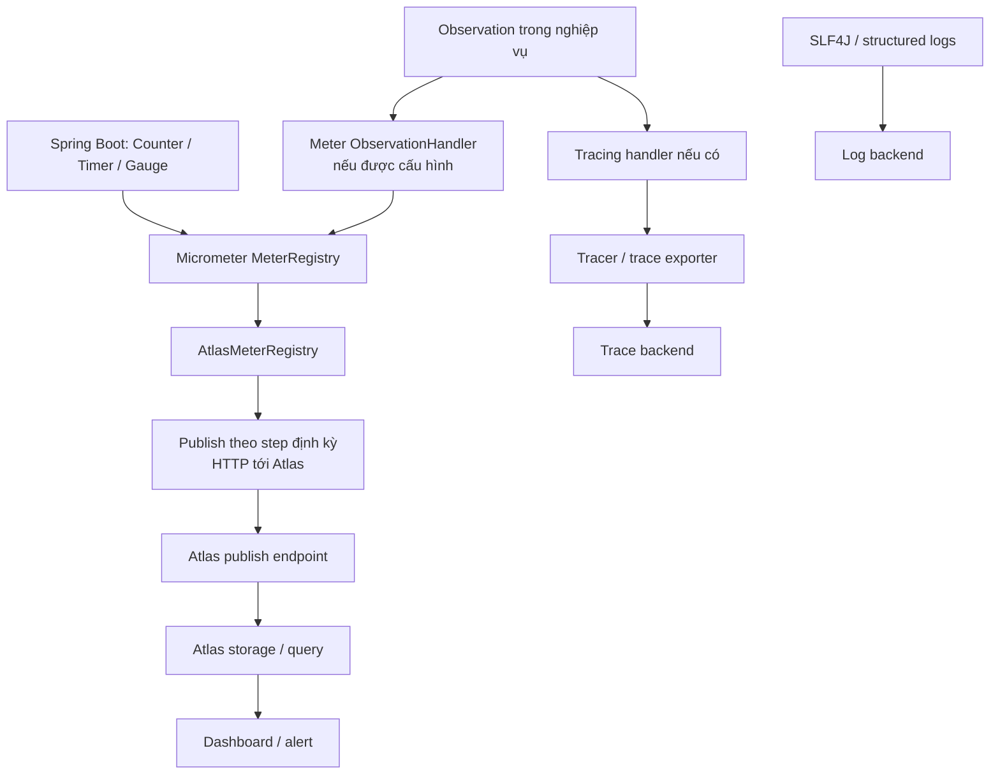
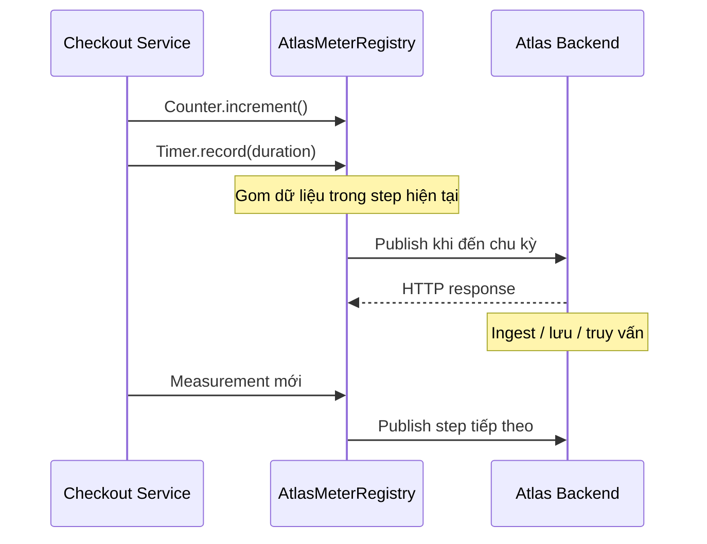

# Atlas registry trong Spring Boot và Micrometer

Một ứng dụng Spring Boot đã ghi nhận số lần thanh toán, độ trễ gọi đối tác và thông số JVM bằng Micrometer. Các meter này tồn tại trong bộ nhớ ứng dụng, nhưng làm sao chúng trở thành biểu đồ và cảnh báo trên hệ thống giám sát tập trung? Một lựa chọn là **Netflix Atlas** — hệ thống lưu trữ và truy vấn time series theo các chiều tag. Micrometer cung cấp **Atlas registry** để chuyển measurements trong ứng dụng sang Atlas theo cơ chế **push định kỳ**.

Bài **Atlas registry** thuộc chương **Meter registry và exporter** của module **SPRING_BOOT_OBSERVABILITY**. Module tập trung thiết lập observability cho Spring Boot bằng Micrometer Observation, metrics, logs và distributed tracing; hiểu propagation ngữ cảnh, tag/cardinality, exporter, sampling và liên kết tín hiệu để điều tra lỗi, độ trễ và hành vi ứng dụng trong môi trường thực. Bài này hướng dẫn cách hiểu, cấu hình, kiểm tra và vận hành **`AtlasMeterRegistry`**, đồng thời phân biệt nhiệm vụ xuất metrics của nó với logging và tracing.

## 1. Mục tiêu học tập

Sau bài học, bạn có thể:

- Giải thích Atlas là gì và vai trò của `AtlasMeterRegistry` trong Micrometer.
- Mô tả luồng **meter → registry → bước xuất định kỳ → Atlas** và phân biệt push với Prometheus pull.
- Cấu hình Spring Boot để gửi metrics đến một Atlas endpoint đã được triển khai.
- Tạo Counter và Timer dùng `MeterRegistry` mà không phụ thuộc trực tiếp vào backend cụ thể.
- Hiểu tham số `step`, độ trễ cập nhật, hành vi sau restart và giới hạn khi ứng dụng chưa gửi được metrics.
- Thiết kế tags/cardinality an toàn khi xuất nhiều meter từ nhiều instance.
- Phân biệt Atlas metrics exporter với Micrometer Observation, tracing bridge, trace exporter và logs.
- Chẩn đoán những tình huống có meter trong Actuator nhưng không thấy dữ liệu ở Atlas.

## 2. Netflix Atlas và AtlasMeterRegistry

**Netflix Atlas** là một nền tảng lưu trữ, truy vấn và phân tích **dimensional time-series metrics**. Thay vì chỉ nhìn một giá trị của metric, người vận hành có thể lọc và tổng hợp theo các nhãn như application, environment, region hoặc outcome.

**Micrometer** cung cấp API thống nhất để ứng dụng ghi Counter, Timer, Gauge và các meter khác. `MeterRegistry` là nơi các meter được đăng ký và nhận measurements. `AtlasMeterRegistry` là implementation dành cho Atlas: nó chuyển dữ liệu của các meter sang định dạng/phương thức gửi phù hợp với hệ thống Atlas.

| Thành phần | Trách nhiệm | Ví dụ |
| --- | --- | --- |
| `Counter` / `Timer` / `Gauge` | Mô tả và ghi nhận số liệu trong ứng dụng | Số checkout, độ trễ partner |
| `MeterRegistry` | Quản lý meter và tags | Registry được inject vào service |
| **`AtlasMeterRegistry`** | Thu thập, chuẩn bị và đẩy số liệu đến Atlas | Gửi dữ liệu theo chu kỳ step |
| Atlas publish endpoint | Nhận dữ liệu metrics do registry gửi | `/api/v1/publish` ở máy chủ Atlas |
| Atlas storage/query | Lưu và truy vấn các time series theo tag | Dashboard, biểu đồ và phân tích |
| `ObservationRegistry` | Điều phối vòng đời Observation qua handlers | Quan sát nghiệp vụ checkout |

**Atlas registry không tự triển khai Atlas server.** Thêm dependency `micrometer-registry-atlas` chỉ cung cấp thành phần phát metrics ở phía ứng dụng. Bạn vẫn cần Atlas deployment, publish endpoint có thể truy cập, cấu hình mạng và xác thực phù hợp.

### Sơ đồ luồng dữ liệu



Metrics, traces và logs có thể đi qua **những pipeline khác nhau**. Atlas registry xử lý nhánh **metrics**, không phải một exporter đa năng tự gửi mọi span hay bản ghi log.

## 3. Push model khác Prometheus pull như thế nào?

Trong mô hình Prometheus thường gặp, ứng dụng cung cấp endpoint `/actuator/prometheus` và Prometheus **chủ động scrape** theo chu kỳ. Với Atlas registry, ứng dụng **chủ động publish** metrics đến URI Atlas đã cấu hình.

| Tiêu chí | Atlas registry | Prometheus registry thông dụng |
| --- | --- | --- |
| Chiều truyền dữ liệu | Ứng dụng **push** đến Atlas | Prometheus **pull/scrape** endpoint |
| Nơi đặt đích xuất | URI Atlas trong cấu hình ứng dụng | Scrape target trong Prometheus/collector |
| Chu kỳ | `step` / lịch publish của registry | `scrape_interval` của hệ thống thu thập |
| Endpoint đặc trưng | Atlas publish API, thường `/api/v1/publish` | `/actuator/prometheus` khi đã expose |
| Kiểm tra tại ứng dụng | Actuator metrics, log exporter, cấu hình URI | Actuator metrics và scrape response |
| Nguyên nhân thiếu dữ liệu | Kết nối xuất, auth, URI, step, Atlas ingest | Endpoint không truy cập được, target discovery, auth, scrape |

**Không** cho rằng Atlas sẽ tự đọc `/actuator/metrics` hoặc `/actuator/prometheus`. Hai endpoint Actuator không phải cơ chế publish chính của AtlasMeterRegistry.

Nếu cùng một ứng dụng được cấu hình cả Atlas và Prometheus registries, ứng dụng có thể **xuất cùng một meter tới hai hệ thống khác nhau** theo thiết kế. Tuy nhiên, không nên vô tình gửi trùng vào cùng một backend rồi cộng kết quả như những sự kiện độc lập.

## 4. Dependency cần có trong Spring Boot

Với Spring Boot 3.x dùng Gradle Kotlin DSL và quản lý dependency qua Spring Boot BOM:

```kotlin
dependencies {
    implementation("org.springframework.boot:spring-boot-starter-actuator")
    runtimeOnly("io.micrometer:micrometer-registry-atlas")
}
```

Actuator cung cấp cơ sở metrics/management và auto-configuration. Dependency `micrometer-registry-atlas` bổ sung Atlas registry cho Micrometer; Spring Boot có thể phát hiện registry này và cấu hình theo properties tương ứng.

Trong dự án Maven, ý tưởng tương tự:

```xml
<dependencies>
    <dependency>
        <groupId>org.springframework.boot</groupId>
        <artifactId>spring-boot-starter-actuator</artifactId>
    </dependency>
    <dependency>
        <groupId>io.micrometer</groupId>
        <artifactId>micrometer-registry-atlas</artifactId>
        <scope>runtime</scope>
    </dependency>
</dependencies>
```

Khi dùng Spring Boot dependency management, không cần tự chọn phiên bản Micrometer tùy tiện. Nếu đang dùng Boot major version khác, hãy đối chiếu lại tên property và phiên bản exporter tương thích.

### Atlas backend không có sẵn chỉ vì thêm dependency

Để thấy metrics trong Atlas, tối thiểu phải có:

1. Atlas deployment nhận publish và cho phép truy vấn.
2. URI publish đúng, chẳng hạn `https://atlas.example.internal/api/v1/publish` (**địa chỉ minh họa, không phải server thật**).
3. Đường mạng từ ứng dụng đến endpoint và cơ chế bảo vệ/auth phù hợp.
4. Registry Atlas được bật, chu kỳ publish hoạt động và ứng dụng thực sự tạo measurements.
5. Atlas ingest chấp nhận dữ liệu; dashboards/query sử dụng đúng tên meter/tags.

Không nên coi ứng dụng khởi động thành công là bằng chứng Atlas đã nhận metrics.

## 5. Cấu hình Atlas registry bằng application.yml

Trong Spring Boot 3.x, một cấu hình thường dùng có dạng:

```yaml
spring:
  application:
    name: order-service

management:
  atlas:
    metrics:
      export:
        enabled: true
        uri: ${ATLAS_PUBLISH_URI:https://atlas.example.internal/api/v1/publish}
        step: 1m
  metrics:
    tags:
      application: ${spring.application.name}
      environment: ${APP_ENV:local}
      region: ${APP_REGION:local}
  endpoints:
    web:
      exposure:
        include: health,info,metrics
```

Giải thích:

- `management.atlas.metrics.export.enabled`: bật/tắt exporter trong điều kiện auto-configuration phù hợp.
- `management.atlas.metrics.export.uri`: đích **publish** mà ứng dụng gửi dữ liệu tới. URI trong ví dụ là placeholder và **phải thay bằng endpoint thật**.
- `management.atlas.metrics.export.step`: khoảng thời gian cơ bản cho việc ghi/gửi số liệu theo cửa sổ step; `1m` là ví dụ, không phải giá trị tối ưu chung.
- `management.metrics.tags.*`: common tags áp dụng cho nhiều meter trên registry của ứng dụng.
- `management.endpoints.web.exposure.include`: cho phép xem Actuator metrics để kiểm tra cục bộ, **không** phải để Atlas đọc qua HTTP.

Trong production, nên cấp `ATLAS_PUBLISH_URI` từ deployment configuration hoặc secret/config system phù hợp. Nếu Atlas đòi xác thực, proxy hoặc custom TLS, cần cấu hình client và đường mạng cụ thể; đừng nhúng thông tin đăng nhập hoặc token trực tiếp vào source code hay labels.

### Bật/tắt theo môi trường

Ví dụ giữ Atlas exporter **tắt ở local** và bật tại các deployment đã có backend:

```yaml
management:
  atlas:
    metrics:
      export:
        enabled: ${ATLAS_EXPORT_ENABLED:false}
        uri: ${ATLAS_PUBLISH_URI:http://localhost:7101/api/v1/publish}
```

Exporter chỉ được bật khi deployment thiết lập `ATLAS_EXPORT_ENABLED=true`. Địa chỉ localhost chỉ minh họa cho môi trường phát triển có Atlas đang chạy tại máy đó. Đừng suy luận rằng máy local mặc định có Atlas server.

**Lưu ý phiên bản:** nhóm property `management.atlas.metrics.export.*` được dùng trong các dòng Spring Boot 3.x. Một số dự án Boot 2.x dùng đường dẫn property khác; cần kiểm tra configuration metadata của **đúng phiên bản Boot** trước khi chuyển đổi cấu hình.

## 6. Hiểu step và thời điểm dữ liệu xuất hiện

**Step registry** thường chia việc đo và xuất metrics thành các khoảng thời gian định kỳ. AtlasMeterRegistry được thiết kế để publish theo cơ chế này, nên dữ liệu trong Atlas có thể **trễ hơn** sự kiện vừa xảy ra trong ứng dụng.



### Những điều cần hiểu đúng

1. **Ghi trong ứng dụng không đồng nghĩa xuất ngay:** `counter.increment()` và `timer.record(...)` cập nhật meter; Atlas có thể chỉ thấy dữ liệu sau thời điểm publish.
2. **Step không phải query refresh:** đổi `step` có thể ảnh hưởng lịch publish và cách dữ liệu được phân bổ theo cửa sổ, chứ không chỉ tốc độ vẽ dashboard.
3. **Độ trễ hiển thị có nhiều thành phần:** thời điểm measurement, registry publish, network, ingestion và thời gian refresh dashboard.
4. **Publish lỗi không tự biến thành lỗi nghiệp vụ:** một HTTP request đến Atlas thất bại ảnh hưởng telemetry, nhưng không nên làm checkout thất bại chỉ vì metric chưa xuất được.
5. **Restart có thể làm mất dữ liệu chưa gửi:** measurements trong bộ nhớ có thể chưa đến backend nếu process dừng đột ngột trước lần publish hoặc không flush phù hợp.

Đừng khẳng định “cứ mỗi 1 phút sẽ có đúng một điểm dữ liệu tức thì” vì Atlas ingest, step alignment và pipeline có thể khác nhau. Hãy kiểm tra dữ liệu thực tế theo timestamp và semantics của registry/backend đang dùng.

### Step khác scrape interval

Ví dụ `management.atlas.metrics.export.step=1m` là cấu hình **phía publisher Atlas**. Nó không đổi lịch scrape của Prometheus nếu bạn cài đồng thời Prometheus registry. Với hai backend, cần vận hành và xác minh lịch lấy dữ liệu của từng hệ thống riêng.

## 7. Ghi Counter và Timer mà không phụ thuộc Atlas

Code nghiệp vụ nên phụ thuộc **`MeterRegistry`** thay vì gắn chặt vào `AtlasMeterRegistry`. Nhờ vậy, cùng service có thể chạy với Atlas ở production, `SimpleMeterRegistry` trong unit test hoặc exporter khác khi kiến trúc thay đổi.

### Ví dụ: service checkout với tags hữu hạn

```java
package example.observability;

import io.micrometer.core.instrument.MeterRegistry;
import io.micrometer.core.instrument.Timer;
import org.springframework.stereotype.Service;

@Service
public class CheckoutService {

    private final MeterRegistry meterRegistry;
    private final PaymentGateway paymentGateway;

    public CheckoutService(
            MeterRegistry meterRegistry,
            PaymentGateway paymentGateway) {
        this.meterRegistry = meterRegistry;
        this.paymentGateway = paymentGateway;
    }

    public PaymentResult checkout(PaymentCommand command) {
        Timer.Sample sample = Timer.start(meterRegistry);
        String outcome = "error";

        try {
            PaymentResult result = paymentGateway.authorize(command);
            outcome = result.accepted() ? "success" : "rejected";
            return result;
        } finally {
            Timer duration = Timer.builder("business.checkout.duration")
                .description("Checkout authorization duration")
                .tag("operation", "authorize")
                .tag("outcome", outcome)
                .register(meterRegistry);
            sample.stop(duration);

            meterRegistry.counter(
                "business.checkout.completed",
                "outcome", outcome
            ).increment();
        }
    }
}

record PaymentCommand(String orderId) {}
record PaymentResult(boolean accepted) {}

interface PaymentGateway {
    PaymentResult authorize(PaymentCommand command);
}
```

**Ý nghĩa ví dụ:**

- `Timer.Sample` đo thời lượng từ lúc checkout bắt đầu đến khi hoàn tất hoặc ném exception.
- `outcome` chỉ nhận `success`, `rejected` và `error`. Khi gateway ném exception, `finally` vẫn ghi time và counter; Java tiếp tục lan truyền exception.
- `orderId` không được dùng làm metric tag vì cardinality rất cao.
- Hai meter có **hai mục đích**: Timer đo latency, Counter `business.checkout.completed` đếm kết quả. Nếu chỉ cần đếm số lần checkout, có thể dùng `Timer.count` và bỏ Counter để tránh trùng thông tin.
- Khi Atlas registry được Boot cấu hình, các meter này có thể được đẩy đến Atlas theo step mà service **không cần gọi API Atlas**.

Ví dụ trên chưa ghi exception vào tracing span; nó chỉ đo metrics. Nếu cần tracing và liên kết log, cân nhắc dùng Micrometer Observation/tracing integration ở đúng ranh giới và tránh bọc thêm Timer thủ công khi meter observation handler đã tạo Timer tương ứng.

### Thêm common tags ở Spring Boot

Nếu registry được cấu hình:

```yaml
management:
  metrics:
    tags:
      application: order-service
      environment: prod
      region: ap-southeast-1
```

Một series nghiệp vụ có thể được phân loại theo:

```text
name=business.checkout.duration
application=order-service
environment=prod
region=ap-southeast-1
operation=authorize
outcome=error
```

Đây là **sơ đồ metadata**, không phải JSON payload nguyên gốc của Atlas. Cấu trúc dữ liệu gửi đi và cách truy vấn/hiển thị phụ thuộc implementation Atlas registry và Atlas server.

## 8. Atlas registry và ObservationRegistry khác nhau

Tên “registry” xuất hiện ở hai hệ thống liên quan nhưng có trách nhiệm khác nhau:

| Thành phần | Vai trò | Trả lời câu hỏi nào? |
| --- | --- | --- |
| `ObservationRegistry` | Điều phối vòng đời `Observation` và các handler | Công việc bắt đầu/kết thúc, lỗi/event ở đâu? |
| `MeterRegistry` | Quản lý Counter, Timer, Gauge | Có bao nhiêu lần, mất bao lâu, giá trị là gì? |
| `AtlasMeterRegistry` | Đưa meter measurements đến Atlas | Metrics được xuất đến Atlas bằng cách nào? |
| Micrometer Tracing bridge | Chuyển Observation thành spans khi cấu hình | Request đi qua những bước nào? |
| Tracing exporter | Gửi spans đến backend tracing | Trace được lưu ở đâu? |
| Logging pipeline | Định dạng/thu thập logs | Sự kiện và exception cụ thể nào? |

### Ví dụ tạo Observation thay vì Timer trực tiếp

```java
import io.micrometer.observation.Observation;
import io.micrometer.observation.ObservationRegistry;

public PaymentResult observeCheckout(
        PaymentCommand command,
        PaymentGateway gateway,
        ObservationRegistry observationRegistry) {

    Observation observation = Observation
        .createNotStarted("business.checkout", observationRegistry)
        .lowCardinalityKeyValue("operation", "authorize")
        .start();

    try (Observation.Scope ignored = observation.openScope()) {
        try {
            PaymentResult result = gateway.authorize(command);
            observation.lowCardinalityKeyValue(
                "outcome", result.accepted() ? "success" : "rejected");
            return result;
        } catch (RuntimeException ex) {
            observation.lowCardinalityKeyValue("outcome", "error");
            observation.error(ex);
            throw ex;
        }
    } finally {
        observation.stop();
    }
}
```

Đây là **phương án thay thế** cho việc instrument checkout, không phải code nên chạy song song với Timer thủ công cho cùng một phép đo. Khi `ObservationRegistry` có meter observation handler, observation có thể tạo metric được lưu vào `MeterRegistry`, rồi `AtlasMeterRegistry` đảm nhận việc xuất. Khi có tracing handler, span tương ứng được tạo theo pipeline tracing riêng.

**Ghi nhớ:** Atlas không tự lưu trace hoặc log chỉ vì một observation đã được tạo. Muốn liên kết metrics với traces/logs, phải cấu hình tracing bridge, exporter, MDC/context propagation và pipeline logging phù hợp.

## 9. Tags, cardinality và chi phí Atlas

Atlas là hệ thống metrics đa chiều. Lợi thế của tags chỉ bền vững khi tập giá trị được thiết kế có kiểm soát.

| Tag | Ví dụ phù hợp | Ví dụ nguy hiểm |
| --- | --- | --- |
| `application` | `order-service` | UUID mới cho từng request |
| `environment` | `dev`, `staging`, `prod` | Giá trị tự do do client gửi |
| `region` | `ap-southeast-1`, `eu-west-1` | IP riêng mỗi người dùng |
| `operation` | `authorize`, `reserve` | Tên thao tác ghép ID |
| `outcome` | `success`, `rejected`, `error` | Full exception message |
| `http.route` | `/orders/{id}` | `/orders/123456` |
| `traceId` | Không nên là metrics tag | Một giá trị mới cho gần mỗi trace |

### Vì sao tổ hợp tags nguy hiểm?

Giả sử một timer có 5 applications, 3 environments, 4 regions, 3 outcomes và 6 HTTP routes. Nếu mọi tổ hợp đều phát sinh, số bộ tag tiềm năng:

\[
5 \times 3 \times 4 \times 3 \times 6 = 1\,080
\]

Thêm `orderId` có 100.000 giá trị sẽ đưa biên lý thuyết lên **108 triệu tổ hợp**. Số series thực tế phụ thuộc tổ hợp xuất hiện, phân rã theo instance và cách Atlas lưu dữ liệu; nhưng rủi ro lưu trữ, mạng và truy vấn là có thật.

Không có ngưỡng cardinality cố định cho mọi cụm Atlas. Hãy đặt **ngân sách tag** theo số service, instances, meter families, chu kỳ xuất và giới hạn backend. Các nhãn như `instance` hoặc `pod` có thể do hạ tầng thêm; tránh thêm lại cùng ý nghĩa với giá trị xung đột.

### Nguyên tắc an toàn

1. Dùng route template thay URL cụ thể; chuẩn hóa outcome/error category thành enum hữu hạn.
2. Không đưa email, token, payload, user ID, order ID hoặc exception message vào metrics.
3. Nếu cần tìm request cụ thể, dùng `traceId` trong logs/traces có kiểm soát thay vì tạo một time series cho từng trace.
4. Đánh giá số meter **mới xuất hiện** khi rollout và churn do labels thay đổi.
5. Cân nhắc histogram/percentile theo nhu cầu vì thống kê phân phối có thể tăng tài nguyên và lượng dữ liệu xuất.

## 10. Kiểm tra metrics từ ứng dụng đến Atlas

Một bước kiểm tra tốt cần **xác minh nhiều tầng**, vì thấy meter trên Actuator không đủ chứng minh Atlas đã nhận nó.

### Tầng 1 — Meter có trong ứng dụng chưa?

Nếu đã expose endpoint `metrics`:

```http
GET /actuator/metrics
GET /actuator/metrics/business.checkout.duration
GET /actuator/metrics/business.checkout.completed
```

Tên meter phải là tên phía Micrometer, **không phải** tên đã chuyển đổi ở backend khác. Kết quả có thể có `measurements` và `availableTags` như `operation`, `outcome`. Nếu chưa xuất hiện, hãy kiểm tra code đã thực thi, registry được inject, `MeterFilter` và cấu hình metric enable/disable.

### Tầng 2 — Atlas registry có hoạt động không?

Kiểm tra:

- Dependency `micrometer-registry-atlas` có mặt và tương thích phiên bản Boot.
- Atlas export thực sự **enabled** trong profile đang chạy.
- URI xuất đúng, endpoint có DNS/route/TLS/auth hợp lệ.
- Step/lịch publish đã trôi qua đủ để có cơ hội gửi dữ liệu.
- Logs/telemetry của ứng dụng có lỗi publish/timeout/HTTP response bất thường không.

Đừng coi `/actuator/metrics` trả 200 là xác nhận publish thành công. Endpoint đó đọc meter trong ứng dụng; publish cần đường mạng riêng.

### Tầng 3 — Atlas có nhận và lưu dữ liệu không?

Ở phía Atlas, kiểm tra logs/metrics ingest, phản hồi HTTP của publish endpoint và kết quả query theo tên meter/tags. Khi test tại môi trường có quyền truy cập, đối chiếu:

1. Khoảng thời gian query có bao gồm những step vừa xuất không?
2. Có lọc sai `application`, `environment`, `region`, `outcome` hoặc name không?
3. Timestamp và độ trễ ingestion có làm dữ liệu xuất hiện muộn không?
4. Atlas có bỏ/đổi tên dữ liệu theo rule, limit hoặc cấu hình ingest không?
5. Có nhiều instances khiến metric bị chia theo nguồn mà chưa được tổng hợp đúng không?

API truy vấn và biểu thức Atlas có thể phụ thuộc phiên bản/deployment; không nên đoán cú pháp endpoint nội bộ nếu chưa xác minh Atlas thực tế.

### Tầng 4 — Dashboard đang diễn giải đúng chưa?

Ví dụ một Counter checkout có `success` và `error`. Cách biểu diễn số liệu ở backend có thể theo từng step hoặc dạng rate đã chuẩn hóa. Muốn tính tỷ lệ lỗi, phải hiểu **đơn vị và semantics** mà Atlas registry/backend công bố, rồi lấy **tổng lỗi / tổng lượt** trên cùng khoảng thời gian và tập tags.

Không lấy tổng các điểm dữ liệu chỉ vì chúng “trông giống count” khi backend thực tế đang biểu diễn rate. Hãy xác minh phép tổng hợp và window bằng dữ liệu thực của hệ thống.

## 11. Bảo mật, độ bền và khả năng vận hành

### Mạng và xác thực

Đường push Atlas có thể vượt qua các vùng mạng hoặc proxy. Trong production:

- Sử dụng HTTPS khi phù hợp, cấu hình chứng chỉ tin cậy và giới hạn đích egress.
- Dùng cơ chế xác thực/ủy quyền do Atlas deployment cung cấp; bảo vệ credentials qua secret store, không đẩy vào tag hay log.
- Đặt timeout và cấu hình kết nối phù hợp với đường mạng.
- Xem xét gateway trung gian nếu tổ chức không cho ứng dụng gửi trực tiếp đến backend.

### Khi Atlas không khả dụng

Một đường metrics push nên được vận hành theo nguyên tắc **không làm hỏng nghiệp vụ chính**. Tuy nhiên, export vẫn tiêu thụ CPU, memory, network và có thể phát sinh warning/log khi thất bại. Cần quan sát lỗi publish, tình trạng queue/buffer nếu có, tài nguyên và chiến lược retry/backoff thực tế của registry/transport.

Không mặc định AtlasMeterRegistry lưu bền mọi measurement và tự gửi bù sau khi process chết. Nếu cần bảo đảm không mất dữ liệu tuyệt đối, phải có kiến trúc thu thập riêng; telemetry thường mang tính **best effort**.

### Đồng bộ thời gian và nhịp xuất

Với step-based metrics, sai lệch đồng hồ hoặc timestamp giữa các nguồn có thể làm dữ liệu khó so sánh. Hãy đồng bộ thời gian hệ thống, kiểm tra lịch publish và khoảng query. Đặc biệt với nhiều vùng, đừng quy kết thiếu điểm metrics thành lỗi code khi chưa xem ingest latency và thời gian hệ thống.

## 12. Những lỗi thiết kế thường gặp

| Sai sót | Triệu chứng | Cách khắc phục |
| --- | --- | --- |
| Chỉ thêm dependency, chưa có Atlas server | Không có metrics trên dashboard | Cấu hình backend/publish endpoint thật |
| Nghĩ Atlas sẽ scrape `/actuator/prometheus` | Không có dữ liệu ở Atlas | Hiểu cơ chế **push** của Atlas registry |
| Ghi meter vào registry tự tạo ngoài Boot | Meter ở code nhưng không được Atlas publish | Inject `MeterRegistry` do Spring cấu hình |
| URI chỉ đến sai path/port | Publish lỗi HTTP hoặc timeout | Xác minh endpoint `/api/v1/publish` và mạng |
| Tưởng meter phải xuất ngay | Test xong đã kết luận mất dữ liệu | Chờ chu kỳ step/ingestion rồi kiểm tra |
| Chạy exporter ở local không có server | Logs kết nối lỗi liên tục | Tắt exporter theo profile hoặc dùng Atlas test |
| Gắn `traceId`/`orderId` làm tags | Cardinality bùng nổ | Giữ tags hữu hạn, ID ở logs/traces |
| Bật histogram cho mọi timer | Tốn bộ nhớ và dữ liệu xuất | Chọn timer quan trọng |
| Dùng step Atlas như scrape interval Prometheus | Lẫn lộn lịch thu thập | Quản lý hai pipeline riêng |
| Cộng rate như count trong Atlas dashboard | Số lượt tính sai | Kiểm tra semantics/đơn vị query |
| Dùng Timer thủ công và Observation cùng ranh giới | Metric ghi trùng | Chọn một chiến lược instrumentation |
| Cho rằng Atlas registry xuất spans/logs | Không tìm thấy traces/logs | Cấu hình tracing/log pipeline riêng |
| Không bảo vệ publish credentials | Nguy cơ lộ secrets | Dùng secret management, TLS, RBAC |
| Đánh đồng publish lỗi với checkout lỗi | Hiểu sai quan hệ với nghiệp vụ | Phân biệt lỗi telemetry và business |

## 13. Thực hành: cấu hình Atlas registry và kiểm chứng

**Bài toán:** một `order-service` cần gửi Counter `business.checkout.completed` và Timer `business.checkout.duration` tới Atlas. Ứng dụng phát metrics với tags `application`, `environment`, `region`, `operation` và `outcome`; không phát ID động.

### Phần A — Chuẩn bị

1. Có Spring Boot Actuator và dependency `micrometer-registry-atlas` tương thích.
2. Chuẩn bị Atlas publish endpoint ở test/staging; xác minh quyền truy cập và xác thực.
3. Khai báo `management.atlas.metrics.export.uri` và `step`, cùng common tags hữu hạn.
4. Expose `/actuator/metrics` để kiểm tra cục bộ; bảo vệ endpoint theo chính sách.
5. Giữ code nghiệp vụ sử dụng `MeterRegistry`, không hardcode Atlas client.

### Phần B — Gây ra dữ liệu đo

Chạy ba trường hợp với `CheckoutService`:

| Ca | Kết quả gateway | Timer / Counter mong đợi |
| --- | --- | --- |
| A — Thành công | `PaymentResult(accepted=true)` | `outcome=success`, thời lượng và count tăng |
| B — Từ chối nghiệp vụ | `PaymentResult(accepted=false)` | `outcome=rejected`, không tự coi là lỗi kỹ thuật |
| C — Timeout kỹ thuật | Ném `RuntimeException` | `outcome=error`, duration vẫn ghi, lỗi lan đến caller |

Measurements ở Actuator có thể thấy sau khi code chạy; phía Atlas cần đợi lần publish/ingest phù hợp. Ghi lại thời điểm test, chu kỳ step và khoảng query.

### Phần C — Bảng kiểm chứng

| Kiểm tra | Kết quả cần thấy |
| --- | --- |
| `/actuator/metrics` | Có tên meter vừa tạo |
| `/actuator/metrics/business.checkout.duration` | Có measurements và available tags hữu hạn |
| Atlas exporter | Được bật, URI/step đúng môi trường |
| Network/auth | Publish không bị DNS/TLS/401/403/timeout |
| Atlas ingest | Có bằng chứng backend nhận dữ liệu |
| Atlas query | Tìm được meter với đúng tên/tags và thời gian |
| Đường lỗi | Không mất duration khi gateway ném exception |
| Cardinality | Không có `orderId`, `traceId`, email, payload trong tags |
| Correlation | Logs/traces được cấu hình riêng và có thể nối bằng trace ID |

### Phần D — Thử nghiệm xử lý sự cố

**Tình huống:** Actuator thấy Counter tăng nhưng Atlas dashboard chưa có điểm dữ liệu.

1. Kiểm tra `management.atlas.metrics.export.enabled` và URI publish trong cấu hình profile cuối cùng.
2. Xem log exporter ở khoảng thời gian **sau một hoặc vài step**, phân biệt kết nối lỗi với chưa đến lịch publish.
3. Kiểm tra proxy/network/TLS/auth, response HTTP và log ingest của Atlas.
4. Thử query với khoảng thời gian rộng hơn, không lọc quá nhiều tags.
5. Đối chiếu tên meter/tags phía Java với cách Atlas lưu/hiển thị; xem common tags có bị đổi hoặc lọc không.
6. Nếu có nhiều instances, kiểm tra phép tổng hợp và đơn vị đo, tránh nhầm rate với count.
7. Nếu sự cố xảy ra ngay trước pod restart, xét khả năng mất measurements chưa xuất.

### Câu hỏi tự đánh giá

1. `AtlasMeterRegistry` khác `ObservationRegistry` ở trách nhiệm nào?
2. Vì sao có `micrometer-registry-atlas` trong classpath chưa chứng minh Atlas đã nhận metrics?
3. `step=1m` có làm `counter.increment()` chờ một phút mới trả về không? Nó tác động đến phần nào?
4. Khi app có cả Atlas và Prometheus registries, ai chủ động lấy dữ liệu ở mỗi nhánh?
5. Vì sao `orderId` và `traceId` không nên nằm trong Atlas metric tags?
6. Nếu Atlas biểu diễn một metric dưới dạng rate, vì sao cộng các điểm lại có thể không cho tổng events?
7. Khi JVM chết trước lịch publish, tại sao backend có thể thiếu metrics dù Actuator từng hiển thị?
8. Làm thế nào nối lỗi tăng trên Atlas metrics với logs và distributed tracing của một giao dịch?

## 14. Ghi nhớ

**Atlas registry** là implementation của Micrometer `MeterRegistry` dùng để **push metrics theo chu kỳ** tới Netflix Atlas. Trong Spring Boot, việc tích hợp thường bắt đầu từ `micrometer-registry-atlas` và cấu hình `management.atlas.metrics.export.*`, với publish URI trỏ tới Atlas deployment có thật. Code nghiệp vụ nên phụ thuộc `MeterRegistry`, đo Counter/Timer tại ranh giới rõ ràng và gắn tags có cardinality thấp.

Thấy metric trong Actuator chỉ chứng minh meter có mặt ở ứng dụng; muốn xác nhận Atlas đã nhận dữ liệu phải kiểm tra lịch publish, network, auth, ingest và query. Khi diễn giải kết quả, hiểu step, đơn vị và phép tổng hợp backend, không nhầm với Prometheus scrape. Atlas phục vụ **metrics**; tracing và logs dùng pipeline riêng. Phối hợp đúng các tín hiệu cùng context propagation, sampling và chính sách dữ liệu giúp điều tra lỗi, độ trễ và hành vi Spring Boot trong môi trường thực mà vẫn kiểm soát chi phí quan sát.
