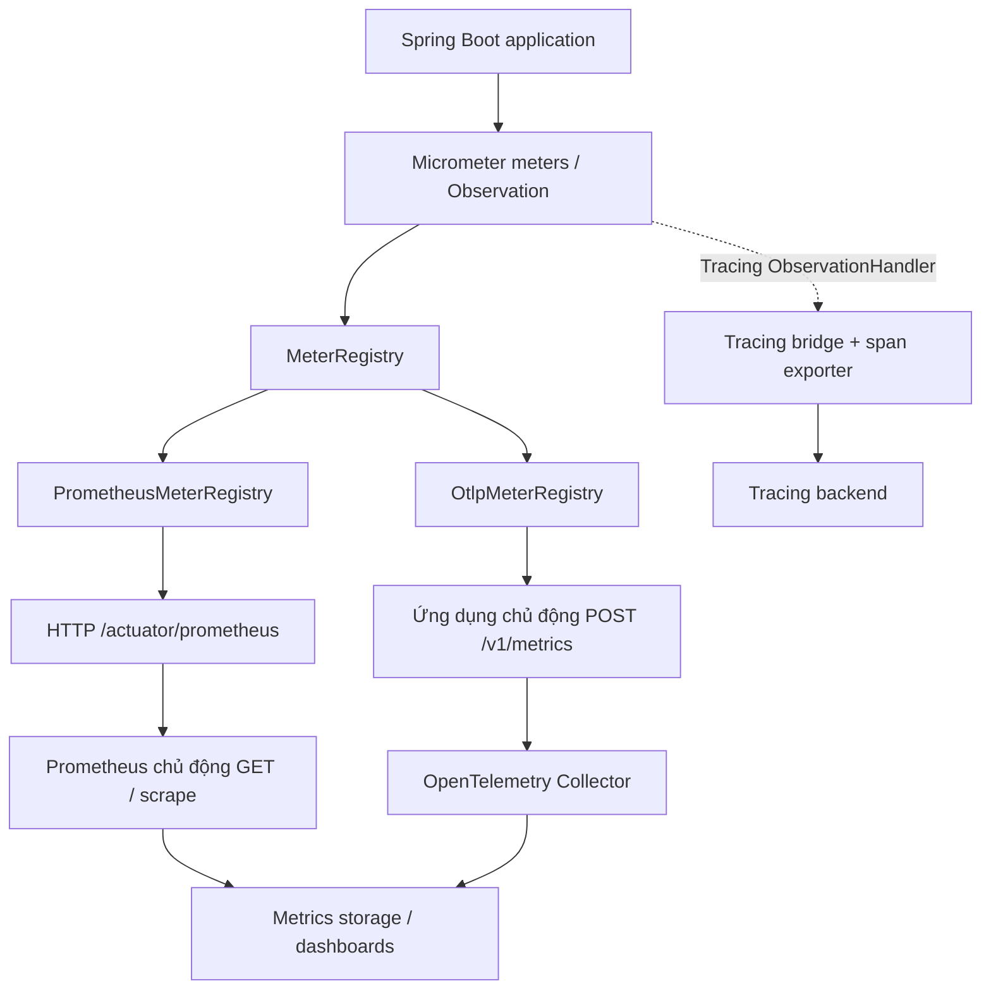
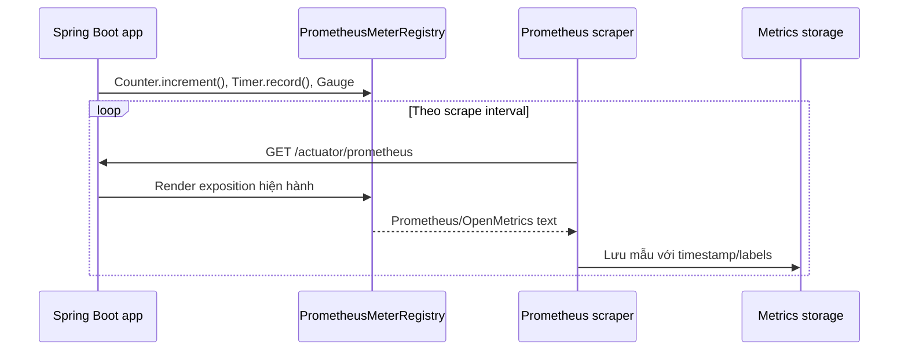
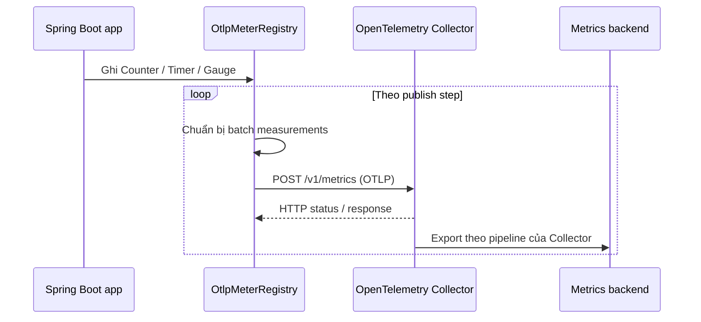
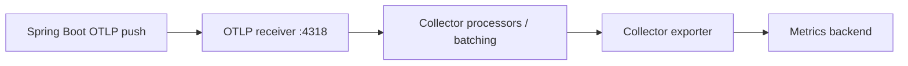
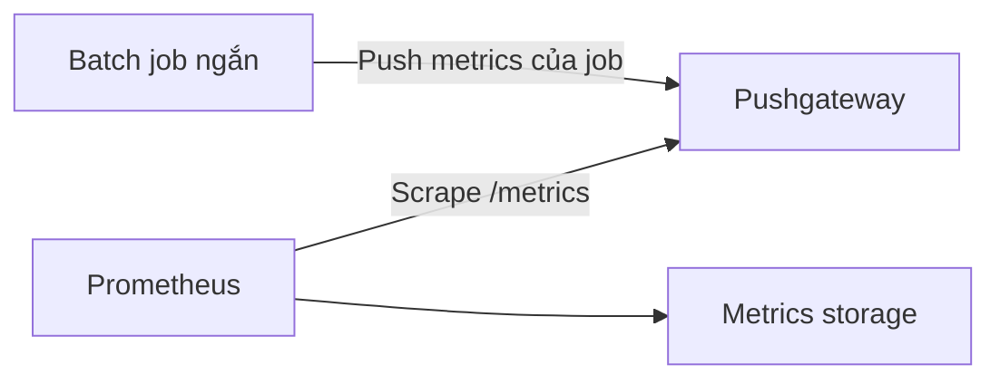
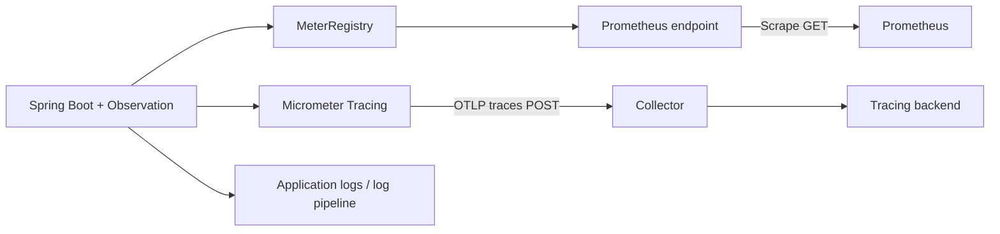

# Push và pull model trong Meter Registry và Exporter của Spring Boot

**Push** và **pull** là hai mô hình vận chuyển metrics từ ứng dụng tới hệ thống quan sát. Chúng trả lời cùng câu hỏi — *dữ liệu được chuyển từ nơi đo đến nơi lưu như thế nào?* — nhưng khác nhau về bên chủ động kết nối, cách lập lịch, cơ chế khám phá đích, đường đi qua mạng và hành vi khi xảy ra lỗi.

Trong module **SPRING_BOOT_OBSERVABILITY**, Spring Boot sử dụng **Micrometer** để tạo các meter như Counter, Timer, Gauge và có thể dùng **Micrometer Observation** để tạo measurements từ một hoạt động nghiệp vụ. Sau đó, một **`MeterRegistry`** cùng exporter quyết định metrics được **Prometheus kéo về (pull/scrape)** hay được ứng dụng **đẩy ra (push/publish)** qua OTLP hoặc giao thức khác.

Bài thuộc chương **Meter registry và exporter**, tập trung vào thiết kế, cấu hình, vận hành và kiểm chứng hai mô hình; đồng thời liên hệ với tag/cardinality, sampling, context propagation, logs và distributed tracing để hỗ trợ điều tra lỗi, độ trễ và hành vi ứng dụng trong môi trường thực.

## 1. Trước tiên phải tách việc đo khỏi việc vận chuyển

Giả sử `order-service` nhận đơn hàng và muốn theo dõi:

- Tổng đơn hàng xử lý thành công: `Counter`.
- Thời gian xử lý một đơn: `Timer`.
- Số đơn đang chờ trong queue: `Gauge`.
- Hành trình request đi qua `order-service`, `inventory-service` và `payment-service`: một **distributed trace** gồm nhiều spans.

Các phép đo do thư viện, framework hoặc business code ghi nhận. **Điểm xuất dữ liệu** nằm ở lớp khác.



Sơ đồ là hình minh họa các **đường truyền có thể lựa chọn hoặc kết hợp**. Không phải ứng dụng nào cũng cài cả hai registry. Khi có nhiều registry, Spring Boot/Micrometer có thể phối hợp chúng qua `CompositeMeterRegistry`, tùy auto-configuration và các bean đang tồn tại.

**Không nhầm `ObservationRegistry` với `MeterRegistry`:**

- `ObservationRegistry` điều phối vòng đời Observation và handlers.
- Metrics ObservationHandler có thể ghi Timer/measurements vào `MeterRegistry`.
- Tracing ObservationHandler có thể tạo span qua tracer.
- Prometheus hoặc OTLP **metrics exporter** chỉ quyết định đường vận chuyển metrics; chúng không tự bật distributed tracing.

## 2. Thuật ngữ nền tảng

| Thuật ngữ | Ý nghĩa | Ví dụ |
| --- | --- | --- |
| **Instrumentation** | Thành phần tạo ra phép đo | HTTP server observations, JVM binder, business Counter |
| **Meter** | Đại diện một phép đo và các tags | `http.server.requests` Timer |
| **MeterRegistry** | Quản lý meter và đường xuất số liệu | `PrometheusMeterRegistry`, `OtlpMeterRegistry` |
| **Exporter/publisher** | Chuyển measurements tới nơi nhận | Micrometer OTLP metrics export |
| **Scraper** | Chủ động lấy dữ liệu từ một HTTP endpoint | Prometheus scrape target |
| **Receiver** | Dịch vụ nhận metrics được đẩy đến | OTLP receiver trong Collector |
| **Backend** | Lưu trữ, truy vấn, alert và dashboard | Prometheus-compatible metrics store |
| **Scrape interval** | Khoảng thời gian bên pull lấy dữ liệu | 15 giây |
| **Publish step** | Khoảng thời gian một push registry tổng hợp/xuất metrics | 30 giây |
| **Cardinality** | Số tổ hợp tên metric và labels/time series | Nhiều `uri`/`status`/`instance` |

**Push/pull không mô tả loại metric**. Counter, Timer và Gauge đều có thể xuất theo hai mô hình, nhưng cách chuẩn hóa tên, đơn vị, phân phối và temporality có thể khác nhau giữa các registry/backend.

## 3. Pull model: Prometheus chủ động scrape

Ở mô hình pull, **ứng dụng cung cấp một endpoint HTTP**. Prometheus hoặc một scraper tương thích chủ động gửi yêu cầu định kỳ để thu thập snapshot của các metric hiện có.



Điểm nhận request là endpoint trong ứng dụng; **ứng dụng không tự mở kết nối đẩy một lô metrics lên Prometheus** chỉ vì `PrometheusMeterRegistry` đã được cấu hình.

### 3.1. Những thành phần cần có

1. Spring Boot Actuator tích hợp Micrometer.
2. `micrometer-registry-prometheus` trên classpath.
3. Endpoint `/actuator/prometheus` được expose và truy cập được từ scraper.
4. Cấu hình Prometheus scrape target, service discovery hoặc quy tắc khám phá đích.
5. Backend đang nhận và lưu samples, dashboards/alerts dùng đúng tên series.

Nếu thiếu bước 4, ứng dụng vẫn có thể trả dữ liệu ở endpoint nhưng **dashboard Prometheus không có series**.

### 3.2. Ưu điểm của pull

- Bên thu thập kiểm soát **tần suất scrape**, timeout và danh sách target.
- Prometheus có thể biểu diễn trạng thái target qua các metrics như `up`, giúp phân biệt scrape thành công và thất bại.
- Dịch vụ không phải cấu hình một URL push trên từng instance khi Prometheus đã khám phá được mục tiêu.
- Có thể chuẩn hóa labels tại tầng scrape và quản lý scraping theo job/namespace.
- Một endpoint metrics cho phép kiểm tra bằng `curl` khi debug cục bộ.

### 3.3. Giới hạn của pull

- Scraper phải **kết nối được đến ứng dụng** theo mạng, DNS, service discovery và chính sách bảo mật.
- Các process rất ngắn có thể kết thúc trước lần scrape đầu tiên.
- Nhiều instance động cần service discovery; sai port/path/target có thể làm mất quan sát.
- Khi backend tạm không scrape được, các biến động nằm giữa hai lần scrape có thể không được lưu.
- Nếu scrape quá nặng, endpoint metrics và network có thể tạo thêm tải cho ứng dụng.

**Pull không có nghĩa luôn tốt hơn push về độ tin cậy.** Nó chỉ đặt trách nhiệm lập lịch và kết nối ở phía scraper, với các failure modes riêng.

## 4. Push model: ứng dụng chủ động publish metrics

Ở mô hình push, ứng dụng có một registry/exporter định kỳ **gửi dữ liệu tới endpoint nhận**, ví dụ một OpenTelemetry Collector hỗ trợ OTLP/HTTP.



Ở đây **ứng dụng có trách nhiệm kết nối đến receiver**, còn Collector quyết định cách xử lý tiếp theo: batch, transform, authenticate và chuyển tới backend được cấu hình.

### 4.1. Ưu điểm của push

- Ứng dụng chỉ cần outbound network tới Collector/receiver, hữu ích khi inbound connection từ scraper khó triển khai.
- Có thể định tuyến dữ liệu qua một lớp Collector tập trung.
- Collector có thể gom metrics từ nhiều nguồn và áp quy tắc xử lý, giới hạn, batching và xuất tiếp.
- Có thể quản lý endpoint export qua cấu hình deployment hoặc service discovery của receiver.
- Phù hợp với một số nền tảng observability được thiết kế theo mô hình ingest dữ liệu.

### 4.2. Giới hạn của push

- Mỗi exporter phải biết **đích nhận** và cấu hình protocol/authentication/TLS.
- Receiver gián đoạn có thể gây thất bại publish, tạo áp lực retry hoặc mất dữ liệu theo khả năng buffering cụ thể.
- Process kết thúc trước chu kỳ publish có thể chưa xuất được các measurements mới nhất.
- Các lỗi cấu hình endpoint, proxy, DNS hoặc quyền truy cập có thể xảy ra ngay ở phía ứng dụng.
- Có thêm tài nguyên CPU/network để chuẩn bị và gửi lô dữ liệu định kỳ.

**Push không đồng nghĩa “giao hàng bảo đảm, không mất một measurement nào”.** Độ tin cậy thực tế phụ thuộc exporter, queue/buffer/retry, collector, backend và quá trình shutdown; cần kiểm tra theo thư viện và phiên bản cụ thể.

## 5. So sánh push và pull bằng các tiêu chí vận hành

| Tiêu chí | Pull (Prometheus scrape) | Push (OTLP metrics, ví dụ) |
| --- | --- | --- |
| Ai mở kết nối? | Scraper mở kết nối tới app | App/exporter mở kết nối tới receiver |
| Endpoint | App expose `/actuator/prometheus` | Collector nhận `/v1/metrics` |
| HTTP method điển hình | GET | POST đối với OTLP/HTTP |
| Lập lịch | Scraper giữ `scrape_interval` | Registry/exporter giữ `step`/publish schedule |
| Phát hiện target | Service discovery/scrape config | Endpoint receiver được cấu hình trên app |
| Network | Cần đường đến app từ scraper | Cần outbound từ app đến collector |
| Lỗi đích nhận | Scrape thất bại, có thể thấy `up=0` | Publish thất bại, cần theo dõi exporter/collector |
| Short-lived jobs | Có nguy cơ bị bỏ qua nếu kết thúc trước scrape | Có nguy cơ chưa publish trước khi exit |
| Dữ liệu JVM/HTTP | Có, nếu được instrument | Có, nếu được instrument |
| Tên metric/labels | Theo Prometheus exposition conventions | Theo OTLP và backend mapping |
| Collector | Không bắt buộc | Thường dùng nhưng không bắt buộc nếu backend nhận OTLP trực tiếp |
| Tracing | Cấu hình riêng | Cấu hình riêng, dù có thể cùng dùng Collector |

**Hai mô hình không loại trừ nhau.** Một ứng dụng có thể vừa expose Prometheus cho hệ monitoring cũ, vừa gửi OTLP metrics trong giai đoạn chuyển đổi. Nhưng phải xem xét khả năng ghi trùng nếu cả hai đường cuối cùng dẫn về cùng một storage.

## 6. Thiết lập Spring Boot cho pull: Prometheus

Ví dụ sử dụng **Spring Boot 3.x** và Maven, với dependency versions do Spring Boot BOM/parent quản lý. Dòng Spring Boot khác có thể có thay đổi về starter/property; cần đối chiếu đúng version của dự án.

### 6.1. Dependencies

```xml
<dependencies>
    <dependency>
        <groupId>org.springframework.boot</groupId>
        <artifactId>spring-boot-starter-actuator</artifactId>
    </dependency>
    <dependency>
        <groupId>io.micrometer</groupId>
        <artifactId>micrometer-registry-prometheus</artifactId>
    </dependency>
</dependencies>
```

Spring Boot thường tự cấu hình `PrometheusMeterRegistry` khi dependency và các điều kiện liên quan được đáp ứng.

### 6.2. application.yml

```yaml
spring:
  application:
    name: order-service

management:
  endpoints:
    web:
      exposure:
        include: health,info,metrics,prometheus
  prometheus:
    metrics:
      export:
        enabled: true
  metrics:
    tags:
      application: order-service
      environment: development
```

Cấu hình trên mở `/actuator/metrics` để chẩn đoán và `/actuator/prometheus` để scrape trên đường quản trị mặc định. Các endpoint có thể yêu cầu authentication, port hoặc base path riêng khi ứng dụng cấu hình bảo mật.

Kiểm tra:

```bash
curl -i http://localhost:8080/actuator/metrics
curl -i http://localhost:8080/actuator/prometheus
```

Đầu ra Prometheus thường là văn bản exposition:

```text
# HELP jvm_threads_live_threads The current number of live threads
# TYPE jvm_threads_live_threads gauge
jvm_threads_live_threads{application="order-service"} 42
```

Đây là output minh họa; tên và labels thực tế phụ thuộc Micrometer registry, version, common tags và cách backend biểu diễn đơn vị.

### 6.3. Prometheus scrape config minh họa

Một cấu hình Prometheus cơ bản với một instance có thể truy cập:

```yaml
scrape_configs:
  - job_name: order-service
    metrics_path: /actuator/prometheus
    scrape_interval: 15s
    scrape_timeout: 10s
    static_configs:
      - targets:
          - order-service:8080
```

Đây là phần cấu hình của **Prometheus server**, không đặt vào `application.yml` của Spring Boot. Tên host `order-service` phải phân giải được từ môi trường chạy Prometheus, còn `8080` phải là cổng đang phục vụ endpoint quản trị.

Nếu Actuator chạy ở cổng quản trị riêng, thay target port tương ứng. Khi triển khai Kubernetes, ServiceMonitor/PodMonitor hoặc discovery rules là cách chọn targets tùy vào Prometheus Operator/stack đang dùng; **không tự giả định chỉ cần tạo Service là Prometheus sẽ scrape**.

### 6.4. Kiểm chứng đường pull

1. Từ máy/namespace của scraper, thực hiện GET endpoint.
2. Kiểm tra status code, Content-Type và text exposition hợp lệ.
3. Xem Prometheus Targets, xác định target UP và lần scrape gần nhất.
4. Truy vấn metric sau khi đủ thời gian scrape và sau khi có hoạt động tạo measurements.
5. Kiểm tra tên và labels cuối cùng trong backend thay vì suy từ Java code.

Một request GET thành công từ máy cá nhân **không bảo đảm** Prometheus có cùng quyền kết nối. Chẩn đoán đường mạng phải bắt đầu từ phía scraper.

## 7. Thiết lập Spring Boot cho push: Micrometer OTLP metrics

Với **OTLP/HTTP**, ứng dụng tự gửi batch metrics đến Collector hoặc backend có receiver phù hợp.

### 7.1. Dependencies

```xml
<dependencies>
    <dependency>
        <groupId>org.springframework.boot</groupId>
        <artifactId>spring-boot-starter-actuator</artifactId>
    </dependency>
    <dependency>
        <groupId>io.micrometer</groupId>
        <artifactId>micrometer-registry-otlp</artifactId>
    </dependency>
</dependencies>
```

Không cần cài `micrometer-registry-prometheus` nếu hệ thống chỉ sử dụng OTLP metrics. Việc thêm `micrometer-registry-otlp` **không tự bật OTLP tracing**.

### 7.2. application.yml cho Spring Boot 3.x

```yaml
spring:
  application:
    name: order-service

management:
  endpoints:
    web:
      exposure:
        include: health,info,metrics
  metrics:
    tags:
      application: order-service
      environment: development
  otlp:
    metrics:
      export:
        enabled: true
        url: http://otel-collector:4318/v1/metrics
        step: 30s
```

Trong ví dụ:

- `url` là endpoint **receiver metrics**, không phải đường Actuator.
- `step: 30s` là chu kỳ publish được cấu hình cho registry.
- `otel-collector` phải là hostname/Service DNS ứng dụng thực sự truy cập được.
- Cổng `4318` thường là OTLP/HTTP; cổng `4317` thường là OTLP/gRPC. Cấu hình receiver có thể khác.
- Nếu Collector và ứng dụng chạy ở hai container, `localhost` trong container ứng dụng thường **không** trỏ tới Collector.

Endpoint OTLP/HTTP thường nhận POST với payload theo một encoding hỗ trợ, ví dụ protobuf và media type `application/x-protobuf`. Cần bảo đảm protocol/encoding mà `OtlpMeterRegistry` sử dụng tương thích với receiver thực tế.

### 7.3. Tối thiểu về Collector

Một Collector được cấu hình đúng cần có receiver OTLP, một pipeline metrics, và exporter đưa dữ liệu đi tiếp.



Một cấu hình **minh họa dùng để debug trong lab** có thể nhận OTLP/HTTP và in metrics bằng debug exporter:

```yaml
receivers:
  otlp:
    protocols:
      http:
        endpoint: 0.0.0.0:4318

exporters:
  debug:
    verbosity: basic

service:
  pipelines:
    metrics:
      receivers: [otlp]
      exporters: [debug]
```

Tùy Collector distribution/version, cấu hình và tên exporter có thể thay đổi. Ví dụ chỉ phù hợp với lab: bind `0.0.0.0` mở receiver trên các interface trong container/host, vì vậy cần hạn chế network và xác thực ở môi trường thật. Muốn dữ liệu vào Prometheus-compatible storage, cần thêm một pipeline/exporter phù hợp chứ **debug exporter không tự lưu metrics lâu dài**.

### 7.4. Kiểm chứng đường push

1. Xác minh `/actuator/metrics` có meter đang thay đổi.
2. Kiểm tra địa chỉ URL, protocol/encoding và cổng OTLP.
3. Xác nhận Collector listener nhận được kết nối POST.
4. Đọc logs hoặc self-observability của exporter/Collector khi publish.
5. Kiểm tra pipeline metrics đưa dữ liệu tới backend, không chỉ nhận ở receiver.
6. Truy vấn metric tại backend sau vài publish steps, lưu ý độ trễ ingest/processing.

**Không kiểm tra receiver bằng cách GET `/v1/metrics` rồi mong thấy JSON metrics.** Đó là đích POST; có thể trả 404/405 tùy implementation ngay cả khi receiver hoàn toàn hoạt động.

## 8. Thử một phép đo nghiệp vụ với cả hai registry

Để thấy rõ push/pull chỉ khác ở đường xuất, ta tạo một Counter và Timer qua registry do Spring Boot quản lý.

```java
import io.micrometer.core.instrument.MeterRegistry;
import io.micrometer.core.instrument.Timer;
import org.springframework.stereotype.Service;

@Service
public class CheckoutMetrics {

    private final MeterRegistry registry;

    public CheckoutMetrics(MeterRegistry registry) {
        this.registry = registry;
    }

    public void process(String channel, Runnable action) {
        String channelTag = normalizeChannel(channel);

        Timer timer = Timer.builder("checkout.process.duration")
                .description("Time spent processing checkout")
                .tag("channel", channelTag)
                .register(registry);

        timer.record(() -> {
            try {
                action.run();
                registry.counter(
                        "checkout.processed",
                        "channel", channelTag,
                        "outcome", "success"
                ).increment();
            } catch (RuntimeException error) {
                registry.counter(
                        "checkout.processed",
                        "channel", channelTag,
                        "outcome", "error"
                ).increment();
                throw error;
            }
        });
    }

    private static String normalizeChannel(String raw) {
        if ("mobile".equalsIgnoreCase(raw)) {
            return "mobile";
        }
        if ("web".equalsIgnoreCase(raw)) {
            return "web";
        }
        return "other";
    }
}
```

Trong code này:

- Timer đo thời gian của callback khi hoàn tất, kể cả khi callback ném một `RuntimeException` và Timer.record xử lý kết thúc.
- Counter ghi số lần thành công hoặc ném RuntimeException thuộc phạm vi ví dụ.
- `channel` chỉ có ba nhóm: `mobile`, `web` và `other`.
- Không có `orderId`, `requestId` hoặc Trace ID trong tags.
- Cùng business code có thể dùng `PrometheusMeterRegistry`, `OtlpMeterRegistry` hoặc registry tổng hợp do Spring Boot quản lý.

Đây là ví dụ đồng bộ. Với code bất đồng bộ, callback trả về trước khi công việc thực sự kết thúc thì Timer trên chỉ đo thời gian khởi tạo tác vụ. Cần instrument đúng lifecycle của `CompletableFuture`, Reactor hoặc queue job để tránh hiểu sai độ trễ.

### Quan sát từ đầu tới cuối

Ở phía ứng dụng:

```bash
curl -s http://localhost:8080/actuator/metrics/checkout.processed
curl -s http://localhost:8080/actuator/metrics/checkout.process.duration
```

Nếu dùng Prometheus, tìm time series theo tên đã được registry chuẩn hóa; chẳng hạn Counter có thể xuất hậu tố `_total`, Timer có thể sinh count/sum hoặc histogram nếu cấu hình.

Nếu dùng OTLP push, chờ publish step/collector processing rồi tìm metric tương ứng trong backend. Tên hiển thị và đơn vị có thể khác biểu diễn Prometheus; **kiểm chứng metadata thực tế thay vì mặc định mọi backend dùng cùng tên series**.

## 9. Scrape interval và publish step: hai đồng hồ khác nhau

Cả push và pull đều lấy dữ liệu theo thời gian, nhưng bên điều phối khác nhau.

### 9.1. Pull theo scrape interval

Ví dụ Prometheus scrape mỗi 15 giây:

```text
Time (s):      0       15       30       45       60
Prometheus:    GET-----GET------GET------GET------GET
App counter:   tăng liên tục theo events
Stored:        snapshots tại các lần scrape thành công
```

Nếu app có Counter tăng từ 100 lên 150 giữa hai lần scrape, backend thấy hai mẫu ở thời điểm khác nhau và có thể suy rate từ chuỗi counter trong cửa sổ thích hợp. Một Counter reset khi process restart cần được hệ truy vấn xử lý đúng.

### 9.2. Push theo publish step

Ví dụ OtlpMeterRegistry publish mỗi 30 giây:

```text
Time (s):      0             30             60
Otlp registry: collect ------ publish ------- publish
Receiver:                    batch A        batch B
Backend:                   ingest/query theo pipeline
```

Chu kỳ publish ảnh hưởng tới độ trễ cập nhật dashboard và đặc điểm tổng hợp ở registry. Không nhầm `step` với scrape interval của Prometheus, cũng không suy “step 30s nghĩa là mỗi sự kiện bị gộp sai thành một giá trị duy nhất”.

### 9.3. Vì sao hai backend có thể khác số liệu?

Cùng một business operation nhưng các đường xuất có thể có:

- Thời gian lấy mẫu khác nhau.
- Đơn vị và naming conventions khác.
- Cách biểu diễn Counter/Timer/histogram khác nhau.
- Quy tắc temporality và aggregation khác nhau theo registry và receiver.
- Labels bổ sung tại Prometheus scrape, OTLP resource attributes hoặc Collector.
- Thời gian ingest, buffering và retry khác.
- Các phép đo chưa được xuất trước shutdown hoặc xảy ra trong khoảng giữa các lần scrape.

Vì vậy, **không so sánh hai giá trị instantaneous tại hai đồng hồ khác nhau rồi kết luận exporter lỗi**. Khi kiểm tra đối chiếu, chọn cùng cửa sổ thời gian, tập labels, đơn vị và cách tổng hợp.

## 10. Semantics của Counter, Gauge và Timer qua push/pull

Mô hình vận chuyển không thay đổi định nghĩa nghiệp vụ của meter, nhưng ảnh hưởng tới dữ liệu backend nhận được.

| Meter | Ý nghĩa ở ứng dụng | Lưu ý khi pull | Lưu ý khi push |
| --- | --- | --- | --- |
| `Counter` | Số sự kiện tích lũy | Scrape các mẫu theo thời gian; query rate cần xử lý reset | OTLP/backend phải hiểu temporality và tính đơn điệu phù hợp |
| `Gauge` | Giá trị hiện hành | Spike giữa các lần scrape có thể không được thấy | Spike giữa các lần publish có thể không được thấy |
| `Timer` | Số lần, tổng thời lượng và tùy chọn phân phối | Prometheus thường có count/sum/buckets tương ứng | OTLP biểu diễn metric theo schema và aggregation riêng |
| `DistributionSummary` | Phân phối một đại lượng | Có thể xuất count/sum/buckets nếu hỗ trợ | Có thể xuất distribution/histogram tùy registry |
| `LongTaskTimer` | Công việc đang thực thi lâu và thời lượng | Snapshot theo thời điểm scrape | Snapshot theo thời điểm publish |

### 10.1. Counter là lũy kế hay delta?

Trong OTLP có khái niệm **aggregation temporality** như *cumulative* và *delta*, tùy loại metric và exporter/receiver. Không thể xem payload OTLP là một bản sao của một scrape Prometheus chỉ bằng đổi transport.

Khi backend cần tính rate, cần xác nhận mapping temporality từ Micrometer registry qua Collector đến storage; tránh cộng lặp số lũy kế hoặc coi một delta là cumulative.

Nếu không chắc backend đang dùng schema nào, hãy đo một Counter thử nghiệm tăng 1 lần mỗi giây trong lab, so sánh kết quả trên hai đường và kiểm tra metadata/temporality tại receiver.

### 10.2. Gauge không đảm bảo thấy mọi biến động

Một queue tăng từ 0 lên 100 rồi trở về 0 giữa hai lần scrape/publish có thể cho ra hai mẫu 0. Tăng tốc lấy mẫu có thể giúp nhưng cũng tăng chi phí. Khi cần biết số job đã vào, đã rời, bị từ chối hoặc thời gian đợi, thêm Counter và Timer/LongTaskTimer phù hợp.

### 10.3. Histogram nhân chi phí series

Khi dùng Prometheus classic histogram, mỗi tổ hợp tags có thể có nhiều bucket series cùng count/sum. OTLP histogram có cấu trúc dữ liệu khác nhưng vẫn có chi phí đo, truyền và lưu.

Nếu có 20 endpoint, 5 trạng thái HTTP, 3 phương thức và 10 instances, giới hạn trên của tổ hợp labels theo các chiều này là:

\[
20 \times 5 \times 3 \times 10 = 3\,000
\]

Nếu bật nhiều histogram buckets, tổng số series hoặc điểm dữ liệu truyền/lưu sẽ tăng tương ứng. **Push/pull không tự sửa lỗi high-cardinality**; cần thiết kế tags và buckets ở nguồn.

## 11. Vấn đề vận hành: exporter và scraper gặp sự cố

### 11.1. Khi Prometheus không scrape được

Các nguyên nhân thường thấy:

- Service discovery không tìm được target mới.
- Endpoint `/actuator/prometheus` chưa expose hoặc cổng thay đổi.
- Spring Security/reverse proxy từ chối request.
- NetworkPolicy/firewall chặn kết nối từ scraper.
- Endpoint quá chậm khiến vượt `scrape_timeout`.
- Content-Type/body sai định dạng exposition.
- Target tạm không sẵn sàng trong rolling deployment.

Nếu scrape thất bại, backend sẽ không có mẫu hợp lệ cho lượt đó. Prometheus thường có tín hiệu `up=0` cho target scrape thất bại, nhưng cần xem cả thông tin target và thời điểm stale/missing series.

Cách xử lý là kiểm tra **từ phía scraper đến app** chứ không chỉ gọi endpoint từ laptop.

### 11.2. Khi OTLP push không thành công

Các nguyên nhân thường gặp:

- URL endpoint sai: thiếu `/v1/metrics` hoặc dùng nhầm `/v1/traces`.
- Protocol hoặc encoding không khớp với receiver.
- Collector chưa bind cổng, DNS không giải được, timeout.
- TLS, API key hoặc authentication headers sai.
- Collector nhận nhưng pipeline metrics không có exporter tới backend.
- Receiver/backend bị throttle hoặc giới hạn tài nguyên.
- Process shutdown khi còn measurements chưa publish.

Cần kiểm tra **ứng dụng → receiver → processors → exporter → backend**. Response 2xx từ Collector không chứng minh backend cuối đã lưu dữ liệu nếu pipeline còn các bước tiếp theo.

### 11.3. Buffering và retry không miễn phí

Khi receiver gián đoạn, exporter có thể retry, nhưng điều đó phụ thuộc triển khai và version. Một số registry có cơ chế publish theo step, không phải hàng đợi bền vững cho mọi sự kiện.

Nếu queue trong memory tăng mà Collector không thể gửi đi, có thể gặp áp lực bộ nhớ, drop data hoặc delay. Trong production, cần xác định:

1. Registry có cơ chế retry/buffer gì?
2. Retry có giới hạn thời gian/số lần không?
3. Có backpressure hoặc circuit-breaker không?
4. Shutdown có flush được phép đo tồn đọng không?
5. Collector có queue/retry/persistence theo cấu hình không?
6. Khi backend lỗi, dashboard sẽ thiếu bao nhiêu dữ liệu và có cách phát hiện không?

Không dùng lời hứa chung “push có retry” hoặc “pull luôn khôi phục” thay cho kiểm chứng hệ thống thật.

## 12. Security: chiều kết nối quyết định bề mặt bảo vệ

### Pull

Một HTTP endpoint metrics được expose trên ứng dụng. Cần kiểm soát:

- Đường đến endpoint từ scraper: namespace, VPC, firewall, NetworkPolicy.
- Management port/base path và quyền truy cập.
- TLS và authentication khi hạ tầng yêu cầu.
- Không mở mọi Actuator endpoints chỉ để có `/actuator/prometheus`.
- Hạn chế xuất nhãn nhạy cảm như user ID, tenant secret hoặc raw request payload.

Một endpoint metrics có thể tiết lộ đường route, tên pool, tên ứng dụng và trạng thái runtime. Dù chỉ chứa số liệu, nó vẫn là tài nguyên cần bảo vệ.

### Push

Ứng dụng giữ kết nối outbound tới receiver. Cần kiểm soát:

- Đúng Collector/backend endpoint; tránh gửi nhầm môi trường.
- TLS/server certificate và credential của exporter.
- Cấu hình secret qua cơ chế quản lý bí mật phù hợp, không ghi token trong source code.
- Egress policy và DNS.
- Receiver xác thực đúng client, có quota và giới hạn ingestion.
- Collector xử lý, lọc và retention dữ liệu theo chính sách.

**Push không đồng nghĩa tự nhiên an toàn hơn pull.** Nó thay đổi bề mặt mạng và nơi đặt quyền xác thực.

## 13. Kubernetes, autoscaling và instance churn

Một môi trường có nhiều pods động làm nổi rõ khác biệt giữa hai mô hình.

### Pull trong Kubernetes

Prometheus cần tìm mỗi target để scrape, thông qua cấu hình discovery/Operator và các quyền cần thiết. Một số điểm cần lưu ý:

- Pods có thể xuất hiện/biến mất trong rolling deployment.
- Một pod có thể kết thúc trước lần scrape tiếp theo.
- Service target/port/management endpoint phải nhất quán.
- Labels `pod` và `instance` có thể gây nhiều series cũ/mới khi pods thay đổi liên tục.
- Scraping qua Service load balancing vào một pod ngẫu nhiên có thể không đại diện cho **tất cả pods**; cần target discovery đúng theo từng instance nếu mục tiêu là thu số liệu trên mọi pod.

### Push trong Kubernetes

Ứng dụng có thể push tới Collector gần nó (ví dụ service hoặc agent) rồi từ đó tới backend. Khi đó:

- App cần endpoint Collector ổn định và sẵn sàng.
- Collector cần scale/buffering đủ sức nhận nhiều nguồn.
- Labels/resource attributes xác định service, namespace, pod hoặc instance phải được thiết kế cẩn thận.
- Pods bị kill sớm có thể không publish đủ những measurements chưa gửi.
- Health của Collector và metrics pipeline là một thành phần của health hệ thống, không chỉ phụ trợ.

### Churn và cardinality là vấn đề của cả hai mô hình

Nếu cùng một service có 10 pods và mỗi lần deploy tạo 10 pod IDs mới, backend có thể giữ các time series cũ cho đến khi hết retention. Cần theo dõi **active series**, series được tạo mới, retention và sự ổn định của labels.

Không thêm `request.id` hoặc `trace.id` vào metric labels để xác định từng request; chúng tăng gần như theo số request và làm hệ thống metrics không hiệu quả.

## 14. Short-lived jobs và Prometheus Pushgateway

Một câu hỏi kinh điển: **nếu một batch job chạy 5 giây rồi kết thúc, Prometheus scrape mỗi 15 giây thì làm sao không bỏ lỡ nó?**

Với mô hình pull thuần túy, job có thể kết thúc trước khi scraper truy cập. Một trong những lựa chọn cho các *service-level batch jobs* phù hợp là **Prometheus Pushgateway**:



Điểm quan trọng:

- Đây **không phải mô hình “Prometheus server nhận push từ mọi web service”**.
- Pushgateway là một dịch vụ trung gian lưu/trình bày metrics đã được đẩy vào, sau đó Prometheus **scrape Pushgateway**.
- Metrics có thể còn lại trong Pushgateway sau khi job kết thúc; cần quản lý grouping keys và cleanup phù hợp để tránh metrics cũ/stale.
- Không dùng Pushgateway như giải pháp mặc định cho ứng dụng Spring Boot server chạy liên tục nếu Prometheus có thể scrape chúng.
- Khi cần ghi nhận kết quả job, cũng có thể thiết kế một service đo metrics lâu sống hoặc dùng hệ event/telemetry phù hợp; lựa chọn phụ thuộc topology và semantics.

### Remote write có phải application push không?

Prometheus có thể **remote_write** dữ liệu đã scrape tới một backend khác. Đây là **Prometheus (hoặc agent) chủ động gửi dữ liệu downstream**, không có nghĩa ứng dụng chuyển từ `PrometheusMeterRegistry` sang push registry.

Phân biệt ba bước:

1. App expose Prometheus exposition.
2. Prometheus scrape app (pull).
3. Prometheus remote_write đến backend khác (push ở tầng Prometheus).

Tương tự, Collector có thể scrape Prometheus endpoint rồi xuất qua OTLP đến backend. **Một pipeline tổng thể có thể chứa cả pull lẫn push tại các chặng khác nhau.**

## 15. Push/pull và Micrometer Observation, traces, logs

Micrometer Observation cho phép gắn instrumentation vào hoạt động nghiệp vụ. Nếu có cả metrics và tracing handlers, cùng một Observation có thể góp dữ liệu vào hai pipeline độc lập.

```java
import io.micrometer.observation.Observation;
import io.micrometer.observation.ObservationRegistry;
import org.springframework.stereotype.Service;

@Service
public class PaymentService {

    private final ObservationRegistry observationRegistry;

    public PaymentService(ObservationRegistry observationRegistry) {
        this.observationRegistry = observationRegistry;
    }

    public void authorize(String paymentMethod, Runnable paymentAction) {
        String methodGroup = "wallet".equals(paymentMethod)
                ? "wallet" : "card";

        Observation.createNotStarted(
                    "payment.authorize",
                    observationRegistry
                )
                .lowCardinalityKeyValue("payment.method", methodGroup)
                .observe(paymentAction);
    }
}
```

Kết quả tùy cấu hình:

- **Metrics handler** có thể ghi Timer `payment.authorize` vào MeterRegistry.
- **Pull registry** có thể expose measurements đó ở `/actuator/prometheus`.
- **Push registry** có thể publish measurements đó qua OTLP metrics.
- **Tracing handler** có thể tạo span có context phù hợp.
- **Tracing exporter** đưa spans được lấy mẫu tới tracing backend, thường qua một đường push khác.
- **Logs** có thể chứa Trace ID/Span ID qua MDC khi tracing scope và logging pattern được cấu hình đúng.

### Một ứng dụng có thể pull metrics nhưng push traces

Đây là topology rất phổ biến và **không mâu thuẫn**:



Metrics transport và traces transport không bắt buộc dùng cùng hướng. Không có “sampling 10% cho tất cả metrics” chỉ vì tracing sampling được đặt 10%.

### Sampling và propagation là hai cơ chế riêng

- **Tracing sampling** quyết định trace/span nào được ghi nhận hoặc xuất.
- **Trace context propagation** truyền ngữ cảnh qua HTTP, async hoặc messaging, chẳng hạn W3C `traceparent`.
- **Metrics scrape/publish cadence** quyết định khi nào backend nhận mẫu metrics.
- **Tag cardinality** quyết định số series được tạo và chi phí của backend.

Các cơ chế độc lập này có thể tương tác gián tiếp nhưng không thay thế nhau. Nếu trace bị đứt giữa `order-service` và `payment-service`, thay đổi `scrape_interval` không sửa được; phải kiểm tra instrumentation/propagation.

### Điều tra sự cố theo ba tín hiệu

Khi p95 thanh toán tăng:

1. **Metrics:** xác định service, operation, outcome và khoảng thời gian bị ảnh hưởng.
2. **Traces:** tìm request được lấy mẫu và span gây độ trễ, đối chiếu client/server spans qua Trace ID.
3. **Logs:** xác minh timeout, retry, connection errors hoặc lỗi nghiệp vụ nhờ correlation ID thích hợp.
4. **Runtime/infra metrics:** xem connection pool, thread pool, CPU, memory và Collector health.

Nếu backend hỗ trợ **exemplars**, một số measurements có thể mang liên kết tới trace được lấy mẫu mà không biến Trace ID thành label thông thường; phải kiểm tra registry/backend tương ứng, không giả định mọi meter đều hỗ trợ.

## 16. Khi nào chọn push, khi nào chọn pull?

Không có lựa chọn tốt nhất cho mọi hệ thống. Quyết định phải dựa trên topology, tiêu chuẩn hạ tầng và khả năng vận hành.

| Bối cảnh | Phương án thường đáng cân nhắc | Lý do |
| --- | --- | --- |
| Có Prometheus và service discovery ổn định | Pull qua `/actuator/prometheus` | Monitoring stack sẵn có, scraper quản lý targets |
| Nhiều ứng dụng bên trong mạng cho phép scrape | Pull | Dễ kiểm tra scrape targets và exporters |
| Outbound tới Collector dễ hơn inbound từ scraper | Push OTLP metrics | Đơn giản hóa một số yêu cầu network |
| Tổ chức chuẩn hóa pipeline OpenTelemetry Collector | Push OTLP hoặc Collector scrape rồi export | Tùy topology, công cụ Collector và policy |
| Migration từ Prometheus sang hệ metrics mới | Có thể chạy cả hai trong thời gian giới hạn | Đối chiếu số liệu, quản lý rủi ro ghi trùng |
| Batch job rất ngắn | Cần thiết kế riêng; có thể Pushgateway cho trường hợp phù hợp | Tránh bị bỏ lỡ trước lần scrape |
| Cần metrics và traces dùng chung Collector | Có thể push metrics và traces riêng | Collector là điểm nhận, nhưng signals khác nhau |
| Hệ thống có strict inbound restrictions | Thường ưu tiên outbound push hoặc agent | Tùy security architecture |

### Các câu hỏi cần trả lời trước khi quyết định

1. Ai có thể chủ động mở kết nối qua mạng?
2. Backend có hỗ trợ Prometheus exposition, OTLP hay cả hai?
3. Service discovery cho các instances/pods có đáng tin cậy không?
4. Mục tiêu về độ trễ cập nhật dashboard và retention là bao nhiêu?
5. Có yêu cầu mTLS, authentication hoặc tenant isolation không?
6. Collector/Prometheus có SLO và alert tự giám sát không?
7. Nếu exporter/receiver không khả dụng, có chấp nhận mất vài measurements không?
8. Cần budget cho labels, histogram, network, CPU và storage ra sao?

**Thiết kế phải gồm cả cơ chế kiểm chứng lỗi**, không chỉ một dependency và vài dòng `application.yml`.

## 17. Troubleshooting theo từng điểm trong pipeline

| Triệu chứng | Khả năng nguyên nhân | Kiểm tra trước |
| --- | --- | --- |
| `/actuator/metrics` có tên meter, backend trống | Lỗi scrape/push/export | Chọn đúng nhánh đường truyền để kiểm tra |
| `/actuator/prometheus` trả 404 | Thiếu Prometheus registry, chưa expose, sai path/port | Dependency, exposure, management port |
| Prometheus target DOWN | Network, auth, DNS, timeout, malformed exposition | Kiểm tra từ máy scraper, target error |
| Endpoint Prometheus có data nhưng dashboard trống | Chưa scrape, query sai, label khác | Target health, PromQL, tên series thực |
| OTLP receiver GET trả 405 | Receiver mong POST | Xem cấu hình exporter, không dùng GET để khám phá |
| OTLP push trả 404/415 | Sai path/encoding/protocol | `/v1/metrics`, OTLP HTTP vs gRPC |
| Collector nhận request nhưng backend không thấy | Pipeline/exporter downstream lỗi | Collector config/logs và backend ingestion |
| Push registry báo timeout | Collector không truy cập được/quá tải | DNS, TLS, auth, connection, receiver health |
| Counter giữa hai backend khác | Step/scrape/temporality/labels/timestamps | So cùng thời gian, units, aggregation |
| Gauge không thấy spike | Đo snapshot quá thưa | Xem cadence, thêm Counter/Timer phù hợp |
| Số series tăng vọt | Tag ID động, route URL raw, histogram | Kiểm soát metadata, budget labels |
| Có metric nhưng không có span | Tracing bridge/sampling/exporter thiếu hoặc lỗi | Tracing pipeline độc lập |
| Trace đứt qua HTTP/async | Thiếu propagation | W3C headers, executor/context, client instrumentation |
| Dữ liệu mất khi rollout | Scrape bỏ qua pod hoặc chưa publish trước exit | Pod lifecycle, graceful shutdown, cadence |
| Hai đường export cùng lưu backend | Duplicate ingestion | Kiểm tra routing, external labels và dedupe policy |

### Quy trình chẩn đoán bốn lớp

**Lớp 1 – Instrumentation:** meter có được tạo và ghi measurements không? Kiểm tra `/actuator/metrics`, Observation lifecycle, `MeterFilter` và traffic thực tế.

**Lớp 2 – Registry/exporter:** Prometheus endpoint có exposition đúng không, hoặc OTLP publisher có cấu hình URL/step đúng không?

**Lớp 3 – Collector/scraper:** pull target có UP không? OTLP receiver có nhận được request không? Processor/exporter phía sau có drop dữ liệu không?

**Lớp 4 – Backend/query:** data đã ingest chưa? Tên series, label schema, aggregation temporality và query window có đúng không?

Phân lớp giúp tránh sửa sai: chẳng hạn tăng tracing sampling không thể khắc phục lỗi Prometheus target DOWN.

## 18. Bài thực hành: so sánh hai mô hình trên cùng service

### Chuẩn bị

- Spring Boot 3.x web app có Actuator.
- Một thao tác nghiệp vụ ghi Counter/Timer, chẳng hạn `CheckoutMetrics` ở phần 8.
- Một Prometheus instance test hoặc môi trường có thể scrape ứng dụng.
- Một OpenTelemetry Collector lab để nhận OTLP/HTTP.
- Không dùng production credentials hay dữ liệu khách hàng thật.

### Bước 1 – Xác nhận metric nội bộ

Tạo vài request hoặc gọi service nghiệp vụ nhiều lần. Kiểm tra:

```bash
curl -s http://localhost:8080/actuator/metrics/checkout.processed
curl -s http://localhost:8080/actuator/metrics/checkout.process.duration
```

Nếu chưa có meter, kiểm tra việc service đã thực thi, registry được inject và không bị filter.

### Bước 2 – Cấu hình pull

Thêm `micrometer-registry-prometheus`, expose `/actuator/prometheus` và tạo scrape job trong Prometheus theo phần 6.

Xác nhận target được scrape, metrics xuất hiện trên backend và tên/labels đúng. Ghi lại `scrape_interval`.

### Bước 3 – Cấu hình push trong môi trường lab

Thêm `micrometer-registry-otlp` hoặc tạo một profile riêng chạy push. Cấu hình URL Collector OTLP/HTTP và `step` theo phần 7. Kiểm tra Collector nhận metrics và backend có dữ liệu.

Nếu dùng cả hai registry đồng thời, hãy đánh dấu rõ dữ liệu đến từ đường nào để tránh nhầm lẫn hoặc ghi trùng.

### Bước 4 – So sánh hai đồng hồ

Cho ứng dụng tạo Counter đều đặn trong khoảng thời gian kiểm thử và ghi lại:

- Chu kỳ scrape 15 giây của pull.
- Publish step 30 giây của push.
- Thời điểm samples bắt đầu có mặt tại backend.
- Tên, đơn vị, labels và cách biểu diễn count.

Chọn cùng một khoảng thời gian đủ dài để đối chiếu tổng số sự kiện và rate; không so sánh hai điểm instantaneous rồi coi khác biệt là lỗi.

### Bước 5 – Gây lỗi có kiểm soát

Trong lab:

- Tạm làm Prometheus không truy cập được endpoint, xem target DOWN và khôi phục.
- Tạm cấu hình sai URL OTLP để xem lỗi publish, sau đó sửa lại.
- Kiểm tra metrics trong ứng dụng có thể còn nguyên ngay cả khi backend không nhận.
- Quan sát độ trễ phục hồi và xem có khoảng trống dữ liệu hay không.

Không thực hiện phép thử gây gián đoạn trên môi trường dùng chung hoặc production.

### Bước 6 – Thử với Gauge

Thêm Gauge cho queue depth. Tạo một spike ngắn và kiểm tra liệu Prometheus/OTLP samples có thấy không. Kết luận rằng cả hai mô hình đều có giới hạn theo **thời điểm lấy mẫu**, nhưng cần hiểu lịch lấy mẫu của từng registry.

### Bước 7 – Kiểm tra cardinality

Dùng tags `channel=web/mobile/other` và `outcome=success/error`. Đếm số series/tổ hợp labels thực tế. Không thêm order ID, user ID, raw URL hoặc Trace ID làm labels.

### Bước 8 – Thêm traces và logs

Nếu môi trường đã cấu hình Micrometer Tracing bridge và exporter, instrument `payment.authorize` bằng Observation. Xác nhận có Timer trên metrics backend và span trong một trace được lấy mẫu, rồi truy vấn logs theo Trace ID. Thử thay đổi tracing sampling để thấy nó không trực tiếp làm thay đổi scrape interval/publish step của metrics.

### Bước 9 – Tóm tắt quyết định thiết kế

Ghi lại mô hình phù hợp nhất với network topology, backend, security policy và SLO của hệ thống. Lập danh sách các failure modes đã kiểm thử, cùng owner của exporter và dashboard.

### Checklist nghiệm thu

| Kiểm chứng | Kết quả mong đợi |
| --- | --- |
| Meter nội bộ | Counter/Timer xuất hiện và tăng theo traffic |
| Pull | Prometheus scrape được endpoint, target UP |
| Push | Collector nhận OTLP metrics POST và có pipeline xuất tiếp |
| Cadence | Phân biệt scrape interval và publish step |
| Query | Dùng đúng tên/labels/units trong backend tương ứng |
| Resilience | Phân biệt lỗi app, scraper, exporter, Collector, backend |
| Security | Endpoint pull và đích push có mạng/quyền phù hợp |
| Cardinality | Tags hữu hạn, không có ID động hoặc dữ liệu nhạy cảm |
| Tracing | Span được cấu hình/xuất độc lập với metrics transport |
| Quyết định | Chọn mô hình theo topology, chi phí và khả năng vận hành |

## 19. Kết luận

**Pull** và **push** khác nhau ở **bên chủ động lấy hoặc gửi metrics**, không phải ở mục tiêu quan sát ứng dụng.

- Với **Prometheus pull**, Spring Boot cung cấp `/actuator/prometheus`; scraper định kỳ GET endpoint và lưu các mẫu.
- Với **OTLP push**, `OtlpMeterRegistry` chủ động POST metrics đến Collector/receiver theo chu kỳ publish.
- Cùng một Counter, Timer hoặc Gauge có thể phục vụ hai mô hình; khác biệt nằm ở exporter, lịch gửi/lấy, semantics và backend mapping.
- Khi gặp sự cố, kiểm tra theo chuỗi **instrumentation → registry → scraper/receiver → backend**.
- Thiết kế metadata có cardinality thấp và bảo vệ dữ liệu nhạy cảm quan trọng với **cả hai mô hình**.
- Logs và distributed traces dùng pipeline riêng: metrics phát hiện vấn đề tổng thể, traces cho thấy đường đi request, logs giúp xác minh nguyên nhân.

Hiểu đúng push/pull giúp kiến trúc sư chọn đường vận chuyển phù hợp với hạ tầng, người phát triển cấu hình Spring Boot chính xác và nhóm vận hành phát hiện nhanh mất dữ liệu metrics, độ trễ xuất dữ liệu hoặc sai lệch giữa các tín hiệu khi điều tra hệ thống thực.
