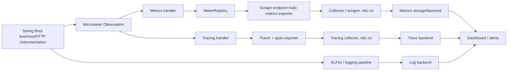
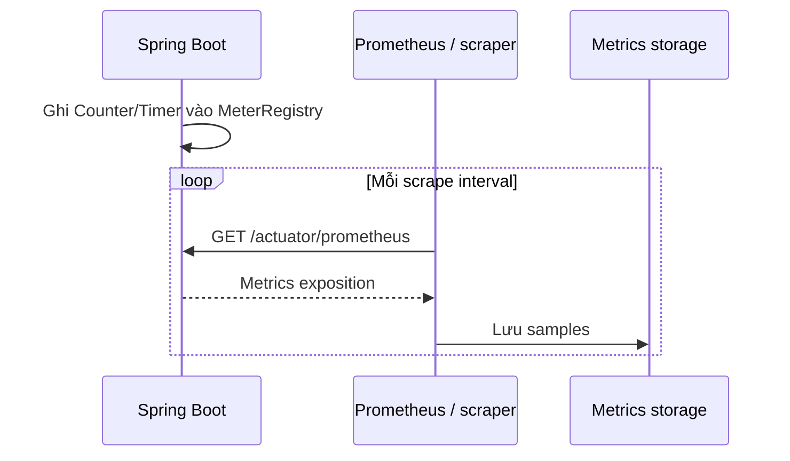
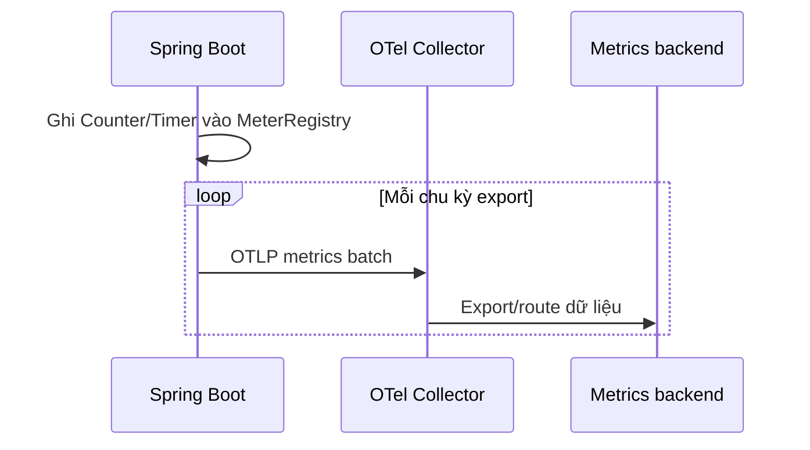
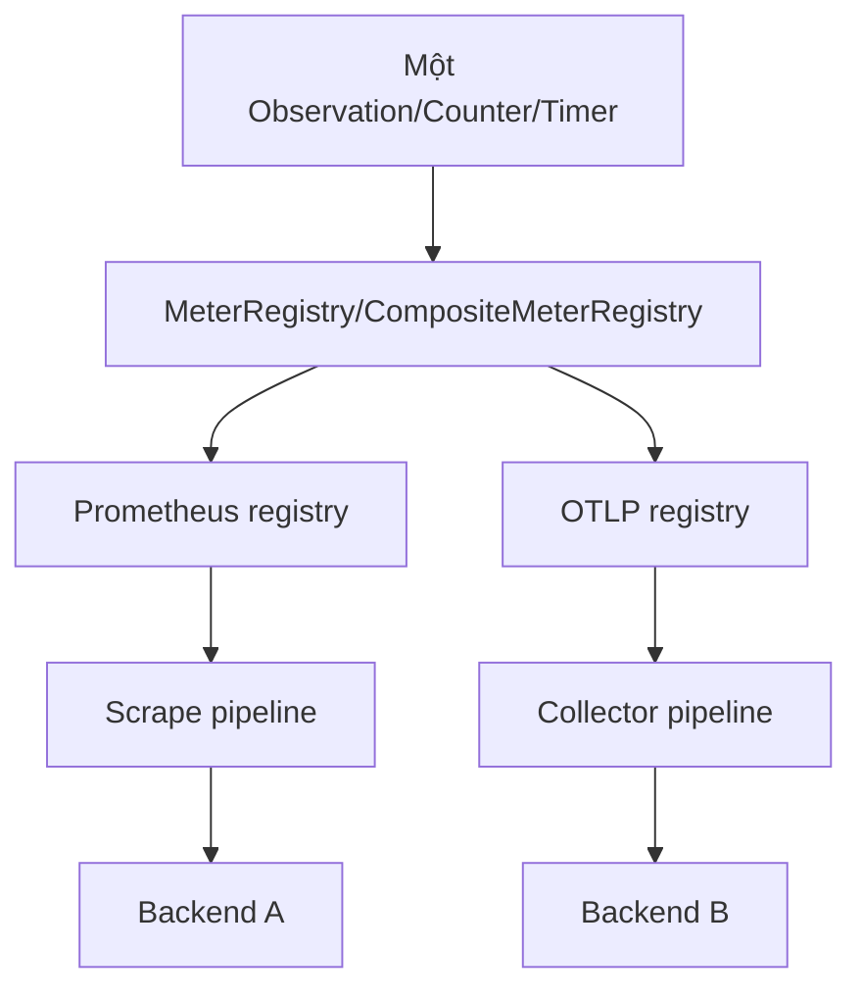
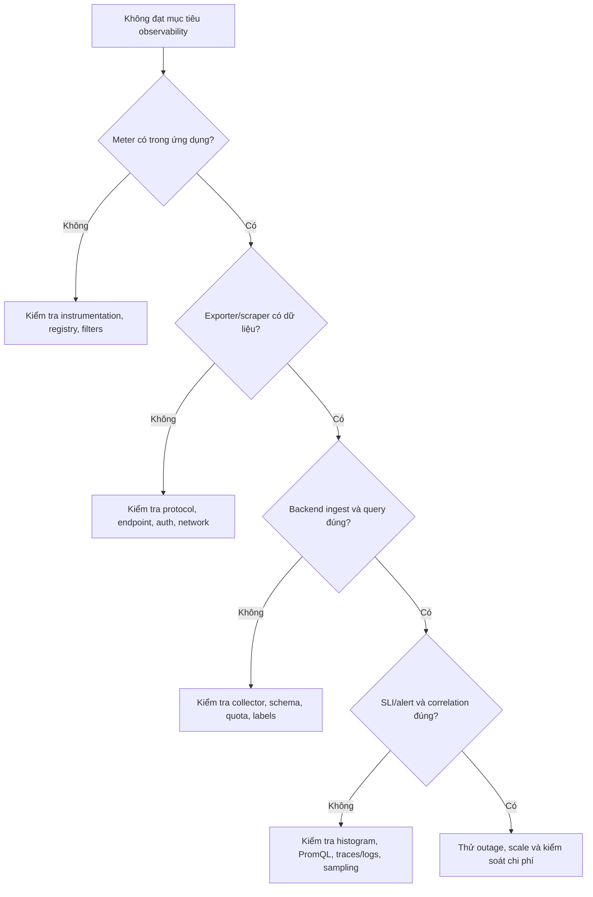

# Điều kiện chọn backend cho Spring Boot Observability

Một ứng dụng Spring Boot đã có Micrometer Observation, HTTP metrics, logs và distributed tracing nhưng vẫn chưa chắc đã **quan sát được trong thực tế**. Muốn biết endpoint nào chậm, dịch vụ nào phát sinh lỗi và nguyên nhân nằm ở đâu, dữ liệu phải được thu thập, vận chuyển, lưu trữ và truy vấn ở hệ thống phù hợp. Đây là lý do cần cân nhắc **backend quan sát** ngay từ thiết kế, thay vì chỉ thêm một thư viện exporter rồi coi như hoàn tất.

Bài **“Điều kiện chọn backend”** thuộc chương **Meter registry và exporter** của module **SPRING_BOOT_OBSERVABILITY**. Mục tiêu là biết chọn một kiến trúc thu thập và lưu trữ metrics phù hợp với Spring Boot, đồng thời xem xét logs, distributed tracing, context propagation, tag/cardinality, exporter, sampling và cách liên kết các tín hiệu để điều tra lỗi, độ trễ và hành vi ứng dụng.

**Nguyên tắc chính:** chọn backend theo **câu hỏi cần trả lời**, **hợp đồng dữ liệu và SLO**, **khả năng vận hành**, **bảo mật** và **tổng chi phí**, không chọn chỉ vì một exporter dễ cấu hình.

## 1. Phân biệt MeterRegistry, exporter, collector và backend

Trong các tài liệu observability, từ “backend” đôi khi được dùng cho nhiều tầng khác nhau. Cần tách chúng ra để xác định đúng nơi phát sinh lỗi.

| Thành phần | Nhiệm vụ | Ví dụ |
| --- | --- | --- |
| **ObservationRegistry** | Điều phối vòng đời Observation, convention/filter và handler | `ObservationRegistry` của Micrometer |
| **MeterRegistry** | Quản lý Counters, Timers, Gauges, tags và measurements trong ứng dụng | `PrometheusMeterRegistry`, `OtlpMeterRegistry`, `SimpleMeterRegistry` |
| **Exporter hoặc reader** | Đưa measurements ra ngoài qua HTTP scrape hoặc xuất định kỳ | Endpoint `/actuator/prometheus`, OTLP metrics export |
| **Collector / agent** | Nhận, xử lý, thêm tài nguyên, batch, route và chuyển dữ liệu | OpenTelemetry Collector, agent của nhà cung cấp |
| **Storage backend** | Lưu time series, traces hoặc logs theo retention/index | Prometheus, hệ thống metrics tương thích PromQL, trace/log stores |
| **Query và visualization** | Truy vấn, vẽ dashboard, phát cảnh báo | PromQL và dashboard/alerting phù hợp |

Sơ đồ định hướng:



Một **MeterRegistry không nhất thiết là hệ thống lưu trữ lâu dài**. Ví dụ `SimpleMeterRegistry` chủ yếu phục vụ test hoặc ứng dụng cần số đo cục bộ; các phép đo biến mất khi tiến trình dừng nếu không có cơ chế lưu khác.

Một **collector không tự động là backend**: nó có thể nhận OTLP, xử lý rồi gửi đi, nhưng vẫn cần đích lưu trữ và giao diện truy vấn. Ngược lại, một backend có thể tự scrape metrics mà không cần một collector trung gian.

Tương tự, **metrics backend không tự lưu traces/logs** chỉ vì nó nhận metrics. Một bộ sản phẩm quan sát có thể cung cấp cả ba tín hiệu, nhưng vẫn có ba pipeline, schema, retention và điều kiện xuất khác nhau.

## 2. Bắt đầu từ câu hỏi vận hành

Trước khi so sánh Prometheus, OTLP hoặc dịch vụ SaaS, hãy xác định những tình huống ứng dụng thật sự cần hỗ trợ:

| Câu hỏi cần trả lời | Tín hiệu chủ đạo | Điều backend phải làm được |
| --- | --- | --- |
| Bao nhiêu request/giây đến mỗi route? | HTTP request metrics | Counter/rate, phân nhóm theo route/method |
| Tỷ lệ HTTP 5xx của checkout 5 phút qua? | Metrics | Truy vấn theo thời gian, lọc labels, alerting |
| p95/p99 latency có vượt SLO không? | Histogram metrics | Lưu và tổng hợp bucket hoặc cơ chế phân vị phù hợp |
| Payment gateway có làm request chậm không? | Metrics + traces | Tìm dependency latency và span liên quan |
| Một giao dịch cụ thể thất bại vì sao? | Traces + logs + dữ liệu nghiệp vụ | Trace search, log correlation, truy cập có kiểm soát |
| Bao nhiêu request bị ảnh hưởng khi deploy phiên bản mới? | Metrics, release metadata | So sánh trước/sau deploy theo nhãn ổn định |
| Sự cố xảy ra trên service nào trong chuỗi gọi? | Distributed traces | Service identity, span relationships, propagation |
| Cần kiểm toán **mọi** giao dịch hay không? | Nguồn audit/transaction chuyên dụng | Tính đầy đủ, quyền truy cập, retention đáp ứng yêu cầu |

Nếu mục tiêu chính là **SLI/SLO của web service**, backend metrics cần hỗ trợ truy vấn thời gian, histogram và cảnh báo. Nếu mục tiêu là **điều tra cuộc gọi xuyên nhiều dịch vụ**, tracing phải có collector, sampling, tìm span và log correlation. Một backend giỏi biểu đồ metrics không tự đáp ứng yêu cầu audit giao dịch.

### Định nghĩa SLI trước khi chọn sản phẩm

Ví dụ một HTTP SLI hợp lý:

- **Availability SLI:** tỷ lệ request được coi là thành công theo định nghĩa dịch vụ.
- **Latency SLI:** tỷ lệ request hoàn tất dưới ngưỡng thời gian hoặc phân vị độ trễ theo route quan trọng.
- **Traffic:** request rate, có phân tách đường xử lý chính.
- **Errors:** tỷ lệ 5xx hoặc kết quả lỗi nghiệp vụ được định nghĩa riêng.

Không nhất thiết coi toàn bộ 4xx là lỗi hệ thống. Một request tra cứu không có bản ghi có thể trả 404 đúng thiết kế. Một thanh toán bị từ chối hợp lệ có thể trả trạng thái HTTP thành công nhưng cần business metric khác. **Backend không thể sửa một SLI định nghĩa sai từ đầu.**

## 3. Quyết định đầu tiên: pull hay push?

Ở tầng metrics, hai mô hình phổ biến là **pull/scrape** và **push/periodic export**.

### Pull: hệ thống giám sát chủ động scrape ứng dụng

Ví dụ điển hình: Spring Boot có `PrometheusMeterRegistry` và endpoint `/actuator/prometheus`. Prometheus hoặc scraper có quyền mạng sẽ gọi endpoint định kỳ.



**Ưu điểm:** triển khai phù hợp với hệ sinh thái Prometheus, scraper quyết định tần suất lấy dữ liệu, kiểm tra target health dễ, có thể dùng service discovery.

**Ràng buộc:** scraper phải truy cập được ứng dụng qua mạng và endpoint phải được bảo vệ; môi trường có NAT, firewall, serverless hoặc workload ngắn hạn đôi khi khó scrape. Scrape mất kết nối có thể làm thiếu mẫu, không tự được bù lại chỉ bằng cách đợi scrape tiếp theo.

### Push: ứng dụng hoặc agent xuất dữ liệu định kỳ

Ví dụ: `OtlpMeterRegistry` gửi metrics qua OTLP đến OpenTelemetry Collector; Collector xử lý và gửi tới backend lưu trữ.



**Ưu điểm:** ứng dụng thường chỉ cần kết nối outbound đến collector; thích hợp cho mạng có firewall phía inbound, có thể dùng collector để route/transform dữ liệu.

**Ràng buộc:** phải quản lý chu kỳ export, request timeout, retry, batch/queue, backpressure và dữ liệu mất khi tiến trình dừng đột ngột. Collector không tự bảo đảm giao hàng “exactly once”; tùy protocol, SDK/registry và queue, một đợt gửi thất bại vẫn có thể gây thiếu hoặc trùng dữ liệu.

### Bảng chọn nhanh

| Điều kiện | Pull / Prometheus scrape | Push / OTLP metrics |
| --- | --- | --- |
| Scraper truy cập được service | Rất phù hợp | Không bắt buộc |
| Chỉ cho phép kết nối outbound | Có thể khó nếu không có proxy/agent | Thường thuận tiện hơn |
| Hệ sinh thái PromQL/alerts đã có | Lựa chọn tự nhiên | Cần backend/collector có khả năng tương ứng |
| Workload tạm thời/ngắn hạn | Cần thiết kế scrape phù hợp | Có thể thuận tiện nhưng phải flush khi shutdown |
| Yêu cầu chuẩn hóa telemetry qua Collector | Có thể scrape rồi forward qua Collector | Tích hợp Collector trực tiếp |
| Dễ kiểm tra target alive | Scrape health thuận tiện | Phải giám sát exporter/collector riêng |
| Bảo mật đường đi | Bảo vệ scrape endpoint và credentials | TLS/auth outbound, collector endpoints |
| Rủi ro dữ liệu | Missing scrapes, target discovery sai | Export failures, queue đầy, flush không kịp |

**Không có mô hình luôn tốt hơn mọi trường hợp.** Chọn theo topology, chu kỳ dữ liệu, vận hành và yêu cầu backend, không theo độ ngắn của cấu hình YAML.

## 4. Những nhóm backend và tình huống phù hợp

Phần này nói về **kiểu giải pháp**, không coi một công cụ cụ thể là mặc định bắt buộc.

### Nhóm A — Prometheus và hệ thống tương thích Prometheus

Dùng khi đội vận hành muốn một mô hình metric dựa trên **time series có labels**, **PromQL**, alerting và hệ sinh thái scrape. Có thể triển khai Prometheus độc lập cho quy mô phù hợp hoặc hệ thống lưu trữ nhiều cụm/dài hạn tương thích Prometheus.

Cần kiểm tra:

- Cách phát hiện các target Spring Boot trong Kubernetes/VM.
- Khả năng truy vấn qua nhiều instance hoặc nhiều cluster.
- Retention và yêu cầu lưu dài hạn.
- HA, replica và khả năng chống trùng samples.
- Histogram buckets, recording rules, alerting và quản lý labels.
- Quyền truy cập API/query và vùng dữ liệu.

**Prometheus scrape tại một target không có nghĩa đã có hệ thống long-term metrics storage hoặc HA hoàn chỉnh.** Cần thiết kế thêm theo phạm vi hệ thống.

### Nhóm B — OTLP + OpenTelemetry Collector + metrics backend

Dùng khi cần luồng xuất dữ liệu thống nhất qua OTLP, có Collector để route hoặc kiểm soát telemetry. **OTLP là giao thức/định dạng truyền dữ liệu**, không phải hệ thống truy vấn và lưu trữ tự thân.

Sơ đồ:

```text
Spring Boot OtlpMeterRegistry
    -> OTLP/HTTP hoặc OTLP/gRPC tùy exporter
    -> OpenTelemetry Collector
    -> exporter của Collector
    -> metrics storage/backend
    -> dashboard + alerts
```

Cần kiểm tra endpoint nhận dữ liệu, transport, authentication, temporality, aggregation và cách backend ánh xạ resource attributes thành labels.

Collector có thể nhận metrics từ ứng dụng và traces/logs từ pipeline khác, nhưng **mỗi signal vẫn cần receiver, processor và exporter phù hợp**. Không giả định cấu hình OTLP metrics sẽ tự tạo traces hoặc tự nhận logs của Logback.

### Nhóm C — Dịch vụ quan sát được quản lý

Một dịch vụ SaaS/managed platform có thể cung cấp metrics, traces, logs, dashboards và alerting trên cùng sản phẩm. Ưu điểm thường là giảm công vận hành storage, HA, scale và giao diện correlation.

Cần xem xét trước khi chọn:

- Chi phí theo lượng samples, active series, GB ingest, indexed attributes, retention hoặc số users.
- Giới hạn query, quotas, throttling và xử lý spike.
- Dữ liệu được chuyển qua quốc gia/khu vực nào, quyền truy cập, encryption.
- Cách import/export, khả năng rời nhà cung cấp và giữ lại dữ liệu.
- Khả năng tìm trace theo attributes, dùng exemplars và nối log bằng trace ID.
- Các điều khoản SLA, hỗ trợ sự cố, audit và quyền quản trị.

**Nền tảng có ba màn hình metrics/logs/traces không tự đảm bảo cả ba đã được instrument hay liên kết đúng trong Spring Boot.**

### Nhóm D — Registry và backend chuyên biệt khác

Các hệ thống như StatsD hoặc những registry metrics khác có thể phù hợp với hạ tầng sẵn có. Đừng giả định chúng hỗ trợ cùng semantic của Timer, histogram, exemplars hay tag normalization như Prometheus.

Với Java demo/unit test, `SimpleMeterRegistry` là lựa chọn thực dụng để kiểm tra values mà không cần exporter hoặc service bên ngoài; nhưng **không nên chọn nó làm nơi lưu quan sát lâu dài của production**.

## 5. Những tiêu chí bắt buộc cần chốt trước quyết định

Một backend chỉ đáp ứng yêu cầu khi đi qua đủ tiêu chí kỹ thuật lẫn vận hành.

| Tiêu chí | Câu hỏi kiểm chứng |
| --- | --- |
| **Dữ liệu cần thu** | Có hỗ trợ Counter, Gauge, Timer, histogram, unit, labels, resource metadata không? |
| **Truy vấn** | Tính rate, increase, error ratio, p95 theo service/route có đáng tin cậy không? |
| **Độ trễ dữ liệu** | Từ request hoàn tất đến dashboard/alert nhìn thấy dữ liệu mất bao lâu? |
| **Cardinality** | Giới hạn active series, label values, histogram buckets và cách xử lý vượt ngưỡng là gì? |
| **Retention** | Giữ dữ liệu chi tiết và tổng hợp bao lâu để điều tra, lập báo cáo và SLO? |
| **Scale và HA** | Có đáp ứng nhiều instance, zone, cluster và quá tải hay không? |
| **Network** | Pull được không; có thể gửi outbound qua TLS/proxy hay không? |
| **Security** | TLS, auth, mTLS, token rotation, RBAC, audit, tenant isolation có đáp ứng? |
| **Compliance** | Vùng dữ liệu, yêu cầu xóa, masking và dữ liệu cá nhân có phù hợp không? |
| **Reliability** | Khi exporter/collector/backend lỗi thì metrics có bị mất hoặc gây ảnh hưởng ứng dụng? |
| **Correlation** | Có thể đi từ metric → exemplar/trace → log bằng trace ID không? |
| **Operations** | Ai sẽ vận hành collector, query, alerts, backups, upgrades và incident response? |
| **Cost** | Tính được tổng ingest/storage/query/egress và vận hành khi traffic tăng? |
| **Portability** | Có dùng Micrometer/OTLP/Prometheus conventions, có thể chuyển backend nếu cần? |

Phải xác nhận **mức độ ưu tiên** của từng tiêu chí. Ví dụ dịch vụ tài chính có yêu cầu vùng dữ liệu chặt chẽ có thể loại một giải pháp rất tiện nhưng không đáp ứng residency. Hệ thống chỉ có vài service nội bộ có thể không cần giải pháp phân tán phức tạp.

## 6. Cardinality là tiêu chí chọn backend, nhưng không phải trách nhiệm riêng của backend

Trong Micrometer Metrics, một meter name cộng với các tổ hợp tags tạo ra các chuỗi thời gian khác nhau. Khi tăng số chiều hoặc số giá trị của một chiều, số series có thể tăng mạnh.

Giả sử HTTP server metric có:

| Dimension | Số giá trị giả định |
| --- | ---: |
| `application` | 4 |
| `environment` | 2 |
| `method` | 4 |
| `uri` route template | 30 |
| `status` | 5 |

Giới hạn tổ hợp lý thuyết:

\[
4 \times 2 \times 4 \times 30 \times 5 = 4\,800
\]

Nếu thêm `user.id` với 100.000 giá trị, con số lý thuyết trở thành:

\[
4\,800 \times 100\,000 = 480\,000\,000
\]

**Đây không phải dự báo sẽ có 480 triệu series.** Chỉ những tổ hợp thực sự xuất hiện mới tạo dữ liệu, và tags có thể tương quan với nhau. Tuy nhiên, phép tính cho thấy một ID có cardinality cao có thể phá ngân sách metrics rất nhanh.

### Histogram nhân thêm số series

Nếu Timer phát histogram bucket, một tổ hợp labels thường có nhiều series `_bucket` cùng `_count`/`_sum`. Việc bật histogram cho mọi endpoint khi có tag `user.id` hoặc raw URL là quyết định đặc biệt rủi ro.

Khi đánh giá backend, cần biết:

- Có histogram để tính p95/p99 từ nhiều instances không?
- Có thể quy định ngưỡng/bucket và mức độ chính xác phù hợp không?
- Phân vị được tính client-side hay từ histogram backend, có gộp được không?
- Hệ thống có đưa ra cảnh báo khi active series tăng bất thường không?
- Khi vượt quota, backend **drop** dữ liệu hay throttle? Tác động lên alert/SLO ra sao?

### Không dùng backend “chịu được nhiều series” để hợp thức hóa tag sai

Các khóa như `user.id`, `order.id`, `session.id`, `traceId` hoặc raw URL có ID thường không phù hợp làm metric labels. Hash user ID cũng không giải quyết cardinality nếu mỗi user vẫn có một hash riêng.

Nên dùng low-cardinality tags như `method`, `http.route` dạng template, nhóm `status`, `payment.method` đã chuẩn hóa và common tags ổn định. High-cardinality attributes có thể được gắn vào span khi có căn cứ thu thập và kiểm soát dữ liệu, nhưng không tự biến thành metric labels.

## 7. Retention, độ trễ và chi phí thực tế

Một lựa chọn backend phải giải quyết cả **thời gian giữ dữ liệu** và **độ mới**.

### Retention

Ví dụ một đội vận hành có thể cần:

- Dữ liệu chi tiết ở độ phân giải cao trong vài ngày hoặc vài tuần cho incident response.
- Các thống kê tổng hợp đủ dài cho báo cáo SLO và capacity planning.
- Traces chỉ lưu theo sampling hoặc chính sách thời gian khác metrics.
- Logs có mức độ nhạy cảm cao hơn, yêu cầu truy cập và thời hạn lưu riêng.
- Audit/transaction records **không thay thế** bằng sampled traces khi cần tính đầy đủ.

Không có một retention “chuẩn” áp dụng cho mọi ứng dụng; mức cần thiết phải xuất phát từ chính sách nội bộ, quy định, nhu cầu truy vết và ngân sách.

### Độ trễ của pipeline

Với scrape 15–30 giây hoặc OTLP export mỗi một khoảng cố định, dữ liệu có thể đến dashboard muộn hơn thời điểm request. Collector batch và backend ingest còn tạo thêm độ trễ. Nếu SLO/alert yêu cầu phát hiện lỗi rất nhanh, cần kiểm tra **end-to-end freshness** chứ không chỉ đo latency của ứng dụng.

### Công thức ước lượng để lập ngân sách

Với hệ thống pull theo chu kỳ scrape:

\[
\text{Samples/day} \approx
\text{Active series}
\times
\frac{86\,400}{\text{Scrape interval (seconds)}}
\]

Đây là ước lượng khi targets luôn scrape thành công và series giữ nguyên. Nó **không tự suy ra số GB hoặc chi phí tiền**: kích thước mỗi sample, metadata, compression, histogram, index và backend có thể khác nhau.

Ví dụ nếu có 50.000 series và khoảng scrape 30 giây:

\[
50\,000 \times \frac{86\,400}{30}
= 144\,000\,000 \text{ samples/day}
\]

Khi chuyển sang push/OTLP, mô hình tính ingest có thể khác theo thời gian xuất, aggregation/temporality và chính sách nhận dữ liệu. Đừng dùng công thức scrape như đơn vị hóa đơn của mọi dịch vụ SaaS.

## 8. Thiết lập ví dụ A: Prometheus scrape Spring Boot

Một ứng dụng Spring MVC dùng Gradle Groovy có thể khai báo:

```groovy
dependencies {
    implementation 'org.springframework.boot:spring-boot-starter-web'
    implementation 'org.springframework.boot:spring-boot-starter-actuator'
    runtimeOnly 'io.micrometer:micrometer-registry-prometheus'
}
```

Cấu hình Spring Boot minh họa:

```yaml
spring:
  application:
    name: checkout-service

management:
  endpoints:
    web:
      exposure:
        include: health,info,metrics,prometheus
  metrics:
    tags:
      application: checkout-service
      environment: test
```

Sau khi ứng dụng khởi chạy:

```bash
curl -sS http://localhost:8080/actuator/metrics
curl -sS http://localhost:8080/actuator/prometheus
```

`/actuator/metrics` là API JSON liệt kê và xem meter, còn `/actuator/prometheus` là dữ liệu exposition dành cho scraper. **Việc endpoint tồn tại không có nghĩa Prometheus đang scrape.**

Một cấu hình scrape Prometheus tối giản, chỉ dùng trong mạng thử nghiệm:

```yaml
scrape_configs:
  - job_name: "checkout-service"
    scrape_interval: 15s
    metrics_path: /actuator/prometheus
    static_configs:
      - targets: ["checkout-service:8080"]
```

`checkout-service:8080` là hostname/port giả định mà **Prometheus có thể truy cập**, không nhất thiết là DNS thực của mọi deployment. Trong Kubernetes hoặc nhiều instance, cân nhắc service discovery và bảo đảm không vô tình scrape cùng target hai lần.

**Bảo mật:** không expose `/actuator/prometheus` công khai trên Internet chỉ vì scraper cần nó. Cấu hình mạng, HTTPS/auth, service discovery và quyền truy cập phù hợp. Các đoạn YAML ở đây là ví dụ giải thích ý tưởng, không phải cấu hình bảo mật production hoàn chỉnh.

### Kiểm tra kết quả theo tầng

1. Có HTTP request hoàn tất hoặc metric JVM để xác nhận Micrometer đã tạo meter.
2. `/actuator/metrics` có tên `http.server.requests` hoặc `jvm.memory.used` theo instrumentation thực tế.
3. `/actuator/prometheus` có series ở định dạng Prometheus.
4. Target trong Prometheus có trạng thái scrape thành công.
5. Query ở Prometheus nhìn thấy series và tags mong đợi.
6. Dashboard/alert đọc đúng query, đơn vị và cửa sổ thời gian.

Nên kiểm tra tên series **sau exporter**. Ví dụ tên Micrometer `http.server.requests` thường thành `http_server_requests_seconds_count` và `http_server_requests_seconds_sum` trong Prometheus, nhưng exact naming phụ thuộc registry, version và conventions.

## 9. Thiết lập ví dụ B: Spring Boot OTLP metrics push

Khi có một OpenTelemetry Collector trong mạng nội bộ và ứng dụng có thể gửi outbound tới Collector, Micrometer có implementation cho OTLP metrics.

Ví dụ dependency:

```groovy
dependencies {
    implementation 'org.springframework.boot:spring-boot-starter-actuator'
    runtimeOnly 'io.micrometer:micrometer-registry-otlp'
}
```

Ví dụ cấu hình thường dùng trong dòng Spring Boot 3.x, cần đối chiếu properties của phiên bản đang triển khai:

```yaml
spring:
  application:
    name: checkout-service

management:
  metrics:
    tags:
      application: checkout-service
      environment: test
  otlp:
    metrics:
      export:
        url: http://otel-collector:4318/v1/metrics
        step: 30s
```

Ý nghĩa:

- `micrometer-registry-otlp` cung cấp metrics exporter tương ứng.
- `management.otlp.metrics.export.url` là đích nhận OTLP metrics theo cách cấu hình của Spring Boot tương ứng.
- `step` là chu kỳ publish được cấu hình cho registry hỗ trợ bước xuất theo thời gian.
- `otel-collector` là hostname minh họa; production nên sử dụng TLS, xác thực và endpoint do hệ thống quan sát cung cấp.

**Phân biệt OTLP/HTTP và OTLP/gRPC.** Ví dụ port 4318 với path `/v1/metrics` là kiểu OTLP/HTTP thường gặp; OTLP/gRPC thường dùng port khác và cơ chế cấu hình khác. Không thay đường dẫn bằng `/v1/traces` và kỳ vọng metrics đi được.

**Đặc biệt:** cấu hình OTLP metrics **không tự động cấu hình Micrometer Tracing, span exporter hoặc logging pipeline**. Để có distributed tracing cần bridge/tracer, sampler, propagation và exporter phù hợp riêng; Collector cũng phải có pipeline tiếp nhận traces. Để có logs, cần logging exporter/agent/pipeline riêng.

### Cần gì ở Collector?

Collector phải có:

- Receiver chấp nhận protocol/transport mà ứng dụng gửi.
- Metrics pipeline nối receiver → processors → exporter.
- Exporter có quyền kết nối và gửi đến metrics storage.
- Resource/attribute rules có kiểm soát, không làm bùng nổ labels.
- Queue, retry, memory limits và telemetry nội bộ được cấu hình phù hợp.

Nếu Collector chỉ được triển khai mà không có một metrics pipeline hợp lệ, ứng dụng vẫn có thể cố gửi nhưng dữ liệu không đến backend. Không nên tự mở Collector receiver không có TLS/auth ra mạng công cộng.

### Kiểm tra export thực tế

1. Counter/Timer có trong MeterRegistry và được cập nhật.
2. Ứng dụng kết nối được Collector; kiểm tra HTTP response, DNS, TLS và auth.
3. Collector thực sự nhận metrics, không drop/reject vì quota hay schema.
4. Exporter của Collector chuyển được đến backend.
5. Backend có đúng service identity, tags, temporality và đơn vị.
6. Query và dashboard nhìn thấy dữ liệu sau khoảng export thích hợp.

Khi không có dữ liệu, hãy phân tầng lỗi thay vì lập tức thay backend.

## 10. Một lần instrument, nhiều đích nhận metrics

Có những tình huống cần cùng metrics ở hai backend: dashboard nội bộ hiện tại và hệ thống mới đang thử nghiệm, hoặc hệ thống trung tâm và bộ giám sát chuyên biệt.

Micrometer hỗ trợ mô hình nhiều `MeterRegistry`, có thể dùng `CompositeMeterRegistry` để cập nhật nhiều registry con. Với Spring Boot, tùy phiên bản và dependencies, auto-configuration có thể quản lý các registry liên quan.



**Không nên tạo hai Observation cho cùng một request chỉ vì muốn gửi đến hai backend.** Khi làm vậy, cùng công việc có thể bị đếm hai lần hoặc tạo span trùng.

Cũng cần kiểm tra nguy cơ **đường xuất trùng**:

- Một meter bị instrument hai lần ở nguồn.
- Cùng một registry con được đưa vào composite và đồng thời export qua pipeline lặp.
- Hai exporter gửi cùng dữ liệu vào một backend với cùng labels khiến ingest/truy vấn không đúng như dự kiến.
- Hai hệ thống cùng scrape một target rồi remote-write vào chung nơi lưu mà không phân biệt nguồn.

Việc một application gửi metrics đến hai backend không đồng nghĩa mỗi backend có dữ liệu giống hệt từng sample. Scrape interval, export step, filtering, aggregation và mất kết nối có thể tạo khác biệt.

## 11. Điều kiện về histogram, SLO và khả năng truy vấn

Backend cho web service phải hỗ trợ **câu hỏi về độ trễ** chứ không chỉ count.

Một Timer ở Micrometer có thể cung cấp Count và Total Time. Ví dụ Prometheus thường xuất:

```text
http_server_requests_seconds_count
http_server_requests_seconds_sum
http_server_requests_seconds_bucket   (nếu histogram tương ứng được bật)
```

Với Prometheus, throughput minh họa:

```promql
sum by (uri) (
  rate(http_server_requests_seconds_count[5m])
)
```

HTTP error rate 5xx theo một dịch vụ:

```promql
sum(rate(http_server_requests_seconds_count{
  application="checkout-service", status=~"5.."
}[5m]))
/
sum(rate(http_server_requests_seconds_count{
  application="checkout-service"
}[5m]))
```

Nếu classic histogram buckets thực sự tồn tại, có thể tính p95 theo route:

```promql
histogram_quantile(
  0.95,
  sum by (uri, le) (
    rate(http_server_requests_seconds_bucket[5m])
  )
)
```

**Điều kiện sử dụng các truy vấn trên:**

- Exporter/backend có những series và label names thật sự tương ứng.
- Timer có histogram buckets nếu cần `histogram_quantile` kiểu classic.
- Có đủ traffic trong cửa sổ; tỷ lệ lỗi cần xử lý mẫu số bằng 0.
- Dữ liệu từ nhiều instances được gộp đúng chiều, không lấy trung bình p95 của từng instance.
- Thời lượng được biểu diễn theo đơn vị nhất quán, thường là giây ở Prometheus.

Nếu một backend chỉ cung cấp giá trị Count/Sum mà không có histogram hoặc một kiểu phân phối tương đương, **không thể tính p95 chính xác từ trung bình**. Khi p95 là SLO bắt buộc, đó là điều kiện chọn backend và cấu hình exporter phải được thử nghiệm sớm.

## 12. Sampling, exemplars và liên kết metrics–traces–logs

Bài toán chọn backend quan sát không dừng ở việc một metric xuất hiện trên dashboard. Khi có incident, cần đi từ **một biểu đồ xấu** đến **một request cụ thể** để hiểu nguyên nhân.

```text
Metric: p95 của POST /checkout tăng
   |
   +-- service/route/time window
   |
   v
Trace: span server + span DB + span payment gateway
   |
   +-- traceId / spanId
   |
   v
Logs: timeout, retries, circuit breaker, fallback
```

Ba cơ chế cần phân biệt:

- **Common metric tags:** `application`, `environment`, `region` giúp tìm nhóm metric.
- **Trace context propagation:** W3C `traceparent` hoặc cơ chế tương đương cho phép nối span qua HTTP/messaging/async nếu instrumentation phù hợp.
- **Log correlation:** `traceId`/`spanId` có thể xuất hiện trong MDC/log khi tracing và logger đã được cấu hình.

**Common tags của MeterRegistry không tự trở thành trace resource attributes.** Ví dụ `application=checkout-service` trong metrics và `service.name=checkout-service` trong traces có thể cần cấu hình riêng để giữ cùng định danh.

### Sampling không trực tiếp giải quyết metric cardinality

Traces thường được sampling nhằm kiểm soát chi phí. Một trace không được lưu vẫn có thể tương ứng với một request được metrics handler ghi vào Timer. Vì vậy:

- Không lấy số trace đã thu chia tổng request để suy tỷ lệ lỗi khi sampling không đồng nhất.
- Không kỳ vọng tìm được mọi request qua trace backend nếu chỉ giữ một phần.
- Không dùng trace sampling để chữa việc gắn `user.id` vào metric label.
- Nếu yêu cầu kiểm toán mọi giao dịch, dùng nguồn audit/transaction được quản trị riêng.

### Exemplars: có ích nhưng cần hỗ trợ xuyên pipeline

Một số hệ thống có thể gắn **exemplar** với một mẫu metric, chứa thông tin tham chiếu trace. Khi dashboard hiển thị exemplar, người vận hành có thể mở trace tương ứng.

Nhưng không nên chọn backend chỉ vì marketing nói “hỗ trợ exemplars”. Hãy thử:

1. Registry/exposition có xuất exemplar khi tracing có hoạt động không?
2. Collector/scraper có giữ exemplar qua các bước xử lý không?
3. Metrics backend lưu và query exemplar được không?
4. Trace backend còn giữ trace liên quan, xét sampling và retention?
5. Dashboard có tạo được liên kết bằng trace ID đúng định dạng không?

Chỉ khi cả chuỗi hoạt động, nút mở trace từ metric mới có giá trị trong điều tra.

## 13. Bảo mật, quyền riêng tư và ranh giới dữ liệu

Metrics có vẻ chỉ là con số, nhưng labels, resource attributes và exemplar/trace có thể tiết lộ thông tin hệ thống hoặc dữ liệu liên quan đến người dùng.

Đánh giá ít nhất:

| Vấn đề | Điều cần xác minh |
| --- | --- |
| TLS | Đường app → collector, scraper → app, collector → backend có được bảo vệ? |
| Credentials | Token/API key lưu ở secret manager hoặc cơ chế bảo mật, có xoay vòng không? |
| RBAC | Người xem dashboard, người truy vấn trace/log có quyền được giới hạn không? |
| Data residency | Dữ liệu được lưu ở vùng/quốc gia nào, có đáp ứng quy định không? |
| Sensitive metadata | Có user ID, email, token, raw URL, body hoặc IP được đưa vào tags/span/log không? |
| Retention/xóa | Có chính sách lưu, xóa, hạn chế truy cập riêng cho từng signal không? |
| Multi-tenancy | Backend có phân tách dữ liệu và quota giữa các nhóm/tenant không? |
| Audit | Có ghi nhận hoạt động quản trị và truy vấn dữ liệu nhạy cảm khi cần không? |

Các ID được băm hoặc giả danh vẫn có thể được liên kết với cá nhân nếu tồn tại bảng ánh xạ. Không mặc nhiên cho rằng hash làm dữ liệu trở nên vô hại; cũng không giúp giảm metric cardinality nếu giữ một giá trị riêng cho mỗi user.

**Quy tắc:** giữ metrics ở mức tổng hợp, còn dữ liệu chi tiết của cá nhân chỉ xuất hiện trong hệ thống được phê duyệt, với mục đích, quyền và retention rõ ràng.

## 14. Khi exporter hoặc backend bị lỗi thì ứng dụng phải ra sao?

Observability phải giúp phát hiện sự cố, không được trở thành nguyên nhân làm giao dịch nghiệp vụ thất bại vì một backend giám sát đang không phản hồi.

Cần có chính sách rõ cho:

- **Timeout:** exporter không được treo vô hạn khi Collector hoặc backend chậm.
- **Retry/backoff:** tránh tạo bão retry khi đích gặp sự cố; giới hạn retry và thời gian.
- **Buffer/queue:** có sức chứa phù hợp, giới hạn bộ nhớ và chính sách drop khi đầy.
- **Shutdown flush:** với push exporter, cần xem cơ chế flush/close và khả năng mất batch cuối khi pod chết đột ngột.
- **Scrape gap:** với pull, missing target hoặc network partition tạo lỗ hổng samples.
- **High availability:** Collector hoặc storage là single point of failure hay không?
- **Alerting on telemetry pipeline:** có đo lỗi export, queue saturation và freshness không?
- **Fail-open về mặt nghiệp vụ:** khi phù hợp, việc ghi metric không được làm hỏng luồng thanh toán; yêu cầu audit bắt buộc thì phải thiết kế tách biệt.

Không nên khẳng định mọi MeterRegistry/exporter mặc định **không bao giờ** ảnh hưởng request thread: điều này phụ thuộc implementation, cấu hình và cách code tự ghi telemetry. Cần đo load, thread usage và thời gian export trong thực tế.

### Thiết kế một đợt kiểm tra mất kết nối

Trong staging, có thể tạm chặn Collector hoặc scraper, rồi:

1. Xác minh request nghiệp vụ vẫn hoạt động theo SLO mong đợi.
2. Quan sát log exporter và metrics của pipeline.
3. Kiểm tra queue, retry, memory và việc collector khôi phục.
4. So sánh samples/series trước, trong và sau sự cố.
5. Xác định dữ liệu bị thiếu hay trùng; ghi rõ giới hạn, không giả định zero data loss.

Đây là kiểm thử năng lực vận hành của giải pháp được chọn, không chỉ là kiểm tra có thể kết nối TCP.

## 15. Ma trận ra quyết định theo tình huống

| Tình huống | Hướng thường hợp lý | Điều phải xác minh trước |
| --- | --- | --- |
| Một vài Spring Boot services trong Kubernetes, đã có Prometheus | Prometheus registry và pull/scrape | Target discovery, endpoint security, retention, label budgets |
| Nhiều mạng chỉ cho outbound, đã có OTel Collector | OTLP metrics push đến Collector và storage phù hợp | Receiver/export pipeline, TLS/auth, retries, temporality |
| Cần metrics/traces/logs chung một giao diện, ít người vận hành | Managed observability platform | Cost, SLO, correlation thực tế, compliance và lock-in |
| Yêu cầu giữ dữ liệu trong hạ tầng nội bộ | Self-hosted/managed private backend phù hợp | Vận hành HA, backup, storage, access control |
| Cần kiểm thử code Micrometer cục bộ | `SimpleMeterRegistry` | Không coi số đo trong bộ nhớ là monitoring production |
| Muốn migration sang backend mới không gián đoạn | Xuất song song có giới hạn hoặc dùng Collector để route | Trùng dữ liệu, thứ tự chuyển, chi phí tạm thời |
| Cần mọi giao dịch được kiểm toán đầy đủ | Nguồn audit có tính đầy đủ và metadata phù hợp | Không dùng sampled tracing thay thế audit |
| Cần cảnh báo p95 theo route | Metrics backend có histogram/query phù hợp | Histogram chính xác, aggregation, cardinality và alert semantics |

Không phải “Prometheus cho mọi nhu cầu metrics, OTLP cho mọi traces” là quy tắc bắt buộc. OTLP cũng có thể truyền metrics; Prometheus còn có cơ chế tích hợp với các pipeline và storage khác. Cần đánh giá **kiến trúc cụ thể** thay vì chỉ tên sản phẩm.

### Bảng chấm điểm có trọng số

Giả sử tổ chức đánh giá hai phương án A và B. Mỗi tiêu chí có độ quan trọng khác nhau:

| Tiêu chí | Trọng số minh họa | A (1–5) | B (1–5) |
| --- | ---: | ---: | ---: |
| SLI/SLO queries và histogram | 25% | 5 | 4 |
| Network và bảo mật | 20% | 3 | 5 |
| Retention và scale | 20% | 4 | 4 |
| Vận hành/độ tin cậy | 15% | 4 | 4 |
| Chi phí dự báo | 10% | 4 | 3 |
| Liên kết traces/logs | 10% | 3 | 5 |

Điểm có trọng số được tính bằng tổng **trọng số × điểm**. Đây là ví dụ cách làm quyết định, không phải đánh giá khách quan về Prometheus, Collector hay một nhà cung cấp cụ thể. Đội dự án phải tự đo và chấm điểm bằng bằng chứng.

**Tiêu chí bắt buộc** như tuân thủ pháp lý, vùng lưu trữ hoặc yêu cầu bảo mật cần dùng làm điều kiện loại trừ, chứ không chỉ cho trọng số thấp để một điểm mạnh khác “bù trừ”.

## 16. Lộ trình triển khai và kiểm chứng backend được chọn

Để tránh chọn theo tài liệu quảng cáo, nên thử một **vertical slice** hoàn chỉnh với một service và một tình huống sự cố.

### Giai đoạn 1 — Chốt hợp đồng dữ liệu

- Tên meter và đơn vị, ví dụ `http.server.requests`.
- Low-cardinality tags được cho phép: `method`, route template, `status`, `application`, `environment`.
- Histogram cần cho p95 và SLI.
- Service identity cho traces/logs và cách tương quan bằng `traceId`.
- Retention, masking, access và quota.
- Các test cases: request thành công, 5xx, timeout, retry, traffic burst.

### Giai đoạn 2 — Kết nối exporter/collector

Dùng một số request có thể kiểm soát và xác minh từng tầng:

```text
Spring Boot MeterRegistry
  -> [PASS] meter tồn tại
Exporter/scrape
  -> [PASS] sample được đọc/gửi
Collector (nếu có)
  -> [PASS] nhận và route
Backend
  -> [PASS] ingest và query
Dashboard/alert
  -> [PASS] truy vấn đúng SLI
Trace/log
  -> [PASS] mở trace và log theo correlation
```

### Giai đoạn 3 — Kiểm tra tính đúng đắn

- Một request được instrument đúng một lần.
- RPS và error rate khớp số request thử trong phạm vi dung sai/cửa sổ.
- Tên/tag qua exporter đúng taxonomy.
- p95 dùng histogram đúng, không dùng trung bình thay thế.
- Không có `user.id` hoặc `traceId` làm metric label.
- Collector/scraper failure không làm hỏng business path ngoài giới hạn chấp nhận.
- Trace/link/log hoạt động khi trace thực sự được sampling giữ.
- Một metric từ nhiều instances được tổng hợp đúng, không bị double count.

### Giai đoạn 4 — Chạy song song và chuyển đổi

Nếu đang đổi backend:

1. Giữ hợp đồng tên/tags rõ ràng; hạn chế thay đồng thời cả instrumentation và backend.
2. Xuất song song trong thời gian được kiểm soát nếu ngân sách cho phép.
3. So sánh count/rate/error ratio/p95 cùng khoảng thời gian; lưu ý scrape interval và sampling pipeline khác nhau.
4. Cập nhật dashboards, alerts, on-call runbooks và RBAC.
5. Kiểm tra lộ trình rollback và xác định thời điểm dừng backend cũ.
6. Không để hai đường export ghi trùng về cùng một nơi lưu sau migration.

Thành công không chỉ là “nhìn thấy một metric”; phải thấy **đúng tín hiệu, đúng độ mới, đúng ngữ nghĩa và đúng người có quyền sử dụng**.

## 17. Chẩn đoán nhanh các lỗi lựa chọn hoặc cấu hình backend

| Triệu chứng | Nguyên nhân khả dĩ | Điểm kiểm tra |
| --- | --- | --- |
| `/actuator/metrics` có tên, backend không có series | Exporter/scrape/network/ingest/query | Phân tầng registry → exporter → collector → storage |
| `/actuator/prometheus` có dữ liệu nhưng Prometheus target down | Target/service discovery, auth, TLS, network | Scrape target và HTTP status |
| OTLP push báo lỗi 404 | Sai path/protocol OTLP/HTTP hay receiver chưa bật | `/v1/metrics`, protocol, Collector receiver |
| OTLP push báo 401/403 | Credentials/token/quyền | Auth config, header, secret rotation |
| Collector nhận nhưng backend không có | Collector pipeline thiếu exporter, queue/retry, backend reject | Collector telemetry/log, backend ingest |
| Có Count/Sum nhưng không có p95 | Chưa bật histogram hoặc backend không có distribution phù hợp | Buckets/query strategy |
| Series tăng đột biến | Thêm ID, raw URL, pod/build labels hoặc histogram rộng | Tag cardinality, filter, quota |
| Dashboard thiếu riêng một service | Service identity/tag mismatch hoặc registry khác | Meter ID, common tags, exporter transformation |
| Có metrics nhưng không có span | Thiếu tracing bridge, sampling hoặc exporter | Trace pipeline riêng, không thay MeterRegistry vô cớ |
| Span có mà log thiếu trace ID | MDC/formatter/propagation hoặc log pipeline | Scope, instrumentation async, encoder |
| Dữ liệu bị nhân đôi | Double instrumentation, duplicate scrape/export | Đường nguồn, target list, remote-write |
| Alert đến quá chậm | Scrape/export step, batching, ingest/query delay | End-to-end freshness và alert evaluation |

Cây quyết định:



## 18. Bài tập thực hành

### Bài A — Đánh giá pull

Tạo ứng dụng Spring Boot có Actuator và Prometheus registry theo mục 8. Gọi endpoint nghiệp vụ tạo ít nhất hai HTTP status. Xác minh `/actuator/metrics` và `/actuator/prometheus` có tên/series tương ứng. Sau đó cấu hình một scraper được phép kết nối từ cùng mạng thử nghiệm.

Ghi lại: thời gian scrape, target status, metric names, tag values, RPS và error rate. Nếu chỉ có Count/Sum, giải thích vì sao chưa tính được p95 bằng histogram quantile.

### Bài B — Đánh giá push

Dùng `OtlpMeterRegistry` theo ví dụ mục 9 với Collector/receiver đã được cấu hình trong môi trường test. Tạo một Counter có low-cardinality tags. Quan sát lần export và kiểm tra pipeline đến backend, rồi thử ngắt kết nối tạm thời.

Ghi lại exporter errors, retry, độ mới dữ liệu và trạng thái queue. Không suy đoán dữ liệu không mất khi chưa có bằng chứng.

### Bài C — Kiểm chứng cardinality

Dùng `SimpleMeterRegistry` tạo `checkout.attempts` với `result=success|failure` và `payment.method=card|wallet`. Sau đó thử một số user IDs **giả** làm tag riêng và quan sát số meter IDs thay đổi. Xóa instrumentation ID trước khi chạy backend chung.

Tự giải thích vì sao một backend chịu được một triệu series không biến `user.id` thành tag phù hợp về chi phí và quyền riêng tư.

### Bài D — Kiểm chứng liên kết tín hiệu

Trong hệ thống đã có tracing và logging, tạo một request có lỗi giả lập. Xem metrics để biết route và status, mở trace nếu được sampling giữ, tìm logs bằng `traceId` và đối chiếu với timestamp. Xác nhận common metric tag `application` và trace resource/service identity dùng quy ước tương thích.

Nếu trace vắng mặt, kiểm tra sampling, exporter và propagation, thay vì kết luận HTTP metric không được ghi.

## 19. Câu hỏi tự kiểm tra

1. Vì sao `MeterRegistry` và metrics backend không phải cùng một thành phần?
2. Khi nào mô hình pull phù hợp hơn push, và ngược lại?
3. Để dùng OTLP, ngoài `OtlpMeterRegistry` còn cần những thành phần nào trong Collector và backend?
4. Vì sao có meter ở `/actuator/metrics` chưa chứng minh backend đã thu dữ liệu?
5. Khi chọn backend cho p95 SLO, cần xác minh loại phân phối/histogram và khả năng tổng hợp nào?
6. Vì sao `user.id` làm metric label là rủi ro dù dịch vụ metrics có quota rất cao?
7. Retention cho metrics có bắt buộc giống retention cho traces và logs không?
8. Trace sampling 10% có nghĩa Timer HTTP cũng chỉ đo 10% request không?
9. Dữ liệu gì cần có để dashboard đi từ một điểm metric sang trace và log?
10. Vì sao OTLP là giao thức chứ không phải tên một hệ thống lưu trữ?
11. Khi Collector bị chặn mạng, ứng dụng phải xử lý telemetry như thế nào?
12. Có thể nào dữ liệu cùng meter ở Prometheus và OTLP backend không hoàn toàn trùng khớp? Vì sao?
13. Khi cùng backend nhận hai luồng xuất trùng, cần kiểm tra nguy cơ gì?
14. Những tiêu chí nào là điều kiện loại trừ, không thể đánh đổi bằng điểm số?
15. Một thử nghiệm backend được coi là đạt khi chỉ xem thấy tên metric hay cần kiểm chứng thêm điều gì?

## Kết luận

**Chọn backend cho Spring Boot Observability là một quyết định về toàn bộ pipeline**, từ Micrometer MeterRegistry, exporter và collector đến storage, query, alerting và liên kết metrics–traces–logs. Prometheus pull, OTLP push qua Collector và các nền tảng managed đều có thể phù hợp ở những môi trường khác nhau. Quyết định phải dựa trên topology mạng, truy vấn SLI/SLO, histogram, cardinality, retention, compliance, chi phí, độ tin cậy và năng lực vận hành.

Backend chỉ có giá trị khi dữ liệu **đến nơi, đúng tên và đơn vị, đủ mới, có thể truy vấn, không bị nhân đôi và không làm lộ thông tin không cần thiết**. Khi gặp sự cố, hãy dùng metrics để phát hiện phạm vi, distributed tracing để hiểu đường đi của một request được thu và logs để đọc nguyên nhân cụ thể; đồng thời kiểm tra sampling, context propagation và chính sách dữ liệu ở từng tầng.

