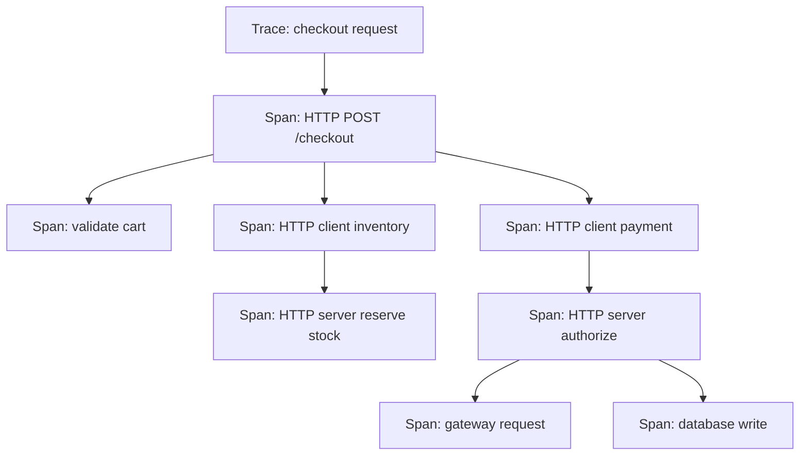
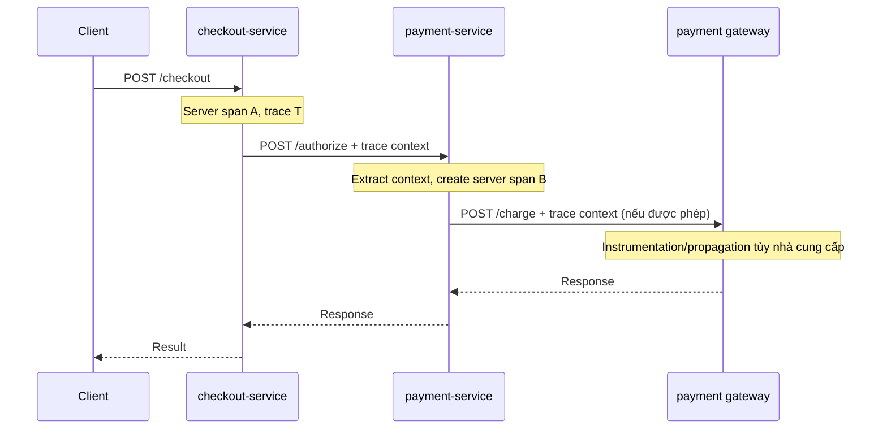
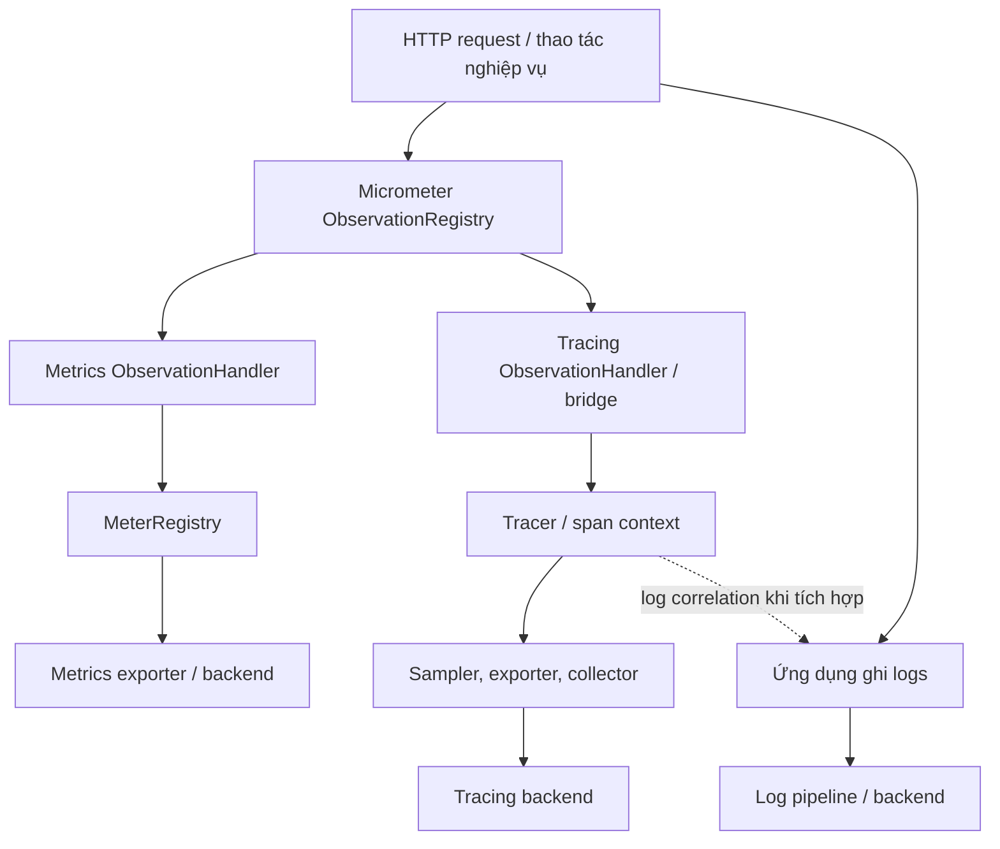

# Trace là gì trong distributed tracing?

Một khách hàng gọi `POST /checkout` trên ứng dụng Spring Boot. Dịch vụ checkout kiểm tra giỏ hàng, truy vấn tồn kho, gọi dịch vụ thanh toán, rồi ghi kết quả vào database. Người dùng chỉ thấy **một request chậm 2,4 giây**; còn hệ thống phía sau thực hiện nhiều hoạt động ở nhiều service. Metric HTTP có thể cho biết p95 latency tăng, log ghi rằng cổng thanh toán bị timeout, nhưng câu hỏi quan trọng vẫn là: **request cụ thể này đã đi qua đâu, mỗi bước mất bao lâu và những bước nào liên quan đến nhau?**

**Trace** là mô hình dữ liệu giúp quan sát **hành trình của một hoạt động xuyên qua nhiều bước thực thi**, thường trải dài qua nhiều thread, process hoặc service. Một trace tập hợp các **span** liên quan với nhau bằng những định danh và quan hệ ngữ cảnh. Khi instrument và propagation đúng, ta có thể mở một trace để đọc các bước đã được đo, thời điểm, thời lượng, lỗi và metadata liên quan.

Bài này thuộc chương **Tracing** của module **SPRING_BOOT_OBSERVABILITY**. Module thiết lập observability cho Spring Boot bằng Micrometer Observation, metrics, logs và distributed tracing; đồng thời tìm hiểu context propagation, tag/cardinality, exporter, sampling và liên kết các tín hiệu để điều tra lỗi, độ trễ và hành vi ứng dụng trên môi trường thực. Bài học tập trung vào **bản chất của trace**, cách trace được hình thành và giới hạn của điều chúng ta thực sự nhìn thấy.

## Mục tiêu học tập

Sau bài này, bạn có thể:

1. Định nghĩa được **trace**, **span**, **trace ID**, **span ID** và **parent span**; đọc một sơ đồ trace nhiều service.
2. Phân biệt trace với log và metric, cũng như phân biệt **trace đầy đủ về mặt nghiệp vụ** với **trace chỉ chứa các bước đã instrument**.
3. Mô tả span start/end, attributes, events, status, links và quan hệ giữa spans.
4. Giải thích vì sao **context propagation** qua HTTP, messaging và thread là điều kiện để giữ liên kết của một distributed trace.
5. Hiểu vai trò của Micrometer Observation, tracing bridge, sampler, exporter, collector và trace backend trong Spring Boot.
6. Biết ý nghĩa của head/tail sampling, hạn chế khi trace bị lấy mẫu hoặc bị drop và cách kết hợp traces với metrics/logs.
7. Nhận diện rủi ro cardinality, dữ liệu nhạy cảm, span thiếu hoặc duration dễ bị diễn giải sai.
8. Áp dụng quy trình điều tra có bằng chứng bằng trace mà không nhầm tương quan với quan hệ nhân quả.

## 1. Trace mô tả hành trình, không chỉ một dòng log

Giả sử một request checkout đi qua ba dịch vụ:

```text
Người dùng
   |
   v
checkout-service
   |-- validate cart
   |-- inventory-service: reserve stock
   |-- payment-service: authorize payment
   |       |-- external payment gateway
   |       +-- database: record result
   +-- respond to user
```

Mỗi dịch vụ có thể ghi log riêng, nhưng nếu không có khóa tương quan và thời điểm đáng tin cậy, việc ghép các dòng log của một request thành một hành trình rất khó. Distributed tracing đưa ra một mô hình khác:

- Một **trace** đại diện cho một hành trình/hoạt động logic được theo dõi.
- Mỗi **span** đại diện cho một bước được instrument trong hành trình.
- Các span chia sẻ **trace ID** và có thể liên kết bằng **parent span ID** hoặc **span links**.
- Mỗi span ghi thời điểm bắt đầu/kết thúc, tên bước và các thuộc tính phù hợp.
- Trace backend tổng hợp các span đã nhận để trực quan hóa timeline và quan hệ.



Sơ đồ trên mô tả **quan hệ nghiệp vụ mong muốn**, không phải cam kết rằng các client/server spans chắc chắn sẽ được tạo. Kết quả thực tế phụ thuộc vào instrumentation, propagation, sampling, exporter và khả năng lưu trữ của backend.

### Trace khác request như thế nào?

Một HTTP request có thể khởi đầu một trace, nhưng không nên coi “một request = đúng một trace hoàn chỉnh” là luật bất biến:

- Request có thể không có trace được lưu vì sampling.
- Request có thể kích hoạt tác vụ bất đồng bộ tồn tại sau lúc trả response; quan hệ có thể dùng trace tiếp nối hoặc span links tùy thiết kế.
- Một trace có thể chứa nhiều lời gọi service và nhiều span, không chỉ một controller.
- Một công việc batch/message consumer có thể là nguồn khởi đầu trace mà không có HTTP request.
- Nếu propagation bị mất, cùng một giao dịch nghiệp vụ có thể xuất hiện thành **nhiều trace rời nhau**.

## 2. Span là đơn vị cơ bản của một trace

**Span** biểu diễn một thao tác đã được instrument: xử lý HTTP request, thực hiện truy vấn DB, gọi API downstream, xử lý message, hoặc chạy bước nghiệp vụ.

Các thông tin thường liên quan đến một span:

| Thành phần | Ý nghĩa | Ví dụ minh họa |
|---|---|---|
| **Trace ID** | Định danh trace mà span thuộc về | `6f8c...` |
| **Span ID** | Định danh một span trong trace | `a9b4...` |
| **Parent span ID** | Span cha trực tiếp, nếu có | ID span HTTP server của checkout |
| **Name** | Tên loại thao tác, nên ổn định | `checkout.payment.authorize` |
| **Start time** | Mốc bắt đầu được ghi nhận | 10:15:00.120 |
| **End time / duration** | Mốc kết thúc và khoảng thời gian được quan sát | 85 ms |
| **Kind** | Vai trò trong lời gọi giao tiếp | `SERVER`, `CLIENT`, `PRODUCER`, `CONSUMER`, `INTERNAL` |
| **Attributes** | Các key-value mô tả thao tác | `http.request.method=POST` |
| **Events** | Các mốc/sự kiện đáng chú ý trong span | Retry, exception |
| **Status** | Trạng thái theo semantic conventions của tracing stack | `OK`, `ERROR` hoặc chưa đặt |
| **Links** | Liên hệ với các span context khác | Công việc fan-in từ nhiều message |

Không phải mọi library hoặc backend đều hiển thị các trường với cùng tên và kiểu. Ví dụ tên HTTP attributes phụ thuộc semantic conventions và phiên bản OpenTelemetry/Micrometer. Hãy kiểm tra dữ liệu thực tế thay vì chỉ dựa vào hình minh họa.

### 2.1. Trace ID và span ID

Trace ID giúp nhận ra các span cùng một hành trình. Span ID giúp phân biệt từng bước trong trace.

Trong hệ tracing hỗ trợ W3C Trace Context, trace ID có 16 byte (biểu diễn bằng 32 ký tự hex), span ID có 8 byte (16 ký tự hex). Ví dụ cấu trúc chuẩn:

```text
trace-id:  0af7651916cd43dd8448eb211c80319c
span-id:  b7ad6b7169203331
```

Đây là **ID chẩn đoán/định danh**, không phải dữ liệu nghiệp vụ. Không suy đoán tên người dùng, đơn hàng, môi trường hoặc loại lỗi từ nội dung của trace ID. Mỗi span trong cùng một trace có span ID riêng; một trace ID không chứng minh mọi service đã gửi span đầy đủ.

### 2.2. Root span và child span

Một **root span** không có parent trong quan hệ parent-child đang được biểu diễn. Các span bên dưới có parent ID, tạo thành cấu trúc phân cấp.

Ví dụ:

```text
Trace ID: T-01
  HTTP POST /checkout  [span A, root]
    validate cart      [span B, parent A]
    reserve inventory  [span C, parent A]
      DB query         [span D, parent C]
    authorize payment  [span E, parent A]
      gateway request  [span F, parent E]
```

Khi xem trace UI, cần phân biệt:

- **Quan hệ parent-child** cho biết context được kế thừa/thiết lập như thế nào.
- **Thời gian bắt đầu/kết thúc** cho biết các bước chồng lấn hay nối tiếp.
- **Root** không nhất thiết là bước nghiệp vụ đầu tiên trên toàn bộ hệ thống nếu upstream không instrument hoặc trace data bị thiếu.
- Một span **được hiển thị như root** trên backend có thể chỉ vì không nhận được span cha.

### 2.3. Span kind không phải mức độ quan trọng

Các kind phổ biến:

- `SERVER`: phía nhận và xử lý một request RPC/HTTP.
- `CLIENT`: phía thực hiện lời gọi outbound.
- `PRODUCER`: phía phát message.
- `CONSUMER`: phía nhận/xử lý message.
- `INTERNAL`: thao tác bên trong process.

Span kind cung cấp ngữ nghĩa về hướng giao tiếp, không tự biểu thị thao tác nhanh/chậm hay thành công/thất bại. Một span `INTERNAL` cho nghiệp vụ authorize có thể quan trọng hơn một span HTTP client, tùy câu hỏi điều tra.

## 3. Một trace được hình thành theo thời gian như thế nào?

Giả sử yêu cầu checkout kéo dài 900 ms:

```text
Trục thời gian (ms)
0           200         400         600         800   900
|------------|-----------|-----------|-----------|------|

checkout HTTP request    [================================] 900
validate cart              [==]                               60
inventory reserve             [===========]                  300
authorize payment                         [================] 430
write audit DB                                     [===]      80
```

Mỗi thanh tương ứng một span, nếu đoạn đó được instrument. Một số spans có thể chạy song song; nhiều child spans có thể chồng lấn trong cùng khoảng thời gian của parent.

**Không cộng mọi duration của child spans để suy ra duration của root.** Nếu hai lời gọi chạy song song 300 ms và 400 ms, tổng durations là 700 ms nhưng thời gian thực tăng thêm có thể chỉ khoảng 400 ms. Ngược lại, có khoảng thời gian của parent không được các child span nào mô tả, chẳng hạn tính toán nội bộ, chờ lock hay phần code chưa instrument.

### 3.1. Span duration không phải số liệu tuyệt đối về nguyên nhân

Span client 800 ms chỉ cho biết **đoạn thực thi được instrument ở phía client** kéo dài khoảng đó. Nó có thể bao gồm DNS, connection acquisition, network, chờ phía server và đọc response theo scope của instrumentation. Nó **không chứng minh** server đã xử lý CPU trong 800 ms.

Span server 500 ms cho biết phạm vi phía server được đo; nó không nói riêng phần nào là CPU, I/O hay chờ thread. Muốn biết nguyên nhân cần kết hợp child spans, metrics tài nguyên, logs, đôi khi profiling.

### 3.2. Lệch đồng hồ và thứ tự sự kiện

Nhiều span nằm trên các host khác nhau. Sai lệch đồng hồ (clock skew), làm tròn timestamp hoặc độ phân giải của instrumentation có thể khiến timeline nhìn như child bắt đầu trước parent hoặc có duration bất thường. Tracing backend có thể hiệu chỉnh hoặc không.

Không suy ra ngay quan hệ nhân quả từ vài millisecond chênh lệch trên timeline giữa hai host. Cần xem propagation, thứ tự request-response và clock synchronization.

## 4. Parent-child khác span links

Cấu trúc parent-child phù hợp khi một thao tác được thực hiện trong ngữ cảnh của một thao tác khác. Tuy nhiên, các workflow bất đồng bộ có thể có nhiều nguồn hoặc tạo nhiệm vụ mới không nên biểu diễn bằng một parent duy nhất.

**Span link** cho phép gắn một span với context của một hoặc nhiều span khác mà không nói chúng là parent trực tiếp.

Ví dụ xử lý batch:

```text
Message A -> producer span A ---\
                                 \
Message B -> producer span B -----> batch consumer span C
                                 /   (C links to A and B)
Message D -> producer span D ---/
```

Nếu consumer xử lý nhiều message cùng lúc, lựa chọn một producer làm parent duy nhất có thể gây hiểu sai. Span links có thể bảo toàn các quan hệ đầu vào mà vẫn giữ ngữ nghĩa đúng.

Khi thiết kế, cần phân biệt:

| Quan hệ | Khi nào thường phù hợp | Lưu ý |
|---|---|---|
| **Parent-child** | Lời gọi lồng nhau hoặc context cha rõ ràng | Một span thường có tối đa một parent trực tiếp |
| **Span link** | Batch, fan-in, kết hợp nhiều message, công việc có mối liên hệ không phải cha-con | Link không tự tạo waterfall cha-con thông thường |
| **Cùng trace ID** | Các span thuộc cùng trace | Chưa đủ chứng minh mọi dependency đều được instrument |
| **Cùng business ID** | Các sự kiện cùng giao dịch nghiệp vụ | Có thể trải qua nhiều trace khác nhau |

Với queue/messaging, nhiều thư viện có cách biểu diễn propagation và span links khác nhau. Không áp đặt một kiểu quan hệ cho mọi trường hợp; hãy chọn theo vòng đời và semantic conventions thực tế.

## 5. Tại sao distributed tracing cần context propagation?

Một trace phân tán chỉ có ý nghĩa khi các thành phần có thể **chuyển và khôi phục thông tin liên kết** qua ranh giới thực thi.

Với HTTP:



Các bước chính:

1. **Inject:** HTTP client instrumentation lấy span context hiện hành và gắn vào headers outbound.
2. **Transport:** headers đi qua network, gateway/proxy và các dịch vụ trung gian.
3. **Extract:** server instrumentation nhận headers, khôi phục context phù hợp.
4. **Create span:** phía nhận tạo span với quan hệ theo context đã khôi phục.
5. **Close scope và export:** context được khôi phục đúng khi kết thúc, spans được chuyển tới pipeline nếu cấu hình giữ lại.

Một định dạng phổ biến là **W3C Trace Context** với `traceparent` và tùy chọn `tracestate`. Ví dụ:

```http
traceparent: 00-0af7651916cd43dd8448eb211c80319c-b7ad6b7169203331-01
```

Header trên gồm version, trace ID, parent ID và trace flags. Trace flags có thể mang thông tin sampled; nó **không phải token xác thực hay bằng chứng rằng backend đã lưu trace**. Một số hệ thống dùng B3 hoặc propagator khác; format phải tương thích ở hai đầu.

### 5.1. Propagation khác export

Propagation mang **context** sang bước tiếp theo để tạo quan hệ span. Export chuyển **dữ liệu span đã ghi nhận** tới collector/backend. Một request có thể truyền `traceparent` đúng nhưng trace vẫn không xuất hiện ở UI do sampling, exporter, collector hoặc retention.

Ngược lại, hai service đều export span nhưng không propagate context có thể tạo ra hai trace rời nhau.

### 5.2. Giữa thread và async callback

Trong ứng dụng Java, việc mở observation/tracing scope trên thread HTTP **không đồng nghĩa** scope đó tự đi sang mọi thread pool. Ví dụ:

```java
// Minh họa vấn đề; không phải mẫu propagation đúng:
try (Observation.Scope scope = parentObservation.openScope()) {
    executor.execute(() -> doBackgroundWork());
}
```

`doBackgroundWork()` có thể chạy ở thread khác sau khi scope cha đã đóng. Nếu không capture/restore context bằng instrumentation hoặc Micrometer Context Propagation phù hợp, callback có thể không nhìn thấy span hiện hành.

Với `@Async`, `CompletableFuture`, raw executors, Reactor hoặc messaging, cần chọn cơ chế propagation đúng của stack đang chạy. Trong Reactor, context thường gắn với subscription/signal; mở scope khi **xây dựng** `Mono`/`Flux` không bảo đảm scope tồn tại lúc callback thực sự chạy.

**Không giữ một scope mở xuyên nhiều thread tùy ý.** Scope nên được sở hữu và đóng đúng nơi công việc thực thi. Với tác vụ có vòng đời độc lập lâu dài, cần quyết định span parent/link và thời điểm kết thúc dựa theo ngữ nghĩa nghiệp vụ.

### 5.3. Baggage không phải tracing attribute mặc định

**Baggage** là dữ liệu ngữ cảnh bổ sung có thể được propagate qua các hop khi hệ thống hỗ trợ. Baggage khác trace ID và khác span attribute lưu ở backend:

- Không phải baggage nào cũng tự được ghi thành searchable span attribute.
- Baggage có thể đi qua boundary tin cậy và header HTTP; cần giới hạn kích thước và nội dung.
- Không cho token, số thẻ, email, thông tin khách hàng hoặc payload nhạy cảm vào baggage.
- Không dùng baggage như kênh truyền tùy ý các field có cardinality cao chỉ để phục vụ tìm kiếm.

## 6. Trace, metrics và logs trả lời câu hỏi khác nhau

| Tín hiệu | Thế mạnh | Giới hạn quan trọng |
|---|---|---|
| **Metrics** | Tỷ lệ lỗi, throughput, p95/p99 latency, tài nguyên, xu hướng toàn hệ thống | Tổng hợp làm mất ngữ cảnh của một request cụ thể |
| **Logs** | Sự kiện, trạng thái, thông báo lỗi, bằng chứng từ ứng dụng | Tùy nội dung được ghi; có thể thiếu correlation hoặc thất lạc |
| **Traces** | Hành trình của request đã được instrument, quan hệ và thời lượng spans | Có khoảng trống nếu thiếu instrumentation, sampling hoặc propagation |

Ví dụ:

- **Metric:** `http.server.requests` báo p95 tăng từ 300 ms lên 1,2 giây trong 15 phút.
- **Log:** `payment gateway timeout` kèm `traceId` ở một số request.
- **Trace:** một giao dịch có child span HTTP client kéo dài 900 ms trong khi các bước DB ngắn.

Kết hợp ba tín hiệu giúp lập giả thuyết: gateway có thể đóng góp lớn vào latency. Nhưng **một trace không chứng minh** 100% request chậm cùng nguyên nhân, đặc biệt nếu sampling chỉ giữ một số trường hợp.

### Liên kết bằng trace ID

Khi Micrometer Tracing và log correlation được tích hợp đúng, một log có thể mang `traceId`/`spanId`. Ví dụ log minh họa:

```json
{
  "timestamp": "2026-11-22T10:15:01Z",
  "level": "WARN",
  "service": "checkout-service",
  "message": "Payment authorization timed out",
  "traceId": "0af7651916cd43dd8448eb211c80319c",
  "spanId": "b7ad6b7169203331"
}
```

Đây là log giả định. **Mở scope không tự tạo dòng log**, và log format có thể không in ID nếu chưa cấu hình. Trace ID xuất hiện trong log cũng **không bảo đảm** trace tương ứng đã được giữ bởi tracing backend.

Đặc biệt, **không gắn trace ID làm label cho metrics**: số lượng giá trị gần như bằng số request, dễ gây bùng nổ time series. Khi hạ tầng hỗ trợ, exemplar có thể liên kết một điểm trên biểu đồ metric tới trace mà không đưa mỗi trace ID thành nhãn của toàn bộ series.

## 7. Trace được tạo trong Spring Boot bằng cách nào?

Trong Spring Boot 3.x, tích hợp observability thường dựa trên các lớp liên quan nhưng không đồng nhất:

- **Micrometer Observation**: biểu diễn thao tác và vòng đời `start`, `openScope`, `error`, `stop`; cho handlers biết các mốc.
- **Micrometer Tracing**: cung cấp abstraction và bridge tới tracing implementation như OpenTelemetry hoặc Brave.
- **Tracing implementation/SDK**: quản lý spans, context, sampling và phối hợp exporter.
- **Exporter/collector**: vận chuyển spans tới nơi thu thập/lưu trữ như OpenTelemetry Collector và backend tracing.
- **Instrumentations**: HTTP server/client, messaging, database và code nghiệp vụ tạo các observation/span thích hợp.



**Một `ObservationRegistry` không tự tạo trace chỉ vì tồn tại.** Nó cần tracing handler/bridge và implementation tương ứng. Ngược lại, có tracing dependency không đồng nghĩa mọi method đều có span riêng; chỉ những vị trí đã instrument mới tạo span.

### 7.1. Dependency minh họa

Một cấu hình Gradle **mang tính minh họa cho một stack Spring Boot 3.x hỗ trợ Micrometer Tracing với OpenTelemetry bridge và OTLP exporter**:

```groovy
dependencies {
    implementation 'org.springframework.boot:spring-boot-starter-actuator'
    implementation 'io.micrometer:micrometer-tracing-bridge-otel'
    runtimeOnly 'io.opentelemetry:opentelemetry-exporter-otlp'
}
```

Đây là một **phương án** tích hợp, không phải yêu cầu dùng đồng thời mọi tracing bridge. Các phiên bản Spring Boot có thể khác nhau về starter, quản lý dependency và cơ chế auto-configuration; hãy đối chiếu stack cụ thể khi triển khai thật. Không trộn Brave và OpenTelemetry bridge tùy tiện vì có thể sinh cấu hình chồng chéo.

Ví dụ xác suất sampling được một số cấu hình Spring Boot 3.x hỗ trợ:

```yaml
spring:
  application:
    name: checkout-service

management:
  tracing:
    sampling:
      probability: 0.10
```

`0.10` chỉ minh họa **head sampling probability 10% theo cơ chế thực tế được cấu hình**; không đồng nghĩa 10% request mới được ghi metrics. Endpoint, giao thức OTLP, địa chỉ collector và authentication cần cấu hình phù hợp với thư viện/phiên bản. **Không thể xuất spans tới backend chỉ với YAML sampling mà thiếu exporter và pipeline.**

### 7.2. Instrument một bước nghiệp vụ bằng Observation

Nếu HTTP controller đã được instrument tự động, có thể bổ sung observation cho một bước nghiệp vụ có giá trị điều tra:

```java
import io.micrometer.observation.Observation;
import io.micrometer.observation.ObservationRegistry;
import org.springframework.stereotype.Service;

@Service
class PaymentAuthorizationService {
    private final ObservationRegistry observationRegistry;
    private final PaymentGateway gateway;

    PaymentAuthorizationService(
            ObservationRegistry observationRegistry,
            PaymentGateway gateway) {
        this.observationRegistry = observationRegistry;
        this.gateway = gateway;
    }

    PaymentResult authorize(PaymentRequest request) {
        return Observation.createNotStarted(
                        "checkout.payment.authorize", observationRegistry)
                .contextualName("authorize payment")
                .lowCardinalityKeyValue("payment.operation", "authorize")
                .lowCardinalityKeyValue("payment.provider", "provider-a")
                .observe(() -> gateway.authorize(request));
    }
}
```

`PaymentGateway`, `PaymentRequest` và `PaymentResult` là các kiểu nghiệp vụ giả định. Khi registry có tracing handler/bridge thích hợp và ngữ cảnh cha được duy trì, observation này **có thể** sinh span nghiệp vụ được liên kết với HTTP request. Nếu chỉ có metrics handler, nó có thể đo thời lượng nhưng không tạo span trong tracing backend.

`observe(...)` quản lý vòng đời đồng bộ của callback. Với tác vụ bất đồng bộ, không được dùng thao tác trả về `Future` hoặc publisher rồi coi observation đã đo đến lúc công việc thực sự hoàn tất; cần instrumentation phù hợp với lifecycle và context của async workflow.

**Không instrument trùng toàn bộ HTTP request** khi server instrumentation đã tạo span tương đương. Cần xác định ranh giới của span nghiệp vụ: ví dụ chỉ đo bước `authorize`, không chồng một HTTP server span thứ hai lên cùng phạm vi mà không có mục đích.

### 7.3. Tracing ở HTTP client cần builder được instrument

Các HTTP client do Spring quản lý/instrument theo cách được hỗ trợ có thể tạo span outbound và propagate context tự động. Nếu code tự khởi tạo client bằng API raw, bypass builder/customizer do Spring cung cấp hoặc truyền request qua một wrapper không instrument, trace có thể đứt tại đó.

Khi kiểm tra:

1. Có server span ở checkout không?
2. Có client span khi gọi payment-service không?
3. Request outbound có trace context header phù hợp không?
4. Payment-service có extract và tạo server span cùng trace không?
5. Spans có được exporter/backend giữ lại sau sampling không?

Một span client xuất hiện không đủ chứng minh server đã nhận header hoặc tạo span tương ứng. Cần xác nhận ở cả hai đầu.

## 8. Sampling: vì sao có request nhưng không có trace?

Một hệ thống nhiều request/giây có thể tạo khối lượng spans rất lớn. **Sampling** quyết định dữ liệu trace nào được ghi/giữ trong một số giai đoạn của pipeline.

### 8.1. Head-based sampling

Head sampling thường quyết định gần lúc bắt đầu trace, trước khi biết thao tác cuối cùng thành công hay lỗi. Nó giúp giảm tải sớm, nhưng có thể bỏ mất một request chậm hoặc lỗi hiếm.

**Parent-based sampling** có thể kế thừa quyết định sampling từ context cha, tăng tính nhất quán của các spans thuộc cùng trace; không đảm bảo tuyệt đối mọi span sẽ được lưu nếu propagation hoặc export bị lỗi.

### 8.2. Tail-based sampling

Tail sampling quyết định sau khi có thêm dữ liệu về trace, có thể ưu tiên trace lỗi, trace chậm hoặc một nhóm service/operation. Cách này cần collector/pipeline có khả năng giữ spans đủ lâu để đưa ra quyết định, tốn thêm buffer, bộ nhớ và cấu hình đúng.

Không đồng nhất `management.tracing.sampling.probability` với một chính sách **tail sampling** trong collector. Chúng diễn ra ở các lớp khác nhau.

| Tình huống | Có thể xảy ra | Điều không được kết luận |
|---|---|---|
| HTTP metric tăng, không thấy trace | Trace bị lấy mẫu bỏ, exporter/collector lỗi hoặc chưa instrument | Request không xảy ra |
| Log có trace ID, backend không có trace | Log correlation vẫn có ID, spans không được giữ | Log ghi sai |
| Trace thiếu một số spans | Instrumentation/propagation thiếu hoặc spans bị drop | Bước nghiệp vụ không được gọi |
| Trace hiện đủ spans nhưng latency metric khác | Hai tín hiệu có phạm vi và chính sách tổng hợp khác nhau | Một trong hai chắc chắn bị lỗi |

**Traces được lấy mẫu không phải tập thống kê đại diện mặc định**. Không lấy tỷ lệ spans lỗi trên tập trace đã được chọn ưu tiên lỗi để ước lượng chính xác tỷ lệ request lỗi của cả dịch vụ.

## 9. Span name, attributes, cardinality và dữ liệu nhạy cảm

Trace cần metadata để điều tra, nhưng càng nhiều metadata càng tốn tài nguyên và có nguy cơ lộ thông tin. Hai quy tắc quan trọng:

1. **Span name nên mô tả loại thao tác ổn định**, không chứa dữ liệu từng request.
2. **Attributes cần chọn lọc theo câu hỏi vận hành và quyền riêng tư**.

Ví dụ:

```text
Tốt:
  span.name = checkout.payment.authorize
  payment.operation = authorize
  payment.provider = provider-a
  http.route = /orders/{id}

Không nên:
  span.name = checkout.payment.authorize.order-928381
  http.url = /orders/928381?access_token=...
  payment.card_number = ...
  user.email = ...
```

Trong Micrometer Observation, `lowCardinalityKeyValue(...)` thể hiện chiều phân loại có tập giá trị hữu hạn, thích hợp hơn với metric tags; `highCardinalityKeyValue(...)` có thể dùng cho thông tin chi tiết của trace nếu handler và chính sách cho phép. **High cardinality không có nghĩa là an toàn**. Không đặt token, bí mật, payload tài chính hoặc PII vào spans, events hoặc baggage.

Trace ID và span ID vốn là các định danh có cardinality rất cao theo thiết kế. Điều đó không có nghĩa mọi order ID cũng nên được copy vào mọi span. Một số backend đánh index attributes, số khác không; chi phí tìm kiếm và retention tùy nền tảng.

### Tags không tự nối trace

Một metric có tag `payment.provider=provider-a` và một span có attribute cùng giá trị **chỉ chứng tỏ cả hai cùng nói về provider-a**, không chứng minh chúng xuất phát từ cùng request. Muốn nối một sự kiện cụ thể, cần trace ID/log correlation hoặc exemplar khi stack hỗ trợ.

Ngược lại, nếu cố gắn `traceId` lên tất cả metric tags thì time series có thể tăng gần theo số request; điều đó không phải giải pháp quan sát bền vững.

## 10. Trace không tự bảo đảm tính đầy đủ hay quan hệ nhân quả

Trace là **dữ liệu quan sát một phần hệ thống**, không phải bản ghi toàn tri. Những khoảng trống phổ biến:

- **Thiếu instrumentation:** thư viện/giao thức không tạo span, method nội bộ không được bao quanh.
- **Mất context propagation:** chuyển thread, HTTP client không instrument, proxy loại header, message consumer thiếu extraction.
- **Sampling và export:** spans không được chọn, queue/collector drop, backend quá tải hoặc retention hết.
- **Sai thời điểm:** span kết thúc trước callback async hoặc đo nhầm phạm vi.
- **Lệch đồng hồ:** timestamp giữa các host không đồng bộ.
- **Semantic status không thống nhất:** một business rejection có thể được ứng dụng coi là kết quả hợp lệ, trong khi HTTP 4xx hoặc exception được xử lý khác nhau theo conventions.
- **Dữ liệu giới hạn bởi quyền:** backend hoặc bộ lọc chỉ cho phép xem một phần spans/traces.
- **Quan hệ thời gian không đủ chứng minh nguyên nhân:** hai spans xảy ra cùng lúc không tự chứng minh một span gây chậm span kia.

Ví dụ, một span `payment-client` 900 ms và log timeout chỉ là **bằng chứng liên quan**; phải kiểm tra số lần retry, network, connection pool, payment-service server spans và tình trạng gateway trước khi quy nguyên nhân.

### Lưu ý về error status

Span có exception event hoặc `ERROR` status không luôn tương đương request HTTP 5xx hay giao dịch nghiệp vụ thất bại. Một exception có thể được catch/retry thành công; một business decline có thể là kết quả hợp lệ được trả về bằng HTTP 200. Định nghĩa **failure** cần rõ ở metrics/SLI và business logic, còn span status theo semantic conventions của tracing implementation.

## 11. Quy trình điều tra một request Spring Boot chậm

Giả sử dashboard cho thấy:

- p95 `POST /checkout` tăng từ 280 ms lên 1,5 giây trong 10 phút.
- HTTP 5xx tăng từ 0,2% lên 3%.
- Logs có một số thông điệp `payment provider timeout`.

Trên trace backend, kỹ sư mở một trace mẫu cho request chậm:

```text
HTTP POST /checkout                   1,420 ms
  validate cart                          45 ms
  inventory-service client              190 ms
  authorize payment                     980 ms
    payment-service client              940 ms
      gateway outbound request          910 ms
  update order DB                       100 ms
```

Dữ liệu minh họa cho thấy gateway outbound request là **ứng viên đáng điều tra**. Để đi đến kết luận đáng tin:

**Bước 1 — Khoanh vùng bằng metrics.** Xác định thời gian, route, instance, version và tỷ lệ lỗi thực tế. Metric là nguồn tốt hơn để lượng hóa phạm vi tác động.

**Bước 2 — Mở nhiều traces có liên quan.** So sánh request thành công/chậm/lỗi, chú ý chính sách sampling. Đừng khẳng định toàn bộ hệ thống chỉ từ một trace.

**Bước 3 — Kiểm tra cấu trúc spans.** Child span nào chiếm phần lớn critical path? Có spans song song hay những khoảng thời gian chưa instrument? Có trace bị đứt giữa checkout-service và payment-service không?

**Bước 4 — Liên kết logs bằng trace ID.** Tìm retry, timeout, circuit breaker, pool exhausted hoặc một exception cụ thể. Kiểm tra log có đúng trace ID và thời điểm gần với các spans không.

**Bước 5 — Kiểm tra phía dependency.** So sánh client và server span, network metrics, connection pool, queue, downstream error rate. Span client dài chưa đủ kết luận provider server có CPU bottleneck.

**Bước 6 — Đối chiếu thay đổi.** Deployment, cấu hình timeout, retry policy, traffic pattern hoặc sự cố hạ tầng có trùng thời điểm không?

**Bước 7 — Kiểm chứng giả thuyết.** Tái hiện bằng workload phù hợp hoặc theo dõi sau biện pháp sửa; đo lại p95/error rate và spans mẫu. Một thay đổi làm trace ngắn hơn nhưng metric lỗi vẫn cao chưa chứng minh sự cố đã xử lý xong.

### Kết luận có thể và không thể rút ra

| Bằng chứng | Kết luận hợp lệ | Kết luận không nên vội vàng |
|---|---|---|
| HTTP p95 tăng | Độ trễ của nhóm request tăng | Tất cả request đều chậm |
| Một span client kéo dài 900 ms | Phạm vi gọi outbound bị chậm ở trace này | Server đã chạy CPU 900 ms |
| Log timeout có trace ID | Có sự kiện timeout tương quan tới request | Mọi request lỗi đều timeout |
| Không thấy server span | Có khoảng trống tracing cần kiểm tra | Downstream chắc chắn không được gọi |
| Trace được lưu thành công | Một phần telemetry đã qua pipeline | Toàn bộ request/traces đều đã được lưu |

## 12. Các anti-pattern khi bắt đầu dùng tracing

| Sai lầm | Hậu quả | Cách cải thiện |
|---|---|---|
| Coi trace là log có nhiều dòng | Bỏ qua quan hệ span, timeline và context propagation | Hiểu trace ID, span ID, parent-child và links |
| Coi mỗi request luôn có một trace đầy đủ | Kết luận sai khi có sampling hoặc propagation gap | Phân biệt hành vi nghiệp vụ và dữ liệu instrumented |
| Tạo một span bao toàn bộ request khi server instrumentation đã có | Trùng span, timeline khó đọc | Chỉ thêm spans cho các bước nghiệp vụ cần thiết |
| Dùng order ID làm span name | Nhiều operation names, khó nhóm và tìm kiếm | Tên ổn định; metadata có kiểm soát |
| Gắn trace ID vào metric label | Bùng nổ cardinality metrics | Dùng log correlation và exemplar khi hỗ trợ |
| Mở scope trên thread cha rồi giả định tự lan qua executor | Trace cha-con bị đứt | Context capture/restore hoặc instrumentation async phù hợp |
| Dừng observation ngay khi tạo `Future`/`Mono` | Duration không phản ánh xử lý async thực tế | Gắn lifecycle vào thời điểm hoàn thành/hủy |
| Tưởng traceparent là header xác thực | Có thể đặt niềm tin sai vào dữ liệu bên ngoài | Xử lý context như dữ liệu không đáng tin; xác thực riêng |
| Coi một span `ERROR` là toàn bộ transaction thất bại | Sai ngữ nghĩa nghiệp vụ | Đối chiếu outcome và SLI riêng |
| Cộng mọi child durations để tìm tổng thời gian | Đếm trùng spans chồng lấn | Phân tích critical path và khoảng chưa instrument |
| Tìm không thấy trace rồi tăng sampling vô hạn | Chi phí cao, có thể không sửa propagation/export | Xác định nơi dữ liệu mất trước khi đổi sampling |
| Đưa PII/token vào attributes, baggage | Rủi ro lộ dữ liệu qua telemetry pipeline | Áp dụng allowlist, redaction, retention và phân quyền |

## 13. Checklist để đưa tracing vào vận hành

Trước khi dùng trace làm bằng chứng điều tra, hãy kiểm tra:

1. **Instrumentation:** HTTP server/client, database, messaging và bước nghiệp vụ quan trọng có tạo spans đúng phạm vi không?
2. **Bridge và handlers:** Micrometer Observation có tracing handler/bridge và tracer thực sự không?
3. **Trace context:** W3C `traceparent` hoặc propagator được chọn có nhất quán giữa các service không?
4. **Async:** executor, `@Async`, Reactor, queues có context capture/restore đúng lúc không?
5. **Span naming:** tên operations ổn định, không có IDs động/raw URLs hoặc payload nhạy cảm không?
6. **Attributes/events:** có thông tin phân loại hữu ích, cardinality hợp lý, tuân thủ privacy và retention không?
7. **Sampler:** head/parent/tail sampling được áp ở đâu và tỷ lệ giữ thực tế thế nào?
8. **Exporter:** queue, retry, collector, endpoint, TLS/authentication và backend đã được kiểm tra chưa?
9. **Sampling bias:** có phân biệt trace mẫu với thống kê trên toàn bộ request không?
10. **Log correlation:** logs có `traceId`/`spanId` trong scope phù hợp không? Có bị rò rỉ MDC sang request khác không?
11. **Metrics correlation:** có HTTP latency, throughput, error rate, SLI để lượng hóa tác động bên cạnh traces không?
12. **Thời gian:** clock skew, start/end và asynchronous lifecycle có làm duration khó diễn giải không?
13. **Quan hệ:** parent-child và links có phản ánh đúng fan-out, fan-in và message handling không?
14. **Vận hành:** có dashboard theo service/version, thời gian lưu, quyền truy cập và quy trình truy vấn một trace cụ thể không?
15. **Kiểm thử:** đã chạy request thành công, request lỗi, call downstream, tác vụ async và trường hợp sampler drop chưa?

## 14. Câu hỏi tự đánh giá

**Câu 1.** Một trace gồm mười span. Có nghĩa đã theo dõi được toàn bộ mười bước duy nhất của nghiệp vụ không?

**Gợi ý:** Không. Span chỉ đại diện cho các phạm vi được instrument; nghiệp vụ có thể có nhiều bước chưa được đo, và một bước có thể tạo nhiều spans.

**Câu 2.** Trace ID và span ID có vai trò khác nhau như thế nào?

**Gợi ý:** Trace ID nhóm các spans thuộc một trace; span ID định danh riêng một span, còn parent span ID giúp xây dựng quan hệ cha-con.

**Câu 3.** Một child span kéo dài 300 ms và một child span khác 400 ms. Có thể kết luận parent mất ít nhất 700 ms không?

**Gợi ý:** Không. Hai child spans có thể chạy song song hoặc chồng lấn. Cần xem timeline và critical path.

**Câu 4.** Checkout-service và payment-service đều có spans nhưng thuộc hai trace ID khác nhau. Nên kiểm tra gì?

**Gợi ý:** Kiểm tra client inject, server extract, định dạng propagator, proxy/gateway headers, async context và việc tạo root mới ngoài dự kiến.

**Câu 5.** Log có trace ID của một request nhưng backend tracing không tìm được trace. Điều đó chứng minh request chưa chạy không?

**Gợi ý:** Không. Sampling có thể bỏ trace; exporter/collector/backend cũng có thể làm mất hoặc hết retention. Log vẫn có thể giữ ID.

**Câu 6.** Tại sao không nên gắn `traceId` làm tag cho mọi HTTP metric?

**Gợi ý:** Gần như mỗi request có ID riêng, gây cardinality rất cao và số time series lớn. Dùng correlation log/traces hoặc exemplar theo stack.

**Câu 7.** `Observation.createNotStarted(...).observe(...)` luôn tạo span hiển thị trong backend đúng không?

**Gợi ý:** Không. Nó quản lý observation; muốn có span cần tracing handler/bridge, instrumentation/context phù hợp và trace được giữ qua sampler/exporter.

**Câu 8.** Khi batch consumer xử lý nhiều message từ các producer khác nhau, tại sao span links có thể tốt hơn parent duy nhất?

**Gợi ý:** Links giữ mối liên hệ tới nhiều nguồn mà không tạo quan hệ cha-con sai; việc chọn parent/link cần theo semantics của messaging stack.

## Kết luận

**Trace là tập các spans liên quan, mô tả những phần hành trình của một hoạt động đã được instrument** qua nhiều bước hoặc service. Trace ID giúp nhóm hành trình, span ID và quan hệ parent-child/links giúp hiểu cấu trúc, còn timestamp và attributes hỗ trợ phân tích thời gian và lỗi. Trong Spring Boot, Micrometer Observation kết hợp tracing bridge, context propagation, sampler, exporter và backend để hình thành distributed traces. Nhưng trace không tự đầy đủ, không thay metrics để đo quy mô tác động và không thay logs để ghi mọi sự kiện. Cách dùng tracing đáng tin là đặt tên ổn định, truyền context đúng, quản lý chi phí/dữ liệu nhạy cảm, rồi đối chiếu traces với metrics, logs và bằng chứng vận hành trước khi kết luận nguyên nhân.
