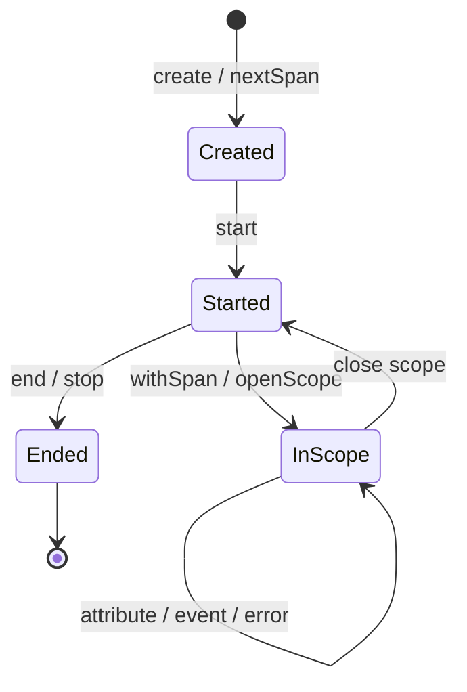
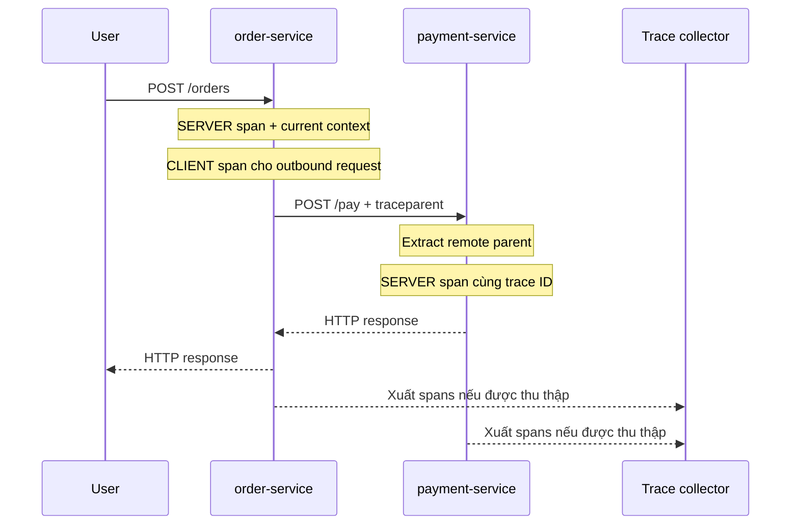
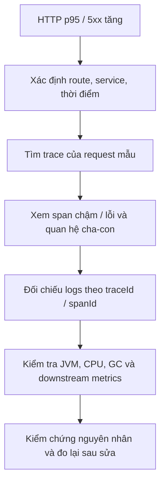

# Span là gì? Đơn vị quan sát cơ bản của distributed tracing

Một khách hàng đặt hàng qua API `POST /orders`. Request đi qua `order-service`, kiểm tra tồn kho, gọi `payment-service` rồi ghi dữ liệu. Dashboard báo p95 tăng từ 250 ms lên 1,4 giây, nhưng chỉ số HTTP không chỉ rõ thời gian mất ở bước nào. **Distributed tracing** giúp tái dựng đường đi của một yêu cầu dưới dạng những khoảng công việc có quan hệ với nhau. Mỗi khoảng công việc đó được gọi là một **span**.

Bài **“Span là gì”** nằm trong chương **Tracing** của module `SPRING_BOOT_OBSERVABILITY`. Module học cách thiết lập observability cho Spring Boot với Micrometer Observation, metrics, logs và distributed tracing; hiểu context propagation, tag/cardinality, exporter, sampling và liên kết tín hiệu để điều tra lỗi, độ trễ và hành vi ứng dụng trên môi trường thực. Bài này tập trung vào khái niệm span, cấu trúc, vòng đời, quan hệ giữa các span, cách tạo/quan sát span trong Spring Boot và những điều span **có thể hoặc không thể chứng minh** khi chẩn đoán sự cố.

## 1. Khái niệm span và trace

**Span** là bản ghi đại diện cho một đơn vị công việc có thời điểm bắt đầu và kết thúc: xử lý HTTP request, xác nhận đơn hàng, gọi database, gửi message, gọi HTTP client hoặc chạy một bước nghiệp vụ. Một span thường có tên, mã định danh, mốc thời gian, thuộc tính, sự kiện và thông tin liên kết với công việc khác.

**Trace** là tập các span liên quan đến cùng một luồng xử lý phân tán, được nối bằng **trace context** và quan hệ cha–con hoặc các quan hệ liên kết khác. Trace thường bắt đầu khi hệ thống nhận yêu cầu từ bên ngoài, nhưng cũng có thể bắt đầu từ tác vụ scheduler, message hoặc một công việc không có HTTP request.

| Khái niệm | Ý nghĩa | Ví dụ |
| --- | --- | --- |
| Trace | Toàn bộ luồng xử lý được truy vết | Một lần khách đặt hàng qua nhiều service |
| Span | Một đơn vị công việc có khoảng thời gian | `inventory.reserve`, `payment.authorize` |
| Trace ID | Mã chung dùng để nhóm các span trong cùng trace | Chuỗi hex 32 ký tự theo định dạng W3C thông dụng |
| Span ID | Mã riêng của một span trong trace | Chuỗi hex 16 ký tự theo W3C |
| Parent span | Span tạo hoặc làm ngữ cảnh cha của một span khác | HTTP server span là cha của nghiệp vụ đặt hàng |
| Root span | Span không có cha được ghi nhận trong trace | Span đầu tiên khi một tác vụ bắt đầu trace mới |
| Span context | Thông tin định danh và các cờ/giá trị cần truyền | Trace ID, span ID, trace flags, trace state |

Ví dụ một trace phân cấp:

```text
Trace: 4bf92f3577b34da6a3ce929d0e0e4736
└── HTTP SERVER POST /orders         (span A, 980 ms)
    └── order.place                  (span B, 900 ms)
        ├── inventory.reserve        (span C, 190 ms)
        └── payment.authorize        (span D, 580 ms)
            └── HTTP CLIENT /pay     (span E, 530 ms)
                └── HTTP SERVER /pay (span F, 490 ms ở service khác)
```

Tất cả span trong hình có thể chia sẻ **Trace ID**, trong khi mỗi span có **Span ID** riêng. Span C và D là hai span con của B. Span E và F ở hai tiến trình khác nhau có thể liên kết quan hệ cha–con nếu HTTP client inject và HTTP server extract trace context đúng cách.

**Một trace không bắt buộc có mọi span.** Sampling, lỗi exporter, thiếu instrumentation hoặc mất context propagation có thể khiến trace lưu trên backend thiếu một số nhánh. Thứ tự và thời lượng trên ví dụ chỉ minh họa, không phải kết quả một ứng dụng thực.

## 2. Cấu trúc một span

Trong hệ sinh thái OpenTelemetry, một span thường chứa các trường sau; hệ thống Micrometer Tracing có API trừu tượng riêng nhưng cùng hướng đến những khái niệm tracing này.

| Trường | Vai trò | Lưu ý |
| --- | --- | --- |
| Name | Tên thao tác | Ví dụ `order.place`; nên ổn định, không nhét ID động |
| Trace ID | Định danh trace | Thường giữ nguyên khi truyền qua nhiều service |
| Span ID | Định danh span | Mỗi span có ID riêng |
| Parent Span ID | Định danh span cha nếu có | Không phải span nào cũng có cha |
| Start/end timestamps | Xác định khoảng chạy | Dùng để tính duration và vẽ waterfall |
| Kind | Kiểu tương tác của span | `SERVER`, `CLIENT`, `INTERNAL`, `PRODUCER`, `CONSUMER` |
| Attributes/tags | Ngữ cảnh có cấu trúc | HTTP method, route template, dependency type, outcome |
| Events | Các mốc đáng chú ý trong span | Retry bắt đầu, cache miss, ngoại lệ được ghi nhận |
| Status/error | Tình trạng xử lý | Hệ thống tracing và convention quyết định cách biểu diễn |
| Links | Liên kết với span khác không theo cây cha–con | Batch hoặc message có nhiều nguồn |
| Resource | Thông tin service/process/host được SDK/exporter gắn khi có | `service.name`, phiên bản triển khai, môi trường |

Một ví dụ span hiển thị trong tracing backend có thể là:

```text
traceId      = 4bf92f3577b34da6a3ce929d0e0e4736
spanId       = 00f067aa0ba902b7
parentSpanId = b9c7c989f97918e1
name         = payment.authorize
kind         = INTERNAL
service.name = order-service
start        = 10:15:24.100
end          = 10:15:24.630
duration     = 530 ms
attributes:
  payment.channel = card
  outcome         = success
events:
  gateway.requested
  gateway.responded
```

Đây là dữ liệu **giả định**; sự xuất hiện của `kind`, `resource`, tags hay events tùy vào instrumentation và cấu hình. Thông tin `service.name` thường là **resource attribute** liên quan tiến trình, không nhất thiết là attribute được gắn trực tiếp lên từng span.

### 2.1. Trace ID và Span ID khác nhau thế nào?

- **Trace ID** nhóm các span thuộc một trace. Khi `order-service` gọi `payment-service`, trace ID thường được giữ nguyên nếu propagation hoạt động.
- **Span ID** nhận diện chính một span. Một span client và span server của cùng lời gọi HTTP là **hai span khác nhau**, thường có cùng trace ID nhưng span ID riêng.
- **Parent Span ID** chỉ ra ngữ cảnh cha. Span đầu tiên của một trace mới thường không có parent; một span được tạo từ request có remote parent sẽ có parent ID từ dịch vụ phía trước.

ID chỉ là khóa liên kết. Nó **không chứa nguyên nhân lỗi, tên khách hàng hoặc độ trễ**. Không được dùng trace ID làm metric tag vì giá trị gần như khác nhau ở mỗi trace, gây cardinality rất cao.

## 3. Span kind: nhìn vai trò của mỗi thao tác

Trong OpenTelemetry, **span kind** mô tả vai trò tương tác:

| Kind | Khi nào dùng | Ví dụ |
| --- | --- | --- |
| `SERVER` | Phía nhận và xử lý một lời gọi từ xa | HTTP request đến `payment-service` |
| `CLIENT` | Phía chủ động gọi một dịch vụ/tài nguyên từ xa | `order-service` gọi `payment-service` |
| `INTERNAL` | Công việc nội bộ trong một process | `inventory.reserve`, tính giá, validate đơn |
| `PRODUCER` | Phía phát thông điệp qua messaging | Publish `OrderCreated` vào broker |
| `CONSUMER` | Phía nhận và xử lý thông điệp | Consumer xử lý `OrderCreated` |

Đây là **ngữ nghĩa tương tác**, không phải HTTP status hay mức độ ưu tiên. Một span `CLIENT` không nhất thiết bị lỗi; một span `INTERNAL` có thể ghi nhận exception. Những span được tạo trực tiếp từ Observation có thể mang kind nội bộ nếu không có instrumentation chuyên biệt.

Để mô hình hóa HTTP call, instrumentation thường tạo một **CLIENT span** ở phía gọi và một **SERVER span** ở phía nhận. Hai span này có thể chồng thời gian lên nhau vì client chờ response trong lúc server xử lý. **Không cộng thẳng mọi duration để suy ra độ trễ toàn request.**

## 4. Duration, waterfall và đường găng (critical path)

Duration của span thường được tính từ thời điểm kết thúc trừ thời điểm bắt đầu:

\[
\text{span duration} = \text{end time} - \text{start time}.
\]

Ví dụ một request:

```text
Thời gian (ms)  0      200      400      600      800      1000
HTTP server     [----------------------------------------------] 980
order.place       [------------------------------------------]   900
inventory.reserve   [--------]                                  190
payment.authorize                 [--------------------------]  580
HTTP client /pay                    [-----------------------]     530
```

Các thanh ở đây được đơn giản hóa để minh họa. Khi đọc waterfall:

1. **Parent span chứa thời gian chạy của cả công việc lồng bên trong**, không phải chỉ thời gian xử lý trực tiếp của parent.
2. **Child span có thể chồng lên nhau** nếu code chạy song song; tổng duration của các child có thể lớn hơn duration parent.
3. Có thể có **khoảng trống không được instrument** giữa các child; không mặc nhiên xem khoảng trống là CPU work.
4. Một lời gọi HTTP có client span và server span; phần chênh có thể bao gồm network, queueing, serialization hoặc thời gian instrumentation, không phải tất cả là “network latency”.
5. Với trace xuyên nhiều máy, timestamp có thể bị sai lệch do đồng hồ chưa đồng bộ; phải cẩn trọng khi diễn giải những khoảng rất ngắn.

**Critical path** là chuỗi công việc quyết định độ trễ thực tế khi có xử lý đồng thời. Nó không được xác định đơn giản bằng cách chọn các span có tổng duration lớn nhất. Khi phát hiện span chậm, tiếp tục xem concurrency, queueing, GC, lock và các downstream call.

## 5. Vòng đời span: tạo, bắt đầu, gắn scope, ghi nhận, kết thúc

Một span có vòng đời riêng:



**Start** đánh dấu thời điểm bắt đầu; **end** hoàn thành span. **Scope** đặt span làm ngữ cảnh hiện hành trong phạm vi thực thi để các thao tác con có thể tìm thấy parent. Đóng scope **không đồng nghĩa** kết thúc span: scope khôi phục ngữ cảnh trước đó, còn `end()` kết thúc khoảng đo.

Quy tắc:

- Không tạo span mà quên kết thúc: backend có thể không nhận được span hoàn chỉnh.
- Không đóng scope của một thread trong một thread khác.
- Không giữ current span của request A trên thread pool khi thread được dùng cho request B.
- Ghi thông tin lỗi theo semantic nghiệp vụ và tracing; đừng mặc định HTTP status code nào cũng tương ứng một exception Java.
- Không tạo span cho mọi phép gán biến, getter hoặc vòng lặp rất nhỏ; chi phí quan sát và độ nhiễu của trace sẽ tăng.

### 5.1. Vì sao scope quan trọng?

Giả sử đang xử lý span cha `order.place`. Nếu `inventory.reserve` bắt đầu trong scope của cha, tracing layer có thể tạo quan hệ **parent → child**. Nếu code chạy trong một thread khác nhưng không restore context, span con có thể trở thành một trace mới hoặc thiếu quan hệ đúng.

Trong Spring Boot, **Micrometer Observation** giúp quản lý vòng đời công việc theo cách thống nhất; **Micrometer Tracing bridge** giúp chuyển các Observation phù hợp thành span qua tracer backend đã cấu hình. Không phải mọi Observation đều trở thành span nếu thiếu handler hoặc bị sampling/filter loại bỏ.

## 6. Tạo span nghiệp vụ thông qua Micrometer Observation

Với Spring Boot 3.x, cách thường được ưu tiên để instrument nghiệp vụ là dùng `ObservationRegistry` được Spring quản lý. Cách này có thể phục vụ **metrics và tracing** từ một vòng đời, thay vì viết hai bộ instrumentation riêng.

Giả sử đặt hàng cần giữ tồn kho:

```java
import io.micrometer.observation.Observation;
import io.micrometer.observation.ObservationRegistry;
import org.springframework.stereotype.Service;

@Service
public class InventoryService {
    private final ObservationRegistry observationRegistry;
    private final InventoryGateway gateway;

    public InventoryService(
            ObservationRegistry observationRegistry,
            InventoryGateway gateway) {
        this.observationRegistry = observationRegistry;
        this.gateway = gateway;
    }

    public Reservation reserve(OrderCommand command) {
        String channel = normalizeChannel(command.channel());

        return Observation.createNotStarted(
                "inventory.reserve", observationRegistry)
            .contextualName("reserve-inventory")
            .lowCardinalityKeyValue("sales.channel", channel)
            .observe(() -> gateway.reserve(command));
    }

    private static String normalizeChannel(String channel) {
        if ("web".equals(channel) || "mobile".equals(channel)
                || "partner".equals(channel)) {
            return channel;
        }
        return "other";
    }
}

record OrderCommand(String orderReference, String channel) {}
record Reservation(boolean reserved) {}

interface InventoryGateway {
    Reservation reserve(OrderCommand command);
}
```

Đây là ví dụ tập trung vào observability; ứng dụng thực tế phải có implementation được đăng ký làm bean cho `InventoryGateway`.

Khi gọi `reserve(... )`:

1. Observation tên `inventory.reserve` được tạo bằng registry có cấu hình của ứng dụng.
2. `observe(Supplier`)` bọc công việc **đồng bộ**, quản lý start/scope/stop và chuyển tiếp exception khi có lỗi.
3. Handler metrics có thể ghi Timer `inventory.reserve`.
4. Khi có tracing bridge và handler thích hợp, Observation có thể được biểu diễn thành span tên liên quan `reserve-inventory` với quan hệ parent đúng nếu current context đã được thiết lập.
5. Thuộc tính `sales.channel` có tập giá trị hữu hạn, phù hợp cho nhóm metrics; tránh biến `orderReference` thành low-cardinality metric tag.

**Một Annotation/Observation không bảo đảm span xuất hiện ở backend.** Cần tracer bridge, exporter, backend nhận dữ liệu và chính sách sampling phù hợp. Registry tự tạo trong service bằng `ObservationRegistry.create()` có thể thiếu handlers đã được Spring Boot đăng ký.

### 6.1. Khác biệt Observation và Span

| Micrometer Observation | Span |
| --- | --- |
| Khái niệm quan sát một thao tác theo vòng đời | Bản ghi truy vết của một thao tác |
| Có thể dẫn tới metric Timer, span hoặc handler khác | Phục vụ distributed tracing |
| `ObservationRegistry` + `ObservationHandler` | `Tracer`, tracing SDK, exporter/backend |
| `lowCardinalityKeyValue`, `highCardinalityKeyValue`, error/event | Attributes/tags, events, error/status tùy API |
| `openScope()` và `stop()` là hai trách nhiệm khác nhau | `SpanInScope.close()` và `span.end()` là hai trách nhiệm khác nhau |

Không nên tạo cả manual Tracer span và Observation span xung quanh cùng một bước chỉ vì muốn “thêm độ chi tiết”: điều này có thể tạo hai span gần như trùng nhau. Hãy xác định lớp instrumentation đang chịu trách nhiệm.

## 7. Tạo một span trực tiếp bằng Micrometer Tracer

Trong tình huống cần API cụ thể của tracing, có thể inject `io.micrometer.tracing.Tracer`. Ví dụ:

```java
import io.micrometer.tracing.Span;
import io.micrometer.tracing.Tracer;
import org.springframework.stereotype.Service;

@Service
public class PricingService {
    private final Tracer tracer;
    private final PricingEngine engine;

    public PricingService(Tracer tracer, PricingEngine engine) {
        this.tracer = tracer;
        this.engine = engine;
    }

    public PriceQuote calculate(PriceCommand command) {
        Span span = tracer.nextSpan().name("price.calculate");
        span.start();

        try (Tracer.SpanInScope scope = tracer.withSpan(span)) {
            span.tag("pricing.mode", "standard");
            span.event("pricing.started");
            PriceQuote quote = engine.calculate(command);
            span.event("pricing.completed");
            return quote;
        } catch (RuntimeException exception) {
            span.error(exception);
            throw exception;
        } finally {
            span.end();
        }
    }
}

record PriceCommand(String sku) {}
record PriceQuote(long amountMinor) {}
interface PricingEngine {
    PriceQuote calculate(PriceCommand command);
}
```

Ví dụ giả định có một bean `PricingEngine` và một `Tracer` được cấu hình. `tracer.nextSpan()` thường tạo span con từ ngữ cảnh hiện hành nếu có; khi không có parent hợp lệ, một trace mới có thể bắt đầu.

**Ý nghĩa từng thao tác:**

- `nextSpan().name(... )`: yêu cầu tạo span và định danh loại công việc.
- `start()`: bắt đầu đo khoảng thực thi.
- `withSpan(span)`: đặt span vào current scope; giúp những thao tác lồng nhau tìm được context khi được hỗ trợ.
- `tag(... )`, `event(... )`: bổ sung ngữ cảnh/trạng thái trong phạm vi trace.
- `error(exception)`: ghi thông tin lỗi theo cơ chế bridge/tracer, không thay thế xử lý exception của ứng dụng.
- `scope.close()` qua `try-with-resources`: trả current span về trạng thái trước đó.
- `span.end()` trong `finally`: kết thúc span kể cả khi có exception.

Với dữ liệu nhạy cảm, **không ghi nguyên văn SKU chứa dữ liệu người dùng, token, email hoặc payload** vào tags/events nếu chưa có nhu cầu và chính sách bảo vệ phù hợp.

### 7.1. Khi nào nên dùng Tracer trực tiếp?

Dùng Micrometer Tracer khi cần kiểm soát trực tiếp span, tags/events hoặc tích hợp một đoạn code tracing cụ thể. Với phần lớn instrumentation nghiệp vụ thông thường, Observation dễ tái sử dụng hơn do kết nối đồng thời nhiều tín hiệu và convention chung. Đừng thay thế hoàn toàn instrumentation HTTP/messaging tự động bằng các span thủ công nếu framework đã cung cấp ranh giới chuẩn.

## 8. Quan hệ cha–con giữa các service: propagation

Khi một request đi từ `api-gateway` tới `order-service` rồi `payment-service`, mỗi tiến trình có bộ nhớ và thread riêng. **Current span không thể tự di chuyển qua network**. Cần mã hóa trace context vào các trường truyền tải và khôi phục nó ở phía nhận.

Ví dụ W3C Trace Context dùng HTTP header:

```http
traceparent: 00-4bf92f3577b34da6a3ce929d0e0e4736-00f067aa0ba902b7-01
```

Với định dạng version `00` phổ biến:

| Phần | Ý nghĩa |
| --- | --- |
| `00` | Phiên bản định dạng traceparent |
| `4bf92f3577b34da6a3ce929d0e0e4736` | Trace ID (32 ký tự hex) |
| `00f067aa0ba902b7` | Parent ID được gửi trong context (16 ký tự hex) |
| `01` | Trace flags; bit sampled được bật trong ví dụ |

Header có thể đi kèm `tracestate` để chuyển metadata tracing do nhà cung cấp/SDK quản lý. Cờ sampled là một **tín hiệu về quyết định sampling**, không phải cam kết rằng mọi span chắc chắn đến backend và được lưu giữ. Có thể gặp các cơ chế head-based/tail-based sampling hoặc bước lọc trong collector.



Nếu bên gửi không inject header, bên nhận không extract hoặc hai bên dùng cấu hình propagation không tương thích, span ở service sau có thể mở trace mới. **Không sửa lỗi này bằng cách chép tay traceId vào metric tag**: cần sửa instrumentation và propagation.

### 8.1. Baggage có phải span attribute không?

**Baggage** là dữ liệu context được thiết kế để truyền xuyên ranh giới process cùng trace context khi được cấu hình. **Span attribute** là dữ liệu mô tả một span và không mặc nhiên được truyền tới service sau. Một attribute như `payment.channel=card` trên span A **không tự xuất hiện** trên span B ở process khác.

Baggage có thể ảnh hưởng kích thước header, quyền riêng tư và bảo mật; không dùng nó để truyền token, dữ liệu cá nhân hoặc các thông tin nhạy cảm một cách tùy tiện. Không phải mọi baggage field đều được đưa vào log MDC hay span attribute nếu chưa có cấu hình thích hợp.

## 9. Scope trên thread, async và reactive pipeline

Trong luồng đồng bộ, current span thường gắn với execution context của thread. Khi gọi `Executor`, `CompletableFuture`, `@Async`, message consumer hoặc một Reactor pipeline, code có thể tiếp tục trên thread khác.

Ví dụ dễ gây nhầm:

```java
// KHÔNG bảo đảm đo đến khi công việc CompletableFuture hoàn tất.
return Observation.createNotStarted("report.generate", registry)
    .observe(() -> CompletableFuture.supplyAsync(this::generateReport));
```

Observation ở đây có thể chỉ đo thời gian tạo/sắp lịch future; scope của thread hiện tại không tự theo task đến worker thread. Muốn đo toàn bộ vòng đời async, phải tổ chức thời điểm start/end theo **completion thật sự** và truyền context đúng cách.

Những nguyên tắc quan trọng:

1. **Capture** context của công việc cha ở điểm gửi task và **restore** khi worker chạy; đóng scope restore trong đúng thread.
2. Có thể dùng cơ chế Micrometer Context Propagation hoặc tích hợp framework tương ứng để xử lý ThreadLocal context.
3. Với Reactor/WebFlux, cần hiểu Reactor Context và propagation được hỗ trợ; đừng giả định một ThreadLocal có thể theo toàn bộ reactive chain.
4. Với messaging, producer/consumer có thể truyền context qua headers; các kiểu xử lý batch/fan-in có thể cần **span links** thay vì một quan hệ cha–con đơn giản.
5. Kiểm tra thực tế trace tree: span con phải nằm đúng trace, có parent phù hợp và thời gian đo đúng công việc.

**Không giữ `Tracer.SpanInScope` hoặc `Observation.Scope` mở từ một thread rồi đóng trong thread khác.** Scope chịu trách nhiệm khôi phục current context tại phạm vi nó được mở.

## 10. Attributes, events, lỗi và semantic conventions

Span được dùng để hiểu một thao tác, nhưng không phải nơi nên lưu mọi biến của chương trình. Hãy chọn thông tin trả lời câu hỏi vận hành cụ thể:

| Dữ liệu | Ví dụ hợp lý | Cần tránh |
| --- | --- | --- |
| Span name | `inventory.reserve` | `inventory.reserve-ORDER-928371` |
| Attribute có tập giá trị nhỏ | `inventory.outcome=reserved/rejected` | Giá trị tự do từ user input không giới hạn |
| HTTP attributes | Method, route template, response status theo convention | Raw URL chứa token, query nhạy cảm |
| Event | `retry.started`, `stock.lock.acquired` | Event cho mỗi dòng code hoặc mỗi phần tử trong vòng lặp |
| Exception | Loại lỗi, thông điệp đã được xử lý theo chính sách | Stack/payload/secret ngoài kiểm soát |
| Link | Liên kết nguồn batch message | Cố ép mọi công việc nhiều cha thành quan hệ một cha duy nhất |

Một số điểm cần nhớ:

- **Tag/attribute** bổ sung ngữ cảnh tại một span; chúng không nhất thiết trở thành metric tags.
- **Span event** đánh dấu một mốc có timestamp bên trong công việc, không tạo một span mới.
- **Error status** và **exception event** không nhất thiết đồng nghĩa. Tùy SDK, convention và handler, ghi exception có thể tạo event, thay đổi status hoặc cả hai.
- **HTTP 4xx** không phải lúc nào cũng là lỗi kỹ thuật; **nghiệp vụ từ chối** không bắt buộc phải được đánh dấu là exception. Xác định policy về lỗi theo nhu cầu quan sát.
- Thuộc tính có cardinality cao trong tracing cũng gây chi phí lưu trữ và truy vấn; dù tracing có thể giữ thông tin chi tiết hơn metrics, vẫn cần giới hạn và chính sách bảo mật.

### 10.1. Ví dụ event và error

Trong code dùng `Tracer`:

```java
Span span = tracer.nextSpan().name("inventory.reserve").start();
try (Tracer.SpanInScope scope = tracer.withSpan(span)) {
    span.tag("inventory.result", "pending");
    span.event("inventory.lookup.started");
    performReservation();
    span.tag("inventory.result", "reserved");
    span.event("inventory.lookup.completed");
} catch (RuntimeException ex) {
    span.tag("inventory.result", "error");
    span.error(ex);
    throw ex;
} finally {
    span.end();
}
```

Ví dụ giả định biến `tracer` và hàm `performReservation()` nằm trong cùng phạm vi phương thức. Với thao tác đồng bộ có kết quả nghiệp vụ như “out of stock”, có thể sử dụng attribute `inventory.result=rejected` mà không ném exception; xử lý này phụ thuộc hợp đồng nghiệp vụ.

## 11. Cấu hình distributed tracing với Spring Boot

Ví dụ sau dành cho **Spring Boot 3.x và Java 17+**, sử dụng Micrometer Tracing bridge sang OpenTelemetry; các phiên bản thư viện để Spring Boot BOM/parent quản lý. Kiểm tra property và exporter protocol theo **phiên bản Spring Boot cụ thể** trước khi áp dụng trong production.

```xml
<dependencies>
    <dependency>
        <groupId>org.springframework.boot</groupId>
        <artifactId>spring-boot-starter-web</artifactId>
    </dependency>
    <dependency>
        <groupId>org.springframework.boot</groupId>
        <artifactId>spring-boot-starter-actuator</artifactId>
    </dependency>
    <dependency>
        <groupId>io.micrometer</groupId>
        <artifactId>micrometer-tracing-bridge-otel</artifactId>
    </dependency>
    <dependency>
        <groupId>io.opentelemetry</groupId>
        <artifactId>opentelemetry-exporter-otlp</artifactId>
    </dependency>
</dependencies>
```

Ví dụ `application.yml` cho môi trường phát triển:

```yaml
spring:
  application:
    name: order-service

management:
  tracing:
    sampling:
      probability: 1.0   # Phục vụ kiểm tra local; không mặc định dùng trên production
  otlp:
    tracing:
      endpoint: http://otel-collector:4318/v1/traces
  endpoints:
    web:
      exposure:
        include: health,metrics
```

Đường `4318/v1/traces` ở đây là ví dụ receiver **OTLP HTTP**; hãy bảo đảm collector lắng nghe đúng endpoint, network và giao thức. Sampling `1.0` giúp quan sát nhiều trace trong thử nghiệm nhưng có thể tốn chi phí trên production. Không có một xác suất lấy mẫu tối ưu cho mọi dịch vụ.

**Đừng nhầm metric với trace:** `/actuator/metrics` cho biết meter; nó không phải trình duyệt trace và không xác nhận spans đã đến backend. Traces được gửi qua tracing exporter/collector tương ứng. Nếu cần Prometheus metrics, còn cần Prometheus registry và cấu hình scrape/export riêng.

### 11.1. Kiểm tra một trace end-to-end

1. Khởi động collector và tracing backend tương thích (có thể là Jaeger/Tempo hoặc hệ khác theo kiến trúc).
2. Gửi một request tới endpoint được instrument.
3. Tìm trace theo `service.name` và khoảng thời gian gần request.
4. Mở trace, xem HTTP SERVER span, business spans và HTTP CLIENT span nếu có.
5. Xác minh parent-child, trace IDs và thời lượng tương ứng.
6. Nếu có nhiều service, xác minh header propagation và span server ở service nhận cùng trace.
7. Kiểm tra log correlation nếu tracing bridge và logging pattern có cấu hình traceId/spanId.

Khi ứng dụng dùng WebFlux, messaging hoặc các HTTP client khác nhau, mức độ auto-instrumentation phụ thuộc framework, cách tạo client và cấu hình cụ thể. Ưu tiên dùng client builder/instance do Spring quản lý có hỗ trợ observation; một HTTP client tự tạo ngoài cơ chế đó có thể không tự truyền context.

## 12. Sampling và exporter ảnh hưởng đến việc nhìn thấy span

Một hệ có thể instrument rất nhiều span nhưng **không lưu mọi span** để kiểm soát chi phí:

| Cơ chế | Quyết định | Tác động |
| --- | --- | --- |
| Head-based sampling | Quyết định sớm khi bắt đầu trace dựa trên policy | Có thể bỏ cả trace trước khi biết request thất bại |
| Parent-based sampling | Xem quyết định sampling từ parent nếu có | Giúp giữ tính nhất quán giữa các dịch vụ |
| Tail-based sampling | Ra quyết định sau khi xem span/trace trong collector tương thích | Có thể ưu tiên trace lỗi/chậm nhưng cần hạ tầng giữ và phân tích dữ liệu |
| Exporter/collector | Chuyển/nhận/batch/retry/span processing | Lỗi mạng hoặc cấu hình sai có thể làm mất span đã được ghi nhận |
| Backend retention | Lưu bao lâu và cho phép truy vấn gì | Trace cũ có thể bị xóa dù đã export thành công |

Sampling probability `0.1` thường thể hiện mục tiêu giữ khoảng 10% trace theo một chính sách lấy mẫu xác suất, **không phải bảo đảm đúng 10% mỗi phút** và cũng không phải “mọi request lỗi đều được giữ”. Traces được giữ có thể bị lệch nếu có các policy lựa chọn khác nhau; cần hiểu cách sampling để diễn giải số lượng lỗi từ trace.

**Không dùng số span trên backend làm tổng số request** nếu có sampling. Muốn theo dõi request rate, error rate, p95/p99 tổng hợp, hãy dùng metrics được thiết kế và thu thập độc lập, chẳng hạn HTTP Timer/histogram.

### 12.1. Khi trace chỉ hiện một phần

Các nguyên nhân có thể là:

- Một service không cài tracing instrumentation/bridge.
- Header trace context không được inject hoặc bị proxy loại bỏ.
- Worker thread hoặc message consumer không restore context.
- Sampling và processor chọn bỏ một phần dữ liệu.
- Exporter/collector/backend bị lỗi, nghẽn hoặc chưa cấu hình.
- Truy vấn sai service name, khoảng thời gian hoặc trace ID.

Lúc chẩn đoán, cần phân biệt **span chưa được tạo**, **span có tạo nhưng không được export** và **span đã được export nhưng không thấy trong backend**. Chỉ nhìn một trace thiếu nhánh chưa đủ xác định nguyên nhân nào.

## 13. Span, metrics và logs bổ sung cho nhau

Giả sử `POST /orders` chậm và thỉnh thoảng trả lỗi:

| Tín hiệu | Đơn vị quan sát | Câu hỏi trả lời |
| --- | --- | --- |
| Metrics HTTP | Nhiều request được tổng hợp theo tag | Tỷ lệ 5xx, p95 và request rate thay đổi ra sao? |
| Business metrics | Nhiều lần cùng thao tác nghiệp vụ | `payment.authorize` chậm theo kênh nào? |
| Span/trace | Một luồng xử lý được thu thập | Request này mất thời gian ở span nào, gọi service nào? |
| Logs | Sự kiện và thông báo theo thời gian | Có timeout, retry, exception, mã lỗi nào? |
| JVM/CPU/GC metrics | Trạng thái runtime theo instance | Có GC pause, CPU saturation hoặc thread contention không? |

Luồng điều tra:



**Span duration không phải CPU time.** Một span 800 ms có thể dành 700 ms để chờ network, lock hoặc queue. Nếu nghi CPU-bound, cần profile (như JFR) và đối chiếu CPU metrics. Nếu span HTTP client dài, xem cả server span phía nhận, retry và tình trạng network; không kết luận toàn bộ chênh lệch là đường truyền.

### 13.1. Log correlation hoạt động ra sao?

Khi tracing bridge và logging integration được cấu hình, log ghi trong scope của một span có thể được gắn `traceId`/`spanId` qua MDC hoặc cơ chế tương ứng. Điều này giúp tìm các log liên quan đến một trace đã chọn.

Tránh nhầm:

- Gắn traceId vào **log field** phục vụ tra cứu từng request là hợp lý.
- Gắn traceId vào **metric label/tag** thường gây cardinality khổng lồ.
- Log in bên ngoài current span scope có thể thiếu thông tin correlation.
- Nếu thread hoặc process không giữ context, log và span có thể không nối đúng; cần sửa propagation thay vì chép ID thủ công khắp nơi.

### 13.2. Exemplar có phải span không?

Một số hệ metrics hỗ trợ **exemplar**: mẫu số đo có thể kèm trace ID để người vận hành mở trace tương ứng từ điểm dữ liệu metric. Exemplar là **cơ chế liên kết** giữa một số mẫu metric với trace, không phải mọi sample đều có exemplar và không thay thế span. Khả năng sử dụng phụ thuộc Micrometer, registry, exporter, backend, sampling và dashboard.

## 14. Thiết kế tên span và thuộc tính có ích

Tên span nên đại diện cho loại công việc, chứ không mô tả từng thực thể duy nhất.

| Mục tiêu | Nên | Tránh |
| --- | --- | --- |
| HTTP server | `GET /orders/{id}` hoặc tên theo convention framework | `GET /orders/492813` |
| Business operation | `order.place` | `order.place.customer.8291` |
| HTTP client | Tên request theo HTTP instrumentation | Chèn access token vào name |
| SQL/database | Operation/statement được chuẩn hóa theo chính sách | SQL chứa dữ liệu nhạy cảm |
| Messaging | `order.created process` theo convention | Tên có mỗi message ID khác nhau |

Các thuộc tính nên hữu ích khi lọc trace, ví dụ `order.channel=web/mobile` hoặc `payment.provider=providerA/providerB` nếu có tập giá trị hữu hạn. Mã đơn hàng, customer ID hoặc exception message có thể là dữ liệu nhạy cảm và cardinality cao: chỉ ghi khi có yêu cầu tra cứu rõ, phù hợp retention/quyền truy cập, đồng thời chuẩn hóa hoặc ẩn danh nếu cần.

Không dùng span như log vô hạn: thêm hàng nghìn events/attributes cho một span có thể khiến SDK/collector giới hạn, loại bỏ dữ liệu hoặc tăng chi phí. Khi cần ghi lịch sử chi tiết có thể dùng structured logs và dẫn chiếu bằng trace ID.

## 15. Những nhầm lẫn phổ biến khi đọc span

| Nhầm lẫn | Vì sao sai | Cách hiểu đúng |
| --- | --- | --- |
| “Span là cả trace” | Span chỉ đại diện một công việc | Một trace gồm nhiều span có liên hệ |
| “Span ID bằng trace ID” | Hai mức định danh khác nhau | Cùng trace ID nhưng span IDs riêng |
| “Cứ có Observation là thấy span” | Cần tracing handler/bridge/exporter và sampling | Kiểm tra pipeline tracing |
| “Cứ đóng scope là span kết thúc” | Scope chỉ quản lý current context | `span.end()` hoặc Observation `stop()` mới kết thúc |
| “Tổng duration child bằng duration parent” | Có thời gian overlap và khoảng chưa instrument | Dùng waterfall và critical path |
| “Span 500 ms nghĩa dùng 500 ms CPU” | Có thể chờ network/I/O/lock | Xem CPU metrics, thread/JFR |
| “Một trace thiếu span nghĩa code không chạy” | Span có thể chưa instrument, bị sampling hoặc mất khi export | Kiểm tra từng chặng |
| “Mọi HTTP 4xx là lỗi kỹ thuật” | HTTP 4xx có thể là kết quả dự kiến | Định nghĩa error policy theo semantics |
| “Gắn traceId làm metric tag để nối” | Cardinality rất cao | Dùng log correlation/exemplar |
| “Một span name nên chứa ID riêng” | Khó lọc/nhóm, tăng độ biến động và rủi ro lộ dữ liệu | Dùng tên thao tác ổn định |
| “Span con tự qua thread khác” | Current context không mặc nhiên truyền qua async | Capture/restore qua integration phù hợp |
| “Sampling 10% giúp thấy 10% lỗi” | Head sampling có thể bỏ trace lỗi trước khi biết kết quả | Dùng metrics và policy sampling phù hợp |

## 16. Bài thực hành: theo dấu một request qua hai Spring Boot service

Tạo hai service thử nghiệm `order-service` và `payment-service`; cả hai có Actuator, Micrometer Tracing bridge, exporter và cùng một tracing backend tương thích. Thực hiện trong môi trường dev/staging.

1. **Khám phá trace hiện có:** gửi `POST /orders` và tìm HTTP server span của `order-service`. Ghi lại trace ID, span ID, duration và service name.
2. **Thêm một business span:** instrument `inventory.reserve` bằng `Observation.createNotStarted(...).observe(... )`. Xác nhận span mới nằm trong trace của request, không phải một trace rời rạc.
3. **Tạo lời gọi liên dịch vụ:** dùng HTTP client được Spring cấu hình để có instrumentation tương ứng, gọi `payment-service`. Kiểm tra CLIENT span phía gọi và SERVER span phía nhận cùng trace ID.
4. **Kiểm tra propagation:** quan sát `traceparent` trong môi trường thử nghiệm có kiểm soát và xác minh parent/child. Không ghi lại toàn bộ headers chứa secrets vào log.
5. **Gắn event và error:** tạo một trường hợp thanh toán từ chối nghiệp vụ và một trường hợp exception kỹ thuật; phân biệt outcome với error, kiểm tra span attributes/events/status theo SDK đang dùng.
6. **Thử sampling:** chuyển probability từ `1.0` ở dev xuống một mức thấp hơn, gửi nhiều request rồi so số trace với HTTP metrics. Giải thích vì sao số trace không dùng làm tổng số request.
7. **Thử async:** chuyển một bước sang executor, ghi nhận trace thiếu parent khi propagation chưa đúng, rồi dùng cơ chế context propagation phù hợp để sửa. Kiểm tra scope và thời gian span theo completion thật.
8. **Liên kết logs:** cấu hình log có traceId/spanId và tìm log của một span chậm; đồng thời xem CPU/GC metrics để phân biệt thời gian chờ với CPU execution.
9. **Kiểm tra dữ liệu:** rà soát tên span, attributes, events, trace retention và quyền truy cập; không đưa thông tin nhận dạng khách hàng hoặc token vào telemetry.

### Câu hỏi tự kiểm tra

1. Span khác trace như thế nào? Hai span của hai service có thể cùng trace ID nhưng khác span ID không?
2. Vì sao parent span 900 ms không bắt buộc bằng tổng duration các child?
3. Span `CLIENT` và `SERVER` của cùng một HTTP request khác nhau ở đâu?
4. Vai trò của `traceparent` là gì? Nếu mất header đó ở một proxy, trace tree có thể thay đổi thế nào?
5. `withSpan(... )` và `span.end()` có cùng chức năng không?
6. Vì sao `Observation.observe(() -> CompletableFuture.supplyAsync(...))` không đảm bảo đo trọn công việc async?
7. Sampling có ảnh hưởng thế nào đến việc tìm trace của một lỗi hiếm?
8. Khi span kéo dài 1 giây, cần thêm tín hiệu gì trước khi kết luận CPU đang quá tải?

## 17. Checklist đưa tracing vào production

- Đặt span name ổn định, gắn attributes/events chỉ khi phục vụ câu hỏi điều tra cụ thể.
- Instrument ở những ranh giới có ý nghĩa; tránh duplicate spans và instrumentation quá dày.
- Duy trì trace context qua HTTP/message/async; kiểm tra parent-child giữa các service.
- Đảm bảo span được start/end đúng và scope được mở/đóng đúng thread.
- Định nghĩa policy ghi lỗi và outcome phù hợp với HTTP và nghiệp vụ.
- Sử dụng Micrometer Observation để tái sử dụng instrumentation cho metrics và tracing khi thích hợp.
- Có tracing bridge, exporter/collector, backend, network/auth và sampling policy rõ ràng.
- Không dùng số trace làm request rate khi có sampling; kết hợp metrics để theo dõi toàn bộ lưu lượng.
- Không đưa trace ID hoặc dữ liệu định danh người dùng vào metric tags; bảo vệ span attributes và logs.
- Giới hạn retention, cardinality, số events, chi phí exporter và quyền truy cập trace.
- Đối chiếu trace với HTTP/business/JVM metrics, structured logs và profiler để xác minh nguyên nhân thật.

## Kết luận

**Span** là đơn vị cơ bản của distributed tracing: một bản ghi công việc có tên, khoảng thời gian, định danh và ngữ cảnh, có thể mang attributes, events, status và quan hệ với các span khác. Nhiều span liên quan tạo thành một trace phản ánh đường đi của yêu cầu qua các service. Trong Spring Boot, Micrometer Observation cùng tracing bridge giúp tạo spans từ các thao tác nghiệp vụ và liên kết chúng với metrics; Micrometer Tracer cho phép điều khiển span trực tiếp khi cần. Một trace hữu ích đòi hỏi start/end và scope đúng, context propagation xuyên ranh giới, exporter và sampling phù hợp. Khi được đối chiếu với metrics và logs, các span giúp xác định **đoạn công việc chậm hoặc lỗi** mà không nhầm thời lượng của một span với CPU time hay tổng số request.
