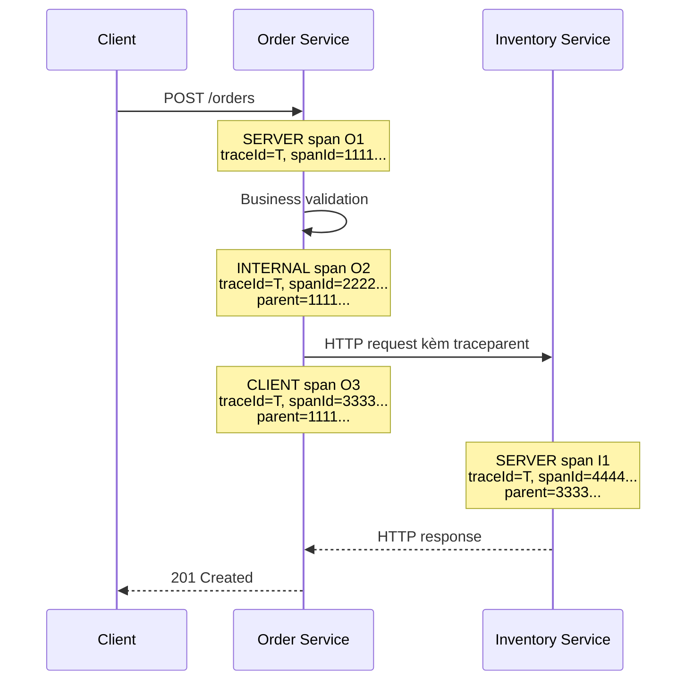
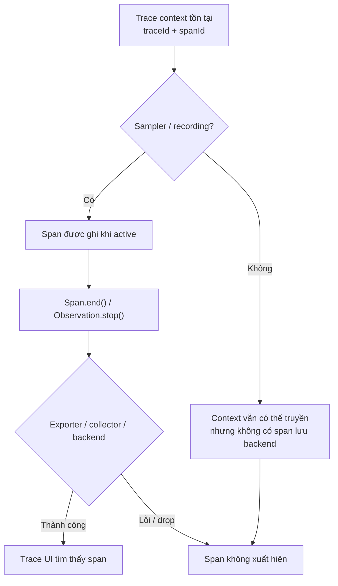

# Span ID

Một yêu cầu `POST /orders` đi qua Order Service, gọi Inventory Service và sau đó gọi Payment Service. Khi thấy request chậm, người vận hành cần biết **bước nào thực sự tốn thời gian**, log nào thuộc đúng bước ấy và chúng liên kết với nhau như thế nào. Distributed tracing cung cấp các `span` để mô tả từng đơn vị công việc. **Span ID** giúp phân biệt từng span trong một trace, ngay cả khi các span có cùng tên hoặc được thực thi trên các dịch vụ khác nhau.

Bài **Span ID** thuộc chương **Tracing** của module **SPRING_BOOT_OBSERVABILITY**. Module tập trung vào quan sát Spring Boot bằng Micrometer Observation, metrics, logs và distributed tracing; học cách propagation ngữ cảnh, quản lý tag/cardinality, exporter, sampling và kết nối tín hiệu khi điều tra lỗi, độ trễ, hành vi ứng dụng trong môi trường thực.

> **Ý chính:** `traceId` nhận diện **toàn bộ trace**, còn `spanId` nhận diện **một span cụ thể trong trace đó**. Một span con dùng cùng `traceId` với span cha, có `spanId` riêng và ghi `parentSpanId` trỏ tới `spanId` của cha. Trong định dạng W3C Trace Context phổ biến, span ID là **8 byte, được biểu diễn bằng 16 ký tự hexadecimal chữ thường**; giá trị toàn số 0 không hợp lệ.

## 1. Mục tiêu học tập

Sau bài này, bạn có thể:

1. Phân biệt chính xác `Trace ID`, `Span ID`, `Parent Span ID`, tên span, span kind và span attributes.
2. Đọc một cây trace và xác định quan hệ cha–con thông qua các ID.
3. Giải thích cấu trúc `traceparent` theo W3C và ý nghĩa trường `parent-id` khi truyền qua HTTP.
4. Hiểu vì sao một cuộc gọi liên dịch vụ có thể tạo nhiều Span ID khác nhau nhưng giữ nguyên Trace ID.
5. Đọc `traceId` và `spanId` từ `Micrometer Tracer` trong Spring Boot, đồng thời liên kết log records với span.
6. Nhận ra lỗi propagation qua HTTP, thread pool, `@Async`, Reactor và messaging.
7. Phân biệt sự thiếu span do sampling/exporter với sự đứt trace context.
8. Không đưa Span ID vào low-cardinality metric tags, không dùng tracing ID để xác thực hoặc thay thế định danh nghiệp vụ.
9. Dùng Span ID để điều tra một trace chậm hoặc lỗi và biết các giới hạn của cách suy luận từ nó.

## 2. Span là gì, và Span ID thuộc phần nào?

Một **span** đại diện cho một đơn vị công việc có ranh giới thời gian, chẳng hạn tiếp nhận HTTP request, gọi database, gọi HTTP client hoặc thực thi một tác vụ nghiệp vụ.

Một span có thể chứa:

| Trường thông tin | Ví dụ | Vai trò |
|---|---|---|
| `name` | `POST /orders`, `inventory.reserve` | Nói **công việc gì** được đo. |
| `traceId` | `4bf92f3577b34da6a3ce929d0e0e4736` | Nhóm các span cùng một trace. |
| `spanId` | `a1b2c3d4e5f60718` | Định danh một span cụ thể trong trace. |
| `parentSpanId` | `00f067aa0ba902b7` | Trỏ tới span cha, nếu có. |
| `startTime`, `endTime` | Thời điểm bắt đầu/kết thúc | Xác định duration và quan hệ thời gian. |
| `kind` | `SERVER`, `CLIENT`, `INTERNAL` | Mô tả vai trò trong giao tiếp hoặc xử lý. |
| Attributes | `http.request.method=POST`, `db.system.name=postgresql` | Metadata có cấu trúc phục vụ tìm kiếm/nhóm. |
| Events | `retry.scheduled`, exception event | Những mốc đáng chú ý khi span đang chạy. |
| Status | `UNSET`, `ERROR`, `OK` (OTel) | Kết quả theo semantics của tracing. |
| Links | Span context của công việc khác | Quan hệ nhân quả không nhất thiết là cha–con. |

Không nhầm **tên span** với **Span ID**:

```text
span.name = "inventory.reserve"
span.id   = "a1b2c3d4e5f60718"

Lần gọi khác:
span.name = "inventory.reserve"
span.id   = "5e6f708192a3b4c5"
```

Hai span có thể có **cùng tên** vì cùng loại công việc; chúng vẫn là hai lần thực thi khác nhau với Span ID riêng. Nên giữ span name ổn định, không nhúng Order ID hoặc Span ID vào tên span.

## 3. Trace ID, Span ID và Parent Span ID

Ví dụ cây trace minh họa sau gồm một HTTP request và ba thao tác bên trong. Tất cả có chung Trace ID:

```text
Trace ID: 4bf92f3577b34da6a3ce929d0e0e4736

Order HTTP server span
  spanId       = 1111111111111111
  parentSpanId = (không có: root trong ví dụ)
  |
  +-- Validate order
  |     spanId       = 2222222222222222
  |     parentSpanId = 1111111111111111
  |
  +-- Reserve inventory
  |     spanId       = 3333333333333333
  |     parentSpanId = 1111111111111111
  |
  +-- Authorize payment
        spanId       = 4444444444444444
        parentSpanId = 1111111111111111
```

Các dãy số lặp lại ở đây **chỉ nhằm giúp đọc cây**, không minh họa thuật toán sinh ID thực tế. Trong hệ thống thật, IDs thường được tạo để giảm xác suất va chạm, không đánh số tăng dần theo thứ tự gọi.

Nhìn vào cây:

- `1111111111111111` là Span ID của root span trong phạm vi trace này.
- `2222222222222222`, `3333333333333333` và `4444444444444444` là **ba Span ID khác nhau** của các con.
- Mỗi span con mang `parentSpanId=1111111111111111`; chúng là **siblings**.
- Nếu span Inventory có thêm span DB con, DB sẽ trỏ tới `3333333333333333`, không trỏ trực tiếp tới Order root.
- Mọi span trong ví dụ vẫn có `traceId=4bf92f3577b34da6a3ce929d0e0e4736`.

### 3.1 Định danh span cần cặp Trace ID + Span ID

Theo cách biểu diễn của OpenTelemetry, **Span ID** chỉ cần duy nhất trong phạm vi một trace. Để xác định một span ở một hệ thống lưu nhiều traces, dùng **cặp (`traceId`, `spanId`)**. Span ID đơn lẻ không phải khóa định danh toàn cục có thể dùng để tìm đúng bản ghi trong mọi hệ thống.

| Giá trị | Phạm vi định danh | Kích thước W3C phổ biến |
|---|---|---|
| `traceId` | Một trace liên dịch vụ | 16 byte = 32 ký tự hex |
| `spanId` | Một span trong trace | 8 byte = 16 ký tự hex |
| `parentSpanId` | Định danh span cha của span hiện tại | Cùng dạng 8 byte khi tồn tại |

Hai traces **khác nhau** về nguyên tắc có thể có cùng chuỗi Span ID mà vẫn không gây nhầm lẫn nếu Trace ID khác nhau. Instrumentation phải tránh sinh trùng Span ID **bên trong cùng một trace**.

### 3.2 Root span có Parent Span ID không?

Một root span **không có parent span** trong trace mà nó bắt đầu. Trong một mô hình dữ liệu, `parentSpanId` có thể vắng mặt, rỗng hoặc được biểu diễn bằng giá trị sentinel tùy exporter/backend; đừng suy luận mọi định dạng JSON đều sử dụng cùng một cách biểu diễn.

Nếu service nhận trace context từ bên ngoài, HTTP server span do service tạo thường **không phải root của toàn bộ trace**, dù nó là span cấp cao nhất xuất hiện trong truy vấn chỉ lọc theo service đó. Parent thực sự có thể nằm trong dịch vụ upstream mà bạn chưa thu thập được trace.

## 4. Luồng liên dịch vụ: một Trace ID nhưng nhiều Span ID

Giả sử Order Service gọi Inventory Service qua HTTP. Đây là một ví dụ điển hình của span loại `SERVER` và `CLIENT`.



Sơ đồ rút gọn trong phần chú thích `1111...`/`2222...` chỉ là cách viết tắt. Trên wire, Span ID W3C cần 16 ký tự hex.

Bảng định danh đầy đủ:

| Span | Service | `traceId` | `spanId` | `parentSpanId` |
|---|---|---|---|---|
| O1: HTTP server | Order | `4bf92f3577b34da6a3ce929d0e0e4736` | `1111111111111111` | Không có |
| O2: validate | Order | Cùng Trace ID | `2222222222222222` | `1111111111111111` |
| O3: HTTP client | Order | Cùng Trace ID | `3333333333333333` | `1111111111111111` |
| I1: HTTP server | Inventory | Cùng Trace ID | `4444444444444444` | `3333333333333333` |

**Điểm quan trọng nhất:** Inventory Service **không sao chép Span ID của HTTP client bên Order để làm Span ID của chính nó**. Nó sử dụng ID đó làm **parent**, sau đó tạo Span ID mới cho server span I1.

Nếu hai dịch vụ tự tạo **hai Trace ID mới** cho cùng chuỗi gọi, trace sẽ bị chia thành hai cây độc lập, khó truy vết end-to-end. Nếu cùng Trace ID nhưng parent relationship đứt, các spans có thể xuất hiện rời rạc trong cùng trace và thiếu liên kết nhân quả.

## 5. W3C Trace Context: đọc `traceparent` đúng cách

W3C Trace Context chuẩn hóa cách truyền ngữ cảnh tracing qua các hệ thống. Với HTTP, hai header quan trọng thường là `traceparent` và `tracestate`; `baggage` là một cơ chế riêng để truyền các cặp key-value ngữ cảnh.

Ví dụ `traceparent` phiên bản `00`:

```http
traceparent: 00-4bf92f3577b34da6a3ce929d0e0e4736-00f067aa0ba902b7-01
```

Cấu trúc:

```text
00 - 4bf92f3577b34da6a3ce929d0e0e4736 - 00f067aa0ba902b7 - 01
│                   │                               │          │
│                   │                               │          └─ trace-flags
│                   │                               └─ parent-id (8 bytes)
│                   └─ trace-id (16 bytes)
└─ version
```

| Phần | Ví dụ | Độ dài dạng hex | Ý nghĩa |
|---|---|---:|---|
| `version` | `00` | 2 ký tự | Phiên bản format của header. |
| `trace-id` | `4bf92f3577b34da6a3ce929d0e0e4736` | 32 ký tự | Nhận diện trace xuyên qua các hop. |
| `parent-id` | `00f067aa0ba902b7` | 16 ký tự | Span ID **của thao tác phía gửi** được dùng làm parent context cho phía nhận. |
| `trace-flags` | `01` | 2 ký tự | Flags truyền giữa các hop, gồm sampled bit. |

Với version `00`, tổng độ dài của giá trị `traceparent` theo định dạng trên là 55 ký tự. Trace ID và Parent ID toàn các chữ số 0 là **không hợp lệ**. Các trường hex trong header `00` sử dụng chữ thường `0-9a-f`; đừng tự tạo header bằng UUID string chứa dấu gạch ngang của `java.util.UUID` rồi xem đó là Trace ID hợp lệ.

### 5.1 Tại sao trường tên `parent-id` chứ không phải `span-id`?

Ở **phía gửi**, header phản ánh ID của span mà thông qua đó ngữ cảnh được truyền đi. Nó thường là **Span ID hiện hành của HTTP client span**, không phải ID của server span mà bên nhận sắp tạo.

```text
Order Service:
  traceId = T
  CLIENT spanId = 3333333333333333

Header gửi tới Inventory:
  traceparent: 00-T-3333333333333333-01

Inventory Service khi nhận:
  traceId = T                         (giữ nguyên)
  parentSpanId = 3333333333333333     (đọc từ header)
  SERVER spanId = 4444444444444444   (ID mới)
```

`T` trong khối trên là **ký hiệu đại diện**, không phải giá trị header có thể gửi thật. Trên HTTP, phần Trace ID phải là chuỗi hex hợp lệ 32 ký tự.

Nếu Inventory Service tiếp tục gọi Payment Service, nó cũng phải truyền **ngữ cảnh của span đang dùng tại điểm gọi**, không phát lại nguyên xi Span ID của Order caller một cách máy móc. Chính cơ chế **inject/extract trace context** của instrumentation/tracer chịu trách nhiệm cập nhật parent-id qua từng hop.

### 5.2 `trace-flags` và sampling

Trong W3C, bit thấp nhất `01` biểu thị **sampled**. Với ví dụ `trace-flags=01`, sampled bit được bật; `00` có sampled bit tắt. Cần kiểm tra **bit**, không nên coi cả byte bằng chính xác `01` mới là sampled nếu các flags khác xuất hiện.

Flag là **gợi ý/metadata truyền qua các hop**, không phải bảo đảm rằng mọi span cuối cùng được ghi và exporter đã gửi thành công. Một dịch vụ downstream có thể áp dụng chính sách sampling khác; collector có thể drop spans, exporter bị lỗi hoặc backend hết retention.

Không tự tăng tỷ lệ sampling chỉ vì nhìn thấy một `spanId` trong log. ID có thể tồn tại trong ngữ cảnh mà span không được backend lưu lại.

### 5.3 W3C `tracestate` và `baggage`

- `tracestate` giữ thông tin vendor-specific giúp những tracing systems khác nhau hợp tác. Nó **không thay thế** `traceId`/`parent-id`.
- `baggage` mang các cặp dữ liệu ngữ cảnh do ứng dụng chọn. Không mặc định baggage là span attributes hay metrics tags; nó có thể được truyền qua mạng, nên phải tránh secrets, dữ liệu cá nhân và giá trị quá lớn.
- Span ID không phải baggage. Không viết `baggage: spanId=...` để tự thực hiện propagation khi tracing instrumentation đã hỗ trợ W3C.

## 6. Span ID được sinh ra thế nào và có thể thay đổi khi nào?

Tracing implementation (OpenTelemetry/Brave) thường tự sinh các ID theo cơ chế được thiết kế để giảm xác suất va chạm, thay vì dựa trên sequence number hoặc ID nghiệp vụ.

Các tình huống phổ biến:

1. **Một span mới được tạo:** nó có Span ID riêng, có thể kế thừa Trace ID từ context cha.
2. **Một span con được tạo:** Trace ID giống cha; Span ID mới; Parent Span ID tham chiếu cha.
3. **Bắt đầu trace mới:** tracer sinh Trace ID mới; span đầu tiên cũng có Span ID riêng.
4. **Qua HTTP client → server:** server thường sinh Span ID mới, đặt Parent Span ID theo context nhận được.
5. **Qua async task:** nếu tracing context được propagate, span trong worker có thể là con hoặc linked span theo thiết kế; nếu không propagate, worker có thể bắt đầu trace khác.
6. **Khi sampling không ghi span:** SDK có thể vẫn truyền trace context hợp lệ; không suy ra mỗi ID nhìn thấy đều tương ứng một bản ghi sẽ truy vấn được.

**Đừng tự gán Span ID theo `orderId` hoặc một dãy có thể đoán được.** Tracer implementation có trách nhiệm tạo/span context đúng và bảo đảm mức độ duy nhất cần thiết trong trace. Trong ứng dụng Spring Boot thông thường, sử dụng auto-instrumentation hoặc Micrometer Tracing API thay vì tự chế thuật toán ID.

### 6.1 Span ID là opaque identifier, không phải token truy cập

Span ID không nên được dùng làm:

- Token xác thực/ủy quyền cho API.
- Khóa bí mật để truy cập dữ liệu đơn hàng.
- Định danh nghiệp vụ lâu dài của một transaction.
- Tên metric hoặc low-cardinality tag.
- Căn cứ duy nhất để suy đoán user, service, thứ tự và mức độ lỗi.

ID dùng cho **correlation/trace topology**, không mã hóa ý nghĩa nghiệp vụ. Có Span ID cũng không có nghĩa được phép đọc thông tin của trace; backend tracing cần bảo vệ bằng chính sách truy cập riêng.

## 7. Micrometer Tracing trong Spring Boot

Spring Boot Actuator tích hợp **Micrometer Tracing** như một API thống nhất phía ứng dụng, còn tracer implementation có thể là OpenTelemetry hoặc Brave. Khi các thành phần phù hợp được cấu hình, HTTP instrumentation tạo spans và chuyển trace context qua những client được quản lý.

### 7.1 Phân biệt các API chính

| API | Vai trò | Khi nào dùng |
|---|---|---|
| `ObservationRegistry` | Quản lý observation lifecycle, handlers cho metrics và traces. | Instrument một bước nghiệp vụ có cả duration và tracing. |
| `MeterRegistry` | Quản lý metrics (Counter, Timer, Gauge...). | Đo sự kiện và trạng thái tổng hợp. |
| `io.micrometer.tracing.Tracer` | Truy cập span hiện hành, tạo/quản lý span qua tracing facade. | Cần đọc Trace ID/Span ID hoặc thao tác span ở mức thấp hơn. |
| `io.micrometer.tracing.Span` | Biểu diễn span đang được tracer quản lý. | Xem context hoặc thêm metadata/error theo API. |
| `Span.context()` | Trả về span context chứa `traceId`, `spanId`... | Dùng cho correlation và chẩn đoán. |
| MDC của SLF4J/Logback | Các trường theo ngữ cảnh thực thi của logger. | Đưa `traceId` và `spanId` vào log output. |

**Không đồng nhất `Observation` với `Span`:** một Observation có thể tạo span nhờ tracing handler, nhưng nếu ứng dụng không cấu hình tracing hoặc observation bị no-op, không thể kỳ vọng có span hiện hành.

### 7.2 Dependencies cho Spring Boot 4.x

Với Spring Boot 4.x hỗ trợ starter OpenTelemetry tích hợp, một ví dụ Gradle:

```groovy
dependencies {
    implementation 'org.springframework.boot:spring-boot-starter-actuator'
    implementation 'org.springframework.boot:spring-boot-starter-opentelemetry'
}
```

Bộ starter trên hỗ trợ Micrometer Tracing/OpenTelemetry theo cấu hình Spring Boot 4.x. Để **export** traces tới backend thực tế, còn phải có OTLP endpoint/collector đúng và quyền truy cập phù hợp. Nếu chỉ chạy local mà không có collector, không được xem việc log có trace ID là bằng chứng span đã được lưu.

Ở **Spring Boot 3.x**, cách khai báo tracing thường sử dụng Actuator cùng `micrometer-tracing-bridge-otel`/`micrometer-tracing-bridge-brave` và exporter tương ứng (Zipkin, OTLP...). **Không copy máy móc danh sách dependency Boot 4 sang Boot 3.** Kiểm tra reference guide của đúng phiên bản đã khóa.

### 7.3 Cấu hình sampling cho môi trường thử

```yaml
spring:
  application:
    name: order-service

management:
  tracing:
    sampling:
      probability: 1.0
```

`probability: 1.0` chỉ phù hợp cho **thử nghiệm có kiểm soát**, giúp tăng khả năng tìm đủ trace. Tài liệu Spring Boot hiện hành thường đặt tỷ lệ mẫu mặc định thấp hơn, chẳng hạn 10%, để tránh quá tải backend. Trên production, chọn tỷ lệ theo traffic, chi phí, SLO và khả năng exporter; một cấu hình 100% không mặc định là tốt.

Khi dùng OpenTelemetry với OTLP trên Boot 4.x, kiểm tra cấu hình `management.opentelemetry.tracing.export.otlp.*` và các property chung của exporter theo tài liệu đúng phiên bản. Không suy ra chỉ cần đặt sampling là đã có đường truyền OTLP.

## 8. Đọc Span ID của span đang hoạt động bằng Micrometer

Trong một đoạn code đang chạy **bên trong active tracing scope**, có thể inject `Tracer` và gọi `currentSpan()` để lấy context. Đây là ví dụ Spring Boot service (Java 17+):

```java
import io.micrometer.observation.Observation;
import io.micrometer.observation.ObservationRegistry;
import io.micrometer.tracing.Span;
import io.micrometer.tracing.Tracer;
import org.slf4j.Logger;
import org.slf4j.LoggerFactory;
import org.springframework.stereotype.Service;

@Service
public class InventoryService {

    private static final Logger log =
            LoggerFactory.getLogger(InventoryService.class);

    private final ObservationRegistry observations;
    private final Tracer tracer;

    public InventoryService(ObservationRegistry observations, Tracer tracer) {
        this.observations = observations;
        this.tracer = tracer;
    }

    public String reserve() {
        Observation observation =
                Observation.createNotStarted("inventory.reserve", observations)
                        .contextualName("reserve inventory")
                        .lowCardinalityKeyValue("operation", "reserve")
                        .start();

        try (Observation.Scope ignored = observation.openScope()) {
            Span current = tracer.currentSpan();
            if (current == null) {
                log.info("Reservation running without an active tracing span");
            } else {
                String traceId = current.context().traceId();
                String spanId = current.context().spanId();

                // Để minh họa rõ cả hai giá trị; ở production,
                // ưu tiên correlation tự động qua MDC/log format.
                log.info("Reservation span traceId={} spanId={}",
                        traceId, spanId);
            }

            return "reserved";
        } catch (RuntimeException failure) {
            observation.error(failure);
            throw failure;
        } finally {
            observation.stop();
        }
    }
}
```

**Giải thích lifecycle:**

1. `Observation.createNotStarted(...).start()` khởi tạo vòng đời đo đạc nghiệp vụ.
2. `openScope()` đưa observation vào context hiện hành. Khi tracing handler phù hợp, có thể có **span hiện hành** cho đoạn code này.
3. `tracer.currentSpan()` có thể trả `null` nếu không có active span; luôn xử lý trường hợp này thay vì gọi ngay `currentSpan().context()`.
4. `span.context().traceId()` nhận diện trace, `span.context().spanId()` nhận diện span hiện hành.
5. Nếu exception xảy ra, `observation.error(...)` ghi sự kiện lỗi cho handlers phù hợp trước khi kết thúc.
6. `try-with-resources` đóng scope, rồi `finally` gọi `observation.stop()`. Tránh rò context qua thread được tái sử dụng.
7. Đoạn mã không tự sinh Span ID mới bằng chuỗi Java. Việc tạo ID thuộc tracer.

**Điều kiện để ví dụ chạy đúng:** ứng dụng phải có các beans `ObservationRegistry` và `Tracer` qua cấu hình tracing tương thích; code trả `"reserved"` chỉ là business stub. Không giả định ví dụ này compile/run trên mọi Spring Boot version nếu dependency có khác biệt.

### 8.1 Tại sao Span ID đọc được có thể khác giữa hai dòng log?

Khi một span con được mở (chẳng hạn HTTP client span) bên trong nghiệp vụ, context hiện hành có thể tạm chuyển sang span con rồi trở lại span cha khi scope đóng.

```text
10:00:00.000  traceId=T spanId=A  "start inventory reserve"
10:00:00.005  traceId=T spanId=B  "calling database"
10:00:00.040  traceId=T spanId=A  "inventory reserved"
```

Đây có thể là hành vi **đúng**: cùng trace, khác span tại thời điểm logging. Nếu tất cả log của một request bắt buộc có đúng một Span ID, bạn đang bỏ qua giá trị của span-level correlation. Muốn nhóm log theo **toàn request**, dùng Trace ID; muốn biết log nằm trong **bước cụ thể**, xem thêm Span ID.

### 8.2 Không tự tạo span nếu Observation đã tạo span đúng ranh giới

Một lỗi thường gặp:

```java
// Mô hình cần cân nhắc: Observation đã có tracing handler
// nhưng code lại tự tạo thêm span đo CHÍNH CÙNG công việc.
Observation observation = Observation.start("inventory.reserve", observations);
Span manual = tracer.nextSpan().name("inventory.reserve").start();
```

Nếu cả hai đo cùng một khoảng công việc, trace có thể xuất hiện hai span trùng nghĩa, gây khó hiểu duration/parent-child. Chọn **một owner** cho ranh giới đo. Tạo span thủ công chỉ khi cần mô tả một bước **thật sự riêng** chưa được Observation/framework instrument.

## 9. Correlation ID trong logs: Trace ID + Span ID

Khi có Micrometer Tracing, Spring Boot có thể bổ sung correlation IDs vào output log. Thông thường, MDC có các key `traceId` và `spanId`, và log pattern hiển thị chúng.

Ví dụ dòng log minh họa:

```text
2026-11-22T10:15:32Z INFO  [order-service,4bf92f3577b34da6a3ce929d0e0e4736,a1b2c3d4e5f60718] Order accepted
2026-11-22T10:15:32Z INFO  [order-service,4bf92f3577b34da6a3ce929d0e0e4736,00f067aa0ba902b7] Calling inventory
2026-11-22T10:15:32Z INFO  [order-service,4bf92f3577b34da6a3ce929d0e0e4736,a1b2c3d4e5f60718] Inventory response received
```

Đây là định dạng minh họa; chính xác logging pattern còn tùy Spring Boot version và cấu hình Logback/Log4j2. Không tự khẳng định ứng dụng đã có những dòng log đó nếu chưa bật tracing.

### 9.1 Cấu hình pattern theo MDC

Một cách thể hiện rõ các trường trong Logback là dùng `logging.pattern.correlation` nếu phiên bản hỗ trợ. Ví dụ YAML:

```yaml
logging:
  pattern:
    correlation: "[%X{traceId:-},%X{spanId:-}] "
```

Với những phiên bản Boot khác, có thể dùng pattern logging level riêng. Trước khi sửa, hãy kiểm tra format mặc định để **không in ID hai lần** và không làm mất tên service/mức log. MDC chỉ có giá trị trong scope được propagation đúng; nó có thể rỗng ở startup logs, scheduled tasks chưa instrument hoặc các thread ngoài trace.

### 9.2 Trace ID dùng để tìm toàn bộ request, Span ID dùng để khoanh đoạn

| Truy vấn | Dùng định danh nào? | Kết quả mong muốn |
|---|---|---|
| “Cho tôi mọi log thuộc một request liên dịch vụ” | `traceId` | Nhóm log nhiều spans và nhiều services thuộc cùng trace. |
| “Log này phát sinh trong DB call nào?” | `traceId` + `spanId` | Khoanh đúng span nếu backend lưu span tương ứng. |
| “Span cha của span hiện tại là gì?” | `parentSpanId` | Tìm span cha trong cùng trace. |
| “Lỗi này xảy ra bao nhiêu lần trong 5 phút?” | Metric với name/tags hữu hạn | Không dùng Span ID làm metric label. |
| “Có chắc trace đã được export?” | Exporter/collector/backend diagnostics | ID trong log không đủ làm bằng chứng. |

Một Span ID hiển thị trong log có thể không tìm thấy trong trace backend vì sampling, exporter, collector, retention hoặc phạm vi tìm kiếm sai; nó cũng có thể là span đã không được ghi do chính sách recording.

### 9.3 Structured logging

Với JSON logging nếu ứng dụng cấu hình, các trường có thể trông như:

```json
{
  "timestamp": "2026-11-22T10:15:32Z",
  "level": "INFO",
  "service": "order-service",
  "event": "inventory.reservation.started",
  "traceId": "4bf92f3577b34da6a3ce929d0e0e4736",
  "spanId": "a1b2c3d4e5f60718"
}
```

Đây **không phải định dạng JSON mặc định cố định** của mọi Spring Boot version; nó là ví dụ về schema cần có để thực hiện correlation. Hãy bảo đảm log collector giữ nguyên field types/names và không cắt Span ID hoặc chuyển nó sang dạng số nguyên gây mất chữ số 0 đầu.

## 10. Propagation qua HTTP: vì sao Span ID khác nhau nhưng trace vẫn nối?

Spring Boot có thể tự instrument inbound HTTP server và outbound HTTP clients, đặc biệt khi client được tạo qua các builder do Spring Boot quản lý.

Ví dụ trong Spring Boot dùng `RestClient.Builder` được inject:

```java
import org.springframework.stereotype.Service;
import org.springframework.web.client.RestClient;

@Service
public class InventoryClient {

    private final RestClient client;

    public InventoryClient(RestClient.Builder builder) {
        this.client = builder
                .baseUrl("http://inventory-service:8080")
                .build();
    }

    public String reserve() {
        return client.post()
                .uri("/api/reservations")
                .retrieve()
                .body(String.class);
    }
}
```

Khi stack đã có Micrometer Tracing và HTTP client observation hoạt động, builder được Spring quản lý giúp gắn instrumentation/context propagation vào request. Địa chỉ trong ví dụ chỉ minh họa; ứng dụng thật cần discovery, timeout, auth và xử lý lỗi phù hợp.

**Không dùng `RestClient.create(...)` hoặc `WebClient.create(...)` ở mọi nơi rồi mặc định tracing vẫn được propagate.** Nếu bỏ qua builder được auto-configure, bạn có thể bỏ qua instrumentation cần thiết; hãy kiểm tra header thực tế trong môi trường thử và trace trên backend.

### 10.1 Khi nhận header hợp lệ

Giả sử HTTP client span của Order Service là `00f067aa0ba902b7`:

```http
POST /api/reservations HTTP/1.1
Host: inventory-service
traceparent: 00-4bf92f3577b34da6a3ce929d0e0e4736-00f067aa0ba902b7-01
Content-Type: application/json
```

Inventory Service giải mã trace context, giữ Trace ID và sinh span mới. Nó sẽ có **`spanId` khác**, với `parentSpanId` bằng `00f067aa0ba902b7` nếu framework tạo một server span con theo context đó.

Đừng yêu cầu Inventory log có Span ID **bằng đúng** giá trị `parent-id` của header: nếu trùng hoàn toàn, có thể có lỗi instrumentation, hoặc bạn đang nhìn vào một span context khác với span server được tạo. Điều đúng để xác minh là **Trace ID không đổi và quan hệ parent-child hợp lệ**.

### 10.2 Khi propagation bị đứt

Nếu Inventory tạo trace mới, các nguyên nhân thường gặp:

- HTTP client được tạo ngoài instrumented builder.
- Request qua proxy/gateway làm rơi hoặc sửa header.
- Bên gửi dùng một propagation format (W3C/B3) nhưng bên nhận chỉ hiểu format khác.
- Dữ liệu header không hợp lệ hoặc bị policy bảo mật từ chối.
- Context đã mất trước khi tạo HTTP client span do thread/async boundary.
- Instrumentation của server hoặc tracer configuration không được bật.

Kiểm tra **cả inbound và outbound instrumentation**, không chỉ đổi sampling rate.

## 11. Async và reactive: ThreadLocal không đi qua mọi ranh giới

Trong ứng dụng đồng bộ trên một thread, tracer scope và MDC thường được lưu qua thread-local state. Khi công việc chuyển sang thread khác, `@Async`, executor tự tạo, `CompletableFuture`, Reactor hoặc messaging, context có thể không đi theo nếu thiếu propagation.

### 11.1 Ví dụ mất correlation khi tự tạo thread

```java
log.info("Request accepted"); // traceId=T, spanId=A ở request thread

new Thread(() -> {
    log.info("Background work started");
    // Tracer.currentSpan() ở đây có thể null:
    // không tự kế thừa context từ request thread.
}).start();
```

Đoạn này chỉ minh họa **lỗi thiết kế**; không nên tự tạo raw thread mỗi request trong Spring Boot. Hãy dùng executor được quản lý và cơ chế context propagation phù hợp, hoặc queue/job abstraction có tracing instrumentation.

### 11.2 Propagation không có nghĩa mọi span dùng cùng Span ID

Khi context được truyền đúng đến worker, work span vẫn có thể có **Span ID mới** và cùng Trace ID với parent. Nếu chỉ thấy Span ID khác nhau giữa hai thread và kết luận mất context, bạn sẽ chẩn đoán nhầm.

Điều cần kiểm tra là:

- Trace ID có được duy trì khi muốn giữ một trace xuyên ranh giới không?
- Worker span có parentSpanId hoặc span link đúng theo mô hình hay không?
- MDC có bị rò context giữa hai tasks trên thread pool không?
- Scope có được đóng trong `finally` hoặc `try-with-resources`?
- Nếu job chạy độc lập rất lâu, có nên tạo **trace mới có Span Link** thay vì buộc nó thành child của HTTP request đã kết thúc?

Với Reactor, các callbacks có thể chạy trên nhiều schedulers. Tùy Spring Boot/Micrometer/Reactor version, cần context propagation integration hoặc Reactor instrumentation phù hợp. **Không mặc định `ThreadLocal` tự đi theo mọi `publishOn/subscribeOn`.**

### 11.3 Producer–consumer và Span Links

Trong messaging, producer span và consumer span có thể có quan hệ cha–con hoặc link tùy instrumentation/semantic conventions. Một batch consumer xử lý nhiều messages có thể sử dụng **links** đến các span contexts của nguồn thay vì chỉ một parent.

`Span Link` **không phải** `parentSpanId`. Link cho biết quan hệ nhân quả với một span context khác, có thể ở trace khác; nó không tạo ràng buộc “cha duy nhất” trong cây span. Khi debug asynchronous system, cần xem cả links nếu backend hỗ trợ.

## 12. Span ID và sampling/exporter: có ID không đồng nghĩa trace sẽ xuất hiện

Hãy phân biệt ba bước:

1. **Context:** tracer/context propagation có Trace ID và Span ID hợp lệ.
2. **Recording/sampling:** SDK quyết định span được ghi đủ dữ liệu để export hay không, theo sampler/parent decision.
3. **Export/storage:** exporter, collector và backend tiếp nhận/lưu dữ liệu theo chính sách.



Nếu log chứa `traceId` và `spanId` mà trace backend không trả kết quả, cần phân biệt:

| Khả năng | Dấu hiệu | Cách kiểm tra |
|---|---|---|
| Trace không được sample | Sampled flag/policy và tỷ lệ mẫu cho thấy có thể bị loại. | Xem sampler, `management.tracing.sampling.probability`, chính sách parent-based. |
| Span chưa kết thúc | Span được tạo nhưng thiếu `end()`/`stop()`. | Rà soát lifecycle, try/finally và callback async. |
| Exporter không gửi được | Queue backlog, kết nối OTLP/Zipkin lỗi. | Xem logs/metrics của exporter và collector. |
| Backend drop hoặc đã hết retention | Collector nhận nhưng UI không thấy. | Kiểm tra pipeline processors, sampling phía collector, retention. |
| Trace ID bị mất/format khác | Hai services có Trace ID khác nhau. | Kiểm tra W3C/B3 headers, proxy, client builder. |
| Query sai thời gian/service | Span tồn tại nhưng tìm sai khoảng. | Tìm rộng hơn theo Trace ID và service name. |
| Span không được tạo ở điểm cần đo | Chỉ có HTTP server span, không có span nghiệp vụ. | Bổ sung Observation tại ranh giới cần quan sát. |

**Quan trọng:** `management.tracing.sampling.probability=1.0` trong môi trường thử **không khắc phục** exporter lỗi hoặc context propagation bị đứt. Nó chỉ thay xác suất ghi dữ liệu theo sampler.

## 13. Span ID có nên trở thành metric tag không?

**Không.** Span ID thường có giá trị mới cho mỗi span. Nếu gắn nó vào tag của `Timer` hoặc `Counter`, mỗi lần thực thi có thể tạo một time series mới, làm cardinality tăng rất nhanh.

Sai:

```java
// Tránh: một Span ID gần như mới cho mỗi operation.
registry.counter("checkout.requests", "spanId", currentSpanId)
        .increment();
```

Đúng hơn:

```java
registry.counter("checkout.requests", "outcome", "approved")
        .increment();
```

Tập giá trị `outcome` thường nhỏ, giúp Metrics tổng hợp theo kết quả. Khi cần tra một request:

- Lấy `traceId` và `spanId` từ log record có correlation.
- Tìm trace trong backend tracing theo Trace ID.
- Mở span có ID phù hợp để xem timing, attributes, parent-child.
- Dùng metrics theo service/route/status/time window để xác định mức ảnh hưởng **tổng thể**.

### 13.1 Ví dụ cardinality

Một metric `checkout.duration` có tags:

```text
outcome: 3 giá trị
channel: 4 giá trị
region: 5 giá trị
=> tối đa theo tổ hợp: 3 × 4 × 5 = 60 series logic
```

Nếu thêm `spanId` thay đổi gần như mỗi invocation và có 100.000 giá trị, số series tiềm năng có thể lên đến hàng triệu. Việc lưu Span ID như **trace context trong logs** là hoàn toàn khác với gắn nó vào **low-cardinality metric tags**.

### 13.2 High-cardinality trace attributes cũng cần giới hạn

Trace attributes có thể chứa dữ liệu nhiều giá trị để chẩn đoán, nhưng không có nghĩa nên ghi mọi ID, payload hoặc dữ liệu cá nhân. Span ID và Trace ID là các trường **truy vết chuyên biệt**, không cần lặp lại thành những custom attributes cho mọi span. Backend có thể áp dụng giới hạn số attributes, độ dài và retention.

## 14. Phân biệt Span ID, span name, trace state và correlation ID

| Khái niệm | Ví dụ | Nên dùng vào việc |
|---|---|---|
| **Span ID** | `a1b2c3d4e5f60718` | Chọn đúng một span trong trace. |
| **Trace ID** | `4bf92f3577b34da6a3ce929d0e0e4736` | Gom toàn bộ trace across services. |
| **Parent Span ID** | `00f067aa0ba902b7` | Nối cây cha–con. |
| **Span name** | `inventory.reserve` | Nhóm/nhận diện loại operation. |
| **Span kind** | `CLIENT` / `SERVER` / `INTERNAL` | Mô tả vai trò của operation. |
| **Correlation ID trên log** | Một chuỗi hiển thị Trace ID và Span ID. | Từ log nhảy sang trace, hoặc ngược lại. |
| **W3C tracestate** | Vendor-specific key-values. | Tương tác giữa tracing systems. |
| **Baggage** | Context key-values được propagate khi cấu hình. | Truyền metadata qua boundary, có kiểm soát. |
| **Request ID** | ID ở reverse proxy hoặc HTTP request. | Theo dõi một request ở tầng cụ thể; có thể khác Trace ID. |
| **Business transaction ID** | Mã đơn hàng/payment. | Theo dõi nghiệp vụ, thường sống lâu hơn một trace. |

Không dùng Span ID để thay thế `orderId` vì một giao dịch có thể có nhiều spans, retries và nhiều traces theo thời gian. Ngược lại, một Trace ID không bảo đảm một giao dịch chỉ có một request hoặc không có asynchronous work ngoài trace ban đầu.

## 15. Playbook điều tra: hai dịch vụ có Span IDs khác nhau

**Tình huống:** Order Service gọi Inventory Service. Log Order hiển thị Trace ID `T1`, Span ID `A`. Log Inventory hiển thị Trace ID `T1`, Span ID `B`. Nhóm cho rằng “Span ID khác nhau nên mất correlation”.

### Bước 1 — Kiểm tra Trace ID

Nếu cùng Trace ID và có parent relationship hợp lệ, **Span ID khác nhau là điều bình thường**. Đây có thể chính là dấu hiệu hai operations riêng được instrument đúng.

### Bước 2 — Mở trace theo Trace ID

Quan sát `Order HTTP server` → `Order HTTP client` → `Inventory HTTP server`. Mỗi span nên có ID riêng. Kiểm tra Inventory parentSpanId trỏ tới Span ID của **Order HTTP client**, không nhất thiết Order HTTP server.

### Bước 3 — Đối chiếu `traceparent`

Trong môi trường test, kiểm tra outbound `traceparent` từ Order, inbound ở Inventory và parentSpanId của server span. Tránh log toàn bộ headers của production vì có thể chứa secrets/cookies. Khi test header, chỉ ghi các trường tracing cần thiết với quyền truy cập phù hợp.

### Bước 4 — Kiểm tra việc sử dụng Spring-managed client

Nếu HTTP client do code tạo ngoài builder auto-configured, tracing có thể thiếu. Xem code tạo `RestClient.Builder`/`WebClient.Builder` và dependency thực tế.

### Bước 5 — Kiểm tra async context

Nếu caller chuyển sang executor trước khi gọi Inventory, kiểm tra trace context propagation sang worker thread. Có thể có một span client với Trace ID mới nếu ngữ cảnh đã mất.

### Bước 6 — Xác nhận exporter/sampling

Nếu chỉ thấy một phần spans, xác minh sampler, exporter, collector và backend. Việc Span ID khác nhau **không tự gây** mất spans; nó là đặc tính cần có.

### Kết luận mẫu

```text
Order HTTP server:     traceId=T1 spanId=A   parent=(none)
Order HTTP client:     traceId=T1 spanId=C   parent=A
Inventory HTTP server: traceId=T1 spanId=B   parent=C
```

Khi cấu trúc này xuất hiện, propagation cha–con đã hợp lý theo mô hình HTTP instrumentation. Nếu Inventory có `traceId=T2` thay vì `T1`, đó là dấu hiệu cần điều tra propagation format, header, client builder hoặc ngữ cảnh async.

## 16. Playbook điều tra: span chậm nhưng logs lại có Span ID khác

**Tình huống:** Một trace chậm có `payment.authorize` kéo dài 1,8 giây. Khi tìm logs của Order Service theo Trace ID, có nhiều Span ID khác nhau và một số ERROR logs không nằm trong span cần điều tra.

1. **Mở trace tổng:** xác định traceId, thời gian, các spans con và critical path. Đừng chỉ chọn span có duration lớn nhất rồi kết luận nguyên nhân.
2. **Chọn Span ID nghi vấn:** ghi lại cặp (`traceId`, `spanId`) của `payment.authorize`.
3. **Lọc log theo cả hai ID:** nếu log backend hỗ trợ, tìm các logs thực sự được ghi trong scope span đó.
4. **Đọc logs của spans cha/con:** một lỗi provider có thể được log tại HTTP client span, trong khi business span chỉ ghi “authorization failed”.
5. **Xác minh propagation:** nếu logs của dependency mang Trace ID khác, xem việc truyền context.
6. **Xem metrics:** p95 payment authorization, HTTP error rate, connection pool saturation và retry count có đồng biến không?
7. **Kiểm tra sampling:** một trace đơn lẻ có thể không đại diện cho mọi request. Metrics tổng hợp giúp biết sự cố phổ biến đến mức nào.
8. **Xác minh sau sửa:** theo dõi latency distribution/error budget và traces mới, không chỉ thấy một Span ID đẹp trong log.

**Phân biệt:** Span ID cho biết **log được ghi trong span nào**, nhưng **không phải bản giải thích nguyên nhân lỗi**. Có thể span phía trên chỉ chờ một dependency; phải đọc attributes/events, thời gian của spans con và các tín hiệu khác.

## 17. Những lỗi phổ biến về Span ID

| Biểu hiện | Nguyên nhân có thể | Cách kiểm tra |
|---|---|---|
| Trace ID giống nhưng Span ID khác giữa services | **Thường là bình thường**: mỗi service có span riêng. | Xem parentSpanId và cây trace. |
| Trace ID khác giữa services dù cùng request | Context không propagate hoặc header bị bỏ. | Kiểm tra client builder, gateway và W3C/B3 format. |
| `parent-id` trong header khác Span ID của server nhận | **Bình thường**: nó là ID span phía gửi. | So sánh với parentSpanId, không với spanId mới. |
| Span ID bằng 16 số `0` | Giá trị không hợp lệ theo W3C version 00. | Kiểm tra generator/parser; không tự xây IDs. |
| Span ID bị cắt còn 15 ký tự | Chuyển hex sang số hoặc mất chữ số `0` đầu. | Giữ định danh dạng chuỗi/byte sequence. |
| Span ID xuất hiện trong log nhưng không có trace UI | Sampling/exporter/backend/retention. | Kiểm tra pipeline tracing và timespan. |
| Log spanId trống tại startup | Không có active tracing scope. | Không ép logs startup phải có span; kiểm tra framework lifecycle. |
| Async task có Trace ID mới | Context propagation mất ở thread boundary. | Dùng executor/instrumentation phù hợp. |
| Một request có quá nhiều span cùng tên | Instrumentation trùng hoặc quá chi tiết. | Xác định span ownership và ranh giới nghiệp vụ. |
| Trace UI có nhiều root không mong đợi | Propagation hoặc parent relationship lỗi; có thể do spans bị drop. | Kiểm tra inbound headers, parent IDs và sampling. |
| Meter registry bị tăng series sau khi bật tracing | Đưa `traceId`/`spanId` vào metric tags. | Gỡ tag dynamic, dùng logs/traces cho correlation. |
| Truy vấn theo một Span ID không ra kết quả | Chỉ có Span ID, thiếu Trace ID hoặc backend chưa lưu. | Tìm theo cặp IDs và time window. |
| Span ID trong logs không đúng HTTP server span | Có active child span lúc log được ghi. | Xác nhận scope đúng ở thời điểm logging. |
| Trace ID hợp lệ nhưng Span ID zero | Span context bị tạo thủ công hoặc invalid. | Để SDK/tracer quản lý ID và validate propagation. |

## 18. Kiểm tra kiến thức và bài tập

### Bài 1 — Trace ID và Span ID

Một trace có ba spans A, B, C. Cả ba mang `traceId=4bf92f3577b34da6a3ce929d0e0e4736` nhưng có ba `spanId` khác nhau. Đây là lỗi hay hành vi đúng? Nếu B và C đều có `parentSpanId` bằng Span ID của A, chúng có quan hệ gì?

### Bài 2 — Đọc header W3C

Cho:

```http
traceparent: 00-4bf92f3577b34da6a3ce929d0e0e4736-00f067aa0ba902b7-01
```

Hãy xác định version, trace-id, parent-id, sampled flag. Khi service nhận tạo span mới, `spanId` của nó có nên luôn bằng `00f067aa0ba902b7` không?

### Bài 3 — Giá trị nào không hợp lệ?

```text
A: 00f067aa0ba902b7
B: 0000000000000000
C: ABCD1234EF567890
D: 00f067aa0ba902b
```

Giả sử dùng header `traceparent` version `00`, hãy chọn những giá trị không hợp lệ và giải thích vì sao.

### Bài 4 — Lọc log đúng lớp

Một request có Trace ID `T` và ba Span ID `S1`, `S2`, `S3`. Bạn sẽ tìm toàn bộ log theo ID nào? Khi muốn tìm log chỉ trong DB span `S3`, cần điều kiện nào?

### Bài 5 — Mất trace context

Order Service dùng `RestClient.create(...)` và Inventory Service luôn tạo Trace ID mới dù nhận HTTP request thành công. Hãy nêu các bước kiểm tra instrumentation, W3C headers, builder, scope và tracing configuration.

### Bài 6 — Sampling

Một log có `traceId` và `spanId` nhưng trace backend không tìm thấy. Điều này có nhất thiết chứng minh propagation lỗi không? Hãy liệt kê các lý do khác.

### Bài 7 — Cardinality

Một lập trình viên thêm `spanId` làm tag cho `checkout.requests` để tra cứu từng yêu cầu. Vì sao cách này không phù hợp? Cách nào cho phép điều tra từng span mà vẫn giữ metric cardinality thấp?

### Bài 8 — Async spans

Một background task được khởi tạo từ HTTP request, chạy vài phút sau qua queue. Khi nào nên dùng parent-child; khi nào span link và trace mới có thể hợp lý hơn? Vì sao không nên ép mọi công việc dài thành một span con “đang mở” mãi?

### Gợi ý trả lời

1. Đúng: mỗi span có Span ID riêng; B/C là hai spans con/siblings cùng cha A.
2. `00`, Trace ID 32 hex, parent-id 16 hex, sampled bit `01`; span bên nhận thường phải có ID mới, parentSpanId bằng ID phía gửi.
3. B toàn 0 không hợp lệ; C chữ hoa không hợp lệ khi serialize `traceparent` version 00; D chỉ 15 ký tự không hợp lệ. A hợp lệ ở dạng ID.
4. Lọc `traceId=T` cho toàn request; lọc đồng thời `traceId=T` và `spanId=S3` cho DB span.
5. Kiểm tra instrumented `RestClient.Builder`/`WebClient.Builder`, header inject/extract, gateway, propagation format, thread boundary.
6. Không. Có thể do sampling, exporter, collector, retention, query time range, span chưa kết thúc.
7. Span ID biến thiên theo mỗi span tạo cardinality cao; dùng metric tags hữu hạn, log MDC và backend tracing cho các IDs cụ thể.
8. Với tác vụ không còn là child trực tiếp theo lifetime hoặc xử lý batch, dùng trace mới và links có thể phù hợp; lựa chọn tùy semantics của messaging/instrumentation.

## 19. Tài liệu tham khảo chính thức

- [W3C Trace Context](https://www.w3.org/TR/trace-context/): `traceparent`, `trace-id` 16 byte, `parent-id` 8 byte, flags và quy tắc hợp lệ.
- [W3C Trace Context Level 2](https://www.w3.org/TR/trace-context-2/): cập nhật định dạng, sampled/random flags và tương tác các hệ thống.
- [OpenTelemetry — Traces](https://opentelemetry.io/docs/concepts/signals/traces/): Trace ID, Span ID, parent, events, attributes, links, kinds và status.
- [OpenTelemetry Specification — Overview](https://opentelemetry.io/docs/specs/otel/overview/): `SpanContext`, định danh spans và tính bất biến của tracing context.
- [OpenTelemetry — Context Propagation](https://opentelemetry.io/docs/concepts/context-propagation/): truyền context xuyên ranh giới xử lý.
- [OpenTelemetry — Logs Data Model](https://opentelemetry.io/docs/specs/otel/logs/data-model/): `TraceId`/`SpanId` trong các log records tương quan.
- [Micrometer Tracing — Reference](https://docs.micrometer.io/tracing/reference/): `Tracer`, `Span`, logging correlation và tracing bridges.
- [Micrometer Observation — Components](https://docs.micrometer.io/micrometer/reference/observation/components.html): `Observation`, scope, error và handlers.
- [Spring Boot — Tracing](https://docs.spring.io/spring-boot/reference/actuator/tracing.html): dependencies, correlation IDs, HTTP client builders, sampling và exporters.
- [Spring Boot — Observability](https://docs.spring.io/spring-boot/reference/actuator/observability.html): kết nối Observation, context propagation và signal configuration.

**Ghi nhớ:** **Trace ID nhóm toàn bộ hành trình; Span ID chỉ ra một bước cụ thể; Parent Span ID nối quan hệ nhân quả giữa các bước.** Khi request đi qua nhiều dịch vụ, các Span ID **phải có khả năng khác nhau** trong khi Trace ID được giữ nguyên nếu context được propagate đúng. Đọc `traceparent.parent-id` là ID của thao tác phía gửi; đừng coi đó là ID của span mới ở phía nhận. Dùng cặp Trace ID + Span ID để tìm logs và traces, dùng metrics để định lượng trên nhiều requests, và luôn kiểm tra sampling/exporter khi một span không xuất hiện ở backend.
