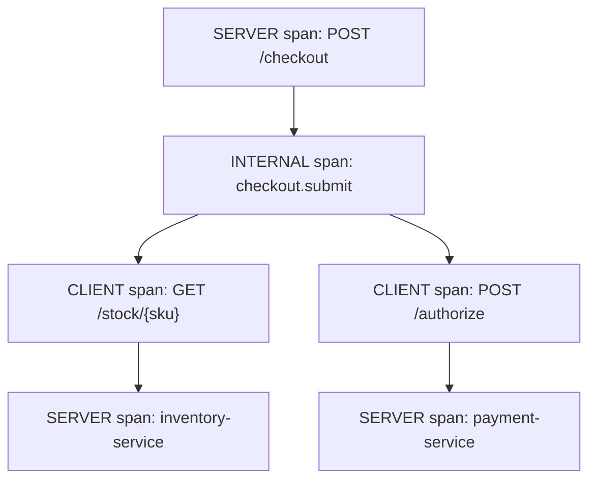
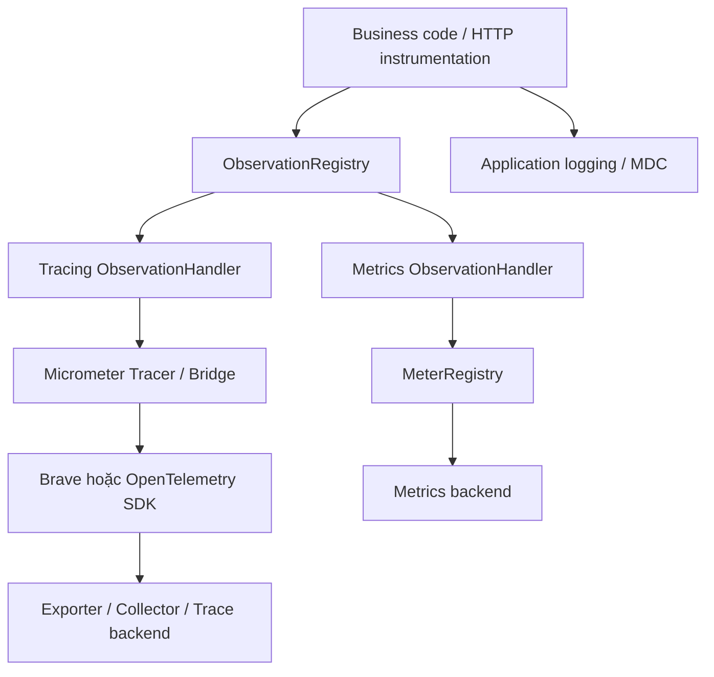
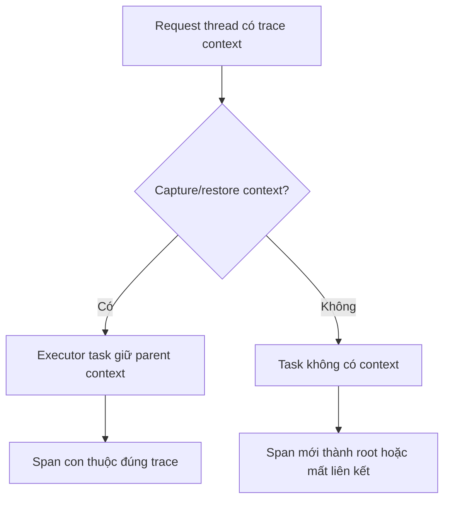
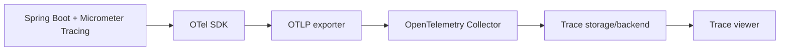

# Micrometer Tracing trong Spring Boot: từ Observation đến distributed trace

Khi `POST /checkout` chậm, metrics cho biết p95 tăng, logs báo timeout, nhưng cần **distributed tracing** để xem request đi qua những service nào, mỗi lời gọi mất bao lâu và lỗi phát sinh tại bước nào. Trong module **SPRING_BOOT_OBSERVABILITY**, chương **Tracing**, bài **Micrometer Tracing** hướng dẫn thiết lập và sử dụng Micrometer Tracing cùng Micrometer Observation, metrics, logs và các pipeline xuất dữ liệu. Kiến thức này phục vụ điều tra lỗi, độ trễ và hành vi ứng dụng trong môi trường thực; đồng thời giải thích context propagation, sampling, tag/cardinality, exporter và correlation.

Sau bài học, bạn có thể phân biệt trace/span/scope, hiểu vai trò của Tracer và tracing bridge, instrument nghiệp vụ, nối spans qua HTTP hoặc executor, điều chỉnh sampling, xuất OTLP và kiểm tra vì sao metric có dữ liệu nhưng trace không xuất hiện.

## 1. Micrometer Tracing là gì?

**Micrometer Tracing** cung cấp một API trừu tượng để tạo và quản lý tracing mà không buộc mã nghiệp vụ phụ thuộc trực tiếp vào một vendor. Trong Spring Boot, tracing thường được kết hợp với **Micrometer Observation**: khi một hoạt động được bắt đầu/kết thúc, tracing handler có thể chuyển hoạt động đó thành span thông qua một tracer implementation.

| Thành phần | Trách nhiệm |
| --- | --- |
| `Observation` và `ObservationRegistry` | Mô tả vòng đời một hoạt động và phân phối callback cho handlers |
| `io.micrometer.tracing.Tracer` | API tạo span, lấy span hiện hành và mở span scope |
| **Tracing bridge** | Kết nối API Micrometer Tracing tới OpenTelemetry hoặc Brave |
| **SDK/implementation** | Duy trì context, tạo span data, áp dụng sampler và kết hợp exporter |
| **Exporter/Collector** | Đưa spans ra khỏi JVM đến hệ thống tiếp nhận |
| **Trace backend** | Lưu trữ và hiển thị traces/spans |
| **Metrics và logging** | Hai tín hiệu riêng biệt, có thể liên kết qua ngữ cảnh |

Micrometer Tracing **không phải** database lưu trace, và thêm dependency bridge không tự bảo đảm mọi request có span trên backend. Một span có thể được tạo trong JVM nhưng bị sampling loại hoặc không export thành công.

## 2. Trace, span, parent và scope

Một **trace** mô tả đường đi của một thao tác qua các component. Một **span** biểu diễn một đoạn công việc trong trace, chứa các thông tin như:

- **Trace ID:** định danh chung của toàn bộ trace.
- **Span ID:** định danh riêng của span.
- **Parent span ID:** liên kết với span cha, nếu có.
- **Name:** tên hoạt động ổn định, ví dụ `checkout.submit`.
- **Start/end time, duration:** thời gian thực thi.
- **Tags/attributes, events, error/status:** ngữ cảnh và kết quả.
- **Span kind:** `SERVER`, `CLIENT`, `INTERNAL` hoặc vai trò khác tùy instrumentation.



Sơ đồ minh họa một trace mong muốn: nếu propagation đúng, các spans thuộc cùng trace ID và có quan hệ cha–con. Không phải cứ gọi API ở nhiều service thì các spans tự động được nối; mỗi bên phải cùng hiểu context truyền qua request.

**Scope** gắn span hoặc observation hiện hành với bối cảnh thực thi. Khi scope mở, span mới có thể lấy span hiện hành làm parent. Khi scope đóng, context trước đó phải được khôi phục. Sai vòng đời scope dễ làm trace bị tách hoặc lẫn ngữ cảnh giữa các request.

### Không nhầm span với log hoặc metric

Một span là **khoảng thời gian** và những thuộc tính của một hoạt động. Một dòng log thường là **sự kiện tại một thời điểm**. Metric như Timer tổng hợp **nhiều lượt thực thi** thành count, total time hoặc histogram. Một trace cho biết request cụ thể chậm ở đâu; histogram mới giúp biết p95 của nhiều requests.

## 3. Kiến trúc Observation → tracing

Trong ứng dụng Spring Boot dùng Actuator, một observation có thể được chuyển thành metrics và tracing thông qua các handlers:



**Observation và span không đồng nhất:** `Observation.start()` tạo một observation hoạt động, nhưng span chỉ xuất hiện khi có tracing handler/bridge hoặc instrumentation tracing tương ứng. Ngược lại, code có thể tạo span trực tiếp bằng `Tracer` mà không cần tạo một observation mới.

Metrics handler có thể ghi Timer khi observation dừng. Tracing handler có thể tạo span ở start và đóng nó ở stop. Vì thế thuộc tính gắn vào context ở các thời điểm khác nhau không nhất thiết có cùng tác dụng lên metrics và traces. Cần kiểm tra cách convention/filter và handler xử lý chúng.

## 4. Chọn OpenTelemetry bridge hay Brave bridge?

Hai bridge phổ biến trong hệ Micrometer Tracing 1.x:

| Hướng | Dependency thường dùng | Điểm cần xác minh |
| --- | --- | --- |
| **OpenTelemetry** | `io.micrometer:micrometer-tracing-bridge-otel` | OTel SDK, sampler, propagator và OTLP exporter |
| **Brave** | `io.micrometer:micrometer-tracing-bridge-brave` | Brave implementation, reporter và propagation |

Chọn một stack chính phù hợp với hệ thống. Không nên thêm cả hai bridge rồi giả định framework sẽ luôn chọn đúng implementation. Với một hệ dùng OTLP/Collector, OTel bridge thường phù hợp; với hệ Zipkin/Brave sẵn có, Brave là một lựa chọn.

**Ghi chú phiên bản:** các ví dụ dưới đây hướng tới Spring Boot 3.x và Micrometer Tracing tương ứng. Dependencies, auto-configuration, annotation và property có thể đổi theo các dòng Spring Boot/Micrometer. Dùng BOM/dependency management của ứng dụng và kiểm tra tài liệu đúng phiên bản khi triển khai.

## 5. Cấu hình OpenTelemetry cho Spring Boot

Ví dụ Gradle:

```groovy
dependencies {
    implementation 'org.springframework.boot:spring-boot-starter-actuator'
    implementation 'io.micrometer:micrometer-tracing-bridge-otel'
    runtimeOnly 'io.opentelemetry:opentelemetry-exporter-otlp'

    testImplementation 'org.springframework.boot:spring-boot-starter-test'
}
```

Actuator hỗ trợ nền tảng Observation; bridge nối Micrometer Tracing với OpenTelemetry; exporter chuyển spans ra endpoint nhận dữ liệu. Một cấu hình `application.yml` minh họa:

```yaml
spring:
  application:
    name: checkout-service

management:
  tracing:
    sampling:
      probability: 1.0
  otlp:
    tracing:
      endpoint: http://localhost:4318/v1/traces
```

`probability: 1.0` chỉ phù hợp khi học hoặc kiểm thử trên lưu lượng có kiểm soát; production cần chọn tỷ lệ theo yêu cầu vận hành và chi phí. Endpoint minh họa là OTLP/HTTP ở cổng 4318; collector phải thực sự lắng nghe cùng protocol và đường dẫn. Trong container, `localhost` là chính container hiện hành, **không** tự trỏ sang container collector bên cạnh.

Để có trace trên backend cần đủ các bước: tạo `Tracer`/handlers, thực thi instrumentation, sampler chọn trace, exporter kết nối đúng receiver và backend lưu thành công. Nếu thiếu một bước, logs vẫn có thể ghi trace ID mà truy vấn backend không tìm thấy trace.

### Phương án Brave/Zipkin

Một hệ dùng Brave có thể dùng:

```groovy
dependencies {
    implementation 'org.springframework.boot:spring-boot-starter-actuator'
    implementation 'io.micrometer:micrometer-tracing-bridge-brave'
    runtimeOnly 'io.zipkin.reporter2:zipkin-reporter-brave'
}
```

Ví dụ property ở các phiên bản Spring Boot hỗ trợ Zipkin:

```yaml
management:
  tracing:
    sampling:
      probability: 0.25
  zipkin:
    tracing:
      endpoint: http://localhost:9411/api/v2/spans
```

Đây là cấu hình tham khảo; cần xác minh starter/reporter phù hợp phiên bản và endpoint Zipkin thực. Không cấu hình Brave và OTel song song nếu chưa có thiết kế rõ ràng về ownership, exporter và propagation.

## 6. Instrument nghiệp vụ bằng Micrometer Observation

Đối với nghiệp vụ muốn đo cả metrics lẫn tracing, `Observation` là điểm bắt đầu phù hợp. Ví dụ service được Spring inject `ObservationRegistry`:

```java
import io.micrometer.observation.Observation;
import io.micrometer.observation.ObservationRegistry;
import org.springframework.stereotype.Service;

interface PaymentGateway {
    void authorize();
}

@Service
public final class PaymentService {
    private final ObservationRegistry observations;
    private final PaymentGateway gateway;

    public PaymentService(ObservationRegistry observations,
                          PaymentGateway gateway) {
        this.observations = observations;
        this.gateway = gateway;
    }

    public void authorize() {
        Observation observation = Observation.createNotStarted(
                "checkout.payment.authorize", observations)
            .lowCardinalityKeyValue("operation", "authorize")
            .start();

        try (Observation.Scope scope = observation.openScope()) {
            gateway.authorize();
            observation.lowCardinalityKeyValue("outcome", "accepted");
            observation.event(
                Observation.Event.of("payment.authorized"));
        } catch (RuntimeException ex) {
            observation.lowCardinalityKeyValue("outcome", "error");
            observation.error(ex);
            throw ex;
        } finally {
            observation.stop();
        }
    }
}
```

Trong ví dụ này:

1. `start()` và `stop()` đánh dấu vòng đời hoạt động.
2. `openScope()` đặt observation làm context hiện hành để các thao tác con có cơ hội liên kết đúng.
3. `lowCardinalityKeyValue` ghi nhãn hữu hạn phục vụ metric aggregation.
4. `event(...)` biểu diễn một mốc; muốn nó trở thành **span event** còn phụ thuộc tracing handler.
5. `error(ex)` chuyển lỗi cho handlers. Việc backend biểu diễn trạng thái/exception thế nào còn tùy SDK và exporter.
6. `finally` bảo đảm không để observation mở mãi khi có exception.

Không gắn order ID, email, token hoặc exception message tự do làm low-cardinality tags. Nếu cần mô tả lỗi, dùng mã nhóm ổn định như `error.category=timeout` hoặc `unavailable` và đánh giá chính sách lưu exception riêng.

**Tránh đo trùng:** nếu HTTP client đã được Spring instrument, một observation nghiệp vụ `checkout.payment.authorize` nên có ý nghĩa riêng. Đừng viết thêm code tạo span HTTP client y hệt chỉ vì muốn “nhiều spans hơn”.

## 7. Dùng Tracer API trực tiếp khi cần thao tác span

Micrometer Tracing API có ích cho adapter hoặc đoạn công việc cần span tùy chỉnh:

```java
import io.micrometer.tracing.Span;
import io.micrometer.tracing.Tracer;
import org.springframework.stereotype.Component;

@Component
public final class PaymentSpanAdapter {
    private final Tracer tracer;

    public PaymentSpanAdapter(Tracer tracer) {
        this.tracer = tracer;
    }

    public void run(Runnable action) {
        Span span = tracer.nextSpan().name("payment.authorize").start();
        try (Tracer.SpanInScope scope = tracer.withSpan(span)) {
            span.tag("component", "payment");
            action.run();
            span.event("payment.authorize.completed");
        } catch (RuntimeException ex) {
            span.error(ex);
            throw ex;
        } finally {
            span.end();
        }
    }
}
```

`nextSpan()` dựa trên current context khi có; `withSpan(span)` mở scope; `end()` kết thúc span. Không giữ một span hoặc scope làm singleton giữa các requests. Không kết thúc span trước khi công việc async hoàn tất, nếu span được thiết kế để bao trọn thời gian thực thi đó.

### Observation API hay Tracer API?

Ưu tiên **Observation API** cho những operation nghiệp vụ có thể hữu ích ở metrics và tracing. Dùng **Tracer API** khi thật sự cần điều khiển span, event hoặc tích hợp một library đặc biệt. Nếu cả hai cùng instrument đúng một đoạn công việc mà không phân biệt mục đích, backend có thể xuất hiện hai spans trùng nghĩa.

## 8. Propagation qua HTTP: vì sao trace bị tách?

Một service A gọi service B; ngoài việc tạo client span, A phải **inject trace context** vào request headers. B phải **extract** context và tạo server span liên quan.

```mermaid
sequenceDiagram
    participant User as Client
    participant Checkout as checkout-service
    participant Inventory as inventory-service
    User->>Checkout: POST /checkout
    Note over Checkout: SERVER span; context hiện hành
    Checkout->>Inventory: GET /stock/{sku} + trace headers
    Note over Inventory: Extract parent context
    Inventory-->>Checkout: 200 OK
    Checkout-->>User: 200 OK
```

**W3C Trace Context** thường dùng `traceparent` (và có thể `tracestate`). Một hệ khác có thể dùng B3. Hai đầu cần cấu hình compatible propagation; nếu A gửi W3C còn B chỉ hiểu định dạng khác, B có thể tạo một trace mới. Không tự gắn một chuỗi trace ID bất kỳ thành header rồi coi như propagation hợp lệ.

Trong Spring Boot, ưu tiên các HTTP client builders do framework quản lý:

```java
import org.springframework.stereotype.Component;
import org.springframework.web.client.RestClient;

@Component
public final class InventoryClient {
    private final RestClient client;

    public InventoryClient(RestClient.Builder builder) {
        this.client = builder
            .baseUrl("https://inventory.internal.example")
            .build();
    }

    public String getStock(String sku) {
        return client.get()
            .uri("/stock/{sku}", sku)
            .retrieve()
            .body(String.class);
    }
}
```

`RestClient` thường có trong hệ Spring Boot từ 3.2 trở lên. Với `RestTemplateBuilder` hoặc `WebClient.Builder` do Spring Boot cung cấp, cách thức tương tự: builder có thể nhận observation/tracing customizations. Client tạo trực tiếp bằng `new RestTemplate()`, `RestClient.create()` hoặc `WebClient.builder()` ngoài Boot configuration **có thể thiếu** instrumentation. Tên API và behavior phải được xác minh với phiên bản thực.

Không phải mọi thư viện bên ngoài như OkHttp, Feign hoặc Java HttpClient đều tự động instrument chỉ vì đã cài Actuator. Cần integration tương ứng và tránh đo trùng với Java agent/SDK.

## 9. Context propagation qua executor, `@Async` và Reactor

Một span hiện hành thường được giữ trong **scope/thread context**. Khi ứng dụng chuyển việc sang thread khác, không thể giả định context tự được chuyển theo:



Micrometer Context Propagation hỗ trợ chụp và phục hồi context qua ranh giới thực thi khi các accessors tương ứng đã được đăng ký. Mẫu sau mô tả cách làm:

```java
import io.micrometer.context.ContextSnapshot;
import java.util.concurrent.Executor;

void submitWithContext(Executor executor, Runnable work) {
    ContextSnapshot snapshot = ContextSnapshot.captureAll();
    executor.execute(() -> {
        try (ContextSnapshot.Scope scope = snapshot.setThreadLocals()) {
            work.run();
        }
    });
}
```

Ví dụ cần dependency `io.micrometer:context-propagation` và các `ThreadLocalAccessor` cần thiết. Một số phiên bản Spring Boot tích hợp context propagation/`TaskDecorator` cho một số executor; không nên tự chồng thêm wrapper nếu framework đã làm. Phải test **đúng executor** ứng dụng dùng, không chỉ test một lời gọi đồng bộ trong cùng thread.

Với Reactor, `Context` không giống Java `ThreadLocal`. `WebClient` và reactive instrumentation có thể duy trì context khi setup đúng; publisher chỉ bắt đầu network exchange khi được subscribe. Việc dùng scheduler khác, custom operators hoặc cấu hình bridge sai có thể làm span mất parent. Không dùng `Thread.sleep(...)` để chờ tracing mà không có điều kiện xác minh.

Khi qua Kafka/RabbitMQ hoặc message bus, context thường đi qua message headers và instrumentation phù hợp. Một số hệ dùng span links để mô tả quan hệ không thuần cha–con; không ép mọi message flow thành mô hình HTTP.

## 10. Baggage, span attributes và MDC

Ba loại thông tin này không được đánh đồng:

| Thành phần | Ý nghĩa | Có tự truyền qua network? |
| --- | --- | --- |
| **Span attributes/tags** | Mô tả một span, hỗ trợ tìm kiếm | Không tự thành baggage |
| **Baggage** | Một số trường context có thể được propagate qua process | Có thể, nếu cấu hình remote fields/propagator |
| **MDC logging** | Các trường có trong logging context, ví dụ traceId/spanId | Không tự thành HTTP headers |

**Không đặt** email, access token, JWT, số thẻ hay nội dung giao dịch vào baggage. Vì baggage có thể được gửi sang downstream hoặc đối tác ngoài, nó còn là một ranh giới bảo mật. Giới hạn kích thước, số trường và quyền truy cập; dùng trace ID/correlation ID kỹ thuật theo chính sách thay vì phát tán dữ liệu cá nhân.

Trace context như `traceparent` mang định danh và quan hệ tracing; đừng cố mã hóa dữ liệu nghiệp vụ vào nó. Các fields baggage được cho phép và cách truyền phải được kiểm chứng theo stack/version, không suy rằng bật tracing sẽ tự cho mọi application key đi qua network.

## 11. Sampling: tại sao một số requests không có trace?

Sampling giảm lượng traces cần lưu. Trong một cấu hình Spring Boot hỗ trợ sampling probability:

```yaml
management:
  tracing:
    sampling:
      probability: 0.10
```

Giá trị `0.10` đại diện xác suất lấy mẫu khoảng 10% theo chính sách sampler đang áp dụng; **không đảm bảo** đúng một trace trên mỗi mười requests. Quyết định còn có thể phụ thuộc parent sampling flag, cấu hình SDK và policy ở collector/backend.

| Cơ chế | Thời điểm quyết định | Hạn chế |
| --- | --- | --- |
| **Head-based sampling** | Sớm, khi trace/span được tạo | Chưa biết request có chậm/lỗi về sau |
| **Parent-based sampling** | Theo quyết định upstream khi có parent | Cần hiểu propagation và chính sách cha |
| **Tail-based sampling** | Sau khi đủ dữ liệu trace ở collector/hệ thống tương ứng | Cần hạ tầng xử lý, bộ nhớ và chính sách rõ ràng |

Một request vẫn có thể đóng góp metric Timer dù span của nó không được sample/export. Log có trace ID cũng không đảm bảo trace nằm trong backend. Đừng tăng sampling 100% trên production vô thời hạn khi traffic lớn; hãy chọn chính sách có căn cứ từ SLO, nhu cầu điều tra, retention và chi phí.

**Sampling không phải cơ chế che secrets.** Dù chỉ 1% traces được giữ, trace được chọn vẫn có thể chứa dữ liệu nhạy cảm nếu code đưa token hoặc payload vào attributes/events.

## 12. Exporter, OpenTelemetry Collector và backend

Đường xuất trace với OTel thường gồm:



OTLP thường hỗ trợ **gRPC** qua cổng 4317 hoặc **HTTP** qua cổng 4318; cần endpoint và protocol khớp với receiver đang chạy. Cổng là quy ước phổ biến, không phải sự đảm bảo. Với OTLP/HTTP, đường dẫn `/v1/traces` thường được sử dụng; không áp dụng một URL HTTP cho exporter cấu hình gRPC mà không kiểm tra.

Một cấu hình collector **minh họa để nhận spans và in debug trong môi trường test**:

```yaml
receivers:
  otlp:
    protocols:
      http:
        endpoint: 0.0.0.0:4318

processors:
  batch: {}

exporters:
  debug: {}

service:
  pipelines:
    traces:
      receivers: [otlp]
      processors: [batch]
      exporters: [debug]
```

Đây không phải cấu hình production hoàn chỉnh: collector version/distribution phải hỗ trợ các components trên, và exporter `debug` không cung cấp trace storage. Production cần receiver/exporter thực, TLS/identity, limits, queue, batching, theo dõi dropped spans và bảo vệ dữ liệu.

### Chẩn đoán từ gần nguồn ra xa

1. `Tracer` và tracing handler đã thực sự được tạo trong application context?
2. Lời gọi có tạo span, span được kết thúc đúng và sampler có giữ không?
3. Exporter đang dùng OTLP HTTP/gRPC hoặc Zipkin; endpoint/network/auth đã chính xác?
4. Collector có nhận spans và chuyển tiếp không, hay có processor drop/transform?
5. Backend đang tìm đúng service name, environment, tenant và time window?

Thời gian pipeline có thể trễ do batching/queue; không dùng việc chưa nhìn thấy span ngay tức thì làm bằng chứng duy nhất rằng instrumentation không hoạt động.

## 13. Log correlation: traceId và spanId

Micrometer Tracing có thể gắn `traceId` và `spanId` vào logging context/MDC khi scope hiện hành được tích hợp với logger, giúp tìm các dòng log liên quan đến một trace.

```text
2026-11-22T10:30:01.120Z WARN [checkout-service] [traceId=<trace-id> spanId=<span-id>] payment.retry.scheduled reason=timeout
```

Đây là **log minh họa**, không phải định dạng bắt buộc. Với Logback, pattern thường có thể tham chiếu các MDC fields theo `%X{traceId}` và `%X{spanId}`:

```text
%d{yyyy-MM-dd HH:mm:ss.SSS} trace=%X{traceId:-} span=%X{spanId:-} %-5level %logger - %msg%n
```

Phải xác minh cấu hình logging/version và tránh áp dụng trùng pattern nếu ứng dụng đã dùng structured JSON logging. Trace ID trong log **không chứng minh** span được xuất thành công: trace có thể bị sampling loại, exporter lỗi hoặc backend chưa lưu.

Để log có correlation trong asynchronous tasks, logging scope/MDC cũng phải được khôi phục phù hợp. Không đưa customer ID, email, JWT, raw body hoặc thông điệp exception chưa kiểm soát vào MDC để “dễ tra cứu”.

## 14. Cardinality, security và span events

Traces cho phép nhiều thuộc tính có giá trị đa dạng hơn metrics, nhưng cần kiểm soát dữ liệu:

| Thuộc tính | Cách dùng |
| --- | --- |
| `http.request.method=POST` | Tập giá trị hữu hạn, hữu ích |
| `http.route=/orders/{id}` | Route template ổn định |
| `error.category=timeout` | Mã lỗi được chuẩn hóa |
| `service.name=checkout-service` | Nhận diện nguồn |
| `orderId=ORD-492715` | Chỉ dùng nếu có mục đích và bảo vệ dữ liệu được phê duyệt; không làm metric label |
| `user.email=...`, `authorization=Bearer ...` | Không thu thập mặc định |
| Raw URL/query hoặc request body | Tránh ghi nguyên văn vào span, log và metric |

Micrometer Observation phân biệt `lowCardinalityKeyValue` với `highCardinalityKeyValue`. Low-cardinality thường hữu ích cho metrics, còn high-cardinality có thể được tracing handler xử lý tùy implementation. **High-cardinality không có nghĩa được phép ghi PII hoặc secrets**.

**Span event** có thể mô tả một mốc như `payment.retry.scheduled` mà không cần đưa thông điệp lỗi tự do chứa thông tin cá nhân. `Observation.event(...)` không tự bảo đảm mọi backend lưu một span event tương ứng; cần handler và export pipeline đúng.

**Exception recording** qua `observation.error(ex)` hoặc `span.error(ex)` có thể lưu exception attributes/message; cần đánh giá nguồn lỗi (HTTP client, database, third-party) và loại bỏ dữ liệu không được phép trước khi phát telemetry. Không sử dụng trace IDs làm metric labels: mỗi request có một ID mới, khiến cardinality bùng nổ.

## 15. Kiểm thử tracing ở các tầng

| Tầng | Điều có thể chứng minh | Cách test |
| --- | --- | --- |
| **Unit Observation** | Tên operation, low-cardinality tags, error/event | `TestObservationRegistry` |
| **In-memory tracing** | Span name, IDs, parent-child, attributes và error | In-memory tracer/exporter của Brave hoặc OTel |
| **Spring integration** | HTTP client/server instrumentation và async context | Test web server/client, executor thật, sampling phù hợp |
| **Exporter/Collector** | Protocol, batching, endpoint và khả năng receive | Collector hoặc stub receiver trong môi trường test |
| **End-to-end staging** | Trace được lưu/tra cứu và liên kết logs | Test request với trace ID trong hệ thống đã kiểm soát |

Ví dụ test hợp đồng **Observation**:

```java
import io.micrometer.observation.Observation;
import io.micrometer.observation.tck.TestObservationRegistry;
import io.micrometer.observation.tck.TestObservationRegistryAssert;
import org.junit.jupiter.api.Test;

class CheckoutObservationTest {
    @Test
    void recordsCheckoutOperation() {
        TestObservationRegistry registry = TestObservationRegistry.create();

        Observation.createNotStarted("checkout.submit", registry)
            .lowCardinalityKeyValue("outcome", "accepted")
            .observe(() -> {
                // Mô phỏng tác vụ, không gọi mạng.
            });

        TestObservationRegistryAssert.assertThat(registry)
            .hasObservationWithNameEqualTo("checkout.submit")
            .that()
            .hasLowCardinalityKeyValue("outcome", "accepted");
    }
}
```

Để biên dịch cần test dependency `io.micrometer:micrometer-observation-test` phù hợp. **Bài test này chưa xác minh tracing.** Muốn chứng minh parent-child hoặc exporter, phải cấu hình in-memory span exporter/tracer đúng SDK đang dùng và assert kết quả. Không hard-code một trace ID cố định.

Một test propagation tốt phải thực sự đi qua **HTTP request boundary** hoặc **executor**, không chỉ gọi method đồng bộ. Với Spring Boot test, observability auto-configuration có thể được tắt/giảm mặc định; khi muốn kiểm thử instrumentation tự động, có thể cần `@AutoConfigureObservability` ở phiên bản hỗ trợ. Tránh để test exporter gửi span vào backend production.

## 16. Lỗi thường gặp và hướng chẩn đoán

| Hiện tượng | Nguyên nhân có thể | Kiểm tra |
| --- | --- | --- |
| Có Observation nhưng không có span | Thiếu tracing bridge/handler hoặc instrumentation không chạy | Tracer bean và handlers |
| Có log trace ID, backend không có trace | Sampling, exporter, collector hoặc backend | Kiểm tra từng pipeline |
| Span của hai service có trace ID khác | Header propagation thiếu/không tương thích | Inject/extract W3C/B3 ở từng hop |
| Mất parent sau `@Async` hoặc executor | Context không capture/restore | Accessors, task decorator và executor thật |
| WebClient không có span | Publisher chưa subscribe hoặc builder không instrument | Reactive execution |
| Spans bị trùng | Vừa dùng auto-instrumentation vừa tạo span thủ công cùng thao tác | Xác định ownership |
| Chỉ thấy ít traces | Sampling thấp hoặc upstream sampling decision | Config sampling/parent |
| Span có duration sai | End span quá sớm/muộn, async lifecycle không chuẩn | start/scope/end |
| Có metrics nhưng không thấy trace | Hai pipeline độc lập | Bridge, sampler, exporter |
| Trace chứa raw URL/token | Thu thập header/body hoặc tag không kiểm soát | Sanitization tại nguồn và collector |
| Collector nhận spans nhưng UI trống | Backend/tenant/index/time range không đúng | Kiểm tra exporter cuối |

**Checklist thực hành:** xác minh request chạy → instrumentation tạo span → context giữ parent → sampling cho phép → exporter/collector nhận → backend lưu/tra đúng service và thời điểm. Cần tìm **tầng đầu tiên thiếu dữ liệu** trước khi thay đổi sampling hoặc thêm instrumentation.

## 17. Tình huống thực tế: checkout chậm nhưng trace thiếu payment

**Giả định:** sau deployment, p95 checkout tăng từ 300 ms lên 2 giây. Metrics HTTP client cho thấy nhiều cuộc gọi payment chậm và 503, logs có `payment.retry.scheduled`, nhưng trace backend chỉ có span HTTP server checkout.

**Bước 1 — Xác minh số liệu.** Kiểm tra p95 và 5xx/error rate trên cửa sổ đủ request, phân biệt số HTTP attempts với số đơn hàng logic. Retry có thể khiến client request count tăng mà business throughput không tăng.

**Bước 2 — Kiểm tra client.** Checkout đang dùng `RestClient.Builder` được Boot quản lý hay client tạo ngoài framework? Nếu không có instrumentation, payment client span có thể không tồn tại.

**Bước 3 — Kiểm tra propagation.** Nếu checkout có client span nhưng payment-server bắt đầu trace ID khác, xem W3C/B3 headers theo cách không log secrets. Kiểm tra cả đầu inject và extract.

**Bước 4 — Kiểm tra async.** Nếu payment logic qua executor, kiểm tra context capture/restore; một scope chỉ hoạt động trên thread ban đầu không đảm bảo thread mới nhận parent.

**Bước 5 — Kiểm tra sampling và export.** Với staging traffic có kiểm soát, cấu hình sampling phù hợp, xem in-memory spans hoặc collector debug exporter, sau đó kiểm tra backend ingestion.

**Bước 6 — Điều tra nguyên nhân.** Khi spans đầy đủ, đối chiếu payment duration, retry/backoff và logs cùng trace ID. Không lấy một trace để kết luận toàn hệ thống: cần kiểm chứng lại bằng metrics tổng hợp.

**Bước 7 — Đo lại.** Sau sửa instrumentation/timeout/retry, kiểm tra cả p95/error rate, trace completeness, log correlation và số attempts trên mỗi checkout. Trace hiển thị đầy đủ là điều kiện để chẩn đoán tốt hơn, chưa phải bằng chứng latency đã được khắc phục.

## 18. Bài tập tự kiểm tra

**Bài 1.** Một Timer `checkout.payment.authorize` tăng count nhưng trace backend trống. Có phải `ObservationRegistry` lỗi?

*Gợi ý:* Chưa. Metrics handler có thể hoạt động, còn tracing bridge, sampling hoặc exporter khác pipeline.

**Bài 2.** Service A có client span, service B có server span nhưng trace IDs khác. Cần kiểm tra gì?

*Gợi ý:* HTTP headers, propagator W3C/B3, inject/extract và context propagation qua async boundary.

**Bài 3.** Một team đặt email vào baggage để tìm người dùng nhanh hơn. Rủi ro?

*Gợi ý:* Baggage có thể lan qua dịch vụ và bên thứ ba, gây rò PII; thay bằng correlation kỹ thuật và hệ thống dữ liệu được phân quyền.

**Bài 4.** `sampling.probability=0.1` và metrics ghi 10.000 requests nhưng backend chỉ có khoảng 1.000 traces. Mâu thuẫn không?

*Gợi ý:* Không nhất thiết. Tracing sampling độc lập với metrics; parent decision và pipeline còn có thể ảnh hưởng số trace.

**Bài 5.** Log có trace ID nhưng không tìm thấy trace. Hãy nêu ít nhất ba nguyên nhân.

*Gợi ý:* Sampling, exporter sai endpoint/protocol, collector drop, backend query sai tenant/time range.

**Bài 6.** Tại sao thêm `Tracer.nextSpan()` vào cùng operation đã có Observation instrumentation có thể gây hại?

*Gợi ý:* Tạo span trùng nghĩa, làm timeline và duration khó đọc. Chọn một đường instrument chính hoặc phân đoạn công việc có ý nghĩa riêng.

**Bài 7.** Test đồng bộ trong cùng thread đã pass. Có đủ để khẳng định trace xuyên `@Async` không bị đứt?

*Gợi ý:* Không. Cần test executor thật và kiểm tra parent-child sau capture/restore context.

**Bài 8.** Một trace payment dài 1,5 giây có chứng minh p95 payment là 1,5 giây?

*Gợi ý:* Không. Traces là các trường hợp đơn lẻ có thể chịu sampling; histogram metrics mới phản ánh phân phối trên nhiều requests.

## 19. Ghi nhớ

- **Micrometer Tracing** là API tracing trung lập; để có trace trên backend cần **bridge, tracer SDK, sampler, exporter/collector và hệ thống lưu trữ**.
- **Trace** gồm spans liên kết bằng trace ID/parent context. **Scope** và **propagation** quyết định liệu thao tác con có đúng trace hay không.
- **Micrometer Observation** phù hợp cho nghiệp vụ muốn cùng lúc cung cấp metrics/tracing; đừng instrument hai lần cùng một hoạt động mà không có lý do.
- Chọn **OpenTelemetry hoặc Brave**, dùng HTTP clients được Spring quản lý, và xác minh W3C/B3 context qua HTTP, executor, Reactor và messaging.
- **Sampling** giảm dữ liệu trace được lưu, không làm metrics biến mất và không che được secrets. Log có trace ID không bảo đảm backend đã lưu trace.
- **Baggage, span attributes, events và logs** cần chính sách bảo vệ dữ liệu; không đưa token/PII vào telemetry hoặc trace IDs vào low-cardinality metric labels.
- Khi điều tra lỗi và độ trễ, dùng **metrics để xác định quy mô → traces để xem đường đi → logs để hiểu sự kiện**, rồi xác minh lại bằng số liệu tổng hợp.
