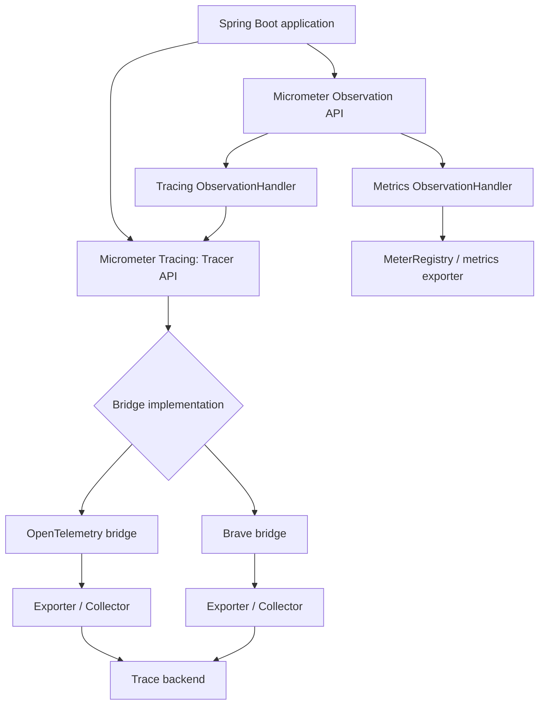
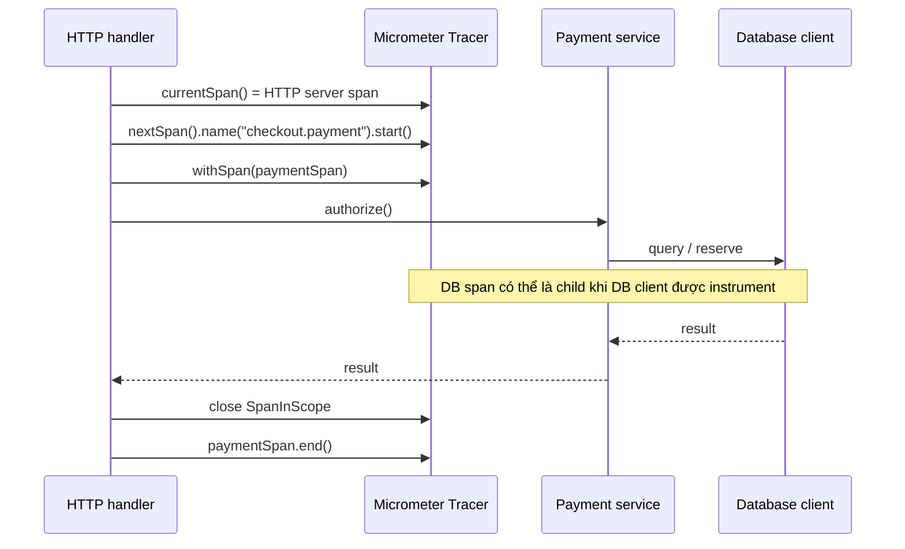
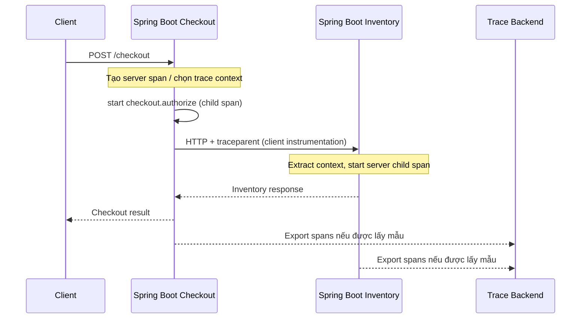

# Tracer abstraction

Một request `POST /checkout` đi qua Spring Boot API, service giữ tồn kho, dịch vụ thanh toán và database. Dashboard cho biết request chậm hơn bình thường, nhưng thông tin đó chưa đủ để biết độ trễ đến từ khâu nào. Nếu mỗi service tự tạo log ID theo cách khác nhau hoặc ghi traces trực tiếp bằng một SDK riêng, việc nối các bước xử lý sẽ khó duy trì khi thay tracer backend.

**Tracer abstraction** giải quyết một phần bài toán này: thay vì buộc mã nghiệp vụ phụ thuộc trực tiếp vào từng SDK tracing, Micrometer Tracing cung cấp các giao diện như `Tracer`, `Span` và `Tracer.SpanInScope`. Các bridge/integration cụ thể (ví dụ dựa trên OpenTelemetry hoặc Brave) triển khai những giao diện đó; exporter và backend được cấu hình ở tầng hạ tầng. Trong Spring Boot, abstraction này phối hợp với **Micrometer Observation**, metrics, logs và distributed tracing để điều tra độ trễ, lỗi và hành vi ứng dụng trên môi trường thực.

Bài học thuộc chương **Tracing** của module **SPRING_BOOT_OBSERVABILITY**, tập trung vào thiết kế và sử dụng abstraction, không chỉ cách bật một exporter.

Sau bài học, bạn có thể:

1. Phân biệt `Tracer`, `Span`, `TraceContext`, `CurrentTraceContext`, `SpanInScope`, propagator và exporter.
2. Tạo, đặt tên, thêm tags/events, ghi lỗi và kết thúc manual span đúng vòng đời.
3. Giải thích quan hệ parent–child, current span và khi nào một span trở thành root.
4. Hiểu khác biệt giữa context đang hoạt động trên thread với **distributed context propagation** qua HTTP/message.
5. Lựa chọn khi nào nên dùng `Observation`, khi nào cần thao tác trực tiếp với `Tracer`.
6. Cấu hình Micrometer Tracing bridge và exporter phù hợp trong Spring Boot 3.x, nhận diện các thay đổi có thể gặp ở phiên bản khác.
7. Tránh các lỗi sampling, mất context qua executor/Reactor, rò scope, thêm dữ liệu nhạy cảm hoặc tạo vô số span/tags.
8. Kiểm chứng trace IDs, quan hệ span, lỗi và pipeline export bằng một quy trình điều tra cụ thể.

## 1. Tại sao cần Tracer abstraction?

Distributed tracing mô tả **đường đi của một lần xử lý** qua nhiều thao tác và nhiều tiến trình. Mỗi thao tác có thể được biểu diễn thành **span**, còn toàn bộ các span có liên quan thường có cùng **trace ID**.

Ví dụ:

```text
Trace ID: 7d43...f219
|
+-- HTTP SERVER  POST /checkout                 [span A]
    |
    +-- checkout.authorize                      [span B]
        |
        +-- HTTP CLIENT  POST /payments/verify   [span C]
            |
            +-- HTTP SERVER  POST /payments/verify [span D, service khác]
                |
                +-- database query              [span E, nếu instrument]
```

Nếu các thành phần dùng cùng cơ chế propagation tương thích, span D có thể được liên kết với span C qua context được gửi theo request. Khi nhìn trace trong backend, bạn có thể thấy thời gian tiêu tốn ở từng bước, thứ tự gọi và thông tin lỗi được ghi lại.

Nhưng một ứng dụng Java có thể dùng các implementation tracing khác nhau. Nếu mã nghiệp vụ luôn tham chiếu trực tiếp vào các lớp của một backend SDK, việc chuyển bridge hoặc cấu hình instrumentation sẽ gây coupling.

Micrometer Tracing cung cấp một tầng API:



**Abstraction không có nghĩa bạn không cần implementation.** `Tracer` chỉ là hợp đồng API; phải có bridge/tracer implementation phù hợp, cơ chế xuất dữ liệu và một backend nhận dữ liệu. Ngay cả khi span được tạo đúng, sampling hoặc lỗi exporter vẫn có thể làm trace không xuất hiện trong hệ thống lưu trữ.

### 1.1. Những mục tiêu abstraction giải quyết

| Vấn đề | Cách abstraction hỗ trợ | Giới hạn cần nhớ |
| --- | --- | --- |
| Code buộc vào SDK cụ thể | Mã gọi `io.micrometer.tracing.Tracer` thay vì trực tiếp phụ thuộc SDK vendor | Cấu hình bridge/exporter vẫn có chi tiết riêng |
| Khó tạo manual span | API `nextSpan()`, `name(...)`, `start()`, `tag(...)`, `end()` | Developer vẫn phải quản lý lifecycle đúng |
| Mất cha–con khi chia nhỏ tác vụ | `withSpan(...)` kích hoạt span hiện hành trong scope | Chỉ scope cục bộ chưa tự truyền qua thread/process |
| Cần thêm thông tin điều tra | `Span.tag(...)`, `event(...)`, `error(...)` | Attributes bị giới hạn bởi sampling, privacy và backend |
| Muốn metrics và traces từ cùng instrumentation | Dùng Micrometer Observation cùng tracing/metrics handlers | Tracer thuần không tự ghi Timer hoặc Counter |
| Muốn đổi nơi lưu traces | Bridge và exporter tách khỏi mã nghiệp vụ | Tên attributes, propagation và semantic conventions có thể khác nhau |

## 2. Các thành phần chính của Micrometer Tracing

### 2.1. `Tracer` — điểm vào để thao tác với spans

`io.micrometer.tracing.Tracer` là giao diện cấp cao, cung cấp thao tác tạo span mới, tìm span hiện hành và kích hoạt một span trong scope. Một số phương thức thường dùng:

- `nextSpan()`: lấy một span mới, có thể dựa vào ngữ cảnh cha đang hoạt động nếu có.
- `currentSpan()`: lấy span hiện hành trong ngữ cảnh tại thời điểm gọi; có thể trả `null`.
- `withSpan(span)`: đặt một span vào scope hiện hành và trả về `Tracer.SpanInScope` để khôi phục ngữ cảnh khi đóng.
- `spanBuilder()`: cung cấp builder cho các nhu cầu tạo span có kiểm soát.

Điều quan trọng: **tạo span, làm span hiện hành và kết thúc span là các hành động khác nhau**. Tên API trông đơn giản nhưng mỗi hành động có ý nghĩa đối với quan hệ trace, log correlation và lifecycle.

### 2.2. `Span` — một occurrence được đo

Một `Span` đại diện một thao tác được tracing: có tên, trace/span context, thời điểm bắt đầu/kết thúc và metadata được backend hỗ trợ.

Các thao tác thường gặp:

| Phương thức | Mục đích |
| --- | --- |
| `span.name("...")` | Đặt tên công việc, thường nên ổn định |
| `span.start()` | Bắt đầu span |
| `span.tag("key", "value")` | Thêm attribute/tag phục vụ truy vết |
| `span.event("...")` | Ghi dấu một sự kiện đáng chú ý trong span |
| `span.error(exception)` | Ghi thông tin lỗi cho tracing instrumentation |
| `span.end()` | Kết thúc span, cho phép implementation xử lý dữ liệu kết thúc |
| `span.context()` | Truy cập thông tin span/trace context khi cần |

Tên span nên mô tả thao tác, ví dụ `inventory.reserve`, `checkout.authorize` hoặc `report.generate`. Không đặt tên như `checkout.authorize.order-983716`; ID động khiến backend có rất nhiều tên và tăng nguy cơ chứa dữ liệu nhạy cảm.

### 2.3. `Tracer.SpanInScope` — span nào là current?

`SpanInScope` đại diện cho **phạm vi kích hoạt span**, thường gắn với thread/context đang thực thi. Dùng với `try-with-resources` để scope được đóng kể cả khi có exception:

```java
try (Tracer.SpanInScope scope = tracer.withSpan(span)) {
    // Trong phạm vi này, tracer.currentSpan()
    // có thể trả về span đã kích hoạt.
}
```

**Đóng scope không kết thúc span.** Nó khôi phục ngữ cảnh hiện hành trước đó. Ngược lại, `span.end()` kết thúc lifetime; nó không thay thế việc đóng scope còn đang hoạt động.

Một nguyên tắc quan trọng:

```text
Tạo span mới -> start -> withSpan -> làm công việc
                              |
                         close scope
                              |
                           end span
```

Nếu nhầm `span.end()` với `scope.close()`, ứng dụng có thể để current span cũ tồn tại trên thread, khiến log hoặc nested instrumentation bị liên kết sai.

### 2.4. `TraceContext` và `CurrentTraceContext`

`TraceContext` chứa những thông tin nhận diện/phục vụ liên kết trace: trace ID, span ID, trạng thái sampling và các thuộc tính context khác tùy implementation. `CurrentTraceContext` là abstraction quản lý **trace context đang hoạt động** ở phạm vi thực thi.

Bạn thường không cần tự thay đổi IDs để tạo một child span; hãy dùng `Tracer` và instrumentation đang hoạt động. Truy cập IDs chủ yếu để correlation hoặc kiểm chứng:

```java
Span current = tracer.currentSpan();

if (current != null) {
    String traceId = current.context().traceId();
    String spanId = current.context().spanId();
    // Chỉ minh họa cách đọc; không tự đưa IDs vào metric tags.
}
```

Trace ID/span ID là dữ liệu giúp tìm một yêu cầu cụ thể trong logs/traces. **Không sử dụng chúng làm low-cardinality metric labels**: gần như mỗi request sẽ sinh ra một time series mới.

### 2.5. Propagator và baggage khác với Tracer

- **Propagator** đóng gói/khôi phục trace context qua carrier như HTTP headers hoặc message headers. Đây là điều kiện để những spans ở dịch vụ khác nhận cùng trace và quan hệ parent–child.
- **Baggage** có thể mang một số metadata xuyên boundaries nếu được cấu hình. Nó có overhead, được tiếp xúc ở nhiều tầng và cần allowlist; tuyệt đối không coi baggage là chỗ chứa token, password, email hay full request payload.
- **Exporter** quyết định cách đưa spans đã được thu thập sang collector/backend. Nó không thay cho việc inject/extract headers.

Không có một lời gọi `tracer.withSpan(...)` nào tự biến toàn bộ Java object hoặc các span tags thành HTTP headers. Propagation là một cơ chế riêng, cần instrumentation và carrier tương thích.

## 3. Ví dụ đầu tiên: tạo một manual span trong Spring Boot

Một số bước nghiệp vụ không được instrument tự động, ví dụ tính phí vận chuyển bằng thuật toán riêng. Nếu chỉ muốn một span chi tiết cho thao tác này, có thể inject Micrometer `Tracer`.

Ví dụ Java 17+, Spring Boot 3.x với tracing bridge đã được cấu hình:

```java
import io.micrometer.tracing.Span;
import io.micrometer.tracing.Tracer;
import org.springframework.stereotype.Service;

@Service
public class DeliveryQuoteService {
    private final Tracer tracer;
    private final DeliveryPricing pricing;

    public DeliveryQuoteService(Tracer tracer, DeliveryPricing pricing) {
        this.tracer = tracer;
        this.pricing = pricing;
    }

    public long calculate(String routeGroup) {
        String category = switch (
                routeGroup == null ? "" : routeGroup) {
            case "local" -> "local";
            case "regional" -> "regional";
            default -> "other";
        };

        Span span = tracer.nextSpan()
                .name("delivery.quote.calculate")
                .start();

        try (Tracer.SpanInScope scope = tracer.withSpan(span)) {
            span.tag("delivery.route.group", category);
            span.event("quote.calculation.started");

            long result = pricing.calculate(category);

            span.event("quote.calculation.finished");
            return result;
        } catch (RuntimeException | Error failure) {
            span.error(failure);
            throw failure;
        } finally {
            span.end();
        }
    }
}

// Giao diện tối giản để tập trung vào tracing.
interface DeliveryPricing {
    long calculate(String routeGroup);
}
```

Đường chạy cần lưu ý:

1. `nextSpan()` tạo span mới. Nếu ở thời điểm đó có current span phù hợp, implementation có thể tạo span con; nếu không có parent context thì có thể bắt đầu trace mới.
2. `name(...)` đặt tên ổn định trước khi start.
3. `start()` bắt đầu span, **chưa tự biến nó thành span hiện hành trên mọi thread**.
4. `withSpan(span)` kích hoạt span cho phần xử lý đồng bộ trong `try`.
5. `tag(...)` thêm thuộc tính có tập giá trị kiểm soát được; `event(...)` đánh dấu sự kiện có ý nghĩa.
6. `span.error(failure)` ghi nhận lỗi tracing; `throw failure` giữ nguyên hành vi nghiệp vụ.
7. `finally` bảo đảm `span.end()` kể cả `return` hoặc exception. Scope được đóng bởi `try-with-resources` trước khi `finally` chạy.

**Giới hạn ví dụ:** đây là manual tracing, **không** tự tạo metric Timer cho duration. Nếu muốn vừa metrics vừa trace từ cùng một instrumentation, dùng Micrometer Observation sẽ thường phù hợp hơn. Ngoài ra, một span đã kết thúc chưa chắc được xuất hay lưu: sampler và pipeline có thể quyết định khác.

## 4. Scope, parent–child và current span

Một span có thể là root của trace hoặc child của một span khác. Trong synchronous code, khi một span được đặt trong scope hiện hành, instrumentation được gọi bên trong có thể sử dụng nó làm parent.



### 4.1. Kiểm tra current span đúng cách

```java
Span current = tracer.currentSpan();

if (current == null) {
    // Chưa có span đang hoạt động ở ngữ cảnh hiện tại.
} else {
    String traceId = current.context().traceId();
    // Có thể dùng traceId để correlation/debug có kiểm soát.
}
```

Không dùng `currentSpan()` như một điều kiện bắt buộc để cho phép nghiệp vụ chạy. Tracing có thể bị tắt, chỉ có một số instrumentation hoạt động hoặc thread không có context. **Nghiệp vụ phải tiếp tục đúng dù không có span**.

### 4.2. Một span không nên được share như singleton

`Span` và scope thường gắn với **một occurrence**, không phải trạng thái dùng chung của service. Nếu lưu một `Span` đang hoạt động vào trường singleton và nhiều request cùng cập nhật nó:

- Trace A và B có thể bị lẫn tag/event.
- Sai quan hệ parent–child.
- Lỗi vòng đời khi một request end span của request khác.
- Mất correlation trong logs.
- Race condition khi nhiều threads cập nhật một object.

Tạo span theo từng invocation. Nếu cần chuyển context sang asynchronous task, hãy dùng context propagation phù hợp chứ không lưu một mutable current span toàn cục.

### 4.3. Thời điểm kết thúc khác với thời điểm đóng scope

Một span có thể tồn tại trong lifetime của một thao tác nhưng chỉ được **kích hoạt** trong một vài đoạn code. Ví dụ một future thực thi trên executor khác; scope của thread gửi task có thể đóng trong khi span đang đo công việc còn sống. Điều đó chỉ hợp lệ nếu bạn thực sự có chiến lược xử lý completion, concurrency và context propagation.

Đừng giữ một `SpanInScope` mở khi trả về từ request rồi hy vọng thread bất kỳ sẽ đóng hộ. Scope phải có owner rõ ràng. Với asynchronous/reactive code, sử dụng instrumentation có propagation hỗ trợ là cách an toàn hơn so với tự chuyển scope object qua threads.

## 5. Khi nào dùng Tracer trực tiếp, khi nào dùng Observation?

Spring Boot thường khuyến khích **Micrometer Observation** để thêm instrumentation cho thao tác nghiệp vụ khi bạn cần metrics và traces từ cùng một định nghĩa.

| Nhu cầu | Công cụ ưu tiên | Lý do |
| --- | --- | --- |
| Đo duration + count + trace cho một business step | `Observation` + handlers phù hợp | Một vòng đời, nhiều tín hiệu |
| Thêm một span chi tiết vào trace đang có | `Tracer` trực tiếp | Điều khiển span/event/tag cụ thể |
| Đo thời gian một thao tác không cần tracing | `Timer` | Không cần tạo span |
| Thay tên/tag thống nhất cho nhiều occurrences | `ObservationConvention` | Chuẩn hóa dữ liệu qua context |
| Cần truy cập trace ID/span ID hiện tại | `Tracer.currentSpan()` hoặc logging correlation | Không cần tự tạo span chỉ để lấy IDs |
| Propagate trace qua HTTP/message | Instrumentation + propagator | `withSpan(...)` không truyền qua mạng |
| Instrument HTTP server đã có auto tracing | Dùng framework instrumentation trước | Tránh span/timer trùng ranh giới |

### 5.1. Cùng nghiệp vụ với Observation

```java
import io.micrometer.observation.Observation;
import io.micrometer.observation.ObservationRegistry;
import org.springframework.stereotype.Service;

@Service
public class InventoryReservationService {
    private final ObservationRegistry registry;
    private final InventoryGateway gateway;

    public InventoryReservationService(ObservationRegistry registry,
                                       InventoryGateway gateway) {
        this.registry = registry;
        this.gateway = gateway;
    }

    public boolean reserve(String sku) {
        return Observation.createNotStarted("inventory.reserve", registry)
                .contextualName("reserve inventory")
                .lowCardinalityKeyValue("operation", "reserve")
                .observe(() -> gateway.reserve(sku));
    }
}

interface InventoryGateway {
    boolean reserve(String sku);
}
```

`observe(...)` bọc công việc **đồng bộ**, quản lý start/scope/stop và xử lý exception theo API. Khi registry có metrics observation handler, nó có thể cập nhật Timer; khi có tracing handler, nó có thể tạo span qua `Tracer` implementation.

**Không trộn sai vòng đời:** Nếu code vừa tạo một manual span bằng `Tracer`, vừa tạo một Observation cho chính xác cùng ranh giới mà tracing handler cũng sinh span, trace có thể có hai spans gần như trùng nội dung. Hãy xác định hai thao tác thật sự khác nhau hay đang instrument lặp.

### 5.2. Tracer tag khác Observation key-value

Trên span trực tiếp:

```java
span.tag("operation", "reserve");
```

Trên observation:

```java
observation.lowCardinalityKeyValue("operation", "reserve");
observation.highCardinalityKeyValue("diagnostic.class", "inventory");
```

Đây không phải các API hoàn toàn tương đương:

- `Span.tag(...)` bổ sung dữ liệu cho span (theo khả năng implementation), không tự trở thành metric label.
- `Observation.lowCardinalityKeyValue(...)` có thể làm metric dimension và cũng có thể được tracing handler sử dụng.
- `Observation.highCardinalityKeyValue(...)` thường nhắm tới dữ liệu chi tiết cho tracing, không phải dimension metrics.
- Các key-values không tự chuyển qua service khác chỉ vì chúng có mặt trên một span.

Dù là low hay high-cardinality, **không đưa token, password, thông tin thanh toán, email hay raw request body vào telemetry**. High-cardinality chỉ nói về tính đa dạng giá trị, không phải quyền được xuất dữ liệu nhạy cảm.

## 6. Cấu hình Spring Boot 3.x với Micrometer Tracing

### 6.1. Các dependency có vai trò khác nhau

Ví dụ một ứng dụng Maven dùng Spring Boot 3.x dependency management và muốn gửi trace qua OpenTelemetry Protocol (OTLP):

```xml
<!-- Actuator và Observation infrastructure -->
<dependency>
    <groupId>org.springframework.boot</groupId>
    <artifactId>spring-boot-starter-actuator</artifactId>
</dependency>

<!-- Bridge hiện thực Micrometer Tracing API bằng OpenTelemetry -->
<dependency>
    <groupId>io.micrometer</groupId>
    <artifactId>micrometer-tracing-bridge-otel</artifactId>
</dependency>

<!-- Export spans tới OTLP collector/backend -->
<dependency>
    <groupId>io.opentelemetry</groupId>
    <artifactId>opentelemetry-exporter-otlp</artifactId>
</dependency>
```

Trong cấu hình được Spring Boot hỗ trợ, tracing bridge tạo/đăng ký các bean liên quan như `Tracer`; exporter gửi spans ra bên ngoài. `spring-boot-starter-actuator` **một mình** không có nghĩa bạn đã có tracing backend hoặc đã xuất trace thành công.

Nếu chọn Brave-based bridge, bạn cần dependency và exporter phù hợp với bridge đó, ví dụ Zipkin-compatible pipeline theo cấu hình triển khai. Tránh mang đồng thời nhiều bridge cùng cạnh tranh hiện thực `Tracer` vào ứng dụng trừ khi bạn đã thiết kế việc phối hợp rõ ràng.

### 6.2. Cấu hình lấy mẫu và OTLP exporter

```yaml
management:
  tracing:
    sampling:
      probability: 0.1

  otlp:
    tracing:
      endpoint: http://localhost:4318/v1/traces
```

Giải thích:

- `management.tracing.sampling.probability: 0.1` minh họa khoảng **10%** tracing decisions được lấy mẫu theo sampler đang dùng; không phải cứ 10 request thì chắc chắn có đúng một trace.
- `management.otlp.tracing.endpoint` trong Spring Boot 3.x dùng để cấu hình endpoint nhận OTLP HTTP traces theo integration tương ứng.
- `localhost:4318` chỉ đúng khi ứng dụng và collector/backend cùng nhìn thấy endpoint đó. Trong container/Kubernetes, `localhost` là địa chỉ **trong network namespace của container/pod hiện tại**, không mặc định trỏ tới collector ở một container khác.
- Collector phải nhận được và lưu spans; một HTTP endpoint cấu hình đúng cú pháp chưa bảo đảm toàn bộ pipeline hoạt động.

**Lưu ý phiên bản:** Spring Boot 4.x có thay đổi starter và các cấu hình OTLP/tracing so với một số bản 3.x. Khi triển khai, đối chiếu tài liệu của **đúng phiên bản** và dependencies thực tế, thay vì sao chép property này nguyên xi.

### 6.3. Sampling không giống lifecycle

Nếu tracer không xuất một span vì sampling, code vẫn phải đóng scope và gọi `span.end()`. Không viết:

```java
if (tracer.currentSpan() != null) {
    // Chỉ lúc có span mới chạy logic nghiệp vụ.
    processPayment();
}
```

Nghiệp vụ không được phụ thuộc sự tồn tại của một sampled span. Tracing có thể tạo span không được ghi lại hoặc quyết định bỏ xuất; ứng dụng vẫn phải hoạt động và cleanup đúng.

Một trace không xuất hiện còn có thể do collector, network, exporter queue, authentication, retention hoặc query sai time range. Đừng quy mọi sự vắng mặt của trace là “không tạo span”.

## 7. Distributed context propagation: làm sao span nối qua HTTP?

Trong một service, `Tracer.withSpan(...)` cho biết span đang hoạt động trong scope. **Để giữ cùng trace qua hai dịch vụ**, client phải inject context vào carrier (thường HTTP headers), và server phía nhận phải extract context rồi tạo span con khi instrumentation được cấu hình.

Với W3C Trace Context, một header `traceparent` có dạng:

```http
traceparent: 00-4bf92f3577b34da6a3ce929d0e0e4736-00f067aa0ba902b7-01
```

Ý nghĩa các phần:

- `00` đầu: version của định dạng.
- `4bf92f3577b34da6a3ce929d0e0e4736`: 32 ký tự hex biểu diễn trace ID.
- `00f067aa0ba902b7`: 16 ký tự hex biểu diễn parent ID được truyền.
- `01`: trace flags trong ví dụ, có bit sampling được bật.

Đây là ví dụ minh họa một traceparent hợp lệ. Mỗi lần request thực tế có IDs riêng; **không dùng các giá trị mẫu này trong production**.

### 7.1. Spring Boot HTTP client

Một lựa chọn nên ưu tiên là HTTP client builder được Spring Boot cung cấp và cấu hình, ví dụ `RestClient.Builder` trong stack tương thích:

```java
import org.springframework.stereotype.Component;
import org.springframework.web.client.RestClient;

@Component
public class InventoryApiClient {
    private final RestClient client;

    public InventoryApiClient(RestClient.Builder builder) {
        this.client = builder
                .baseUrl("http://inventory-service")
                .build();
    }

    public String getStatus() {
        return client.get()
                .uri("/internal/inventory/status")
                .retrieve()
                .body(String.class);
    }
}
```

Khi HTTP client instrumentation, tracing handlers và propagation được bật, client có thể tạo một client span và inject trace context vào headers; service B extract nó để gắn server span vào cùng trace. Không nên tự tạo header bằng cách chép `tracer.currentSpan().context().traceId()` vào một chuỗi `traceparent` tự viết: cần cả parent span ID, flags và định dạng đúng, cùng việc xử lý nhiều chuẩn propagation khi cần.

**Không phải mọi `new RestClient.Builder()` đều có instrumentation của Boot.** Inject builder do Boot quản lý giúp giữ customizers/tracing integration, nhưng vẫn phải xác minh dependency và cấu hình thực tế.

### 7.2. Một ví dụ đường truyền context



Nếu trong backend bạn thấy hai trace IDs khác nhau cho cùng request xuyên A và B, kiểm tra:

1. Client A có tracing instrumentation không?
2. Headers thực sự có `traceparent` hoặc propagation format được chọn không?
3. Gateway/proxy có loại bỏ hoặc sửa headers không?
4. Server B có extract đúng format không?
5. Async/scheduler có làm mất parent context trước lúc gọi B không?
6. Có hệ thống nào chủ động tạo root span mới thay vì child không?

Sampling quyết định span nào được lưu, **không phải** một lời giải đầy đủ cho lỗi propagation.

### 7.3. Baggage không thay cho API contract

Baggage có thể đi qua tiến trình khi cấu hình cho phép, nhưng không phải nơi để đóng gói toàn bộ `CheckoutRequest`. Các baggage fields mang rủi ro bị ghi lại trong logs, truyền tới dịch vụ không cần biết hoặc tạo overhead trên headers.

Nếu B cần biết `customerTier` để quyết định nghiệp vụ, hãy định nghĩa nó trong API/message contract và bảo vệ bằng cơ chế xác thực phù hợp. Nếu chỉ muốn traces liên kết, trace context thường đã đủ; **không cần phát tán customer ID**.

## 8. Xử lý exception, tags và events trên một span

Manual span chỉ hữu ích nếu nó mô tả **một công việc có ý nghĩa** và ghi nhận đúng các trạng thái quan trọng. Ví dụ:

```java
Span span = tracer.nextSpan()
        .name("payment.authorize")
        .start();

try (Tracer.SpanInScope scope = tracer.withSpan(span)) {
    span.tag("payment.provider", "primary");
    span.event("payment.request.sent");

    boolean approved = gateway.authorize();

    span.tag("payment.outcome",
            approved ? "approved" : "rejected");
    return approved;
} catch (RuntimeException | Error failure) {
    span.error(failure);
    span.tag("payment.outcome", "error");
    throw failure;
} finally {
    span.end();
}
```

Đây là đoạn code minh họa **bên trong một phương thức trả boolean** với biến `tracer` và `gateway` có sẵn. Một số nguyên tắc:

- `approved=false` có thể là từ chối nghiệp vụ hợp lệ, **không nhất thiết là exception**. Tag `outcome=rejected` sẽ phản ánh điều đó.
- Gắn lỗi bằng `span.error(failure)` để tracing handler/backend có thể biết exception. Sau đó vẫn phải ném lại hoặc xử lý theo hợp đồng nghiệp vụ.
- `span.end()` phải nằm trong cleanup để không bị bỏ qua khi `return` hoặc exception.
- Các attributes/events phải có chủ đích. Không ghi raw request body, access token hoặc dữ liệu thẻ thanh toán để “debug nhanh”.
- Không dùng mỗi một tên span duy nhất như `work` cho mọi loại công việc; tên cần mô tả operation nhưng vẫn có số lượng hữu hạn.

### 8.1. Events và logging phục vụ hai mục đích

`span.event("cache.miss")` tạo một dấu mốc trong span nếu implementation/exporter hỗ trợ; nó **không phải** lời gọi logger và không bảo đảm phát một dòng log. Trong khi đó:

```java
log.info("Inventory reservation started");
```

ghi một log event, có thể có trace/span IDs qua MDC khi tracing scope và logging correlation được cấu hình. Log không tự trở thành span event. Tùy nhu cầu điều tra:

- Span events ghi dấu các mốc quan trọng trong hành trình của một request.
- Structured logs mô tả kết quả/exception/decision chi tiết hơn theo retention và access policy.
- Metrics tổng hợp tần suất và phân phối; không dùng trace span count làm mẫu số traffic nếu sampling đang bật.

### 8.2. Tránh attribute cardinality cao và dữ liệu nhạy cảm

Dữ liệu như `payment.provider=primary|backup` hay `payment.outcome=approved|rejected|error` hữu ích cho chẩn đoán. Nhưng `orderId`/`userId` thay đổi theo từng request; dù có thể là span attributes về kỹ thuật, chúng tạo chi phí indexing và nguy cơ riêng tư.

Quyết định mang thông tin chi tiết vào trace cần dựa trên **mục đích, chính sách dữ liệu, sampling, truy cập và retention**. Đừng suy luận rằng “không phải metric label thì có thể gửi bất kỳ thứ gì”.

## 9. Async executor: current span không tự chuyển thread

Một request chạy trên HTTP thread, sau đó gửi công việc sang thread pool:

```text
HTTP thread:
  currentSpan = HTTP/server span
      |
      +-- submit Runnable to executor
             |
Executor thread:
  currentSpan = ?   (có thể null nếu thiếu propagation)
```

Thread-local/current trace context thường không được kế thừa đúng qua thread pool theo cách bạn mong muốn. Nếu task có manual child span bằng `tracer.nextSpan()` khi current context đã mất, nó có thể tạo **root trace mới**, dẫn đến hai đoạn dữ liệu không nối nhau.

### 9.1. Dùng TaskDecorator của Spring khi phù hợp

Trong Spring Framework 6.1+ và các phiên bản Spring Boot tương ứng, có thể sử dụng `ContextPropagatingTaskDecorator` cùng Micrometer Context Propagation integration phù hợp:

```java
import org.springframework.context.annotation.Bean;
import org.springframework.context.annotation.Configuration;
import org.springframework.core.task.support.ContextPropagatingTaskDecorator;
import org.springframework.scheduling.concurrent.ThreadPoolTaskExecutor;

@Configuration
public class TracingExecutorConfig {

    @Bean("jobsExecutor")
    public ThreadPoolTaskExecutor jobsExecutor() {
        ThreadPoolTaskExecutor executor = new ThreadPoolTaskExecutor();
        executor.setCorePoolSize(4);
        executor.setMaxPoolSize(8);
        executor.setQueueCapacity(100);
        executor.setThreadNamePrefix("jobs-");
        executor.setTaskDecorator(
                new ContextPropagatingTaskDecorator());
        return executor;
    }
}
```

Đây là một hướng tích hợp có điều kiện:

- TaskDecorator capture context ở thời điểm submit và restore ở thread thực thi khi cơ chế context propagation được cấu hình đầy đủ.
- Có chi phí capture/restore; không bắt buộc cho mọi task cực nhỏ.
- Tracing bridge và context accessors phù hợp vẫn cần tồn tại.
- Không tự động bảo đảm propagation qua mọi future continuation chạy trên executor khác hoặc mọi thư viện async.

Với `@Async("jobsExecutor")`, hãy xác minh Spring proxy có thực sự gửi lời gọi qua executor này. Self-invocation trong cùng bean có thể bỏ qua `@Async`, dẫn tới quan sát khác mong đợi.

### 9.2. Không được kết thúc span quá sớm khi trả future

Ví dụ sai:

```java
Span span = tracer.nextSpan().name("report.generate").start();
try {
    return reportClient.generateAsync(); // Future vẫn đang chạy.
} finally {
    span.end(); // Chỉ đo thời gian tạo/lên lịch future.
}
```

Nếu muốn đo **thời gian từ khi submit tới khi future hoàn tất**, phải có một owner xử lý terminal completion/cancellation và end đúng một lần. Mọi callback cập nhật span cần xác định thread safety và context propagation. Với reactive code, cần xem lifecycle của subscription và cancellation, không chỉ thời điểm tạo `Mono`.

Đây là lý do trong nghiệp vụ async phức tạp, sử dụng instrumentation/context propagation tích hợp sẵn thường đáng tin cậy hơn việc tự chuyển một span object giữa nhiều callbacks.

## 10. Reactive pipeline và Reactor Context

Spring WebFlux/Reactor không bảo đảm tất cả operator chạy trên một thread cố định. `Reactor Context` có phạm vi theo subscription và là một cơ chế khác với thread-local span scope.

Nếu bạn tạo span ngay khi **khai báo** một `Mono`:

```java
public Mono<String> lookup() {
    Span span = tracer.nextSpan().name("catalog.lookup").start();
    try {
        return webClient.get()
                .uri("/catalog")
                .retrieve()
                .bodyToMono(String.class);
    } finally {
        span.end();
    }
}
```

Span kết thúc ngay sau khi dựng publisher, **không đo thời gian request reactive thực sự chạy**. Để quan sát đúng cần instrumentation gắn với subscription, terminal signals và cancellation, đồng thời propagate context qua scheduler/operator. Spring Boot + Reactor + Micrometer Context Propagation có những tích hợp hỗ trợ trường hợp này, nhưng không nên giả định một `withSpan(...)` thủ công tự lan qua mọi operator.

Một số định hướng:

1. Đối với HTTP server/client reactive, ưu tiên instrumentation của Spring WebFlux/`WebClient.Builder` do Boot cấu hình.
2. Với custom business step reactive, xem xét Observation API và các integration phù hợp với Reactor lifecycle.
3. Mỗi subscription hoặc logical operation phải có owner rõ ràng; một cold publisher có thể được subscribe nhiều lần.
4. Không reuse một mutable span/context giữa các subscriptions độc lập.
5. Xử lý `onComplete`, `onError` và `cancel` theo đúng định nghĩa lifetime.
6. Đối chiếu trace parent–child và logs trên thực tế sau khi đổi scheduler.

**Span kết thúc đúng thời điểm** và **context propagation đúng** là hai yêu cầu riêng: một trong hai đúng không bảo đảm cái còn lại đúng.

## 11. Sampling, exporter và backend ảnh hưởng thế nào tới abstraction?

Micrometer Tracing chỉ cung cấp API và cầu nối tới implementation; không thể ép backend lưu mọi span.

### 11.1. Bốn tầng cần phân biệt

| Tầng | Câu hỏi |
| --- | --- |
| Instrumentation | Mã đã tạo, kích hoạt và kết thúc span đúng chưa? |
| Sampling | Tracing policy có quyết định ghi/thu thập span đó không? |
| Exporter/collector | Có gửi và tiếp nhận spans thành công không? |
| Storage/query | Backend đã lưu, lập chỉ mục và truy vấn đúng trace/time range chưa? |

Ví dụ với sampling 10%: một request có thể được xử lý đầy đủ, custom Observation ghi Timer, logs được phát, nhưng backend không có trace được lưu. Điều đó **không tự chứng minh span thiếu hoặc Tracer API sai**.

Nếu trace được ghi nhưng thiếu một đoạn:

- Có thể instrumentation không tạo span cho đoạn đó.
- Có thể context propagation mất ở thread/HTTP boundary.
- Có thể sampler/drop policy khác nhau.
- Có thể exporter mất một phần dữ liệu.
- Có thể truy vấn backend lọc sai service/time range.

Không khắc phục vấn đề exporter bằng cách thêm trace ID vào metric tags; điều đó chỉ làm nổ cardinality và không sửa trace pipeline.

### 11.2. Tên span, trace IDs và attributes không phải metrics dimensions

Metrics thường quan sát **toàn bộ traffic được instrument** theo các chiều hữu hạn. Trace backend lưu **những traces được chọn và export** với thông tin đường đi chi tiết hơn. Dùng trace ID để tìm log/trace cụ thể là hợp lý, nhưng không biến trace ID thành label trên Timer.

Nếu muốn điều tra p99 chậm, dùng:

1. Histogram/timer metrics để phát hiện phần đuôi latency đang xấu đi.
2. Trace mẫu phù hợp để xem đoạn nào chiếm thời gian.
3. Logs cùng trace/span context để tìm exception, retry hoặc fallback.
4. Metrics tài nguyên khác như connection pool, executor queue, GC để kiểm chứng giả thuyết.

## 12. Kiểm thử Tracer abstraction

Một test tốt không chỉ kiểm tra “method có trả kết quả đúng”, mà còn kiểm tra instrumentation **không làm thay đổi ngữ nghĩa nghiệp vụ** và **không rò context**.

### 12.1. Ma trận thử nghiệm

| Kịch bản | Điều cần chứng minh |
| --- | --- |
| Không có parent span | Manual span được tạo và kết thúc; có thể là root |
| Có HTTP/server parent | Child span giữ quan hệ cha–con khi propagation/scope hoạt động |
| Thành công | `end()` được gọi và tags/events mang giá trị đã xác định |
| Exception | `error(...)` được gọi; exception nghiệp vụ vẫn được xử lý/truyền đúng |
| Early return | Span vẫn end trong `finally` |
| Nhiều request đồng thời | Không reuse span/global mutable context |
| HTTP client cross-service | Trace context được inject/extract đúng format |
| Executor task | Context được capture/restore đúng, logs có correlation khi bật |
| Reactor cancellation | Cleanup khi subscription kết thúc/hủy, không end lúc xây publisher |
| Sampling thấp | Nghiệp vụ hoạt động dù một số spans không được lưu |
| Exporter bị ngắt | Lỗi telemetry không bị nhầm với lỗi nghiệp vụ; phát hiện pipeline mất dữ liệu |

### 12.2. Chọn đúng loại test

**Unit test:** kiểm tra method nghiệp vụ vẫn trả kết quả và ném exception đúng khi tracing được bật/tắt; vòng đời span được quản lý bằng cleanup. Dùng test double hoặc tracer implementation được hỗ trợ nếu cần kiểm tra callback.

**Integration test:** chạy tracing bridge và exporter/collector thử nghiệm phù hợp. Dùng exporter lưu spans trong bộ nhớ hoặc collector test nếu stack hỗ trợ; xác minh span names, parent IDs, events/errors và duration hợp lý.

**End-to-end test:** phát request qua ít nhất hai service; kiểm tra trace ID được nối qua HTTP headers và spans hiển thị đúng parent–child. Xem log correlation, tracing sampling và khả năng exporter thực sự hoạt động.

**Không đánh giá test chỉ bằng số trace backend trả về** khi sampling nhỏ hơn 100%; trong môi trường thử có thể cấu hình sampling phù hợp và isolate pipeline để kiểm chứng.

### 12.3. Đo chính xác những gì cần đo

Nếu custom span được dùng để đo thời gian `gateway.authorize(...)`, hãy bảo đảm span bắt đầu trước và end sau **toàn bộ công việc cần đo**. Nếu chỉ bọc thời gian dựng một `CompletableFuture`, duration của span sẽ nhỏ bất thường dù người dùng phải chờ lâu. Nếu code dùng nhiều retry, quyết định có span tổng bao toàn bộ retry/backoff hay child span mỗi attempt, không trộn hai ý nghĩa.

## 13. Những anti-pattern phổ biến

| Anti-pattern | Hậu quả | Cách khắc phục |
| --- | --- | --- |
| Gọi `tracer.nextSpan()` nhưng không `start()` hoặc `end()` | Span không có vòng đời đầy đủ, khó export/đo duration | Quản lý start/scope/end rõ ràng |
| `end()` chỉ ở nhánh thành công | Nhánh exception/return sớm thiếu kết thúc | `try-with-resources` cho scope, `finally` cho end |
| Dùng `withSpan(...)` nhưng không đóng scope | Rò current span trên thread; parent/log correlation sai | Đóng scope trong mọi đường chạy |
| Tạo một singleton `Span` cho toàn service | Nhiều request trộn trace, race condition | Tạo một span cho mỗi invocation |
| Đưa `userId`, token vào span name/attributes | Cardinality/chi phí và rò thông tin | Tên ổn định, allowlist attributes, bảo vệ dữ liệu |
| Truyền trace bằng cách tự chép mỗi trace ID | Mất parent ID, flags/format, không hợp propagator | Dùng HTTP/message instrumentation và propagator |
| Tạo thêm manual span trùng auto HTTP span | Trace dài, noisy và khó phân tích | Chỉ thêm span cho bước nghiệp vụ có ý nghĩa |
| Nghĩ `Tracer` tự ghi Timer | Thiếu metrics hoặc tự tạo phép đo trùng | Dùng Observation + metrics handler khi cần cả hai |
| Kết thúc span ngay khi trả `Future`/`Mono` | Duration quá ngắn và thiếu phần async | Gắn lifecycle vào completion/cancellation |
| Cho rằng scope thread A tự đi qua executor | Trace bị tách, log worker thiếu correlation | Context propagation/TaskDecorator phù hợp |
| Bật exporter nhưng không có bridge hoặc collector | Có cấu hình nhưng thiếu trace cuối | Xác minh dependencies và pipeline từng tầng |
| Cho rằng sampled trace nào cũng xuất hiện | Nhầm giữa sampling và lỗi instrumentation | Kiểm tra sampler, exporter, backend time range |

## 14. Bài thực hành: manual span và trace xuyên dịch vụ

### Bối cảnh

Bạn có hai Spring Boot services:

- **Checkout** nhận `POST /checkout` và gọi **Inventory**.
- **Inventory** xử lý giữ tồn kho và trả kết quả.

Trong lab, bạn có Actuator, tracing bridge + exporter phù hợp và một backend có thể xem trace.

### Các bước thực hiện

1. **Chuẩn bị dependencies:** thêm Actuator, Micrometer tracing bridge (ví dụ OpenTelemetry) và exporter theo đúng phiên bản Spring Boot.
2. **Cấu hình sampler:** trong môi trường lab riêng, đặt sampling đủ cao để quan sát test dễ dàng; không tự áp dụng sampling 100% cho production.
3. **Tạo manual span:** trong một bước tính toán của Checkout, inject `io.micrometer.tracing.Tracer` và tạo span `checkout.pricing.calculate`.
4. **Bảo đảm cleanup:** dùng `try (Tracer.SpanInScope ...)` và `finally { span.end(); }`. Tạo thử nhánh trả về sớm và nhánh exception.
5. **Thêm thông tin có kiểm soát:** `span.tag("checkout.channel", "web")` và `span.event("pricing.calculated")`. Không gửi order ID/token.
6. **Dùng HTTP client có instrumentation:** tạo `RestClient` từ `RestClient.Builder` được Boot inject. Gọi Inventory và xác minh headers/context được truyền qua HTTP.
7. **Xem trace trong backend:** xác nhận spans Checkout, client HTTP, Inventory server có quan hệ parent–child và trace ID phù hợp.
8. **Thử lỗi propagation:** trong lab, tạo một HTTP client không được instrument hoặc cố ý mất context rồi so sánh trace bị tách. Sau đó sửa lại và xác nhận.
9. **Thử async:** gửi một bước sang `jobsExecutor`, kiểm tra context propagation/TaskDecorator; nhìn logs trong worker có trace ID phù hợp hay không.
10. **Đối chiếu metrics:** đo thêm custom business step bằng Observation và kiểm tra Timer metrics (nếu metrics handler có mặt). Giải thích vì sao raw `Tracer` manual span không tự tạo Timer.
11. **Đối chiếu sampling:** giảm sampling rồi quan sát rằng một số traces không được lưu, trong khi ứng dụng vẫn hoạt động và metrics có thể tiếp tục tăng.
12. **Giả lập exporter lỗi:** ngừng collector trong lab, kiểm tra metrics/logs/error của exporter; phân biệt mất telemetry với lỗi nghiệp vụ.

### Câu hỏi tự kiểm tra

**Câu 1.** Một service có thể tạo span nhưng không có trace nào trong backend không?

Có. Sampling, exporter, collector, storage và query time range đều có thể làm trace không thấy dù code đã chạy. Cần kiểm tra lần lượt các tầng.

**Câu 2.** `span.end()` có đóng current span scope không?

Không. Scope được quản lý bằng `Tracer.SpanInScope.close()`; `span.end()` kết thúc lifetime span. Hai thao tác có trách nhiệm khác nhau.

**Câu 3.** `Tracer.currentSpan()` có thể trả `null` không?

Có. Không phải mọi thread hoặc mọi code path đều có span đang hoạt động. Tracing không được làm điều kiện để nghiệp vụ chạy.

**Câu 4.** Muốn gửi trace context từ Checkout sang Inventory có cần chép mọi span tags vào HTTP headers không?

Không. Dùng tracing instrumentation/propagator để inject/extract các trường trace context như `traceparent`. Tags của một span không tự được propagate sang service khác.

**Câu 5.** Khi nào nên chọn Micrometer Observation thay vì Tracer trực tiếp?

Khi muốn mô tả một business operation và tận dụng cùng một vòng đời cho metrics/traces bằng các handlers. Dùng Tracer trực tiếp khi cần điều khiển span/events/tags chi tiết và chấp nhận quản lý lifecycle thủ công.

**Câu 6.** Vì sao không nên gắn trace ID vào Timer tags?

Trace ID gần như duy nhất cho mỗi trace, tạo metric cardinality rất cao và phá khả năng tổng hợp. Nó phù hợp cho log/trace correlation chứ không phải metrics dimensions.

**Câu 7.** Một span có tên `checkout.authorize.ORD-12345` có vấn đề gì?

Tên chứa ID giao dịch động làm số lượng tên/nhóm dữ liệu tăng mạnh và có nguy cơ rò thông tin. Đặt tên cố định như `checkout.authorize`; bổ sung attributes đã được kiểm soát khi thật sự cần.

## 15. Checklist sử dụng Tracer abstraction trong production

| Câu hỏi | Tiêu chí đạt |
| --- | --- |
| Dùng đúng abstraction? | `io.micrometer.tracing.Tracer` hoặc Observation phù hợp với mục tiêu |
| Có bridge implementation? | Một tracing bridge tương thích với Spring Boot |
| Có exporter/backend nhận spans? | Đã kiểm chứng end-to-end, không chỉ khai báo dependencies |
| Span lifecycle rõ ràng? | Start, scope close, end trong mọi đường đi |
| Parent–child đúng? | Current span và HTTP/message propagation được xác minh |
| Async/reactive được xử lý? | Context propagation và lifecycle đi theo completion/cancellation |
| Tên và attributes ổn định? | Không chứa ID động, token, email hay full payload |
| Sampling được hiểu đúng? | Không đồng nhất “không thấy trace” với “không có span” |
| Metrics có được tính độc lập? | Không giả định Tracer tự ghi Timer; kiểm tra Observation handlers |
| Logs có correlation? | Trace/span IDs đúng scope, MDC/log pipeline được cấu hình |
| Có quy trình điều tra? | Xác minh instrumentation → sampling → exporter → storage/query |
| Có kiểm thử lỗi? | Exception, early return, timeout, cancellation, downstream lỗi đều được xem xét |

**Tổng kết:** `Tracer` là abstraction quản lý spans và current trace context trong ứng dụng Spring Boot mà không buộc code nghiệp vụ phải gắn trực tiếp với một tracing SDK cụ thể. `Span` mô tả một thao tác, `SpanInScope` quyết định ngữ cảnh hiện hành, còn propagator chuyển context qua ranh giới dịch vụ. Bridge, sampler và exporter quyết định dữ liệu trace đi đến đâu. Khi chọn đúng giữa **Tracer** và **Observation**, thiết kế lifecycle an toàn và kết hợp metrics, logs với traces, bạn có một nền tảng quan sát đáng tin cậy hơn để điều tra hiệu năng và sự cố.

### Tài liệu tham khảo

- [Micrometer — Tracing reference](https://docs.micrometer.io/tracing/reference/)
- [Micrometer — Tracing API](https://docs.micrometer.io/tracing/reference/api.html)
- [Micrometer — Context Propagation](https://docs.micrometer.io/context-propagation/reference/)
- [Spring Boot — Tracing](https://docs.spring.io/spring-boot/reference/actuator/tracing.html)
- [Spring Boot — Observability](https://docs.spring.io/spring-boot/reference/actuator/observability.html)
- [Spring Framework — Task Execution and Scheduling](https://docs.spring.io/spring-framework/reference/integration/scheduling.html)
- [OpenTelemetry — Context Propagation](https://opentelemetry.io/docs/concepts/context-propagation/)
- [W3C — Trace Context](https://www.w3.org/TR/trace-context/)

