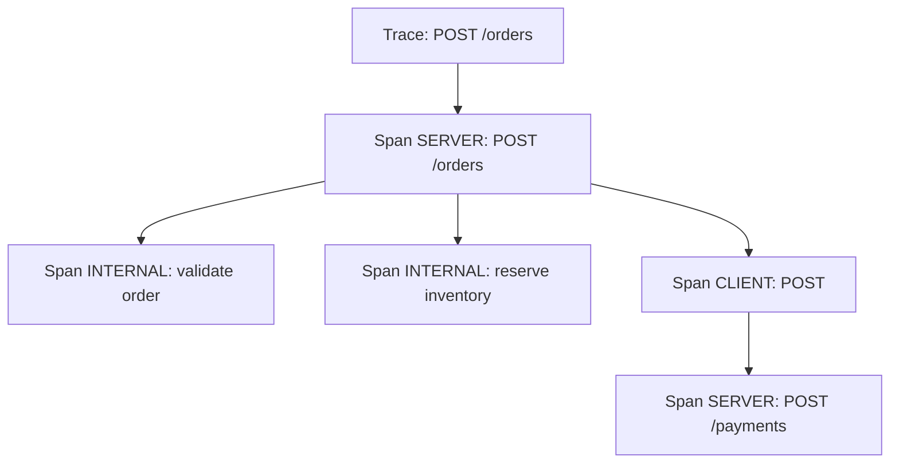
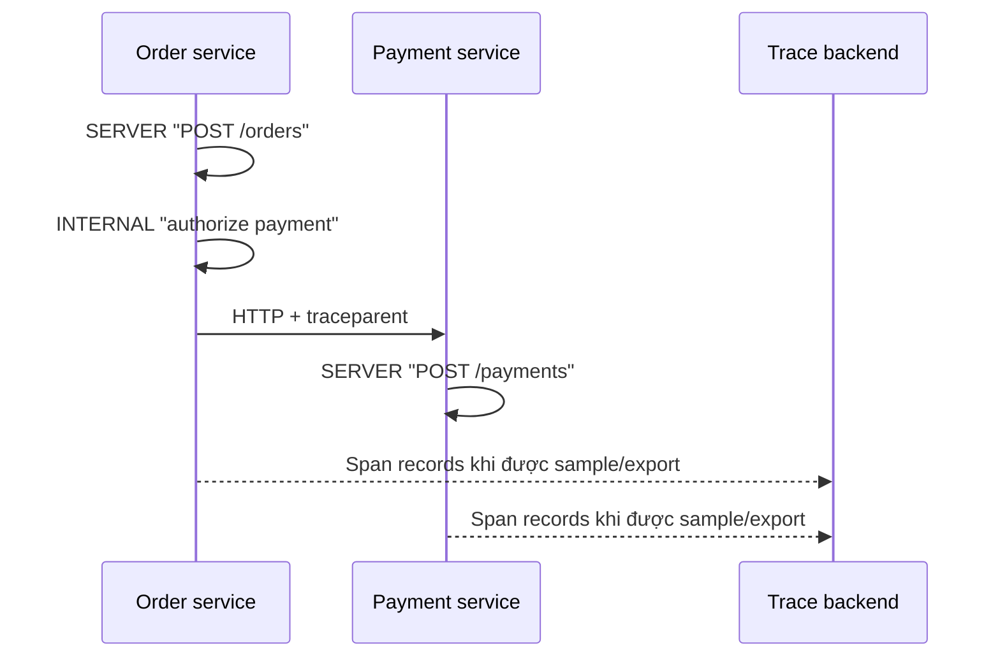

# Span name trong Micrometer Tracing và Spring Boot

## 1. Mục tiêu và phạm vi

Khi điều tra một request chậm trên hệ thống phân tán, trace backend có thể hiển thị hàng chục span từ nhiều dịch vụ. Tên span là thông tin đầu tiên giúp người vận hành phân biệt bước **xử lý HTTP**, **kiểm tra tồn kho**, **tính giá**, **gọi cơ sở dữ liệu** hay **gửi sự kiện**. Nếu tên quá chung, trace khó đọc; nếu tên chứa `orderId`, `userId` hoặc URL thực, dữ liệu tracing bị phân mảnh và có nguy cơ tiết lộ thông tin.

Bài này nằm trong chương **Tracing** của module **SPRING_BOOT_OBSERVABILITY**. Trọng tâm là **Span name**: tên biểu diễn thao tác được đo, quy tắc đặt tên, quan hệ với Micrometer Observation, cách thay đổi tên có kiểm soát, và việc kiểm chứng trên Spring Boot. Kiến thức được đặt trong bối cảnh module thiết lập metrics, logs, distributed tracing, context propagation, tag/cardinality, exporter và sampling để điều tra lỗi và độ trễ ở môi trường thực.

Sau bài học, bạn có thể:

1. Phân biệt `span name`, `traceId`, `spanId`, `span kind`, attributes và resource attributes.
2. Chọn tên **ổn định, cardinality thấp, có ý nghĩa thao tác**, không ghép định danh riêng của từng request.
3. Giải thích `Observation.name` khác `Observation.contextualName` như thế nào và vì sao tracing handler ưu tiên contextual name.
4. Đặt tên custom span qua `Observation`, `Tracer`, `@Observed` hoặc `ObservationConvention`.
5. Hiểu quy ước HTTP span name dựa trên method và **route template**.
6. Kiểm tra tên span thực tế ở backend, liên hệ đúng trace với metrics và logs, không nhầm tên với sampling hoặc propagation.
7. Nhận diện lỗi thường gặp khi đổi tên quá muộn, instrument trùng, dùng giá trị động hoặc không có trace được export.

**Phiên bản minh họa:** Spring Boot 3.5.x, Java 17+, Micrometer Observation/Tracing. Với Spring Boot 4.x hoặc các phiên bản OpenTelemetry semantic conventions khác, phải kiểm tra đúng starter, namespace cấu hình và quy ước của bản đang triển khai.

## 2. Span name là gì?

Một **trace** mô tả một hành trình yêu cầu qua các thành phần. Một **span** đại diện cho một thao tác có thời điểm bắt đầu, kết thúc, quan hệ cha-con và metadata. **Span name** là nhãn ngắn gọn mô tả *loại thao tác đang thực hiện*, không phải định danh duy nhất của lần chạy.

Ví dụ khi một request tạo đơn hàng:



Sơ đồ chỉ minh họa một trace khi server/client đã được instrument và trace context được propagate. Tên HTTP client thực tế có thể bao gồm URL **template** nếu instrumentation có sẵn template, hoặc chỉ dùng HTTP method khi không có đích có cardinality thấp. Cấu trúc span và tên ở backend còn phụ thuộc framework, tracer và phiên bản semantic conventions.

### 2.1. Phân biệt các trường gần nhau

| Trường | Mục đích | Ví dụ | Có nên chứa ID động? |
| --- | --- | --- | --- |
| **Span name** | Nhóm/đọc loại thao tác | `reserve inventory`, `GET /orders/{id}` | **Không** |
| `traceId` | Định danh toàn bộ hành trình trace | Chuỗi hex/ID của trace | Bản thân là định danh kỹ thuật; không đưa vào tên |
| `spanId` | Định danh một span trong trace | Chuỗi ID của span | Không đưa vào tên |
| `parentSpanId` | Nối quan hệ cha-con | ID của span cha | Không đưa vào tên |
| Span kind | Vai trò thao tác trong giao tiếp | `SERVER`, `CLIENT`, `INTERNAL`, `PRODUCER`, `CONSUMER` | Không |
| Span attributes | Thông tin có cấu trúc về thao tác | `http.request.method=GET`, `payment.provider=acquirer-a` | Tùy chính sách, sampling và privacy |
| Resource attributes | Thực thể phát telemetry | `service.name=checkout-service` | Thường là giá trị ổn định |
| Span events | Sự kiện có thời điểm trong span | `retry scheduled` | Tránh chèn bí mật vào tên/event |
| Span status/error | Trạng thái lỗi khi thao tác thất bại | `ERROR`, exception type | Tách biệt với tên |

**Không thể suy ra trace ID từ span name.** Nhiều span ở những request khác nhau có thể cùng tên `reserve inventory`, nhưng mỗi lần thực thi có `spanId` riêng. Một span đổi tên không có nghĩa nó trở thành span mới, cũng không thay đổi `traceId`/`spanId`.

### 2.2. Span name khác service name

`service.name` thuộc **resource attributes** và xác định ứng dụng/dịch vụ phát span, chẳng hạn `checkout-service`. `span name` mô tả thao tác bên trong dịch vụ ấy. Một service có thể phát hàng trăm loại span khác nhau; không nên đặt tất cả span là `checkout-service`.

Ở trace backend, các trường thường được dùng cùng nhau: *service*, *operation/span name*, *duration*, *status* và *trace ID*. Một dashboard tổng hợp latency theo tên span có ý nghĩa khi tên **ổn định**.

## 3. Quy tắc chọn tên span tốt

Một tên hữu ích cần đồng thời **diễn đạt hành động** và **giới hạn tập giá trị**:

- Dùng một tên cho một **loại thao tác**, không dùng tên theo từng lần chạy.
- Ưu tiên dạng hành động + đối tượng/đích nghiệp vụ: `reserve inventory`, `authorize payment`, `calculate tax`.
- Với HTTP, bám theo semantic conventions và route template: `GET /orders/{id}`, không dùng URL thực `GET /orders/81472`.
- Dùng tên ngắn gọn, dễ tìm, thống nhất trong cùng hệ thống; tránh nhét tham số, payload hoặc thông điệp exception.
- Tách thông tin bổ sung vào span attributes/events theo chính sách dữ liệu, không ghép vào tên.
- Không đổi tên theo trạng thái: `authorize payment success` và `authorize payment failed` thường nên là **cùng loại thao tác**; phân biệt kết quả bằng status/error/attribute có kiểm soát.
- Không nhân tạo một span chỉ để hiện thị thêm một dòng; chỉ tạo span cho một bước có giá trị quan sát, tránh trace có quá nhiều span nhỏ.

### 3.1. Tên tốt và tên cần tránh

| Bối cảnh | Nên dùng | Tránh dùng | Vấn đề của tên sai |
| --- | --- | --- | --- |
| Đọc đơn qua HTTP | `GET /orders/{id}` | `GET /orders/81472` | Một tên khác cho mỗi ID |
| Kiểm tra tồn kho | `reserve inventory` | `reserve inventory sku=88235` | SKU động làm phân mảnh |
| Thanh toán | `authorize payment` | `authorize payment for alice@example.com` | Rò rỉ dữ liệu cá nhân |
| Truy vấn DB | `SELECT orders` hoặc tên theo instrumentation DB hiện hành | `SELECT * FROM orders WHERE id=81472` | SQL động và tham số nhạy cảm |
| Gửi message | `publish order-events` (khi đích hữu hạn) | `publish order-81472` | Đích động, index khó dùng |
| Xử lý lỗi | `process checkout` | `failed: timeout after 1032ms for id=...` | Tên bị chi phối bởi lỗi/giá trị thực |
| Phân tích giá | `calculate price` | `run method` hoặc `process` | Quá chung để tìm nút nghẽn |

Các tên ở cột nên dùng là **ví dụ thiết kế**. Với HTTP, database và messaging được framework tự instrument, tên/kind phải được chọn theo quy ước của instrumentation đang chạy; không ghi đè tùy tiện để khớp nguyên văn bảng.

### 3.2. Cardinality của span name

Giả sử một API có 4 HTTP methods và 30 route templates hợp lệ. Trong tình huống lý tưởng, nó có tối đa khoảng `4 × 30 = 120` nhóm tên theo quy tắc method + route. Nếu ghép ID của 100.000 đơn hàng vào tên, số **tên span riêng biệt** có thể tăng theo số đơn hàng.

Điều này làm tìm kiếm/nhóm theo operation name kém hiệu quả, tăng chi phí indexing và phá vỡ các bảng thống kê dựa vào tên. Không nên áp dụng máy móc công thức `số tên span = số metric series`: metrics time series được phân biệt theo **meter name và tags**, còn tracing lưu **span records** với tên và attributes. Cả hai đều chịu áp lực lưu trữ từ metadata động, nhưng cơ chế và ngân sách khác nhau.

**Kết luận:** Tên span tốt để **nhóm thao tác**, còn ID cụ thể dùng trace ID, một attribute được phép thu thập, log/audit hoặc database tùy mục tiêu điều tra.

## 4. Span name theo OpenTelemetry semantic conventions

OpenTelemetry quy định tên cho các loại spans để nhiều dịch vụ, tracer và backend có thể hiểu thống nhất. Không phải mọi span đều phải đặt tên thủ công; nên ưu tiên auto-instrumentation của framework cho HTTP và các transport đã được hỗ trợ.

### 4.1. HTTP server spans

Khi có **route template cardinality thấp**, tên HTTP span thường theo dạng:

```text
{HTTP_METHOD} {ROUTE_TEMPLATE}
```

Ví dụ:

```text
GET /orders/{id}
POST /orders
PUT /orders/{id}
```

Các request:

```text
GET /orders/102
GET /orders/103
GET /orders/104
```

đều được nhóm vào một span name `GET /orders/{id}`, không tạo ba tên khác nhau.

Nếu **không có route template** ở thời điểm instrument, OpenTelemetry hướng dẫn dùng method, ví dụ `GET`, thay vì suy đoán từ raw URI path. Khi route được framework xác định muộn, instrumentation có thể cập nhật tên span trước khi kết thúc. Một số tên fallback và cách update thay đổi theo phiên bản; kiểm tra dữ liệu thực ở trace backend.

`http.route` là attribute chứa route template (khi có), khác với `url.path` chứa đường dẫn thực. Không dùng `url.path` hoặc query string thô để thay cho `http.route`.

### 4.2. HTTP client spans

Ở client, ứng dụng có thể không biết route template của server đích. Một HTTP client span vì thế có thể tên `GET` hoặc `POST`. Khi instrumentation có **URL template hợp lệ**, tên có thể bao gồm template đó. Không mặc định ghép toàn bộ URL có token, query hoặc ID động vào tên.

Với Spring Boot, nên sử dụng `RestClient.Builder`/`WebClient.Builder` được framework cấu hình để các interceptor/observation conventions có cơ hội nhận ngữ cảnh và truyền trace headers. Khi dùng HTTP client tự tạo, không nên giả định tracing đã được instrument.

### 4.3. Database và messaging

Với database, semantic conventions/instrumentation có thể dùng operation (`SELECT`, `INSERT`, `db.client.operation`...) và đích có cardinality thấp như collection/table khi phù hợp. Tránh SQL đầy đủ có tham số động trong span name.

Với messaging, tên nên biểu diễn hành vi `publish`, `receive` hoặc `process` và đích hữu hạn. Tên hàng đợi/topic do người dùng tạo tự do cần được chuẩn hóa để không gây cardinality cao.

Các semantic conventions có thể phát triển theo phiên bản; nếu đã có thư viện instrumentation cho database/message broker, ưu tiên tên mặc định của nó và đo thực tế trước khi thay đổi.

## 5. Micrometer Observation: `name` và `contextualName`

Đây là chỗ dễ nhầm nhất khi lập trình Spring Boot.

Một `Observation` có hai loại tên liên quan:

| Thuộc tính Micrometer | Mục đích chính | Ví dụ |
| --- | --- | --- |
| **Observation name** (`name`) | Định danh kỹ thuật ổn định của observation, thường dùng làm **meter name** | `inventory.reserve` |
| **Contextual name** (`contextualName`) | Tên có ngữ cảnh, dễ đọc; tracing handler thường dùng làm **span name** | `reserve inventory` |
| Low-cardinality key-values | Nhãn ít giá trị, dùng cho metrics và có thể cho spans | `channel=web` |
| High-cardinality key-values | Metadata chi tiết hơn cho spans khi được phép | `workflow.id=opaque-value` |
| `Observation.Context` | Dữ liệu nội bộ của một observation cho handlers | Trạng thái bước xử lý, error |

Ví dụ:

```java
import io.micrometer.observation.Observation;
import io.micrometer.observation.ObservationRegistry;

Observation observation = Observation
        .createNotStarted("inventory.reserve", observationRegistry)
        .contextualName("reserve inventory")
        .lowCardinalityKeyValue("channel", "web");

observation.observe(() -> inventoryService.reserve());
```

Giả sử registry có metrics/tracing handlers phù hợp:

- Metrics handler có thể tạo **Timer** tên `inventory.reserve` với tag `channel=web`.
- Tracing handler có thể tạo span tên **`reserve inventory`**, vẫn được liên kết vào parent trace/span nếu scope/propagation đúng.
- Logs có thể mang `traceId`/`spanId` trong phạm vi scope nếu MDC được cấu hình, nhưng **không tự mang tên span** dưới dạng MDC field.

Trong Micrometer Tracing, logic tên của `TracingObservationHandler` sử dụng `Observation.Context.getContextualName()` khi nó có giá trị; nếu không, handler thường dùng `getName()` làm fallback. Vì thế nếu chỉ viết:

```java
Observation.createNotStarted("inventory.reserve", observationRegistry)
        .observe(() -> inventoryService.reserve());
```

thì tên span có thể là `inventory.reserve`. Điều này không sai, nhưng khi muốn tên dễ đọc riêng cho span, hãy dùng `contextualName`.

**Đừng đặt `Observation.name` thành `inventory.reserve.81472` để tạo span dễ tìm:** tên này còn có thể trở thành **metric name**, gây bùng nổ metric families. Dữ liệu định danh của một lần chạy không phải tên một loại thao tác.

### 5.1. Thời điểm gán tên

Nên gán `name` và `contextualName` **trước khi gọi `observe` hoặc `start`**, nếu thao tác đã có tên ổn định. Ví dụ HTTP có thể đổi tên khi route template chỉ biết sau routing; đó là hành vi instrumentation có chủ đích, không phải lý do tự đổi mọi span theo dữ liệu cuối request.

Span có thể cho phép đổi tên trước khi `end()`, nhưng việc đổi muộn không quay ngược quyết định **head sampling** đã thực hiện khi tạo/bắt đầu span. Một số handler, filter hoặc exporter đọc metadata ở các thời điểm khác nhau; tránh phụ thuộc vào việc cập nhật sau `stop/end`.

## 6. Cấu hình Spring Boot 3.5 để quan sát tên span

Một ví dụ ứng dụng Spring Boot MVC dùng Micrometer Observation và **Micrometer Tracing bridge tới OpenTelemetry**.

### 6.1. Maven dependencies

Với Spring Boot parent/BOM quản lý phiên bản:

```xml
<dependencies>
    <dependency>
        <groupId>org.springframework.boot</groupId>
        <artifactId>spring-boot-starter-web</artifactId>
    </dependency>
    <dependency>
        <groupId>org.springframework.boot</groupId>
        <artifactId>spring-boot-starter-actuator</artifactId>
    </dependency>
    <dependency>
        <groupId>io.micrometer</groupId>
        <artifactId>micrometer-tracing-bridge-otel</artifactId>
    </dependency>
    <dependency>
        <groupId>io.opentelemetry</groupId>
        <artifactId>opentelemetry-exporter-otlp</artifactId>
    </dependency>
</dependencies>
```

Phần tracing cần bridge, tracer/provider và exporter tương thích; với dependency management của Boot, auto-configuration sẽ kết nối các thành phần khi điều kiện phù hợp. Nếu dùng bridge **Brave** thay vì OpenTelemetry, phải thay bộ dependency và exporter tương ứng; không trộn hai bridge chỉ để tạo cùng loại span.

**Lưu ý:** tracing SDK/provider và `OtlpMeterRegistry` là hai đường dữ liệu riêng. Thêm `micrometer-registry-otlp` chỉ để xuất metrics không tự cung cấp tracer hoặc spans.

### 6.2. Application properties

```yaml
spring:
  application:
    name: inventory-service

management:
  endpoints:
    web:
      exposure:
        include: health,info,metrics
  tracing:
    sampling:
      probability: 1.0  # Chỉ để kiểm tra cục bộ
  otlp:
    tracing:
      endpoint: http://localhost:4318/v1/traces
```

Cấu hình minh họa **Spring Boot 3.5.x**: trace exporter gửi tới receiver OTLP/HTTP trên cổng 4318 với đường dẫn `/v1/traces`. Cần Collector/trace backend thực sự chạy và cho phép ingest. Khi ở Docker/Kubernetes, `localhost` là môi trường network của ứng dụng; thay bằng DNS hoặc địa chỉ Collector truy cập được.

Sampling `1.0` giúp bài thử thấy nhiều span hơn; **không** nên mặc định dùng 100% trong production vì chi phí và lượng dữ liệu. Điều chỉnh `management.tracing.sampling.probability` không đổi tên span hoặc làm metric Timer chỉ đếm theo tỷ lệ trace.

Expose `/actuator/metrics` để kiểm tra meters là tùy chọn; endpoint này **không** phải nơi đọc tất cả span names. Tên span thực tế cần xem ở Collector hoặc trace backend (ví dụ Jaeger/Tempo/Zipkin) đã cấu hình tương thích.

## 7. Ví dụ Spring Boot hoàn chỉnh: tên span ổn định cho nghiệp vụ

Service bên dưới chỉ đo một bước `inventory.reserve`. Nó dùng tên span không phụ thuộc request và chuẩn hóa `channel` về các giá trị hữu hạn.

```java
package com.example.inventory;

import io.micrometer.observation.Observation;
import io.micrometer.observation.ObservationRegistry;
import org.springframework.stereotype.Service;

@Service
public class InventoryService {
    private final ObservationRegistry registry;

    public InventoryService(ObservationRegistry registry) {
        this.registry = registry;
    }

    public String reserve(String rawChannel, boolean fail) {
        String channel = "web".equals(rawChannel) ? "web" : "other";

        return Observation
                .createNotStarted("inventory.reserve", registry)
                .contextualName("reserve inventory")
                .lowCardinalityKeyValue("channel", channel)
                .observe(() -> {
                    if (fail) {
                        throw new IllegalStateException(
                                "Simulated out-of-stock error");
                    }
                    return "reserved";
                });
    }
}
```

Một controller đơn giản để gọi nghiệp vụ:

```java
package com.example.inventory;

import org.springframework.web.bind.annotation.GetMapping;
import org.springframework.web.bind.annotation.RequestParam;
import org.springframework.web.bind.annotation.RestController;

@RestController
public class InventoryDemoController {
    private final InventoryService inventory;

    public InventoryDemoController(InventoryService inventory) {
        this.inventory = inventory;
    }

    @GetMapping("/demo/reserve")
    public String reserve(
            @RequestParam(defaultValue = "web") String channel,
            @RequestParam(defaultValue = "false") boolean fail) {
        return inventory.reserve(channel, fail);
    }
}
```

Gửi hai request:

```text
GET /demo/reserve?channel=web
GET /demo/reserve?channel=mobile&fail=true
```

Kỳ vọng khi tracing đã cấu hình thành công:

- HTTP server span do Spring MVC instrument có tên theo convention của framework (tên thực tế thay đổi theo phiên bản/routing).
- Custom span lồng bên trong thường tên **`reserve inventory`**.
- Span lỗi có thể nhận error/status/exception metadata khi `observe` bắt exception thoát ra.
- Hai request có thể có trace IDs khác nhau nhưng đều có custom span **cùng tên**.
- Metric có thể mang tên `inventory.reserve` và tag `channel=web|other`, không phải hai metric mang tên `reserve inventory`.

Tên span không định nghĩa kết quả thành công/thất bại. Trong demo, khi `fail=true`, tên **vẫn giữ nguyên**, còn trạng thái lỗi khác. Đây là thiết kế tốt để tìm được toàn bộ lượt gọi `inventory.reserve` rồi phân tích tỷ lệ lỗi/thời gian theo thời điểm.

## 8. Dùng `Tracer` để đặt tên span trực tiếp

Không phải mọi trường hợp đều đi qua `Observation`. Với Micrometer Tracing, có thể chủ động tạo span:

```java
import io.micrometer.tracing.Span;
import io.micrometer.tracing.Tracer;

public class InventoryTraceOperation {
    private final Tracer tracer;

    public InventoryTraceOperation(Tracer tracer) {
        this.tracer = tracer;
    }

    public void checkInventory(Runnable checkAction) {
        Span span = tracer.nextSpan().name("check inventory").start();

        try (Tracer.SpanInScope scope = tracer.withSpan(span)) {
            checkAction.run();
        } catch (RuntimeException | Error ex) {
            span.error(ex);
            throw ex;
        } finally {
            span.end();
        }
    }
}
```

Cần lưu ý:

1. `tracer.nextSpan()` thường tạo span con nếu có **current span**; nếu không, nó có thể bắt đầu trace mới.
2. `.name("check inventory")` đặt tên **trực tiếp** trên span.
3. `.start()` bắt đầu đo thời gian; `tracer.withSpan(span)` đưa span vào scope để code con/logging có thể truy cập context.
4. `SpanInScope.close()` trả context hiện hành về trước đó; **không thay cho `span.end()`**.
5. Khi `checkAction` ném lỗi, `span.error(ex)` ghi nhận sự cố và exception vẫn được ném lại.
6. Đoạn trên chỉ tạo một **tracing span**; nó không mặc nhiên sinh Timer cùng tên trong `MeterRegistry`.

Nếu yêu cầu cả metrics và traces từ một instrumentation nghiệp vụ, **ưu tiên `Observation`**. Đừng tạo một `Observation` và một `Tracer.nextSpan()` cùng bao một đoạn code chỉ vì muốn tên khác; điều đó có thể tạo span trùng lặp và làm trace khó đọc.

### 8.1. Span name có thể đổi bằng API nhưng không nên lạm dụng

Micrometer `Span.name(...)` có thể thay tên span trước khi kết thúc. Tuy nhiên:

```java
span.name("check inventory");
// ... nghiệp vụ diễn ra ...
span.name("check inventory"); // Vẫn giữ tên ổn định.
```

Không dùng `span.name("check inventory order=" + orderId)` để cập nhật theo kết quả thực thi. Nếu muốn phân loại kết quả, dùng status/exception và một **attribute hữu hạn** như `inventory.outcome=reserved|out-of-stock`, đồng thời kiểm tra quyền riêng tư.

Đổi tên sau khi đã `end()` không có bảo đảm làm thay đổi span đã gửi. Nếu tên ban đầu chưa biết do routing, cho framework/convention chịu trách nhiệm đổi sang route template có cardinality thấp.

## 9. Đặt tên tập trung bằng `ObservationConvention`

Khi nhiều thành phần cùng instrument một nhóm thao tác, không nên tự đặt `name` và `contextualName` khác nhau ở từng call site. `ObservationConvention` có thể chuẩn hóa tên cùng key-values theo một loại `Observation.Context`.

Ví dụ kiểu Context cho checkout:

```java
import io.micrometer.observation.Observation;

public final class CheckoutContext extends Observation.Context {
    private final String channel;

    public CheckoutContext(String channel) {
        this.channel = channel;
    }

    public String channel() {
        return channel;
    }
}
```

Convention đặt hai tên khác nhau, cùng là các **hằng ổn định**:

```java
import io.micrometer.common.KeyValues;
import io.micrometer.observation.Observation;
import io.micrometer.observation.ObservationConvention;

public final class CheckoutConvention
        implements ObservationConvention<CheckoutContext> {

    @Override
    public boolean supportsContext(Observation.Context context) {
        return context instanceof CheckoutContext;
    }

    @Override
    public String getName() {
        return "checkout.process";
    }

    @Override
    public String getContextualName(CheckoutContext context) {
        return "process checkout";
    }

    @Override
    public KeyValues getLowCardinalityKeyValues(CheckoutContext context) {
        return KeyValues.of("channel", context.channel());
    }
}
```

Tại điểm instrument:

```java
CheckoutContext context = new CheckoutContext("web");

Observation.createNotStarted(
                new CheckoutConvention(),
                () -> context,
                observationRegistry)
        .observe(() -> processCheckout());
```

`processCheckout()` là nghiệp vụ do bạn hiện thực; `observationRegistry` là bean được Spring Boot inject. Cách này cho phép **meter name** `checkout.process`, **span name** `process checkout` và `channel=web` nhất quán giữa các call site.

Ở đây dùng overload **nhận convention và context supplier**. Nếu chỉ dùng `Observation.createNotStarted("checkout.process", registry)`, việc khai báo class `CheckoutConvention` không làm convention tự xuất hiện một cách kỳ diệu. Khi tích hợp framework có sẵn như HTTP server/client, ưu tiên convention của framework và các extension point được hỗ trợ; không đăng ký nhiều convention cạnh tranh nếu không cần thiết.

## 10. Tên span từ annotation `@Observed`

Spring Boot 3.5 có thể bật hỗ trợ annotation Micrometer, ví dụ:

```java
import io.micrometer.observation.annotation.Observed;
import org.springframework.stereotype.Service;

@Service
public class PricingService {

    @Observed(
        name = "pricing.calculate",
        contextualName = "calculate price"
    )
    public long calculate(long basePrice, long tax) {
        return basePrice + tax;
    }
}
```

Để proxy/aspect có thể intercept annotation, ứng dụng Boot 3.5 cần dependency **`spring-boot-starter-aop`** và cấu hình:

```yaml
management:
  observations:
    annotations:
      enabled: true
```

Khi method được gọi **qua Spring AOP proxy**, `@Observed` tạo observation với tên kỹ thuật `pricing.calculate` và contextual name `calculate price`. Nếu có tracing handler, contextual name thường trở thành span name.

Chú ý:
- Gọi nội bộ một method cùng bean (self-invocation) có thể **không** đi qua Spring AOP proxy.
- Việc thêm `@Observed` lên MVC controller hoặc method đã được framework auto-instrument có thể tạo **observation/span trùng**. Nếu muốn đo bước nghiệp vụ riêng, đặt annotation vào service method phù hợp.
- Không dùng `@Observed(name = "pricing.calculate." + orderId)`; annotation yêu cầu hằng compile-time, nhưng nguyên tắc tương tự với các cơ chế đặt tên động khác.
- `@NewSpan` của Micrometer Tracing là một cơ chế khác, chỉ tập trung tracing. Không cần dùng cả `@Observed` và `@NewSpan` cho cùng thao tác nếu không có chủ đích rõ ràng.

Với Spring Boot 4.x, cơ chế starter AOP/AspectJ có thể được tổ chức khác; kiểm tra documentation và dependencies của phiên bản đang sử dụng.

## 11. Tên span, tags/attributes và cardinality

**Span name nên có cardinality thấp.** Tuy nhiên điều đó **không** có nghĩa mọi span attribute cũng phải có ít giá trị như metric tag. Trace backend có thể lưu attribute chi tiết cho một lần thực thi khi điều này được cho phép; nhưng bảo mật, sampling, retention và chi phí indexing vẫn phải được cân nhắc.

| Dữ liệu | Span name? | Metric low-cardinality tag? | Span attribute? |
| --- | --- | --- | --- |
| `operation=reserve` | Có thể dùng để chọn một tên ổn định | Có | Có |
| `channel=web|mobile|other` | Thường không cần ghép vào tên | Có | Có |
| `outcome=ok|failed` | Không cần hai tên khác nhau | Có khi phù hợp | Có |
| `http.route=/orders/{id}` | Có, khi xây HTTP span name | Có, nếu framework hỗ trợ | Có |
| `orderId=81472` | **Không** | **Không** | Chỉ khi có lý do, được phép và đã kiểm soát |
| `email=alice@example.com` | **Không** | **Không** | Thông thường tránh đưa vào tracing |
| `traceId=...` | **Không** | **Không** | Có sẵn ở span context, không cần gắn lại |
| `exception.message=...` | **Không** | **Không** | Cần xét nguy cơ tiết lộ secrets |

Với Micrometer Observation:

```java
Observation.createNotStarted("payment.authorize", observationRegistry)
        .contextualName("authorize payment")
        .lowCardinalityKeyValue("provider", "acquirer-a")
        .highCardinalityKeyValue("workflow.id", safeOpaqueId)
        .observe(() -> authorizePayment());
```

`safeOpaqueId` ở đây là ID kỹ thuật **đã được xét chính sách dữ liệu**, không phải lời khuyên mặc định gửi mọi workflow ID. Low-cardinality tags có thể trở thành metric tags; high-cardinality key-values thường được tracing handler đưa vào spans, **không được xuất làm metric tags bởi handler metrics tiêu chuẩn**.

Nếu đưa request ID vào `Observation.name`, cả metrics lẫn trace naming đều có thể bị ảnh hưởng. Nếu chỉ đưa ID vào `contextualName`, bạn tránh được việc đổi meter name nhưng vẫn gây **span name explosion**. Cách đúng là không đặt giá trị động vào cả hai loại tên.

### 11.1. Tên span không phải khóa tra cứu nghiệp vụ

Trace ID là phương tiện tìm một lần thực thi trong trace backend. Nếu bài toán là tra cứu mọi giao dịch của khách hàng cụ thể, đừng biến span name thành `checkout.customer.<id>`. Dùng hệ thống lưu sự kiện/audit hoặc cơ chế index có kiểm soát theo dữ liệu được phép, và liên kết từ log/trace khi cần.

## 12. Span name, tracing propagation và sampling

### 12.1. Propagation chuyển gì?

Khi dịch vụ A gọi dịch vụ B, distributed tracing cần chuyển **trace context** (ví dụ header W3C `traceparent`) để phía B tạo span cùng trace và nối đúng quan hệ cha-con.



Header propagation **không chuyển tên span** giữa hai dịch vụ và không tự copy toàn bộ attributes của span cha. Phía B đặt tên span theo instrumentation và công việc của **chính B**. Hai spans có thể có tên giống hoặc khác nhưng được nối bởi trace context, không phải bởi tên.

Khi dùng `@Async`, `CompletableFuture` hoặc Reactor, current span/observation có thể bị mất nếu không có context propagation phù hợp. Một span `reserve inventory` xuất hiện như root span ở backend không nhất thiết là lỗi đặt tên; có thể là lỗi scope/propagation.

### 12.2. Sampling quyết định span nào được giữ

Ví dụ cấu hình thử:

```yaml
management:
  tracing:
    sampling:
      probability: 0.1
```

Điều này minh họa một sampling probability **10%** theo chính sách tracing. Dù code đã tạo đúng span name, một span vẫn có thể không xuất hiện ở backend vì sampling, exporter, collector hoặc retention. Không nên đổi tên span để “buộc” sampler giữ lại trace nếu chưa thiết kế chính sách rõ ràng.

Một số sampler quyết định từ lúc span bắt đầu; **đổi tên về cuối** không đảm bảo thay đổi quyết định đã có. Với yêu cầu sampling theo operation, hãy xác định loại sampler và các dữ liệu có mặt lúc quyết định thay vì dựa vào tên cập nhật muộn.

### 12.3. Span name và log correlation

Khi tracing scope được cấu hình, log có thể mang `traceId` và `spanId` trong MDC:

```text
INFO  [traceId=4af8..., spanId=25c1...] Reserve inventory started
ERROR [traceId=4af8..., spanId=25c1...] Inventory provider timeout
```

Đây chỉ là ví dụ định dạng, không phải output mặc định của mọi logging pattern. **Đổi span name không làm đổi trace ID**. Logging pipeline cũng không tự lưu tên span vào mỗi log line; nếu cần, phải chủ động thiết kế trường log mà không làm tăng cardinality hoặc lưu dữ liệu nhạy cảm.

## 13. Kiểm chứng Span name trong hệ thống thực

### 13.1. Quy trình kiểm tra với ứng dụng demo

1. Khởi động Spring Boot với Actuator, tracing bridge và exporter đã cấu hình.
2. Gửi vài request `GET /demo/reserve` với cả `fail=false` và `fail=true`.
3. Xem `GET /actuator/metrics/inventory.reserve` nếu registry metrics/handler có mặt. Việc này xác nhận **tên metric**, không phải tên span.
4. Mở trace backend hoặc debug exporter của OpenTelemetry Collector để tìm service `inventory-service` và span name `reserve inventory`.
5. Kiểm tra từng span có trace ID/span ID riêng, parent hợp lý, duration và trạng thái lỗi đúng.
6. Đổi giá trị `channel` hoặc bật `fail=true`, xác nhận **tên span vẫn không đổi**.
7. Kiểm tra HTTP server span dùng route template khi có routing thông tin; không chứa raw ID/query string.
8. Nếu cần liên kết logs, tìm `traceId` của span ở log đã cấu hình MDC và đối chiếu exception/timeline.

### 13.2. Những gì cần kiểm tra tại backend

| Trường trên backend | Kỳ vọng | Nếu không đúng |
| --- | --- | --- |
| `service.name` | Tên dịch vụ thống nhất | Xem resource attributes/exporter |
| `span.name` | `reserve inventory` | Xem `contextualName`, convention, instrumentation |
| `traceId` | Cùng trace giữa span cha và con | Kiểm tra propagation/scope |
| `parentSpanId` | Khớp quan hệ mong đợi | Kiểm tra vị trí tạo span, context transfer |
| `span.kind` | INTERNAL/SERVER/CLIENT phù hợp | Không sửa kind chỉ bằng đổi tên |
| `status/error` | Phản ánh kết quả thực thi | Xem exception được ghi nhận thế nào |
| `duration` | Bao đúng đoạn code | Kiểm tra ranh giới start/stop và async lifecycle |
| `attributes` | Không chứa bí mật, tags hữu ích | Rà soát convention và input normalization |

### 13.3. Phân biệt kết quả của metrics và traces

Một dashboard báo `inventory.reserve` latency p95 tăng, còn trace UI hiển thị `reserve inventory`. Đây có thể là **cùng loại thao tác** được instrument bằng Micrometer Observation nhưng mang tên khác nhau ở hai tầng.

Nếu một người vận hành tìm `inventory.reserve` trong trace backend mà không thấy, có thể họ đang dùng **tên metric** thay vì **span name**. Tương tự, tìm `reserve inventory` trong endpoint `/actuator/metrics` có thể không ra vì Timer dùng observation name.

Nên lập bảng “metric name ↔ span name” cho những thao tác nghiệp vụ quan trọng để dashboard và runbook nhất quán.

## 14. Những lỗi phổ biến khi thiết kế span name

| Triệu chứng | Nguyên nhân thường gặp | Cách xử lý |
| --- | --- | --- |
| Hàng nghìn tên span gần giống nhau | Ghép orderId, URI, email, timestamp vào tên | Dùng operation/route template ổn định |
| Chỉ thấy `inventory.reserve` thay vì `reserve inventory` | Không đặt contextual name hoặc convention không được áp dụng | Kiểm tra `contextualName`, kiểu Context và handler |
| HTTP span hiển thị path chứa ID | Instrumentation tùy biến dùng raw URI thay vì route template | Dùng framework route metadata và semantic conventions |
| Mọi span tên `process` | Tên quá chung | Đặt action + target/operation có ý nghĩa |
| Tên span thay đổi theo kết quả lỗi | Gắn error message hoặc outcome vào tên | Giữ tên cố định, dùng status/attributes |
| Metrics có, không thấy span | Chưa có tracer/exporter, sampling, backend hoặc handler tracing | Kiểm tra tracing pipeline end-to-end |
| Có span nhưng thiếu parent | Không propagate context qua HTTP/executor/reactive | Kiểm tra W3C headers và context propagation |
| Hai spans trùng ý nghĩa | `@Observed`/custom Tracer instrument lại code đã tự instrument | Chọn một nguồn instrumentation |
| Đổi tên gần lúc stop nhưng query chưa đồng nhất | Handler/exporter hoặc sampling đọc tên ở thời điểm khác | Đặt tên ổn định sớm, kiểm tra lifecycle |
| Log không chứa span name | MDC thường chứa trace ID/span ID, không tự chứa tên | Dùng trace backend để xem name, thiết kế log field khi thật cần |
| Dùng `@Observed` nhưng không tạo span | Thiếu AOP/annotations enabled, self-invocation hoặc thiếu tracing handler | Kiểm tra dependencies, proxy, config và exporter |
| Tracing tốn tài nguyên bất thường | Quá nhiều spans/tên/attributes, sampling cao | Giảm spans vô ích, ổn định tên, điều chỉnh sampling/retention |

## 15. Checklist thiết kế và review

- [ ] Tên span mô tả **loại thao tác**, không định danh một lần chạy.
- [ ] Đã chuẩn hóa HTTP server names theo method + route template; không dùng raw path.
- [ ] Đã phân biệt tên **Observation.name** (thường dùng cho metric) và **Observation.contextualName** (thường dùng cho span).
- [ ] Span name/cardinality thấp, không chứa ID, email, token, stack trace hoặc exception message.
- [ ] Nếu tên tùy biến được thêm bằng convention, đã kiểm tra đúng kiểu Context và nơi convention thực sự được áp dụng.
- [ ] Không thêm `@Observed` hoặc `Tracer.nextSpan` trùng instrumentation đã có.
- [ ] Scope và `stop()/end()` phản ánh đúng thời gian thao tác, kể cả lỗi/timeout/async.
- [ ] Đã kiểm tra traces thực nhận ở backend, không chỉ dựa vào endpoint metrics.
- [ ] Trace sampling và export/Collector được kiểm chứng độc lập với chiến lược đặt tên.
- [ ] Log correlation sử dụng `traceId`/`spanId` khi cần; không lấy tên span làm khóa join duy nhất.
- [ ] Có bảng tên chuẩn cho các thao tác quan trọng như `inventory.reserve`, `payment.authorize`, `checkout.process`.
- [ ] Các span attributes/metrics tags được kiểm soát cardinality và riêng tư.

## 16. Câu hỏi tự luyện

1. Vì sao hai request cùng xử lý `GET /orders/{id}` nên có cùng **span name** nhưng khác `traceId` hoặc `spanId`?
2. Span name, span kind và `service.name` giải đáp ba câu hỏi khác nhau như thế nào?
3. Trong Micrometer, `Observation.name` và `Observation.contextualName` khác nhau ở điểm nào?
4. Nếu đoạn code `Observation.createNotStarted("payment.authorize", registry).contextualName("authorize payment")` chạy, bạn kỳ vọng tên Timer và span lần lượt là gì?
5. Tại sao ghép `orderId` vào `contextualName` vẫn có hại dù nó không đổi trực tiếp meter name?
6. HTTP server không biết route template. Theo semantic conventions, nên dùng raw URL path hay chỉ method làm tên fallback?
7. Một custom span có tên tốt nhưng không xuất hiện ở tracing backend. Bạn cần kiểm tra các thành phần nào ngoài tên?
8. Khi dùng `@Observed` trên Spring Boot 3.5, vì sao self-invocation có thể không tạo observation mới?
9. Tại sao chỉ cần `contextualName` chưa đủ để nối span qua hai service?
10. Đổi tên một span sau khi sampler quyết định có chắc khiến trace đó được sample lại không? Giải thích.
11. Khi log chứa trace ID nhưng không có tên span, điều đó có phải lỗi log correlation không?
12. Nếu bạn có HTTP server span, custom `checkout.process` span và outbound HTTP client span, đâu là chỗ thích hợp để diễn tả tên thao tác nghiệp vụ?

## Tài liệu tham khảo

- [Micrometer — Observation Components](https://docs.micrometer.io/micrometer/reference/observation/components.html)
- [Micrometer — Observation Instrumentation](https://docs.micrometer.io/micrometer/reference/observation/instrumenting.html)
- [Micrometer — Observation API](https://javadoc.io/doc/io.micrometer/micrometer-observation/latest/io/micrometer/observation/Observation.html)
- [Micrometer — ObservationConvention](https://javadoc.io/static/io.micrometer/micrometer-observation/1.15.0/io/micrometer/observation/ObservationConvention.html)
- [Micrometer Tracing — Direct Tracer API](https://docs.micrometer.io/tracing/reference/api.html)
- [Spring Boot 3.5 — Observability](https://docs.spring.io/spring-boot/3.5/reference/actuator/observability.html)
- [Spring Boot 3.5 — Tracing](https://docs.spring.io/spring-boot/3.5/reference/actuator/tracing.html)
- [OpenTelemetry — HTTP Span Semantic Conventions](https://opentelemetry.io/docs/specs/semconv/http/http-spans/)
- [OpenTelemetry — Tracing API, Span Names](https://opentelemetry.io/docs/specs/otel/trace/api/)
