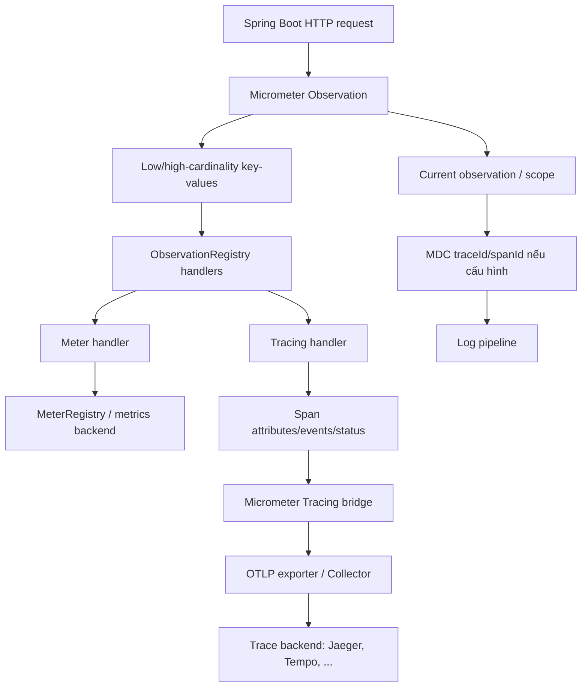
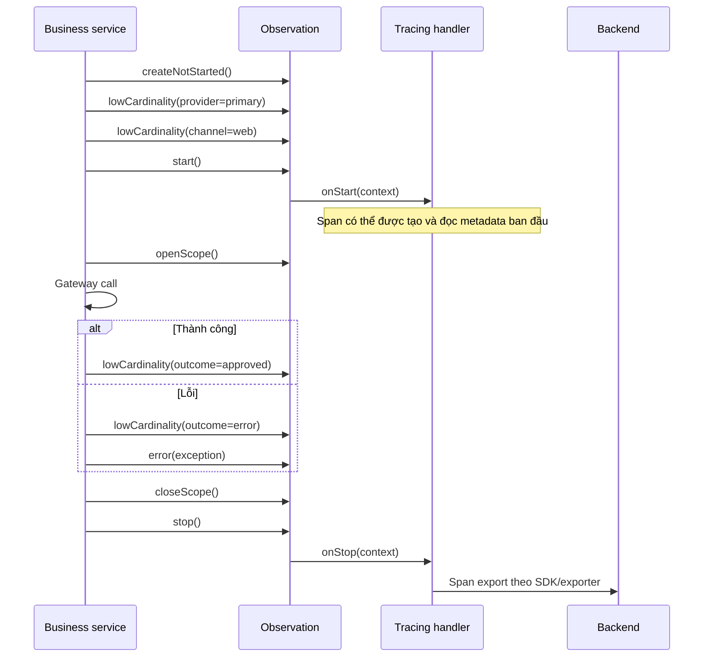
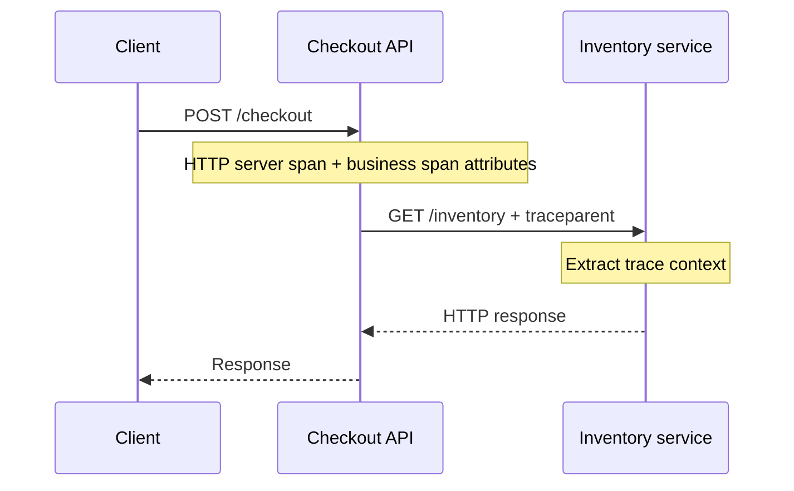

# Span attributes trong distributed tracing với Spring Boot

> **Chương:** Tracing  
> **Module:** `SPRING_BOOT_OBSERVABILITY` — Thiết lập observability cho Spring Boot bằng Micrometer Observation, metrics, logs và distributed tracing; hiểu propagation ngữ cảnh, tag/cardinality, exporter, sampling và liên kết tín hiệu để điều tra lỗi, độ trễ, hành vi ứng dụng trong môi trường thực.  
> **Trọng tâm:** Span attributes là dữ liệu mô tả **một công việc cụ thể** trong distributed trace. Bài này tập trung vào cách định nghĩa, gắn, truyền đạt ngữ nghĩa và kiểm chứng attributes qua Micrometer Observation, Micrometer Tracing, Spring Boot và OpenTelemetry/OTLP, đồng thời tránh nhầm attributes với metric labels, baggage hay log fields.

## 1. Mục tiêu học tập

Sau bài này, bạn có thể:

1. Giải thích trace, span, span name, span attributes, events, status, resource attributes và trace context khác nhau ở đâu.
2. Chọn thuộc tính có ý nghĩa vận hành để nhận diện **operation, dependency, kết quả và nhánh xử lý**, thay vì đổ toàn bộ request payload vào trace.
3. Dùng `Observation.lowCardinalityKeyValue(...)` và `Observation.highCardinalityKeyValue(...)` để mô tả một operation và hiểu cách các tracing handlers ánh xạ dữ liệu sang span attributes.
4. Sử dụng trực tiếp `Tracer`/`Span.tag(...)` khi cần instrument một đoạn công việc thủ công; quản lý scope, exception và thời điểm `end()` chính xác.
5. Thiết kế naming và attribute keys theo semantic conventions/contract nhất quán, biết khác biệt giữa high cardinality trong tracing và metric cardinality.
6. Hiểu attributes **không tự propagate** qua HTTP, không quyết định sampling nếu thêm muộn, không đồng nghĩa với baggage hoặc MDC.
7. Kiểm chứng attributes ở tầng code, exporter OTLP, Collector và tracing backend; chẩn đoán trường hợp span có nhưng attribute thiếu.
8. Kết hợp metrics–traces–logs để tìm nguyên nhân lỗi và độ trễ mà không đưa trace ID hoặc dữ liệu nhạy cảm vào metric labels.

## 2. Span là gì và attributes bổ sung điều gì?

Một **trace** mô tả hành trình của một operation xuyên qua một hoặc nhiều service. Trace thường gồm nhiều **span** biểu diễn các bước xử lý, ví dụ nhận HTTP request, kiểm tra đơn hàng, gọi payment gateway và ghi database.

Một span thường có:

| Thành phần | Ví dụ | Tác dụng |
|---|---|---|
| **Trace ID** | Mã định danh trace | Nối những spans thuộc cùng một trace |
| **Span ID / parent span** | Mã span và quan hệ cha–con | Dựng cấu trúc cây của call path |
| **Span name** | `checkout.payment.authorize` | Nhận diện loại công việc; nên ổn định |
| **Thời điểm bắt đầu/kết thúc** | 10:30:00.000 đến 10:30:00.145 | Xác định duration và vị trí thời gian |
| **Span attributes** | `payment.provider=primary`, `payment.outcome=approved` | Mô tả đặc tính, phân loại và bối cảnh một span |
| **Events** | `retry.started`, `fallback.used` | Đánh dấu sự kiện theo thời điểm trong span |
| **Status/error** | Error, exception | Thể hiện lỗi xử lý với semantics của tracing system |
| **Links** | Liên kết tới span context khác | Mô tả liên hệ ngoài quan hệ parent–child, tùy instrumentation |

Ví dụ:

```text
Trace 4bf92f3577b34da6a3ce929d0e0e4736
└─ HTTP POST /checkout                    [180 ms]
   ├─ checkout.validate                   [12 ms]
   ├─ checkout.payment.authorize          [130 ms]
   │  attributes:
   │    payment.provider = primary
   │    payment.channel  = mobile
   │    payment.outcome  = approved
   └─ checkout.order.persist              [24 ms]
```

Những chuỗi ID và duration ở đây chỉ là dữ liệu minh họa.

Span attributes giúp trả lời câu hỏi mà chỉ span name/duration chưa đủ: **gateway nào đang chậm? request đến từ kênh nào? bước này thành công hay fallback?** Khi backend có hỗ trợ tìm kiếm/index attributes, ta có thể lọc một nhóm spans thay vì đọc ngẫu nhiên hàng nghìn traces.

### 2.1. Attributes không phải mọi dữ liệu liên quan request

Span là bản ghi quan sát, **không phải bản sao đầy đủ của HTTP request, database transaction hay session người dùng**. Không nên thêm nguyên request/response body, authorization header, token, password, số thẻ, email, địa chỉ riêng hoặc câu SQL có parameters nhạy cảm vào attributes.

Một attribute tốt có ba đặc điểm:

- **Giải thích được:** key và value có ý nghĩa cụ thể, được team thống nhất.
- **Có mục tiêu:** dùng để lọc, so sánh, khoanh vùng lỗi hoặc đánh giá latency.
- **Phù hợp với chi phí/chính sách:** không gây cardinality/indexing quá mức, không tiết lộ dữ liệu.

## 3. Attributes nằm ở đâu trong luồng observability?



Trong Spring Boot đã bật tracing, **hai lối instrumentation** thường gặp là:

1. **Observation API:** tạo `Observation` và gắn low-/high-cardinality key-values. Các handlers của registry quyết định cách chuyển thông tin thành meters và spans.
2. **Tracing API:** làm việc trực tiếp với `Tracer` và `Span` để đặt name, tags/attributes, events và error cho span.

Cả hai đều hợp lý; không nhất thiết dùng đồng thời cả hai để đo **cùng một đoạn công việc**, vì có thể vô tình tạo hai spans lồng nhau trùng ngữ nghĩa.

**Lưu ý:** `Span.tag(key, value)` trong Micrometer Tracing thường ánh xạ sang **span attribute** trong tracing implementation. Từ “tag” ở API Micrometer Tracing không có nghĩa nó tự trở thành **metric label**.

## 4. Phân biệt span attributes với những khái niệm gần giống

| Khái niệm | Nằm ở đâu? | Mục tiêu | Có tự truyền sang service khác không? |
|---|---|---|---|
| **Span attributes** | Một span cụ thể | Lọc/tìm hiểu operation, dependency, outcome | **Không** |
| **Resource attributes** | Resource mô tả service/process/entity phát telemetry | Định danh `service.name`, version, environment | Không tự từ span sang span; có thể do resource config ở từng service |
| **Metric labels/tags** | Meter/time series | Tổng hợp, grouping, dashboard, alert | Không |
| **Baggage** | Trace/propagation context có thể mang qua service boundaries | Mang một lượng nhỏ context được cho phép đến downstream | **Có thể**, khi cấu hình baggage propagation |
| **Trace context** | Parent/child IDs, flags, state | Nối các spans vào cùng trace | **Có**, khi inject/extract headers phù hợp |
| **MDC/log fields** | Dòng log và logging scope | Correlation, chẩn đoán log | Không tự động qua network |
| **Span event** | Dữ liệu sự kiện có timestamp trong một span | Ghi mốc quan trọng như retry | Không |

### 4.1. Attributes khác baggage

Nếu span ở service A có:

```text
payment.channel = mobile
```

thì service B **không tự nhận được** thuộc tính này qua HTTP. HTTP tracing instrumentation thường truyền `traceparent` và có thể `tracestate` hoặc baggage headers theo cấu hình. Những headers đó mang trace context và baggage **được chọn để propagate**, không gửi toàn bộ attributes của span A.

Nếu cả A và B đều cần biết một giá trị phân loại, hãy cân nhắc:

- Truyền dữ liệu nghiệp vụ bằng **request contract** đã xác định, và để từng service gắn attribute phù hợp.
- Với một lượng nhỏ thông tin không nhạy cảm cần đi cùng trace, dùng baggage có chính sách rõ ràng và propagation được hỗ trợ.
- Tránh dùng baggage để truyền dữ liệu bí mật hoặc payload lớn; baggage có thể đi qua nhiều network hops và headers.

**Không tạo một attribute `traceId` trên mọi span chỉ để liên kết trace.** Trace ID là phần gốc của span context, các backends đã có cơ chế lưu và tìm theo ID.

### 4.2. Resource attributes khác span attributes

`service.name=checkout-service` là **thuộc tính của resource** phát telemetry, không phải đặc điểm khác nhau cho từng payment attempt. Thông thường bạn cấu hình service identity một lần qua ứng dụng/tracing SDK thay vì thêm `service.name` lặp lại thủ công cho từng span.

Ví dụ metadata phân tầng:

```text
Resource:
  service.name           = checkout-service
  service.version        = 2.7.0
  deployment.environment = staging

Span: checkout.payment.authorize
  payment.provider       = primary
  payment.channel        = web
  payment.outcome        = error
```

Cách map các thuộc tính như `service.version` hoặc deployment environment có thể do OpenTelemetry resource detector, Spring Boot config hoặc Collector thực hiện; cần thống nhất một nguồn sự thật để tránh giá trị mâu thuẫn.

## 5. Đặt tên attributes và semantic conventions

Một hệ thống có hàng trăm spans sẽ khó điều tra nếu cùng một ý nghĩa lại có nhiều keys:

```text
provider=primary
paymentProvider=PRIMARY
payment.gateway=primary
payment.provider=main
```

Đây là bốn biến thể có thể mô tả cùng một khái niệm nhưng khiến filter/query khó tái sử dụng. Hãy xây **attribute contract**.

### 5.1. Ưu tiên semantic conventions khi đã có định nghĩa chuẩn

OpenTelemetry có các **semantic conventions** cho HTTP, database, RPC, messaging, exceptions và nhiều loại workload. Tên và trạng thái ổn định của từng convention có thể thay đổi theo phiên bản instrumentation/semantic-convention library.

Ví dụ thường thấy ở các bản convention mới:

| Attribute/nhóm | Ví dụ | Lưu ý |
|---|---|---|
| `http.request.method` | `POST` | HTTP method có tập giá trị nhỏ |
| `http.route` | `/orders/{id}` | **Route template**, không phải raw URL chứa ID |
| `http.response.status_code` | `500` | Mã HTTP numeric; cách gắn do instrumentation quyết định |
| `server.address` | `api.internal.example` | Cân nhắc bảo mật và dạng host |
| `db.system.name` hoặc key theo convention phiên bản | `postgresql` | Nên để database instrumentation xử lý nhất quán |
| `error.type` hoặc thông tin exception theo convention | Một nhóm lỗi | Chính sách và tên chính xác phụ thuộc version |

Trên framework integration, **không tự gắn lại toàn bộ HTTP attributes** nếu auto-instrumentation đã có. Việc ghi đè bằng raw URL hoặc tên động có thể gây sai semantic và tăng cardinality.

### 5.2. Tên custom attributes theo namespace miền nghiệp vụ

Khi chưa có semantic convention chuẩn cho nghiệp vụ checkout, có thể sử dụng tập key nội bộ:

| Key | Ví dụ | Ý nghĩa |
|---|---|---|
| `app.payment.provider` | `primary`, `backup` | Cổng thanh toán logic |
| `app.payment.channel` | `web`, `mobile`, `partner`, `other` | Nguồn request đã chuẩn hóa |
| `app.payment.outcome` | `approved`, `declined`, `error` | Kết quả nghiệp vụ của operation |
| `app.payment.retry.phase` | `initial`, `retry` | Giai đoạn retry |
| `app.payment.fallback` | `true`, `false` | Có sử dụng nhánh fallback hay không |
| `app.inventory.region` | `north`, `south`, `other` | Vùng nghiệp vụ đã chuẩn hóa |

Prefix `app.` trong bảng chỉ là **quy ước nội bộ minh họa**, không phải một OpenTelemetry semantic convention bắt buộc. Chọn tên có chủ đích, tránh xung đột với các keys đã có. Nếu tổ chức dùng conventions riêng, thống nhất với conventions đang được instrumentation và backend hỗ trợ.

### 5.3. Span name cũng phải ổn định

**Nên:**

```text
checkout.payment.authorize
checkout.inventory.reserve
checkout.order.persist
```

**Không nên:**

```text
checkout.payment.authorize.ORDER-928473
checkout.inventory.reserve.sku-725194
GET /orders/928473
```

Span name là một trong những trường nhiều UI sử dụng để group, tìm và thống kê. Dữ liệu động nên ở nơi thích hợp với chính sách bảo mật, không xuất hiện trong tên operation. Với HTTP, dùng route templates thay raw URL khi instrumentation hỗ trợ.

## 6. Gắn attributes bằng Micrometer Observation

Đây là lựa chọn phù hợp khi bạn đã dùng `ObservationRegistry` cho application instrumentation, muốn kết nối metrics và tracing theo một ranh giới operation.

### 6.1. Thêm low-cardinality key-values

```java
import io.micrometer.observation.Observation;
import io.micrometer.observation.ObservationRegistry;

Observation observation = Observation
        .createNotStarted("checkout.payment.authorize", observationRegistry)
        .contextualName("authorize payment")
        .lowCardinalityKeyValue("app.payment.provider", "primary")
        .lowCardinalityKeyValue("app.payment.channel", "web");

observation.observe(() -> {
    // Thực hiện công việc đồng bộ cần quan sát.
    authorizePayment();
});
```

`authorizePayment()` trong ví dụ là method nghiệp vụ do ứng dụng cung cấp.

**Low-cardinality** có nghĩa tập giá trị cho mỗi key được quản lý và nhỏ, ví dụ:

- `provider`: `primary`, `backup`, `other`;
- `channel`: `web`, `mobile`, `partner`, `other`;
- `outcome`: `approved`, `declined`, `error`.

Các key-values này có thể được meter handler sử dụng làm **metric tags**, đồng thời có thể được tracing handler sử dụng làm span attributes. Chính xác key nào xuất hiện ở backend phụ thuộc handler, convention, thời điểm cập nhật context và exporter.

### 6.2. High-cardinality key-values

Observation cũng có API:

```java
observation.highCardinalityKeyValue(
        "app.diagnostic.attempt_id", approvedDiagnosticId);
```

`approvedDiagnosticId` là một định danh **được kiểm tra và cho phép** lưu trong tracing. Đây là ví dụ minh họa, không phải lời khuyên mặc định gắn mọi attempt ID.

Khác biệt:

- **High-cardinality** nghĩa số giá trị có thể lớn, phù hợp hơn cho việc chẩn đoán một trace riêng lẻ so với làm metric label.
- Tracing handler có thể chuyển high-cardinality key-values thành span attributes nhưng meter handler **không nên** tạo dimension metric từ chúng.
- “Được phép high cardinality” **không có nghĩa được phép dữ liệu nhạy cảm**. ID khách hàng, email, số tài khoản, token và dữ liệu thanh toán vẫn cần chính sách riêng.
- Dữ liệu high-cardinality có thể tăng chi phí trace storage/indexing dù không làm nổ metric time series.

Nếu không cần tìm một attempt cụ thể trong trace backend, đừng thêm ID đó “cho đầy đủ”.

### 6.3. Khi nào dùng API nào?

| Nhu cầu | Lựa chọn | Giải thích |
|---|---|---|
| Phân loại request theo kênh để xem cả metrics lẫn traces | `lowCardinalityKeyValue` | Tập giá trị có giới hạn |
| Đính kèm mã correlation kỹ thuật có số giá trị lớn, được phép | `highCardinalityKeyValue` | Không biến thành metric dimension |
| Thêm dữ liệu cho span đang được điều khiển trực tiếp | `Span.tag` | Instrumentation tracing trực tiếp |
| Đánh dấu thời điểm retry trong một span | `Span.event` hoặc cơ chế event của implementation | Event có timestamp, khác attribute |
| Đánh dấu exception | `observation.error` hoặc `span.error` | Báo lỗi cho tracing handler; không chỉ thêm text lỗi |
| Truyền context sang HTTP downstream | Tracing instrumentation/propagator | Không dùng attributes để thay propagation |
| Lưu service identity | Resource/config của tracing SDK | Không cần gắn thủ công trên từng span |

## 7. Ví dụ Spring Boot: payment authorization có span attributes

Ví dụ này sử dụng **Spring Boot 3.x, Java 17+**, có Actuator và Micrometer Observation. Nếu tracing bridge/exporter được bật, observation sẽ có thể xuất span. Phần code tập trung vào **định nghĩa attributes an toàn** và phân loại kết quả nghiệp vụ.

### 7.1. Chuẩn bị dependency

Trong Maven dùng Spring Boot parent/BOM:

```xml
<dependencies>
    <dependency>
        <groupId>org.springframework.boot</groupId>
        <artifactId>spring-boot-starter-web</artifactId>
    </dependency>

    <dependency>
        <groupId>org.springframework.boot</groupId>
        <artifactId>spring-boot-starter-actuator</artifactId>
    </dependency>

    <!-- Ví dụ cấu hình tracing sử dụng OpenTelemetry bridge -->
    <dependency>
        <groupId>io.micrometer</groupId>
        <artifactId>micrometer-tracing-bridge-otel</artifactId>
    </dependency>
    <dependency>
        <groupId>io.opentelemetry</groupId>
        <artifactId>opentelemetry-exporter-otlp</artifactId>
    </dependency>
</dependencies>
```

Nếu project đã dùng một tracing bridge khác, không thêm đồng thời nhiều bridges mà chưa thiết kế rõ cách chọn tracer. Với Spring Boot 4 hoặc những minor version có thay đổi dependency/property, cần xác minh tài liệu version cụ thể.

### 7.2. Cấu hình local để quan sát span

```yaml
spring:
  application:
    name: checkout-service

management:
  tracing:
    sampling:
      probability: 1.0
  otlp:
    tracing:
      endpoint: ${OTLP_TRACES_ENDPOINT:http://localhost:4318/v1/traces}
  endpoints:
    web:
      exposure:
        include: health,metrics
```

Cấu hình này **minh họa Spring Boot 3.x** dùng OTLP/HTTP tracing exporter. Endpoint cần trỏ tới Collector/backend có HTTP receiver đang nghe đúng port và path. Không phải mọi OTLP exporter đều dùng HTTP/4318: có môi trường dùng gRPC/4317 hoặc cấu hình giao thức riêng.

`probability: 1.0` chỉ thích hợp trong **local/dev hoặc thử nghiệm lưu lượng thấp** để dễ tìm traces. Trong production, lấy mẫu theo ngân sách và chính sách của hệ thống; không mặc định lưu mọi trace.

### 7.3. Định nghĩa hợp đồng business tags

```java
package com.example.checkout;

import java.util.Locale;

final class PaymentAttributePolicy {

    private PaymentAttributePolicy() {}

    static String channel(String raw) {
        if (raw == null) {
            return "other";
        }

        return switch (raw.trim().toUpperCase(Locale.ROOT)) {
            case "WEB" -> "web";
            case "MOBILE" -> "mobile";
            case "PARTNER" -> "partner";
            default -> "other";
        };
    }

    static String provider(String raw) {
        if ("primary".equalsIgnoreCase(raw)) {
            return "primary";
        }
        if ("backup".equalsIgnoreCase(raw)) {
            return "backup";
        }
        return "other";
    }
}
```

Tập giá trị đã chuẩn hóa giúp low-cardinality attributes có cùng ngữ nghĩa trong metrics và traces. Chỉ cắt chuỗi raw input hoặc giới hạn độ dài 50 ký tự **không bảo đảm** cardinality thấp.

### 7.4. Service gắn attributes và outcome đúng vòng đời

```java
package com.example.checkout;

import io.micrometer.observation.Observation;
import io.micrometer.observation.ObservationRegistry;
import org.springframework.stereotype.Service;

@Service
public class PaymentService {

    private final ObservationRegistry observationRegistry;
    private final PaymentGateway gateway;

    public PaymentService(
            ObservationRegistry observationRegistry,
            PaymentGateway gateway) {
        this.observationRegistry = observationRegistry;
        this.gateway = gateway;
    }

    public AuthorizationResult authorize(
            String rawChannel,
            String rawProvider,
            String paymentToken) {

        String channel = PaymentAttributePolicy.channel(rawChannel);
        String provider = PaymentAttributePolicy.provider(rawProvider);

        Observation observation = Observation
                .createNotStarted("checkout.payment.authorize",
                        observationRegistry)
                .contextualName("authorize payment")
                .lowCardinalityKeyValue("app.payment.channel", channel)
                .lowCardinalityKeyValue("app.payment.provider", provider);

        return observation.observe(() -> {
            try {
                AuthorizationResult result =
                        gateway.authorize(paymentToken);

                observation.lowCardinalityKeyValue(
                        "app.payment.outcome",
                        result.approved() ? "approved" : "declined");

                return result;
            } catch (RuntimeException exception) {
                observation.lowCardinalityKeyValue(
                        "app.payment.outcome", "error");
                throw exception;
            }
        });
    }
}

interface PaymentGateway {
    AuthorizationResult authorize(String paymentToken);
}

record AuthorizationResult(boolean approved) {}
```

**Vì sao thiết kế như vậy?**

1. `ObservationRegistry` được inject từ Spring Boot thay vì tạo registry rời; cùng một instance có thể được framework và business instrumentation sử dụng.
2. Mỗi lần gọi `authorize(...)` tạo một `Observation` mới với tên ổn định.
3. `channel` và `provider` có ngay **trước khi observation bắt đầu**, hữu ích nếu tracing handler đọc metadata tại thời điểm start.
4. `outcome` chỉ xác định sau gateway call và được gắn **trước khi observation stop**.
5. Callback `observe(...)` đồng bộ quản lý start, scope, ghi nhận exception từ callback và stop. Lệnh `throw` giữ nguyên nghiệp vụ lỗi; không biến exception thành kết quả success giả.
6. `paymentToken` tuyệt đối **không được gắn thành span attribute, metric tag hoặc log field**. Nó chỉ là tham số của gateway.
7. Meter và tracing handlers có thể đọc metadata ở thời điểm khác nhau; do đó tag `outcome` gắn muộn **không được bảo đảm** xuất hiện trên mọi span/exporter. Cần kiểm chứng pipeline thực tế.

Ví dụ trả `declined` mà không throw là một **kết quả nghiệp vụ**. Đừng tự coi mọi declined là lỗi tracing; error/status phụ thuộc semantic contract và cách service phản hồi.

### 7.5. Controller mẫu để phát sinh request

```java
package com.example.checkout;

import org.springframework.web.bind.annotation.PostMapping;
import org.springframework.web.bind.annotation.RequestMapping;
import org.springframework.web.bind.annotation.RequestParam;
import org.springframework.web.bind.annotation.RestController;

@RestController
@RequestMapping("/demo/payments")
public class PaymentController {

    private final PaymentService paymentService;

    public PaymentController(PaymentService paymentService) {
        this.paymentService = paymentService;
    }

    @PostMapping("/authorize")
    public AuthorizationResult authorize(
            @RequestParam String channel,
            @RequestParam String provider,
            @RequestParam String paymentToken) {

        return paymentService.authorize(
                channel, provider, paymentToken);
    }
}
```

**Chỉ là controller demo:** tham số `paymentToken` trong query/form parameters có nguy cơ xuất hiện trong access logs, URL hoặc tracing instrumentation tùy HTTP client/server, và không phù hợp cho dữ liệu thanh toán thật. Trong production, dùng API contract và cơ chế mã hóa/ẩn dữ liệu nhạy cảm phù hợp; không đưa token vào URL hoặc request logging. Nếu muốn thử an toàn, chỉ dùng chuỗi giả `demo-token` trên môi trường local.

Để không lộ token trong URL của bài lab, gửi request form body:

```bash
curl -X POST http://localhost:8080/demo/payments/authorize \
  -H 'Content-Type: application/x-www-form-urlencoded' \
  --data-urlencode 'channel=WEB' \
  --data-urlencode 'provider=primary' \
  --data-urlencode 'paymentToken=demo-token'
```

Đoạn này vẫn là thử nghiệm với giá trị giả. Nếu cần kết nối thực, triển khai authentication, validation, secret handling và API design chuẩn.

## 8. Gắn attributes trực tiếp với Micrometer Tracing

Trong một số trường hợp bạn muốn tạo span thủ công thay vì tạo observation. Micrometer Tracing cung cấp facade `io.micrometer.tracing.Tracer` và `Span`.

### 8.1. Ví dụ với Tracer và Span.tag

```java
package com.example.checkout;

import io.micrometer.tracing.Span;
import io.micrometer.tracing.Tracer;
import org.springframework.stereotype.Component;

@Component
public class InventoryTraceOperation {

    private final Tracer tracer;
    private final InventoryGateway inventoryGateway;

    public InventoryTraceOperation(
            Tracer tracer,
            InventoryGateway inventoryGateway) {
        this.tracer = tracer;
        this.inventoryGateway = inventoryGateway;
    }

    public boolean checkStock(String sku) {
        Span span = tracer.nextSpan()
                .name("inventory.check-stock")
                .start();

        span.tag("app.inventory.operation", "check-stock");

        try (Tracer.SpanInScope scope = tracer.withSpan(span)) {
            boolean available = inventoryGateway.isAvailable(sku);

            span.tag("app.inventory.available",
                    Boolean.toString(available));
            span.event("inventory.response.received");

            return available;
        } catch (RuntimeException exception) {
            span.tag("app.inventory.outcome", "error");
            span.error(exception);
            throw exception;
        } finally {
            span.end();
        }
    }
}

interface InventoryGateway {
    boolean isAvailable(String sku);
}
```

**Giải thích:**

- `tracer.nextSpan()` tạo span mới; khi có current tracing context, bridge thường có khả năng gắn quan hệ parent phù hợp. Đừng giả định parent tồn tại nếu code chạy ngoài scope đã instrument.
- `name(...)` chọn tên span ổn định.
- `start()` bắt đầu span, `withSpan(span)` mở scope cho current span.
- `span.tag(key, value)` thêm thông tin dưới dạng tag/span attribute theo bridge.
- `span.event(...)` đánh dấu một sự kiện có tên trong span.
- `span.error(exception)` cung cấp thông tin lỗi cho tracing implementation; chính xác cách ghi exception và status phụ thuộc bridge/SDK/exporter.
- `span.end()` kết thúc span kể cả khi có exception.

**Không gắn `sku` như một metric tag.** Nếu muốn truy vấn một SKU cụ thể trong traces, vẫn phải xét quyền riêng tư, mục đích điều tra, retention và chi phí index. Ví dụ an toàn hơn là gắn nhóm inventory có giá trị kiểm soát như `app.inventory.region=north`.

### 8.2. Span.tag không giống MeterRegistry tag

```java
span.tag("app.inventory.operation", "check-stock");
```

dùng tracing API và mô tả span. Trong khi:

```java
meterRegistry.counter(
        "inventory.checks",
        "operation", "check-stock"
).increment();
```

dùng metrics API, tạo **time series** theo labels. Tracing attributes có thể có cardinality lớn hơn metric labels, nhưng không miễn trừ giới hạn storage, privacy hoặc attribute-indexing.

Đừng gắn cùng thông tin hai lần bằng cả `Observation.lowCardinalityKeyValue` và `Span.tag` lên các spans khác nhau rồi cho rằng chúng sẽ xuất hiện trên **cùng một span**. Khi dùng nhiều tầng instrumentation, cần xem span hierarchy thực tế.

### 8.3. Khi nào nên dùng Observation thay direct span?

| Tình huống | Ưu tiên |
|---|---|
| Business operation muốn vừa đo duration/timer vừa trace | `Observation` dùng registry đã cấu hình |
| Framework đã auto-instrument HTTP/JDBC/client call | Giữ instrumentation có sẵn, tránh tạo span trùng |
| Cần một span thủ công cho bước quan trọng, kiểm soát event/attribute rõ | `Tracer`/`Span` có thể phù hợp |
| Chỉ cần Counter nghiệp vụ | `MeterRegistry` Counter, không nhất thiết tạo span |
| Cần propagating parent context | Tracing integration, scope và instrumented clients |
| Cần chạy một callback đồng bộ có lifecycle tự đóng | `Observation.observe(...)` |

Nếu dùng cả Observation và direct `Tracer` quanh cùng một khối code, có thể sinh hai spans lồng nhau giống nhau, làm trace dài và tốn tài nguyên. Hãy lựa chọn instrumentation boundary có ý nghĩa.

## 9. Gắn attributes sớm hay muộn trong lifecycle?

Một điểm dễ gây lỗi là **attributes không phải lúc nào cũng được lấy từ context vào cùng thời điểm**.



Sơ đồ minh họa thứ tự logic trong trường hợp đồng bộ. Callback và cách tracing handler map key-values vào span có thể khác theo phiên bản Micrometer, bridge và loại handler. **Đừng khẳng định attribute gắn trước stop chắc chắn có trên span đã tạo tại start.**

### 9.1. Một số quy tắc an toàn về thời điểm

- Giá trị biết từ trước (`operation`, `channel`, `provider`) nên được chuẩn hóa và gắn **trước `start()`**.
- Kết quả thực tế (`outcome`) có thể được gắn trước `stop()` nếu API và handler hỗ trợ việc cập nhật muộn; hãy kiểm tra traces ở backend.
- Với direct span, `Span.tag(...)` nên được gọi **khi span còn hoạt động/chưa end**, không kỳ vọng sửa được span sau `end()`.
- Không dựa vào `ObservationFilter` (thường enrich context ở giai đoạn hoàn tất) để đặt tên span, quyết định parent hay cung cấp attribute cho logic sampling lúc start.
- Nếu cần một thuộc tính tham gia logic khi bắt đầu span, đưa nó vào context hoặc lúc tạo span; filter muộn không thể thay đổi quyết định đã đưa ra.

### 9.2. Tại sao attribute gắn muộn có thể không xuất hiện?

Một tracing handler có thể lấy low-cardinality metadata trong `onStart`, trong khi metrics handler lấy final tags ở `onStop`. Kết quả là **metric có `outcome=error` nhưng span lại thiếu `outcome`**, dù cả hai cùng xuất phát từ một Observation.

Để chẩn đoán, xác minh:

1. Key đã tồn tại trong `Observation.Context` lúc nào?
2. Tracing handler có đọc key-values ở `onStart`, `onError` hay `onStop`?
3. Bridge/SDK/exporter có nhận attribute đó không?
4. Sampler có bỏ span trước khi export không?
5. Collector/backend có filter/rename attribute không?

Nếu outcome rất quan trọng với tracing, cân nhắc cập nhật direct/current span phù hợp vào thời điểm biết kết quả, hoặc dùng extension point của tracing instrumentation cho phiên bản đang dùng; tránh tạo một giải pháp phụ thuộc giả định callback không kiểm chứng.

## 10. Attributes, error status và span events

Ba khái niệm này khác nhau:

### 10.1. Attribute mô tả trạng thái hoặc phân loại

```java
span.tag("app.payment.outcome", "error");
span.tag("app.payment.provider", "primary");
```

Attribute giúp lọc/search; **không tự đặt span status thành error** chỉ vì có `outcome=error`.

### 10.2. Error cần được ghi qua API dành cho lỗi

```java
try {
    paymentGatewayCall();
} catch (RuntimeException exception) {
    span.error(exception);
    throw exception;
}
```

`span.error(exception)` giúp tracing implementation gắn thông tin lỗi/exception theo cơ chế của nó. OpenTelemetry có semantic conventions cho exception events, status và error type; representation cụ thể phụ thuộc version/bridge. Không nên tự nhét toàn bộ exception message có dữ liệu nhạy cảm vào arbitrary tags.

**Không dùng exception chỉ để diễn tả một business decline bình thường.** “Thẻ bị từ chối” có thể là một kết quả dự kiến; cần quyết định error semantics ở ranh giới operation.

### 10.3. Event có timestamp

```java
span.event("payment.retry.started");
span.event("payment.fallback.used");
```

Event thể hiện **điều gì đã xảy ra tại một thời điểm**. Một attribute như `app.payment.fallback=true` chỉ thể hiện trạng thái hoặc kết quả, không cho biết chính xác thời điểm fallback.

Đừng tạo event cho từng log line hoặc từng vòng lặp nhỏ không có giá trị điều tra: span events cũng tăng volume/chi phí.

### 10.4. Links không phải attributes

Khi một consumer xử lý message được tạo ở một trace khác, có thể có quan hệ liên quan nhưng không thích hợp làm parent–child. OpenTelemetry có khái niệm **span links** để gắn reference tới span context khác. Một attribute tự đặt như `related.trace_id=...` không thay thế span link chuẩn và có thể tạo rủi ro truy cập dữ liệu. Dùng đúng API links của tracing SDK/instrumentation khi cần, theo khả năng của bridge.

## 11. Cardinality: tracing có rộng hơn metrics nhưng không vô hạn

Trong **metrics**, low-cardinality labels là điều kiện quan trọng để kiểm soát số time series. Trong **tracing**, attribute values có thể đa dạng hơn vì mỗi span đã là một bản ghi riêng; tuy nhiên việc lưu nhiều key/value vẫn tốn storage, network, indexing và query resources.

| Thuộc tính | Metric label | Span attribute | Lưu ý |
|---|---|---|---|
| `app.payment.channel=web` | Thường phù hợp | Phù hợp | Ít giá trị, có ý nghĩa phân loại |
| `app.payment.provider=primary` | Phù hợp | Phù hợp | Tập provider đã whitelist |
| `app.payment.outcome=error` | Phù hợp nếu semantics rõ | Phù hợp | Có thể xuất hiện muộn |
| `retry.phase=initial` | Phù hợp | Phù hợp | Cần tránh dimension thừa |
| `order.id=...` | Không | Chỉ khi được phê duyệt | Có thể là dữ liệu khách hàng hoặc định danh nhạy cảm |
| `traceId` | Không | Không cần lặp | Trace ID có sẵn trong span context |
| `http.route=/orders/{id}` | Thường phù hợp | Phù hợp | Không dùng raw path động |
| `user.email` | Không | Thường không nên | Dữ liệu cá nhân, rủi ro bảo mật |
| `authorization.token` | Không | **Tuyệt đối không** | Bí mật xác thực |

### 11.1. Tính chi phí ở hai tầng

Ví dụ một timer có 4 `channel` × 3 `outcome` × 2 `provider` × 8 replicas, tối đa 192 tổ hợp labels trước khi tính các dimension khác. Thêm `userId` có 100.000 giá trị có thể làm số series bùng nổ.

Trong traces, không có phép nhân series đúng y hệt như metrics nhưng giả sử mỗi request tạo 20 spans và mỗi span có 10 attributes, với 1.000 request/giây hệ thống đã tạo khối lượng rất lớn **trước sampling**, chưa tính events, exceptions và resource fields. Lượng được export/lưu phụ thuộc sampling và limits của SDK/exporter/backend.

### 11.2. Kiểm soát chính sách dữ liệu

Một team observability nên xác định:

- Danh sách keys được chấp nhận theo operation.
- Loại giá trị: enum/category, boolean, integer, domain ID hay resource metadata.
- Giá trị nào phải normalize hoặc redact trước khi instrument.
- Có cần high-cardinality reference không, ai có quyền query, retention bao lâu?
- Attribute limits (số lượng, độ dài, kích thước) của SDK/Collector/backend.
- Quy định cho user data, payment details, customer IDs, credentials và regulated data.

Không giả định backend “an toàn” vì ở mạng nội bộ; tracing backend có thể phục vụ nhiều nhóm với quyền truy cập rộng hơn database nghiệp vụ.

## 12. Kiểu dữ liệu attribute và sự khác biệt API

Trong OpenTelemetry, span attributes có thể dùng kiểu **string, boolean, integer, floating point** và một số kiểu mảng theo SDK/API. Micrometer Tracing facade có các phương thức như `Span.tag(String, String)` chủ yếu biểu diễn value dưới dạng chuỗi.

Ví dụ:

```java
span.tag("app.payment.retry", Boolean.toString(true));
span.tag("app.payment.retry_count", Integer.toString(2));
```

Tùy bridge, backend có thể lưu các values này như **string**, không tự biến thành boolean/integer. Nếu một query yêu cầu so sánh số học với attribute, hãy kiểm tra type thực tế ở backend hoặc dùng native SDK/instrumentation được phép với typed attributes.

Nên ưu tiên semantic conventions có sẵn cho HTTP/database thay vì ghi đè typed attributes tiêu chuẩn bằng strings tùy ý. Việc đồng nhất kiểu dữ liệu là một phần của **schema telemetry**.

## 13. Sampling và giới hạn hiển thị attributes

### 13.1. Head sampling quyết định sớm

Ở **head sampling**, quyết định có record/export span thường được đưa ra tại thời điểm span được tạo/bắt đầu, dựa trên thông tin đã có (trace parent, sampler config và các input hỗ trợ). Nếu bạn gắn `app.payment.outcome=error` **sau** khi gateway trả kết quả, head sampler không thể quay ngược để chọn lưu một trace đã bị loại chỉ vì lỗi vừa phát sinh.

Hệ quả:

- Một trace lỗi có thể không xuất hiện trong backend dù Observation/metric ghi nhận lỗi.
- `management.tracing.sampling.probability=0.10` không có nghĩa 10% metrics Counter được ghi.
- Không điều khiển sampling bằng cách gắn một key-value muộn rồi kỳ vọng SDK tự xét lại.
- Nếu cần ưu tiên lưu lỗi/latency, hãy nghiên cứu **tail sampling tại Collector/backend** theo kiến trúc và ngân sách; tail sampling cần có đầy đủ dữ liệu tạm thời và có chi phí/giới hạn riêng.

### 13.2. Attribute limits và dropped data

Một span đã được sampled cũng có thể thiếu một số attributes nếu:

- SDK giới hạn số attributes trên mỗi span hoặc độ dài value.
- Instrumentation không add key vì null/invalid value.
- Collector có processors loại hoặc rename attributes.
- Backend giới hạn indexed fields, retention hoặc schema.
- Exporter gặp lỗi và span không được gửi/nhận.

Việc backend không có attribute chưa đủ để kết luận code không gọi `lowCardinalityKeyValue`/`span.tag`.

### 13.3. Span links và events cũng chịu limits

Nhiều tracing SDK giới hạn số span events, span links hoặc attributes để bảo vệ tài nguyên. Không dùng span như một audit log không giới hạn. Với dữ liệu cần truy cứu đầy đủ và đúng tuyệt đối, cần hệ thống sự kiện/transaction log riêng.

## 14. Propagation, async và scope

### 14.1. Attributes không giải quyết trace bị đứt

Giả sử checkout API gọi inventory service:



Để service B tiếp tục cùng trace, client ở A và server ở B cần tracing instrumentation/propagator phù hợp. Header `traceparent` mang trace/parent information; **không tự chứa** `app.payment.channel=web` trừ khi thông tin đó được truyền riêng theo API/baggage có chính sách.

Nếu tạo một span thủ công ngoài scope hiện hành hoặc gửi request bằng một HTTP client không được instrument, B có thể tạo trace mới. Thêm cùng span attribute cho A và B không làm chúng trở thành parent–child.

### 14.2. Scope phải đi cùng luồng thực thi

Một span được tạo và start không nhất thiết đã là **current span**. Khi cần propagation đến downstream client hoặc log MDC, mở scope:

```java
Span span = tracer.nextSpan().name("checkout.validate").start();

try (Tracer.SpanInScope scope = tracer.withSpan(span)) {
    validate();
} catch (RuntimeException error) {
    span.error(error);
    throw error;
} finally {
    span.end();
}
```

`validate()` là method nghiệp vụ minh họa.

`SpanInScope` có tác dụng đặt/khôi phục current span trong khoảng code. Với `@Async`, custom `Executor`, `CompletableFuture`, messaging hoặc Reactor, cần cơ chế **context propagation** của framework. Không truyền một scope object giữa threads một cách tùy tiện rồi mong rằng context an toàn.

### 14.3. Async có thể làm span kết thúc quá sớm

**Không nên:**

```java
return Observation.createNotStarted(
        "inventory.async", observationRegistry)
    .observe(() -> CompletableFuture.supplyAsync(this::loadInventory));
```

Callback trả về `CompletableFuture` ngay; observation có thể stop **trước khi** task async xử lý xong. Nếu muốn đo duration thực của async operation, quản lý start/stop theo tín hiệu hoàn thành và propagate context vào nơi task chạy, hoặc dùng instrumentation do framework hỗ trợ. Không suy luận rằng attribute và duration của span vẫn đúng chỉ vì method đã trả một future.

## 15. Kiểm chứng Span attributes tại local

### 15.1. Kiểm tra từng tầng

1. **Code:** method gắn đúng key, value đã normalize; Observation hoặc Span được start/stop/end đúng không?
2. **Context/handler:** key có trong `Observation.Context` khi handler cần đọc không?
3. **Tracing:** có active tracing bridge và span được tạo không? Có parent scope không?
4. **Sampling:** local sampling đã đủ để thấy dữ liệu chưa?
5. **Exporter:** OTLP endpoint, giao thức, TLS, authentication và queue có đúng không?
6. **Collector:** receiver/traces pipeline có nhận dữ liệu, không drop/rename attribute không?
7. **Backend/UI:** tìm đúng service, operation, time range, trace ID và đúng attribute key không?

Một trace backend như Jaeger hoặc Tempo thường cho xem chi tiết span và attributes/tags ở giao diện hoặc API. Cách tìm kiếm/index attributes **khác nhau theo backend/version**: việc span có attribute không bảo đảm UI có thể tìm kiếm trực tiếp bằng mọi key tùy ý.

### 15.2. Trình tự thử nghiệm

Giả sử đang chạy Collector có OTLP/HTTP receiver trên `localhost:4318` và một tracing backend được kết nối:

```bash
curl -s http://localhost:8080/actuator/health

curl -X POST http://localhost:8080/demo/payments/authorize \
  -H 'Content-Type: application/x-www-form-urlencoded' \
  --data-urlencode 'channel=MOBILE' \
  --data-urlencode 'provider=primary' \
  --data-urlencode 'paymentToken=demo-token'
```

Tìm trace theo service `checkout-service` và khoảng thời gian vừa gửi request. Một span `checkout.payment.authorize` hoặc contextual name tương đương có thể cho thấy:

```text
Span: authorize payment
Attributes:
  app.payment.channel  = mobile
  app.payment.provider = primary
  app.payment.outcome  = approved
```

Đây là **output minh họa**, không phải bảo đảm tất cả attributes đều hiện diện. `outcome` có thể phụ thuộc timing của tracing handler. Nếu hoàn toàn không có trace, kiểm tra tracing configuration/sampling/exporter trước khi sửa key-value.

### 15.3. Tìm một request lỗi có trace ID

Khi backend có trace lỗi, xem:

- Tên operation HTTP cha, custom business span con.
- Thời điểm bắt đầu/kết thúc, duration, parent relationship.
- Attributes được gắn, có đúng provider/channel không.
- Exception events/status có phản ánh lỗi hay không.
- Có span outbound HTTP/gRPC/database liên quan không.
- Trace ID có hiện trong logs cùng request không.

Nếu trace bị đứt ở outbound call, kiểm tra propagation headers/client instrumentation; **không thêm thuộc tính `related.traceId` để “nối” hai trace bằng tay**.

## 16. Unit test metadata bằng ObservationRegistry độc lập

Một unit test có thể xác nhận **Instrumentation code đã đưa key-values vào Observation.Context** mà không cần backend tracing hay OTLP collector. Điều này chưa xác minh attributes đã được tracing handler/exporter chuyển thành span thực.

```java
import io.micrometer.common.KeyValue;
import io.micrometer.common.KeyValues;
import io.micrometer.observation.Observation;
import io.micrometer.observation.ObservationHandler;
import io.micrometer.observation.ObservationRegistry;
import java.util.concurrent.atomic.AtomicReference;
import org.junit.jupiter.api.Test;

import static org.junit.jupiter.api.Assertions.assertNotNull;
import static org.junit.jupiter.api.Assertions.assertTrue;

class SpanAttributesContextTest {

    @Test
    void hasExpectedObservationKeyValues() {
        ObservationRegistry registry = ObservationRegistry.create();
        AtomicReference<Observation.Context> captured =
                new AtomicReference<>();

        registry.observationConfig().observationHandler(
                new ObservationHandler<Observation.Context>() {
                    @Override
                    public boolean supportsContext(
                            Observation.Context context) {
                        return "checkout.payment.authorize"
                                .equals(context.getName());
                    }

                    @Override
                    public void onStop(Observation.Context context) {
                        captured.set(context);
                    }
                });

        Observation.createNotStarted(
                    "checkout.payment.authorize", registry)
                .lowCardinalityKeyValue("app.payment.channel", "web")
                .highCardinalityKeyValue(
                        "app.diagnostic.attempt_id", "safe-demo-001")
                .observe(() -> "ok");

        Observation.Context context = captured.get();
        assertNotNull(context);

        assertTrue(hasKeyValue(context.getLowCardinalityKeyValues(),
                "app.payment.channel", "web"));
        assertTrue(hasKeyValue(context.getHighCardinalityKeyValues(),
                "app.diagnostic.attempt_id", "safe-demo-001"));
    }

    private static boolean hasKeyValue(
            KeyValues values, String key, String expectedValue) {
        for (KeyValue item : values) {
            if (item.getKey().equals(key)
                    && item.getValue().equals(expectedValue)) {
                return true;
            }
        }
        return false;
    }
}
```

Vì test này dùng registry độc lập, không có tracing bridge/OTLP exporter mặc định. Nó bảo vệ contract key/value và thời điểm stop, chứ không chứng minh backend đã nhận span. Với Spring Boot integration test, cần bật cấu hình observability trong test context phù hợp version và kiểm tra một tracing exporter/test tracer tương ứng.

### 16.1. Test normalization và dữ liệu bí mật

Cũng nên có unit tests cho `PaymentAttributePolicy.channel(...)`:

| Input | Kết quả mong đợi |
|---|---|
| `"WEB"` | `web` |
| `" mobile "` | `mobile` |
| `"partner"` | `partner` |
| `null` | `other` |
| `"unknown-user-input"` | `other` |

Thêm test đảm bảo token, password, request body và ID nhạy cảm **không được đưa vào context**. Một test e2e có thể kiểm tra actual OTLP payload/collected span khi môi trường test hỗ trợ receiver an toàn.

## 17. Dùng attributes để nối metrics → traces → logs

Một workflow điều tra production:

1. Dashboard metrics cho thấy `checkout.payment.authorize` có error rate tăng ở `provider=primary` và p95 latency tăng sau một đợt deploy.
2. Lọc traces theo service/time range và `app.payment.provider=primary` nếu backend hỗ trợ tìm kiếm thuộc tính này.
3. Trong một trace chậm, xác định child span nào chiếm thời gian lớn nhất: gateway HTTP, database, pool acquisition hoặc bước xử lý nội bộ.
4. Lấy `traceId` của span lỗi, tìm những dòng log có cùng trace ID để xem exception, retries hoặc fallback.
5. Đối chiếu với CPU/GC, Hikari pool pending/timeout, dependency metrics và thời điểm deploy.
6. Sau khi sửa, kiểm tra error ratio/p95 đã giảm và tracing/log correlation vẫn hoạt động.

### 17.1. Vì sao metrics có attribute mà traces không có?

Có ít nhất ba lý do khác nhau:

- Meter handler tiêu thụ low-cardinality key-values khi hoàn tất, nhưng tracing handler chỉ đọc ở start; attribute mới được thêm muộn.
- Head sampler không chọn lưu trace đó.
- Collector/backend loại hoặc không index attribute.

Do đó **đừng suy ra tracing hoạt động sai chỉ vì dashboard metrics có tag mà search trace không thấy**. Đọc cả application instrumentation, tracer lifecycle và exporter pipeline.

### 17.2. Logs có tự mang span attributes không?

Không. Log pattern của Spring Boot với Micrometer Tracing có thể chứa `traceId` và `spanId` từ MDC trong scope, nhưng `app.payment.channel` không tự động xuất hiện trong mọi log. Nếu logging system cần field đó, phải có cơ chế structured logging/enrichment riêng và chính sách an toàn; tránh thêm cùng dữ liệu nhiều lần hoặc dùng logging làm kênh truyền trace context.

### 17.3. Sampling không làm metric counter giảm tương ứng

Một trace backend chỉ giữ một phần traces nhưng metrics timer/counter vẫn có thể đo **tất cả** operations đã được instrument. Vì vậy:

- Dùng metrics để định lượng vấn đề toàn hệ thống.
- Dùng traces để xem call path và ví dụ cụ thể.
- Dùng logs để đọc các quyết định/lỗi chi tiết với correlation.
- Không ước lượng chính xác số request chỉ bằng cách nhân số traces sampled với nghịch đảo sampling rate khi sampler không hoàn toàn đồng đều hoặc có dữ liệu thiếu.

## 18. Troubleshooting Span attributes

| Triệu chứng | Khả năng phổ biến | Cách kiểm tra |
|---|---|---|
| Không có span trong tracing backend | Thiếu tracing bridge/exporter, sampling, sai OTLP endpoint, Collector không nhận | Classpath, Boot config, sampler, receiver, logs exporter |
| Có span nhưng không thấy custom key | Sai key, gắn lên observation khác, handler không map, gắn sau end/stop | Kiểm tra Context và handler timing, direct `Span.tag` |
| Tag có ở metric nhưng không có trên span | Khác thời điểm handler đọc metadata | Đưa tag biết trước vào context trước start; kiểm chứng handler/backend |
| Attribute bị cắt hoặc thiếu | SDK attribute limits, Collector processors, backend restrictions | Xem limits/processor config và OTLP payload thử nghiệm |
| Span name chứa mỗi order ID | Tên operation lấy input động | Chuyển sang stable name, giữ dữ liệu động ngoài name |
| Không có parent/child relation | Thiếu scope/context propagation, client chưa instrument | Kiểm tra current span, `traceparent`, async executors |
| Log thiếu traceId/spanId | Không có tracing context/MDC/layout phù hợp | Kiểm tra logging config và scope |
| Backend tìm key không ra, nhưng mở trace thấy key | Backend không index arbitrary attributes hoặc query sai cú pháp | Kiểm tra search/index config của tracing backend |
| Có tags chứa token/email | Instrumentation ghi raw input hoặc exception details | Dừng ghi, redact, xử lý retention/quyền truy cập |
| Lượng trace storage tăng đột biến | Thêm quá nhiều spans/attributes/events, tăng sampling | Audit instrumentation, sampling, limits và retention |
| Có trace lỗi nhưng status lại OK | Đang gắn `outcome=error` mà không record error, hoặc error semantics sai | Kiểm tra `observation.error`/`span.error` và bridge mapping |
| Query traces ít hơn request rate | Head/tail sampling, exporter/backend loss | So sánh sampling và pipeline health, không kết luận traffic giảm |

### 18.1. Runbook theo từng tầng

**Tầng 1 — Business boundary:** key/value có phát sinh đúng operation? Có normalize? Có dữ liệu nhạy cảm không?

**Tầng 2 — Lifecycle:** `Observation` hoặc `Span` được start/stop đúng lúc? Có scope khi cần current context? Attribute được gắn trước hay sau handler đọc?

**Tầng 3 — Bridge và sampler:** application dùng đúng Micrometer Tracing bridge? Spans có được sampled? Có tạo trùng spans từ nhiều instrumentation?

**Tầng 4 — Exporter/Collector:** OTLP protocol, URL, TLS, authentication, batch/export errors, processors và attribute limits có đúng không?

**Tầng 5 — Backend/query:** service name, time range, span name, attribute key case, search/indexing và retention có khớp không?

Chỉ sau khi tìm được tầng lỗi mới nên sửa code hoặc cấu hình tương ứng. Đổi một key tag ngẫu nhiên thường không giúp giải quyết propagation hoặc sampling.

## 19. Bảo mật và kiểm soát chi phí trong production

### 19.1. Nguyên tắc tối thiểu về dữ liệu

- **Không** đưa authorization headers, cookies, access/refresh token, password, secret, số tài khoản, số thẻ, raw payload hoặc câu SQL chứa PII vào attributes.
- Tối thiểu hóa keys và giới hạn độ dài/value; ưu tiên enum/category so với raw input.
- Khi lưu một business ID nhằm mục đích chẩn đoán, cần chính sách phê duyệt, retention, giới hạn truy cập và kiểm tra có thực sự cần không.
- Không ghi traces/logs vào môi trường không được phân quyền; bảo vệ UI, API query và OTLP ingest.
- Xem trace attributes như một phần dữ liệu vận hành có thể ảnh hưởng tới quyền riêng tư, không phải “nơi chứa mọi thứ để debug”.

### 19.2. Chi phí và khả năng vận hành

- Thêm span mới chỉ khi có **ranh giới có ý nghĩa** và hỗ trợ điều tra.
- Không tạo một span cho mọi vòng lặp nhỏ hoặc mọi getter trong hot path.
- Kiểm tra trace volume, span count, average attributes, events và exporter queue.
- Chọn sampling phù hợp, giám sát dropped/export-failed spans nếu SDK/backend có metrics.
- Chú ý tail sampling có thể tăng chi phí Collector vì cần giữ dữ liệu trước khi quyết định.
- Test trường hợp high traffic, exceptions và retries để bảo đảm overhead quan sát không khiến ứng dụng chậm đáng kể.
- Định nghĩa key contract và review schema như API: khi đổi key, cập nhật dashboards, saved searches và runbooks.

## 20. Bài thực hành tổng hợp

**Tình huống:** Checkout API gọi payment gateway và inventory service. Team muốn lọc các trace khi gateway `primary` lỗi, đồng thời không làm metric cardinality tăng theo order IDs.

### Phần A — Thiết kế attributes

1. Chọn stable span name `checkout.payment.authorize`.
2. Định nghĩa low-cardinality keys `app.payment.provider` và `app.payment.channel` với enum/whitelist.
3. Chọn `app.payment.outcome` gồm `approved`, `declined`, `error`; làm rõ kết quả nào được coi là lỗi kỹ thuật.
4. Chỉ chọn high-cardinality attribute cho mã chẩn đoán khi dữ liệu được phép và có mục đích; không đưa số thẻ, token hoặc customer email.
5. Xác định cái gì thuộc resource attributes, cái gì thuộc span attributes và cái gì thuộc trace context.

### Phần B — Instrumentation

1. Tạo custom `Observation` bằng `ObservationRegistry`.
2. Gắn provider/channel **trước start**, cập nhật outcome trước stop.
3. Thử cách khác bằng direct `Tracer`/`Span.tag` trên một đoạn công việc độc lập, không instrument trùng.
4. Khi exception, dùng `observation.error` hoặc `span.error` phù hợp.
5. Nếu có async call, kiểm tra scope/context propagation và thời điểm span kết thúc.

### Phần C — Xác minh pipeline

1. Trong dev, đặt tracing sampling cao để dễ quan sát và cấu hình OTLP exporter phù hợp.
2. Gửi request mẫu bằng dữ liệu giả; tìm trace theo service/time range.
3. Xem attributes có đúng keys và values không; kiểm tra span status/events với lỗi.
4. Tạo một outbound HTTP call tới inventory service, xác minh traceparent và parent–child relation.
5. Dùng trace ID tìm logs cùng request.
6. So sánh request count và metrics error rate với traces; giải thích sự khác biệt do sampling và pipeline.

### Phần D — Phân tích tình huống

Một dashboard metrics cho thấy `outcome=error` tăng, nhưng tracing backend không thấy key đó. Hãy đặt giả thuyết theo ba nhóm:

- **Timing:** outcome gắn muộn, tracing handler đọc lúc start.
- **Pipeline:** SDK limits, Collector drop/rename, backend indexing/search.
- **Sampling:** những spans lỗi cụ thể đã bị head sampler loại.

Đề xuất cách kiểm chứng từng nhóm mà không thêm một tag `traceId` vào metrics.

### Tiêu chí hoàn thành

Bạn đạt mục tiêu khi phân biệt rõ span attributes với baggage, resource attributes và metric labels; tạo được một custom span có naming ổn định, gắn attributes không nhạy cảm, đo đúng lifecycle, giải thích vì sao attribute có thể biến mất và tìm được trace/log của một request lỗi dựa trên bối cảnh metrics.

## 21. Checklist code review cho span attributes

- [ ] Span name có ý nghĩa ổn định, không chứa request-specific IDs.
- [ ] Attribute keys nhất quán với semantic conventions hoặc contract của tổ chức.
- [ ] Các giá trị low-cardinality được normalize và whitelist; không dùng raw user input làm metric labels.
- [ ] High-cardinality attributes chỉ tồn tại khi thực sự cần và được phép theo chính sách dữ liệu.
- [ ] Không có tokens, credentials, PII hoặc payload nhạy cảm trong attributes/events/logs.
- [ ] Attributes cần ở start được chuẩn bị trước `start()`; outcome gắn muộn đã được kiểm chứng với handler/backend.
- [ ] Exception và span status sử dụng đúng error API; business declines có semantics rõ.
- [ ] Scope/async context được quản lý, span kết thúc đúng khi operation thực sự hoàn tất.
- [ ] Tracing bridge, sampler, OTLP exporter và backend đã được kiểm tra riêng.
- [ ] Traces có parent–child relation, không dựa vào một attribute để giả lập propagation.
- [ ] Logs có trace ID/span ID khi cần correlation và được định dạng/thu gom phù hợp.
- [ ] Có giới hạn số attributes/events, sampling và retention phù hợp traffic.
- [ ] Không tự thêm traces trùng với auto-instrumentation không cần thiết.
- [ ] Có test context attributes và integration test/exporter verification khi cần.
- [ ] Khi thay đổi key/name, đã cập nhật trace queries, dashboards và runbooks.

---

## Ghi nhớ

**Span attributes mô tả một bước cụ thể trong distributed trace; chúng không phải trace context, baggage, metric labels hay log fields.** Trong Spring Boot, có thể gắn metadata qua `Observation.lowCardinalityKeyValue`/`highCardinalityKeyValue` để dùng với Micrometer handlers, hoặc trực tiếp qua `Tracer` và `Span.tag` nếu đang quản lý span thủ công. Hãy chọn tên ổn định, chuẩn hóa dữ liệu, kiểm soát thời điểm gắn attributes và ghi lỗi qua API dành cho errors.

Span attributes có thể bị ảnh hưởng bởi thời điểm tracing handler đọc context, head sampling, giới hạn SDK, exporter, Collector và khả năng query/index của backend. Muốn điều tra production hiệu quả, hãy dùng **metrics để xác định nhóm lỗi và mức ảnh hưởng, tracing để tìm đoạn xử lý chậm/lỗi, logs có trace correlation để hiểu chi tiết** — đồng thời tránh đưa ID riêng từng request hoặc dữ liệu nhạy cảm vào metric tags và span attributes không cần thiết.
