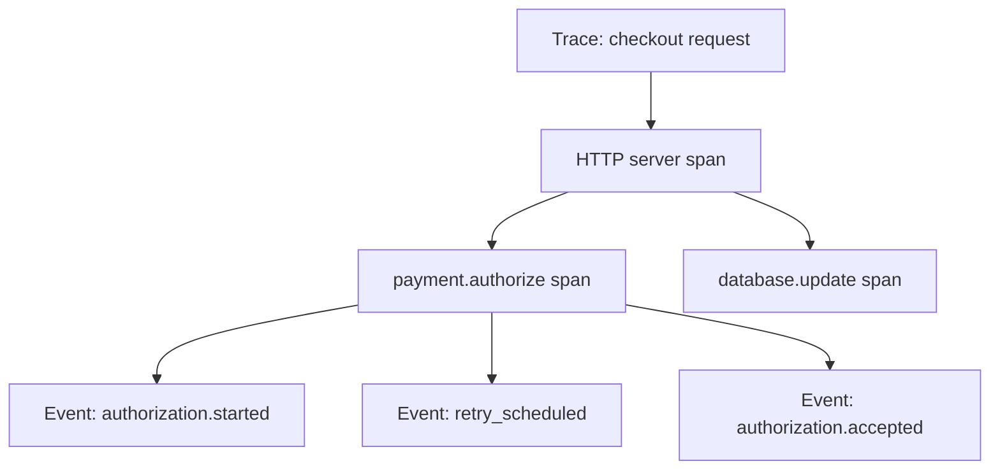
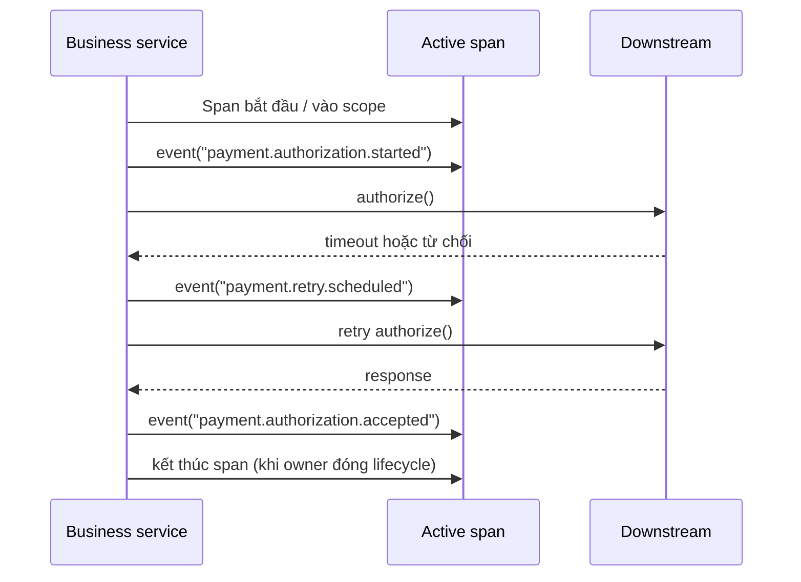
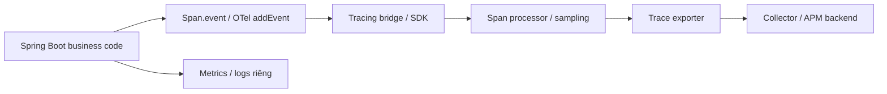

# Span event

> **Chương:** Tracing  
> **Module:** `SPRING_BOOT_OBSERVABILITY` — thiết lập observability cho Spring Boot bằng Micrometer Observation, metrics, logs và distributed tracing. Bài học tập trung vào **span event**: dấu mốc nằm trong một span, giúp liên kết diễn biến của một request với metrics, logs, context propagation, sampling và exporter khi điều tra sự cố.

## Mục tiêu bài học

Sau bài học, bạn có thể:

- Giải thích **span event** là gì, nó gắn với span nào và khác **span**, **span attribute**, **log event** và **metric** ở điểm nào.
- Chọn các mốc nghiệp vụ có ý nghĩa để thêm event thay vì tạo một span mới cho mọi thao tác nhỏ.
- Ghi event lên **span đang hoạt động** bằng Micrometer Tracing trong Spring Boot; bổ sung event attributes khi dùng OpenTelemetry API phù hợp.
- Phân biệt event đánh dấu một mốc với **error status/exception recording** và phép đo độ trễ.
- Hiểu ảnh hưởng của sampling, exporter, async context propagation và chính sách cardinality/bảo mật tới sự hiện diện của event trên backend.
- Kiểm tra một trace thực tế và dùng sự kiện để khoanh vùng timeout, retry hoặc thay đổi trạng thái của một giao dịch.

## 1. Vấn đề: một span dài chưa nói rõ đã xảy ra chuyện gì

Một HTTP request đến dịch vụ checkout, gọi dịch vụ thanh toán, chờ phản hồi rồi hoàn tất. Tracing backend cho thấy:

```text
POST /checkout                            2.8 s
└── payment.authorize                     2.6 s
```

Thông tin này chỉ cho biết **khoảng thời gian** của mỗi span. Người vận hành vẫn có thể cần biết: khi nào bắt đầu retry, kết quả kiểm tra rủi ro đã có chưa, request chuyển sang trạng thái chờ xác nhận vào lúc nào?

Một giải pháp là ghi các **mốc sự kiện** trong span:

```text
payment.authorize (span 2.6 s)
  +0 ms       payment.authorization.started
  +120 ms     payment.authorization.provider_selected
  +1,850 ms   payment.authorization.retry_scheduled
  +2,560 ms   payment.authorization.accepted
```

Đây là nội dung minh họa, không phải trace thực tế. Các sự kiện giúp tạo một **timeline có ngữ cảnh trong span** mà không phải thêm span con chỉ để biểu thị một thời điểm.

**Span event** là một bản ghi mang **tên, thời điểm** và (tùy API) **attributes** nằm bên trong một span cụ thể. Trong OpenTelemetry, sự kiện thường được biểu diễn như một phần của dữ liệu span, được xuất cùng span khi tracing pipeline thu thập nó.

Event **không có duration riêng** và **không phải span con**. Nếu cần biết chính xác một thao tác con kéo dài bao lâu, hãy cân nhắc tạo span con hoặc observation có vòng đời bắt đầu/kết thúc rõ ràng.

## 2. Mối quan hệ giữa trace, span và event

Một **trace** mô tả đường đi của một công việc qua nhiều thành phần. Mỗi **span** mô tả một operation với thời điểm bắt đầu/kết thúc, trace ID, span ID và quan hệ cha–con (nếu có). Một span có thể chứa nhiều events.



| Khái niệm | Ý nghĩa chính | Có thời lượng riêng? | Dùng khi nào? |
| --- | --- | --- | --- |
| **Trace** | Toàn bộ đường thực thi liên kết giữa các spans | Bao gồm một hay nhiều khoảng span | Điều tra chuỗi xử lý xuyên dịch vụ. |
| **Span** | Một operation với bắt đầu/kết thúc, attributes, trạng thái và quan hệ | **Có** | Đo bước HTTP, DB, RPC, nghiệp vụ. |
| **Span event** | Mốc xảy ra trong một span, có tên và thời điểm | **Không** | Đánh dấu retry, checkpoint, thay đổi trạng thái, quyết định nghiệp vụ. |
| **Span attribute** | Cặp key/value mô tả thuộc tính của span | Không | Mô tả `payment.provider`, `http.request.method` và dữ liệu được phép khác. |
| **Application log** | Bản ghi sự kiện từ logging framework | Không | Lưu exception và chi tiết vận hành, truy vấn theo trace/correlation ID. |
| **Metric** | Phép đo có thể tổng hợp theo time series | Tùy meter type | Theo dõi rate, error rate, latency và xu hướng. |

**Sự khác biệt quan trọng:** event là **mốc thời gian**, còn attribute là **thuộc tính**. Một span có thể có attribute `payment.provider=provider_a` và các events `payment.authorization.started`, `payment.authorization.accepted`. Thay đổi attribute sau này không làm nó trở thành một bản ghi diễn tiến ở từng thời điểm.

### 2.1. Event có thay thế logging không?

Không. Một span event thường được truy vấn **bên trong trace** và tồn tại theo chính sách lưu trữ traces. Log event được hệ thống logging/collector thu thập theo pipeline riêng, có thể không phụ thuộc vào trace sampling.

Do đó:

- Dùng **span event** khi muốn đọc các mốc trên timeline của **một span đã được lưu**.
- Dùng **structured log** khi cần sự kiện có thể tìm kiếm theo thời gian, đối tượng nghiệp vụ hay correlation ID, đặc biệt nếu trace có thể bị sampling.
- Dùng **metric** khi cần đếm/xem xu hướng của tất cả lần retry, timeout hoặc lỗi trong nhiều requests.

Một event `retry_scheduled` không tự tạo counter retry. Nếu số retry là SLI quan trọng, phải instrument counter/observation phù hợp.

## 3. Khi nào nên tạo span event?

Một event có giá trị khi nó trả lời câu hỏi **“điều gì đã xảy ra ở thời điểm đó trong operation?”**.

| Tình huống | Event gợi ý | Lý do |
| --- | --- | --- |
| Chuyển từ validation sang gọi cổng thanh toán | `payment.validation.completed` | Cho thấy mốc hoàn tất một quyết định. |
| Lập lịch retry sau lỗi tạm thời | `payment.retry.scheduled` | Xác định mốc retry mà không tạo span chỉ để đánh dấu. |
| Hết số lần retry | `payment.retry.exhausted` | Phân biệt lỗi sau nhiều lần thử với lỗi ngay từ đầu. |
| Queue consumer xác nhận nhận message | `message.received` | Hữu ích khi điều tra message lifecycle. |
| Job chuyển sang checkpoint mới | `batch.checkpoint.persisted` | Đọc timeline của job dài, có kiểm soát tần suất. |
| Xác nhận cập nhật trạng thái nghiệp vụ | `order.state.confirmed` | Thể hiện quyết định có ý nghĩa vận hành. |

Các trường hợp **không nên** tạo event quá mức:

- Mỗi lời gọi getter/setter trong code.
- Mỗi dòng của vòng lặp xử lý hàng triệu items.
- Mọi dòng log `debug` được sao chép vào trace.
- Payload thô, token hoặc ID riêng của từng khách hàng không qua chính sách dữ liệu.
- Event chỉ để thay cho một span con mà nhóm cần đo duration rõ ràng.

Nếu event được ghi hàng chục nghìn lần vào một span, trace payload có thể lớn, backend có thể giới hạn số events hoặc loại bớt dữ liệu. Khi cần theo dõi quy mô lớn, hãy tổng hợp **metrics theo tags hữu hạn** và chỉ giữ những mốc quan trọng.

### 3.1. Quy ước đặt tên

Tên event nên:

1. **Ổn định** giữa các lần chạy và các phiên bản, không chứa ID động.
2. Dựa trên **domain/action/state**, ví dụ `payment.retry.scheduled` hoặc `inventory.reserve.rejected`.
3. Ngắn gọn nhưng đủ ý nghĩa khi xem timeline.
4. Không chứa dữ liệu nhạy cảm, URL với ID thực hoặc exception message biến thiên.
5. Có cùng ý nghĩa ở mọi nơi phát event; nếu các service dùng một schema chung, cần chuẩn hóa tên và attributes.

Ví dụ **không nên**:

```text
retry-order-982384
customer-nguyen@example.com-authorization-failed
payment-error-Connection timed out after 3001ms
```

Tên động không có lợi cho việc truy vấn và có thể lộ dữ liệu. Dùng tên cố định và attributes được kiểm soát khi thực sự cần mang thêm ngữ cảnh.

## 4. Vòng đời và thời điểm ghi event

Một event phải được thêm khi span còn khả năng ghi nhận dữ liệu. Mô hình thường gặp:



Điểm cần nhớ:

- **Event gắn vào span nào?** Span đang được chọn tại lúc gọi API, không phải tự động vào “trace” chung chung.
- **Thời điểm:** hầu hết API sẽ lấy timestamp khi bạn thêm event. Có thể có API cho phép chỉ định timestamp nhưng cần đồng hồ và ngữ nghĩa phù hợp.
- **Thứ tự:** khi có nhiều threads/services, timeline còn chịu ảnh hưởng truyền context, scheduling và sai lệch đồng hồ; không coi mọi thứ tự hiển thị là bằng chứng tuyệt đối về nguyên nhân.
- **Kết thúc:** gọi event sau khi span đã kết thúc có thể không được ghi. Với code async, phải kiểm soát thời gian sống của span.
- **Sampling:** khi trace/span không được ghi nhận hoặc không được xuất, event có thể hoàn toàn không thấy tại backend.

**Đánh dấu lỗi không đồng nghĩa đánh dấu trạng thái span.** Event có tên `payment.authorization.failed` tự nó không nhất thiết đặt status lỗi cho span, ghi exception attributes, hay làm HTTP response thành 500. Nếu có exception, dùng API error-recording phù hợp và để ứng dụng xử lý trạng thái nghiệp vụ như bình thường.

## 5. Ghi event bằng Micrometer Tracing trong Spring Boot

Một tích hợp thông dụng dùng Micrometer Tracing `Tracer` để lấy span đang hoạt động. Khi có tracing bridge/handlers phù hợp, bạn có thể thêm event bằng `Span.event(String)`.

### 5.1. Ví dụ service có event cho thanh toán

Ví dụ dưới đây không tự tạo span mới; nó thêm events vào **span hiện hành** trong scope của HTTP request hoặc một observation nghiệp vụ. `PaymentGateway` là interface nghiệp vụ do dự án triển khai.

```java
package example.tracing;

import io.micrometer.tracing.Span;
import io.micrometer.tracing.Tracer;
import org.springframework.stereotype.Service;

@Service
public class PaymentAuthorizationService {
    private final Tracer tracer;
    private final PaymentGateway gateway;

    public PaymentAuthorizationService(
            Tracer tracer,
            PaymentGateway gateway) {
        this.tracer = tracer;
        this.gateway = gateway;
    }

    public String authorize(String providerName, String paymentToken) {
        String provider = normalizeProvider(providerName);
        Span span = tracer.currentSpan();

        if (span != null) {
            span.tag("payment.provider", provider);
            span.event("payment.authorization.started");
        }

        try {
            String authorizationId =
                    gateway.authorize(provider, paymentToken);

            if (span != null) {
                span.event("payment.authorization.accepted");
            }
            return authorizationId;

        } catch (RuntimeException failure) {
            if (span != null) {
                span.event("payment.authorization.failed");
                span.error(failure);
            }
            throw failure;
        }
    }

    private static String normalizeProvider(String value) {
        return "provider_a".equals(value) ||
               "provider_b".equals(value)
                ? value : "other";
    }

    public interface PaymentGateway {
        String authorize(String provider, String token);
    }
}
```

**Đọc code:**

1. Spring inject `Tracer` do Micrometer Tracing integration cung cấp. Nếu ứng dụng chỉ có Micrometer Metrics mà thiếu tracing bridge/configuration, bean `Tracer` có thể không tồn tại.
2. `tracer.currentSpan()` lấy span đang nằm trong tracing scope hiện hành; nó có thể là `null` nếu thao tác chạy ngoài scope hoặc mất context.
3. `span.tag("payment.provider", provider)` là **span attribute/tag**, không phải metric label được tự tạo bằng lời gọi này. `provider` được chuẩn hóa để không có giá trị tùy ý.
4. `span.event("payment.authorization.started")` ghi mốc bắt đầu xử lý nghiệp vụ **trong span hiện hành**. Nó không thay thế việc mở một span với `start()` và đóng span với `end()`.
5. `span.event("payment.authorization.accepted")` và `failed` thể hiện hai nhánh kết quả.
6. `span.error(failure)` thông báo exception cho span theo Micrometer Tracing API. Không dùng mỗi một event tên `failed` rồi kỳ vọng backend tự hiểu đây là exception.
7. Exception vẫn được ném lại. Telemetry không thay đổi hợp đồng xử lý lỗi của ứng dụng.

Không ghi `paymentToken`, authorization ID, dữ liệu thẻ hay dữ liệu nhận dạng khách hàng vào event name hoặc attributes. Tập tags tracing cũng phải tuân theo chính sách dữ liệu và giới hạn của backend.

### 5.2. Đặt event trên span HTTP hay span nghiệp vụ?

Với service chạy bên trong một HTTP request đã được instrument, `currentSpan()` có thể là **HTTP server span**. Khi đó các events thanh toán sẽ xuất hiện trên HTTP span, không phải một span `payment.authorize` riêng.

Nếu muốn có span nghiệp vụ riêng để đo duration của thao tác thanh toán và gắn events vào đúng span đó, hãy tạo **observation nghiệp vụ** có tracing handler thích hợp:

```java
import io.micrometer.observation.Observation;
import io.micrometer.observation.ObservationRegistry;

public String authorizeObserved(
        ObservationRegistry observations,
        PaymentAuthorizationService paymentService,
        String provider,
        String paymentToken) {

    String normalizedProvider =
            "provider_a".equals(provider) || "provider_b".equals(provider)
                    ? provider : "other";

    return Observation.createNotStarted("payment.authorize", observations)
            .contextualName("authorize payment")
            .lowCardinalityKeyValue("payment.provider", normalizedProvider)
            .observe(() -> paymentService.authorize(
                    normalizedProvider, paymentToken));
}
```

Ở một Spring Boot app đã cấu hình Micrometer Observation và Tracing, `observe(...)` bao bọc công việc đồng bộ bằng vòng đời observation, scope và xử lý lỗi. Khi metrics handler cũng được cấu hình, observation có thể đóng góp vào duration metric. Khi tracing handler hoạt động, service bên trong có thể nhìn thấy **span nghiệp vụ hiện hành** và thêm events lên đó.

Cần tránh **đo trùng** nếu đã có instrumentation tương đương ở cùng ranh giới. Nếu không cần duration riêng, thêm event vào span sẵn có có thể đủ. Nếu cần đo một thao tác bắt đầu/kết thúc, span con/observation là lựa chọn phù hợp hơn.

## 6. Event attributes với OpenTelemetry API

Trong Micrometer Tracing, `Span.event(String)` thường là API mức trừu tượng đơn giản để đặt tên event. **Span tags** như `span.tag(...)` mô tả span, không phải API gắn attributes riêng cho từng event.

Nếu ứng dụng sử dụng **Micrometer Tracing bridge OpenTelemetry** và có OpenTelemetry API phù hợp, bạn có thể sử dụng `io.opentelemetry.api.trace.Span.addEvent(...)` để bổ sung attributes **của event**.

Ví dụ chạy trong context có OTel span đang ghi nhận:

```java
import io.opentelemetry.api.common.AttributeKey;
import io.opentelemetry.api.common.Attributes;
import io.opentelemetry.api.trace.Span;

public void inventoryRejected() {
    Span current = Span.current();

    if (current.getSpanContext().isValid() &&
            current.isRecording()) {
        current.addEvent(
                "inventory.reservation.rejected",
                Attributes.of(
                        AttributeKey.stringKey("inventory.reason"),
                        "insufficient_stock",
                        AttributeKey.longKey("inventory.requested_items"),
                        3L
                )
        );
    }
}
```

**Phân biệt các tầng API:**

- `io.micrometer.tracing.Span` trong ví dụ mục 5 là abstraction của Micrometer Tracing.
- `io.opentelemetry.api.trace.Span` trong ví dụ này là **OpenTelemetry API**, với khả năng gắn event attributes.
- Chỉ trông đợi `Span.current()` nhìn thấy context tương ứng khi ứng dụng thật sự chạy trên OTel bridge/SDK và context được kích hoạt, truyền đúng. Nếu stack dùng Brave bridge hoặc cơ chế khác, không mặc định có thể dùng OTel API để thao tác span đó.
- Kiểm tra phiên bản dependencies/bridge thực tế khi áp dụng. Không tự trộn các tracing SDK độc lập và mong chúng luôn chia sẻ cùng context.

Trong ví dụ, `inventory.reason=insufficient_stock` và `inventory.requested_items=3` là metadata thuộc **event**. Event mang mốc thời gian và attributes này để giải thích vì sao việc giữ tồn kho bị từ chối. Không ghi toàn bộ danh sách sản phẩm, mã khách hàng hoặc payload vào attributes nếu không có nhu cầu và chính sách cho phép.

### 6.1. Span attributes và event attributes khác nhau thế nào?

Ví dụ về ý nghĩa:

```text
Span: inventory.reserve
  Attributes:
    inventory.operation = reserve
    inventory.storage   = primary-db

  Events:
    [10:31:04.120] inventory.lookup.completed
      inventory.item_count = 3

    [10:31:04.164] inventory.reservation.rejected
      inventory.reason = insufficient_stock
      inventory.requested_items = 3
```

**Span attributes** diễn tả span như một operation. **Event attributes** diễn tả tình huống ở chính mốc event đó. Nhiều events cùng loại có thể có các giá trị khác nhau ở các thời điểm khác nhau.

Cách hiển thị và cho phép truy vấn các attributes của event phụ thuộc tracing backend, exporter và chính sách indexing. Không phải backend nào cũng đánh chỉ mục event attributes như metric labels.

## 7. Dùng event hay tạo span con?

Khi thiết kế instrumentation, hãy hỏi: **“Cần một mốc thời gian hay cần đo một khoảng thời gian?”**

| Nhu cầu | Công cụ nên cân nhắc | Vì sao |
| --- | --- | --- |
| Ghi mốc “đã chọn provider” | Span event | Một thời điểm trong operation hiện tại. |
| Đo độ trễ HTTP call tới payment provider | Span con/instrumentation HTTP client | Có duration, trạng thái, quan hệ cha–con. |
| Đo một tác vụ batch mất nhiều phút | Observation/span có lifecycle | Cần start/end rõ ràng và có thể ghi duration metric. |
| Đếm số retry trên toàn hệ thống | Counter có tags hữu hạn | Có thể phân tích rate và alert theo thời gian. |
| Tìm exception của một request khi trace bị sampling | Structured log có trace/correlation ID khi được phép | Log pipeline có thể độc lập với trace sampling. |
| Đánh dấu retry thứ hai của một operation | Span event, attributes có chọn lọc | Có thể xem sequence khi trace được giữ lại. |

Một event không phải **timer**. Khoảng cách giữa hai timestamps trong trace có thể cung cấp một gợi ý, nhưng không thay thế span đo duration chính xác nếu có concurrency, async scheduling, clock skew hoặc event bị thiếu.

**Không biến mọi dòng log thành event.** Hãy chọn mốc có ý nghĩa, số lượng giới hạn và trách nhiệm rõ ràng để trace vẫn đọc được.

## 8. Sampling, exporter và khả năng tìm thấy event

### 8.1. Trace không được lấy mẫu

Các hệ thống tracing thường dùng **sampling** để kiểm soát chi phí. Với head-based sampling, quyết định có thể được đưa ra từ đầu trace. Nếu trace không được ghi hoặc không xuất, các events của trace đó thường **không xuất hiện** trong backend.

Ví dụ Spring Boot với cấu hình tracing phù hợp:

```yaml
spring:
  application:
    name: checkout-service

management:
  tracing:
    sampling:
      probability: 0.1
```

`0.1` ở đây minh họa xác suất lấy mẫu 10% trong cấu hình tương thích; không phải giá trị khuyến nghị chung cho mọi production system. **Sampling traces không tương đương sampling metrics.** Một operation có thể vẫn đóng góp timer/counter ngay cả khi event không thấy trên tracing backend.

Với các sự kiện hiếm nhưng quan trọng như “payment failed”, **đừng dựa vào span event như nguồn duy nhất để đếm số lỗi**. Cần logs/metrics hoặc dữ liệu nghiệp vụ phù hợp. Có thể xem xét chiến lược sampling nâng cao nếu stack hỗ trợ, nhưng phải hiểu quyền truy cập, độ trễ, chi phí và khả năng mất dữ liệu.

### 8.2. Pipeline export trace



Khi không thấy event, có nhiều khả năng:

1. `currentSpan()` là `null` hoặc OTel current span không recording.
2. Event được gọi **sau khi span kết thúc** hoặc nằm trên span khác.
3. Thiếu tracing bridge/SDK/exporter, hoặc ứng dụng chưa tạo active span.
4. Trace bị sampling loại bỏ.
5. Exporter/collector lỗi, mất kết nối hoặc backend giới hạn số events/attributes.
6. Backend đã nhận trace nhưng giao diện đang mở **span không đúng**, hoặc event bị lọc theo retention/indexing.

Cần xác định tầng nào thiếu dữ liệu trước khi sửa instrumentation.

### 8.3. Event và log correlation

Nếu Spring Boot được cấu hình Micrometer Tracing và logging integration, log có thể chứa `traceId`/`spanId` trong MDC hoặc structured fields. Có thể đối chiếu timestamp của log với event trên span để hiểu trình tự.

Nhưng việc gọi `span.event(...)` **không tự tạo một dòng log**. Để có logs với ngữ cảnh, ứng dụng phải thật sự gọi logger và pipeline logging phải được cấu hình. Nếu trace bị sampling, logs còn có thể được lưu theo quy tắc riêng và giúp tìm dấu vết.

## 9. Context propagation: event đi vào đúng span nào?

Span event luôn được ghi vào một **span cụ thể**. Trong hệ thống phân tán, việc lấy “current span” phụ thuộc tracing context đang hoạt động tại thời điểm gọi.

### 9.1. HTTP xuyên dịch vụ

Ví dụ luồng:

```text
checkout-service
  POST /checkout                traceId=T, spanId=A
    payment-client.request      traceId=T, spanId=B
        |
        | HTTP propagation (traceparent)
        v
payment-service
  POST /authorize               traceId=T, spanId=C
    event: payment.authorization.started
    event: payment.authorization.accepted
```

Để tiếp tục một trace xuyên HTTP, client/server instrumentation cần inject/extract context, ví dụ theo W3C `traceparent`. Bản thân `span.event()` **không truyền trace context** qua mạng.

Một event phát ở `payment-service` sẽ gắn với active span tại service đó, không tự chuyển về span của `checkout-service`. Khi backend trình bày trace, người dùng có thể nhìn cả hai spans nếu propagation và export hoạt động.

### 9.2. Async, Executor và Reactor

Ví dụ dễ gây hiểu nhầm:

```java
Span current = tracer.currentSpan();

executor.execute(() -> {
    // Không được giả định thread mới luôn mang tracing scope cha.
    Span workerSpan = tracer.currentSpan();
    if (workerSpan != null) {
        workerSpan.event("payment.async.started");
    }
});
```

Nếu executor không có context propagation, `workerSpan` có thể `null` hoặc thuộc ngữ cảnh khác. Không giải quyết bằng cách giữ một reference `Span` từ thread ngoài rồi gọi event tùy ý **sau khi span có thể đã kết thúc**: event có thể mất hoặc sai lifecycle.

Cách thiết kế phù hợp:

- Xác định event thuộc operation nào và span nào chịu trách nhiệm.
- Dùng context propagation được hỗ trợ bởi Micrometer/OTel, executor wrappers, Spring task instrumentation hoặc Reactor context integration tương ứng phiên bản.
- Tạo child span/observation trong task nếu đó là một operation riêng; mở/đóng scope và dừng đúng lúc công việc thật hoàn tất.
- Kiểm tra trace ID, span ID và parent-child relationship ở backend sau khi đổi thread hoặc queue boundary.
- Với message queue xử lý lâu sau đó, có thể dùng trace context propagation, span links hoặc workflow ID theo kiến trúc; không mặc định một scope sống xuyên qua các tiến trình.

### 9.3. Không tin tracing headers như xác thực

Trace headers có thể đến từ client bên ngoài. Chúng phục vụ tương quan thực thi, **không xác nhận identity, tenant, quyền truy cập hoặc mức độ tin cậy** của request. Không dùng giá trị tracing baggage/headers trực tiếp làm bằng chứng phân quyền hoặc đưa secrets vào span events.

## 10. Cardinality, chi phí và bảo mật của span event

**Cardinality của metric tags** và **độ phong phú của trace attributes** có quy tắc khác nhau, nhưng cả hai đều có chi phí và rủi ro.

| Nội dung muốn ghi | Có nên đặt vào event? | Giải thích |
| --- | --- | --- |
| Tên `payment.retry.scheduled` | Có khi cần điều tra retry | Ổn định, có ý nghĩa. |
| `payment.retry.reason=timeout` | Có, nếu dùng event attributes và tập giá trị chuẩn | Dễ phân loại và không lộ thông tin riêng. |
| Số thứ tự retry nhỏ, chẳng hạn `attempt=2` | Có chọn lọc | Có ích cho timeline, tránh spam hàng nghìn events. |
| `provider=provider_a` | Có nếu phù hợp | Giá trị có tập được kiểm soát. |
| Full request/response body | Không theo mặc định | Payload lớn, có thể chứa dữ liệu nhạy cảm. |
| Access token, password, thẻ thanh toán | Không | Bí mật nghiêm trọng, không được đưa vào telemetry. |
| Email/định danh cá nhân | Thường không | Rủi ro quyền riêng tư; cần chính sách riêng nếu thật sự cần. |
| Exception message nguyên văn | Cân nhắc kỹ | Có thể chứa ID, URL, token hoặc dữ liệu từ client. |

Một số backend giới hạn **số events trên mỗi span**, tổng kích thước span hoặc độ dài attributes. Khi vượt mức, backend/SDK có thể drop hoặc truncate events. Vì thế:

- Ưu tiên **sự kiện hiếm nhưng có giá trị** thay vì ghi từng vòng lặp.
- Đặt tên ổn định; dùng attributes nhỏ, được chuẩn hóa.
- Ghi lỗi có kiểm soát; không đưa stack trace hoặc thông tin nhạy cảm vào event name.
- Theo dõi trace payload size, ingestion/quota, retention và sampling.
- Tách nhu cầu “đếm mọi lỗi” sang metrics counters hoặc nguồn dữ liệu nghiệp vụ thay vì kỳ vọng 100% traces được lưu.

**Không dùng event attributes có ID động để suy ra an toàn hoàn toàn:** chúng không gây bùng nổ time series giống metric labels nếu không được đưa vào metrics, nhưng vẫn làm tăng dữ liệu trace và có thể bị indexing theo thuộc tính. Cần đánh giá chính sách truy cập và chi phí.

## 11. Điều tra sự cố thực tế với span events

**Tình huống:** sau deployment, người dùng báo checkout chậm hoặc timeout khi xác thực thanh toán. HTTP metrics cho thấy p95 tăng và tỷ lệ lỗi tăng.

Trình tự điều tra:

1. **Xác nhận tác động qua metrics:** xem rate, error rate và duration theo route, môi trường, provider tags hữu hạn. Không lấy mẫu traces làm nguồn duy nhất tính tỷ lệ lỗi.
2. **Tìm trace chậm đã được thu thập:** mở một trace tương ứng thời điểm, dịch vụ và route. Nếu không có trace, kiểm tra sampling/exporter và tiếp tục dùng logs.
3. **Đọc span hierarchy:** tìm `payment.authorize` và duration của nó. Xác định span này có nằm trong parent HTTP đúng không.
4. **Đọc events theo timeline:** xem `payment.authorization.started`, `payment.retry.scheduled`, `payment.authorization.failed` hoặc `accepted` có xuất hiện không. Tính chất có mặt/vắng mặt phải được giải thích với instrumentation và sampling.
5. **Đối chiếu dependency spans:** các HTTP calls tới provider có thể có duration riêng. Nếu retry event có nhưng không thấy child span tương ứng, kiểm tra instrumentation client.
6. **Tra logs bằng trace ID:** xem exception, HTTP status, retry delay và message ID ở những bước tương ứng.
7. **Khoanh vùng nguyên nhân:** chậm do queue/acquire connection, DNS, provider response, retry backoff hay logic nội bộ? Event là mốc hỗ trợ, không tự đủ để kết luận.
8. **Kiểm chứng sau sửa:** metrics rate/error/latency cải thiện, events và spans xuất hiện đúng trên traces mẫu, logs không lộ dữ liệu.

Ví dụ:

```text
Trace checkout #T42
  HTTP POST /checkout               3.5 s
    payment.authorize               3.2 s
      0.00 s  payment.authorization.started
      1.40 s  payment.retry.scheduled
      3.15 s  payment.authorization.accepted

    HTTP client provider_a attempt1 1.35 s  timeout
    HTTP client provider_a attempt2 1.60 s  200
```

Các durations và timestamps là **dữ liệu giả định**. Chúng gợi ý thời gian tiêu hao ở các lời gọi provider và retry, nhưng nguyên nhân phải được xác minh thêm bằng metrics/logs, mạng và trạng thái downstream. Nếu cần đo **thời gian chờ giữa các lần retry** như SLI riêng, hãy bổ sung phép đo phù hợp thay vì suy luận hoàn toàn từ event timestamps.

## 12. Các lỗi thường gặp

| Hiện tượng | Nguyên nhân có thể | Cách kiểm tra |
| --- | --- | --- |
| `currentSpan()` trả `null` | Không có tracing scope, bridge chưa bật hoặc mất context | Kiểm tra tracing dependencies, active scope và propagation. |
| Không có event dù span xuất hiện | Event được gọi sau span end, trên span khác hoặc bị giới hạn | Kiểm tra lifecycle, span ID, SDK/event limits và đường code. |
| Không thấy trace ở backend | Sampling, exporter hoặc collector chưa hoạt động | Kiểm tra sampler, tracing bridge, exporter và backend. |
| Có event tên `failed` nhưng span không hiển thị lỗi | Event name không tự thay span status/exception | Ghi nhận lỗi bằng API phù hợp như `span.error(exception)`. |
| Event nằm trên HTTP span thay vì span nghiệp vụ | `currentSpan()` đang là HTTP span; chưa tạo child observation/span | Chọn đúng scope và ranh giới nghiệp vụ. |
| Event thiếu khi chạy `@Async` hoặc executor | Context không được capture/restore | Tích hợp context propagation, xác minh parent/span IDs. |
| Log có trace ID nhưng không có event | Logging pipeline và tracing pipeline khác nhau; event chưa ghi hoặc bị sampling | Kiểm tra event recording, exporter và log/tracing config riêng. |
| Quá nhiều events, trace bị cắt | Ghi event cho từng item, vượt event/span limits | Giảm tần suất, tổng hợp metrics, chỉ giữ mốc có giá trị. |
| Event attributes không hiện ở UI | Bridge/exporter/backend không hỗ trợ hoặc không index | Kiểm tra API đang dùng, OTel bridge và giới hạn backend. |
| Attributes chứa dữ liệu nhạy cảm | Ghi raw payload/exception message | Redact/drop, áp dụng chính sách dữ liệu và kiểm tra access. |
| Metrics retry không tăng dù có retry event | Event không tự tạo counter | Tạo counter với tags hữu hạn tại ranh giới retry. |
| Span event xuất hiện trễ/khác thứ tự mong muốn | Async timing, clock skew hoặc UI sắp xếp lại | Đối chiếu timestamps, context và sequence nghiệp vụ. |

## 13. Bài thực hành kiểm chứng

Thực hiện trong một Spring Boot test environment có Micrometer Tracing bridge/exporter và trace backend thích hợp.

1. Tạo API gọi `PaymentAuthorizationService.authorize(...)` từ một HTTP request. Bật tracing và cấu hình sampling đủ để quan sát được trace trong môi trường thử nghiệm.
2. Ghi một ca thành công. Mở trace, xác minh có event `payment.authorization.started` và `payment.authorization.accepted` trên **đúng span**.
3. Ghi ca exception có kiểm soát. Kiểm tra event `payment.authorization.failed`, error recording và hành vi trả lỗi ở tầng ứng dụng.
4. Tạo observation nghiệp vụ `payment.authorize` quanh lời gọi; so sánh span hierarchy và thời điểm events trước/sau khi có child span.
5. Với OTel bridge, thêm event `inventory.reservation.rejected` có attributes và xem tracing backend có hiển thị timestamp, name, attributes hay không.
6. Chạy thao tác qua executor không có context propagation trong **môi trường thử nghiệm**; quan sát `currentSpan()`/span ID. Sau đó bật cơ chế propagation phù hợp, kiểm tra lại.
7. Hạ sampling có kiểm soát; giải thích vì sao một số runs vẫn có metrics/logs nhưng không có trace hoặc events trên backend.
8. Tạo nhiều retries giả lập. Rà soát số events trên span, bảo đảm không ghi từng item/attempt vô hạn hoặc dữ liệu nhạy cảm.
9. Đối chiếu metrics về lỗi/độ trễ với sampled trace và logs cùng trace ID; nêu rõ tín hiệu nào mang tính tổng hợp, tín hiệu nào chỉ phản ánh một request.

**Tiêu chí đạt:** người học chỉ ra được **span ID chứa event**, **tên/timestamp/attributes của event**, vì sao event khác span con và metrics, cách event được export, và những nguyên nhân khiến event bị thiếu khi sampling hoặc mất context.

## 14. Câu hỏi tự kiểm tra

**Câu 1.** Span event có thời lượng riêng như child span không?  
**Gợi ý:** Không. Event biểu thị một mốc có timestamp trong span; child span có start/end và duration.

**Câu 2.** Gọi `span.event("payment.authorization.failed")` có đủ để đặt span status là lỗi không?  
**Gợi ý:** Không. Ghi exception/status bằng tracing API phù hợp; event name chỉ là tên của mốc.

**Câu 3.** Thêm span event có tự phát sinh log trong Logback không?  
**Gợi ý:** Không. Log cần logger và pipeline riêng; trace events nằm trong dữ liệu span/tracing.

**Câu 4.** Nếu trace bị sampling loại bỏ, còn xem được event đó trên backend không?  
**Gợi ý:** Thường không. Dùng metrics/logs cho các tín hiệu cần độ bao phủ cao hơn.

**Câu 5.** Tại sao không ghi một event cho mỗi bản ghi của batch có hàng triệu dòng?  
**Gợi ý:** Số events và kích thước span rất lớn, dễ chạm giới hạn hoặc tăng chi phí; dùng metrics tổng hợp và checkpoints có chọn lọc.

**Câu 6.** `span.tag(...)` và OpenTelemetry `span.addEvent(name, attributes)` có giống nhau không?  
**Gợi ý:** Không. Tag/attribute của span mô tả operation; event attributes thuộc về một mốc cụ thể.

**Câu 7.** Vì sao `tracer.currentSpan()` có thể trả `null` khi code chạy ở executor?  
**Gợi ý:** Tracing scope/context không nhất thiết tự truyền qua thread; cần cơ chế propagation được cấu hình.

**Câu 8.** Có nên gắn `traceId` làm low-cardinality metric tag để đếm mọi lần retry?  
**Gợi ý:** Không. Trace ID có cardinality cao; dùng metric retry counter với tags hữu hạn, rồi liên kết đến traces/logs qua context hoặc exemplars khi có hỗ trợ.

**Câu 9.** Khi một event xuất hiện trên HTTP span thay vì span `payment.authorize`, cần sửa gì?  
**Gợi ý:** Xác định span hiện hành khi ghi event; nếu cần child business span thì tạo observation/span có scope và lifecycle phù hợp.

**Câu 10.** Một trace có event retry nhưng không có child span HTTP client tương ứng chứng minh điều gì?  
**Gợi ý:** Chưa chứng minh HTTP call không xảy ra; có thể thiếu instrumentation hoặc context propagation ở HTTP client. Cần đối chiếu logs và metrics.

**Ghi nhớ:** **Span event là một mốc có tên và thời điểm bên trong span**, không phải duration, metric hay log. Trong Spring Boot, bạn có thể thêm event bằng Micrometer Tracing `Span.event(String)` hoặc dùng OpenTelemetry `addEvent(...)` để mang event attributes khi stack hỗ trợ. Hãy chọn sự kiện có ý nghĩa, ghi trong đúng active span, kiểm soát sampling/exporter/context propagation và bảo mật dữ liệu; dùng metrics và logs bổ sung để điều tra lỗi/độ trễ mà không phụ thuộc vào từng sampled trace.
