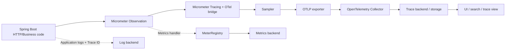
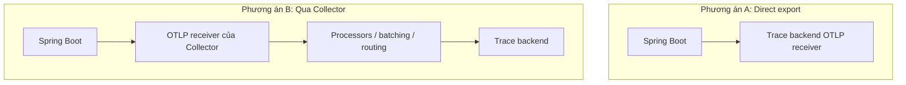
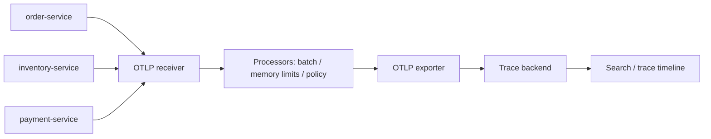
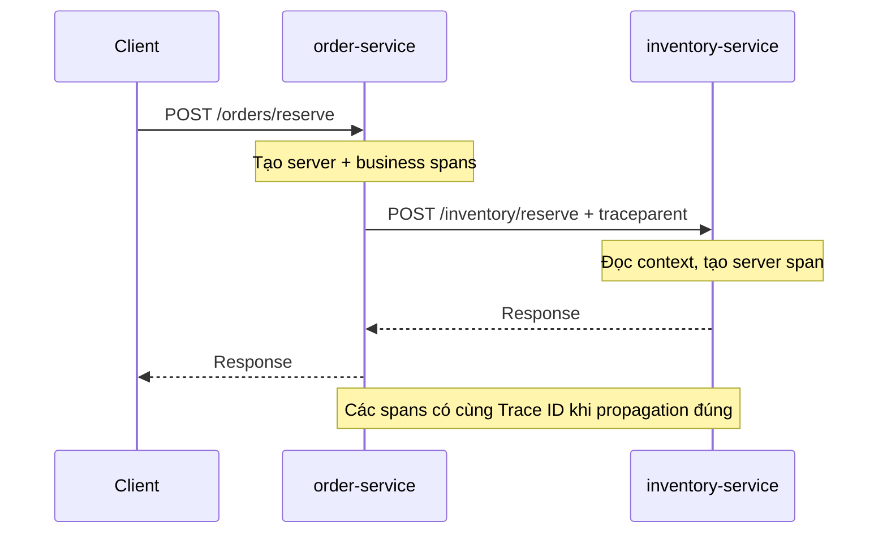
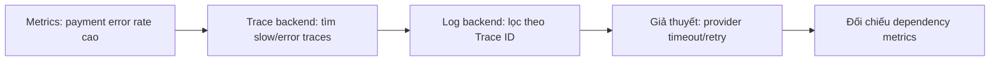

# Trace backend trong Spring Boot Observability

**Trace backend** là hệ thống tiếp nhận, lưu trữ, lập chỉ mục hoặc hỗ trợ tìm kiếm và hiển thị **distributed traces**. Khi một request đi qua nhiều dịch vụ, backend giúp ghép các spans có cùng `traceId` thành một timeline, hiển thị quan hệ cha–con, độ trễ của từng bước, lỗi và metadata phù hợp để người vận hành điều tra.

Trong module **SPRING_BOOT_OBSERVABILITY**, Spring Boot có thể kết hợp **Micrometer Observation**, Micrometer Tracing, logs và metrics. Tuy nhiên, việc ứng dụng tạo span **không có nghĩa trace đã xuất hiện trên giao diện quan sát**. Dữ liệu còn phải đi qua sampler, exporter, mạng, có thể qua OpenTelemetry Collector, rồi được trace backend nhận, lưu và cho phép truy vấn.

Bài thuộc chương **Tracing**, tập trung vào việc lựa chọn, cấu hình, xác minh và vận hành trace backend, đồng thời liên hệ với **context propagation, sampling, tags/cardinality, exporter, metrics và log correlation**. Mục tiêu cuối cùng là dùng trace để làm rõ nguyên nhân lỗi hoặc độ trễ trong ứng dụng Spring Boot đang chạy thực tế.

## 1. Trace backend giải quyết vấn đề gì?

Giả sử một request đặt hàng đi qua các dịch vụ:

```text
Client
  |
  +-- order-service: POST /orders
        |
        +-- inventory-service: reserve stock
        |
        +-- payment-service: authorize payment
              |
              +-- external payment provider
```

Người dùng báo rằng đặt hàng mất 4 giây, nhưng log của `order-service` chỉ ghi “request completed”. Chỉ xem request duration không cho biết 4 giây đã tiêu hao ở đâu.

Một distributed trace có thể cho thấy:

| Span | Thời lượng giả định | Quan hệ |
| --- | ---: | --- |
| `POST /orders` | 4.000 ms | Root/server span |
| `inventory.reserve` | 180 ms | Con của request |
| `payment.authorize` | 3.600 ms | Con của request |
| `POST payment-provider` | 3.450 ms | Con của payment span |

Số liệu minh họa cho thấy thời gian chủ yếu nằm ở bước thanh toán. Trace backend làm cho mối quan hệ này có thể quan sát và tìm kiếm, thay vì phải ghép riêng nhiều log lines.

Những câu hỏi điển hình mà trace backend hỗ trợ:

- Request nào đi qua các dịch vụ nào?
- Bước nào có duration lớn và có nằm trên đường gây chậm chính không?
- Lỗi phát sinh ở service nào, request có retry không?
- Span con nào thiếu hoặc có parent không đúng?
- Có thể đi từ metric báo p95 tăng tới một trace chậm, rồi từ trace sang logs cùng Trace ID không?
- Trong một phiên bản triển khai mới, dấu hiệu độ trễ tăng xuất hiện ở những operations nào?

**Giới hạn:** trace thường là mẫu của các request được ghi nhận, không nhất thiết là toàn bộ traffic. Trace timeline đưa ra bằng chứng về các spans đã được instrument và xuất thành công; nó không tự mô tả thời gian ở những đoạn code chưa instrument.

## 2. Dữ liệu bên trong một trace

Một **trace** là tập spans có liên quan theo một ngữ cảnh phân tán. Một **span** mô tả một công việc có thời điểm bắt đầu/kết thúc và các trường metadata.

| Thành phần | Vai trò | Ví dụ |
| --- | --- | --- |
| `traceId` | Liên kết các spans thuộc cùng trace | 32 ký tự hex đối với W3C Trace Context |
| `spanId` | Nhận diện span trong trace | 16 ký tự hex đối với W3C Trace Context |
| `parentSpanId` | Biểu thị quan hệ trực tiếp giữa spans | Span HTTP client là con của span nghiệp vụ |
| Span name | Tên operation có ý nghĩa | `payment.authorize` |
| Start/end time | Thời điểm bắt đầu và kết thúc | Tính duration |
| Span kind | Loại vai trò như CLIENT/SERVER/INTERNAL | HTTP client và HTTP server |
| Attributes | Thuộc tính của operation | `http.route`, `http.request.method` |
| Events | Mốc xảy ra bên trong span | Exception event hoặc sự kiện nghiệp vụ |
| Status | Trạng thái span, có thể là lỗi | Error status nếu instrumentation đánh dấu |
| Links | Liên hệ với span khác không theo parent-child | Tác vụ xử lý message hoặc batch |
| Resource attributes | Định danh nguồn phát telemetry | `service.name`, môi trường, phiên bản |

Tên semantic conventions và những attributes cụ thể có thể thay đổi theo phiên bản instrumentation. Hãy xem dữ liệu backend xuất ra thực tế, không mặc định mọi thư viện HTTP dùng cùng một tên attribute.

### 2.1. Trace ID và Span ID không thể thay nhau

Một trace gồm nhiều spans dùng **cùng Trace ID**, nhưng mỗi span có **Span ID riêng**. Parent-child relation thường được ghi thông qua Parent Span ID, không dựa vào việc hai spans có tên giống nhau.

Ví dụ header W3C Trace Context:

```http
traceparent: 00-4bf92f3577b34da6a3ce929d0e0e4736-00f067aa0ba902b7-01
```

Bốn phần chính là version, Trace ID, parent span ID và trace flags. Header `traceparent` hỗ trợ mang ngữ cảnh qua ranh giới HTTP; nó **không chứa toàn bộ nội dung trace** và cũng không bảo đảm backend đã nhận trace.

### 2.2. Span duration không luôn cộng được thành tổng

Nếu hai spans chạy song song, tổng các span durations có thể lớn hơn duration của parent. Ngược lại, parent có thể có khoảng thời gian chưa có child span vì mã ở đoạn đó chưa được instrument.

Để phân tích chậm, cần nhìn **timeline, quan hệ và đường công việc ảnh hưởng tới thời gian kết thúc**. Không đơn giản cộng mọi duration con rồi khẳng định bằng thời gian request.

### 2.3. Clock skew và dữ liệu thiếu

Khi spans đến từ nhiều máy, chênh lệch đồng hồ có thể làm timeline hiển thị bất thường. Backend/instrumentation có thể xử lý một phần nhưng vẫn cần đồng bộ thời gian phù hợp và kiểm tra timestamps.

Nếu một service không được instrument, span bị sampling loại hoặc exporter gặp lỗi, trace có thể **thiếu spans**. Trace backend không thể tự khôi phục đầy đủ những spans chưa từng được tạo hoặc nhận.

## 3. Kiến trúc: instrumentation, exporter, Collector và backend

Một trace pipeline thường có nhiều lớp:



**Mỗi lớp có trách nhiệm riêng:**

1. **Instrumentation** nhận biết hoạt động như HTTP server request, client call hoặc nghiệp vụ `inventory.reserve`.
2. **Observation và tracing handler** tạo hoặc cập nhật span và ngữ cảnh hiện hành.
3. **Sampler** quyết định mức ghi nhận trace theo chính sách đang áp dụng.
4. **Exporter** chuyển spans đã ghi nhận đến endpoint được cấu hình.
5. **Collector (tùy chọn)** nhận, xử lý, batch, lọc, lấy mẫu ở tầng Collector hoặc định tuyến telemetry.
6. **Trace backend** lưu trữ và cho phép tìm kiếm traces/spans, hiển thị timeline, hỗ trợ retention và kiểm soát truy cập theo triển khai.
7. **UI/Query API** giúp con người hoặc công cụ vận hành tìm trace theo Trace ID, service, operation, thời gian và các thuộc tính được hỗ trợ.

**Exporter không phải backend.** Một exporter chỉ thực hiện xuất dữ liệu. **Collector không nhất thiết là backend lưu trữ**: nếu pipeline chỉ dùng debug exporter, spans có thể được ghi vào logs của Collector mà không được lưu lâu dài để tra cứu.

### 3.1. Gửi trực tiếp hay qua Collector?

Hai topology thường gặp:



**Direct export** đơn giản cho môi trường nhỏ hoặc lab khi backend đã có OTLP receiver. **Collector** hữu ích khi nhiều service cần cấu hình thống nhất, batching, bảo vệ dữ liệu, routing và quản lý chính sách ingest.

Một Collector cũng có thể là điểm nghẽn hoặc điểm lỗi nếu không được scale và giám sát đúng. Quyết định dùng Collector cần đi cùng capacity, security và phương án vận hành.

## 4. Những lựa chọn trace backend phổ biến

Các sản phẩm và stack khác nhau về kiến trúc storage, cơ chế tìm kiếm, trải nghiệm UI và chi phí vận hành. Ví dụ:

| Backend | Đặc trưng tổng quát | Điều cần xác minh khi chọn |
| --- | --- | --- |
| **Jaeger** | Hệ thống distributed tracing với giao diện tìm kiếm và phân tích traces | Phiên bản, receiver OTLP, storage backend, khả năng search/retention |
| **Grafana Tempo** | Backend traces thường kết hợp object storage và Grafana để tìm kiếm/hiển thị | Cách query TraceQL, ingestion, storage, index/search và metrics-generator nếu sử dụng |
| **Zipkin** | Hệ tracing truyền thống với mô hình spans/query riêng | Protocol receiver, exporter phù hợp, storage và UI |
| **Managed tracing service** | Backend do nhà cung cấp vận hành | Protocol, authentication, data residency, quota, chi phí, retention và quyền truy cập |
| **OpenTelemetry-compatible platform** | Hệ thống nhận OTLP và cung cấp truy vấn traces | Tính tương thích OTLP, indexing, sampling, search và tổ chức dữ liệu |

Không có lựa chọn “mặc định tốt nhất” cho mọi trường hợp. Với Spring Boot, **OTLP là một giao thức vận chuyển**, không phải tên một sản phẩm lưu trữ. Một backend hỗ trợ OTLP có thể nhận trực tiếp hoặc thông qua Collector; tuy nhiên cần kiểm tra protocol, port và receiver thực tế của phiên bản đang dùng.

### 4.1. Jaeger

Jaeger phục vụ tìm kiếm và quan sát traces, thường hỗ trợ các góc nhìn như service, operation, duration, trace timeline và span attributes. Việc nhận OTLP, thành phần lưu trữ và cấu hình triển khai **phụ thuộc phiên bản Jaeger**; cần dùng tài liệu tương ứng với bản đang vận hành.

Jaeger trong lab có thể dùng cấu hình gọn để kiểm chứng pipeline. Production cần xác định persistence, retention, resource limits và scaling; một container chạy thử không tương đương một hệ thống tracing có HA.

### 4.2. Grafana Tempo

Tempo thường được dùng cùng Grafana để tra cứu distributed traces, có thể kết hợp object storage và TraceQL. Một số tính năng khám phá theo thuộc tính và sinh metrics từ traces phụ thuộc kiến trúc, phiên bản và cấu hình triển khai.

Không suy rằng mọi thuộc tính gắn vào span sẽ được tìm kiếm với chi phí như nhau. Trước khi bổ sung nhiều attributes chi tiết, cần hiểu cách backend index/query, chính sách retention và chi phí.

### 4.3. Zipkin

Zipkin có các định dạng/protocol và storage/query riêng; nếu ứng dụng dùng Micrometer Tracing với một exporter phù hợp, có thể gửi spans đến Zipkin. Không dùng nhầm **Zipkin HTTP endpoint** với **OTLP/HTTP endpoint**: cả hai có thể dùng HTTP nhưng schema và URL khác nhau.

### 4.4. Tiêu chí lựa chọn

Đánh giá theo:

- **Protocol:** OTLP/HTTP, OTLP/gRPC, Zipkin hoặc giao thức riêng.
- **Khả năng tìm kiếm:** Trace ID, service, operation, duration, error, attributes, thời gian.
- **Retention:** giữ traces trong bao lâu, cách xóa và đáp ứng yêu cầu tuân thủ.
- **Chi phí:** ingestion, storage, indexing, query, mạng và replica.
- **Sampling:** head sampling, tail sampling, chính sách ưu tiên errors/slow traces.
- **Bảo mật:** TLS, xác thực, phân quyền, multi-tenancy và dữ liệu nhạy cảm.
- **Vận hành:** HA, backup, upgrade, monitoring, khả năng điều tra khi backend gặp lỗi.
- **Liên kết tín hiệu:** trace-to-logs, metrics-to-traces/exemplars, khả năng tích hợp dashboard.

## 5. Cấu hình Micrometer Tracing trong Spring Boot

Ví dụ dưới đây dùng **Spring Boot 3.x**, đặc biệt các cấu hình thường gặp khi ứng dụng có Micrometer Tracing và OpenTelemetry bridge. Với phiên bản khác, dependency names hoặc properties có thể thay đổi; hãy dùng dependency management/BOM tương thích và kiểm tra documentation theo phiên bản triển khai.

### 5.1. Maven dependencies

```xml
<dependencies>
    <dependency>
        <groupId>org.springframework.boot</groupId>
        <artifactId>spring-boot-starter-actuator</artifactId>
    </dependency>

    <!-- Micrometer Tracing dùng OpenTelemetry bridge -->
    <dependency>
        <groupId>io.micrometer</groupId>
        <artifactId>micrometer-tracing-bridge-otel</artifactId>
    </dependency>

    <!-- Gửi spans qua OTLP -->
    <dependency>
        <groupId>io.opentelemetry</groupId>
        <artifactId>opentelemetry-exporter-otlp</artifactId>
    </dependency>
</dependencies>
```

Ý nghĩa:

- Actuator tham gia auto-configuration cho observability/tracing khi điều kiện phù hợp.
- Micrometer Tracing bridge nối Observation và OpenTelemetry tracing implementation.
- OTLP exporter cung cấp đường xuất spans theo cấu hình.
- **`micrometer-registry-otlp` là dependency cho metrics OTLP**, khác với exporter OTLP traces trong ví dụ này.

Nếu chỉ thêm `micrometer-registry-otlp`, bạn không nên kỳ vọng lập tức có spans ở trace backend. Tương tự, thêm tracing bridge chưa đủ nếu exporter/backend chưa được cấu hình để nhận.

### 5.2. application.yml cho môi trường lab

```yaml
spring:
  application:
    name: order-service

management:
  tracing:
    sampling:
      probability: 1.0
  otlp:
    tracing:
      endpoint: http://localhost:4318/v1/traces
```

**Giải thích:**

- `spring.application.name` thường được dùng làm tên định danh ứng dụng trong các tích hợp Spring Boot, nhưng phải kiểm tra **`service.name` được backend hiển thị thực tế**.
- `management.tracing.sampling.probability: 1.0` phù hợp với lab để dễ tìm trace; production cần chính sách sampling phù hợp traffic và chi phí.
- `management.otlp.tracing.endpoint` chỉ tới receiver OTLP/HTTP traces phù hợp trong cấu hình Spring Boot 3.x hỗ trợ tính năng đó.
- `localhost:4318` chỉ hợp lý nếu backend/Collector nằm trên môi trường mạng mà tiến trình Spring Boot có thể truy cập qua `localhost`.

Khi ứng dụng chạy trong container khác Collector, dùng DNS/hostname phù hợp, chẳng hạn:

```yaml
management:
  otlp:
    tracing:
      endpoint: http://otel-collector:4318/v1/traces
```

Port `4318` thường dành cho **OTLP/HTTP**; `4317` thường dành cho **OTLP/gRPC**. Đừng chỉ đổi số cổng mà không kiểm tra transport/protocol mà exporter và receiver thực sự sử dụng.

### 5.3. Sampling production

Ví dụ sampling 10%:

```yaml
management:
  tracing:
    sampling:
      probability: 0.10
```

Đây là xác suất lấy mẫu theo head sampler cấu hình tương ứng, **không cam kết chính xác 10% ở mọi phút hoặc mọi endpoint**. Nó giúp giảm chi phí ghi/xuất trace, nhưng cũng có thể làm thiếu trace của request gặp lỗi nếu request đó không được lấy mẫu.

Cần cân nhắc sampling theo lưu lượng, SLO, giá trị chẩn đoán, giới hạn backend và chính sách error/latency sampling ở Collector. Mẫu định kỳ tại đầu request không luôn biết request sẽ lỗi hay chậm khi kết thúc.

## 6. OpenTelemetry Collector: thành phần trung gian

Collector thường gồm ba nhóm cấu hình trong pipeline:

1. **Receivers:** nhận spans từ ứng dụng, ví dụ OTLP/HTTP hoặc OTLP/gRPC.
2. **Processors:** batch, lọc, biến đổi attributes, lấy mẫu hoặc giới hạn tài nguyên theo tính năng đang dùng.
3. **Exporters:** chuyển spans đến backend hoặc một Collector khác.



### 6.1. Collector lab: nhận spans và in ra debug

Một cấu hình tối giản mang tính minh họa:

```yaml
receivers:
  otlp:
    protocols:
      grpc:
        endpoint: 0.0.0.0:4317
      http:
        endpoint: 0.0.0.0:4318

processors:
  batch: {}

exporters:
  debug:
    verbosity: basic

service:
  pipelines:
    traces:
      receivers: [otlp]
      processors: [batch]
      exporters: [debug]
```

Ý nghĩa: Collector nhận spans theo OTLP, batch rồi ghi thông tin vào debug output. Cấu hình này **chỉ để kiểm chứng việc nhận dữ liệu**; nó không tạo hệ thống lưu trữ/query traces lâu dài.

Lưu ý:

- Tên components và hỗ trợ `debug` exporter phụ thuộc phiên bản/distribution của Collector; cần dùng version tương thích.
- Bind `0.0.0.0` mở listener trên mọi interfaces của môi trường chạy; hạn chế network và cấu hình bảo mật phù hợp.
- Không bật debug logging mức chi tiết cao cho lưu lượng production vì có thể tăng chi phí và làm lộ attributes.
- Cần chắc chắn pipeline là `traces`, không chỉ `metrics`.

### 6.2. Thay debug exporter bằng backend hỗ trợ OTLP

Nếu trace backend có OTLP/gRPC receiver ở `trace-backend:4317`, có thể cấu hình exporter của Collector theo nguyên tắc:

```yaml
exporters:
  otlp/traces_backend:
    endpoint: trace-backend:4317
    tls:
      insecure: true  # Chỉ ví dụ lab; production cần TLS

service:
  pipelines:
    traces:
      receivers: [otlp]
      processors: [batch]
      exporters: [otlp/traces_backend]
```

Đây là **đoạn cấu hình thay thế cho `exporters` và `service` trong ví dụ trước**, dùng chung receiver/processor đã định nghĩa, **không phải một file cấu hình hoàn chỉnh độc lập**. Chỉ sử dụng khi backend thực sự mở **OTLP/gRPC receiver** và có thể resolve hostname này.

Ở production:

- Bật TLS/mTLS hoặc kết nối được bảo vệ theo yêu cầu backend.
- Cấu hình authentication headers/secrets phù hợp.
- Thiết kế queue, retries, resource limits và observability của Collector.
- Đảm bảo receiver, processor và exporter khớp đúng **signal type**.
- Kiểm tra backend thực sự lưu dữ liệu; Collector gửi thành công không bảo đảm search index đã sẵn sàng ngay.

### 6.3. OTLP/HTTP và OTLP/gRPC khác nhau

| Đặc điểm | OTLP/HTTP | OTLP/gRPC |
| --- | --- | --- |
| Protocol phổ biến | HTTP POST | gRPC trên HTTP/2 |
| Port thông dụng | 4318 | 4317 |
| Path thường gặp cho traces | `/v1/traces` | gRPC service/method, không dùng cùng URL path của HTTP POST |
| Content type ví dụ | `application/x-protobuf` hoặc JSON theo encoding | `application/grpc` |
| Vấn đề thường gặp | Sai path/Content-Type/HTTP method | Sai transport, HTTP/2 hoặc TLS/proxy |
| Tương thích | Cần exporter và receiver cùng OTLP/HTTP | Cần exporter và receiver cùng OTLP/gRPC |

Một HTTP GET vào `/v1/traces` thường **không phải cách xem trace**. Đây thường là endpoint receiver mong đợi HTTP POST. Để xem dữ liệu, dùng **UI hoặc query API của trace backend**.

## 7. Instrument một operation nghiệp vụ trong Spring Boot

HTTP server/client instrumentation thường tạo spans tự động khi các dependency và auto-configuration phù hợp đã được bật. Tuy nhiên, để thấy rõ một bước nghiệp vụ như `order.reserve`, có thể dùng `ObservationRegistry`.

Ví dụ minh họa cho Spring Boot 3.2+ với `RestClient.Builder` được Spring Boot quản lý:

```java
import io.micrometer.observation.Observation;
import io.micrometer.observation.ObservationRegistry;
import org.springframework.http.ResponseEntity;
import org.springframework.web.bind.annotation.PostMapping;
import org.springframework.web.bind.annotation.RequestMapping;
import org.springframework.web.bind.annotation.RestController;
import org.springframework.web.client.RestClient;

@RestController
@RequestMapping("/orders")
public class OrderController {

    private final ObservationRegistry observationRegistry;
    private final RestClient inventoryClient;

    public OrderController(
            ObservationRegistry observationRegistry,
            RestClient.Builder restClientBuilder) {

        this.observationRegistry = observationRegistry;
        this.inventoryClient = restClientBuilder
                .baseUrl("http://inventory-service:8081")
                .build();
    }

    @PostMapping("/reserve")
    public ResponseEntity<Void> reserve() {
        Observation.createNotStarted(
                    "order.reserve",
                    observationRegistry
                )
                .lowCardinalityKeyValue("operation", "reserve")
                .observe(() -> {
                    inventoryClient.post()
                            .uri("/inventory/reserve")
                            .retrieve()
                            .toBodilessEntity();
                });

        return ResponseEntity.accepted().build();
    }
}
```

**Giới hạn của ví dụ:** đây là đoạn controller để minh họa observation và trace propagation, không phải luồng giao dịch có rollback, retry hoặc error mapping hoàn chỉnh. `inventory-service:8081` phải là hostname/cổng hợp lệ từ môi trường ứng dụng.

Điều mong đợi khi tracing và exporter hoạt động:

1. HTTP server instrumentation tạo span cho `POST /orders/reserve`.
2. Observation của `order.reserve` tạo span nghiệp vụ khi tracing handler phù hợp.
3. HTTP client instrumented tạo span outbound call và truyền tracing context qua HTTP headers.
4. Nếu `inventory-service` cũng instrumented và nhận context, server span ở dịch vụ đó có thể nằm trong cùng trace.
5. Backend ghép spans theo Trace ID và hiển thị timeline.

Việc sử dụng **`RestClient.Builder` do Spring Boot cấu hình** giúp các customizers/observation instrumentation phù hợp được áp dụng. Tự khởi tạo HTTP client không qua cấu hình của framework có thể làm mất tracing instrumentation.

### 7.1. Lưu ý khi ghi metadata

`lowCardinalityKeyValue("operation", "reserve")` có một tập giá trị nhỏ; nếu Observation được metrics handler xử lý, low-cardinality values có thể xuất hiện trong metric labels.

Không gắn mã đơn hàng hoặc người dùng vào low-cardinality key:

```java
// Không nên: mỗi ID làm phát sinh một metric time series riêng.
observation.lowCardinalityKeyValue("order.id", uniqueOrderId);
```

Nếu cần metadata chi tiết trong trace, chỉ xem xét những attributes được phê duyệt, không nhạy cảm và có kiểm soát chi phí:

```java
// Chỉ khi approvedReference không chứa PII/secrets
// và chính sách backend cho phép lưu.
observation.highCardinalityKeyValue(
        "operation.reference",
        approvedReference
);
```

High-cardinality span attributes không phải vùng lưu dữ liệu tự do. Backend có thể index hoặc lưu các attributes đó, gây chi phí và rủi ro bảo mật. Email, token, số thẻ, mật khẩu, raw request/response body không nên đưa vào trace.

### 7.2. Exception và trạng thái lỗi

Nếu `Observation.observe(...)` bao quanh một callback ném exception, Observation có thể ghi nhận lỗi theo handler/instrumentation tương ứng. Một span có status ERROR hoặc exception event hay không phụ thuộc cách exception được record, tracing bridge và instrumentation.

Không suy rằng mọi HTTP 4xx/5xx tự trở thành span ERROR theo cùng một quy tắc; **semantic conventions và chính sách xử lý status có thể khác**. Kiểm tra backend bằng request gây lỗi có kiểm soát.

## 8. Context propagation quyết định tính liên tục của trace

Một backend chỉ ghép spans đúng nếu các dịch vụ truyền và tiếp nhận trace context nhất quán.

### 8.1. HTTP propagation

Thông thường, W3C Trace Context sử dụng:

- **`traceparent`:** Trace ID, Span ID của parent context, trace flags.
- **`tracestate`:** metadata bổ sung về vendor/system nếu sử dụng.

Khi `order-service` gọi `inventory-service`:



Nếu backend hiển thị hai traces khác nhau cho một lần gọi, kiểm tra:

- Client có inject `traceparent` không?
- Server có extract tracing context không?
- Có proxy/API gateway loại bỏ hoặc ghi đè headers không?
- Có tạo root span mới sai chỗ thay vì child span không?
- Có đổi thread hoặc dùng asynchronous API làm mất context không?

Không sửa vấn đề propagation bằng cách **gán thủ công một Trace ID vào metric label**. Điều đó không tạo quan hệ parent-child và còn gây high cardinality.

### 8.2. Async, scheduler và message broker

Với `@Async`, `CompletableFuture`, thread pool tự tạo, Reactor hoặc message-driven workloads, context propagation cần cơ chế phù hợp với execution model.

Trường hợp message broker thường có **message headers** và quy tắc tiếp nhận context riêng. Một số xử lý không có quan hệ cha–con trực tiếp mà dùng **span links** để mô tả sự liên hệ, ví dụ nhiều messages hợp thành một batch.

Khi một trace bị thiếu child span ở bước async, kiểm tra context propagation và instrumentation của framework thay vì suy rằng backend đã xóa span.

### 8.3. Baggage khác trace context

Baggage có thể mang các key-values qua ranh giới dịch vụ khi được cấu hình, nhưng **không nên truyền bí mật hoặc dữ liệu cá nhân** trong baggage. Một số hệ thống không propagate tất cả baggage tự động, và baggage không thay thế trace/span identifiers.

## 9. Sampling: tại sao backend không có mọi request?

Tracing có thể tạo ra lượng dữ liệu lớn. Nếu một hệ thống có 10.000 requests/giây và trung bình 8 spans/request, việc lưu toàn bộ spans có thể gây chi phí đáng kể.

Giả sử chỉ để minh họa:

\[
10\,000 \text{ req/s} \times 8 \text{ spans/req}
= 80\,000 \text{ spans/s}
\]

Nếu head sampling chọn 10% requests một cách tương đối độc lập, khối lượng traces được ghi/xuất có thể giảm xấp xỉ tương ứng, nhưng kết quả còn phụ thuộc parent-based sampling, instrumentation, traffic và các chính sách khác.

### 9.1. Head sampling

**Head sampling** đưa ra quyết định sớm, thường khi bắt đầu trace hoặc tiếp nhận parent context. Ưu điểm là giảm chi phí từ nguồn. Nhược điểm là khi chưa biết request sẽ lỗi hoặc chậm, sampler có thể bỏ qua chính request quan trọng cần điều tra.

Cấu hình lab:

```yaml
management:
  tracing:
    sampling:
      probability: 1.0
```

Production:

```yaml
management:
  tracing:
    sampling:
      probability: 0.10
```

Đừng dùng sampling 100% trên traffic lớn nếu chưa đánh giá storage/ingestion; cũng đừng hạ sampling tùy ý mà không xét nhu cầu điều tra lỗi hiếm.

### 9.2. Tail sampling trong Collector

**Tail sampling** trì hoãn quyết định cho đến khi đã thu thập một phần hoặc toàn bộ spans của trace, nhờ đó có thể ưu tiên những traces:

- Có error status.
- Vượt ngưỡng duration.
- Thuộc operation hoặc thuộc tính quan trọng.
- Thuộc một tỷ lệ mẫu đại diện.

Tuy nhiên, tail sampling có yêu cầu:

1. Collector phải nhìn thấy đủ spans của trace trong một khoảng thời gian chờ.
2. Các spans cùng Trace ID cần được định tuyến đến bộ xử lý có thể quyết định cho cùng trace khi triển khai nhiều Collector.
3. Cần memory/queue capacity cho traces đang chờ quyết định.
4. Spans đến muộn có thể bị xử lý khác nếu vượt cửa sổ quyết định.
5. **Không thể phục hồi spans mà head sampler ở ứng dụng đã loại bỏ trước khi xuất**.

Một thiết kế có tail sampling ở Collector thường cần cân đối sampler phía app để tránh drop quá sớm, có cơ chế load balancing theo Trace ID và kiểm soát memory. Không mặc định chỉ thêm một processor là đã có “100% error traces” trong mọi tình huống.

### 9.3. Sampling không áp dụng trực tiếp cho metrics

Micrometer metrics handler có thể ghi Timer cho toàn bộ requests trong khi chỉ một phần traces được xuất. Vì vậy số COUNT của HTTP Timer **có thể lớn hơn nhiều số traces backend hiển thị**, và đó là điều bình thường.

Nếu cần biết error rate, request rate hoặc p95/p99 của toàn bộ traffic, dùng metrics và histogram phù hợp, **không đếm số trace được lấy mẫu như toàn bộ requests**.

## 10. Tìm kiếm và đọc trace trên backend

Giao diện của Jaeger, Tempo/Grafana, Zipkin hoặc managed backend khác nhau, nhưng một workflow có thể áp dụng rộng rãi.

### Bước 1 — Xác định service và khoảng thời gian

Từ dashboard metrics, tìm:

- `service.name` hoặc ứng dụng đang có error rate tăng.
- Route/operation liên quan.
- Khoảng thời gian xuất hiện bất thường, có tính tới timezone và ingest delay.
- Deployment/environment/region/instance khi backend cho phép lọc.

Ví dụ: “Trong 10 phút sau deploy, `POST /orders` có p95 tăng”.

### Bước 2 — Tìm trace phù hợp

Có thể tìm theo:

- Trace ID từ log hoặc response correlation được phê duyệt.
- Service và operation name.
- Duration lớn hơn một ngưỡng.
- Status/error attributes khi backend có hỗ trợ.
- Span attributes được phép index/query.

Không phải backend nào cũng hỗ trợ mọi kiểu tìm kiếm với cùng chi phí và độ trễ; kiểm tra khả năng index/search thực tế.

### Bước 3 — Đọc waterfall/timeline

```text
Trace: POST /orders                          4,000 ms
├─ order.validate                       100 ms
├─ inventory.reserve                    180 ms
└─ payment.authorize                  3,600 ms
   └─ payment-provider HTTP call      3,450 ms
```

Nhìn vào:

- Span nào kéo dài nhất?
- Các spans có chạy song song không?
- Có khoảng trống không được instrument giữa hai spans không?
- Retry có tạo nhiều spans hoặc span events không?
- Lỗi xuất hiện tại span nào, có lan lên parent không?
- Có service boundary bị thiếu span do propagation, sampling hay exporter không?

Không kết luận nguyên nhân chỉ dựa vào tên span dài nhất. Cần xem chính xác timeout, queue, retry, CPU/I/O và logs để xác minh.

### Bước 4 — Liên kết logs và metrics

Trace ID/Span ID có thể xuất hiện trong logs nếu logging correlation được cấu hình, giúp truy vấn logs cùng transaction. Metrics cho biết vấn đề diễn ra rộng tới đâu; một trace chỉ cho thấy một mẫu cụ thể.

Ví dụ một log minh họa:

```text
2026-11-22T10:02:11 INFO  [order-service,4bf92f3577b34da6a3ce929d0e0e4736,00f067aa0ba902b7] Reserving inventory
2026-11-22T10:02:14 ERROR [order-service,4bf92f3577b34da6a3ce929d0e0e4736,9bb7a001bbccdd44] Payment request timed out
```

Đây là format ví dụ, không phải mẫu logging bắt buộc. Trường Trace ID/Span ID có sẵn trong MDC hay không phụ thuộc tracing bridge, scope và logging configuration.

## 11. Liên kết trace backend với metrics và logs

Observability có ba loại tín hiệu tương hỗ nhưng khác công dụng:

| Tín hiệu | Mục tiêu | Câu hỏi |
| --- | --- | --- |
| **Metrics** | Số liệu tổng hợp qua thời gian | Bao nhiêu request lỗi/chậm? |
| **Traces** | Hành trình và quan hệ spans | Request này chậm ở bước nào? |
| **Logs** | Sự kiện chi tiết và lỗi | Exception/retry/timeout cụ thể là gì? |



### 11.1. Metrics-to-traces

Một dashboard có thể hiển thị p95/p99 và error rate. Khi có khả năng truy vấn trace theo service/operation/time, người vận hành chọn một trace phù hợp để nhìn timeline.

Một số registry/backend hỗ trợ **exemplars**, là một cách liên kết phép đo metrics với trace/span được lấy mẫu. Nhưng khả năng này tùy vào loại metric, exporter, tracing context và backend; không phải mọi Timer/Gauge đều có exemplar.

**Không gắn `traceId` vào metric labels** để tự tạo liên kết. Trace ID gần như duy nhất trên từng request, làm metric cardinality tăng mạnh.

### 11.2. Trace-to-logs

Ứng dụng có thể đưa trace/span identifiers vào logging context (MDC) khi tracing scope hoạt động. Log pipeline cần giữ các trường này và backend logs phải hỗ trợ tìm kiếm theo chúng.

Nếu chuyển sang thread khác mà mất context, logs ở worker có thể không có Trace ID dù span HTTP server vẫn tồn tại. Điều tra với context propagation, không chỉ sửa log pattern.

### 11.3. Trace backend không thay thế metrics storage

Trace backend không nên được coi là nơi duy nhất tính throughput, SLO hoặc error rate của toàn bộ requests khi sampling đang bật. Có những giải pháp tạo derived metrics từ spans, nhưng chính sách sampling và phạm vi dữ liệu đầu vào sẽ ảnh hưởng đến độ đại diện.

Đối với toàn bộ traffic, dùng Micrometer metrics/Prometheus hoặc backend metrics tương ứng, bảo đảm tags có cardinality thấp và cấu hình histogram phù hợp.

## 12. Metadata, cardinality và dữ liệu nhạy cảm

Một span có thể chứa attributes chi tiết hơn metric labels, nhưng điều đó không có nghĩa mọi dữ liệu đều an toàn hoặc miễn phí.

### 12.1. Tên và thuộc tính ổn định

Nên dùng operation names đại diện cho **loại công việc**:

- Tốt: `order.reserve`, `payment.authorize`, `GET /orders/{id}`.
- Không tốt: `order.reserve.92813`, `GET /orders/92813`.

Các attributes có số lượng giá trị nhỏ như `http.request.method`, `http.route`, `payment.method` hoặc `outcome` giúp tìm kiếm/nhóm dữ liệu. Các giá trị động như order ID, customer ID và URL có ID có thể làm index/query tốn kém, đồng thời có rủi ro dữ liệu cá nhân.

### 12.2. High-cardinality trong traces khác metrics

Trong Micrometer Observation:

- **Low-cardinality key-values** phù hợp để dùng làm tags của metrics và có thể xuất thành span attributes.
- **High-cardinality key-values** có thể phục vụ tracing tùy handler, không mặc nhiên là metric labels.

Tuy nhiên, trace backend vẫn phải **lưu và có thể index** các attributes. Một thuộc tính có hàng triệu giá trị có thể ảnh hưởng storage/query, ngay cả khi không gây “time series explosion” như metrics.

Chỉ thêm high-cardinality attributes khi có câu hỏi vận hành rõ ràng, có chính sách quyền riêng tư và đã đánh giá chi phí/retention.

### 12.3. Những dữ liệu không nên đưa vào traces

Không đưa:

- Mật khẩu, access token, refresh token, API keys.
- Số thẻ, dữ liệu thanh toán nhạy cảm, mã OTP.
- Địa chỉ email, số điện thoại, dữ liệu định danh người dùng nếu chưa được phê duyệt đúng quy định.
- Toàn bộ raw HTTP request/response body.
- SQL query chứa literal dữ liệu cá nhân hoặc các header như `Authorization`.
- Baggage chứa bí mật hoặc thông tin cá nhân truyền tới những hệ thống khác.

Các biện pháp bảo vệ nên bắt đầu **ngay ở instrumentation**, bổ sung ở Collector/backend theo chính sách và kiểm tra kết quả thực tế. Mã hóa đường truyền không biến dữ liệu nhạy cảm thành dữ liệu được phép lưu.

## 13. Bảo mật và kiểm soát truy cập trace backend

Trace backend có thể chứa cấu trúc hệ thống, tên dịch vụ, endpoint, trạng thái lỗi và chi tiết dependency. Cần xem đây là tài nguyên vận hành có kiểm soát.

Các yêu cầu thường gặp:

1. **Transport security:** TLS/mTLS theo topology giữa app, Collector, backend.
2. **Authentication:** service credentials, headers hoặc cơ chế được backend hỗ trợ.
3. **Authorization:** giới hạn ai có thể xem traces của môi trường, team hoặc tenant nào.
4. **Multi-tenancy:** phân vùng dữ liệu theo tenant nếu backend hỗ trợ; không dùng một attribute tùy ý thay thế phân quyền thật.
5. **Data minimization:** hạn chế span attributes, events, exception messages chứa PII/secrets.
6. **Retention:** thời gian lưu phù hợp với điều tra và chính sách tuân thủ.
7. **Network:** không công khai OTLP receiver hoặc UI khi không cần thiết.
8. **Audit/incident response:** xác định người truy cập và quy trình xử lý khi telemetry chứa dữ liệu không mong muốn.

Ví dụ cấu hình lab có `tls.insecure: true` phải được thay bằng kết nối an toàn khi triển khai production. Không hardcode secrets trong `application.yml` được commit; sử dụng cơ chế quản lý bí mật.

## 14. Vận hành: ingestion, storage, index và retention

Khi lượng request tăng, trace backend phải xử lý nhiều spans hơn, đặc biệt nếu mỗi request tạo nhiều child spans.

Một phép tính đơn giản:

\[
\text{Spans/ngày} =
\text{requests/giây} \times \text{spans/request}
\times \text{sampling ratio} \times 86\,400
\]

Giả sử trung bình 1.000 requests/giây, 6 spans/request và lấy mẫu 10%:

\[
1\,000 \times 6 \times 0.10 \times 86\,400
= 51\,840\,000 \text{ spans/ngày}
\]

Đây là **ước lượng**; thực tế phụ thuộc parent-based sampling, tỷ lệ lỗi, fan-out, async, instrumentation, tail sampling, retries và những spans không được xuất.

### 14.1. Chi phí không chỉ là lưu trữ

Chi phí tracing gồm:

- CPU/network của instrumentation và exporter.
- Batching, queue và memory của Collector.
- Băng thông giữa vùng mạng.
- Ingestion, compression, storage và replica.
- Index/search/query theo attributes.
- Retention và deletion.
- UI/querier resources khi nhiều người dùng điều tra cùng lúc.

Một trace có số lượng attributes rất lớn cũng có thể làm tăng payload và index cost. Cần đặt giới hạn hợp lý cho event count, attribute count/length theo khả năng instrumentation/backend.

### 14.2. Head/tail sampling và retention là các “núm điều chỉnh” khác nhau

- Sampling quyết định **trace nào được ghi/xuất/giữ** tại một bước.
- Retention quyết định **dữ liệu đã lưu được giữ bao lâu**.
- Giảm retention không giúp tìm lại traces đã bị sampler loại.
- Giảm sampling không tự sửa query performance do index/schema kém.

Cần chọn theo mục tiêu: điều tra sự cố gần thời gian thực, nghiên cứu hồi quy vài ngày hoặc yêu cầu tuân thủ lâu dài.

### 14.3. Hệ thống tracing cũng cần tự giám sát

Nên theo dõi:

- Số spans exporter đã gửi và số lần export thất bại.
- Queue size, enqueue failures hoặc dropped spans nếu component cung cấp metric đó.
- Latency/timeout và retry của Collector.
- Receiver accepted/refused spans.
- Backend ingest rate và tình trạng storage/query.
- Số traces tìm được so với số requests kỳ vọng **có điều chỉnh sampling**.
- Kết nối mạng, TLS/auth errors, hạn mức và trạng thái Pods/instances.

Không chỉ dựa vào UI “không có trace” để kết luận ứng dụng không tạo spans.

## 15. Sự cố trace backend: bảng chẩn đoán

| Triệu chứng | Giả thuyết thường gặp | Cách kiểm tra |
| --- | --- | --- |
| Backend không có trace nào | Chưa có tracing bridge/exporter, receiver sai, sampling thấp | Dependencies, app config, Collector và sampling lab |
| `/actuator/metrics` có HTTP Timer nhưng tracing UI trống | Metrics và tracing là hai pipeline | Kiểm tra Micrometer Tracing và OTLP traces exporter |
| OTLP/HTTP trả 404 | URL/route receiver sai | Dùng đúng `/v1/traces` cho OTLP/HTTP, kiểm tra DNS |
| OTLP/HTTP trả 405 | Gọi GET tới receiver chỉ nhận POST | Dùng exporter; không coi receiver như query UI |
| OTLP trả 415 | Encoding/Content-Type hoặc protocol không tương thích | Xác minh protobuf/JSON OTLP vs gRPC |
| Collector có spans nhưng backend trống | Pipeline/exporter downstream lỗi | Collector config, retry/queue, backend ingest |
| Traces xuất hiện rất ít | Head/tail sampling hoặc traffic thực tế ít | Sampling probability, workload, nhận dữ liệu |
| Chỉ thấy root span, thiếu child spans | Instrumentation hoặc context propagation thiếu | HTTP client builder, async/message context |
| Một request thành hai traces | `traceparent` không được truyền/extract | Kiểm tra headers, parent span IDs |
| Service hiển thị `unknown_service` hoặc sai tên | Resource `service.name` chưa đặt/không đúng | App name, resource mapping và backend attributes |
| Span bị lỗi nhưng không có exception | Exception không được record hoặc mapper xử lý khác | Observation error recording, framework instrumentation |
| Lỗi HTTP nhưng span status không ERROR | Semantic rules khác hoặc lỗi không được đánh dấu | Xem span attributes và instrumentation version |
| Không tìm được trace qua service | Index/search chậm hoặc query window sai | Time range, ingest lag, query capabilities |
| Timeline có spans lệch thời gian | Clock skew hoặc spans ghi timestamp sai | NTP, timestamps, runtime clock |
| Một span rất dài nhưng logs trống | Logging correlation/scope thiếu hoặc logs pipeline lỗi | MDC, Trace ID, logging ingestion |
| Lỗi `UNAUTHENTICATED`/TLS | Token, certificate, endpoint policy | Credentials, TLS config, backend permissions |
| Backend quá tải | Spans/attributes/quota cao, sampling quá rộng | Load metrics, sampling, batch, retention |
| Traces bị ghi trùng | Hai exporters/pipelines cùng xuất tới cùng backend | Kiểm tra routing và deduplication |
| Metrics-to-traces không hoạt động | Exemplars không hỗ trợ hoặc thiếu Trace ID tương quan | Registry/backend support, sampled spans |

### 15.1. Debug theo từng lớp

**Lớp 1 – Ứng dụng:** Có instrumentation và active Observation không? Có sampler/exporter phù hợp không? Tên service đúng chưa?

**Lớp 2 – HTTP/gRPC transport:** App có kết nối được receiver không? Endpoint, protocol, TLS/auth đúng chưa?

**Lớp 3 – Collector:** Có nhận spans không, có batch/filter/tail sampling/drop không, exporter downstream có thành công không?

**Lớp 4 – Backend:** Có ingest, lưu, index/query đúng không? UI đang ở đúng tenant, service và time window chưa?

**Lớp 5 – Trace completeness:** Trace có parent/child hợp lý không? Async/context propagation và sampling có làm thiếu spans không?

Chia lớp giúp tránh sửa nhầm: ví dụ **tăng tracing sampling không khắc phục lỗi TLS đến Collector**, còn sửa OTLP endpoint không khắc phục việc tự tạo RestClient thiếu instrumentation.

## 16. Trường hợp phân tích thực tế: checkout chậm vì dependency

### Bối cảnh

Sau một deploy, dashboard cho thấy p95 của `POST /checkout` tăng từ 250 ms lên 2,8 s. Error rate cũng tăng nhẹ.

Điều tra có thể đi theo trình tự:

1. **Metrics:** xác nhận p95/error rate tăng ở `order-service`; đối chiếu request rate để phân biệt traffic spike.
2. **Trace search:** lọc service `order-service`, operation `POST /checkout`, duration lớn hơn 2 s trong khoảng thời gian liên quan.
3. **Trace timeline:** quan sát span `payment.authorize` chiếm 2,4 s và có hai HTTP client spans do retry.
4. **Logs correlation:** dùng Trace ID để tìm timeout/retry messages, cùng timestamp và request context.
5. **Dependency metrics:** kiểm tra payment provider response time, connection pool, queue và error rate.
6. **So sánh deploy:** xem có timeout/retry policy, pool sizing hoặc HTTP client configuration mới.
7. **Kiểm chứng sau sửa:** metrics p95/error rate giảm, số retries và durations trong các sampled traces cũng giảm.

### Không lạm dụng trace để suy số lượng lỗi

Nếu chỉ 10% requests được sampling, 20 traces lỗi tìm được không đồng nghĩa cả hệ thống chỉ có 20 lỗi. Dùng HTTP Timer/Counter và backend metrics cho số lượng tổng hợp.

Nếu trace có span payment kéo dài, chưa chắc external provider là nguyên nhân. Nó có thể là **thời gian chờ connection pool**, retry/backoff hoặc DNS/TLS; cần đối chiếu span nội bộ, logs và client metrics để kết luận.

## 17. Bài thực hành: nối Spring Boot tới một trace backend

Bài lab nhằm kiểm chứng **đường dữ liệu hoàn chỉnh** và khả năng tìm một trace theo Trace ID.

### Chuẩn bị

- Một Spring Boot 3.x web app.
- `spring-boot-starter-actuator`, `micrometer-tracing-bridge-otel`, `opentelemetry-exporter-otlp` như phần 5.
- Một OpenTelemetry Collector hoặc trace backend có receiver OTLP.
- Một backend/UI có thể tra cứu traces, ví dụ Jaeger hoặc Tempo/Grafana, được cấu hình phù hợp phiên bản.
- Các endpoint nghiệp vụ hoặc demo có thể tạo một HTTP call liên dịch vụ.
- Chỉ sử dụng môi trường lab, không đưa PII/secrets vào span attributes.

### Bước 1 – Kiểm tra ứng dụng instrumented

Bật tracing sampling 100% trong lab. Gửi requests đến một endpoint HTTP rồi kiểm tra logs hoặc thông tin cấu hình để biết tracing bridge và exporter đã có.

### Bước 2 – Kiểm tra receiver

Nếu dùng Collector, bật OTLP/HTTP receiver và debug exporter của phần 6 trước. Gửi request, kiểm tra Collector thực sự nhận spans. Nếu không có, kiểm tra app config, DNS, port, protocol và sampling.

### Bước 3 – Kết nối storage backend

Cấu hình Collector xuất tới trace backend hỗ trợ protocol tương ứng. Kiểm tra phía backend ingest rồi mở UI/query. Đừng dừng ở “Collector đã log span” vì đó chưa phải bằng chứng backend lưu được trace.

### Bước 4 – Tìm trace theo service/operation

Gửi một request tạo `order.reserve`. Trong UI, chọn service và time window thích hợp, tìm trace có operation đó. Ghi lại Trace ID và kiểm tra tên các spans.

### Bước 5 – Xác minh propagation

Gọi `inventory-service` từ `order-service` bằng HTTP client có instrumentation. Xác minh spans ở hai dịch vụ có **cùng Trace ID** và parent-child relationship hợp lý.

Nếu không, kiểm tra `traceparent` trên đường truyền được phép và cách client được tạo. Không cần log hoặc công khai headers chứa các giá trị nhạy cảm khác.

### Bước 6 – Gây lỗi có kiểm soát

Trong lab, khiến một operation ném exception có thể dự đoán. Xem span status/events, phân biệt request error với việc trace exporter bị lỗi. Kiểm tra log correlation.

### Bước 7 – Thử sampling

Đổi sampling xuống 10%, tạo lượng request đủ để quan sát tương đối. Xác nhận số traces backend nhìn thấy có thể giảm nhưng HTTP metrics vẫn đo request rate theo pipeline riêng.

### Bước 8 – Kiểm tra metrics và logs

Nếu có metrics backend, tìm nhóm request chậm/lỗi rồi chọn một trace trong cùng khoảng thời gian. Nếu logs có Trace ID, lọc logs theo ID của trace đó. Ghi lại câu hỏi mà từng tín hiệu trả lời.

### Bước 9 – Thử Collector/backend outage trong lab

Tạm ngừng receiver hoặc dùng endpoint sai để quan sát failure/timeout. Khôi phục rồi kiểm tra xuất dữ liệu. Không khẳng định mọi span trong thời gian gián đoạn được gửi lại: điều đó phụ thuộc queue/retry/persistence của exporter/Collector.

### Bước 10 – Đánh giá bảo mật và chi phí

Kiểm tra TLS/auth, service/tenant boundaries, retention, attributes, sampling policy và trace ingestion. Không giữ cấu hình debug/insecure hoặc sampling 100% vô hạn trên production.

### Checklist nghiệm thu

| Kiểm chứng | Dấu hiệu đạt |
| --- | --- |
| Spring Boot instrumentation | Có server/business spans khi request chạy |
| Export | App kết nối đúng OTLP receiver |
| Collector | Pipeline traces nhận và xuất tiếp spans |
| Backend storage | Có thể tìm trace trong UI/query |
| Service identity | `service.name` đúng và ổn định |
| Propagation | Spans liên dịch vụ có cùng Trace ID |
| Error handling | Trace/log phản ánh lỗi theo instrumentation |
| Sampling | Hiểu vì sao một số requests không có trace |
| Metrics correlation | So sánh trace mẫu với latency/error rate tổng hợp |
| Security | Không có secrets/PII trong span attributes |
| Capacity | Có kế hoạch sampling, retention, alerts cho pipeline |

## 18. Các nguyên tắc cần ghi nhớ

1. **Trace backend không tạo traces thay cho ứng dụng.** Cần instrumentation, context, sampling, exporter và receiver phù hợp.
2. **Collector không nhất thiết là storage backend.** Một debug exporter chỉ chứng minh có dữ liệu qua Collector, chưa bảo đảm có UI tìm kiếm.
3. **Trace ID/Span ID/parent relation là nền tảng** để backend ghép spans, tạo cây và waterfall.
4. **Propagation quyết định trace có liền mạch hay không.** Dùng instrumented HTTP clients và xử lý context đúng qua async/messaging.
5. **Sampling quyết định những trace có thể quan sát**, không đồng nghĩa metrics bị lấy mẫu cùng tỷ lệ.
6. **Metadata cần ổn định và an toàn.** Tránh ID động trong metric labels, hạn chế dữ liệu nhạy cảm và attributes quá nhiều trong spans.
7. **OTLP/HTTP, OTLP/gRPC và giao thức riêng** cần khớp exporter/receiver; endpoint ingest không phải UI query.
8. **Bảo vệ trace backend** bằng TLS/auth, phân quyền, retention và monitoring chính pipeline.
9. **Đừng kết luận nguyên nhân từ một trace đơn lẻ.** Đối chiếu metrics, logs, span timeline và tình trạng dependency.
10. **Kiểm chứng từng lớp khi mất trace:** instrumentation → exporter → Collector → backend → query; phân biệt mất spans với việc tìm sai thời gian/service.

Một trace backend được thiết lập và vận hành đúng biến các spans của Spring Boot thành **bằng chứng có cấu trúc về đường đi của request**. Kết hợp với Micrometer metrics và logs, distributed tracing giúp kỹ sư điều tra độ trễ, lỗi và các thay đổi hành vi ứng dụng xuyên nhiều dịch vụ — mà vẫn kiểm soát được chi phí, sampling, quyền truy cập và tính toàn vẹn của dữ liệu quan sát.
