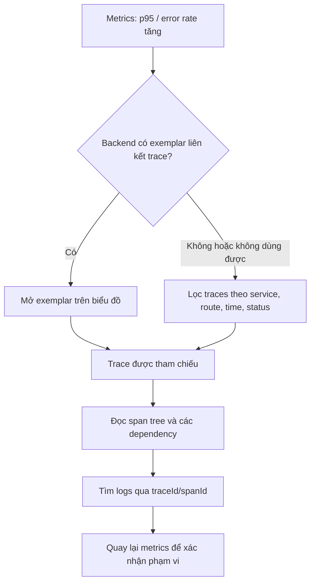
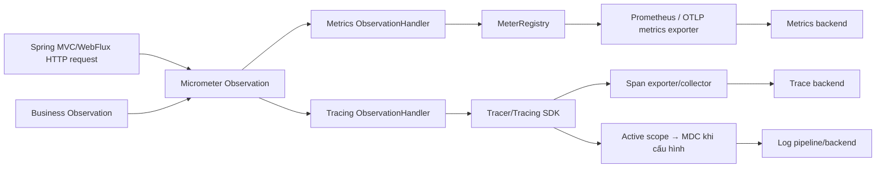
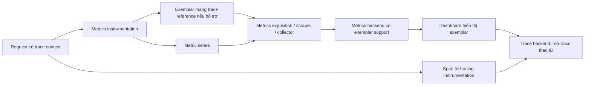
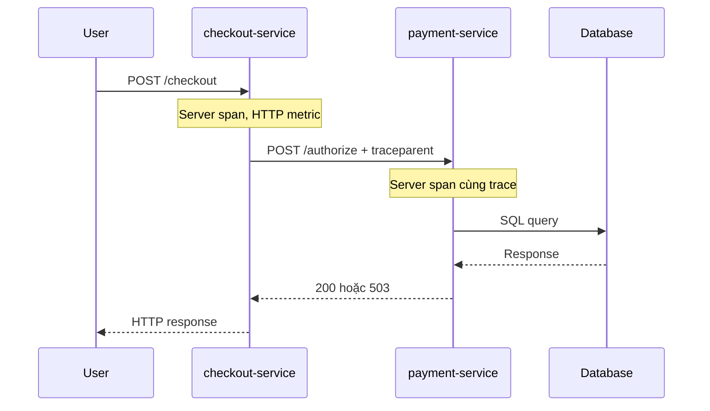

# Trace và metrics correlation trong Spring Boot

Khi dashboard cảnh báo **p95 latency của API checkout tăng**, người vận hành thường muốn mở ngay một distributed trace để biết thời gian bị mất ở controller, database hay payment gateway. Nhưng metrics là **dữ liệu tổng hợp** trên nhiều request, còn trace mô tả **một lần thực thi cụ thể**. Hai loại dữ liệu không tự nhiên có quan hệ một-một. Muốn đi từ biểu đồ tới một request chậm cần thiết kế cách **correlation**: tìm đúng service, route, thời gian và tags, hoặc dùng **exemplar** khi hệ thống hỗ trợ liên kết trực tiếp tới trace.

Bài **“Trace và metrics correlation”** thuộc chương **Tracing** của module **SPRING_BOOT_OBSERVABILITY**. Bài trình bày cách phối hợp Micrometer Observation, HTTP metrics, distributed tracing và logs trong Spring Boot; cách chọn low/high-cardinality metadata, sử dụng trace context và propagation, hiểu sampling/exporter, cùng quy trình điều tra lỗi và độ trễ ở môi trường thực.

**Điểm cốt lõi:** metric giúp phát hiện *hiện tượng và quy mô*; trace giúp giải thích *đường đi của một request cụ thể*. Correlation là cách tìm đúng những traces đại diện cho hiện tượng mà metric đã chỉ ra, **không phải** sao chép `traceId` vào mọi nhãn metric.

## 1. Vì sao metrics và traces bổ sung cho nhau?

Xét một API `POST /checkout` xử lý 10.000 request trong 5 phút. Trong đó 200 request trả HTTP 5xx, và một số request bị chậm do payment gateway.

Metrics có thể trả lời:

- Tổng số request, request/second và tỷ lệ HTTP 5xx là bao nhiêu?
- p95/p99 latency tăng ở endpoint nào?
- Sự cố chỉ xảy ra ở một service/region hay nhiều instance?
- Tỷ lệ lỗi có tăng trước hay sau đợt triển khai?

Traces có thể trả lời cho **một request được ghi nhận**:

- Span server bắt đầu ở đâu và kéo dài bao lâu?
- Lời gọi HTTP client đến `payment-service` hoặc database nằm ở đoạn nào?
- Có retry, timeout, exception hoặc child spans chồng nhau không?
- Các service có chia sẻ cùng trace ID và parent/child relationship không?

Logs bổ sung:

- Exception message đã được xử lý an toàn, mã lỗi nội bộ hoặc quyết định fallback.
- Ngữ cảnh ứng dụng tại một thời điểm.
- Các sự kiện liên quan có thể tìm bằng `traceId` hoặc business reference được phép.

| Tín hiệu | Đơn vị dữ liệu | Trọng tâm |
| --- | --- | --- |
| Metrics | Time series theo meter name và tags | Xu hướng, tỷ lệ, cảnh báo, SLO |
| Traces | Một trace gồm nhiều spans | Quan hệ nhân-quả và thời gian trên đường thực thi |
| Logs | Một sự kiện hoặc dòng log | Chi tiết hoạt động, ngoại lệ, quyết định ứng dụng |
| Audit/transaction records | Bản ghi nghiệp vụ có yêu cầu đầy đủ riêng | Tìm và kiểm toán giao dịch theo quyền |

Một trace chậm **không chứng minh** đa số request đều chậm. Một biểu đồ p95 tăng **không tự chỉ ra** request nào gây ra nó. Cần dùng đúng tín hiệu cho đúng câu hỏi.

## 2. Trace, span, metric và các định danh

Các khái niệm liên quan:

| Khái niệm | Mô tả | Ví dụ |
| --- | --- | --- |
| `traceId` | Định danh một trace phân tán; nhiều spans của cùng trace chia sẻ ID | `4bf92f3577b34da6a3ce929d0e0e4736` |
| `spanId` | Định danh một span cụ thể | `00f067aa0ba902b7` |
| Parent span | Span chứa hoặc gọi ra một phần công việc khác | HTTP server span gọi payment client span |
| Span name | Tên thao tác trong tracing | `POST /checkout`, `payment.authorize` |
| Span attributes | Metadata của span; có thể chi tiết, cần kiểm soát quyền riêng tư | `http.response.status_code=503` |
| Meter name | Tên phép đo | `http.server.requests` |
| Metric labels/tags | Chiều phân nhóm có số giá trị được quản lý | `method=POST`, `uri=/checkout`, `status=503` |
| Exemplar | Ví dụ một quan sát metric có thể mang tham chiếu trace | Trace ID liên quan tới một điểm/bucket đo |
| Service identity | Định danh nguồn ở metrics/traces/logs | `checkout-service` |

**Không nhầm `spanId` với `traceId`.** Mỗi span có ID riêng; toàn bộ các span liên quan trong một trace chia sẻ trace ID, nếu propagation đúng. Một request có thể có nhiều spans, hoặc span server và client ở nhiều dịch vụ.

**Không đồng nhất metric label với span attribute.** Một giá trị `user.id` có thể làm metric cardinality tăng rất mạnh, dù backend trace có thể cho phép các thuộc tính chi tiết hơn khi có chính sách phù hợp.

## 3. Hai mức độ correlation: gián tiếp và trực tiếp

Có hai cách thường dùng để tìm trace từ metric:

1. **Correlation gián tiếp theo ngữ cảnh:** xác định service, route, khoảng thời gian, environment, status và outcome ở metric; dùng những điều kiện đó để tìm traces đại diện trong trace backend.
2. **Correlation trực tiếp bằng exemplar:** một quan sát metric cụ thể được gắn tham chiếu trace/span, giúp giao diện biểu đồ mở trace nếu toàn bộ pipeline giữ thông tin liên kết.



Correlation gián tiếp **không đòi hỏi exemplars**, nên vẫn là kỹ năng cần thiết ngay cả khi backend có chức năng mở trace từ biểu đồ. Exemplar giúp tăng tốc bước chọn trace, nhưng không thay thế việc đối chiếu số liệu tổng hợp.

### Correlation gián tiếp: một ví dụ

Alert cho biết:

```text
Service: checkout-service
Environment: prod
Route: POST /checkout
Time window: 10:00–10:05 UTC
HTTP 5xx rate: tăng
p95 duration: tăng từ 0.2 s lên 2.1 s
```

Người vận hành chuyển sang trace backend, tìm traces của `checkout-service`, route checkout, thời điểm 10:00–10:05 và các span server chậm/lỗi. Nếu backend không cho tìm theo một thuộc tính cụ thể, có thể lọc bằng service + thời gian, rồi xem từng trace có liên quan.

Sau đó sử dụng `traceId` của trace tìm được để tra log. Đây là **tương quan có căn cứ theo phạm vi**, không phải một phép ánh xạ chính xác từ mỗi điểm metric thành một trace.

### Correlation trực tiếp: exemplar

Giả sử dashboard hiển thị một điểm latency cao và có exemplar tham chiếu:

```text
Metric series:
  http_server_requests_seconds_bucket
  application=checkout-service
  uri=/checkout

Exemplar (minh họa):
  observed_duration=2.06 s
  trace_id=4bf92f3577b34da6a3ce929d0e0e4736
```

Khi metric datasource giữ exemplar và trace backend còn giữ trace có ID này, dashboard có thể cung cấp thao tác “Open trace”.

**Không được giả định** chỉ cần bật Micrometer Tracing thì sẽ có exemplars. Đường sinh exemplar, định dạng exposition, scraper/collector, backend và UI đều phải hỗ trợ. Labels/field names gắn trace ID có thể khác nhau theo hệ thống.

## 4. Luồng quan sát trong Spring Boot

Micrometer Observation có thể là điểm instrument chung để sinh metrics và tracing:



Lưu ý trong sơ đồ: **một Observation có thể được xử lý bởi nhiều handler**, chứ không có nghĩa metrics handler tạo trace hoặc tracing handler tự quản lý Timer. Nếu registry không gắn handler tương ứng, một loại tín hiệu có thể không được tạo dù business code vẫn thực thi.

Ví dụ HTTP server instrumentation có thể ghi Timer `http.server.requests` với tags `method`, `uri`, `status` và các nhóm khác tùy convention. Tracing handler có thể tạo span server HTTP. Nếu request gọi HTTP client được instrument, span outbound có thể được nối đúng trace và propagate sang service kế tiếp.

Các metric tags không được tự động copy nguyên xi vào mọi span và ngược lại. Kết quả phụ thuộc Spring Boot/Spring Framework, Micrometer ObservationConvention, ObservationHandler và exporter đang chạy.

## 5. Ví dụ dùng Observation cho một bước nghiệp vụ

Giả sử `checkout-service` có một bước xử lý sau khi HTTP request đã vào controller. Ta muốn vừa có metrics tổng hợp của bước đó, vừa có span chi tiết khi tracing được bật.

Một service minh họa:

```java
import io.micrometer.observation.Observation;
import io.micrometer.observation.ObservationRegistry;
import org.springframework.stereotype.Service;

import java.util.function.Supplier;

@Service
public class CheckoutService {
    private final ObservationRegistry observationRegistry;

    public CheckoutService(ObservationRegistry observationRegistry) {
        this.observationRegistry = observationRegistry;
    }

    public <T> T process(String channel, Supplier<T> action) {
        String safeChannel = "web".equals(channel) ? "web" : "other";

        return Observation.createNotStarted(
                        "checkout.process", observationRegistry)
                .lowCardinalityKeyValue("checkout.channel", safeChannel)
                .observe(action::get);
    }
}
```

Controller gọi service:

```java
import org.springframework.web.bind.annotation.GetMapping;
import org.springframework.web.bind.annotation.RestController;

@RestController
public class CheckoutController {
    private final CheckoutService checkoutService;

    public CheckoutController(CheckoutService checkoutService) {
        this.checkoutService = checkoutService;
    }

    @GetMapping("/checkout")
    public String checkout() {
        return checkoutService.process(
                "web",
                () -> "approved"
        );
    }
}
```

Khi gọi `GET /checkout`:

- Spring HTTP instrumentation (nếu cấu hình) có thể tạo server Observation cho request.
- `CheckoutService.process` tạo một Observation nghiệp vụ tên `checkout.process`.
- Với **metrics handler** phù hợp, một Timer cho `checkout.process` có thể được ghi.
- Với **tracing handler** phù hợp và ngữ cảnh server đang hoạt động, span nghiệp vụ có thể xuất hiện bên trong trace của HTTP request.
- `checkout.channel=web` là low-cardinality key có số giá trị hữu hạn, phù hợp cho metric tag.
- Code không thêm user ID, request ID hoặc trace ID làm label; đó là điều kiện quan trọng để kiểm soát cardinality.

Đây là ví dụ minh họa API, không khẳng định mọi phiên bản Spring Boot mặc định bật đủ tất cả handler/tracer/exporter. Cần kiểm tra bằng dữ liệu thật của ứng dụng.

### Tránh duplicate instrumentation

Nếu cùng một method đã được auto-instrument và lại được bọc bởi một Observation thủ công với cùng mục đích, có thể tạo **metric/span trùng** hoặc gây hiểu sai khi cộng các nhóm đo. Nên chỉ rõ:

- HTTP server Observation đo toàn bộ request.
- `checkout.process` đo một bước nghiệp vụ.
- Metrics ở hai tầng có nghĩa khác nhau; không cộng Count của chúng như thể hai loại request độc lập.
- Nếu muốn đo retry, dùng metric nghiệp vụ đúng nghĩa “một lần retry”, không tự đếm request thêm lần nữa.

## 6. Thiết lập tối thiểu để có metrics và tracing

Ví dụ này mô tả cấu hình thường dùng trong một ứng dụng **Spring Boot 3.x**. Property names, starter và auto-configuration có thể khác theo phiên bản Spring Boot; cần đối chiếu phiên bản dự án khi triển khai.

Với Gradle Groovy:

```groovy
dependencies {
    implementation 'org.springframework.boot:spring-boot-starter-web'
    implementation 'org.springframework.boot:spring-boot-starter-actuator'

    runtimeOnly 'io.micrometer:micrometer-registry-prometheus'

    implementation 'io.micrometer:micrometer-tracing-bridge-otel'
    runtimeOnly 'io.opentelemetry:opentelemetry-exporter-otlp'
}
```

Cấu hình `application.yml` cho môi trường thử nghiệm:

```yaml
spring:
  application:
    name: checkout-service

management:
  endpoints:
    web:
      exposure:
        include: health,metrics,prometheus
  metrics:
    tags:
      application: checkout-service
      environment: test
    distribution:
      percentiles-histogram:
        http.server.requests: true
  tracing:
    sampling:
      probability: 1.0
  otlp:
    tracing:
      endpoint: http://localhost:4318/v1/traces
```

Giải thích:

- `micrometer-registry-prometheus` và `/actuator/prometheus` cung cấp đường **metrics** kiểu scrape, khi endpoint được expose và scraper truy cập được.
- Bridge Micrometer Tracing với OpenTelemetry cùng OTLP exporter cung cấp đường **traces** đến một receiver tương thích, ví dụ OpenTelemetry Collector.
- `management.tracing.sampling.probability: 1.0` được dùng ở **test** để dễ kiểm tra tracing; production cần sampling policy riêng theo tải, chi phí, tính đại diện và nhu cầu điều tra.
- `management.metrics.distribution.percentiles-histogram.http.server.requests` bật histogram cho HTTP Timer trong cấu hình hỗ trợ, giúp backend có thể tính p95/p99 từ buckets.
- Common metric tag `application=checkout-service` **không tự** tạo OpenTelemetry resource attribute `service.name`. Cần xác minh service name ở trace backend; cấu hình tương ứng tùy phiên bản và SDK.
- URL `localhost:4318` chỉ phù hợp nếu **ứng dụng nhìn thấy Collector tại cùng host**. Khi chạy trong container/Kubernetes, `localhost` thường trỏ vào chính container/pod chứ không phải Collector bên ngoài.

**Traces không đến backend chỉ vì đã thêm exporter dependency.** Collector/receiver, protocol, auth/TLS, route mạng và pipeline sang trace storage phải hoạt động. Tương tự, bật `/actuator/prometheus` không có nghĩa Prometheus đã scrape.

### Nếu muốn dùng một metrics pipeline khác

Spring Boot cũng có thể xuất metrics bằng OTLP thông qua registry tương ứng. Việc metrics đi bằng Prometheus scrape hay OTLP push **không quyết định** trace context có propagate được hay không. Tracing và metrics là các signal/pipeline riêng, dù có thể gặp nhau trong cùng bộ công cụ quan sát.

## 7. Service identity phải nhất quán

Một trở ngại phổ biến khi chuyển từ biểu đồ metric sang trace: dashboard metrics dùng `application=checkout-service`, còn trace backend hiển thị service `unknown_service` hoặc một tên khác.

| Tín hiệu | Metadata có thể dùng | Cần kiểm tra |
| --- | --- | --- |
| Metric | `application=checkout-service`, `environment=test` | Common tags ở MeterRegistry và labels sau exporter |
| Trace | `service.name=checkout-service` | Resource/service naming của tracer/SDK |
| Log | `service=checkout-service`, `traceId=...` | Logger JSON/pattern, MDC và pipeline logs |
| Exemplar | ID trace/span hoặc nhãn liên kết khác | Exposition, scraper, backend và datasource/UI |

Tên khóa giữa các signal **không nhất thiết giống nhau**, nhưng ý nghĩa và giá trị cần được liên kết bằng một quy ước nhất quán. Với hệ thống nhiều môi trường, không để metrics của `prod` trộn với traces từ `staging` do quy tắc định danh mơ hồ.

Một quy ước tối thiểu nên chốt:

1. Tên service ổn định giữa metrics, traces và logs.
2. Môi trường triển khai được quản lý tập trung.
3. Route được chuẩn hóa dưới dạng template thay vì raw path có ID.
4. Status/outcome có nghĩa thống nhất khi truy vấn.
5. Timezone và đồng bộ thời gian trên collector/backends chính xác.
6. Quyền truy cập và retention của từng signal được phê duyệt.

Dù cùng service name, **không có nghĩa** dữ liệu metric và trace tự ghép chính xác từng request nếu không có exemplar hoặc khóa liên kết phù hợp.

## 8. Low-cardinality tags và high-cardinality span attributes

Các hệ thống metrics cần số lượng chuỗi thời gian có thể kiểm soát. Một series thường được phân biệt bởi **tên metric cộng tổ hợp labels**; mỗi giá trị mới của tag có thể tạo series mới.

Ví dụ HTTP Timer với các chiều:

| Chiều | Số giá trị giả định |
| --- | ---: |
| `method` | 4 |
| `uri` (route template) | 20 |
| `status` | 6 |
| `application` | 3 |

Số tổ hợp có thể có theo phép nhân đơn giản:

\[
4 \times 20 \times 6 \times 3 = 1\,440
\]

Nếu thêm `traceId` với 100.000 giá trị, số tổ hợp giả định thành:

\[
1\,440 \times 100\,000 = 144\,000\,000
\]

Đây là **giới hạn tổ hợp lý thuyết**, không phải khẳng định tất cả series thực sự được tạo. Nhưng chỉ riêng khả năng tăng này đã đủ giải thích vì sao **không được đặt `traceId` thành metric label**.

### Metadata nên đặt ở đâu?

| Metadata | Metric label? | Span attribute? | Log field? |
| --- | --- | --- | --- |
| Route template như `/checkout` | Thường phù hợp | Thường phù hợp | Có thể phù hợp |
| HTTP method/status | Thường phù hợp | Thường phù hợp | Có thể phù hợp |
| `application`, `environment` | Common tags ổn định | Resource attributes tương ứng | Metadata log tương ứng |
| `traceId` | **Không** | Trace ID là thuộc tính nhận diện của trace, không phải tag metric | Phù hợp cho correlation khi có tracing |
| `spanId` | **Không** | Định danh span | Phù hợp khi log correlation hỗ trợ |
| `user.id`, `order.id` | **Không** | Chỉ cân nhắc với chính sách dữ liệu và nhu cầu rõ ràng | Chỉ nếu được phép và bảo vệ phù hợp |
| Raw URL/query string | Tránh | Cần lọc dữ liệu động/nhạy cảm | Cần lọc dữ liệu động/nhạy cảm |
| API key, access token, password | **Không** | **Không** | **Không** |

Micrometer Observation phân biệt:

```java
Observation observation = Observation.createNotStarted(
        "checkout.process", observationRegistry);

observation.lowCardinalityKeyValue("checkout.channel", "web");

// Chỉ nếu chính sách telemetry cho phép:
observation.highCardinalityKeyValue(
        "checkout.operation_ref", approvedSafeReference);
```

`approvedSafeReference` ở đây là một giá trị minh họa phải được ứng dụng kiểm soát. High-cardinality key có thể trở thành span attribute nếu tracing handler dùng nó. **Nó không tự động** thành log field, W3C baggage, HTTP header hay metric label.

Đừng coi mã băm hoặc opaque ID là vô danh theo mặc định. Một giá trị vẫn có thể liên kết với người dùng nếu tồn tại bảng ánh xạ, và việc lưu ở trace backend có thể mở rộng phạm vi tiếp cận dữ liệu.

## 9. Correlation theo route, thời gian và truy vấn PromQL

Một workflow thường bắt đầu từ HTTP server Timer. Trong một Prometheus exporter phổ biến, meter `http.server.requests` có thể có series:

```text
http_server_requests_seconds_count
http_server_requests_seconds_sum
http_server_requests_seconds_bucket  (nếu histogram được bật)
```

Tên thực tế phụ thuộc phiên bản, registry và naming convention. Hãy xem dữ liệu ở `/actuator/prometheus` hoặc backend trước khi dùng truy vấn.

### 9.1 Phát hiện số request lỗi theo route

```promql
sum by (uri) (
  rate(http_server_requests_seconds_count{
    application="checkout-service",
    status=~"5.."
  }[5m])
)
```

Đây là **tốc độ 5xx theo route**, không phải phần trăm lỗi. Muốn tỷ lệ:

```promql
sum by (uri) (
  rate(http_server_requests_seconds_count{
    application="checkout-service",
    status=~"5.."
  }[5m])
)
/
sum by (uri) (
  rate(http_server_requests_seconds_count{
    application="checkout-service"
  }[5m])
)
```

Khi mẫu số 0 hoặc dữ liệu thiếu, tỷ lệ không thể được đọc như một tỷ lệ bình thường; dashboard và alerts cần xử lý trường hợp đó. HTTP 5xx cũng không bao phủ mọi lỗi nghiệp vụ (ví dụ thanh toán bị từ chối hợp lệ).

### 9.2 Trung bình khác p95

Trung bình thời lượng HTTP:

```promql
sum(rate(http_server_requests_seconds_sum{
  application="checkout-service"
}[5m]))
/
sum(rate(http_server_requests_seconds_count{
  application="checkout-service"
}[5m]))
```

Đây là **mean**, không phải p95. Nếu histogram buckets thực sự được xuất:

```promql
histogram_quantile(
  0.95,
  sum by (uri, le) (
    rate(http_server_requests_seconds_bucket{
      application="checkout-service"
    }[5m])
  )
)
```

Histogram phải được cấu hình và có bucket series. Muốn p95 toàn service, gộp buckets theo `le` và các nhãn mong muốn **trước** khi tính quantile; không lấy trung bình p95 của từng instance.

### 9.3 Từ biểu đồ sang trace

Giả sử thấy `uri=/checkout` có p95 tăng ở khoảng 10:05. Trong trace backend, tìm traces có:

- Service = `checkout-service`.
- HTTP route hoặc span name đại diện cho checkout.
- Khoảng thời gian có sự cố (chú ý UTC/timezone).
- Duration cao, status lỗi hoặc thuộc tính cần thiết nếu backend hỗ trợ filter.

**Mục tiêu là chọn các traces đại diện**, không phải tìm đúng một trace tương ứng với toàn bộ p95. Phân vị đại diện cho phân phối; có thể có nhiều request trong tail latency, và không phải tất cả traces đều được sampling giữ.

## 10. Exemplars: đường dẫn trực tiếp từ điểm metric đến trace

**Exemplar** là một ví dụ quan sát cụ thể được liên kết với dữ liệu metric, thường mang thông tin tham chiếu trace/span. Trong các hệ thống hỗ trợ, exemplars có thể được gắn với histogram samples hoặc những phép đo được hỗ trợ khác.

Một pipeline tương quan có thể trông như sau:



Tùy phiên bản và registry, không phải request nào cũng tạo exemplar. Một exemplar có thể biểu diễn **một quan sát được lựa chọn**, không phải toàn bộ phân phối. Trace backend cũng có thể đã xóa trace hoặc sampler không giữ trace được tham chiếu.

### Những điều kiện phải có

| Tầng | Điều kiện kiểm tra |
| --- | --- |
| Ứng dụng | Tracing context thực sự hiện diện tại thời điểm đo; instrumentation/registry hỗ trợ exemplar |
| Metrics exporter | Có khả năng phát exemplar theo format/protocol hỗ trợ |
| Scraper/Collector | Có đọc và giữ exemplar, không drop thông tin liên kết |
| Metrics backend | Có lưu và truy vấn exemplars |
| Trace exporter/backend | Trace tương ứng được lưu và tìm được theo ID |
| Dashboard | Có cấu hình đường mở trace từ exemplar sang trace datasource |

Một tính năng exemplar chỉ “được hỗ trợ” trên tài liệu của một thành phần không bảo đảm các thành phần còn lại đã nối đúng.

### Prometheus exposition và định dạng

Trong hệ sinh thái Prometheus, exemplar có thể đi theo định dạng hỗ trợ exemplars (ví dụ OpenMetrics), nhưng hỗ trợ và negotiation thực tế tùy registry, client thư viện, phiên bản scraper và backend. **Không nên suy rằng một output Prometheus text thông thường luôn chứa exemplar**.

Khi kiểm thử, cần nhìn thấy exemplar được xuất thật, sau đó xác minh exemplar ở backend và đường mở trace. Nếu thấy metric mà không thấy exemplar, đó **không tự động** là lỗi instrument HTTP; có thể một tầng trong pipeline chưa hỗ trợ.

### Điều exemplar không giải quyết

- Không phải nguồn audit bảo đảm ghi nhận mọi giao dịch.
- Không thay thế đầy đủ search theo service/route/time.
- Không chứng minh tính đại diện thống kê của một trace.
- Không làm trace sampling biến mất; một trace liên quan có thể bị drop hoặc hết retention.
- Không cho phép bỏ qua chính sách bảo vệ dữ liệu khi gắn metadata vào trace/log.

## 11. Trace sampling và sai lệch khi đối chiếu metrics

Một hệ thống có thể giữ toàn bộ measurements metrics nhưng chỉ lưu một tỷ lệ traces. Hai luồng hoạt động theo chính sách khác nhau.

Giả sử trong 5 phút:

- Metric HTTP Timer ghi 10.000 request hoàn tất.
- Trace sampler giữ khoảng 10% traces theo một chính sách cụ thể.
- Trace backend có thể chỉ có một phần traces đã được phát, hoặc ít hơn nếu exporter/collector lỗi.

**Không được lấy 1.000 traces rồi suy từ chúng rằng hệ thống chỉ xử lý 1.000 request.** Tương tự, tỷ lệ lỗi trong sample traces có thể không bằng tỷ lệ lỗi thật, nhất là nếu sampling theo mức ưu tiên/đường lỗi hoặc có tail sampling.

| Trường hợp | Metrics | Trace backend | Cách diễn giải |
| --- | --- | --- | --- |
| Metrics handler chạy, trace bị sampling loại | Có thể có Timer/Counter | Không có trace tương ứng | Request có thể đã xảy ra và được đo |
| Trace được giữ, exporter metrics lỗi | Backend metrics có thể thiếu | Có trace | Hai pipeline lỗi độc lập |
| Head sampling theo tỷ lệ | Count metrics vẫn có thể ghi toàn request | Chỉ một phần traces | Tìm trace theo exemplar không phải lúc nào cũng thành công |
| Tail sampling | Collector quyết định giữ sau khi xem thông tin span | Có thể ưu tiên trace lỗi/chậm | Sample không đại diện ngẫu nhiên cho mọi request |
| Collector/backend hết retention trace | Metrics còn vì retention dài hơn | Trace đã hết hạn | Link exemplar có thể không mở được |
| Context propagation sai | Metrics các service có thể vẫn có | Spans rời rạc thành traces khác | Cần sửa propagation, không phải metric labels |

Có thể đặt sampling probability cao trong test để xác minh liên kết end-to-end, nhưng **không mặc định dùng 100% ở production**. Sampling của traces và cardinality của metrics phải được quản lý riêng.

## 12. Context propagation quyết định tính liên tục của trace

Để nhiều span của các dịch vụ tạo thành một trace, trace context phải được **inject** vào request outbound và **extract** ở service nhận. Với W3C Trace Context, một header minh họa:

```http
traceparent: 00-4bf92f3577b34da6a3ce929d0e0e4736-00f067aa0ba902b7-01
```

Header mang trace ID, parent span ID và trace flags theo chuẩn; nó không chứa thông tin metrics histogram, RPS hay user ID. Khi propagation đúng, server span ở `payment-service` có thể tiếp tục trace từ `checkout-service`.

Một sơ đồ đơn giản:



Ở đây các service có thể có HTTP server metrics riêng và một số client metrics. Các metrics đó đều có thể thể hiện độ trễ/lỗi nhưng **không tự chứng minh** hai request thuộc cùng một trace. Sự liên tục của trace phụ thuộc context propagation.

### Async, executor và message broker

Context có thể bị mất khi:

- Chuyển từ request thread sang executor hoặc `CompletableFuture` mà không có cơ chế propagation phù hợp.
- Tự tạo HTTP client bỏ qua instrumentation.
- Gửi message mà không inject/extract trace context.
- Mở scope không đúng cách rồi đóng quá sớm.
- Dùng logging MDC không phù hợp với context reactive/async.

Một hệ thống có thể vẫn ghi HTTP metrics bình thường ở hai service, nhưng trace bị **đứt thành nhiều trace IDs**. Việc thêm trace ID làm metric tag không sửa được propagation. Cần kiểm tra instrumentation, thread context và cách tạo client/message producer/consumer.

## 13. Logs là mắt xích thứ ba khi điều tra

Traces cho biết span và thời lượng, nhưng logs thường chứa chi tiết lỗi mà span không nên lưu toàn bộ, ví dụ retry policy hoặc exception category.

Ví dụ log có tương quan:

```text
2026-11-22T10:05:21.124Z ERROR
service=checkout-service
traceId=4bf92f3577b34da6a3ce929d0e0e4736
spanId=00f067aa0ba902b7
event=payment.gateway.timeout
message="Gateway did not respond within configured timeout"
```

Khi Micrometer Tracing hoạt động, tracer có thể đưa `traceId` và `spanId` vào MDC trong scope phù hợp. Muốn thấy những trường này ở log backend, cần thêm:

- Pattern/JSON encoder xuất MDC fields.
- Pipeline log giữ nguyên trường correlation.
- Thời gian, service identity và môi trường được nhất quán.
- Thread/async context đang hoạt động khi log được ghi.
- Chính sách masking và quyền truy cập phù hợp.

Nếu log có trace ID nhưng trace backend không có ID đó, có thể do sampler/exporter/retention; log không bảo đảm trace đã được lưu. Nếu trace có nhưng log thiếu ID, kiểm tra scope, MDC và logging pipeline; lỗi không nhất thiết ở MeterRegistry.

**Không đưa trace ID vào metric label để tra log.** Đó là metadata theo từng request và tạo cardinality rất cao. Dùng exemplar nếu hỗ trợ hoặc tìm trace theo thời gian/service rồi tra log bằng trace ID.

## 14. Một case study: p95 tăng nhưng trace không mở được

Một đợt deploy của `checkout-service` diễn ra lúc 10:00 UTC. Sau đó biểu đồ p95 của `POST /checkout` tăng từ 250 ms lên 2,2 giây, trong khi 5xx cũng tăng.

### Giai đoạn A — Xác nhận metric

Kiểm tra:

- Time range đúng và dữ liệu đủ mới.
- `application=checkout-service`, `environment=prod` và `uri=/checkout`.
- Histogram `_bucket` tồn tại và truy vấn p95 đúng.
- Traffic đủ để p95 có ý nghĩa; không dùng một vài samples để suy kết luận chung.
- Các tag mới không làm dashboard bỏ sót series sau deploy.

### Giai đoạn B — Thử exemplar

Dashboard có thể không hiển thị exemplar hoặc exemplar không mở được trace. Khi đó tách các khả năng:

1. Không có trace context tại thời điểm đo.
2. Exporter metrics không phát exemplar hoặc định dạng scrape không hỗ trợ.
3. Scraper/collector/backend không lưu exemplar.
4. Exemplar đã có nhưng trace bị sampling loại hoặc hết retention.
5. UI/datasource không được cấu hình để mở đúng trace backend.
6. Trace ID được lưu theo định dạng hoặc tenant khác so với query.

Nếu exemplar không hoạt động, **không nên dừng điều tra**. Chuyển sang tìm traces theo service, route, duration và time window.

### Giai đoạn C — Đọc trace còn lưu

Một trace chậm được tìm thấy:

```text
POST /checkout                    2,200 ms
  ├─ validateRequest                18 ms
  ├─ payment.authorize            2,110 ms
  │    └─ HTTP POST /authorize    2,080 ms
  └─ persistReceipt                 27 ms
```

Đây là cấu trúc minh họa. Các thời gian span con có thể chồng nhau, nên không cộng mọi span duration để suy chính xác duration của trace.

Trace gợi ý thời gian nằm chủ yếu ở `payment.authorize` và HTTP client call. Tiếp tục xem metrics và traces của `payment-service`, rồi đọc logs tương ứng để biết lỗi timeout, retry hoặc connection saturation.

### Giai đoạn D — Xác minh nguyên nhân trên toàn bộ traffic

Không kết luận hệ thống bị chậm chỉ vì một trace. Dùng metrics ở `payment-service` để xem timeout count, HTTP client duration, thread pool/connection pool và 5xx theo thời gian. Nếu sau deploy có nhiều request cùng biểu hiện, giả thuyết trở nên mạnh hơn.

Điểm mấu chốt: **metric định vị vấn đề, trace cung cấp giả thuyết, log bổ sung ngữ cảnh, metric xác nhận phạm vi**.

## 15. Các lỗi correlation phổ biến và cách khắc phục

| Biểu hiện | Nguyên nhân khả dĩ | Cách kiểm tra |
| --- | --- | --- |
| Có HTTP Timer nhưng không thấy trace | Thiếu tracing bridge/handler, sampling, exporter hoặc backend | Kiểm tra ObservationRegistry, tracer, sampler và OTLP pipeline |
| Có trace nhưng không thấy metric | Thiếu metrics handler/MeterRegistry, filter hoặc exporter | Xem Actuator metrics, registry và backend metrics |
| Metric có nhưng dashboard không mở được exemplar | Không có exemplar support hoặc UI/datasource mapping | Kiểm tra từ nguồn qua scraper đến backend và UI |
| Exemplar có trace ID nhưng mở không thấy trace | Trace bị sampling drop, đã hết retention, sai tenant/backend | Tìm trace ID trực tiếp, kiểm tra sampler/exporter |
| Metric service name khác trace service name | Common tags và resource attributes không thống nhất | Kiểm tra `application` so với `service.name` |
| Trace ở service A không nối với service B | Trace context không propagate qua HTTP/message/async | Kiểm tra headers, client instrumentation, scope |
| Log thiếu `traceId` dù span có | MDC/formatter/pipeline hoặc scope sai | Kiểm tra logging encoder, context và collector |
| RPS metric lớn hơn số traces nhiều lần | Sampling hoặc trace pipeline chưa thu đủ | So sánh sampling policy và export health |
| Rate lỗi theo traces khác HTTP 5xx rate | Sampling bias, định nghĩa lỗi khác nhau | Kiểm tra HTTP status, business errors và selection bias |
| p95 dashboard trông sai | Không có histogram hoặc aggregate sai | Kiểm tra `_bucket`, `le` và PromQL |
| Tăng mạnh active metric series | Raw URL, `user.id`, `traceId` làm labels | Kiểm tra low-cardinality tags/conventions |
| Spans xuất hiện hai lần | Auto và manual instrumentation chồng lấp | Kiểm tra các instrumentation tạo cùng span |

Bốn lỗi khác nhau dễ bị gọi chung là “không correlate được”:

1. **Thiếu dữ liệu metrics**: lỗi ở instrumentation/MeterRegistry/exporter.
2. **Thiếu dữ liệu traces**: lỗi ở tracer/sampling/span exporter.
3. **Dữ liệu có nhưng không cùng trace**: lỗi propagation/parent context.
4. **Cả hai dữ liệu có nhưng UI không liên kết**: lỗi exemplar/metadata/datasource.

Muốn sửa nhanh, hãy định vị đúng tầng trước khi thay đổi cấu hình.

## 16. Quy trình kiểm chứng end-to-end trong môi trường test

Một bài kiểm chứng đáng tin cậy nên đi qua **toàn bộ pipeline** và tạo một request có thể nhận diện.

### Bước 1 — Chuẩn bị môi trường

- Spring Boot Actuator và Micrometer Metrics có hoạt động.
- HTTP server instrumentation/metrics handler có mặt.
- Tracing bridge, tracer, OTLP span exporter và Collector/trace backend có hoạt động.
- Metrics backend hoặc Prometheus scraper nhận được data.
- Log pipeline có thể tìm theo `traceId`.
- Nếu thử exemplar, tất cả các thành phần liên quan có hỗ trợ.
- Sampling trong test được đặt đủ cao để dễ xác minh; tránh dùng dữ liệu người dùng thật.

### Bước 2 — Tạo traffic và lỗi giả lập

Gọi endpoint checkout vài lần, có ít nhất một request chậm hoặc lỗi được kiểm soát. Không phát tải cao vào môi trường dùng chung chỉ để tạo p95.

```bash
curl -i http://localhost:8080/checkout
curl -sS http://localhost:8080/actuator/metrics
curl -sS http://localhost:8080/actuator/metrics/http.server.requests
```

Nếu có Prometheus registry:

```bash
curl -sS http://localhost:8080/actuator/prometheus
```

Kết quả cần quan sát: có meter tên `http.server.requests`, các tags phù hợp và series ở exporter. Tên chính xác tại backend có thể khác tên Micrometer sau normalization.

### Bước 3 — Xác minh metrics

Tính request rate, 5xx rate và p95 (chỉ khi histogram có buckets). Kiểm tra các tags `uri` là route template, không chứa ID riêng lẻ. So sánh `application`/`environment` ở runtime và backend.

### Bước 4 — Xác minh traces

Trong trace backend, tìm một trace mới của `GET /checkout`. Kiểm tra server span và custom `checkout.process` span khi handler được cấu hình. Nếu trace không đến, tách nguyên nhân sampler, exporter, Collector hoặc instrument.

### Bước 5 — Xác minh propagation

Nếu ứng dụng còn gọi service B, kiểm tra trace ID được tiếp tục qua HTTP headers/propagator và spans nằm trong **cùng trace**. Với async work, kiểm tra context sau khi đổi thread.

### Bước 6 — Xác minh log correlation

Từ trace lấy `traceId`, tìm log của request. Nếu thiếu, kiểm tra MDC, pattern/encoder, sampling/retention và log pipeline.

### Bước 7 — Kiểm tra exemplar riêng

Nếu môi trường hỗ trợ exemplar:

1. Tìm một điểm/bucket metric có exemplar.
2. Xác định trường liên kết trace ID thực tế.
3. Mở trace qua UI hoặc tìm trực tiếp trong trace backend.
4. Ghi nhận tỉ lệ liên kết thành công, các trường hợp sampling/retention và giới hạn của tính năng.

Không đánh dấu toàn bộ observability thất bại chỉ vì exemplar không sẵn có; correlation gián tiếp vẫn có thể hoạt động.

### Bước 8 — Kết luận dựa trên bằng chứng

Tài liệu kiểm thử nên ghi lại:

| Kiểm tra | PASS khi |
| --- | --- |
| Runtime meter | Có metric tương ứng sau khi request hoàn tất |
| Backend metric | Truy vấn được series với labels và đơn vị đúng |
| Tracing | Có spans của request được sampling giữ |
| Cross-service context | Spans ở các service cùng trace ID |
| Log correlation | Có thể tìm log bằng trace ID khi được cấu hình |
| Exemplar (tùy chọn) | Mở được trace ID liên quan từ metric |
| Data hygiene | Không có `user.id` hoặc `traceId` trong metric labels |
| Incident workflow | Từ alert đi được tới giả thuyết và kiểm chứng bằng nhiều tín hiệu |

## 17. Những nhận định dễ gây nhầm lẫn

| Nhận định | Vì sao không đúng hoàn toàn |
| --- | --- |
| “Có metric thì chắc chắn có trace” | Metrics handler và tracing handler/exporter là các thành phần khác nhau |
| “Cùng tên `http.server.requests` và `POST /checkout` là cùng một event” | Một metric là phép tổng hợp; span là một lần thực thi |
| “Chỉ cần thêm `traceId` làm tag sẽ có correlation” | Có thể tạo cardinality rất cao; không cần cho metrics aggregate |
| “Exemplar có ở mọi data point” | Exemplars được chọn và phụ thuộc support/pipeline |
| “Sampling trace 10% làm metric count chỉ còn 10%” | Metrics thường được ghi độc lập với trace sampling |
| “Một trace lỗi cho biết tỷ lệ lỗi toàn service” | Trace sample không tự đại diện thống kê |
| “Common metric tag tự tạo resource attribute trong tracing” | Phải bảo đảm metadata giữa hai pipeline nhất quán |
| “Span duration cộng lại bằng HTTP request duration” | Spans có thể lồng nhau hoặc chạy song song |
| “Log có trace ID chứng minh trace backend có trace” | Sampler/exporter/retention vẫn có thể loại trace |
| “Không thấy exemplar nghĩa là không có tracing” | Exemplar pipeline và tracing pipeline là hai việc riêng |
| “Chỉ cần HTTP server instrumentation là đủ qua nhiều service” | Client/message/async context propagation cũng phải đúng |
| “High-cardinality span attribute luôn an toàn” | Vẫn phải kiểm soát quyền riêng tư, retention và chi phí |

## 18. Câu hỏi tự kiểm tra

1. Metric có mối quan hệ một-một với trace không? Vì sao?
2. Correlation gián tiếp theo service/route/time khác correlation trực tiếp bằng exemplar thế nào?
3. Vì sao `traceId` không nên đặt vào metric label?
4. Cùng một Observation có thể tạo Timer và span thông qua cơ chế nào?
5. Nếu metric HTTP Count tăng nhưng trace backend không có trace tương ứng, cần kiểm tra gì?
6. Một trace có nhiều spans, chúng chia sẻ định danh nào và khác nhau ở định danh nào?
7. Vì sao cần thống nhất `application` ở metrics với `service.name` ở tracing?
8. Nếu histogram bucket không tồn tại, có thể suy p95 chính xác từ Count/Sum không?
9. Exemplar cần những điều kiện nào từ ứng dụng đến dashboard?
10. Sampling 10% traces ảnh hưởng thế nào đến khả năng mở trace từ metric?
11. Một request qua executor bị mất MDC thì có chắc metrics cũng bị mất không?
12. Vì sao không thể lấy số traces lỗi chia tổng traces để thay thế HTTP 5xx SLI khi sampling có thiên lệch?
13. Nếu service A và B đều có HTTP metrics nhưng traces rời nhau, cần xem tầng nào?
14. Làm thế nào phân biệt lỗi dữ liệu ở exporter với lỗi UI liên kết exemplar?
15. Khi đã tìm được trace chậm, làm cách nào xác nhận nguyên nhân có ảnh hưởng tới nhiều request?

## Kết luận

**Trace và metrics correlation** là cầu nối giữa số liệu tổng hợp và đường thực thi cụ thể. Với Spring Boot, Micrometer Observation có thể cung cấp một nguồn instrumentation thống nhất cho metrics và tracing, nhưng các signal đi qua handler, registry, exporter và backend riêng. Correlation có thể thực hiện **gián tiếp** bằng service, route, thời gian và tags, hoặc **trực tiếp** qua exemplar khi hệ thống hỗ trợ từ đầu đến cuối.

Để điều tra đáng tin cậy, hãy giữ metric labels ở mức low cardinality, cấu hình service identity nhất quán, bảo đảm trace context propagation, hiểu sampling và kiểm tra log correlation. Bắt đầu từ metric để xác định quy mô và thời điểm, dùng trace để thấy dependency chậm/lỗi, đọc logs để hiểu chi tiết, rồi trở lại metrics để kiểm chứng giả thuyết trên toàn bộ traffic.

