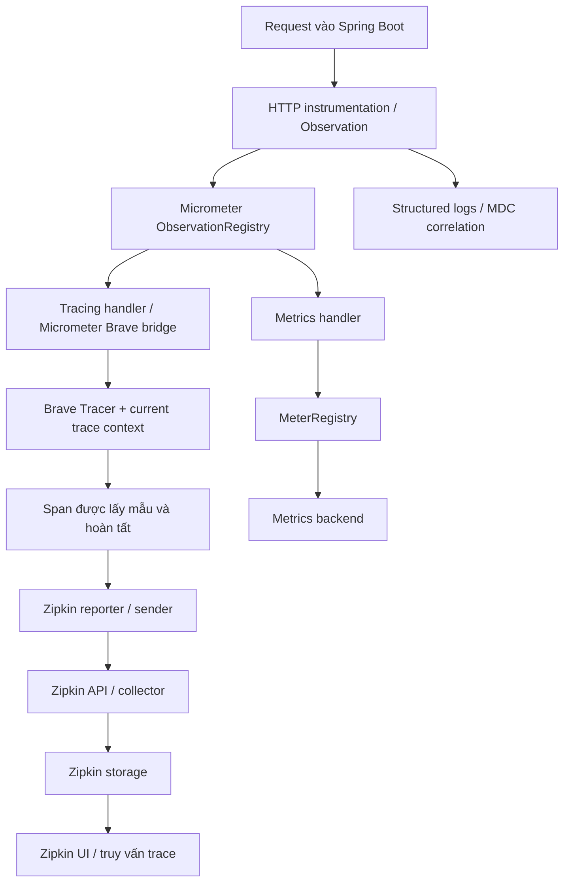
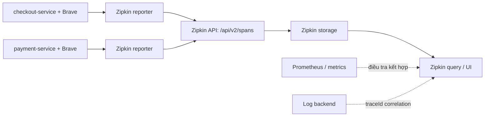

# OpenZipkin Brave với Zipkin trong Spring Boot

Một ứng dụng Spring Boot nhận `POST /checkout`, gọi dịch vụ thanh toán rồi chờ phản hồi từ cổng thanh toán bên ngoài. Metrics cho biết p95 latency tăng, logs có thông báo timeout nhưng không cho biết chính xác **request nào đi qua những service nào và mất thời gian ở đâu**. Distributed tracing giải quyết một phần khoảng trống đó bằng cách ghép các **span** thành một **trace** liên tục.

Trong hệ sinh thái OpenZipkin, **Brave** là thư viện tạo và quản lý span/context trong ứng dụng Java; **Zipkin** là hệ thống thu thập, lưu trữ và truy vấn traces. Khi dùng Spring Boot với Micrometer Tracing, **Brave bridge** nối abstraction của Micrometer với implementation Brave, còn **Zipkin reporter** gửi spans đã ghi sang Zipkin backend. Những thành phần này có nhiệm vụ khác nhau: không thể chỉ thêm Brave là có ngay trace trong giao diện Zipkin.

Bài học thuộc chương **Tracer implementation** của module **SPRING_BOOT_OBSERVABILITY**. Module hướng dẫn thiết lập observability cho Spring Boot bằng Micrometer Observation, metrics, logs và distributed tracing, đồng thời học context propagation, tag/cardinality, exporter, sampling và cách liên kết tín hiệu điều tra lỗi, độ trễ, hành vi ứng dụng trên môi trường thực. Trọng tâm ở đây là triển khai và vận hành **OpenZipkin Brave với Zipkin**, từ mã nguồn Spring Boot đến đường đi thực tế của span.

## Mục tiêu học tập

Sau bài này, bạn có thể:

1. Phân biệt **Brave**, **Micrometer Tracing**, **Brave bridge**, **Zipkin reporter**, **Zipkin server** và tracing backend.
2. Mô tả trace ID, span ID, quan hệ parent-child, span kind và sự khác biệt giữa **propagation** với **export**.
3. Cấu hình một ứng dụng Spring Boot dùng Brave bridge và Zipkin reporter theo mô hình Spring Boot 3.x.
4. Tạo observation/span nghiệp vụ có tên ổn định và hiểu cách nó trở thành một span trên Zipkin khi hệ thống được kết nối đầy đủ.
5. Giữ trace liên tục qua HTTP client/server và nhận diện vấn đề B3/W3C propagation, thread-local context hoặc asynchronous execution.
6. Giải thích sampling, reporter batching, giới hạn Zipkin backend, cardinality và bảo vệ dữ liệu nhạy cảm.
7. Kiểm tra một trace xuyên hai service, đọc timing và tìm nguyên nhân khi Zipkin không thấy span hoặc span bị đứt.
8. Biết khi nào nên dùng Brave–Zipkin, khi nào cần cân nhắc OTLP/OpenTelemetry hoặc collector phù hợp với kiến trúc tổ chức.

## 1. Những thành phần trong hệ OpenZipkin

Tên “OpenZipkin Brave với Zipkin” đôi khi bị hiểu là một thư viện duy nhất. Thực tế, một luồng tracing Java thường có nhiều thành phần:

| Thành phần | Vai trò | Không làm thay |
|---|---|---|
| **Brave** | Tracer implementation trong Java: tạo/quản lý spans, scope và propagation context | Không phải giao diện tìm kiếm hoặc cơ sở dữ liệu trace |
| **Micrometer Tracing** | API abstraction cho tracer/span, độc lập với một implementation cụ thể | Không tự cung cấp kho lưu trữ trace |
| **`micrometer-tracing-bridge-brave`** | Cầu nối Micrometer Tracing API tới Brave | Không tự thay Zipkin reporter hoặc backend |
| **Zipkin reporter** | Đóng gói và gửi spans tới nơi nhận theo cấu hình, thường theo lô | Không quyết định đầy đủ span nào cần tạo hoặc tất cả quy tắc sampling |
| **Zipkin server** | Nhận spans, lưu/truy vấn traces và cung cấp UI/API | Không tự instrument Spring Boot |
| **Micrometer Observation** | Điều phối lifecycle một thao tác; handler có thể biến observation thành metric/span | Không bắt buộc mỗi observation sẽ được export thành span |
| **Metrics/log pipelines** | Lưu các phép đo tổng hợp và sự kiện | Không được thay thế hoàn toàn bởi trace timeline |

Brave là một implementation của mô hình tracing, còn Zipkin là backend/thu thập. Một tổ chức có thể dùng Brave để tạo spans nhưng gửi qua collector hoặc hệ thống hỗ trợ định dạng phù hợp khác; đồng thời có thể đưa spans của nhiều tracer implementation vào Zipkin khi giao thức được hỗ trợ.

### Phân tách trách nhiệm bằng sơ đồ



**Điểm cần nhớ:** không phải tất cả spans được tạo sẽ được lưu. Sampler có thể không ghi span cần export; reporter/exporter có thể lỗi; collector/backend có thể không giữ hoặc không cho truy vấn dữ liệu đã gửi.

## 2. Một trace trong Brave trông như thế nào?

Giả sử request checkout có một trace ID chung và các span tương ứng những bước quan trọng:

```text
Trace ID: 0af7651916cd43dd8448eb211c80319c

checkout-service
  HTTP POST /checkout                [span A, server]
    validate cart                     [span B, internal]
    POST payment-service /authorize   [span C, client]

payment-service
  HTTP POST /authorize                [span D, server; child của C]
    call external payment gateway    [span E, client]
```

Tùy instrumentation, một thao tác outbound có client span ở service gọi và server span ở service nhận. Các spans chia sẻ trace ID nhưng mỗi span có **span ID riêng**. Parent span ID giúp nối các bước thành cây.

Một span thường mang:

- Tên nghiệp vụ hoặc tên operation tương đối ổn định.
- Mốc bắt đầu, kết thúc và thời lượng.
- Trace ID, span ID, parent ID nếu có.
- Vai trò `CLIENT`, `SERVER`, `INTERNAL` hoặc các kind khác.
- Attributes/tags như `http.request.method`, route template, trạng thái hoặc loại đối tác.
- Events/error/status theo semantic conventions và implementation.
- Span links nếu workflow cần quan hệ khác parent-child.

**Trace hoàn chỉnh trên UI chỉ hoàn chỉnh đối với những spans đã instrument và được giữ lại**. Một DB call không được instrument sẽ là khoảng trống trên timeline; một request bị sampling bỏ không xuất hiện dù ứng dụng vẫn thực thi đúng.

### 2.1. Span ID khác trace ID

Trong mô hình tương thích Zipkin/W3C:

```text
traceId = 0af7651916cd43dd8448eb211c80319c
spanId  = b7ad6b7169203331
```

Trace ID định danh cả hành trình; span ID định danh một bước. Không dùng trace ID làm metric label vì gần như mỗi request tạo một giá trị khác nhau, gây cardinality cao. Không dùng span ID làm ID giao dịch nghiệp vụ hoặc bí mật xác thực.

Brave có thể làm việc với các trace ID có độ dài khác nhau tùy cấu hình và format. Khi kết nối nhiều dịch vụ, cần thống nhất **propagator**, cách tạo/nhận trace ID và tương thích của gateway trước khi suy ra rằng trace context sẽ tự nối chính xác.

### 2.2. Span được đóng đúng lúc mới có duration đáng tin

Span đo một đoạn thực thi. Nếu bắt đầu trước lời gọi HTTP nhưng kết thúc ngay khi đưa tác vụ vào queue, duration chỉ đo thời gian enqueue. Nó không đại diện cho xử lý trong consumer.

Ngược lại, nếu quên đóng span hoặc scope, ngữ cảnh có thể bị giữ sai và span chưa được reporter nhận ở thời điểm mong đợi. Một span kết thúc đúng không có nghĩa data đã xuất tới Zipkin: reporter có thể xử lý bất đồng bộ sau đó.

## 3. Spring Boot kết nối Observation, Brave và Zipkin như thế nào?

Trong Spring Boot 3.x, **Micrometer Observation** thường là lớp API dùng để instrument thao tác. **Micrometer Tracing** là API tracing chung; bridge Brave biến API đó thành các thao tác trên Brave. Spring Boot có khả năng auto-configuration khi classpath và cấu hình phù hợp.

Luồng tiêu biểu:

1. Spring Boot nhận HTTP request và instrumentation tạo observation cho request.
2. Observation start/open scope; tracing handler/bridge tương tác với Brave để tạo hoặc đặt span hiện hành.
3. Nếu ứng dụng tạo observation nghiệp vụ lồng trong scope hiện hành, có thể xuất hiện child span.
4. Khi HTTP client được instrument, trace context được inject vào header outbound.
5. Service downstream extract context, tạo server span liên kết với parent nếu propagation tương thích.
6. Khi các spans kết thúc, reporter được cấu hình gửi chúng tới Zipkin.
7. Zipkin nhận và lưu những spans đã đến; UI truy vấn theo service, thời gian, duration hoặc trace ID.

**Không nên tự khai báo một `ObservationRegistry` mới rồi mặc định nó kế thừa toàn bộ tracing handlers.** Registry do Spring Boot quản lý thường là lựa chọn an toàn cho code nghiệp vụ; nếu tách registry, phải wiring rõ các handlers và context.

### Những thứ không tự xuất hiện chỉ vì có dependency

- Không có exporter/reporter đúng → traces có thể không đến Zipkin.
- Không có HTTP client instrumentation → có thể không inject trace headers.
- Không có propagation qua executor/message → child span có thể trở thành root mới.
- Không có log correlation → logs không tự có trace ID/span ID.
- Không bật metrics histogram → Zipkin vẫn có spans nhưng biểu đồ p95 từ metrics có thể không có.
- Backend thiếu kết nối/retention → request hoạt động nhưng UI trống.

Đây là các lớp cấu hình độc lập, cần kiểm tra từng lớp.

## 4. Cấu hình dependency Spring Boot + Brave bridge + Zipkin reporter

Ví dụ Gradle dành cho một stack **Spring Boot 3.x sử dụng Micrometer Tracing với Brave**:

```groovy
dependencies {
    implementation 'org.springframework.boot:spring-boot-starter-actuator'
    implementation 'io.micrometer:micrometer-tracing-bridge-brave'
    runtimeOnly 'io.zipkin.reporter2:zipkin-reporter-brave'
}
```

Trong cấu hình này:

- `spring-boot-starter-actuator` tích hợp khả năng observability/metrics và management của Boot.
- `micrometer-tracing-bridge-brave` cung cấp bridge để Micrometer tracing dùng Brave.
- `zipkin-reporter-brave` hỗ trợ reporting spans theo kiểu phù hợp với hệ Brave–Zipkin.

Cấu hình auto-configuration và dependency chính xác còn phụ thuộc **phiên bản Spring Boot, Micrometer, Brave và Zipkin reporter**. Boot quản lý versions qua BOM khi dùng cấu hình dependency management tương ứng. Không nên gán version tùy ý nếu stack đã có BOM thống nhất.

**Không trộn hai bridge cùng lúc** (`micrometer-tracing-bridge-brave` và `micrometer-tracing-bridge-otel`) chỉ để “có nhiều khả năng export”: điều đó có thể làm cấu hình tracer mơ hồ hoặc tạo pipeline trùng. Chọn implementation chủ đạo của ứng dụng và kết nối exporter/collector phù hợp.

### 4.1. Cấu hình Zipkin endpoint

Ví dụ cho môi trường local/lab, khi Zipkin server lắng nghe tại cổng 9411:

```yaml
spring:
  application:
    name: checkout-service

management:
  tracing:
    sampling:
      probability: 1.0
  zipkin:
    tracing:
      endpoint: http://localhost:9411/api/v2/spans
```

Giải thích:

- `spring.application.name` là một nguồn để stack xác định tên service trong telemetry. Cần kiểm tra tên thực hiển thị tại Zipkin.
- `management.tracing.sampling.probability: 1.0` phù hợp cho **lab với lưu lượng nhỏ**, giúp dễ quan sát trace. Không dùng mặc định trên production nhiều traffic.
- `management.zipkin.tracing.endpoint` chỉ ra Zipkin ingestion API phù hợp với pipeline. Đây **không** phải URL của UI.
- `localhost` trong process ứng dụng nghĩa là **chính network namespace của ứng dụng**. Khi ứng dụng chạy trong container/pod còn Zipkin ở nơi khác, `localhost:9411` có thể sai.

Với production, endpoint, scheme HTTPS, xác thực, route mạng, proxy và exporter phải theo kiến trúc thật. Hãy xác nhận tên properties và cơ chế auto-configuration theo phiên bản Boot đang dùng; ví dụ này không thay thế cho việc kiểm tra cấu hình sau startup.

### 4.2. Zipkin local để học

Một cách thường dùng cho môi trường thực hành là chạy Zipkin bằng container:

```bash
docker run --rm --name zipkin-lab -p 9411:9411 openzipkin/zipkin
```

Trên môi trường local thích hợp, giao diện Zipkin thường có thể truy cập qua `http://localhost:9411/zipkin/` hoặc trang chủ trên cổng 9411, còn API ingestion dùng đường `/api/v2/spans`.

Đây là ví dụ **lab**, không phải hướng dẫn mở Zipkin trực tiếp ra Internet. Image tag/version, storage backend và UI path có thể khác khi triển khai. Trong production cần pin version, kiểm soát ingress và persistence; bộ lưu trữ mặc định của một container thực hành có thể không giữ dữ liệu sau restart.

### 4.3. Hai ứng dụng trên hai host/container

Ví dụ:

```text
checkout-service    :8080
payment-service     :8081
zipkin              :9411

checkout-service  -->  payment-service
       |                       |
       +------ reporter -------+
                  |
               Zipkin API
```

Mỗi service phải cấu hình **địa chỉ Zipkin mà service đó thực sự truy cập được**, không phải một chuỗi `localhost` sao chép máy móc. Tên service cần khác nhau để UI phân biệt nguồn spans; sampling và propagation phải tương thích giữa chúng.

## 5. Tạo trace HTTP xuyên hai Spring Boot services

Để có trace xuyên service, cần instrument cả phía client lẫn phía server. Với Spring Boot 3.x/Spring Framework 6, một `RestClient.Builder` được **Spring Boot cung cấp và tùy biến** có thể tích hợp observation khi các dependency/configuration phù hợp.

### 5.1. Client được tạo từ builder Spring quản lý

Ví dụ trong `checkout-service`:

```java
import org.springframework.context.annotation.Bean;
import org.springframework.context.annotation.Configuration;
import org.springframework.web.client.RestClient;

@Configuration(proxyBeanMethods = false)
class PaymentHttpClientConfiguration {

    @Bean
    RestClient paymentRestClient(RestClient.Builder builder) {
        return builder
                .baseUrl("http://localhost:8081")
                .build();
    }
}
```

Trong production, hostname và scheme phải lấy từ service discovery/cấu hình, thay vì hard-code `localhost`. Mục tiêu ở ví dụ này là nhấn mạnh **builder do Spring quản lý**. Nếu bạn gọi `RestClient.create()` hoặc tự xây HTTP client bên ngoài những customizer/instrumentation của Boot, trace headers **có thể không được inject** dù server span đã tồn tại.

### 5.2. Observation nghiệp vụ bao quanh lời gọi

```java
import io.micrometer.observation.Observation;
import io.micrometer.observation.ObservationRegistry;
import org.springframework.stereotype.Service;
import org.springframework.web.client.RestClient;

@Service
class CheckoutPaymentService {

    private final RestClient paymentRestClient;
    private final ObservationRegistry observationRegistry;

    CheckoutPaymentService(
            RestClient paymentRestClient,
            ObservationRegistry observationRegistry) {
        this.paymentRestClient = paymentRestClient;
        this.observationRegistry = observationRegistry;
    }

    String authorize() {
        return Observation.createNotStarted(
                        "checkout.payment.authorize", observationRegistry)
                .contextualName("authorize payment")
                .lowCardinalityKeyValue("operation", "authorize")
                .lowCardinalityKeyValue("dependency", "payment-service")
                .observe(() ->
                        paymentRestClient
                                .post()
                                .uri("/authorize")
                                .retrieve()
                                .body(String.class)
                );
    }
}
```

Vì callback chạy **đồng bộ**, `observe(...)` quản lý lifecycle trong phạm vi lời gọi. HTTP client instrumentation có thể tạo thêm client span nằm trong span nghiệp vụ; payment-service nhận trace context sẽ tạo server span cùng trace nếu được instrument.

Một controller minh họa có thể gọi service trên:

```java
import org.springframework.web.bind.annotation.PostMapping;
import org.springframework.web.bind.annotation.RestController;

@RestController
class CheckoutController {
    private final CheckoutPaymentService service;

    CheckoutController(CheckoutPaymentService service) {
        this.service = service;
    }

    @PostMapping("/checkout")
    String checkout() {
        return service.authorize();
    }
}
```

### 5.3. Server downstream

Ví dụ trong `payment-service`, chạy riêng ở cổng 8081:

```java
import org.springframework.web.bind.annotation.PostMapping;
import org.springframework.web.bind.annotation.RestController;

@RestController
class PaymentController {
    @PostMapping("/authorize")
    String authorize() {
        return "approved";
    }
}
```

Đây là demo **không có xác thực, kiểm tra business rules hoặc cổng thanh toán thật**. Nó chỉ minh họa luồng HTTP và trace propagation. Khi cấu hình tracing đúng, Zipkin có thể nhận được các spans gần như:

```text
checkout-service
  POST /checkout                 (SERVER)
    checkout.payment.authorize   (INTERNAL)
      POST /authorize            (CLIENT)

payment-service
  POST /authorize                (SERVER)
```

Tập spans thực tế, tên, kind và parent-child phụ thuộc framework/instrumentation/bridge. Không dùng danh sách này như một hợp đồng chính xác về số spans.

### 5.4. Kiểm chứng

Một chuỗi thao tác trong lab:

1. Khởi động Zipkin với API ingestion có thể truy cập.
2. Khởi động `payment-service` với tên service và cấu hình reporter riêng.
3. Khởi động `checkout-service` sử dụng builder HTTP client đã instrument.
4. Gửi một request kiểm thử tới `POST /checkout`.
5. Mở Zipkin UI, chọn service và khoảng thời gian phù hợp, tìm trace chứa request.
6. Xác nhận các spans của cả checkout và payment có **cùng trace ID** nhưng span ID riêng.
7. Kiểm tra duration, parent-child, lỗi và một vài logs có traceId/spanId nếu correlation được cấu hình.
8. Nếu không thấy trace, kiểm tra sampling, reporter, API endpoint, network và propagation trước khi thay đổi mã nghiệp vụ.

Không thấy đủ bốn spans như minh họa không đồng nghĩa không có trace; phải xem các tầng nào thực sự được instrument.

## 6. Brave propagation: B3 và W3C Trace Context

**Propagation** là việc truyền trace context sang một tác vụ hoặc service tiếp theo. Nó khác với **reporting**, vốn gửi dữ liệu của span hoàn thành tới Zipkin.

Brave có nguồn gốc mạnh trong hệ sinh thái Zipkin, nơi **B3 propagation** được sử dụng rộng rãi. Nhiều hệ thống hiện nay cũng dùng **W3C Trace Context**. Điều quan trọng không phải chọn “định dạng nào tuyệt đối tốt hơn” mà là **các hop có cùng khả năng inject/extract**.

### 6.1. B3

B3 có dạng nhiều headers, ví dụ:

```http
X-B3-TraceId: 0af7651916cd43dd8448eb211c80319c
X-B3-SpanId: b7ad6b7169203331
X-B3-Sampled: 1
```

Cũng có dạng **single header** `b3`. Tùy lựa chọn, client và server phải tương thích với B3 single/multi. Một proxy hoặc security gateway có thể loại những header không nằm trong allowlist; điều đó làm trace tiếp tục thành trace root mới ở downstream.

### 6.2. W3C Trace Context

Ví dụ:

```http
traceparent: 00-0af7651916cd43dd8448eb211c80319c-b7ad6b7169203331-01
```

Một số hệ thống còn sử dụng `tracestate`. `traceparent` truyền thông tin về trace ID, parent ID và flags; nó không phải mã xác thực. Nhận header từ client bên ngoài phải xử lý như **dữ liệu không đáng tin** và áp dụng chính sách trust boundary phù hợp.

### 6.3. Cấu hình propagator theo phiên bản

Các bản Spring Boot/Micrometer khác nhau có extension point và properties để chọn loại propagation. Với một số bản Spring Boot 3.x, có thể chọn B3 thông qua cấu hình kiểu:

```yaml
management:
  tracing:
    propagation:
      type: b3
```

**Cần xác minh property và các giá trị enum được hỗ trợ trong phiên bản cụ thể**, đặc biệt khi cần B3 multi-header, W3C hoặc kết hợp nhiều format. Không sao chép cấu hình từ stack OpenTelemetry sang Brave mà không kiểm thử.

Bài kiểm tra bắt buộc là gửi một HTTP request thật, quan sát **headers outbound** ở nơi có quyền kiểm tra, rồi xác nhận server downstream **extract được cùng trace ID**. Bật một property trên một service chưa đủ nếu service khác không nhận định dạng đó.

### 6.4. Một trace bị đứt thường biểu hiện ra sao?

```text
Checkout tracer:
  traceId = A, client span = C

Payment tracer:
  traceId = B, server span = D  <-- trace ID mới
```

Nguyên nhân thường gặp: client không inject, gateway không forward, server không extract, cấu hình propagator lệch, hoặc context hiện hành bị mất trước khi gửi request. **Zipkin reporter vẫn có thể hoạt động tốt ở cả hai service** nhưng UI hiển thị hai trace rời rạc.

## 7. Context trong thread, Reactor và logging MDC

Brave có khái niệm current trace context gắn với scope thực thi. Trong lập trình servlet đồng bộ, framework có thể mở scope khi xử lý request và khôi phục khi request kết thúc.

Nhưng trong ứng dụng hiện đại, công việc thường chuyển qua:

- `@Async` và `TaskExecutor`.
- `CompletableFuture` hoặc raw `ExecutorService`.
- Spring WebFlux/Reactor `Mono` và `Flux`.
- Kafka/RabbitMQ hoặc message queue khác.
- Scheduler và background jobs.

**Không giả định thread-local context tự đi qua mọi ranh giới**. Nếu task chạy trong một thread khác không có capture/restore, span mới có thể không có parent như mong đợi, còn `traceId`/`spanId` trong log có thể trống.

### 7.1. Observation scope trong đồng bộ

```java
Observation observation =
        Observation.createNotStarted(
                "checkout.payment.verify", observationRegistry).start();

try (Observation.Scope scope = observation.openScope()) {
    verifyPayment();
} catch (RuntimeException error) {
    observation.error(error);
    throw error;
} finally {
    observation.stop();
}
```

Trong ví dụ này, `verifyPayment()` là phương thức nghiệp vụ giả định. Scope giúp observation trở thành current trong phạm vi phù hợp, và đóng scope khôi phục context trước đó. Không dùng cùng một `Scope` xuyên thread mà không có cơ chế propagation rõ ràng.

### 7.2. Async không kết thúc khi trả về Future

Ví dụ dễ sai:

```java
return Observation.createNotStarted(
        "batch.payment.process", registry)
    .observe(() -> executor.submit(() -> processPayment()));
```

`observe(...)` phía ngoài chỉ bao quanh thời gian **submit task**, không tự đo thời gian `processPayment()` thực sự chạy. Một span được tạo ở thread gọi cũng có thể kết thúc trước khi task hoàn tất.

Cần dùng instrumentation/task decorator/context propagation phù hợp với executor hoặc xử lý lifecycle observation trong callback thực thi thật. Với Reactor, phải xét subscription và signal lifecycle; mở scope khi tạo publisher không đồng nghĩa scope được duy trì khi publisher được subscribe.

### 7.3. MDC và log correlation

Trong stack Brave–Micrometer được cấu hình phù hợp, thông tin trace/span hiện hành có thể được đưa vào **MDC** để logging pattern in `traceId` và `spanId`. Ví dụ log dạng:

```text
2026-11-22T10:15:01 INFO [checkout-service,traceId=0af7651916cd43dd8448eb211c80319c,spanId=b7ad6b7169203331] Sending payment authorization
```

Đây là ví dụ format; Spring Boot/logback có thể dùng pattern khác. Quan trọng:

1. Có trace context hiện hành tại **thời điểm ghi log**.
2. Logging stack đã cấu hình correlation phù hợp.
3. Scope được đóng đúng lúc để tránh trace ID của request cũ xuất hiện trong log request mới.
4. Không lấy log có trace ID làm bằng chứng chắc chắn span đã được Zipkin lưu; sampling/reporting có thể khác.

Khi mất log correlation ở `@Async` hoặc queue consumer, kiểm tra context propagation trước khi tự nhét trace ID vào mọi log message theo cách thủ công.

## 8. Tạo span trực tiếp bằng Micrometer Tracer khi nào?

Với phần lớn thao tác nghiệp vụ trong Spring Boot, **Micrometer Observation** là điểm instrument phù hợp vì cùng lifecycle có thể phục vụ cả metrics và tracing. Tuy nhiên, khi cần điều khiển span trực tiếp (ví dụ một sự kiện chỉ phục vụ tracing), có thể dùng `io.micrometer.tracing.Tracer`.

Ví dụ:

```java
import io.micrometer.tracing.Span;
import io.micrometer.tracing.Tracer;
import org.springframework.stereotype.Service;

@Service
class ManualTracingService {
    private final Tracer tracer;

    ManualTracingService(Tracer tracer) {
        this.tracer = tracer;
    }

    void verifyPartner() {
        Span span = tracer.nextSpan()
                .name("partner.verify")
                .start();

        try (Tracer.SpanInScope scope = tracer.withSpan(span)) {
            callPartner();
        } catch (RuntimeException ex) {
            span.error(ex);
            throw ex;
        } finally {
            span.end();
        }
    }

    private void callPartner() {
        // Thao tác thực tế được thực hiện ở đây.
    }
}
```

`SpanInScope` thể hiện việc span trở thành current trong scope đồng bộ và được khôi phục khi đóng. `span.end()` kết thúc span. Scope và span lifecycle **là hai chuyện khác nhau**; đóng scope không thay `end()`.

Hạn chế của mẫu này:

- Chỉ đo callback **đồng bộ**.
- Thao tác không tự tạo metric nghiệp vụ; muốn count/latency cần meter/observation phù hợp.
- Nếu gọi bên trong một HTTP server span đã có, sẽ tạo thêm span; chỉ nên làm khi ranh giới thao tác có giá trị điều tra.
- Cần bảo đảm bridge Brave và reporter/exporter được cấu hình; nếu không, tạo span trực tiếp không bảo đảm nó xuất hiện tại Zipkin.
- Tránh **instrument trùng** cùng một thao tác bằng Observation và Tracer theo hai code paths không kiểm soát.

### Error và status là thông tin cần nhất quán

Ghi `span.error(ex)` hoặc `observation.error(ex)` giúp tracing handler có thêm bằng chứng khi exception phát sinh. Nhưng business outcome có thể khác exception: payment decline hợp lệ không nhất thiết là lỗi hệ thống; một timeout được retry thành công có thể có span lỗi ở lần thử đầu nhưng giao dịch cuối thành công.

Không dùng count các spans mang error status để thay thế trực tiếp SLI tỷ lệ request lỗi. Dùng metric có mẫu số request/giao dịch rõ và trace/log để phân tích nguyên nhân.

## 9. Sampling trong Brave và dữ liệu được báo cáo tới Zipkin

Việc bật tracing với xác suất 100% trong lab làm dễ quan sát nhưng có thể gây chi phí rất cao trong production. Hãy phân biệt:

- **Tạo trace context:** phục vụ định danh và quan hệ request.
- **Recording/sampling:** quyết định spans nào thực sự được ghi hoặc có khả năng export.
- **Reporting:** gửi dữ liệu span đã hoàn tất từ ứng dụng tới Zipkin endpoint.
- **Ingestion/storage:** Zipkin nhận, lưu và cho phép tìm kiếm spans.

### 9.1. Head-based sampling

Brave thường được cấu hình cùng cơ chế lấy mẫu tại thời điểm sớm của trace. `management.tracing.sampling.probability` là ví dụ thuộc tính Spring Boot có thể ảnh hưởng tỷ lệ chọn trace, tùy cách auto-configuration tracer được thiết lập.

Ví dụ:

```yaml
management:
  tracing:
    sampling:
      probability: 0.10
```

Với luồng request đủ lớn và chính sách sampling tương thích, tỷ lệ 10% giúp giảm volume traces, nhưng:

- Một lỗi hiếm có thể không được giữ lại.
- Không được giả định chính xác 10 trong mỗi 100 request cụ thể sẽ có trace.
- Tập trace được giữ không tự đại diện cho toàn bộ traffic nếu còn filtering/drop hoặc sampling có thiên lệch.
- Metrics HTTP vẫn có thể đo tất cả request đã instrument, bất kể tracer sampling.

### 9.2. Parent-based sampling và inbound context

Một dịch vụ nhận request có thể kế thừa hoặc ảnh hưởng bởi quyết định sampling được truyền từ upstream. Cơ chế cụ thể phụ thuộc Brave sampler và propagation flags.

Một header `X-B3-Sampled: 1` hoặc sampled flag trong `traceparent` là thông tin context, **không chứng minh span chắc chắn được export, ingestion hoặc lưu**. Không sử dụng sampled flag như chứng cứ production backend đã có đủ trace.

### 9.3. Tail sampling cần pipeline phù hợp

Muốn ưu tiên giữ trace chậm và lỗi **sau khi biết kết quả**, thường cần giải pháp collector/pipeline có tail sampling, bộ đệm và quyền truy cập đầy đủ spans trước khi ra quyết định. **Zipkin server đơn lẻ không tự biến `management.tracing.sampling.probability` thành tail sampler**.

Nếu ứng dụng Brave đã head-sample bỏ spans thì downstream collector không thể khôi phục dữ liệu không được gửi. Cần thiết kế sampling end-to-end, đặc biệt ở nơi thu thập nhiều service.

### 9.4. Reporter batching và delayed visibility

Reporter thường gửi spans bất đồng bộ theo lô để tránh thực hiện network request trên mỗi span. Hệ quả:

- Span kết thúc không nhất thiết xuất hiện tức thời ở Zipkin UI.
- Khi ứng dụng tắt đột ngột hoặc queue đầy, một phần span chưa gửi có thể bị mất.
- Cần giám sát lỗi reporter, queue, retry và áp lực network phù hợp với thư viện thực tế.
- Trong test ngắn hạn, phải phân biệt **không có span** với **span đang chờ reporter/collector xử lý**.

Không dựa vào thời gian đến UI để đo duration nghiệp vụ. Span duration được xác định bởi instrumentation trong ứng dụng, không phải thời điểm backend nhận bản ghi.

## 10. Zipkin server, storage và vận hành production

Zipkin server đóng vai trò endpoint nhận spans và hệ truy vấn. Nó cần được vận hành như một thành phần dữ liệu quan sát:

- **Mạng:** application/reporter phải kết nối được ingestion API; UI và API chỉ dành cho người hoặc hệ thống được cấp quyền.
- **Storage:** mô hình lưu trữ local lab có thể không đảm bảo persistence; production cần lựa chọn backend storage thích hợp với volume và retention.
- **Giới hạn:** kích thước request, số spans/trace, rate, queues và tài nguyên backend cần được quan sát.
- **Tính sẵn sàng:** failure của Zipkin ingestion không nên làm sập logic checkout, nhưng có thể khiến mất trace; ứng dụng phải có chiến lược retry/buffering an toàn theo reporter.
- **Bảo mật:** TLS, authentication, secret management và network segmentation theo trust boundary.
- **Quản lý dữ liệu:** traces có thể chứa tên service, route, lỗi và attributes; cần privacy review, retention, quyền truy vấn và quy tắc redaction.

Không nên coi Zipkin là kho chứa dữ liệu tài chính/khách hàng. Các business IDs có thể hữu ích để đối chiếu nhưng phải đáp ứng chính sách dữ liệu. **Không đưa token, số thẻ, thông tin xác thực hay request body nhạy cảm vào span tags/events/baggage.**

### 10.1. Dòng kết nối lab và production



Sơ đồ chỉ thể hiện tracing trực tiếp tới Zipkin. Một số production stack đưa collector/proxy vào giữa, hoặc chọn exporter/tracing implementation khác; khi đó route, auth và sampling có thể khác.

### 10.2. Không nhầm Zipkin API với UI

- Ingestion endpoint thường có dạng `http://zipkin-host:9411/api/v2/spans`.
- UI có thể được phục vụ tại trang chủ hoặc `/zipkin/` tùy image/version/reverse proxy.
- Tracer/Zipkin reporter cần **ingestion URL**, không phải URL của trang tìm kiếm trace.

Một lỗi phổ biến là cấu hình reporter gửi HTTP POST đến UI path: kết nối network có thể thành công về mặt TCP nhưng backend trả 404/405, và không có span được lưu.

## 11. Cardinality, sampling và liên kết traces với metrics/logs

Tracing và metrics khác nhau về mô hình dữ liệu. Với metrics, mỗi tổ hợp labels có thể tạo một time series; với traces, mỗi span là một bản ghi và trace ID/span ID vốn là duy nhất cao. Điều đó **không cho phép lạm dụng metadata**.

| Dữ liệu | Nên đặt ở đâu? | Lưu ý |
|---|---|---|
| `service.name`, environment | Resource/service metadata ổn định | Dùng nhất quán giữa signals nếu stack hỗ trợ |
| HTTP route mẫu `/orders/{id}` | Span attributes và metric tags thích hợp | Không dùng raw URL chứa mã đơn hàng |
| `payment.provider=provider-a` | Span attribute và metric low-cardinality tag | Tập giá trị hữu hạn |
| Trace ID | Span/trace context, log correlation, exemplar khi hỗ trợ | Không đưa làm metric label thông thường |
| Request correlation ID riêng | Có thể ở một span/log phù hợp nếu được phép | Cardinality cao, retention/rights/index cần kiểm soát |
| Authorization header, token, số thẻ | Không thu thập | Dữ liệu bí mật/nhạy cảm |

Micrometer Observation phân biệt `lowCardinalityKeyValue(...)` và `highCardinalityKeyValue(...)`. Tracing handler có thể sử dụng cả hai theo implementation; metrics handlers thường chỉ nên dùng low-cardinality keys. Tuy vậy, tên gọi “high-cardinality” **không phải bộ lọc bảo mật** và không đảm bảo dữ liệu luôn nằm ở backend tracing.

### Ba tín hiệu trong một tình huống

1. **Metrics:** p95 của `POST /checkout` tăng và tỷ lệ 5xx vượt mục tiêu.
2. **Logs:** thấy `payment gateway timeout` với traceId/spanId.
3. **Traces trong Zipkin:** một số request lỗi có span `payment client` kéo dài so với các bước khác.

Traces cho thấy đường thực thi của **mẫu đã lưu**, metrics cho thấy quy mô tổng thể, logs cung cấp diễn biến lỗi. Để kết luận lỗi hệ thống, cần so sánh request mẫu/chưa lỗi và kiểm tra dependency; **không lấy tỷ lệ spans ERROR trên trace được lấy mẫu làm tỷ lệ lỗi của toàn bộ request**.

## 12. Chẩn đoán: có Brave nhưng Zipkin không thấy traces

Một quy trình hiệu quả là kiểm tra từ ứng dụng ra backend theo từng lớp, không đổi đồng thời năm loại cấu hình.

| Hiện tượng | Nguyên nhân có thể | Điểm kiểm tra đầu tiên |
|---|---|---|
| Không có span nào trong Zipkin | Dependency reporter/endpoint/sampling chưa đúng | Tracer bridge, reporter bean, Zipkin API URL |
| Zipkin thấy checkout nhưng không thấy payment | Payment thiếu instrumentation hoặc không export được | Tracing dependencies/config của payment, reporter errors |
| Hai service hiện thành hai trace khác nhau | Propagation B3/W3C lệch, HTTP client không instrument | Header outbound/inbound, RestClient.Builder, gateway/proxy |
| Trace có server span nhưng thiếu operation nghiệp vụ | Code không tạo observation/span, registry khác handler | ObservationRegistry được inject và tracing handler |
| Log có traceId nhưng UI không thấy trace | Sampling hoặc export/storage lỗi | Sampling probability, reporter, collector, retention |
| Zipkin UI không tìm ra service | Service name khác, time window không khớp, spans chưa tới | `spring.application.name`, search window, ingestion |
| Spans bị thiếu lúc pod restart | Reporter batching chưa flush hoặc queue/drop | Shutdown lifecycle, reporter metrics/logs, resource limit |
| Một span rất ngắn dù công việc chậm | Span kết thúc khi enqueue async | Đặt lifecycle tại callback/consumer đúng |
| Span dư thừa hoặc lặp | Hai lớp instrumentation cùng đo phạm vi | Sơ đồ spans, filter/annotation/manual instrumentation |
| UI hiển thị thông tin nhạy cảm | Attributes hoặc baggage không được kiểm soát | Code/semantic conventions/redaction/routing |

### Bước 1 — Phân biệt “không tạo span” và “không export span”

Nếu logs/telemetry cho thấy scope đang có trace ID nhưng Zipkin không có dữ liệu, kiểm tra reporter/sampling/backend. Nếu span nghiệp vụ không xuất hiện trong bất kỳ trace nào nhưng HTTP span có, kiểm tra observation instrumentation và handler.

### Bước 2 — Kiểm tra ingestion URL từ từng service

`localhost` là nơi rất dễ sai. Trong Docker, `localhost:9411` của checkout container trỏ tới checkout container, không phải Zipkin container. Trong Kubernetes, dùng tên Service và port phù hợp mạng cluster, cùng ingress policy hoặc sidecar/proxy khi cần.

Kiểm tra endpoint bằng đường truy cập được cấp quyền; không tắt TLS/authentication ở production chỉ để thử.

### Bước 3 — Kiểm tra sampling trước khi tăng lượng test

Với probability 0.10, request kiểm thử có thể không được sample. Trong lab lưu lượng nhỏ, có thể dùng 1.0 để xác minh pipeline, rồi đưa về chính sách vận hành có ngân sách phù hợp. Nếu vẫn không có span với sampling được bật đúng, lỗi có thể nằm ở reporter hoặc bridge.

### Bước 4 — Kiểm tra HTTP propagation và context

Một client không được instrument hoặc async context bị mất có thể tạo root trace mới ở downstream. Bật đúng propagator ở cả hai phía và kiểm tra cùng trace ID trong headers/logs/tracing UI.

### Bước 5 — Kiểm tra pipeline và storage

Reporter đã gửi HTTP thành công chưa? Ingestion API có nhận? Storage có còn dữ liệu? UI đang tìm đúng tên service, khoảng thời gian và bộ lọc không?

**Điểm cuối:** chỉ báo cáo “tracing hoạt động” khi có một trace kiểm thử đi qua ít nhất hai service được liên kết, và kiểm tra một số spans/name/timing đúng như mong đợi.

## 13. Tình huống thực tế: cùng request nhưng hai trace ID

Giả sử một hệ thống dùng `checkout-service` và `payment-service`. Sau khi thay một HTTP client cũ bằng code khởi tạo `RestClient` thủ công:

- Metrics của `POST /checkout` vẫn ghi duration 1,8 giây.
- Logs ở checkout có trace ID `A`.
- Logs ở payment có trace ID `B`.
- Zipkin UI có hai trace riêng, một cho checkout và một cho payment.
- Cả hai service vẫn gửi spans tới Zipkin thành công.

### Phân tích có trình tự

**Bước 1 — Kiểm tra không phải lỗi exporter.** Vì Zipkin đã thấy spans của cả hai service, pipeline báo cáo cơ bản đang chạy. Không nên “sửa” bằng cách tăng sampling hoặc đổi Zipkin storage ngay.

**Bước 2 — Kiểm tra HTTP client.** Code có dùng builder đã được Spring Boot tùy biến để tích hợp observation hay không? Nếu tự khởi tạo client và bỏ qua instrumentation, outbound context có thể không được inject.

**Bước 3 — Đọc header có kiểm soát.** Nếu client không gửi B3/W3C header phù hợp hoặc gateway lọc header, payment không thể biết trace cha. Chỉ kiểm tra trong môi trường được phép, không log toàn bộ headers production vì có thể chứa secrets.

**Bước 4 — Kiểm tra propagator.** Nếu checkout gửi B3 còn payment chỉ extract W3C, cùng một request có thể tạo root mới. Đồng bộ cấu hình hai đầu hoặc dùng bridge/propagator được hỗ trợ, sau đó kiểm tra lại trên đường đi thực.

**Bước 5 — Kiểm tra async boundary.** Nếu việc gọi payment được đưa vào executor, phải capture/restore context. Không thể chỉ mở scope ở HTTP thread và kỳ vọng nó tự sang mọi thread.

**Bước 6 — Thử lại.** Gửi request mới, xác nhận HTTP client/server spans thuộc cùng trace ID, các parent-child hợp lý và logs của hai service có correlation.

**Kết luận:** lỗi ở **context propagation/instrumentation**, không phải việc Zipkin không thể lưu spans. Phân biệt được **trace creation**, **propagation** và **export** giúp sửa đúng nguyên nhân mà không tăng chi phí tracing vô ích.

## 14. Những anti-pattern cần tránh

| Anti-pattern | Vì sao sai? | Cách làm phù hợp |
|---|---|---|
| Cho rằng Brave chính là Zipkin UI | Lẫn tracer với backend | Phân biệt bridge, tracer, reporter và Zipkin server |
| Chỉ thêm Brave dependency rồi chờ spans lên UI | Thiếu reporter/endpoint hoặc auto-configuration | Kiểm tra đầy đủ pipeline |
| Dùng `localhost:9411` trong mọi container | Trỏ sai network namespace | Dùng hostname/service discovery thực tế |
| Gửi reporter POST vào đường UI thay `/api/v2/spans` | API trả lỗi, spans không được ingest | Cấu hình đúng ingestion endpoint |
| Trộn Brave và OpenTelemetry bridge không có thiết kế | Có thể trùng/mơ hồ tracer | Chọn một implementation chủ đạo |
| Dùng client tự tạo, bỏ qua Spring instrumentation | Không inject trace headers | Dùng builder/extension point đã instrument |
| Coi B3/W3C tự tương thích trên mọi hop | Trace ID đứt giữa service | Chọn/test propagator nhất quán |
| Giữ scope mở qua thread khác | Rò rỉ/sai current context | Capture/restore bằng cơ chế propagation phù hợp |
| Đóng span khi vừa submit task async | Duration không phản ánh công việc | Gắn lifecycle vào task thực thi |
| Mặc định sampling 100% trên production lớn | Tăng chi phí và tải exporter/backend | Chính sách sampling theo lưu lượng và mục tiêu |
| Tưởng sampling tăng là giải được mọi missing trace | Có thể lỗi network/queue/propagation | Chẩn đoán từng lớp trước |
| Gắn `userId`/`traceId` vào metric labels | Cardinality cao | Trace/log correlation và exemplar nếu có |
| Đưa token/PII vào span tags hoặc baggage | Rủi ro rò rỉ dữ liệu | Allowlist, redaction, phân quyền và retention |
| Coi một span CLIENT dài là CPU server chậm | Thời gian client gồm network/chờ | Đối chiếu server span, logs và metrics dependency |

## 15. Checklist đưa Brave–Zipkin vào production

Trước khi coi hệ tracing đã sẵn sàng, hãy xác minh:

1. **Implementation:** ứng dụng đang dùng Micrometer Tracing với **Brave bridge**, không lẫn với bridge/tracer khác ngoài ý muốn.
2. **Reporter:** Zipkin reporter/exporter có mặt, được Spring Boot cấu hình đúng và có telemetry về lỗi gửi khi có sự cố.
3. **Endpoint:** mỗi service truy cập được Zipkin ingestion URL đúng, không nhầm với UI hoặc `localhost` trong container.
4. **Tên service:** backend phân biệt được từng service và environment; không tạo tên động theo request.
5. **Instrumentation:** có server span, client span và spans nghiệp vụ quan trọng nhưng tránh instrument trùng.
6. **Propagation:** B3/W3C nhất quán qua HTTP, proxy, gateway, messaging và async context.
7. **Scope:** span được start/end đúng thời điểm, scope được đóng khôi phục context, không rò rỉ MDC.
8. **Sampling:** có ngân sách theo traffic, biết hệ quả của head/tail/parent sampling và xác minh tỷ lệ trace thực tế.
9. **Exporter/backend:** có TLS/auth, timeout/retry, giới hạn queues, monitoring drop, storage persistence và retention.
10. **Privacy/cardinality:** span name ổn định; không có token/PII trong tags, events, baggage, không dùng ID từng request làm metric label.
11. **Logs:** log correlation có traceId/spanId khi cần và không bị lẫn giữa các request/thread.
12. **Metrics:** HTTP latency/error rate/throughput độc lập với sampling, có khả năng lượng hóa sự cố ngay cả khi một trace không được giữ.
13. **Cross-service:** trace kiểm thử qua hai service có cùng trace ID, span parent-child/links phù hợp.
14. **Tính sẵn sàng:** khi Zipkin/reporting lỗi, nghiệp vụ vẫn vận hành theo chính sách được thiết kế và nhóm vận hành nhận biết mất telemetry.
15. **Thay đổi:** nâng cấp Boot/Micrometer/Brave/Zipkin có kiểm thử dependency, propagator, tên span/tag và reporter endpoint.

## 16. Câu hỏi tự đánh giá

**Câu 1.** Brave và Zipkin có vai trò gì khác nhau?

**Gợi ý:** Brave tạo/quản lý span và trace context trong ứng dụng Java; Zipkin nhận, lưu và cho tìm kiếm traces. Cần reporter/transport phù hợp giữa chúng.

**Câu 2.** Một ứng dụng có `ObservationRegistry` nhưng Zipkin không thấy span. Có kết luận Bridge Brave bị lỗi không?

**Gợi ý:** Chưa. Cần kiểm tra tracing handler, bridge, instrumentation, sampling, reporter, ingestion endpoint, storage và khoảng thời gian query. ObservationRegistry không tự đảm bảo export.

**Câu 3.** Checkout và payment đều gửi spans tới Zipkin nhưng trace ID khác nhau. Thường nên kiểm tra lớp nào trước?

**Gợi ý:** HTTP instrumentation, inject/extract propagation B3/W3C và async context. Hai pipeline reporter hoạt động không có nghĩa context đã nối.

**Câu 4.** `traceparent` hoặc B3 sampled flag có phải bằng chứng rằng Zipkin đã lưu trace?

**Gợi ý:** Không. Chúng truyền context/quyết định sampling qua network; spans có thể chưa được ghi, bị drop hoặc chưa export/ingest.

**Câu 5.** Tại sao không nên giữ `management.tracing.sampling.probability: 1.0` trên production lưu lượng lớn mà không đánh giá?

**Gợi ý:** Trace volume, queue, network và storage có thể tăng nhanh. Nên thiết kế sampling theo khả năng hệ thống và nhu cầu điều tra.

**Câu 6.** Một method trả về `CompletableFuture` rất nhanh nhưng tác vụ chạy thêm 5 giây. Bao quanh method bằng `observe(...)` đồng bộ có đo đủ 5 giây không?

**Gợi ý:** Không mặc nhiên. `observe(...)` có thể kết thúc khi Future được trả về; cần gắn lifecycle observation/span với quá trình xử lý bất đồng bộ thật.

**Câu 7.** Vì sao log có trace ID mà tracing UI không tìm được trace tương ứng?

**Gợi ý:** Log correlation và export spans là hai đường khác nhau. Kiểm tra sampling, reporter, collector, retention và quyền truy vấn.

**Câu 8.** Brave dùng B3, còn downstream chỉ extract W3C. Những lựa chọn hợp lý là gì?

**Gợi ý:** Đồng bộ propagator hoặc dùng cơ chế tương thích được hỗ trợ ở hai đầu, kiểm thử headers thật và quan hệ trace ID; không giải quyết bằng cách chỉ đổi Zipkin UI.

## Kết luận

**OpenZipkin Brave với Zipkin là một pipeline tracing gồm tracer trong ứng dụng, bridge/instrumentation, context propagation, reporter và backend lưu trữ**. Brave giúp tạo spans có trace context; Zipkin giúp thu thập và đọc hành trình đã được instrument. Trong Spring Boot, Micrometer Observation kết nối tự nhiên với Brave bridge khi được cấu hình đúng, nhưng phải bảo đảm HTTP client/server, B3/W3C propagation, async scope, sampling và reporter đều hoạt động. Một trace hữu ích không chỉ “có mặt trên UI” mà còn có tên ổn định, spans liên kết đúng, metadata an toàn và khả năng đối chiếu với metrics/logs để điều tra sự cố. Hãy kiểm tra từng lớp bằng request thật và giữ chi phí, privacy, độ tin cậy của pipeline ở mức có thể vận hành lâu dài.
