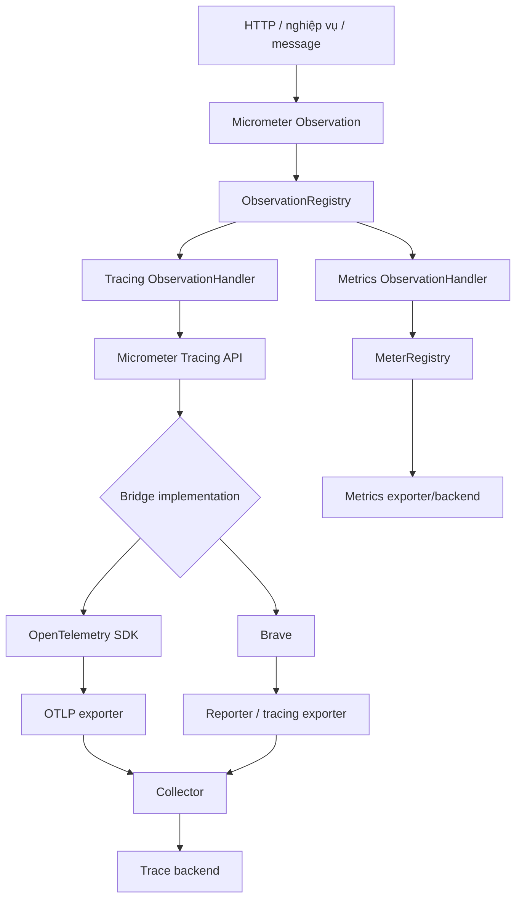
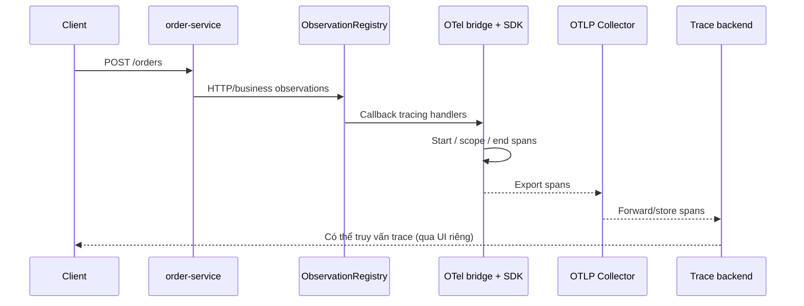
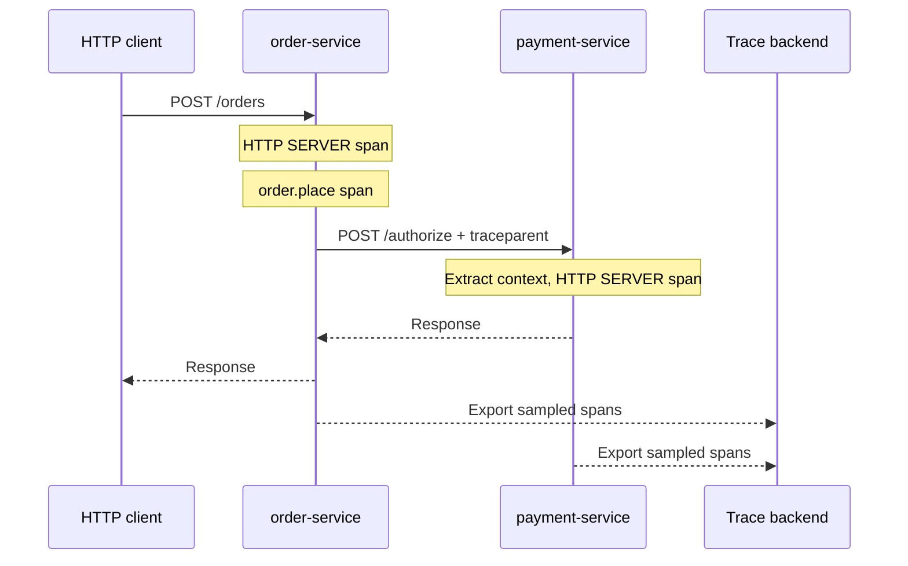
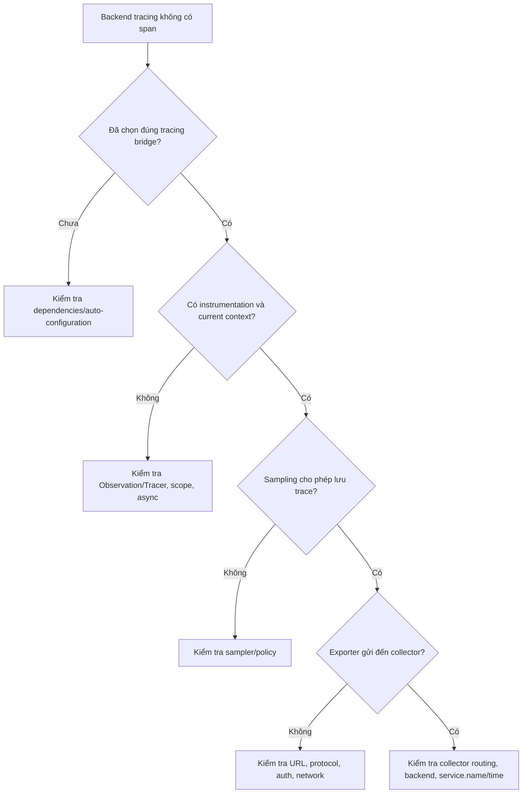

# Micrometer Tracing Bridge trong Spring Boot: nối Observation với OpenTelemetry hoặc Brave

Một hệ thống Spring Boot có metric `http.server.requests` và log ứng dụng đầy đủ, nhưng khi mở hệ thống tracing, nhóm vận hành không thấy span nào. Trong một dịch vụ khác, tracing backend đã nhận span HTTP, song thao tác nghiệp vụ `payment.authorize` lại không xuất hiện trong trace. Nguyên nhân có thể là ứng dụng đã tạo `Observation` nhưng **chưa có bridge/handler tracing phù hợp**, thiếu exporter, cấu hình propagation sai hoặc trace bị sampling.

**Micrometer Tracing Bridge** là lớp tích hợp giữa API tracing thống nhất của Micrometer và một tracer implementation cụ thể, phổ biến là **OpenTelemetry** hoặc **Brave**. Bridge giúp ứng dụng viết instrumentation theo `Observation` và `io.micrometer.tracing.Tracer` mà không phải phụ thuộc trực tiếp vào API của một hệ thống tracer trong phần lớn code nghiệp vụ.

Bài **“Micrometer tracing bridge”** thuộc chương **Tracer implementation** của module `SPRING_BOOT_OBSERVABILITY`. Phạm vi học gồm Micrometer Observation, metrics, logs, distributed tracing; context propagation; tag/cardinality; exporter, sampling và cách ghép tín hiệu để điều tra lỗi, độ trễ và hành vi ứng dụng trong production.

## 1. Các lớp trong pipeline tracing

Trước khi thêm dependency, cần phân biệt năm vai trò:

| Thành phần | Trách nhiệm | Ví dụ |
| --- | --- | --- |
| **Instrumentation** | Xác định ranh giới thao tác và ghi thông tin | HTTP server/client instrumentation, `Observation.createNotStarted(...)`, `@Observed` khi AOP đã cấu hình |
| **Micrometer Observation** | Mô hình vòng đời quan sát và giao diện cho nhiều loại handler | `ObservationRegistry`, `Observation.Scope`, `ObservationHandler` |
| **Micrometer Tracing API** | Facade thao tác với span và tracer | `Tracer`, `Span`, `Tracer.SpanInScope` |
| **Tracing bridge / implementation** | Hiện thực facade Micrometer trên tracing engine cụ thể | `micrometer-tracing-bridge-otel`, `micrometer-tracing-bridge-brave` |
| **Exporter/collector/backend** | Vận chuyển, xử lý, lưu và truy vấn span | OTLP exporter → OpenTelemetry Collector → Jaeger/Tempo; Zipkin reporter → Zipkin |

Sơ đồ khái niệm:



Đây là sơ đồ trách nhiệm, không phải cam kết rằng mọi registry tự động kết nối đủ tất cả nhánh. `ObservationRegistry` chỉ điều phối các handler đã được đăng ký; bridge phải tương thích với cấu hình tracing và thành phần xuất dữ liệu. **Bridge không phải exporter**, còn **exporter không tự động instrument code nghiệp vụ**.

Ví dụ: chỉ thêm `micrometer-registry-prometheus` giúp xuất metrics nhưng không tạo tracer. Ngược lại, thêm bridge tracing không tự tạo histogram hay Prometheus registry.

## 2. Micrometer Observation khác Micrometer Tracing như thế nào?

`Observation` trừu tượng hóa một đơn vị công việc, chẳng hạn `order.place`, và gửi callback vòng đời đến các handler. Handler metrics có thể ghi `Timer`, trong khi handler tracing có thể tạo một span của tracer đang cấu hình.

```java
Observation.createNotStarted("order.place", observationRegistry)
    .lowCardinalityKeyValue("order.channel", "web")
    .observe(() -> orderGateway.place());
```

Đoạn code này **không phụ thuộc trực tiếp OpenTelemetry hay Brave**. Nếu registry có metrics handler, có thể sinh timer; nếu registry còn có tracing handler/bridge, có thể sinh span. Nếu không có tracing integration, bản thân Observation vẫn có thể chạy bình thường mà không có span trên backend.

Còn `Tracer` cho phép thao tác span trực tiếp:

```java
Span span = tracer.nextSpan().name("order.place").start();
try (Tracer.SpanInScope scope = tracer.withSpan(span)) {
    orderGateway.place();
} catch (RuntimeException ex) {
    span.error(ex);
    throw ex;
} finally {
    span.end();
}
```

Hai cách này phục vụ các mức kiểm soát khác nhau. Với nghiệp vụ thông thường cần metric và trace thống nhất, `Observation` thường thuận tiện hơn. Khi cần thao tác chuyên biệt lên span, có thể dùng `Tracer` trực tiếp. Tránh bọc cùng một công việc bằng cả hai cơ chế mà không có chủ đích, vì có thể tạo span trùng lặp.

### Bảng tương ứng các khái niệm

| Observation | Tracing |
| --- | --- |
| `Observation.start()` | Handler tracing có thể gọi bắt đầu span |
| `Observation.openScope()` | Tracer đặt span làm current context |
| `Observation.lowCardinalityKeyValue(...)` | Tập nhãn ít giá trị cho metrics và ngữ cảnh trace khi handler hỗ trợ |
| `Observation.highCardinalityKeyValue(...)` | Thông tin chi tiết thường dành cho tracing; không dùng mặc định làm metric tag |
| `Observation.error(exception)` | Handler có thể ghi exception/error của span |
| `Observation.stop()` | Handler tracing có thể hoàn tất span |
| `Observation.Scope.close()` | Khôi phục current observation/context; không đồng nghĩa stop |
| `ObservationRegistry` | Điều phối handlers; không phải trace database |

Một số handler đọc tags/events tại các thời điểm khác nhau. Nếu muốn một thuộc tính quan trọng có mặt ngay khi span bắt đầu, hãy đặt dữ liệu trước `start()` hoặc sử dụng convention/handler thích hợp; không giả định mọi tag thêm sau start sẽ tự được cập nhật ở mọi backend.

## 3. Tại sao tồn tại hai bridge OpenTelemetry và Brave?

Micrometer Tracing cung cấp một **facade chung** trong code Java; bridge thực hiện facade dựa trên engine tracing cụ thể:

- **OpenTelemetry bridge**: `io.micrometer:micrometer-tracing-bridge-otel` dựa vào OpenTelemetry SDK và hệ sinh thái exporter/propagator của OpenTelemetry.
- **Brave bridge**: `io.micrometer:micrometer-tracing-bridge-brave` dựa vào Brave, một thư viện tracing quen thuộc trong hệ Zipkin.

Đây là hai lựa chọn triển khai cho cùng loại nhiệm vụ, không phải hai bước phải cài liên tiếp. Trong phần lớn ứng dụng, **chọn một bridge chủ đạo**. Cài cả hai mà không hiểu auto-configuration có thể gây xung đột bean, trùng instrumentation hoặc hành vi không mong đợi.

| Tiêu chí | OpenTelemetry bridge | Brave bridge |
| --- | --- | --- |
| API mà nghiệp vụ nên thấy | Micrometer `Tracer`/`Observation` | Micrometer `Tracer`/`Observation` |
| Engine dưới facade | OpenTelemetry SDK | Brave |
| Xuất trace phổ biến | OTLP/Collector qua exporter tương thích | Zipkin reporter hoặc giải pháp reporter tương thích |
| Truyền context | W3C Trace Context và các propagator được cấu hình | W3C/B3 theo hỗ trợ và cấu hình |
| Chuyển từ một bridge sang bridge khác | Giữ phần lớn code dùng Micrometer facade | Giữ phần lớn code dùng Micrometer facade |

Không vì cùng API Micrometer mà mọi tính năng, baggage policy, exporter, propagator hoặc semantic convention giữa hai backend đều giống hệt. Cần kiểm thử hành vi và payload thực tế khi đổi bridge.

## 4. Cấu hình Spring Boot với OpenTelemetry bridge

Các ví dụ sau lấy **Spring Boot 3.x, Java 17+ và Maven** làm hệ quy chiếu, với dependency versions do Spring Boot parent/BOM quản lý. Những dòng property hoặc dependency có thể thay đổi giữa các phiên bản Boot/Micrometer; phải đối chiếu phiên bản dự án khi triển khai.

### 4.1. Dependencies

```xml
<dependencies>
    <dependency>
        <groupId>org.springframework.boot</groupId>
        <artifactId>spring-boot-starter-web</artifactId>
    </dependency>
    <dependency>
        <groupId>org.springframework.boot</groupId>
        <artifactId>spring-boot-starter-actuator</artifactId>
    </dependency>
    <dependency>
        <groupId>io.micrometer</groupId>
        <artifactId>micrometer-tracing-bridge-otel</artifactId>
    </dependency>
    <dependency>
        <groupId>io.opentelemetry</groupId>
        <artifactId>opentelemetry-exporter-otlp</artifactId>
    </dependency>
</dependencies>
```

Ý nghĩa:

1. `spring-boot-starter-actuator` cung cấp auto-configuration observability và các endpoint giám sát phù hợp.
2. `micrometer-tracing-bridge-otel` cung cấp hiện thực Micrometer Tracing trên OpenTelemetry.
3. `opentelemetry-exporter-otlp` cung cấp thành phần xuất dữ liệu trace theo OTLP.
4. `spring-boot-starter-web` cung cấp một môi trường web Servlet để tạo inbound HTTP observations.

Nếu chưa cần web, có thể thay starter web bằng các starter tương ứng. Không cần Prometheus registry chỉ để xuất tracing. Muốn metrics ở Prometheus cần thêm `micrometer-registry-prometheus` và pipeline scrape riêng.

### 4.2. Cấu hình tracer sampling và OTLP HTTP

```yaml
spring:
  application:
    name: order-service

management:
  tracing:
    sampling:
      probability: 1.0  # Cho thử nghiệm; cân nhắc chi phí khi lên production
  otlp:
    tracing:
      endpoint: http://otel-collector:4318/v1/traces
  endpoints:
    web:
      exposure:
        include: health,metrics
```

Trong cấu hình ví dụ:

- `spring.application.name` giúp đặt tên ứng dụng và thường được dùng làm định danh dịch vụ trong telemetry thông qua cấu hình tích hợp của Boot.
- `management.tracing.sampling.probability` là xác suất lấy mẫu ở mức cấu hình tracing của Spring Boot 3.x, không phải tỷ lệ giảm số bản ghi metrics.
- `management.otlp.tracing.endpoint` trỏ tới receiver OTLP **HTTP** của Collector theo kiểu cấu hình này. Endpoint gRPC thường có cổng/giao thức khác; đừng đổi cổng mà bỏ qua giao thức.
- `/actuator/metrics` là endpoint chẩn đoán meter; nó **không phải** nơi liệt kê các span đã xuất.

Tên host `otel-collector` phải truy cập được từ nơi ứng dụng chạy. Khi chạy local không dùng container network, có thể cần đổi thành địa chỉ phù hợp, ví dụ localhost với receiver thật sự đang mở.

Đưa `probability: 1.0` vào môi trường thử nghiệm giúp dễ nhìn trace; tại production, cần cân nhắc lưu lượng, chi phí, bảo mật và chính sách sampling. Một exporter chưa kết nối được Collector có thể khiến backend không thấy span dù instrumentation hoạt động.

### 4.3. Kiểm tra pipeline đúng trình tự



Không nên dùng lệnh gọi `/actuator/metrics` thành công làm bằng chứng cho đoạn `T -> Collector -> Backend`. Cần kiểm tra Collector receiver, exporter, network, credentials và kết quả truy vấn backend.

## 5. Cấu hình Brave bridge khi cần hệ Zipkin/Brave

Nếu kiến trúc dùng Brave, dependency cơ bản khác nhánh OpenTelemetry:

```xml
<dependencies>
    <dependency>
        <groupId>org.springframework.boot</groupId>
        <artifactId>spring-boot-starter-actuator</artifactId>
    </dependency>
    <dependency>
        <groupId>io.micrometer</groupId>
        <artifactId>micrometer-tracing-bridge-brave</artifactId>
    </dependency>
    <!-- Ví dụ khi muốn báo cáo span tới Zipkin -->
    <dependency>
        <groupId>io.zipkin.reporter2</groupId>
        <artifactId>zipkin-reporter-brave</artifactId>
    </dependency>
</dependencies>
```

Cấu hình gửi tới Zipkin qua Spring Boot 3.x thường dùng nhóm thuộc tính như:

```yaml
spring:
  application:
    name: order-service

management:
  tracing:
    sampling:
      probability: 0.2
  zipkin:
    tracing:
      endpoint: http://zipkin:9411/api/v2/spans
```

Ví dụ này nhằm minh họa **một nhánh triển khai thay thế**, không phải yêu cầu cài Brave cạnh OpenTelemetry. Kiểm tra tính tương thích của reporter và thuộc tính với phiên bản Spring Boot thực tế. Việc sử dụng Brave không tự bắt buộc mọi service phải dùng B3: propagation cần được cấu hình đồng nhất và phụ thuộc khả năng hỗ trợ của bridge/framework.

### 5.1. Cách chọn một implementation

Chọn dựa trên giao thức truyền dữ liệu, collector hiện có, chuẩn propagation, nhu cầu semantic attributes và khả năng quản trị. Nếu hệ thống chủ yếu dùng OpenTelemetry Collector/OTLP, nhánh OpenTelemetry thường phù hợp. Nếu hệ thống đã có Brave/Zipkin integration ổn định, nhánh Brave có thể giảm công sức chuyển đổi.

Lớp nghiệp vụ chỉ dùng `ObservationRegistry` và `io.micrometer.tracing.Tracer` có thể giảm mức phụ thuộc vào một implementation. Tuy nhiên khi thay đổi implementation, vẫn phải kiểm thử lại trace sampling, span names, propagation, baggage, MDC và exporter.

## 6. Ví dụ Spring Boot tạo span từ một Observation nghiệp vụ

Giả sử HTTP `POST /orders` gọi service `OrderPlacementService`, sau đó adapter `PaymentGateway`. Ta thêm custom Observation cho bước đặt hàng:

```java
import io.micrometer.observation.Observation;
import io.micrometer.observation.ObservationRegistry;
import org.springframework.stereotype.Service;

@Service
public class OrderPlacementService {

    private final ObservationRegistry observationRegistry;
    private final PaymentGateway paymentGateway;

    public OrderPlacementService(
            ObservationRegistry observationRegistry,
            PaymentGateway paymentGateway) {
        this.observationRegistry = observationRegistry;
        this.paymentGateway = paymentGateway;
    }

    public PaymentDecision place(OrderCommand command) {
        String channel = normalizeChannel(command.channel());

        return Observation.createNotStarted(
                "order.place", observationRegistry)
            .contextualName("place-order")
            .lowCardinalityKeyValue("order.channel", channel)
            .observe(() -> paymentGateway.authorize(command));
    }

    private String normalizeChannel(String raw) {
        if ("web".equals(raw) || "mobile".equals(raw)
                || "partner".equals(raw)) {
            return raw;
        }
        return "other";
    }
}

record OrderCommand(String reference, String channel) {}
record PaymentDecision(boolean approved) {}

interface PaymentGateway {
    PaymentDecision authorize(OrderCommand command);
}
```

`PaymentGateway` ở đây là contract mẫu; để chạy thực tế phải cung cấp một bean implementation và gọi service từ controller hoặc một entry point phù hợp.

Khi ứng dụng có Micrometer tracing bridge hoạt động, handler tracing có thể tạo span tương ứng với Observation này. Khi có metrics handler, có thể sinh thêm Timer cho `order.place`. Một thao tác nghiệp vụ **không cần viết hai vòng đo riêng** chỉ để có cả metric và span.

Ví dụ cố ý giới hạn giá trị `order.channel` trong tập `web/mobile/partner/other`. Không gắn `command.reference()` làm **low-cardinality tag**, vì mã đơn có thể gần như duy nhất theo request. Nếu thực sự cần mã tham chiếu trong tracing, xem xét `highCardinalityKeyValue(...)` kèm chính sách dữ liệu, độ nhạy cảm và retention.

### 6.1. Kỳ vọng khi có tracing bridge

Một trace được instrument đúng có thể chứa:

```text
Trace 4bf92f3577b34da6a3ce929d0e0e4736
└── HTTP SERVER POST /orders
    └── order.place / place-order
        └── HTTP CLIENT POST /authorize  (nếu client được instrument)
            └── HTTP SERVER POST /authorize (ở payment-service)
```

Cấu trúc trên là **kỳ vọng minh họa**, không phải kết quả được bảo đảm bởi mỗi bridge. Tên span có thể dựa vào contextual name hoặc convention, và các span HTTP phụ thuộc instrumentation của đúng client/server. Thiếu propagation có thể khiến service nhận tạo trace mới dù service gửi đã có span.

### 6.2. Vòng đời không tự lan sang async

Đoạn dưới đây **không đo toàn bộ công việc bất đồng bộ**:

```java
return Observation.createNotStarted("order.place", observationRegistry)
    .observe(() -> CompletableFuture.supplyAsync(this::runOrderWork));
```

Scope của Observation chỉ bọc việc tạo/sắp lịch future trong ví dụ. Task có thể chạy trên worker thread khi scope phía gọi đã đóng. Muốn đo trọn công việc async, phải gắn vòng đời observation/span vào completion thực sự, đồng thời capture/restore context qua tích hợp Micrometer Context Propagation hoặc framework tương thích.

## 7. Dùng facade Micrometer Tracer trực tiếp

Khi cần thao tác với span chuyên biệt, inject `io.micrometer.tracing.Tracer` thay vì phụ thuộc vào tracer SDK cụ thể trong code nghiệp vụ.

```java
import io.micrometer.tracing.Span;
import io.micrometer.tracing.Tracer;
import org.springframework.stereotype.Service;

@Service
public class PricingService {
    private final Tracer tracer;
    private final PricingEngine engine;

    public PricingService(Tracer tracer, PricingEngine engine) {
        this.tracer = tracer;
        this.engine = engine;
    }

    public PriceQuote quote(PriceRequest request) {
        Span span = tracer.nextSpan().name("pricing.quote").start();

        try (Tracer.SpanInScope scope = tracer.withSpan(span)) {
            span.tag("pricing.mode", "standard");
            span.event("pricing.started");
            PriceQuote quote = engine.calculate(request);
            span.event("pricing.completed");
            return quote;
        } catch (RuntimeException ex) {
            span.error(ex);
            throw ex;
        } finally {
            span.end();
        }
    }
}

record PriceRequest(String sku) {}
record PriceQuote(long amountMinor) {}
interface PricingEngine {
    PriceQuote calculate(PriceRequest request);
}
```

Đây là ví dụ độc lập: ứng dụng cần một bean `PricingEngine`. Nếu Spring Boot/bridge đã cung cấp bean `Tracer` tương thích, phần service có thể dùng cùng API với cả OTel lẫn Brave.

Giải thích trách nhiệm:

| API | Tác dụng |
| --- | --- |
| `tracer.nextSpan()` | Tạo span mới, thường kế thừa current parent nếu có |
| `name(...).start()` | Đặt tên và bắt đầu đo |
| `tracer.withSpan(span)` | Đặt span làm current context ở phạm vi đang xử lý |
| `span.tag(key,value)` | Ghi metadata tùy implementation |
| `span.event(name)` | Ghi một mốc sự kiện |
| `span.error(ex)` | Báo thông tin exception/error |
| `scope.close()` | Khôi phục current span cũ; không thay thế `end()` |
| `span.end()` | Hoàn tất span dù code thành công hay ném exception |

Nên giữ tên span ổn định như `pricing.quote`, không tạo `pricing.quote.<sku>` theo từng khách hàng/sản phẩm. Không đưa thông tin nhạy cảm như token hoặc payload thanh toán vào tags và events.

### Vì sao không tạo cả manual span lẫn Observation span cho cùng đoạn code?

Giả sử service dùng `Observation.observe(... )` và bên trong lại mở một span manual tên giống hệt. Backend có thể xuất hiện hai đoạn span lồng nhau với duration rất gần nhau. Điều này vừa tăng chi phí vừa làm waterfall khó đọc. Chỉ tạo span con riêng nếu nó đo **một đơn vị công việc khác** có giá trị chẩn đoán.

## 8. Context propagation: bridge không tự thay thế instrumentation đường truyền

Tracer hiện hành trong một thread **không tự vượt qua ranh giới process hoặc network**. Để `order-service` gọi `payment-service` mà vẫn cùng trace, phía gửi phải inject trace context vào carrier (thường HTTP headers) và phía nhận phải extract.

Ví dụ HTTP request dùng chuẩn W3C Trace Context:

```http
POST /authorize HTTP/1.1
traceparent: 00-4bf92f3577b34da6a3ce929d0e0e4736-00f067aa0ba902b7-01
```

Cấu trúc thông dụng của `traceparent` gồm phiên bản, Trace ID, parent ID và flags. Khi chuẩn/propagator được hai service hỗ trợ, phía nhận có thể tạo server span với cùng trace ID và parent phù hợp.



Các điều kiện cần kiểm tra:

1. **Auto-instrumentation đúng loại client:** `RestClient`, `RestTemplate`, `WebClient`, message libraries... có cơ chế instrumentation khác nhau theo phiên bản. Tạo một client bằng tay ngoài builder do Spring quản lý có thể bỏ lỡ tracing integration.
2. **Propagation format tương thích:** W3C `traceparent/tracestate`, B3 hoặc format khác phải được các service cấu hình đọc/ghi phù hợp.
3. **Current context đúng:** phải có current span/observation khi bắt đầu lời gọi outbound.
4. **Trace sampling:** cờ sampled được truyền không có nghĩa exporter chắc chắn gửi được span đến backend.
5. **Proxy/gateway:** không được vô tình xóa/sửa headers trace context nếu muốn nối trace.
6. **Kiểm soát trust boundary:** không tin toàn bộ baggage hoặc headers từ client không đáng tin; áp dụng chính sách bảo mật cho dữ liệu propagation.

### 8.1. Baggage và MDC không giống span attributes

**Baggage** là dữ liệu ngữ cảnh có thể được cấu hình để truyền giữa các service. **Span attributes** mô tả một span, không mặc nhiên được chuyển sang span của service sau. **MDC** là cơ chế lưu trường correlation cho logging trong phạm vi xử lý/thread.

Ví dụ log có thể chứa `traceId`/`spanId` khi Spring Boot logging và bridge hỗ trợ correlation. Baggage có thể cần khai báo rõ những key được truyền từ xa và những key được đưa vào MDC. Không đưa thông tin khách hàng, email, secret hay token vào baggage; vì baggage có thể theo request xuyên nhiều hệ thống.

### 8.2. Qua thread mới hoặc reactive chain

Với `@Async`, `Executor`, `CompletableFuture`, scheduled tasks hoặc Reactor/WebFlux, scope ThreadLocal ở thread gọi không tự lan đến mọi worker. Cần tích hợp **Micrometer Context Propagation**, Reactor Context hoặc instrumentation framework tương ứng để capture/restore context đúng.

Không chuyển trực tiếp một `Observation.Scope` hay `Tracer.SpanInScope` đang mở sang thread khác rồi đóng ở đó. Mỗi scope phải được quản lý tại đúng phạm vi thực thi, tránh để trace của request A lẫn sang request B khi thread pool được tái sử dụng.

## 9. Sampling và exporter: vì sao không thấy trace dù bridge đã hoạt động?

Tracing bridge tạo cơ sở để có span; số span quan sát được ở backend còn phụ thuộc sampler, exporter, collector, network và retention.

| Thành phần | Nhiệm vụ | Triệu chứng khi có vấn đề |
| --- | --- | --- |
| Tracing bridge | Cung cấp tracer và tích hợp handlers | Không có span hoặc không có bean `Tracer` |
| Observation handlers | Chuyển vòng đời Observation thành span | Custom Observation có metric nhưng không có span |
| Sampler | Quyết định trace/span nào được ghi nhận hoặc giữ | Một số request không có trace |
| Exporter | Gửi span ra ngoài tiến trình | Tracing local có nhưng backend trống |
| Collector | Nhận, xử lý, batch, route spans | Mất spans theo pipeline hoặc cấu hình |
| Backend | Lưu và cho phép tìm kiếm | Sai service name/time window, retention đã hết |
| Context propagation | Duy trì quan hệ giữa các service | Trace bị đứt thành hai hoặc nhiều trace |

### 9.1. Sampling không đồng nghĩa phần trăm metrics

`management.tracing.sampling.probability: 0.1` thường mô tả xác suất sampling tracing khoảng 10% ở mức cấu hình; không có nghĩa chỉ 10% request góp vào HTTP metrics. Handler metrics có thể tiếp tục tổng hợp số liệu cho mọi Observation đủ điều kiện dù trace không được giữ.

Không dùng **số trace đã lưu** để tính request rate hoặc tỷ lệ lỗi thật khi sampler đã loại bỏ trace. Hãy dùng Timer/Counter, histogram và labels metric ổn định; trace phục vụ phân tích một request hoặc một tập mẫu.

Sampling đầu trace (*head-based*) có thể loại trace trước khi biết request sẽ lỗi. Nếu cần giữ trace lỗi hiếm, kiến trúc có thể xem xét tail-based sampling tại Collector nếu phù hợp chi phí và khả năng hệ thống; không phải cứ giảm xác suất head sampling thì vẫn luôn giữ đủ trace lỗi.

### 9.2. Phân biệt ba lớp lỗi

- **Không tạo span:** thiếu instrumentation, registry handler không đúng, context bị lọc, bean tracer không có.
- **Có span nhưng không export:** exporter không cấu hình, sampler loại, network/auth/retry/batch lỗi.
- **Đã export nhưng không tìm thấy:** Collector không route đúng, backend từ chối, sai `service.name`, time range hoặc hết retention.

Quy trình kiểm tra phải bám theo đường đi nguồn → bridge → exporter → Collector → backend, không chỉ nhìn vào một màn hình Grafana/Jaeger.

## 10. Tracing bridge và metrics: low/high cardinality

Micrometer Observation phân biệt:

- `lowCardinalityKeyValue(...)`: giá trị thuộc tập hữu hạn, phù hợp để tổng hợp metric, chẳng hạn `payment.channel=card/bank/other`.
- `highCardinalityKeyValue(...)`: dữ liệu chi tiết hơn, thường chỉ được tracing handler tiêu thụ; **không** nên biến thành nhãn time series theo từng request.

Ví dụ:

```java
Observation.createNotStarted("payment.authorize", observationRegistry)
    .lowCardinalityKeyValue("payment.channel", "card")
    .highCardinalityKeyValue("payment.reference", reference)
    .observe(() -> gateway.authorize());
```

Ví dụ giả định có `reference`, `gateway` và `observationRegistry` trong phạm vi hiện tại. Chỉ thêm `payment.reference` khi chính sách dữ liệu cho phép, ưu tiên mã opaque thay vì thông tin cá nhân; tracing cũng có giới hạn storage/cardinality và quyền truy cập.

**Không nhầm attributes của span với nhãn metric.** Một span có thể chứa request identifier mà backend tracing dùng để tìm kiếm; nếu dùng cùng identifier làm label Prometheus, mỗi request có thể tạo một series mới. Các tên metric, tag và convention có thể khác theo bridge/handler và phiên bản.

### Một hợp đồng telemetry nên có gì?

| Thành phần | Ví dụ | Rủi ro cần kiểm soát |
| --- | --- | --- |
| Span/Observation name | `payment.authorize` | Không nối mã giao dịch vào tên |
| Low-cardinality tag | `payment.channel=card` | Chuẩn hóa input về enum hữu hạn |
| Outcome | `approved/rejected/error` | Thống nhất ngữ nghĩa, không coi mọi từ chối là exception |
| High-cardinality attribute | Mã tham chiếu opaque khi cần | Bảo mật, quyền truy cập, retention |
| Event | `gateway.retry.started` | Tránh event quá dày trong span |
| Exception | Loại exception và metadata đã kiểm soát | Không log secrets/payload nhạy cảm |

## 11. Đồng bộ logs với traceId/spanId

Khi tracing bridge và logging correlation được cấu hình đúng, log trong scope của span có thể chứa `traceId` và `spanId`. Điều này giúp từ một trace chậm mở log liên quan, hoặc từ một error log tìm trace tương ứng.

Ví dụ một logging pattern minh họa cho Spring Boot/Logback:

```yaml
logging:
  pattern:
    level: "%5p [traceId=%X{traceId:-},spanId=%X{spanId:-}]"
```

Mẫu này dựa trên các MDC key phổ biến và có thể khác theo phiên bản, bridge hoặc logging backend. Nếu traceId/spanId không có trong log, hãy xác minh tracing và MDC correlation trong scope trước khi đổi pattern; thêm placeholder vào pattern không tự tạo trace context.

Hệ logging giữ dữ liệu riêng với tracing exporter: OTLP tracing exporter chuyển span, **không tự lưu application logs**. Muốn tìm log cần có stdout/structured logging và pipeline log tương ứng; muốn gửi logs bằng OTLP phải cấu hình hệ logs riêng nếu nền tảng hỗ trợ.

Một ví dụ quy trình điều tra:

1. HTTP p95 tăng trên dashboard metrics.
2. Xác định route, service và khoảng thời gian.
3. Tìm trace có sample request chậm và mở span `payment.authorize`.
4. Sao chép `traceId` từ backend tracing và tìm log cùng ID.
5. Xem timeout, retry hoặc lỗi của downstream trong log.
6. Đối chiếu CPU/GC/connection-pool metrics để xác nhận nguyên nhân thay vì suy đoán từ một span duration.

Lưu ý: span duration là **wall-clock time**, không phải CPU time. Span 800 ms có thể chứa 700 ms chờ network hoặc lock; khi nghi vấn CPU-bound cần dùng CPU metrics và profiling thích hợp.

## 12. Kiểm tra ứng dụng: một ví dụ end-to-end

Một trace thử nghiệm có thể bắt đầu bằng request:

```bash
curl -i http://localhost:8080/api/orders/123
curl -s http://localhost:8080/actuator/metrics
curl -s http://localhost:8080/actuator/metrics/http.server.requests
```

Các lệnh trên giả định ứng dụng có endpoint `GET /api/orders/{id}`, Actuator đã được cấu hình expose `metrics` và không cần auth trong môi trường test. Chúng **không xác nhận** exporter tracing thành công; cần truy vấn Collector/backend trace độc lập.

Để xác minh bridge:

1. Gửi request qua service có HTTP server instrumentation.
2. Tìm trace theo `service.name` và khoảng thời gian thực tế.
3. Kiểm tra root/server span và một business span từ `Observation`.
4. Xác minh span IDs khác nhau nhưng trace ID giống nhau khi quan hệ cha–con đúng.
5. Gửi lời gọi sang service khác qua HTTP client được instrument; so sánh trace ID và parent của server span phía nhận.
6. Xem log correlation trong scope, kiểm tra `traceId/spanId`.
7. Đặt sampling 1.0 trong môi trường thử nghiệm nếu cần loại trừ nguyên nhân không được lấy mẫu; khôi phục policy phù hợp trước production.
8. Kiểm tra collector/exporter/auth/network nếu không thấy span dù đã có instrumentation.

Không chạy stress test hoặc ghi payload nhạy cảm vào span chỉ để chứng minh bridge hoạt động.

## 13. Những lỗi thường gặp và cách khắc phục

| Hiện tượng | Nguyên nhân có thể | Hướng kiểm tra |
| --- | --- | --- |
| Không inject được `Tracer` | Bridge/auto-configuration chưa có hoặc điều kiện không thỏa | Kiểm tra dependency, chọn đúng một bridge, cấu hình Spring Boot |
| Có `/actuator/metrics` nhưng không thấy trace | Metrics pipeline chạy, tracing chưa cấu hình | Kiểm tra bridge, sampler, tracing handler, exporter |
| Có HTTP span nhưng thiếu business span | Chưa instrument nghiệp vụ hoặc Observation không đi qua registry đúng | Kiểm tra `ObservationRegistry`, handler và phạm vi code |
| Span được tạo nhưng backend trống | OTLP endpoint sai, collector chưa bật, auth/network lỗi | Kiểm tra exporter logs, receiver và backend |
| Span bị chia thành trace rời rạc | Header propagation mất hoặc async context không restore | Kiểm tra traceparent, client/server instrumentation |
| Trace không có phần downstream | Client tự tạo không được instrument, sampling/filter | Dùng builder do framework quản lý, kiểm tra propagation |
| Log không có traceId | MDC bridge/logging pattern chưa đúng hoặc log ngoài scope | Kiểm tra current span và logging integration |
| Hai span nghiệp vụ gần như trùng nhau | Manual Tracer và Observation chồng lặp | Giảm instrumentation trùng, giữ ranh giới có ý nghĩa |
| Nhiều giá trị metric tags bất thường | Gắn orderId/traceId làm low-cardinality tags | Chuẩn hóa tags, chuyển định danh sang trace/log có kiểm soát |
| Đổi OTel ↔ Brave rồi mất trace | Reporter/protocol/propagation config thay đổi | Kiểm tra bridge, exporter và tương thích header trên từng service |
| Trace sample không phản ánh toàn bộ lỗi | Head sampling loại bỏ request lỗi trước khi kết thúc | Theo dõi lỗi bằng metrics, cân nhắc chính sách sampling |
| Span cha kết thúc trước công việc async | Bọc hàm tạo future thay vì completion | Đo vòng đời thật và truyền context đúng |

### Checklist chẩn đoán có thứ tự



## 14. Bài thực hành: thay bridge mà giữ code nghiệp vụ

Thiết lập hai Spring Boot service thử nghiệm `order-service` và `payment-service`:

1. **Lựa chọn bridge**: ở lần đầu, sử dụng `micrometer-tracing-bridge-otel` và OTLP exporter tới một Collector/backend thử nghiệm. Không cài Brave cùng lúc.
2. **Instrument nghiệp vụ**: tạo `OrderPlacementService` dùng `ObservationRegistry`; thêm `order.channel` với danh sách giá trị hữu hạn.
3. **Tạo thêm manual span**: instrument một đơn vị công việc *khác* bằng Micrometer `Tracer` và xác minh không trùng với business Observation.
4. **Kiểm tra vòng đời**: cố ý ném exception trong test; bảo đảm scope được đóng và span được end; so sánh attributes/error theo implementation.
5. **Kiểm tra propagation**: dùng HTTP client của Spring có observation integration để gọi `payment-service`, kiểm tra W3C traceparent, trace ID và parent-child.
6. **Kiểm tra sampling**: dùng probability 1.0 ở dev trước; sau đó hạ xuống mức phù hợp và so trace count với HTTP metric count để giải thích chênh lệch.
7. **Kiểm tra correlation**: cấu hình log có traceId/spanId; tìm log của một lỗi qua trace ID. Không gắn trace ID làm metric label.
8. **Thử async**: đưa một bước vào executor; quan sát trace khi thiếu context propagation rồi sửa bằng tích hợp tương thích.
9. **Thử thay bridge trên môi trường riêng**: gỡ cấu hình OTel, thay bằng Brave và reporter thích hợp; giữ nguyên lớp nghiệp vụ dùng `Observation`/`Tracer`, kiểm tra lại xuất span và propagation. Không thực hiện đổi bridge đồng thời trên production khi chưa kiểm tra tính tương thích.
10. **Đánh giá vận hành**: bảo vệ endpoint/collector, kiểm soát sampling, retention, tag/cardinality, dữ liệu nhạy cảm và chi phí xuất trace.

### Câu hỏi tự kiểm tra

1. Micrometer Tracing Bridge làm gì mà `ObservationRegistry` hoặc Prometheus registry không tự làm được?
2. Tại sao `micrometer-tracing-bridge-otel` và `opentelemetry-exporter-otlp` là hai thành phần có trách nhiệm khác nhau?
3. Nếu có HTTP metrics nhưng không có spans, cần kiểm tra những lớp nào?
4. Khi thay bridge OpenTelemetry bằng Brave, phần nào trong nghiệp vụ có thể giữ nguyên, phần nào phải kiểm thử lại?
5. Vì sao `scope.close()` không thay thế `span.end()`?
6. Vì sao một HTTP client được tạo ngoài cơ chế instrumentation có thể làm trace đứt dù service nhận đã cấu hình tracer?
7. Có thể suy ra request rate chính xác từ số span sau head sampling 10% không? Vì sao?
8. Tại sao một span 1,2 giây không có nghĩa tiến trình đã dùng 1,2 CPU-second?
9. Vì sao đưa traceId/orderId vào metric tag là sai về cardinality?
10. Muốn xem log cùng trace ID, ngoài bridge tracing cần điều kiện logging và context nào?

## 15. Checklist triển khai production

- Chọn **một tracing bridge chủ đạo** (OTel hoặc Brave) và xác minh dependency/autoconfiguration tương thích.
- Dùng `ObservationRegistry` do Spring quản lý; tránh tự tạo registry không có handler.
- Tách trách nhiệm instrumentation, bridge, exporter/collector và backend; kiểm tra từng bước.
- Instrument ranh giới có ý nghĩa; tránh duplicate spans và tên span chứa ID động.
- Quản lý `start/end`, `open/close scope` đúng và bảo đảm exception không gây rò rỉ current context.
- Bật propagation phù hợp qua HTTP client, messaging và async/reactive execution.
- Chuẩn hóa W3C/B3 hoặc các định dạng được hỗ trợ khi các service dùng tracer implementations khác nhau.
- Phân biệt low/high-cardinality attributes; không đưa mã riêng từng request vào Prometheus labels.
- Có sampling policy, exporter timeout/retry, collector routing và trace retention phù hợp với tải.
- Đồng bộ `service.name`, môi trường và thời gian để kết hợp metrics, logs và traces.
- Bảo vệ collector/endpoint; không ghi thông tin nhạy cảm vào tags/events/baggage/logs.
- Kiểm tra thực tế trace tree, parent-child, propagation, error spans và khả năng tìm log theo traceId.
- Dùng HTTP/business/JVM metrics làm dữ liệu tổng hợp; dùng trace đã được sampling để điều tra request cụ thể.
- Khi thay bridge hoặc nâng Spring Boot/Micrometer, thực hiện regression test propagation, span attributes, log correlation và exporter trước khi phát hành.

## Kết luận

**Micrometer Tracing Bridge** kết nối facade tracing của Micrometer với một tracer implementation như OpenTelemetry hoặc Brave. Trong Spring Boot, bridge cùng `ObservationHandler` phù hợp có thể chuyển một `Observation` nghiệp vụ thành span, còn `Tracer` cho phép tạo và quản lý span trực tiếp khi cần. Tuy nhiên bridge không tự thay cho exporter, Collector, backend, sampler hay context propagation: phải cấu hình và kiểm thử toàn bộ pipeline. Khi được kết hợp đúng với metrics, structured logs, sampling và cardinality policy, tracing bridge giúp duy trì code instrument ổn định đồng thời tạo bằng chứng xuyên dịch vụ để điều tra lỗi và độ trễ trong production.
