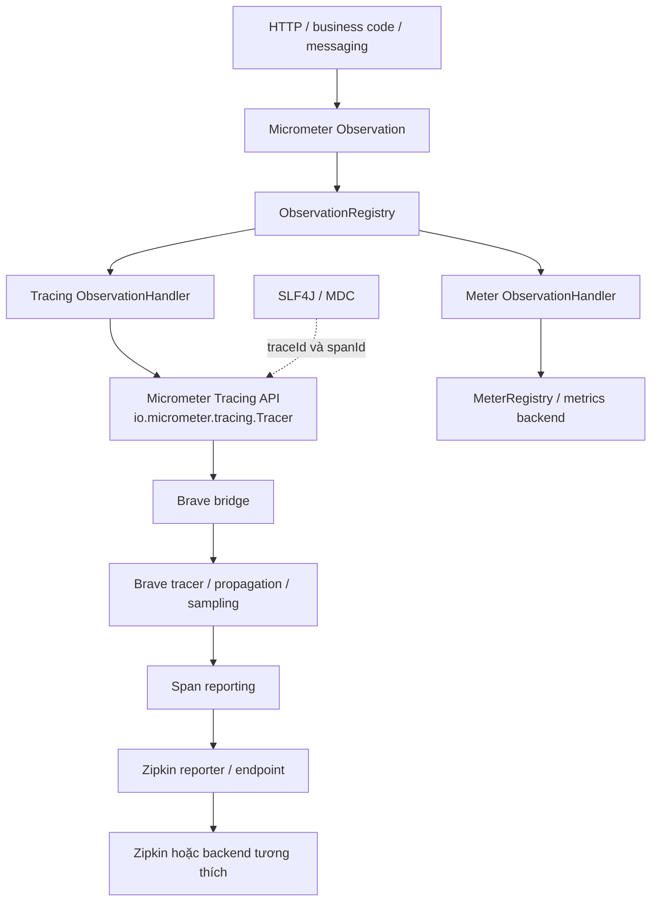
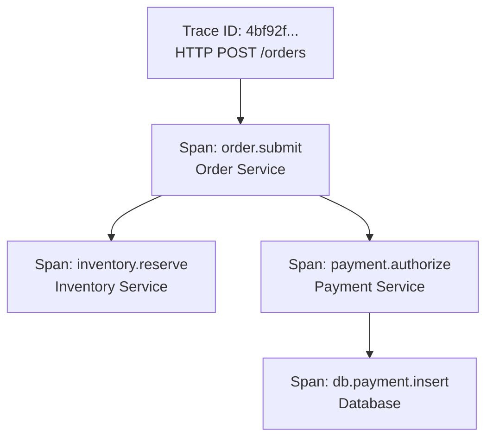
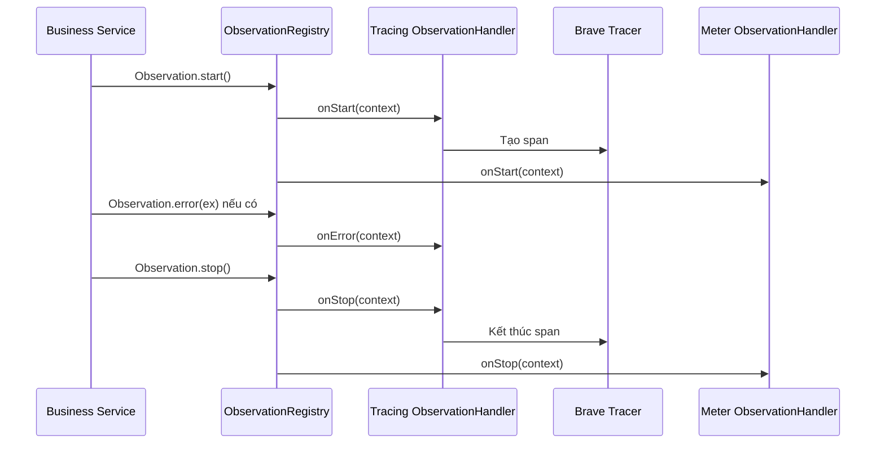
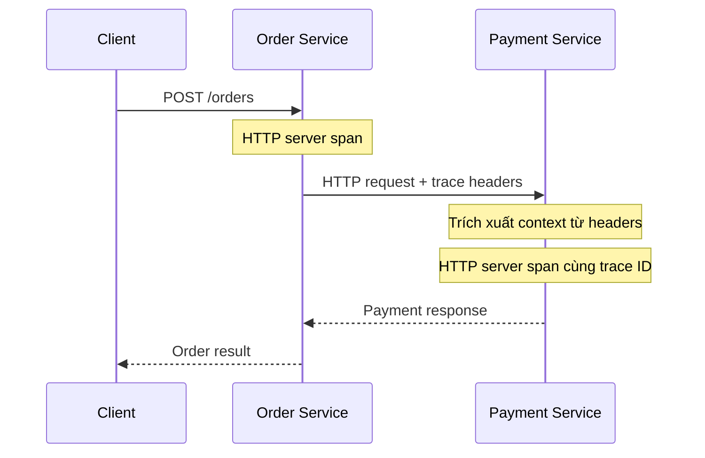
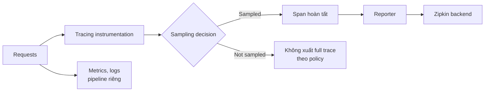
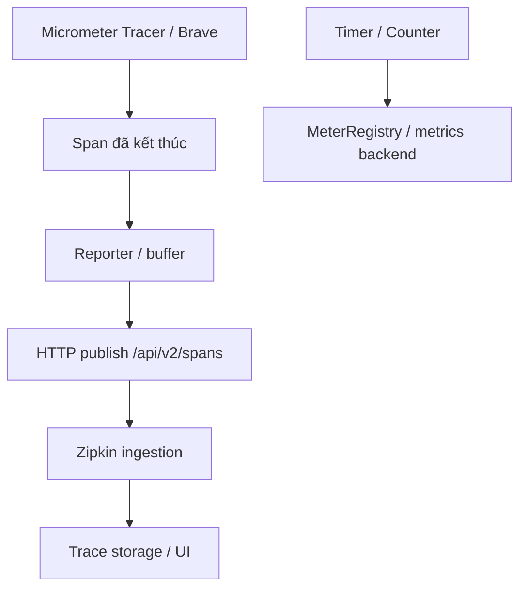

# Brave tracer trong Spring Boot và Micrometer Tracing

Một yêu cầu đặt hàng đi qua HTTP controller, service xử lý nghiệp vụ, lời gọi inventory và payment, rồi mới trả kết quả. Khi người dùng gặp độ trễ hoặc lỗi, nhìn vào log của từng dịch vụ riêng rẽ chưa chắc biết chúng thuộc **cùng một yêu cầu**. Distributed tracing giải quyết vấn đề này bằng cách gắn các công việc vào một **trace** với những **span** biểu diễn các bước và quan hệ cha–con. Trong hệ sinh thái Spring Boot, **Brave** là một implementation có thể cung cấp chức năng tracing bên dưới giao diện **Micrometer Tracing**.

Bài **Brave tracer** thuộc chương **Tracer implementation** của module **SPRING_BOOT_OBSERVABILITY**. Module hướng tới thiết lập observability cho Spring Boot bằng Micrometer Observation, metrics, logs và distributed tracing; học propagation ngữ cảnh, tag/cardinality, exporter, sampling và cách liên kết tín hiệu để điều tra lỗi, độ trễ, hành vi ứng dụng trong môi trường thực. Bài này đi sâu vào kiến trúc **Brave + Micrometer Tracing**, cấu hình Spring Boot, vòng đời span, propagation, reporting và những điểm cần kiểm chứng khi vận hành.

## 1. Mục tiêu học tập

Sau bài học, bạn có thể:

- Giải thích sự khác nhau giữa `trace`, `span`, `traceId`, `spanId`, `parentSpanId` và tracer implementation.
- Mô tả vai trò của **Brave**, **Micrometer Tracing bridge** và một backend như **Zipkin**.
- Cấu hình dependency, tracing sampling và Zipkin reporting cho Spring Boot 3.x ở mức cơ bản.
- Dùng `io.micrometer.tracing.Tracer` để tạo span, mở scope, gắn tag/event, ghi exception và kết thúc span.
- Ưu tiên Micrometer Observation khi muốn kết hợp metrics với tracing, tránh tạo span/timer trùng nhau.
- Nhận biết vấn đề truyền trace context qua HTTP, executor, Reactor và message broker; phân biệt scope nội bộ với propagation qua mạng.
- Hiểu trace sampling, báo cáo bất đồng bộ, dữ liệu nhạy cảm và cardinality khi thiết kế telemetry.
- Kiểm tra vì sao log có trace ID nhưng không có trace trong backend, hoặc vì sao các span không liên kết cha–con.

## 2. Brave là gì và nằm ở lớp nào?

**Brave** là thư viện distributed tracing của hệ sinh thái Zipkin. Nó cung cấp cơ chế quản lý trace/span context, lấy mẫu (sampling), propagation và những thành phần hỗ trợ reporting. Trong ứng dụng Spring Boot hiện đại, người viết code thường không cần gọi trực tiếp `brave.Tracer`: **Micrometer Tracing** đưa ra một facade `io.micrometer.tracing.Tracer` thống nhất, và thư viện **`micrometer-tracing-bridge-brave`** kết nối facade đó với Brave.



Ba lớp dễ nhầm:

| Lớp | Trách nhiệm | Ví dụ |
| --- | --- | --- |
| **Micrometer Observation** | Mô tả công việc có `start`/`stop`, outcome, error, event | Observation `business.order.submit` |
| **Micrometer Tracing API** | Cung cấp giao diện thao tác trace/span tương đối độc lập implementation | `Tracer`, `Span`, `Baggage` |
| **Brave tracer implementation** | Thực thi span context, propagation, sampling và phối hợp reporting | Brave được nối qua bridge |
| **Reporter/exporter** | Gửi thông tin span đã kết thúc tới backend | Zipkin reporter |
| **Tracing backend** | Nhận, lưu và cho phép tìm trace | Zipkin |

**Brave không đồng nghĩa Zipkin server.** Brave có thể tạo span ngay cả khi không có server lưu trace; reporter và backend là các thành phần riêng. Tương tự, chỉ thêm Brave bridge không tự có metrics registry hay đảm bảo log ứng dụng xuất hiện trên một nền tảng tập trung.

### Brave và OpenTelemetry khác nhau thế nào?

Micrometer Tracing có thể sử dụng Brave hoặc OpenTelemetry bridge tùy stack. Hai hướng này cùng phục vụ API tracing nhưng **không nên tùy tiện bật cả hai bridge** trong một ứng dụng mà chưa có thiết kế rõ về bean, tracer, propagation và exporter.

| Quyết định | Brave | OpenTelemetry |
| --- | --- | --- |
| Implementation bên dưới Micrometer | Brave qua `micrometer-tracing-bridge-brave` | OpenTelemetry qua `micrometer-tracing-bridge-otel` |
| Khái niệm | Trace/span, sampling, propagation | Trace/span, sampling, propagation |
| Reporting thường gặp | Zipkin reporter | OTLP exporter hoặc exporter tương ứng |
| API nghiệp vụ được khuyến nghị | Micrometer `Tracer` hoặc `Observation` | Micrometer `Tracer` hoặc `Observation` |
| Lưu ý khi chuyển đổi | Xác minh propagation và exporter | Xác minh propagation và exporter |

Chọn implementation theo kiến trúc quan sát hiện có, khả năng tương tác với dịch vụ khác và backend đích. Thay bridge không tự giải quyết mọi vấn đề về sampling, baggage hoặc context propagation.

## 3. Trace, span và quan hệ cha–con

Một **trace** đại diện cho đường đi của một yêu cầu hoặc một công việc phân tán. Mỗi **span** mô tả một bước cụ thể, có thời gian bắt đầu/kết thúc, tên, thuộc tính và ngữ cảnh liên kết.



| Thuộc tính | Ý nghĩa | Quy tắc quan trọng |
| --- | --- | --- |
| `traceId` | Định danh của trace | Các span cùng trace chia sẻ trace ID khi propagation đúng |
| `spanId` | Định danh một span | Mỗi span có ID riêng |
| `parentSpanId` | ID span cha nếu có | Thiết lập quan hệ gọi giữa các công việc |
| Span name | Loại công việc đang diễn ra | Dùng tên **ổn định**, ví dụ `payment.authorize` |
| Span tags/attributes | Metadata về bước | Không đưa secrets/PII và dữ liệu động không cần thiết |
| Span events | Mốc đáng chú ý trong bước | Ví dụ `retry.started`, `fallback.used` |
| Error | Exception/thông tin lỗi | Cần ghi chủ động khi quản lý span thủ công |

Một trace có thể có nhiều span cùng trace ID. **Không** nhầm `traceId` với `spanId`: nếu chỉ tìm span ID của controller trong log một dịch vụ khác, có thể không tìm được vì mỗi dịch vụ tạo span mới.

Span cha–con không chỉ dựa vào việc trùng trace ID. Điều quan trọng là **span context được truyền** qua các boundary và tracer biết span nào đang là cha khi tạo span tiếp theo.

## 4. Cấu hình Spring Boot dùng Brave

Với **Spring Boot 3.x** quản lý dependency bằng Spring Boot BOM, một cấu hình nền bằng Gradle Kotlin DSL:

```kotlin
dependencies {
    implementation("org.springframework.boot:spring-boot-starter-actuator")
    implementation("io.micrometer:micrometer-tracing-bridge-brave")
    runtimeOnly("io.zipkin.reporter2:zipkin-reporter-brave")
}
```

Nếu ứng dụng có HTTP controller, bổ sung starter web của dự án; nếu dùng WebClient hoặc messaging, cần dependency/instrumentation tương ứng. `spring-boot-starter-actuator` giúp Spring Boot cấu hình hạ tầng observability; `micrometer-tracing-bridge-brave` nối Micrometer Tracing API với Brave. Zipkin reporter hỗ trợ xuất span tới Zipkin khi tính năng reporting được cấu hình và các điều kiện auto-configuration được đáp ứng.

**Tương thích phiên bản:** Ví dụ nhắm tới nhánh Spring Boot 3.x. Các nhánh Boot khác có thể đổi auto-configuration, package hoặc property. Không copy các dependency phiên bản cố định không tương thích với Spring Boot BOM.

### 4.1. Cấu hình sampling và Zipkin endpoint

Ví dụ `application.yml` cho môi trường phát triển:

```yaml
spring:
  application:
    name: order-service

management:
  tracing:
    sampling:
      probability: 1.0
  zipkin:
    tracing:
      endpoint: ${ZIPKIN_ENDPOINT:http://localhost:9411/api/v2/spans}
```

Giải thích:

- `spring.application.name` giúp định danh service trong telemetry khi tích hợp được cấu hình.
- `management.tracing.sampling.probability` điều chỉnh tỷ lệ mẫu tracing. `1.0` giúp quan sát gần như toàn bộ các trace đủ điều kiện khi **thử nghiệm**, không phải khuyến nghị mặc định cho production.
- `management.zipkin.tracing.endpoint` chỉ định địa chỉ nhận các spans do reporter gửi. `http://localhost:9411/api/v2/spans` là địa chỉ minh họa cho Zipkin chạy tại máy local.
- Có dependency **không** bảo đảm Zipkin server đang chạy hoặc có thể truy cập endpoint; phải xác minh network, reporter, HTTP status và UI/backend thực tế.

Trong production, xác định sampling rate theo ngân sách telemetry và mục tiêu điều tra. Có thể chọn xác suất như `0.1` (10%) khi phù hợp, nhưng đây không phải ngưỡng chung cho mọi hệ thống và không cam kết chính xác 10% số request trong mỗi khoảng thời gian ngắn.

### 4.2. Spring Boot tự instrument những gì?

Khi tracing/observation auto-configuration phù hợp, Spring Boot và Spring Framework có thể tự quan sát HTTP server requests và các client được tạo theo cách mà framework hỗ trợ. Ví dụ một `RestClient.Builder` hoặc `WebClient.Builder` được **inject từ Spring** có thể được cấu hình observation, trong khi việc tự `new` client bên ngoài cơ chế Boot có thể bỏ lỡ instrumentation.

Một số luồng HTTP, database, messaging hoặc reactive yêu cầu dependency/integration riêng. **Không** giả định mọi external call đã tạo span chỉ vì Brave bridge có trên classpath. Sau khi cấu hình, hãy chạy một luồng thực tế và xem trace có những span mong đợi hay không.

### 4.3. Không dùng cấu hình Sleuth cũ một cách máy móc

Trong dự án Spring Boot 2.x cũ, **Spring Cloud Sleuth** từng cung cấp tracing và tích hợp Brave. Với Spring Boot 3.x, mô hình quen thuộc chuyển sang **Micrometer Tracing**. Khi migrate, không nên sao chép nguyên các property `spring.sleuth.*`, starter Sleuth hoặc hướng dẫn cấu hình cũ mà không kiểm tra tương thích.

## 5. Tạo span bằng Micrometer Tracer trên Brave

Khi cần quan sát một bước nghiệp vụ chưa được framework instrument, có thể dùng `io.micrometer.tracing.Tracer`. Cách viết này giữ service ít phụ thuộc vào lớp Brave cụ thể.

### 5.1. Ví dụ Java: tạo và kết thúc span

Giả sử `InventoryGateway` là giao diện gọi dịch vụ tồn kho:

```java
import io.micrometer.tracing.Span;
import io.micrometer.tracing.Tracer;
import org.springframework.stereotype.Service;

@Service
public class InventoryReservationService {

    private final Tracer tracer;
    private final InventoryGateway gateway;

    public InventoryReservationService(
            Tracer tracer,
            InventoryGateway gateway) {
        this.tracer = tracer;
        this.gateway = gateway;
    }

    public Reservation reserve(String orderId, int quantity) {
        Span span = tracer.nextSpan()
            .name("inventory.reserve")
            .tag("operation", "reserve")
            .start();

        try (Tracer.SpanInScope scope = tracer.withSpan(span)) {
            try {
                Reservation result = gateway.reserve(orderId, quantity);
                span.tag("outcome", "success");
                return result;
            } catch (RuntimeException ex) {
                span.tag("outcome", "error");
                span.error(ex);
                throw ex;
            }
        } finally {
            span.end();
        }
    }
}

record Reservation(String reservationId) {}

interface InventoryGateway {
    Reservation reserve(String orderId, int quantity);
}
```

**Cách đọc ví dụ:**

1. `tracer.nextSpan()` tạo span mới theo ngữ cảnh hiện hành khi có parent hợp lệ; `name("inventory.reserve")` đặt tên ổn định.
2. `start()` bắt đầu thời gian của span.
3. `tracer.withSpan(span)` mở scope, đặt span thành span hiện hành để các thao tác con có thể lấy parent context theo cơ chế tracer/instrumentation.
4. Nếu gateway trả kết quả, span nhận `outcome=success`. Nếu ném exception, code gắn `outcome=error`, gọi `span.error(ex)` rồi ném lại.
5. `try-with-resources` đóng scope; `finally` gọi `span.end()` để kết thúc span trên cả đường đi thành công và exception.

Nếu `gateway.reserve` là một HTTP client đã được instrument, nó có thể tạo **span con** trong phạm vi `inventory.reserve`. Nếu chưa có instrumentation, span thủ công chỉ ghi nhận **toàn bộ thời gian gọi** mà chưa chắc hiển thị chi tiết network/callee.

**Không đưa `orderId`, `reservationId`, token, message body hoặc exception message vào span tag nếu chưa đánh giá quyền riêng tư và nhu cầu thực sự.** Span tag không phải metric label trong trường hợp thông thường, nhưng metadata vẫn có thể bị xuất tới backend, làm tăng lưu trữ hoặc lộ thông tin.

### 5.2. Event và kết quả nghiệp vụ

Không phải mọi kết quả không thành công đều là exception kỹ thuật. Ví dụ:

```java
if (!result.accepted()) {
    span.tag("outcome", "rejected");
    span.event("inventory.rejected");
    return result;
}

span.tag("outcome", "success");
return result;
```

Đây là đoạn **minh họa thay thế nhánh xử lý kết quả** trong một service dùng kiểu result có phương thức `accepted()`. Một trường hợp hết hàng đã được dự kiến trong hợp đồng có thể là `outcome=rejected`, không phải lỗi hạ tầng cần gắn `span.error(ex)`.

### 5.3. Khi nào không tạo span thủ công?

Nếu một HTTP client đã tạo span cho lời gọi partner, việc tạo thêm span khác **cùng phạm vi, cùng mục đích** có thể làm trace khó đọc và tăng chi phí. Custom span hợp lý khi nó thể hiện **một nghiệp vụ khác** (chẳng hạn “xác thực đơn hàng”), còn span HTTP client thể hiện lời gọi mạng cụ thể.

## 6. Dùng Micrometer Observation thay vì quản lý span trực tiếp

Khi ứng dụng muốn cùng một công việc phát cả **Timer metric** và **tracing span**, nên cân nhắc **Micrometer Observation**. Mỗi `Observation` thông báo vòng đời cho `ObservationRegistry`, nơi các handlers metrics và tracing xử lý theo cấu hình.

```java
import io.micrometer.observation.Observation;
import io.micrometer.observation.ObservationRegistry;

public Reservation reserveObserved(
        String orderId,
        int quantity,
        InventoryGateway gateway,
        ObservationRegistry registry) {

    Observation observation = Observation
        .createNotStarted("inventory.reserve", registry)
        .lowCardinalityKeyValue("operation", "reserve")
        .start();

    try (Observation.Scope scope = observation.openScope()) {
        try {
            Reservation result = gateway.reserve(orderId, quantity);
            observation.lowCardinalityKeyValue("outcome", "success");
            return result;
        } catch (RuntimeException ex) {
            observation.lowCardinalityKeyValue("outcome", "error");
            observation.error(ex);
            throw ex;
        }
    } finally {
        observation.stop();
    }
}
```

Đây là **phương án instrument thay thế** cho ví dụ dùng `Tracer` trực tiếp ở phần 5. Không chạy cả hai khối bao quanh **đúng một ranh giới** nếu không muốn tạo span/timer thừa.

### Từ Observation đến Brave như thế nào?



Sơ đồ biểu diễn **trường hợp registry có các handler tương ứng**; không phải cam kết mọi handler luôn tồn tại, mọi observation luôn sinh span, hoặc mọi trace được export. `Observation.error(ex)` thông báo lỗi đến các handler; nó không tự ném exception hay tự phát một dòng log ứng dụng.

### Low-cardinality và high-cardinality key-value

| Dữ liệu | Ví dụ | Nên đưa ở đâu? |
| --- | --- | --- |
| `operation` | `reserve` | Low-cardinality observation key-value |
| `outcome` | `success`, `rejected`, `error` | Low-cardinality observation key-value |
| `error.category` | `timeout`, `dependency` | Low-cardinality nếu tập giá trị hữu hạn |
| `traceId` / `spanId` | ID riêng của trace/span | Trace/log correlation, không làm metric label |
| `orderId` | ID giao dịch nhiều giá trị | Log hoặc trace attribute có kiểm soát nếu được phép |
| Full exception message | Chuỗi động, có thể chứa PII | Chẩn đoán giới hạn theo chính sách, không làm metric tag |

Meter observation handler thường sử dụng **low-cardinality** metadata để tạo tags cho Timer. Tracing handler có thể sử dụng cả những key-value thuộc Observation theo cơ chế riêng. Không dùng high-cardinality fields tùy tiện: traces cũng có giới hạn dung lượng và rủi ro bảo mật.

## 7. Propagation: giữ cùng trace qua dịch vụ

Một trace phân tán chỉ có ý nghĩa khi **trace context** được truyền từ service gửi sang service nhận. Context mang thông tin cần thiết như trace ID, span ID/parent và sampling flags. Khi service B nhận context và tạo span con, các span có thể được nối đúng với lời gọi ở service A.



### B3 và W3C Trace Context

Hệ sinh thái Brave/Zipkin thường gặp **B3 propagation**, gồm các biến thể single- hoặc multi-header. Trong nhiều môi trường hiện đại, **W3C Trace Context** sử dụng `traceparent` và có thể có `tracestate`. Propagation format được sử dụng phụ thuộc cấu hình tracer/instrumentation và phiên bản các thư viện; không nên giả định hai dịch vụ khác stack sẽ tự tương thích.

| Khái niệm | Ví dụ | Lưu ý |
| --- | --- | --- |
| B3 single header | `b3` | Mang thông tin trace/span/sampling theo B3 |
| B3 multi headers | `X-B3-TraceId`, `X-B3-SpanId`, `X-B3-Sampled` | Hệ sinh thái Zipkin/Brave thường sử dụng |
| W3C | `traceparent` | Chuẩn liên dịch vụ được nhiều tracer hỗ trợ |
| Baggage | Metadata được cho phép truyền kèm context | Cần cấu hình rõ và bảo vệ dữ liệu |

Nếu service A gửi B3 nhưng service B chỉ đọc W3C, trace có thể bị tách thành hai đoạn với các root spans khác nhau. Cần kiểm tra **cấu hình propagation ở cả phía client lẫn server**, không chỉ thấy một trace ID trong log và cho rằng context đã xuyên dịch vụ.

### HTTP client phải được instrument

Không nên chỉ thêm header `traceparent` thủ công rồi hy vọng đầy đủ: tracer phải biết cách **inject** context của span hiện hành vào request và **extract** context khi nhận. Spring Boot/Spring Framework có thể cấu hình tự động cho các HTTP client được khởi tạo qua builder do Spring quản lý; hãy xác minh bằng trace thực tế.

Khi có proxy, API gateway hoặc service mesh, kiểm tra các thành phần trung gian có giữ nguyên header tracing cần thiết hay không. Không chuyển nguyên thông tin nhạy cảm của user vào baggage hoặc tracing headers.

## 8. Propagation qua executor, Reactor và message broker

Scope của span đang mở thường gắn với **ngữ cảnh thực thi hiện hành**, nhiều trường hợp là `ThreadLocal`. Khi xử lý chuyển thread hoặc sang process khác, context **không tự truyền** chỉ vì bạn có bean `Tracer`.

| Boundary | Rủi ro | Cách tiếp cận |
| --- | --- | --- |
| Method đồng bộ trong cùng thread | Thường giữ được span hiện hành | Mở/đóng `SpanInScope` đúng phạm vi |
| `@Async` / `Executor` | Thread mới không có context cha | Dùng context propagation hoặc task decorator phù hợp |
| Reactor `Mono` / `Flux` | Execution theo subscription, đổi scheduler | Dùng Reactor Context/instrumentation phù hợp |
| Kafka/RabbitMQ/message queue | Context vượt qua network/process | Inject/extract trace context qua message headers |
| Scheduled job không có request cha | Không có parent inbound | Tạo root observation/span hợp lệ ở ranh giới job |

### Ví dụ TaskDecorator cho Spring Framework 6.1+

Với Spring Framework 6.1 trở lên và Micrometer Context Propagation được cấu hình tương thích, có thể dùng `ContextPropagatingTaskDecorator` để chụp/khôi phục context khi submit task:

```java
import org.springframework.context.annotation.Bean;
import org.springframework.context.annotation.Configuration;
import org.springframework.core.task.support.ContextPropagatingTaskDecorator;
import org.springframework.scheduling.concurrent.ThreadPoolTaskExecutor;

@Configuration(proxyBeanMethods = false)
public class AsyncTracingConfiguration {

    @Bean
    ThreadPoolTaskExecutor tracedExecutor() {
        ThreadPoolTaskExecutor executor = new ThreadPoolTaskExecutor();
        executor.setCorePoolSize(4);
        executor.setMaxPoolSize(8);
        executor.setQueueCapacity(100);
        executor.setThreadNamePrefix("trace-worker-");
        executor.setTaskDecorator(
            new ContextPropagatingTaskDecorator());
        executor.initialize();
        return executor;
    }
}
```

Đây là ví dụ cho **executor cụ thể** được tạo ở trên. Nó không tự bảo đảm mọi `@Async`, mọi executor tùy biến hoặc mọi Reactor scheduler đều dùng bean này. Cần xác minh task thực sự chạy trên executor có decorator và các `ThreadLocalAccessor`/context provider liên quan đã được tích hợp. Việc truyền context có chi phí, nên chỉ dùng ở những boundary cần thiết.

**Không** giữ một `Tracer.SpanInScope` mở ở thread A rồi đưa nguyên scope sang thread B. Scope phải được quản lý theo context thực thi; với broker, context cần được truyền bằng headers chứ không phải giữ đối tượng scope trong bộ nhớ.

### Lưu ý với Reactor và CompletableFuture

Một method trả `Mono` hoặc `CompletableFuture` có thể kết thúc **trước khi tác vụ thực sự hoàn tất**. Nếu gọi `span.end()` ngay sau khi trả publisher/future, span chỉ đo thời gian lập lịch. Cần gắn vòng đời quan sát với completion/error/cancel, đồng thời tránh dùng chung một span mutable qua nhiều subscription. Ưu tiên instrumentation phù hợp runtime reactive/async khi có sẵn.

## 9. Sampling: vì sao không thấy mọi trace?

**Sampling** quyết định trace nào được ghi nhận và/hoặc xuất đến backend theo chính sách tracer. Nếu `management.tracing.sampling.probability=0.1`, tracer có thể chỉ lựa chọn một phần traces để báo cáo; tỷ lệ quan sát được trên tập nhỏ có thể khác 10%.



Một số nguyên tắc:

1. **Trace không có trong Zipkin không chứng minh request không xảy ra.** Nó có thể không được sampling, chưa flush, hoặc reporter/Zipkin gặp lỗi.
2. **Sampling tracing khác metrics:** một Counter/Timer của Micrometer có thể đo nhiều requests hơn số trace được xuất; không dùng số trace được lưu làm tổng traffic nếu không xét sampling.
3. **Trace context có thể vẫn truyền** ngay cả khi trace không được lưu. Bản ghi log có trace ID không bảo đảm có trace tương ứng trong backend.
4. **Sampling cần nhất quán xuyên dịch vụ:** các quyết định downstream có thể chịu ảnh hưởng sampling flag từ upstream theo implementation/policy.
5. **Production rate cần cân nhắc chi phí:** luôn lấy mẫu 100% có thể gây tải lớn ở hệ thống nhiều request; sampling quá thấp có thể bỏ lỡ một số sự cố hiếm.

Không coi `probability=1.0` là lời hứa tuyệt đối rằng **mọi span** sẽ có trên UI. Vẫn cần reporter, endpoint, network, queue, backend ingestion và chính sách lưu giữ hoạt động.

## 10. Gửi spans tới Zipkin

Với cấu hình Brave + Zipkin reporter phù hợp, các spans được hoàn tất có thể được reporter gửi đến Zipkin. Ví dụ publish endpoint thường là `/api/v2/spans`. Nó **khác** endpoint metrics của Atlas hoặc Prometheus.



### Cách tự kiểm tra

- Có dependency bridge và reporter tương thích không?
- Spring Boot đã tạo `Tracer` bean và exporter/reporting integration theo cấu hình chưa?
- `management.zipkin.tracing.endpoint` có đúng scheme/host/port/path không?
- Zipkin thực sự có server đang nghe và trả response hợp lệ không?
- Sampling có đủ cao để bài test gửi trace và có hoạt động ghi span không?
- Reporter có gặp lỗi mạng, TLS, proxy, HTTP 4xx/5xx, timeout hay không?
- Dữ liệu có tới backend nhưng UI đang lọc sai **service name** hoặc khoảng thời gian không?

Với một request đơn lẻ, có thể cần đợi một khoảng thời gian ngắn để reporter và backend xử lý. Không dùng `Thread.sleep` trong nghiệp vụ chỉ để chờ trace; điều đó làm tăng latency không cần thiết.

### Tracing là best effort

Không giả định tất cả spans được lưu bền trong process và được gửi bù sau khi JVM chết đột ngột. Reporter có thể có hàng đợi/buffer và cơ chế retry riêng; cần kiểm tra giới hạn/backpressure và thiết kế hạ tầng nếu telemetry có yêu cầu đặc biệt. Một lỗi export trace không nên được nhầm với lỗi thanh toán hoặc lỗi nghiệp vụ.

## 11. Brave và correlation trong logs

Khi tracer context hiện hành được tích hợp với logging MDC, logs có thể chứa `traceId` và `spanId`. Trong Spring Boot, cấu hình pattern có thể dùng các trường MDC này, tùy logging stack và phiên bản:

```yaml
logging:
  pattern:
    correlation: "[%X{traceId:-},%X{spanId:-}] "
```

Khi xử lý một request dưới tracing scope, log có thể trông như:

```text
2026-11-22T08:30:12Z INFO [4bf92f3577b34da6a3ce929d0e0e4736,00f067aa0ba902b7] order submitted
2026-11-22T08:30:13Z WARN [4bf92f3577b34da6a3ce929d0e0e4736,b9c7c989f97918e1] inventory retry
```

Đây là **log minh họa**. Các giá trị trace/span ID và vị trí hiển thị phụ thuộc formatter, MDC, sampling, scope và exporter. Không phải mọi log từ background thread đều tự có trace ID.

### Vì sao logs của hai service có cùng traceId nhưng spanId khác nhau?

Do mỗi service hoặc bước có span riêng, nên nó có thể tạo `spanId` mới nhưng vẫn thuộc cùng `traceId` khi propagation đúng. Đây là điều bình thường và hữu ích để phân biệt bước nào ghi log.

### Đừng log cùng exception ở mọi tầng

Ví dụ một HTTP client ném timeout, service bắt rồi log stack trace, controller lại log stack trace và global exception handler ghi thêm một bản khác. Kết quả là nhiều log ERROR mô tả **cùng một sự cố**. Nên quy định ranh giới logging và chỉ thêm thông tin chẩn đoán tại những nơi có ngữ cảnh hữu ích; trace có thể liên kết các bước mà không cần lặp lại stack trace khắp nơi.

## 12. Cardinality, security và dữ liệu nhạy cảm

Tracing có thể chứa metadata chi tiết hơn metrics, nhưng dữ liệu của span vẫn phải được kiểm soát. Mỗi trace được xuất có thể đến một backend với quyền truy cập, retention và chi phí riêng.

| Dữ liệu | Metrics tag? | Span attribute? | Gợi ý |
| --- | --- | --- | --- |
| `operation=authorize` | Có thể | Có thể | Tập giá trị hữu hạn |
| `outcome=success|error` | Có thể | Có thể | Nhất quán ngữ nghĩa |
| `http.route=/orders/{id}` | Có thể | Có thể | Dùng route template |
| `traceId` | **Không** | Đã thuộc trace context | Dùng cho correlation, không làm metric label |
| `orderId` | Không | Chỉ khi thật sự cần và được phép | Kiểm soát PII, giới hạn độ dài |
| `userId` / email | Không | Thận trọng, thường tránh | Dữ liệu cá nhân, hạn chế truy cập |
| Token/cookie/password | **Không** | **Không** | Secrets không được xuất telemetry |
| Exception message | Không | Chỉ theo policy | Có thể lộ query, payload, endpoint |

### Một span name tốt là tên có tập giá trị ổn định

Nên dùng `inventory.reserve` hoặc `payment.authorize` thay vì `inventory.reserve.order-12345`. Span name có ID động vừa làm trace UI khó nhóm vừa tăng số giá trị cần quản lý. Nếu thực sự cần định danh giao dịch, dùng thuộc tính riêng được phép và giữ tên công việc ổn định.

### Baggage và propagation không phải nơi lưu trữ mọi metadata

Baggage có thể truyền metadata qua các dịch vụ, nhưng điều đó cũng có thể làm thông tin vượt boundary tin cậy, tăng kích thước headers và rủi ro lộ dữ liệu. Chỉ propagate các trường đã được duyệt và cần thiết; không chuyển user profile, token hoặc payload qua baggage để tiện tìm trace.

## 13. Troubleshooting: không thấy traces hoặc trace bị đứt

| Triệu chứng | Nguyên nhân cần kiểm tra | Hướng xác minh |
| --- | --- | --- |
| Không có bean `Tracer` | Thiếu bridge/Actuator, auto-configuration không phù hợp | Kiểm tra dependency và Spring context |
| Chỉ thấy metrics, không thấy traces | Chưa có tracing bridge hoặc reporter/exporter | Kiểm tra cả hai pipeline |
| Trace có ở log nhưng không có trong Zipkin | Sampling, reporter, endpoint, backend ingest | Tăng sampling ở test, kiểm tra reporter/Zipkin |
| Chỉ thấy server span, không thấy client span | Client không được instrument hoặc tạo ngoài Spring | Kiểm tra builder và integration thực tế |
| Hai service có trace ID khác nhau | Header propagation mismatch hoặc bị mất | Kiểm tra B3/W3C ở client/server/gateway |
| Span con trở thành root span | Scope/context mất ở async boundary | Kiểm tra executor, Reactor, message headers |
| Trace ID có ở request thread nhưng mất trong worker | Context không được propagate | Dùng task decorator/propagation phù hợp |
| Span không kết thúc | Quên `span.end()` hoặc lifecycle async sai | Dùng `finally` và gắn completion đúng |
| Span báo thành công dù ném exception | Quên `span.error(ex)` khi quản lý thủ công | Báo lỗi trước khi end |
| Hai spans cùng đo đúng một method | Manual span trùng auto instrumentation | Xác định ranh giới, giữ một cách instrument |
| Quá nhiều traces và chi phí lớn | Sampling cao, nhiều span không cần thiết | Điều chỉnh sampling, chỉ instrument bước có ý nghĩa |
| Traces chứa ID/người dùng/payload nhạy cảm | Gắn tag/baggage không kiểm soát | Loại bỏ, mask, giới hạn quyền truy cập và retention |

### Quy trình kiểm tra từng tầng

1. **Ứng dụng:** xác nhận có `Tracer` bean, tạo ít nhất một span/observation, đóng scope và kết thúc span trên mọi đường đi.
2. **Sampling:** đặt rate phù hợp cho môi trường test và tạo nhiều request; không kết luận từ một request nếu rate thấp.
3. **Propagation:** kiểm tra trace headers của HTTP/message qua các boundary, đối chiếu trace ID giữa logs của dịch vụ gửi và nhận.
4. **Reporter:** tìm lỗi kết nối/serialization/auth/TLS/timeout; xác nhận endpoint Zipkin hoạt động.
5. **Backend:** tìm đúng service name, khoảng thời gian và trace ID. Một span có thể được xuất muộn do buffer/ingest.
6. **So sánh tín hiệu:** nếu metrics 5xx tăng mà trace không thấy, dùng logs và status của exporter trước khi kết luận instrumentation hỏng.

## 14. Thực hành: theo dõi một giao dịch qua hai service

**Bài toán:** `order-service` gọi `inventory-service`, thỉnh thoảng gặp timeout. Bạn muốn xác nhận các spans thuộc cùng trace, lỗi được ghi nhận, và có thể tìm log liên quan bằng trace ID.

### Chuẩn bị

1. Dùng Spring Boot 3.x và Actuator, Brave bridge, Zipkin reporter trên cả hai service (hoặc stack tracer tương thích về propagation).
2. Chạy Zipkin endpoint hợp lệ trong môi trường thử nghiệm, cấu hình sampling phù hợp để dễ quan sát.
3. Sử dụng HTTP client được Spring instrument hoặc cấu hình tracing propagation theo cơ chế được hỗ trợ.
4. Nếu có custom observation ở bước reserve, inject `ObservationRegistry` thay vì tự tạo registry mới.
5. Bật cấu hình logging correlation, không ghi token hay payload nhạy cảm.

### Các ca kiểm chứng

| Ca | Tình huống | Kết quả mong đợi |
| --- | --- | --- |
| A — Thành công | Order gọi inventory trả kết quả | Có span request và các span con phù hợp; trace ID đồng nhất |
| B — Timeout | Inventory không đáp ứng | Span tại ranh giới lỗi được ghi `error` theo instrumentation, logs có ngữ cảnh |
| C — Retry thành công | Attempt 1 lỗi, attempt 2 thành công | Span/counter attempt cho biết lỗi; kết quả cuối có thể success |
| D — Sampling thấp | Chỉ một số traces được lưu | Metrics vẫn ghi các lần đo theo pipeline riêng |
| E — Worker thread | Xử lý một bước bằng executor | Parent context được giữ nếu propagation đúng |
| F — Propagation mismatch | Một bên dùng format không tương thích | Có thể thấy trace tách đoạn hoặc root span mới |
| G — Zipkin unavailable | Backend tạm dừng | Không có trace mới, nghiệp vụ không nên thất bại chỉ vì reporting |

### Bước xác minh

**Bước 1:** Gửi một request HTTP chứa dữ liệu thử nghiệm không nhạy cảm tới order-service. Tìm log request và lấy `traceId` nếu đã được in qua MDC.

**Bước 2:** Mở Zipkin, lọc theo service và khoảng thời gian phù hợp; tìm span HTTP server của order-service và span gọi inventory. Nếu sampling đã cho phép, đối chiếu `traceId` và quan hệ cha–con.

**Bước 3:** Cho inventory ném timeout; kiểm tra span tại ranh giới gây lỗi có thông tin lỗi. Nếu có custom span thủ công, xác minh `span.error(ex)` được gọi và `span.end()` vẫn chạy.

**Bước 4:** Cho retry thành công ở lần sau; phân biệt kết quả cuối của user với lỗi attempt. Không đánh đồng số lượng spans lỗi với số request thất bại.

**Bước 5:** Chuyển bước xử lý sang executor có context propagation; so sánh trace trước và sau để thấy trường hợp mất parent context.

**Bước 6:** Dừng tạm Zipkin (chỉ trong môi trường test có kiểm soát), tạo thêm request và xem logs/telemetry báo lỗi reporting; kiểm tra business HTTP response vẫn theo logic ứng dụng. Bật lại Zipkin và xác minh reporter hoạt động.

### Câu hỏi tự đánh giá

1. `brave.Tracer` và `io.micrometer.tracing.Tracer` liên quan nhau thế nào trong Spring Boot dùng Brave bridge?
2. Vì sao thêm `micrometer-tracing-bridge-brave` không đồng nghĩa có ngay tracing backend?
3. Trace ID và span ID khác nhau thế nào, vì sao các service trong cùng request có thể dùng span ID khác nhau?
4. Khi nào nên dùng `Observation` thay vì tự tạo `Span` để đo một nghiệp vụ?
5. Nếu service A gửi B3 nhưng service B chỉ nhận W3C, điều gì có thể xảy ra?
6. Vì sao `traceId` có thể xuất hiện trong logs nhưng trace không có trên Zipkin?
7. Nếu một `CompletableFuture` được trả về trước khi xử lý xong, khi nào nên gọi `span.end()`?
8. Vì sao sampling thấp giúp giảm chi phí trace nhưng không nhất thiết giảm cardinality metrics?
9. Khi nào nên gắn `span.error(ex)`, và vì sao “nghiệp vụ từ chối” không luôn là lỗi kỹ thuật?
10. Tại sao không nên đưa token, order ID động hoặc toàn bộ exception message vào span name/baggage?

## 15. Ghi nhớ

**Brave tracer** là một implementation tracing có thể được dùng phía sau **Micrometer Tracing API** trong Spring Boot. Với `micrometer-tracing-bridge-brave`, ứng dụng có thể thao tác qua `Tracer` hoặc `Observation` mà không buộc business code phụ thuộc trực tiếp vào Brave. Để xem distributed traces trên Zipkin, vẫn cần reporter, endpoint, network, sampling và backend ingest hoạt động.

Một span cần được **start**, đặt vào **scope phù hợp**, ghi error/event khi cần và **end** đúng lúc. Khi công việc vượt qua HTTP, executor hoặc broker, phải truyền trace context bằng instrumentation/propagation tương thích; scope đồng bộ không tự vượt ranh giới thread hoặc mạng. Metrics cho thấy tần suất lỗi/latency, logs cung cấp thông tin sự kiện và trace ID, còn traces được lấy mẫu giúp tìm đường đi của yêu cầu. Hiểu rõ từng pipeline, kiểm soát cardinality và dữ liệu nhạy cảm sẽ giúp điều tra hệ thống Spring Boot thực tế mà không nhầm lẫn tín hiệu hoặc làm tăng chi phí quan sát.
