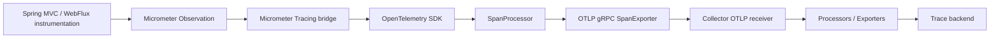

# OTLP gRPC exporter trong Spring Boot

**OTLP gRPC exporter** là thành phần gửi telemetry từ ứng dụng tới một OTLP receiver bằng giao thức gRPC trên HTTP/2. Với distributed tracing, exporter nhận các spans đã được OpenTelemetry SDK ghi nhận và chuyển chúng thành yêu cầu OTLP gửi tới OpenTelemetry Collector hoặc backend tương thích. Trong Spring Boot, exporter cần được kết nối đúng với Micrometer Tracing/Observation hoặc OpenTelemetry SDK để tránh tạo nhiều tracing pipeline trùng lặp.

Trong module **SPRING_BOOT_OBSERVABILITY**, exporter nối instrumentation với hệ thống tiếp nhận telemetry. Bài thuộc chương **Tracer implementation**, tập trung vào dependency/version compatibility, tạo exporter, BatchSpanProcessor, SdkTracerProvider, Resource/sampler/propagators, tích hợp Spring Boot, TLS/auth, lifecycle/shutdown, Collector và troubleshooting.

## 1. OTLP gRPC exporter làm nhiệm vụ gì?

OpenTelemetry SDK tạo span trong quá trình ứng dụng xử lý request. Exporter gửi spans đã được SDK chọn ghi nhận tới receiver.



| Thành phần | Trách nhiệm |
| --- | --- |
| Observation/instrumentation | Phát hiện hoạt động cần quan sát |
| Tracing bridge | Kết nối Micrometer Tracing với tracing implementation |
| TracerProvider | Cấu hình tracer, Resource, sampler và processors |
| SpanProcessor | Xử lý span lifecycle, thường batch trước khi export |
| SpanExporter | Gửi spans tới receiver |
| Collector | Nhận, xử lý và chuyển tiếp telemetry |
| Backend | Lưu, index và cung cấp truy vấn traces |

Exporter không tự instrument controller, không tự tạo Trace ID cho mọi request và không đảm bảo mọi spans đều được lưu. Instrumentation, sampling, processor, transport và backend đều phải hoạt động.

## 2. OTLP gRPC và OTLP HTTP

OTLP có thể được truyền qua gRPC hoặc HTTP. Bài này tập trung vào gRPC exporter.

| Đặc điểm | OTLP gRPC | OTLP HTTP |
| --- | --- | --- |
| Transport | gRPC trên HTTP/2 | HTTP request/response |
| Cổng mặc định thường gặp | 4317 | 4318 |
| Exporter | OtlpGrpcSpanExporter | OtlpHttpSpanExporter |
| Endpoint | Target/URI theo API exporter | URL thường có /v1/traces |
| Proxy | Cần gRPC/HTTP2 tương thích | Cần HTTP routing |
| Payload | OTLP gRPC service calls | OTLP/HTTP protobuf hoặc JSON |

Ví dụ gRPC target trong lab:

```text
http://otel-collector:4317
```

Ví dụ HTTP endpoint:

```text
http://otel-collector:4318/v1/traces
```

Không gắn /v1/traces vào target gRPC. Hai transport có thể dùng chung OTLP data model nhưng không thể thay thế bằng cách chỉ đổi port hoặc URL path.

## 3. Dependencies và version compatibility

Với Spring Boot 3.x, ứng dụng có thể dùng Micrometer Tracing bridge cho OpenTelemetry và exporter OTLP của OpenTelemetry SDK.

Ví dụ dependencies Maven:

```xml
<dependencies>
    <dependency>
        <groupId>org.springframework.boot</groupId>
        <artifactId>spring-boot-starter-actuator</artifactId>
    </dependency>
    <dependency>
        <groupId>io.micrometer</groupId>
        <artifactId>micrometer-tracing-bridge-otel</artifactId>
    </dependency>
    <dependency>
        <groupId>io.opentelemetry</groupId>
        <artifactId>opentelemetry-exporter-otlp</artifactId>
    </dependency>
</dependencies>
```

Dùng Spring Boot BOM/parent và dependency management để chọn version tương thích. Tránh nâng riêng một artifact OpenTelemetry vượt khỏi version mà Micrometer bridge/Boot integration đã kiểm thử.

### 3.1. Kiểm tra dependency tree

Mục tiêu khi kiểm tra dependency tree là phát hiện nhiều phiên bản OpenTelemetry API/SDK/exporter cùng tồn tại hoặc exporter không có trong runtime classpath.

Không thêm SDK thủ công nếu Spring Boot đã auto-configure tracing SDK mà chưa xác định cách tích hợp. Hai SDK/provider độc lập có thể tạo context không tương thích, duplicate spans hoặc hai lần export.

### 3.2. Exporter artifact và bridge khác nhau

- micrometer-tracing-bridge-otel kết nối Micrometer Tracing với OpenTelemetry.
- opentelemetry-exporter-otlp cung cấp OTLP exporters.
- opentelemetry-sdk cung cấp SDK providers/processors.
- micrometer-registry-otlp là registry cho Micrometer metrics, không phải tracing exporter.

Thêm metrics registry OTLP không tự gửi spans. Thêm tracing bridge cũng không tự quyết định endpoint/protocol nếu exporter chưa được cấu hình.

## 4. Tạo OtlpGrpcSpanExporter

OpenTelemetry Java SDK cung cấp gRPC span exporter. Ví dụ:

```java
import io.opentelemetry.exporter.otlp.trace.OtlpGrpcSpanExporter;
import java.time.Duration;

OtlpGrpcSpanExporter spanExporter =
        OtlpGrpcSpanExporter.builder()
                .setEndpoint("http://otel-collector:4317")
                .setTimeout(Duration.ofSeconds(10))
                .build();
```

Ví dụ endpoint dùng plaintext trong mạng lab. API endpoint và scheme có thể phụ thuộc exporter version; production nên cấu hình TLS và xác thực phù hợp.

Exporter có lifecycle. Khi provider đóng, processor/exporter cần được flush và giải phóng. Không tạo exporter mới cho từng request.

### 4.1. Endpoint theo môi trường

Có thể externalize endpoint qua environment variable:

```bash
OTEL_EXPORTER_OTLP_ENDPOINT=http://otel-collector:4317
```

Biến môi trường OpenTelemetry có semantics riêng và exporter implementation phải thực sự đọc nó. Nếu code tự truyền setEndpoint, giá trị trong builder/configuration có thể là nguồn quyết định. Không giả định mọi Spring Boot property tự ánh xạ vào gRPC exporter.

### 4.2. Endpoint generic và traces-specific

OpenTelemetry có biến cấu hình generic cho OTLP endpoint và biến riêng cho từng signal trong SDK environment variable specification. Với gRPC, không thêm HTTP signal path /v1/traces vào endpoint. Kiểm tra semantics của exporter/version nếu dùng generic endpoint hoặc traces-specific endpoint.

## 5. BatchSpanProcessor

Không nên gửi từng span ngay khi span kết thúc. BatchSpanProcessor gom spans vào queue rồi export theo batch để giảm overhead network và exporter calls.

```java
import io.opentelemetry.sdk.trace.export.BatchSpanProcessor;

BatchSpanProcessor spanProcessor =
        BatchSpanProcessor.builder(spanExporter)
                .setScheduleDelay(Duration.ofSeconds(5))
                .setMaxQueueSize(2048)
                .setMaxExportBatchSize(512)
                .setExporterTimeout(Duration.ofSeconds(10))
                .build();
```

Tên method/API có thể thay đổi theo OpenTelemetry SDK version. Các con số chỉ minh họa; cần đo traffic, kích thước spans, latency receiver và giới hạn memory trước khi chọn giá trị production.

| Tham số | Ý nghĩa |
| --- | --- |
| Schedule delay | Khoảng chờ trước lần export theo lịch |
| Max queue size | Số spans tối đa chờ trong queue |
| Max export batch size | Số spans tối đa trong một batch |
| Exporter timeout | Thời gian giới hạn cho lần export |
| Shutdown flush | Cố gắng gửi spans còn lại khi provider đóng |

### 5.1. Queue đầy và dropped spans

Nếu receiver chậm hoặc mất kết nối, queue có thể đầy. Khi vượt giới hạn, spans mới có thể bị drop theo processor policy. Theo dõi exporter failure, queue utilization, Collector receiver metrics và backend ingestion.

Tăng queue không phải giải pháp duy nhất: queue lớn hơn tiêu thụ nhiều memory và có thể kéo dài thời gian phục hồi. Cân bằng throughput, latency, memory và mức mất telemetry chấp nhận được.

## 6. Xây dựng SdkTracerProvider

SpanExporter được kết nối với SDK thông qua SpanProcessor trên SdkTracerProvider.

```java
import io.opentelemetry.api.trace.propagation.W3CTraceContextPropagator;
import io.opentelemetry.context.propagation.ContextPropagators;
import io.opentelemetry.sdk.OpenTelemetrySdk;
import io.opentelemetry.sdk.resources.Resource;
import io.opentelemetry.sdk.trace.SdkTracerProvider;
import io.opentelemetry.sdk.trace.samplers.Sampler;

SdkTracerProvider tracerProvider =
        SdkTracerProvider.builder()
                .setResource(Resource.getDefault())
                .setSampler(Sampler.parentBased(
                        Sampler.traceIdRatioBased(0.10)))
                .addSpanProcessor(spanProcessor)
                .build();

OpenTelemetrySdk openTelemetry =
        OpenTelemetrySdk.builder()
                .setTracerProvider(tracerProvider)
                .setPropagators(
                        ContextPropagators.create(
                                W3CTraceContextPropagator.getInstance()))
                .build();
```

Đây là ví dụ SDK độc lập, không phải cấu hình auto-configuration đầy đủ của Spring Boot. traceIdRatioBased(0.10) chọn tỷ lệ root traces theo sampler; parent-based behavior giúp child spans tuân theo quyết định parent. Ratio cần được chọn theo traffic và ngân sách telemetry.

Resource.getDefault() lấy Resource mặc định theo SDK. Ứng dụng thực tế cần bổ sung service identity/version/environment bằng cơ chế phù hợp.

### 6.1. Resource identity

Ví dụ Resource:

```text
service.name = order-service
service.version = 2.4.1
deployment.environment.name = staging
service.namespace = commerce
```

Resource attributes giúp backend nhóm spans theo service và deployment. Không dùng request ID, Trace ID hoặc user ID làm Resource attributes vì chúng có cardinality cao hoặc nhạy cảm.

### 6.2. Propagators

W3C Trace Context propagator inject/extract traceparent và context tương ứng. Nếu ứng dụng dùng Baggage, cấu hình propagator phù hợp policy và chỉ truyền fields được phép. Exporter không tự đảm nhiệm propagation; instrumentation và propagator quản lý việc truyền context qua HTTP.

## 7. Tích hợp với Spring Boot và Micrometer Tracing

Spring Boot có thể quản lý ObservationRegistry, Micrometer Tracing bridge, tracer và exporter theo auto-configuration. Khi dùng bridge OpenTelemetry, cần xác định cách exporter được cung cấp cho tracing implementation.

Hai hướng kiến trúc chính:

1. **Spring Boot-managed tracing:** để Boot/Micrometer tạo tracer/provider và cấu hình exporter theo extension points/properties mà version đó hỗ trợ.
2. **SDK-managed tracing:** tự tạo OpenTelemetry SDK/provider/exporter và tích hợp với Spring/Micrometer theo cơ chế bridge rõ ràng.

Không trộn hai hướng ngẫu nhiên. Nếu tự tạo OpenTelemetrySdk riêng trong khi Boot đã tạo SDK khác, instrumentation có thể dùng provider khác với exporter vừa tạo.

### 7.1. Tránh duplicate spans

Triệu chứng khi hai tracing pipelines cùng hoạt động:
- Một request tạo hai spans tương tự.
- Backend nhận duplicate traces/spans.
- Trace ID khác nhau giữa log correlation và exporter.
- Context propagation không liên tục.
- Hai exporter cùng gửi một span.

Kiểm tra Java agent, Boot auto-configuration, custom SDK beans và tracing bridge. Chỉ có một tracing provider/ownership model rõ ràng cho instrumentation chính.

### 7.2. Không nhầm Boot OTLP HTTP property với gRPC

Một số cấu hình Spring Boot OTLP tracing endpoint hướng tới OTLP/HTTP. Đặt cổng 4317 vào property HTTP không biến exporter thành gRPC. Nếu cần gRPC, xác nhận auto-configuration/version hỗ trợ transport đó hoặc cung cấp exporter gRPC qua integration phù hợp.

Không dùng setEndpoint trong ví dụ SDK như thể Spring Boot tự động gọi builder đó. Phải có bean/configuration thực sự được tracing bridge sử dụng.

## 8. Tạo Spring configuration cho SDK riêng

Khi chủ động quản lý OpenTelemetry SDK, có thể tạo configuration bean và đóng provider theo lifecycle Spring.

```java
@Configuration
class OpenTelemetryConfiguration {

    @Bean(destroyMethod = "close")
    SdkTracerProvider tracerProvider() {
        OtlpGrpcSpanExporter exporter =
                OtlpGrpcSpanExporter.builder()
                        .setEndpoint("http://otel-collector:4317")
                        .build();

        BatchSpanProcessor processor =
                BatchSpanProcessor.builder(exporter).build();

        return SdkTracerProvider.builder()
                .setResource(Resource.getDefault())
                .addSpanProcessor(processor)
                .build();
    }
}
```

Đoạn này minh họa lifecycle bean của provider. Nó **chưa tự đảm bảo Micrometer Tracing bridge sử dụng provider đó**. Cần dùng integration/bean contract được Spring Boot và Micrometer Tracing version hỗ trợ. Không tự khởi tạo provider thứ hai chỉ để có endpoint gRPC.

Trong production, endpoint, TLS, timeout, Resource và sampler nên được externalize qua cấu hình có kiểm soát thay vì hardcode.

## 9. TLS và authentication

Production exporter thường cần TLS hoặc mTLS khi gửi qua network không hoàn toàn tin cậy. Backend còn có thể yêu cầu authentication metadata như bearer token hoặc API key.

### 9.1. TLS

- Dùng hostname khớp certificate SAN.
- Trust store phải chứa CA cần thiết.
- Kiểm tra expiry/rotation.
- Nếu mTLS, client phải cung cấp certificate/key.
- Không tắt certificate verification để bỏ qua lỗi.

Cấu hình TLS API phụ thuộc OpenTelemetry exporter version và gRPC channel setup. Không sao chép cấu hình HTTP client vào gRPC channel mà không xác minh.

### 9.2. Authentication metadata

Exporter có thể hỗ trợ headers/metadata hoặc custom gRPC credentials. Cơ chế cụ thể phụ thuộc SDK/backend.

- Không hardcode token trong source code.
- Lấy secrets từ secret manager hoặc deployment secret injection.
- Không log credential/metadata.
- Dùng credential quyền tối thiểu.
- Có quy trình rotation và expiry.
- Phân biệt TLS (bảo vệ kênh) với authentication (xác thực client).

## 10. Timeout, retry và graceful shutdown

Exporter gửi telemetry qua network nên cần giới hạn timeout và xử lý lỗi tạm thời.

| Tình huống | Hệ quả | Cách vận hành |
| --- | --- | --- |
| Receiver unavailable | Export thất bại | Theo dõi lỗi và retry theo policy |
| Network chậm | Batch bị trễ | Timeout hợp lý, kiểm tra latency |
| Queue đầy | Spans có thể bị drop | Theo dõi queue, tăng capacity có kiểm soát |
| Backend throttling | Export bị từ chối/chậm | Điều chỉnh rate, batch và capacity |
| Process shutdown | Spans còn trong queue | Flush/close provider đúng lifecycle |

Không giả định exporter retry vô hạn hoặc mọi span được bảo đảm delivery. Retry policy phụ thuộc exporter implementation/version. Backlog quá lớn có thể tăng memory và traffic burst khi backend hồi phục.

### 10.1. Đóng provider đúng cách

SdkTracerProvider.close() giúp flush processor và giải phóng exporter theo lifecycle. Với Spring, bean có destroyMethod=close là một cách quản lý lifecycle khi provider thực sự do bean đó sở hữu.

Trong Kubernetes, termination grace period phải đủ cho ứng dụng shutdown. Nếu process bị kill cưỡng bức trước khi flush, spans còn trong queue có thể mất.

Không đóng exporter sau mỗi request và không tự flush đồng bộ trên request thread.

## 11. Cấu hình OpenTelemetry Collector

Collector nhận OTLP/gRPC tại cổng phổ biến 4317:

```yaml
receivers:
  otlp:
    protocols:
      grpc:
        endpoint: 0.0.0.0:4317

processors:
  batch: {}

exporters:
  debug:
    verbosity: basic

service:
  pipelines:
    traces:
      receivers: [otlp]
      processors: [batch]
      exporters: [debug]
```

Debug exporter hữu ích trong lab để xác minh Collector nhận spans; nó không phải trace storage backend. Production cần exporter tương ứng với backend và TLS/auth phù hợp.

### 11.1. Kiểm tra receiver

Kiểm tra startup logs của Collector để xác nhận receiver bind đúng interface/port. Từ môi trường ứng dụng, hostname/port phải phân giải và truy cập được. Trong container, localhost thường trỏ về container hiện tại, không phải Collector container khác.

### 11.2. Collector downstream exporter

Collector có thể thêm batch, memory limiter, filtering hoặc resource processors trước khi export. Kiểm tra traces pipeline kết nối receiver, processors và exporter. Metrics/logs cần pipeline riêng nếu muốn nhận các signal đó.

## 12. Sampling và exporter

Sampler quyết định spans có được record/sample theo policy trước khi export. Exporter chỉ gửi spans đã đến processor/export path; nó không khôi phục spans bị sampler loại.

Head sampling quyết định sớm ở trace root. Parent-based sampling giúp child spans tuân theo sampled decision từ parent context. Tail sampling ở Collector có thể chọn trace sau khi nhận spans, nhưng không thể xem spans đã bị drop tại ứng dụng.

Phân biệt:
- Không có trace trong backend.
- Sampler đã drop trace.
- Exporter gửi thất bại.
- Collector drop theo processor.
- Backend không ingest/index/retention trace.

Kiểm tra từng tầng bằng metrics/logs tương ứng.

## 13. Bảo mật và cardinality

Exporter chuyển telemetry ra khỏi process, vì vậy cần kiểm soát nội dung trước khi gửi.

Không đưa vào spans:
- Password, API keys, bearer tokens.
- Cookie/Authorization headers.
- Raw request/response bodies có PII.
- Query strings chứa dữ liệu nhạy cảm.
- Customer identifiers không có nhu cầu được phê duyệt.

Resource và span attributes nên có allowlist, route dùng template thay raw ID, baggage được lọc theo policy. TLS không làm dữ liệu nhạy cảm trở nên an toàn để lưu lâu dài ở backend.

Cổng receiver không nên mở công khai nếu không có authentication, TLS và network policy phù hợp.

## 14. Troubleshooting OTLP gRPC exporter

| Triệu chứng | Nguyên nhân có thể | Cách kiểm tra |
| --- | --- | --- |
| Không thấy spans trong Collector | Exporter chưa được tạo hoặc sampler drop | Kiểm tra provider, processor, sampler |
| Connection refused | Sai hostname/port hoặc receiver chưa listen | Kiểm tra Collector receiver và network |
| UNAVAILABLE/deadline exceeded | Proxy, DNS, network hoặc receiver quá tải | Kiểm tra HTTP/2 path, timeout và logs |
| TLS handshake failure | CA, certificate, SNI/hostname sai | Kiểm tra trust chain và certificate |
| UNAUTHENTICATED | Thiếu/sai metadata credential | Kiểm tra secret injection và auth config |
| Collector nhận nhưng backend trống | Downstream exporter/pipeline lỗi | Kiểm tra Collector pipeline và backend |
| Duplicate spans | Nhiều provider/agent/exporter cùng instrument | Kiểm tra auto-config, Java agent, SDK beans |
| Trace ID khác giữa logs và backend | Nhiều tracing contexts/providers | Kiểm tra bridge, provider ownership và MDC |
| Queue đầy | Receiver/backend chậm hoặc mất kết nối | Kiểm tra queue, batch, retry và ingest rate |
| Mất spans khi shutdown | Provider không close hoặc grace period ngắn | Kiểm tra lifecycle/termination |
| Chỉ metrics export thành công | Nhầm metrics registry với tracing exporter | Kiểm tra span exporter riêng |
| HTTP 404/405 | Dùng HTTP path với gRPC target | Xác minh protocol và endpoint |
| Traces thiếu Resource | SDK provider không gắn Resource mong muốn | Kiểm tra Resource của provider |
| Không có child spans | Propagation/instrumentation downstream chưa hoạt động | Kiểm tra propagator và client instrumentation |

### Quy trình debug

1. Xác định ai sở hữu OpenTelemetry provider trong ứng dụng.
2. Xác nhận OtlpGrpcSpanExporter thực sự được tạo và gắn vào SpanProcessor.
3. Xác nhận sampler cho phép span được record/export.
4. Kiểm tra endpoint, DNS, port và gRPC/HTTP2 connectivity.
5. Kiểm tra TLS certificate, authority và authentication metadata.
6. Kiểm tra BatchSpanProcessor queue/timeout/export errors.
7. Xác nhận Collector nhận spans và pipeline downstream hoạt động.
8. Kiểm tra backend ingest/index/query và time range.
9. Kiểm tra duplicate instrumentation và Trace ID correlation.
10. Xác minh shutdown flush và dữ liệu nhạy cảm.

## 15. Bài thực hành: gửi spans bằng OTLP gRPC exporter

Mục tiêu là cấu hình ứng dụng lab tạo spans và gửi tới Collector bằng gRPC exporter.

### Chuẩn bị

- Spring Boot 3.x application.
- Micrometer Observation/Tracing hoặc OpenTelemetry SDK riêng với integration rõ ràng.
- OpenTelemetry exporter OTLP version tương thích.
- OpenTelemetry Collector bật gRPC receiver.
- Trace backend hoặc debug exporter trong lab.

### Bước 1 — Bật Collector receiver

Cấu hình OTLP receiver trên 0.0.0.0:4317. Trong lab có thể dùng debug exporter để quan sát spans nhận được.

### Bước 2 — Kiểm tra dependency

Dùng BOM phù hợp để đồng bộ OpenTelemetry API/SDK/exporter và Micrometer bridge. Xác nhận exporter class có trong runtime classpath.

### Bước 3 — Tạo exporter

Tạo OtlpGrpcSpanExporter với endpoint trỏ tới Collector. Cấu hình timeout phù hợp. Không dùng /v1/traces HTTP path.

### Bước 4 — Tạo processor và provider

Gắn exporter vào BatchSpanProcessor, sau đó gắn processor vào SdkTracerProvider. Cấu hình Resource, sampler và W3C propagator theo yêu cầu lab.

### Bước 5 — Tích hợp instrumentation

Đảm bảo Micrometer Tracing/Spring instrumentation sử dụng đúng provider vừa cấu hình. Nếu Boot đã quản lý provider khác, chọn integration path được hỗ trợ trước khi tiếp tục.

### Bước 6 — Tạo request

Gửi request HTTP tới controller có instrumentation. Xác nhận server span được tạo và sampler chọn trace.

### Bước 7 — Xác minh Collector

Kiểm tra debug output hoặc Collector receiver metrics. Xác nhận Trace ID, span name, service Resource và timestamps.

### Bước 8 — Thử lỗi kết nối

Tạm thời dùng hostname/port sai trong lab. Quan sát exporter errors; khôi phục endpoint đúng và xác nhận export hồi phục.

### Bước 9 — Kiểm tra shutdown

Đóng provider đúng lifecycle. Xác nhận batch cuối được flush khi ứng dụng dừng graceful.

### Bước 10 — Kiểm tra duplicate và privacy

Kiểm tra chỉ có một server span dự kiến, Trace ID liên tục, không có tokens/PII và Resource identity chính xác.

### Checklist nghiệm thu

| Điều cần chứng minh | Kết quả mong đợi |
| --- | --- |
| OTLP transport | Phân biệt gRPC và HTTP |
| Exporter | Tạo đúng OtlpGrpcSpanExporter |
| Processor | BatchSpanProcessor gắn đúng exporter |
| Provider | SdkTracerProvider sở hữu processor |
| Spring integration | Instrumentation dùng đúng provider |
| Sampling | Trace được chọn theo policy |
| Propagation | W3C context nối spans |
| Collector | Nhận spans qua gRPC |
| Security | TLS/auth được cấu hình theo môi trường |
| Lifecycle | Flush/close đúng khi shutdown |
| No duplicates | Không có hai tracing pipelines xuất cùng span |
| Privacy | Không export secrets/PII |

## 16. Những nguyên tắc cần ghi nhớ

1. **OTLP gRPC exporter gửi spans qua gRPC/HTTP2**, thường tới receiver cổng 4317.
2. **Exporter không thay instrumentation hoặc sampler.** Nó chỉ export spans được SDK record và processor chuyển tới.
3. **BatchSpanProcessor gom spans để giảm overhead**, nhưng queue/timeout/batch cần chọn theo tải và memory.
4. **SdkTracerProvider kết nối Resource, sampler, propagators và span processors.** Cấu hình đúng provider mà instrumentation thực sự sử dụng.
5. **Spring Boot/Micrometer bridge và OpenTelemetry SDK cần ownership model rõ ràng.** Tránh tạo provider song song và duplicate spans.
6. **Không nhầm OTLP HTTP endpoint property với gRPC exporter.** Đổi port không đổi transport.
7. **TLS/authentication và secret rotation cần được thiết kế cho production.** Không hardcode credentials hoặc disable certificate validation.
8. **Lifecycle/shutdown ảnh hưởng dữ liệu còn trong queue.** Flush/close provider đúng cách và dành termination grace phù hợp.
9. **Collector và backend là các tầng riêng.** Collector nhận spans chưa chứng minh backend đã lưu và index thành công.
10. **Sampling và export failures là hai nguyên nhân khác nhau.** Phân biệt sampled-out, exporter error, Collector drop và backend ingest issue.
11. **Bảo vệ telemetry metadata.** Kiểm soát Resource/span attributes, baggage, cardinality và PII trước khi export.

OTLP gRPC exporter cung cấp đường vận chuyển spans từ OpenTelemetry SDK tới Collector hoặc backend tương thích. Khi exporter được gắn đúng vào provider mà Spring/Micrometer instrumentation sử dụng, batch/timeout được điều chỉnh hợp lý và TLS/auth/lifecycle được quản lý, distributed traces có thể đi qua pipeline ổn định. Xác minh từ span creation tới Collector và backend giúp phân biệt lỗi instrumentation, sampling và export trong môi trường thực.
