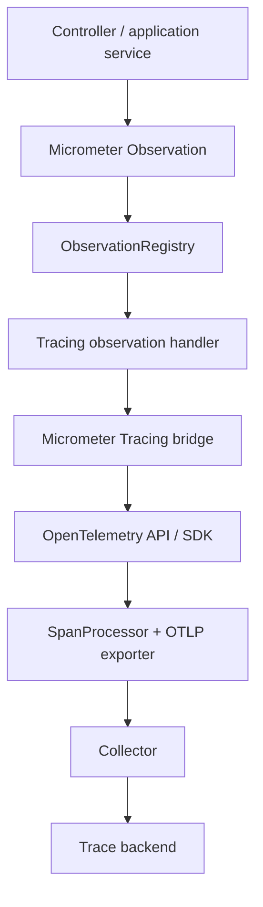

# Tránh dùng vendor API trực tiếp trong tracer implementation

Khi ứng dụng cần distributed tracing, đội phát triển có thể chọn một backend hoặc agent cụ thể để thu thập và xuất spans. Nếu business code gọi trực tiếp API riêng của vendor, quyết định hạ tầng này sẽ lan vào controller, service, domain logic và test. Khi đổi backend, cập nhật SDK hoặc chạy nhiều môi trường khác nhau, code nghiệp vụ cũng phải thay đổi theo.

Bài **Tránh dùng vendor API trực tiếp** thuộc chương **Tracer implementation** của module **SPRING_BOOT_OBSERVABILITY**. Module hướng dẫn thiết lập observability cho Spring Boot bằng Micrometer Observation, metrics, logs và distributed tracing; học context propagation, tags/cardinality, exporter, sampling và liên kết tín hiệu để điều tra lỗi, độ trễ và hành vi ứng dụng trên môi trường thực.

Mục tiêu là giữ instrumentation ở mức abstraction ổn định, cô lập cấu hình SDK/bridge/exporter ở composition root, phân biệt API chuẩn với vendor extension, và kiểm thử hành vi tracing mà không phụ thuộc backend thật.

## 1. Vendor API trực tiếp tạo ra coupling như thế nào?

Giả sử một service nghiệp vụ tạo span bằng class riêng của một tracing vendor. Service phải biết tên class, cách khởi tạo span, cách gắn attributes, cách đặt status và cách kết thúc span. Những chi tiết đó không thuộc quy tắc nghiệp vụ của checkout.

Một số dấu hiệu coupling:

- Controller hoặc service import package SDK của backend.
- Business method tự tạo exporter, tracer provider hoặc SDK instance.
- Domain exception bị chuyển trực tiếp thành vendor-specific status.
- Test cần khởi động backend/agent chỉ để xác minh một thao tác nghiệp vụ.
- Cùng một ý nghĩa nghiệp vụ được instrument khác nhau ở từng module.
- Đổi tracing bridge kéo theo sửa nhiều package nghiệp vụ.

Không phải mọi dependency vào thư viện observability đều xấu. Vấn đề là **business logic phụ thuộc vào chi tiết triển khai telemetry** và phải đổi theo chi tiết đó.

## 2. Phân biệt API chuẩn, abstraction và vendor implementation

| Lớp | Ví dụ | Trách nhiệm |
| --- | --- | --- |
| Business/domain | Checkout, payment, inventory | Thực hiện quy tắc nghiệp vụ |
| Application instrumentation | Micrometer Observation | Đánh dấu operation và metadata nghiệp vụ |
| Tracing API | Micrometer Tracing hoặc OpenTelemetry API | Tạo/đọc span context qua abstraction |
| Bridge/adapter | Micrometer Tracing bridge cho OTel hoặc Brave | Nối abstraction với tracer implementation |
| SDK/agent | OpenTelemetry SDK, vendor agent | Sampling, processors, context propagation và lifecycle |
| Exporter/backend | OTLP exporter, trace platform exporter | Gửi và lưu telemetry |

OpenTelemetry API là API mở, độc lập với một backend cụ thể; OpenTelemetry SDK là implementation. Micrometer Observation cung cấp abstraction cho hoạt động quan sát; Micrometer Tracing cung cấp abstraction tracing và có thể kết nối với các bridge khác nhau.

Một exporter có thể là vendor-specific mà vẫn được đặt ở tầng cấu hình. Business code không cần import exporter package để ghi nhận một hoạt động.

## 3. Kiến trúc ít phụ thuộc vendor

Một kiến trúc Spring Boot có thể giữ instrumentation ở Observation và để framework/bridge quản lý tracing implementation:



Business operation chỉ cần phát biểu rằng một operation đang diễn ra. Spring Boot wiring và tracing bridge chịu trách nhiệm biến observation thành span. Khi đổi bridge/exporter, business method không cần biết backend mới.

Không nhất thiết mọi ứng dụng phải dùng đủ tất cả các lớp trên. Điều quan trọng là có ranh giới rõ: instrumentation API ở code, implementation và exporter ở composition/configuration.

## 4. Ưu tiên Micrometer Observation cho operation của ứng dụng

Với Spring Boot, Micrometer Observation thường là lựa chọn phù hợp để instrument operation ở tầng ứng dụng vì cùng một observation có thể cung cấp metrics và tracing qua handlers đã đăng ký.

Ví dụ:

```java
import io.micrometer.observation.Observation;
import io.micrometer.observation.ObservationRegistry;
import org.springframework.stereotype.Service;

@Service
class CheckoutService {
    private final ObservationRegistry observationRegistry;
    private final PaymentGateway paymentGateway;

    CheckoutService(
            ObservationRegistry observationRegistry,
            PaymentGateway paymentGateway) {
        this.observationRegistry = observationRegistry;
        this.paymentGateway = paymentGateway;
    }

    Receipt checkout(CheckoutCommand command) {
        return Observation.createNotStarted(
                "checkout.process",
                observationRegistry)
            .lowCardinalityKeyValue("checkout.channel", command.channel())
            .observe(() -> paymentGateway.authorize(command));
    }
}
```

Ví dụ minh họa cách instrument application operation bằng Observation. Trong ứng dụng thực, command/channel phải được validate và channel cần thuộc tập giá trị hữu hạn. Không thêm email, customer ID, order ID hoặc dữ liệu nhạy cảm làm low-cardinality tags.

Observation cho phép handler tạo các tín hiệu phù hợp. Nếu tracing handler không được cấu hình, operation vẫn có thể được đo bằng metrics handler; vì vậy không nên giả định mọi observation đều luôn tạo span.

## 5. Khi cần thao tác span trực tiếp, dùng API abstraction

Một số trường hợp cần gắn event, ghi exception hoặc tạo child span rõ ràng. Có thể dùng Micrometer Tracing abstraction:

```java
import io.micrometer.tracing.Span;
import io.micrometer.tracing.Tracer;
import org.springframework.stereotype.Component;

@Component
class InventoryTraceSupport {
    private final Tracer tracer;

    InventoryTraceSupport(Tracer tracer) {
        this.tracer = tracer;
    }

    void recordReservationAttempt(String warehouse) {
        Span span = tracer.nextSpan()
            .name("inventory.reserve")
            .tag("warehouse", warehouse)
            .start();
        try (Tracer.SpanInScope scope = tracer.withSpan(span)) {
            reserve(warehouse);
        } catch (RuntimeException ex) {
            span.error(ex);
            throw ex;
        } finally {
            span.end();
        }
    }

    private void reserve(String warehouse) {
        // Business operation
    }
}
```

Đây là ví dụ dùng abstraction Micrometer Tracing, không import class của một backend cụ thể. API chính xác có thể khác theo Micrometer version; kiểm tra dependency management của Spring Boot trước khi dùng.

Chỉ tạo span thủ công khi có ý nghĩa instrumentation rõ. Nếu một Observation đã bao quanh operation, tạo thêm span tương đương có thể làm trace tree dư thừa. Không đặt tên span chứa ID động; dùng tên operation ổn định và tags có cardinality phù hợp.

## 6. OpenTelemetry API cũng là lựa chọn vendor-neutral

Khi ứng dụng đã chuẩn hóa trên OpenTelemetry, có thể dùng OpenTelemetry API trực tiếp mà không phụ thuộc exporter/backend:

```java
import io.opentelemetry.api.trace.Span;
import io.opentelemetry.api.trace.Tracer;
import io.opentelemetry.context.Scope;

class ShippingClient {
    private final Tracer tracer;

    ShippingClient(Tracer tracer) {
        this.tracer = tracer;
    }

    void dispatch(String carrierCode) {
        Span span = tracer.spanBuilder("shipping.dispatch").startSpan();
        try (Scope scope = span.makeCurrent()) {
            span.setAttribute("shipping.carrier", carrierCode);
            sendToCarrier(carrierCode);
        } catch (RuntimeException ex) {
            span.recordException(ex);
            span.setStatus(
                io.opentelemetry.api.trace.StatusCode.ERROR);
            throw ex;
        } finally {
            span.end();
        }
    }

    private void sendToCarrier(String carrierCode) {
        // External call
    }
}
```

OpenTelemetry API là chuẩn mở, không đồng nghĩa với một vendor backend. Tuy nhiên, code vẫn phụ thuộc vào tracing API cụ thể (ở đây là OTel) thay vì Micrometer Observation. Chọn một abstraction nhất quán theo kiến trúc; không trộn nhiều API trong cùng business operation nếu không có adapter rõ ràng.

## 7. Đặt vendor-specific configuration ở composition root

Các chi tiết như endpoint, credentials, exporter, sampling, resource và processor nên ở cấu hình ứng dụng hoặc platform deployment:

```yaml
management:
  tracing:
    sampling:
      probability: 0.1
  otlp:
    tracing:
      endpoint: http://otel-collector:4318/v1/traces
```

Đây là ví dụ cấu hình Spring Boot theo các property được hỗ trợ ở những phiên bản tương ứng; cần xác minh property/transport theo dependency thực tế. Endpoint collector có thể thay đổi giữa dev, staging và production mà không cần sửa business service.

Nếu tự quản lý SDK, tạo provider/exporter dưới dạng singleton bean và để Spring quản lý shutdown. Không khởi tạo exporter trong controller hoặc mỗi request. Nếu Spring Boot đã sở hữu provider, không tạo SDK thứ hai cạnh tranh.

## 8. Bridge và adapter: ranh giới chuyển đổi

Bridge chuyển API ở tầng ứng dụng sang implementation tracing. Ví dụ Micrometer Tracing có thể kết nối với OpenTelemetry hoặc Brave qua bridge tương ứng. Adapter cũng có thể chuyển một abstraction nội bộ sang API chuẩn.

Nguyên tắc:

- Chỉ một tracing implementation owner cho một pipeline.
- Tracer được inject từ container; không tự tạo global SDK trong business code.
- Không để type vendor-specific đi qua interface domain.
- Mapping status, exception và attributes nằm ở adapter/instrumentation boundary.
- Có test xác nhận context và parent-child relationship sau bridge.

Bridge không tự động giải quyết mọi khác biệt semantic. Cần kiểm tra span names, attribute keys, sampling, propagation formats và baggage khi chuyển implementation.

## 9. Context propagation không nên tự viết theo vendor

Distributed trace cần context được inject vào outbound request và extract ở inbound request. Dùng HTTP client/server instrumentation hoặc propagator chuẩn được framework quản lý.

Với Spring Boot, ưu tiên instrumentations tương thích với stack MVC/WebFlux và HTTP client đang dùng. Khi dùng executor hoặc asynchronous tasks, kiểm tra context propagation qua thread boundary bằng integration được hỗ trợ.

Không tự lưu trace ID vào static ThreadLocal hoặc truyền ID như một business parameter. Cách đó dễ làm mất parent span, rò context giữa requests hoặc tạo trace không hợp lệ. Cũng không dùng trace context làm cơ chế authentication/authorization.

## 10. Attributes, naming và semantic conventions

Vendor-neutral không chỉ là tránh import package. Nếu mỗi service đặt tên span và attribute khác nhau, backend vẫn khó phân tích khi đổi exporter.

Nên:

- Dùng operation names ổn định như checkout.process, inventory.reserve.
- Ưu tiên HTTP/database/messaging semantic conventions phù hợp.
- Dùng attribute keys có ý nghĩa thống nhất giữa services.
- Giữ metric dimensions low-cardinality.
- Không ghi PII, token, raw payload hoặc identifiers động không cần thiết.
- Ghi rõ custom attributes nào là contract nội bộ.

Thay vì span name gắn order ID, dùng tên operation ổn định; nếu cần identifier để tra cứu, cân nhắc log correlation hoặc trace attribute có policy, không đưa ID vào metric labels.

## 11. Tránh abstraction quá mức

Không cần tạo một interface nội bộ cho mọi method tracing chỉ để che một API chuẩn đã ổn định. Một lớp wrapper tự chế có thể làm mất tính năng, tạo thêm API phải bảo trì và khiến developers học hai bộ abstraction.

Tạo adapter riêng khi có nhu cầu thực:

- Nhiều tracing implementations phải được hỗ trợ đồng thời.
- Ứng dụng có API nội bộ ổn định và muốn bảo vệ domain khỏi framework.
- Cần chuyển đổi metadata hoặc enforce policy chung.
- Có migration dài hạn với nhiều modules cần compatibility.

Nếu chỉ có một implementation được Spring Boot quản lý, Micrometer Observation/Tracing hoặc OpenTelemetry API thường đã đủ. Abstraction nên phản ánh nhu cầu thật, không chỉ đổi tên các method của SDK.

## 12. Kiểm thử không cần vendor backend

Business tests nên xác minh hành vi nghiệp vụ độc lập backend. Instrumentation tests có thể dùng ObservationRegistry/MeterRegistry test hoặc in-memory span exporter:

| Test | Điều cần chứng minh |
| --- | --- |
| Business unit test | Kết quả nghiệp vụ đúng khi telemetry handler không có backend |
| Observation test | Operation tạo observation với tên/metadata mong đợi |
| Tracing API test | Span được tạo, kết thúc và status/error đúng |
| Context test | Child span giữ trace ID và parent relationship |
| Bridge integration test | Micrometer span được export qua OTel bridge đúng |
| Configuration test | Chỉ một provider/exporter owner được tạo |
| Migration contract test | Attributes/names quan trọng giữ semantics qua backend mới |

Ví dụ dùng ObservationRegistry không có handlers để kiểm thử business flow:

```java
import io.micrometer.observation.ObservationRegistry;
import org.junit.jupiter.api.Test;
import static org.junit.jupiter.api.Assertions.assertEquals;

class CheckoutServiceTest {
    @Test
    void completesWithoutVendorBackend() {
        PaymentGateway gateway = command -> new Receipt("accepted");
        CheckoutService service = new CheckoutService(
            ObservationRegistry.NOOP, gateway);

        Receipt receipt = service.checkout(
            new CheckoutCommand("web"));

        assertEquals("accepted", receipt.status());
    }
}
```

Đây là test minh họa; kiểu command/receipt/gateway tùy ứng dụng. Test chứng minh business flow không cần vendor backend, không chứng minh exporter hay bridge hoạt động. Phần bridge cần integration test riêng với in-memory/test exporter.

## 13. Chuyển tracing backend mà không sửa business logic

Một migration có thể thực hiện theo các bước:

1. **Inventory:** tìm imports, dependencies và config vendor-specific trong source.
2. **Phân loại:** xác định phần nào thuộc business logic, phần nào là instrumentation/configuration.
3. **Chọn abstraction:** Observation/Micrometer Tracing hoặc OpenTelemetry API theo kiến trúc.
4. **Cô lập adapter:** chuyển vendor-specific calls về configuration/adapter layer.
5. **Chuẩn hóa semantics:** span names, resource attributes, status, exception và propagation.
6. **Chạy song song có kiểm soát:** nếu cần so sánh backend, dùng pipeline test riêng; tránh instrument trùng và double export.
7. **So sánh dữ liệu:** trace completeness, latency, sampling, cardinality, logs correlation và exporter failures.
8. **Loại implementation cũ:** chỉ sau khi contract tests và vận hành xác nhận pipeline mới đáp ứng yêu cầu.

Không chuyển đổi bằng cách thay package import hàng loạt mà không hiểu semantics. Một số vendor API có khái niệm riêng không tương đương một-một với OpenTelemetry; cần quyết định mapping hoặc bỏ tính năng đó.

## 14. Lỗi thường gặp

| Hiện tượng | Nguyên nhân có thể | Hướng xử lý |
| --- | --- | --- |
| Service import vendor SDK | Instrumentation đặt trong business code | Chuyển sang Observation/standard API hoặc adapter |
| Hai trace cho cùng request | Hai provider/agent cùng instrument | Chọn một ownership, kiểm tra bridge |
| Trace ID bị tách qua HTTP | Propagator/instrumentation không đồng nhất | Dùng W3C propagation và test inject/extract |
| Đổi backend làm nhiều test hỏng | Test phụ thuộc exporter/UI thật | Tách business tests và exporter integration tests |
| Mất vendor-specific attributes | Mapping sang standard API chưa đầy đủ | Lập attribute contract và migration test |
| Span names khác giữa services | Không có naming convention | Chuẩn hóa operation names |
| Context mất qua executor | Không propagate context qua async boundary | Dùng context propagation integration được hỗ trợ |
| Exporter được tạo mỗi request | Khởi tạo SDK sai lifecycle | Singleton provider/exporter ở application scope |
| Sampling không như cấu hình | Custom provider hoặc agent ghi đè | Kiểm tra effective sampler và owner |
| Adapter thành framework tự chế | Abstraction quá mức | Chỉ giữ interface có yêu cầu thực tế |

## 15. Tình huống thực tế: chuyển từ agent riêng sang OpenTelemetry

**Bối cảnh giả định:** một Spring Boot service đã dùng agent của một tracing platform. Controller và service gọi API riêng của agent để tạo custom spans. Công ty muốn chuẩn hóa telemetry qua OpenTelemetry Collector nhưng không muốn sửa logic checkout.

Quy trình:

1. Tìm tất cả imports/API riêng của agent trong source và phân biệt instrumentation với business behavior.
2. Thay custom spans ở application boundary bằng Micrometer Observation hoặc OpenTelemetry API theo chuẩn đã chọn.
3. Chuyển endpoint, sampling, resource và exporter sang cấu hình SDK/agent/platform.
4. Kiểm tra HTTP server/client instrumentation không bị agent và framework tạo spans trùng.
5. Xác minh W3C trace context đi xuyên gateway, checkout và payment.
6. So sánh span names, attributes, errors, latency và sampling giữa pipeline cũ/mới bằng traffic test.
7. Chỉ bỏ agent cũ sau khi logs correlation, dashboards và alert queries đã chuyển sang schema mới.

Business method vẫn gọi payment gateway và xử lý receipt như trước. Thay đổi nằm ở instrumentation boundary và deployment configuration, giúp backend tracing có thể thay đổi độc lập hơn với nghiệp vụ.

## 16. Bài tập tự kiểm tra

**Bài 1.** Vì sao import vendor SDK trực tiếp trong domain service gây coupling?

*Gợi ý:* Business code phụ thuộc class/lifecycle/semantics của implementation, khiến đổi SDK/backend kéo theo sửa nghiệp vụ.

**Bài 2.** Micrometer Observation và OpenTelemetry API có giống nhau không?

*Gợi ý:* Không. Observation là abstraction instrumentation của Micrometer; OTel API là tracing/telemetry API chuẩn mở. Chúng có thể tích hợp qua bridge.

**Bài 3.** Có nên tạo một wrapper interface cho mọi method của OTel Tracer?

*Gợi ý:* Chỉ khi có nhu cầu thực như nhiều implementations hoặc policy nội bộ. Tránh abstraction chỉ đổi tên API.

**Bài 4.** Vì sao exporter endpoint không nên nằm trong business service?

*Gợi ý:* Endpoint là deployment configuration; thay môi trường/backend không nên thay đổi nghiệp vụ.

**Bài 5.** Hai provider cùng hoạt động có thể gây vấn đề gì?

*Gợi ý:* Hai trace pipelines, context/resource/sampling khác nhau, duplicate spans và correlation bị tách.

**Bài 6.** Làm sao kiểm thử business flow mà không cần trace backend?

*Gợi ý:* Dùng ObservationRegistry.NOOP hoặc test registry cho business test; kiểm thử exporter/bridge riêng bằng in-memory exporter.

**Bài 7.** Đổi exporter có đảm bảo mọi semantic attributes được giữ nguyên không?

*Gợi ý:* Không. Cần contract tests cho names, attributes, status, propagation và mapping của vendor-specific fields.

**Bài 8.** Vì sao không tự lưu trace ID vào ThreadLocal?

*Gợi ý:* Có nguy cơ mất parent context, rò dữ liệu giữa requests và sai khi async/thread reuse; dùng context propagation chuẩn.

## 17. Ghi nhớ

- Tránh vendor API trực tiếp trong business/domain code để backend và SDK có thể thay đổi mà không làm thay đổi nghiệp vụ.
- Dùng **Micrometer Observation/Tracing** hoặc **OpenTelemetry API** ở instrumentation boundary; chọn abstraction nhất quán.
- Đặt SDK, bridge, sampler, resource, exporter, endpoint và lifecycle ở configuration/composition root.
- Một tracing pipeline cần ownership rõ ràng; tránh hai provider/agent instrument cùng operation và tạo duplicate spans.
- Giữ context propagation, span names và semantic attributes nhất quán; không để identifiers/PII trở thành metric tags.
- Không tạo wrapper quá mức. Adapter chỉ có giá trị khi giải quyết nhu cầu portability, policy hoặc migration cụ thể.
- Tách business unit tests khỏi bridge/exporter integration tests; dùng in-memory/test exporter để xác minh telemetry mà không cần backend thật.
