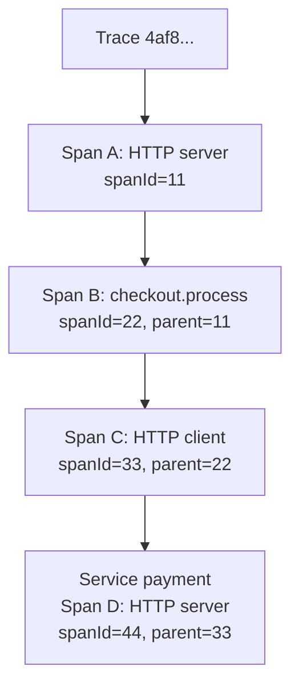
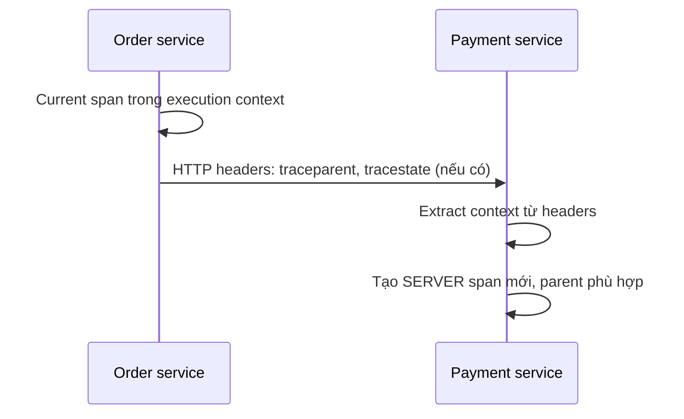

# Tracing context: truyền ngữ cảnh trong distributed tracing

## 1. Mục tiêu học tập

Một request trong Spring Boot có thể bắt đầu ở HTTP server, đi qua service nghiệp vụ, chuyển sang executor, phát một message rồi gọi HTTP sang dịch vụ khác. Distributed tracing chỉ thể hiện đúng quan hệ cha-con khi **ngữ cảnh trace hiện hành được truyền qua từng ranh giới thực thi**. Nếu context bị mất, span ở thread hoặc service tiếp theo có thể trở thành root trace mới, khiến người vận hành không thấy được toàn bộ hành trình.

Trong chương **Context propagation** của module **SPRING_BOOT_OBSERVABILITY**, bài này tập trung vào **Tracing context**. Phạm vi bao gồm current span/observation, thread-local, Reactor Context, Micrometer Context Propagation, executor và `@Async`, HTTP propagation qua W3C Trace Context, message headers, baggage, sampling và cách kiểm tra end-to-end. Đây là các nền tảng cần thiết để liên kết metrics, logs và distributed tracing khi tìm lỗi hoặc độ trễ.

Sau bài học, bạn có thể:

1. Giải thích trace context chứa gì và quan hệ giữa `traceId`, `spanId`, parent và current span.
2. Phân biệt **truyền context trong một tiến trình** với **truyền trace context qua mạng**.
3. Hiểu tại sao `ThreadLocal` không tự đi theo thread pool và reactive pipeline.
4. Sử dụng Micrometer Context Propagation, `ContextPropagatingTaskDecorator` và Reactor Context đúng tình huống.
5. Giải thích cách tracing instrumentation inject/extract W3C `traceparent` trong HTTP hoặc message headers.
6. Đánh giá baggage, sampling và dữ liệu nhạy cảm.
7. Kiểm tra trace cha-con và log correlation, phát hiện context bị mất hoặc bị dùng sai.

**Baseline ví dụ:** Spring Boot 3.5.x, Java 17+, Micrometer Tracing với bridge OpenTelemetry, Spring MVC và Reactor/WebFlux khi có nhắc. Các API và cấu hình cần đối chiếu với phiên bản Spring Boot/Spring Framework/Micrometer thực tế đang chạy.

## 2. Tracing context là gì?

**Trace context** là thông tin nhận diện và liên kết các span thuộc cùng một trace. Tối thiểu, một span thường có:

- `traceId`: định danh trace tổng thể.
- `spanId`: định danh span hiện tại.
- `parentSpanId`: định danh span cha, nếu có.
- Trạng thái trace flags, ví dụ sampled bit.
- `tracestate`: dữ liệu bổ sung theo hệ sinh thái/vendor khi sử dụng W3C Trace Context.

Khi HTTP request A tạo span server, gọi thao tác B và gửi request đến dịch vụ C, các span liên quan phải biết cùng `traceId` và quan hệ parent phù hợp.



Các ID trên chỉ là dữ liệu minh họa. Một trace có thể chứa nhiều span cùng `traceId`, nhưng mỗi span có `spanId` riêng. Trace context **không phải** payload nghiệp vụ, không chứa toàn bộ request/response và cũng không phải một bản sao của `Observation.Context`.

### 2.1. Current span và scope

Trong Micrometer Tracing, `Tracer.currentSpan()` lấy span đang gắn với ngữ cảnh thực thi hiện hành. Khi mở `SpanInScope`, span trở thành current span cho phạm vi code đó; khi scope đóng, current span trước đó được khôi phục.

Với Micrometer Observation, `Observation.Scope` gắn current observation vào ngữ cảnh đang thực thi. Tracing handler có thể dùng scope đó để quản lý span. Hai khái niệm phối hợp nhưng không đồng nhất:

| Khái niệm | Mục đích | API thường gặp |
| --- | --- | --- |
| Trace context | Mang IDs/flags để nối trace | W3C `traceparent`, `tracestate` |
| Span | Mô tả một thao tác có thời gian | `io.micrometer.tracing.Span` |
| Current span | Span hiện hành ở execution context | `Tracer.currentSpan()` |
| Span scope | Đặt/restores current span | `Tracer.withSpan(span)` |
| Observation | Mô tả một thao tác có thể sinh metrics và span | `Observation` |
| Observation scope | Current observation trong scope | `Observation.openScope()` |

Một log có `traceId` không chứng minh tất cả thread/callback trong request đều có current span đúng. Phải kiểm tra tại từng ranh giới mà code chuyển execution.

## 3. Hai loại context propagation cần phân biệt

### 3.1. Trong cùng tiến trình: thread và execution context

Java `ThreadLocal` gắn dữ liệu với một thread cụ thể. Tracing bridge có thể dùng cơ chế này để lưu current span trong luồng đồng bộ:

```text
Thread A:
  current span = checkout.process
  call service()
  return
  restore previous span
```

Khi công việc chuyển từ thread A sang thread B qua `Executor`, `CompletableFuture`, `@Async` hoặc callback, Thread B không tự có cùng ThreadLocal. Thread pool còn tái sử dụng thread, vì vậy việc copy không đúng và không cleanup có thể làm request sau nhìn thấy context của request trước.

Trong reactive applications, execution có thể chuyển qua nhiều thread trong cùng một pipeline. Dựa vào ThreadLocal thuần túy vì thế không đáng tin cậy; Reactor dùng **Reactor Context** làm vùng context gắn với subscription.

Micrometer Context Propagation cung cấp cơ chế cầu nối giữa các context mechanisms như ThreadLocal và Reactor Context thông qua:
- `ThreadLocalAccessor`: đọc/ghi/clear một giá trị ThreadLocal.
- `ContextRegistry`: nơi đăng ký accessor.
- `ContextSnapshot`: chụp các context values hiện có và khôi phục chúng trong phạm vi thực thi.
- `ContextSnapshotFactory`: tạo snapshot theo các accessor/registry đã cấu hình.

### 3.2. Giữa các dịch vụ: inject và extract qua carrier

Khi request rời tiến trình A qua HTTP hoặc message broker, ThreadLocal không thể đi theo network. Instrumentation phải **inject** trace context vào carrier (HTTP headers/message headers); tiến trình B phải **extract** dữ liệu đó và tạo span con hoặc span liên kết phù hợp.



Đây là một cơ chế khác với context snapshot trong thread pool. `ContextPropagatingTaskDecorator` không thay thế W3C propagator, và W3C `traceparent` không tự giữ ThreadLocal qua một executor nội bộ.

## 4. W3C Trace Context: `traceparent` và `tracestate`

W3C Trace Context định nghĩa header chuẩn để mang thông tin liên kết trace qua HTTP. Header `traceparent` có định dạng tổng quát:

```text
version-trace-id-parent-id-trace-flags
```

Ví dụ minh họa hợp lệ về hình thức:

```text
traceparent: 00-4bf92f3577b34da6a3ce929d0e0e4736-00f067aa0ba902b7-01
```

Các trường thể hiện:
- `version=00`: phiên bản định dạng.
- `trace-id`: 32 ký tự hex (16 byte), không được là toàn số 0.
- `parent-id`: 16 ký tự hex (8 byte), không được là toàn số 0; nó thường là span ID của phía gửi trong quan hệ parent.
- `trace-flags=01`: sampled flag được bật trong ví dụ; các bit khác có thể được quy định ở phiên bản sau.

Header `tracestate` là tùy chọn, chứa các mục vendor-specific theo quy tắc W3C. Nó không thay thế `traceparent`.

### 4.1. Luồng inject/extract

1. Service A đang có current span.
2. HTTP client instrumentation lấy trace context hiện hành.
3. Propagator mã hóa ngữ cảnh thành `traceparent` và `tracestate` (nếu áp dụng) trong request headers.
4. Service B nhận headers.
5. Server instrumentation extract trace context và tạo server span gắn đúng parent.
6. Khi B gọi C, nó inject context của span hiện tại của B vào outbound request.

Vì mỗi dịch vụ tạo span của chính mình, giá trị parent ID trong header outbound thường là **span ID của phía gửi**; span server của phía nhận có span ID mới. Không tự copy nguyên header inbound sang mọi request outbound bằng code thủ công nếu tracing client instrumentation đã làm việc đó; làm sai có thể tạo parent relationship không phù hợp hoặc gây duplicate propagation.

### 4.2. Không tự ghi đè header trace

Trong Spring Boot, client/server instrumentation được cấu hình đúng thường đảm nhiệm propagation. Không nên hardcode:

```java
// Không làm như thế này trong code ứng dụng:
request.header("traceparent", "00-fixed-trace-id-fixed-span-id-01");
```

Header giả hoặc giá trị tái sử dụng sẽ làm nhiều request bị gộp sai vào cùng một trace hoặc tạo dữ liệu không hợp lệ. Chỉ custom propagator khi có yêu cầu protocol/interoperability được xác định rõ.

### 4.3. Baggage khác span attributes

**Baggage** là tập key-value được truyền xuyên các ranh giới dịch vụ khi propagator và cấu hình cho phép. Nó có thể mang thông tin phân luồng hoặc metadata dùng chung; nó không tự động là span attribute và không nên được dùng thay cho database hay payload nghiệp vụ.

Ví dụ có thể cân nhắc một key hữu hạn như `tenant.tier=standard`, nếu chính sách nội bộ cho phép. Tránh baggage chứa email, access token, số thẻ, thông tin cá nhân hoặc dữ liệu không cần thiết. Baggage có thể được chuyển tiếp nhiều hop, làm tăng kích thước headers và phát tán thông tin rộng hơn dự kiến.

## 5. Micrometer Context Propagation trong Spring

Micrometer Context Propagation giúp lưu và khôi phục context values ở các ranh giới thực thi. Với Spring, một phần integration được sử dụng trong task decorators, Reactor và các thành phần hỗ trợ observation/tracing.

### 5.1. Context snapshot và ThreadLocal

Mô hình khái niệm:

```text
Thread A (current observation/span)
   |
   | capture context snapshot
   v
ContextSnapshot
   |
   | wrap task / restore
   v
Thread B (context values temporarily restored)
   |
   | task completes
   v
restore previous ThreadLocal values / clear
```

Mục tiêu là **khôi phục trong một phạm vi có giới hạn** rồi cleanup, không phải copy ThreadLocal vĩnh viễn vào thread worker.

Một ví dụ Java thuần với Context Propagation có thể được tổ chức quanh `ContextSnapshotFactory`, nhưng trong ứng dụng Spring Boot nên ưu tiên integration chính thức/được hỗ trợ cho executor và reactive stack thay vì tự viết snapshot thủ công. Việc đăng ký accessor phụ thuộc loại context cần truyền; không phải mọi ThreadLocal trong ứng dụng tự được snapshot.

### 5.2. Vì sao không truyền mọi ThreadLocal?

Không nên snapshot toàn bộ state một cách vô điều kiện:
- Một ThreadLocal có thể chứa request object lớn, security principal hoặc dữ liệu nhạy cảm.
- Thread pool tái sử dụng nên giá trị cũ phải được restore/clear sau task.
- Không phải context nào cũng có ý nghĩa ở thread khác.
- Snapshot quá nhiều giá trị tăng chi phí và tạo phụ thuộc khó kiểm soát.

Chỉ đăng ký/propagate những context cần thiết, có ownership và semantics rõ ràng. Với tracing, dùng accessor/integration của Micrometer Tracing; không tự tạo một ThreadLocal `traceId` rồi mong nó tương đương current span thực.

## 6. Spring Boot 3.5: truyền context qua executor và `@Async`

Giả sử controller nhận một request, sau đó giao bước xử lý sang executor. Không có propagation, worker thread có thể không thấy current observation/span của request cha.

### 6.1. Cấu hình `ContextPropagatingTaskDecorator`

Spring Framework cung cấp `ContextPropagatingTaskDecorator` để capture và restore context trong task execution. Ví dụ cấu hình một executor Spring:

```java
import org.springframework.context.annotation.Bean;
import org.springframework.context.annotation.Configuration;
import org.springframework.core.task.TaskDecorator;
import org.springframework.core.task.support.ContextPropagatingTaskDecorator;
import org.springframework.scheduling.concurrent.ThreadPoolTaskExecutor;

@Configuration
public class AsyncConfiguration {

    @Bean
    TaskDecorator contextPropagatingTaskDecorator() {
        return new ContextPropagatingTaskDecorator();
    }

    @Bean(name = "applicationTaskExecutor")
    ThreadPoolTaskExecutor applicationTaskExecutor(
            TaskDecorator contextPropagatingTaskDecorator) {
        ThreadPoolTaskExecutor executor = new ThreadPoolTaskExecutor();
        executor.setCorePoolSize(4);
        executor.setMaxPoolSize(16);
        executor.setQueueCapacity(200);
        executor.setThreadNamePrefix("app-worker-");
        executor.setTaskDecorator(contextPropagatingTaskDecorator);
        executor.initialize();
        return executor;
    }
}
```

Điểm chính:
- Decorator chụp context tại lúc task được submit theo các accessor đã đăng ký.
- Khi worker thực thi, context được restore trong thời gian task.
- Khi task hoàn tất, context trước đó được trả lại/cleanup để thread tái sử dụng an toàn.
- Cần bảo đảm đúng executor thực tế được inject/dùng bởi `@Async` hoặc nơi submit task; chỉ tạo bean decorator không tự gắn nó vào mọi executor của JVM.

### 6.2. Dùng `@Async`

```java
import io.micrometer.observation.Observation;
import io.micrometer.observation.ObservationRegistry;
import org.springframework.scheduling.annotation.Async;
import org.springframework.stereotype.Service;

@Service
public class BackgroundOrderService {
    private final ObservationRegistry observations;

    public BackgroundOrderService(ObservationRegistry observations) {
        this.observations = observations;
    }

    @Async("applicationTaskExecutor")
    public void processAsync(String orderReference) {
        Observation.createNotStarted("order.process.async", observations)
                .contextualName("process order")
                .lowCardinalityKeyValue("stage", "background")
                .observe(() -> process(orderReference));
    }

    private void process(String orderReference) {
        // Xử lý nghiệp vụ; không đưa orderReference vào metric tags.
    }
}
```

Nếu method được gọi qua Spring proxy từ một bean khác, `@Async` chuyển việc chạy sang executor. Khi executor áp dụng `ContextPropagatingTaskDecorator`, current context có thể được chuyển sang worker. Tên span ở đây vẫn là `process order`; ID đơn hàng là dữ liệu định danh, không phải tên span/tag metric.

**Phân biệt hai loại trace:**
- Context propagation giúp span được tạo trong worker có thể nằm dưới trace cha đang hiện hành.
- `Observation.createNotStarted(...).observe(...)` tạo một span/observation mới cho thao tác worker khi handler phù hợp có mặt.

Nếu worker chạy sau khi request đã kết thúc, trace cha vẫn có thể được giữ qua snapshot nhưng cần đánh giá semantics của async job, thời gian sống và chính sách sampling. Với công việc tách rời theo lịch hoặc queue, có thể cần một trace mới hoặc link giữa traces thay vì ép parent-child kéo dài ngoài ý nghĩa nghiệp vụ.

### 6.3. Giới hạn của TaskDecorator

- Nó không làm cho mọi API async của mọi thư viện tự động propagate.
- Nó không sửa context qua process/network.
- Nếu task truyền qua nhiều executor hoặc callback, kiểm tra từng ranh giới.
- Khi một task bị hủy trước lúc chạy, capture/cleanup cần tuân theo implementation và lifecycle của executor.
- Không dùng một span scope mở ở thread A rồi đóng tại thread B; scope gắn với execution context của thread, phải quản lý đúng tại nơi sử dụng.

## 7. Reactor Context trong WebFlux

Reactor dùng `Context` gắn với **subscription**, không phải một bản sao ThreadLocal của thread. Khi pipeline chuyển thread giữa các scheduler, Reactor Context tiếp tục đi theo subscription; ThreadLocal có thể được khôi phục trong các đoạn thực thi nếu Context Propagation được tích hợp.

### 7.1. Bật chế độ tự động trong Spring Boot

Ở Spring Boot 3.5, có thể chọn chế độ tự động của Reactor context propagation:

```yaml
spring:
  reactor:
    context-propagation: auto
```

Hãy kiểm tra property metadata và tài liệu của phiên bản Boot đang sử dụng vì mặc định/chế độ hỗ trợ có thể khác giữa các bản. `auto` hỗ trợ bridge Reactor Context với ThreadLocal thông qua cơ chế Micrometer Context Propagation; không biến mọi object nghiệp vụ trong Reactor Context thành span attributes tự động.

Khi cần ghi `traceId`, cách ưu tiên là lấy từ current span trong đoạn code đã được tracing instrument, hoặc dùng Observation/Tracing integration sẵn có. Không tự giữ trace ID trong một biến static toàn ứng dụng.

### 7.2. Ví dụ pipeline WebFlux

```java
import io.micrometer.observation.Observation;
import io.micrometer.observation.ObservationRegistry;
import org.springframework.stereotype.Service;
import reactor.core.publisher.Mono;

@Service
public class ReactiveInventoryService {
    private final ObservationRegistry observations;

    public ReactiveInventoryService(ObservationRegistry observations) {
        this.observations = observations;
    }

    public Mono<String> reserve(String channel) {
        return Mono.defer(() ->
                Observation.createNotStarted("inventory.reserve", observations)
                        .contextualName("reserve inventory")
                        .lowCardinalityKeyValue("channel",
                                "web".equals(channel) ? "web" : "other")
                        .observe(() -> Mono.just("reserved")));
    }
}
```

Đoạn trên **cố ý minh họa một ranh giới cần thận trọng**: `observe(Supplier)` chạy đồng bộ tới lúc lambda trả về `Mono`, còn Mono có thể thực thi khi subscribe sau đó. Vì vậy observation có thể dừng khi publisher vừa được tạo, trước khi `Mono.just` hoặc công việc reactive thật được subscribe/hoàn tất. Đây không phải mẫu đo end-to-end cho reactive work.

Với WebFlux, ưu tiên instrumentation Reactor/HTTP tích hợp sẵn của Spring Boot và dùng các API reactive-aware để bao lifecycle **trong subscription**, không bao ngoài assembly. Nếu cần custom observation cho một reactive operation, hãy chọn API Micrometer/Spring phù hợp phiên bản có khả năng theo dõi subscribe/complete/error/cancel; xác minh duration bằng một test subscription thật.

### 7.3. Assembly time và subscription time

| Thời điểm | Ý nghĩa |
| --- | --- |
| Assembly | Code xây dựng publisher (`Mono`, `Flux`) |
| Subscription | Subscriber bắt đầu kích hoạt publisher |
| Execution | Các operator xử lý tín hiệu, có thể qua nhiều thread |
| Termination | Complete, error hoặc cancel |

Một observation đồng bộ quanh assembly chỉ đo thời gian xây pipeline, không phải thời gian I/O reactive. Context propagation phải theo subscription và signal lifecycle để giữ trace chính xác.

## 8. HTTP client/server trong Spring Boot

Với Spring MVC, inbound HTTP request thường được Spring Boot tự instrument. Nếu propagation được cấu hình, tracing server handler extract trace context từ inbound headers và tạo server span.

Với outbound HTTP, nên tạo client từ builder đã được Boot quản lý:

```java
import org.springframework.stereotype.Service;
import org.springframework.web.client.RestClient;

@Service
public class PaymentClient {
    private final RestClient restClient;

    public PaymentClient(RestClient.Builder builder) {
        this.restClient = builder
                .baseUrl("http://payment-service")
                .build();
    }

    public String charge() {
        return restClient.post()
                .uri("/payments/charge")
                .retrieve()
                .body(String.class);
    }
}
```

`RestClient.Builder` do Spring Boot inject có thể mang observation/tracing customizers và propagator đã cấu hình. Không dùng `RestClient.create()` rồi mặc định mong trace headers được inject; client tự tạo có thể bỏ qua instrumentation.

Với WebClient, áp dụng nguyên tắc tương tự: inject `WebClient.Builder` của Spring Boot. Nếu tự tạo client, kiểm tra rõ observation registry, filters/interceptors và tracing propagation trước khi kết luận.

### 8.1. Kiểm tra trace header tại ranh giới dịch vụ

Trong môi trường phát triển, có thể kiểm tra ở client/server test hoặc log diagnostic của HTTP instrumentation:
- Inbound nhận một `traceparent` hợp lệ.
- Server span mới có cùng trace ID và parent span ID tương ứng.
- Outbound request inject context của **span hiện tại**, không hardcode header cũ.
- Service nhận tiếp tục trace và tạo span server mới.

Không log toàn bộ HTTP headers của production request: headers có thể chứa authorization, cookies và thông tin cá nhân. Nếu chỉ xác nhận propagation, log một trạng thái boolean hoặc trace IDs theo chính sách debug giới hạn.

## 9. Messaging và background jobs

Khi gửi message qua Kafka/RabbitMQ hoặc broker tương tự, HTTP headers không tự đi kèm message. Messaging instrumentation hoặc producer code cần inject trace context vào **message headers**; consumer phải extract và tạo consumer/process span.

```text
Order service
  Producer span
  message headers:
    traceparent = ...
        |
        v
Broker / queue
        |
        v
Payment service
  Consumer span (trace context extracted)
  process message
```

Với message tồn tại lâu trong queue hoặc được xử lý theo batch, quan hệ parent-child có thể không phải mô hình phù hợp nhất cho mọi hệ thống. OpenTelemetry hỗ trợ **span links** để liên kết span với một hoặc nhiều span context, hữu ích khi một consumer xử lý nhiều message hoặc công việc tiếp tục sau ranh giới thời gian dài.

Không copy nguyên `traceparent` vào body message trừ khi có contract bắt buộc. Dùng carrier headers và propagator chuẩn. Kiểm tra thư viện messaging hiện tại đã auto-instrument chưa để tránh vừa có instrumentation tự động vừa tự inject/extract thêm một lần.

## 10. Baggage, span attributes và an toàn dữ liệu

Ba khái niệm thường bị trộn:

| Dữ liệu | Được dùng để | Đi qua service? |
| --- | --- | --- |
| Trace context | Nối span trong cùng trace | Có, qua propagator |
| Baggage | Metadata nhỏ, được phép truyền xuyên các service | Có, nếu propagation được cấu hình |
| Span attributes | Mô tả riêng span để truy vấn/chẩn đoán | Thường ở span; không tự gửi sang downstream |
| Observation Context map | Dữ liệu nội bộ cho handlers | Không tự được truyền qua network |
| Metric tags | Nhóm metrics tổng hợp | Không tự trở thành baggage |

Baggage và span attributes không phải vùng lưu trữ bí mật. Khi một value được đưa vào baggage:
- Nó có thể đi qua nhiều hop.
- Có thể làm tăng kích thước HTTP/message headers.
- Có thể bị ghi nhận bởi proxy, collector hoặc service nhận.
- Có thể lộ trong logs/diagnostic nếu instrumentation không lọc.

Chỉ truyền key allowlist, giới hạn độ dài và giá trị, tránh token, password, cookie, email, số thẻ hoặc định danh cá nhân không thực sự cần. Khi mục tiêu là phân loại metrics, dùng tag cardinality thấp; không dùng baggage thay cho labels.

## 11. Sampling và context propagation

Sampling quyết định trace/span nào được ghi và xuất. Propagation quyết định thông tin trace nào được mang sang nơi tiếp theo. Hai cơ chế liên quan nhưng không giống nhau:

| Tình huống | Kết quả |
| --- | --- |
| Context propagate đúng, sampler giữ trace | Span các service có thể xuất hiện chung trong trace |
| Context propagate đúng, sampler loại trace | Dịch vụ vẫn có thể xử lý request; span có thể không được lưu/export |
| Context bị mất, sampler giữ span mới | Có thể thấy một trace mới/root span ở downstream |
| Metrics được thu đầy đủ, trace sample 10% | Metrics vẫn có thể đếm toàn bộ request đã instrument, trace chỉ có một phần |
| Đổi span name | Không sửa trace ID, parent context hay quyết định sampling đã đưa ra |

Khi một trace bị sample-out theo head sampling, downstream có thể nhận sampled flag tương ứng và tuân theo quyết định parent-based sampler. Không thể “sửa” một trace đứt bằng cách tăng sampling nếu parent context đã mất; cần kiểm tra propagation trước.

Để học cục bộ, Spring Boot 3.5 có thể cấu hình sampling probability cao:

```yaml
management:
  tracing:
    sampling:
      probability: 1.0
```

Không mặc định để 100% traces trên hệ thống có lưu lượng cao. Sampling cần cân đối mục tiêu quan sát, chi phí, retention và yêu cầu bắt lỗi hiếm; metrics và alert cần hoạt động độc lập để không phụ thuộc trace đã sample.

## 12. Kiểm chứng context propagation end-to-end

Một phép thử tốt phải đi qua **ranh giới thật**: HTTP server → async executor → HTTP client → service đích. Đừng chỉ kiểm tra `Tracer.currentSpan()` trong một method đồng bộ rồi kết luận toàn hệ thống đã propagate.

### 12.1. Checklist kiểm thử

1. Tạo một request đầu vào và ghi nhận `traceId` ở span server.
2. Gọi một service method đồng bộ; kiểm tra span con có cùng `traceId` và parent phù hợp.
3. Submit task tới executor có `ContextPropagatingTaskDecorator`; bên trong worker kiểm tra current span/observation có được khôi phục.
4. Gửi request outbound bằng `RestClient.Builder`/`WebClient.Builder` của Boot; kiểm tra header và span client.
5. Ở dịch vụ downstream, kiểm tra server span có cùng trace ID và parent tương ứng với client span.
6. Ghi một log trong mỗi đoạn; nếu MDC integration hoạt động, các log cùng request có trace ID đúng.
7. Lặp lại với exception, timeout, cancellation và task bị submit nhưng bị từ chối để kiểm tra cleanup/lifecycle.
8. Lặp lại với sampling thấp để phân biệt mất trace vì sampler hay do context không được propagate.

### 12.2. Những điều cần quan sát

| Điểm kiểm tra | Kỳ vọng |
| --- | --- |
| Thread A current span trước submit | Có span của request |
| Thread B bên trong decorated task | Current span/observation được khôi phục trong task |
| Thread B sau task | Trạng thái ThreadLocal cũ được restore/clear |
| Outbound HTTP | Có trace header được instrument tự inject |
| Inbound service B | Extract trace context và tạo server span liên quan |
| Log ở các đoạn | Trace ID tương ứng, không lấy nhầm request trước |
| Async failure | Span/observation kết thúc, error được ghi nhận |
| Reactive subscription | Context đi theo subscription, không phụ thuộc thread cố định |

### 12.3. Câu lệnh kiểm tra hữu ích

Trên trace backend, lọc theo service và thời điểm, sau đó kiểm tra:
- cùng `traceId`,
- parent-child hoặc span links theo ý đồ,
- operation/span names ổn định,
- duration bao đúng đoạn xử lý,
- error status và exception events,
- resource `service.name` xác định đúng từng dịch vụ.

Nếu dùng log, tra theo `traceId` chứ không chỉ theo span name. Nếu dùng metrics, so sánh request count/error rate/latency theo cùng service/route và thời gian; metrics là dữ liệu tổng hợp, không thể thay thế cây span.

## 13. Lỗi thường gặp và cách chẩn đoán

| Triệu chứng | Nguyên nhân có thể | Hướng kiểm tra |
| --- | --- | --- |
| Span trong executor thành root trace mới | ThreadLocal không được truyền qua executor | Cấu hình task decorator/context snapshot và kiểm tra đúng executor được dùng |
| Request sau nhận trace ID của request trước | ThreadLocal không cleanup/restore trong thread pool | Dùng scope/decorator chuẩn, không giữ context thủ công |
| Log trong worker thiếu trace ID | MDC/current span không propagate hoặc log ngoài scope | Kiểm tra accessor, TaskDecorator và thời điểm ghi log |
| WebFlux span bị đứt sau đổi scheduler | Code phụ thuộc ThreadLocal thuần túy | Dùng Reactor Context và Context Propagation integration |
| `observe(() -> Mono...)` đo rất ngắn | Đang đo assembly thay vì subscription | Đặt instrumentation reactive-aware quanh lifecycle subscription |
| Downstream server tạo trace mới | Client không inject header hoặc server không extract | Dùng builder auto-configured, kiểm tra W3C headers/propagator |
| Có header nhưng parent sai | Header hardcode/copy từ context cũ hoặc instrumentation kép | Kiểm tra current span lúc inject và remove custom inject/extract trùng |
| Queue consumer không nối producer | Message headers thiếu trace context hoặc consumer không extract | Bật instrumentation/propagator cho broker |
| Baggage bị lộ trong log/headers | Truyền quá nhiều key hoặc không lọc | Allowlist, giới hạn size và rà soát log/egress |
| Không thấy span dù context đúng | Sampling loại, exporter/collector lỗi hoặc backend retention | Kiểm tra sampling, exporter logs, Collector và storage |
| Metrics có đủ nhưng trace thiếu | Metrics không chịu tracing sampling; trace sample-out hoặc propagation hỏng | Dùng metrics để khoanh vùng, kiểm tra trace pipeline riêng |
| Trace có parent đúng nhưng log thiếu trace ID | Logging pattern/MDC correlation chưa cấu hình | Kiểm tra tracing-to-MDC integration và log format |
| Span quá dài sau khi submit async | Observation chỉ stop khi task hoàn tất hoặc lifecycle bị giữ quá lâu | Xác định rõ thời điểm công việc kết thúc và cancellation/timeout |

## 14. Quy tắc triển khai trong production

- Ưu tiên instrumentation/propagation do Spring Boot, Spring Framework và các client/broker integration hỗ trợ sẵn.
- Với executor riêng, áp dụng `ContextPropagatingTaskDecorator` hoặc cơ chế propagation tương đương đúng ở executor thực tế.
- Với Reactor, sử dụng Reactor Context; không giả định ThreadLocal luôn tồn tại ở cùng thread.
- Với HTTP, sử dụng W3C trace context qua instrumented client/server; không tự hardcode hoặc forward headers tùy tiện.
- Với message broker, dùng header carrier và propagator/instrumentation tương thích.
- Chỉ truyền baggage keys đã allowlist; không sử dụng để mang secrets hoặc payload.
- Dùng scope có thời gian sống ngắn, đóng đúng thread và cleanup khi task hoàn tất.
- Đặt span names ổn định, tags metrics có cardinality thấp; ID request dùng trace/log/audit theo chính sách.
- Cân sampling/exporter/Collector/retention riêng cho metrics, traces, logs.
- Kiểm tra lỗi, cancellation, retry, timeout và concurrency, không chỉ đường chạy thành công.
- Đo thực tế bằng trace backend và logs đã correlation, không kết luận chỉ từ một `traceId` được in ra.

## 15. Câu hỏi tự luyện

1. Trace context tối thiểu gồm những thông tin nào để nối một span downstream với parent?
2. Vì sao `ThreadLocal` có thể hoạt động trong một controller đồng bộ nhưng không tự hoạt động trong `CompletableFuture.supplyAsync`?
3. `Observation.Scope`, `SpanInScope` và W3C `traceparent` khác nhau như thế nào?
4. `ContextPropagatingTaskDecorator` thực hiện công việc gì khi task chuyển sang worker thread?
5. Vì sao `ContextPropagatingTaskDecorator` không thay thế việc inject/extract header HTTP?
6. Reactor Context khác ThreadLocal ở điểm nào khi pipeline đổi scheduler?
7. Vì sao bọc `Mono` bằng `Observation.observe(Supplier)` có thể chỉ đo assembly time?
8. W3C `traceparent` gồm các trường nào? Sampled flag có ý nghĩa gì?
9. Baggage khác span attributes và metric tags ra sao? Bạn sẽ allowlist những gì?
10. Nếu metrics vẫn đủ nhưng downstream trace biến thành root span, bạn cần kiểm tra theo thứ tự nào?
11. Khi consumer xử lý nhiều message cùng lúc, vì sao span links đôi khi phù hợp hơn parent-child?
12. Sampling 10% traces có làm HTTP request metrics chỉ còn 10% không? Giải thích.

## Tài liệu tham khảo

- [Micrometer Context Propagation — Reference](https://docs.micrometer.io/context-propagation/reference/)
- [Micrometer Tracing — Propagation](https://docs.micrometer.io/tracing/reference/propagation.html)
- [Micrometer Tracing — API](https://docs.micrometer.io/tracing/reference/api.html)
- [Spring Framework — Context Propagation](https://docs.spring.io/spring-framework/reference/integration/observability.html)
- [Spring Framework — ContextPropagatingTaskDecorator API](https://docs.spring.io/spring-framework/docs/current/javadoc-api/org/springframework/core/task/support/ContextPropagatingTaskDecorator.html)
- [Spring Boot 3.5 — Observability](https://docs.spring.io/spring-boot/3.5/reference/actuator/observability.html)
- [Spring Boot 3.5 — Tracing](https://docs.spring.io/spring-boot/3.5/reference/actuator/tracing.html)
- [OpenTelemetry — W3C Trace Context Propagator](https://opentelemetry.io/docs/specs/otel/context/api-propagators/)
- [W3C — Trace Context](https://www.w3.org/TR/trace-context/)
