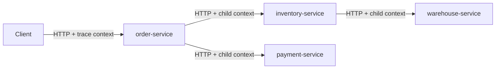
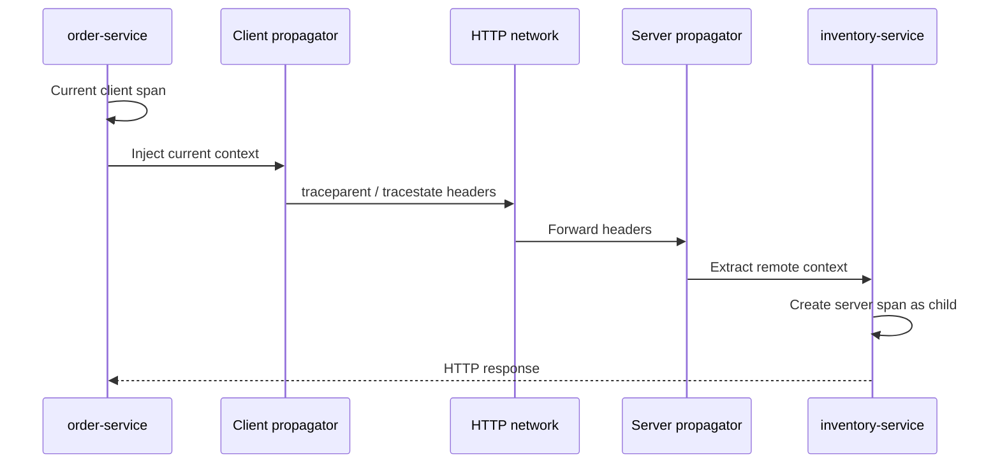
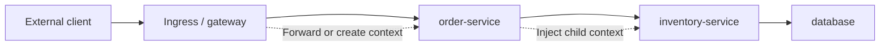

# Context qua HTTP trong Spring Boot

Một request đi vào `order-service`, sau đó gọi `inventory-service` và `payment-service`. Mỗi service tạo span riêng, nhưng khi mở trace ở backend, các spans cần nằm trong cùng một trace và thể hiện đúng quan hệ cha-con. Để làm được điều đó, ứng dụng phải truyền **trace context** qua HTTP headers. Đây là context propagation: service gửi inject context vào request, service nhận extract context từ headers rồi tiếp tục trace hiện tại.

Trong Spring Boot, Micrometer Tracing và tracing bridge thường tích hợp propagation với HTTP instrumentation. Khi client/server được instrument và dùng cấu hình tương thích, trace context có thể tự động được inject/extract. Tuy nhiên, tự tạo HTTP client, custom interceptor, gateway hoặc proxy có thể làm mất headers; lúc đó trace bị tách thành nhiều root traces hoặc mất liên kết.

Bài **Context qua HTTP** thuộc chương **Context propagation** của module **SPRING_BOOT_OBSERVABILITY**. Module tập trung thiết lập observability cho Spring Boot bằng Micrometer Observation, metrics, logs và distributed tracing; học propagation ngữ cảnh, tag/cardinality, exporter, sampling và liên kết tín hiệu để điều tra lỗi, độ trễ và hành vi ứng dụng trên môi trường thực.

## 1. Mục tiêu học tập

Sau bài học, bạn có thể:

- Giải thích context propagation và vì sao cần truyền context qua HTTP.
- Phân biệt trace context, baggage, Observation scope và logging MDC.
- Đọc các trường chính của W3C Trace Context: `traceparent` và `tracestate`.
- Mô tả cách client inject và server extract context.
- Cấu hình và sử dụng HTTP clients được Spring Boot/Micrometer instrument.
- Nhận biết nguyên nhân làm đứt trace qua proxy, gateway hoặc custom interceptors.
- Hiểu trust boundary, validation và giới hạn baggage/headers.
- Kiểm thử trace continuity qua nhiều HTTP services.

## 2. Context propagation là gì?

Context là tập metadata gắn với execution hiện tại. Trong distributed tracing, context quan trọng nhất chứa trace ID, span ID hiện tại và sampling flags. Khi một service gọi service khác, context được serialize thành HTTP headers để service nhận có thể tiếp tục trace.



Nếu propagation hoạt động, các spans có chung trace ID và quan hệ parent-child hợp lý. Nếu service nhận không extract context, nó có thể tạo trace mới độc lập dù business request vẫn thành công.

### Trace context không phải toàn bộ application context

Không serialize toàn bộ Java thread-local, Spring SecurityContext, request attributes hoặc object graph vào HTTP headers. Propagator chỉ truyền metadata được định nghĩa và cho phép, ví dụ trace context hoặc baggage đã được cấu hình. Dữ liệu nội bộ của process phải có cơ chế truyền riêng phù hợp.

## 3. Ba khái niệm cần phân biệt

| Khái niệm | Nội dung | Phạm vi |
| --- | --- | --- |
| Trace context | Trace ID, span ID, flags và state theo chuẩn propagator | Nối các spans qua service boundaries |
| Baggage | Key-value metadata được chọn để truyền cùng context | Chia sẻ metadata cần thiết giữa các services |
| Logging MDC | Map các trường gắn vào log event, thường có traceId/spanId | Tương quan logs trong execution hiện tại |
| Observation scope | Context scope trong process để handlers và instrumentation nhận biết observation hiện hành | Thread/execution scope |

Trace context thường được truyền qua HTTP headers. MDC không tự trở thành header và baggage không tự động là log field. Việc đưa baggage vào MDC hoặc span attributes phải được cấu hình rõ ràng và đánh giá privacy/cardinality.

## 4. W3C Trace Context

W3C Trace Context là chuẩn phổ biến để truyền trace context qua HTTP. Hai headers quan trọng:

- `traceparent`: chứa version, trace ID, parent ID (span ID của caller) và trace flags.
- `tracestate`: mang vendor-specific tracing state theo định dạng chuẩn.

Một `traceparent` minh họa:

```http
traceparent: 00-4bf92f3577b34da6a3ce929d0e0e4736-00f067aa0ba902b7-01
```

Các thành phần:

| Thành phần | Ví dụ | Ý nghĩa |
| --- | --- | --- |
| Version | `00` | Phiên bản định dạng |
| Trace ID | `4bf92f3577b34da6a3ce929d0e0e4736` | Định danh trace xuyên các service |
| Parent ID | `00f067aa0ba902b7` | Span ID của operation upstream |
| Flags | `01` | Cờ sampled trong ví dụ |

Giá trị trên chỉ minh họa định dạng, không phải trace ID thật. Trace ID và span ID phải có định dạng/độ dài hợp lệ; không tự tạo header bằng chuỗi tùy ý.

### Parent ID đổi qua mỗi service

Khi `order-service` nhận request, server span của nó có span ID riêng. Khi gọi `inventory-service`, client span của `order-service` có span ID mới và propagator inject span context hiện hành. `inventory-service` extract context đó rồi tạo server span con. Trace ID giữ nguyên trong trace, còn span ID/parent ID thay đổi theo từng operation.

### Sampling flag

Trace flags trong `traceparent` có thể mang sampling decision. Sampling policy và parent-based behavior quyết định span downstream có được ghi nhận theo context nhận được hay không. Không sửa flags thủ công để ép sampling; dùng sampler/tracing configuration của stack.

## 5. Luồng inject và extract qua HTTP

**Inject** xảy ra ở phía gửi: propagator đọc context hiện hành và ghi headers vào HTTP request. **Extract** xảy ra ở phía nhận: propagator đọc headers, xác thực cấu trúc và tạo context cha để instrumentation tạo span server.



Nếu headers bị strip, service nhận không thể liên kết trace với upstream bằng W3C context. Nếu headers bị thay đổi hoặc không hợp lệ, propagator có thể bỏ qua và bắt đầu trace mới.

## 6. Spring Boot tự động propagation như thế nào?

Trong Spring Boot 3.x, Micrometer Tracing có thể tích hợp với HTTP server và HTTP client instrumentation. Với client được Spring Boot quản lý, observation/tracing customizers có thể cài đặt interceptors để inject context. Ở phía server, web instrumentation extract context trước hoặc trong quá trình tạo server observation/span.

Các điều kiện phổ biến:

1. Có Actuator/Micrometer observability integration phù hợp.
2. Có một tracing bridge được chọn, ví dụ Brave hoặc OpenTelemetry.
3. Có client/server instrumentation tương thích với web stack.
4. Dùng client builder do Spring Boot quản lý hoặc tự gắn observation support đúng cách.
5. Các intermediaries giữ lại headers propagation cần thiết.

Không cần tự viết code nối trace ID vào mọi request nếu instrumentation chuẩn đã làm việc đó. Việc tự tạo `traceparent` thủ công dễ sai parent ID, sampling flags hoặc format.

## 7. Propagation với RestClient

Với Spring Boot 3.2+ và Spring Framework 6.1+, `RestClient` có thể nhận observation integration thông qua builder do Boot auto-configure.

```java
import org.springframework.stereotype.Service;
import org.springframework.web.client.RestClient;

@Service
public class InventoryClient {
    private final RestClient restClient;

    public InventoryClient(RestClient.Builder builder) {
        this.restClient = builder
            .baseUrl("http://inventory-service")
            .build();
    }

    public InventoryItem find(String sku) {
        return restClient.get()
            .uri("/items/{sku}", sku)
            .retrieve()
            .body(InventoryItem.class);
    }
}

record InventoryItem(String sku, int available) {}
```

Khi tracing integration được cấu hình, client observation có thể tạo client span và propagator inject context. Dùng URI template để giữ metric tags ổn định và không đưa SKU/customer IDs vào metric dimensions nếu chúng có cardinality lớn.

Nếu tự gọi `RestClient.builder()` ngoài Spring Boot, phải bảo đảm `ObservationRegistry`/customizers được gắn đúng. Client builder không được instrument có thể gửi HTTP request thành công nhưng không inject trace context.

## 8. Propagation với WebClient

`WebClient` là reactive HTTP client. Trong Spring Boot, dùng builder do Boot quản lý giúp giữ customizers và observation integration.

```java
import org.springframework.stereotype.Component;
import org.springframework.web.reactive.function.client.WebClient;

@Component
public class PricingClient {
    private final WebClient webClient;

    public PricingClient(WebClient.Builder builder) {
        this.webClient = builder
            .baseUrl("http://pricing-service")
            .build();
    }

    public Mono<Price> getPrice(String sku) {
        return webClient.get()
            .uri("/prices/{sku}", sku)
            .retrieve()
            .bodyToMono(Price.class);
    }
}

record Price(String sku, long amount) {}
```

Ví dụ dùng reactive return type; cần dependency WebFlux/Reactor tương ứng. Với reactive pipelines, context có thể gắn với Reactor Context thay vì chỉ ThreadLocal. Không giả định code chạy trên cùng thread; propagation phải được hỗ trợ bởi integration đang dùng.

Không tự đọc MDC rồi copy traceId vào header tùy ý trong WebClient filter. Điều đó không tương đương chuẩn W3C propagation. Hãy dùng tracing propagator/interceptor của framework. MDC là log context; nó không phải nguồn duy nhất hoặc nguồn chuẩn cho trace context.

## 9. Gateway, proxy và service mesh

HTTP request có thể đi qua ingress, API gateway, reverse proxy, service mesh sidecar hoặc load balancer trước khi tới service. Mỗi hop có thể ảnh hưởng headers:

- Giữ `traceparent`/`tracestate` khi forwarding theo policy.
- Không rewrite traceparent thành giá trị không hợp lệ.
- Nếu gateway tạo span riêng, nó phải tiếp tục parent context đúng cách.
- Nếu có nhiều tracing standards (W3C, B3), cấu hình propagators tương thích và tránh xung đột.
- Loại bỏ hoặc kiểm soát headers tại trust boundary khi cần.



Nếu gateway loại `traceparent`, trace ở service bên trong có thể bắt đầu lại. Nếu gateway tin bất kỳ trace header nào từ internet mà không áp dụng policy, caller có thể gửi metadata tùy ý để ảnh hưởng correlation hoặc baggage handling. Trace context không phải identity hoặc authorization credential.

## 10. Baggage qua HTTP

Baggage là metadata key-value được truyền cùng trace context khi propagator và cấu hình cho phép. Ví dụ hệ thống có thể truyền `tenant.tier=gold` hoặc `region=ap-southeast` nếu những giá trị này thực sự cần cho downstream processing.

Không đưa dữ liệu nhạy cảm vào baggage: access token, session ID, cookie, email, số điện thoại, địa chỉ, payment data, password, secret, free-text hoặc payload lớn.

Baggage có thể được truyền qua nhiều service và làm tăng header size. Chỉ allow-list keys cần thiết, giới hạn kích thước/giá trị và kiểm tra dữ liệu inbound. Không dùng baggage làm thay thế authentication hoặc authorization.

### Baggage và cardinality

Nếu baggage được copy vào span attributes hoặc metric tags, giá trị động có thể tăng cardinality. Ví dụ `tenant.id` có hàng trăm nghìn giá trị không phù hợp làm metric tag. Có thể dùng nhóm tenant tier hữu hạn thay cho tenant ID khi mục tiêu chỉ là phân nhóm.

## 11. Context propagation qua async boundaries

Context trong thread hiện tại không tự động xuất hiện ở mọi executor hoặc callback. Với `@Async`, `CompletableFuture`, executor tùy biến hoặc scheduled work, context có thể bị mất nếu không dùng cơ chế propagation phù hợp.

Ví dụ:

```java
CompletableFuture.runAsync(() -> {
    // Không giả định trace context của caller tự động có ở đây.
    performBackgroundWork();
});
```

Để truyền context, Spring/Micrometer có các cơ chế phù hợp phiên bản, chẳng hạn `ContextPropagatingTaskDecorator` cho executor hoặc Micrometer Context Propagation APIs. Cấu hình cụ thể phụ thuộc Spring Boot/Spring Framework/Micrometer version.

Không tự copy toàn bộ ThreadLocal hoặc security context sang mọi task. Chỉ truyền context cần thiết; bảo đảm scope được restore/clear sau khi task kết thúc để tránh context của request trước rò sang request tiếp theo.

### Reactor Context

Trong WebFlux/Reactor, context gắn với subscription/pipeline. Dùng instrumentation và context propagation support của stack thay vì dựa vào thread-local. Khi chuyển giữa reactive và imperative code, kiểm tra bridge/context restoration để trace IDs trong logs và spans không bị mất hoặc gán nhầm.

## 12. Bảo mật và trust boundaries

Trace context và baggage là metadata do caller có thể cung cấp. Không coi chúng là bằng chứng người dùng đã đăng nhập hoặc được phép truy cập tài nguyên.

| Rủi ro | Cách kiểm soát |
| --- | --- |
| Caller gửi trace headers giả | Validate format; dùng propagator chuẩn; policy rõ ở ingress |
| Baggage chứa PII/secret | Allow-list keys, redact và giới hạn kích thước |
| Headers bị phình lớn | Giới hạn tổng header size và số baggage entries |
| Trace context vượt trust boundary | Gateway quyết định forward, restart hoặc strip theo policy |
| Header bị log toàn bộ | Không log raw baggage/headers; chỉ log correlation IDs theo policy |
| Context bị rò giữa tasks | Scope restoration/clear và executor context propagation đúng cách |

Nếu hệ thống cần tạo trace mới ở trust boundary, thiết kế gateway/server để tạo context mới và liên kết theo cơ chế tracing backend hỗ trợ. Không tự ý ghi đè parent ID ở từng service.

## 13. Troubleshooting: trace bị đứt qua HTTP

| Triệu chứng | Nguyên nhân có thể | Hướng kiểm tra |
| --- | --- | --- |
| Mỗi service có trace ID khác nhau | Client không inject hoặc server không extract context | Kiểm tra headers và instrumentation hai đầu |
| Chỉ có server span, thiếu client span | Client builder không có observation support | Dùng Boot-managed builder và kiểm tra tracing handler |
| Client span có nhưng server span thành root | Proxy strip/rewrites headers hoặc server propagator khác | Kiểm tra traceparent sau từng hop |
| Trace ID giữ nguyên nhưng parent relation sai | Span context hiện hành không được scope đúng hoặc custom header logic | Kiểm tra span lifecycle và propagator |
| Logs không có traceId nhưng backend có spans | MDC integration hoặc async context propagation thiếu | Kiểm tra logging correlation và executor/Reactor context |
| Baggage không tới downstream | Baggage key chưa allow-list/remote propagation | Kiểm tra baggage config hai đầu |
| Baggage tới nhưng bị truncate | Header size limit hoặc proxy policy | Kiểm tra kích thước headers và gateway logs |
| Context mất trong @Async | Executor không propagate context | Dùng task decorator/context propagation support |
| WebClient mất context khi reactive switch | Reactor Context/bridge không được cấu hình đúng | Kiểm tra reactive instrumentation và context restoration |
| Trace không có dù headers hiện diện | Sampling từ chối hoặc exporter lỗi | Phân biệt propagation, recording và export |

### Checklist điều tra

1. Gửi request qua một client và một server đã instrument.
2. Kiểm tra `traceparent` ở phía client trước khi gửi.
3. Kiểm tra headers tại ingress/gateway và phía server nhận.
4. So sánh trace ID, parent span ID và sampling flags.
5. Kiểm tra tracing bridge và propagator ở hai service.
6. Xem client/server spans trong backend theo cùng trace ID.
7. Nếu dùng async/reactive, kiểm tra context qua executor/Reactor boundaries.
8. Kiểm tra baggage allow-list, header size và security policy.

Không ghi bearer token hoặc toàn bộ baggage ra logs khi debug. Chỉ thu thập tracing headers đã được redacted trong môi trường được phép.

## 14. Thực hành: nối trace qua ba HTTP services

**Bối cảnh:** `order-service` nhận request, gọi `inventory-service`, rồi gọi `payment-service`. Cả ba ứng dụng dùng Spring Boot và Micrometer Tracing với cùng chuẩn W3C Trace Context.

### Phần A — Chuẩn bị

1. Bật Actuator và chọn một tracing bridge nhất quán ở cả ba service.
2. Dùng RestClient/WebClient builder do Spring Boot quản lý.
3. Cấu hình exporter tới cùng tracing backend/Collector.
4. Xác nhận ingress/gateway forward trace context theo policy.
5. Ghi lại request test và thời điểm gửi.

### Phần B — Kiểm tra

| Ca | Thao tác | Kết quả cần xác minh |
| --- | --- | --- |
| A — End-to-end | Gửi request qua order → inventory → payment | Các spans cùng trace ID |
| B — Parent relation | Mở trace graph | Client/server spans có parent-child relation hợp lý |
| C — Header | Quan sát traceparent ở boundary test | Parent ID đổi theo span hiện hành, trace ID giữ nguyên |
| D — Gateway | Tắt forwarding trong môi trường test | Quan sát trace bị tách, sau đó khôi phục |
| E — Baggage | Forward một key không nhạy cảm đã allow-list | Downstream nhận đúng giá trị |
| F — Async | Chạy background task có context propagation | Span/log correlation giữ đúng context |
| G — Security | Gửi baggage/header vượt giới hạn | Gateway/service xử lý theo policy và không lộ dữ liệu |

### Phần C — Câu hỏi tự đánh giá

1. Trace context được inject và extract ở thời điểm nào?
2. Vì sao trace ID giữ nguyên nhưng span ID thay đổi qua từng service?
3. `traceparent` và `tracestate` có vai trò gì?
4. Vì sao MDC không thay thế W3C propagator?
5. Tại sao dùng Boot-managed RestClient/WebClient builder giúp giữ observation integration?
6. Nếu gateway strip `traceparent`, trace graph thay đổi như thế nào?
7. Baggage khác resource attributes và metric tags ở điểm nào?
8. Vì sao không dùng baggage làm authorization credential?
9. Context có thể bị mất ở CompletableFuture hoặc executor như thế nào?
10. Làm sao phân biệt propagation thành công với trace được sample/export thành công?

## 15. Ghi nhớ

**Context qua HTTP** cho phép các service nối spans trong cùng distributed trace. Client propagator inject trace context vào headers; server propagator extract context và tạo span con. W3C Trace Context thường dùng `traceparent` và `tracestate`; trace ID định danh toàn trace, còn span ID/parent ID thay đổi theo operation.

Trong Spring Boot, ưu tiên Micrometer Tracing và HTTP clients được auto-configure để propagation diễn ra nhất quán. Giữ headers qua gateway theo trust policy, dùng baggage có allow-list và không coi trace metadata là identity. Context qua HTTP khác MDC, metrics hay exporter; trace có thể được propagate dù không được sample hoặc export. Với async/reactive work, cấu hình context propagation đúng execution model và restore scope sau khi hoàn tất. Kiểm tra từng boundary từ client, proxy đến server giúp tìm điểm đứt trace, bảo vệ metadata và liên kết metrics, logs với distributed tracing.
