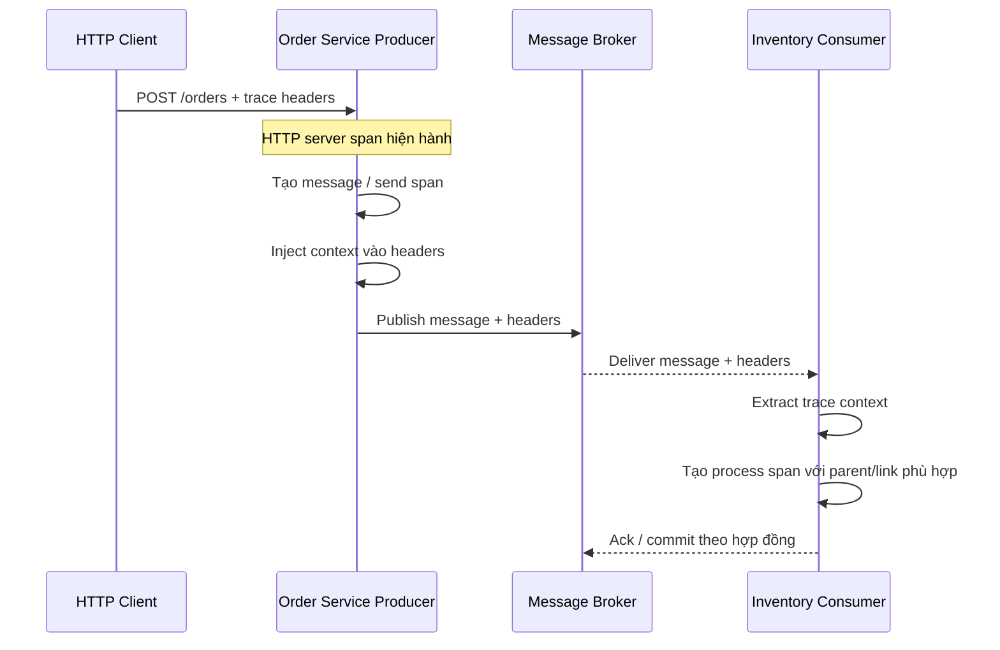
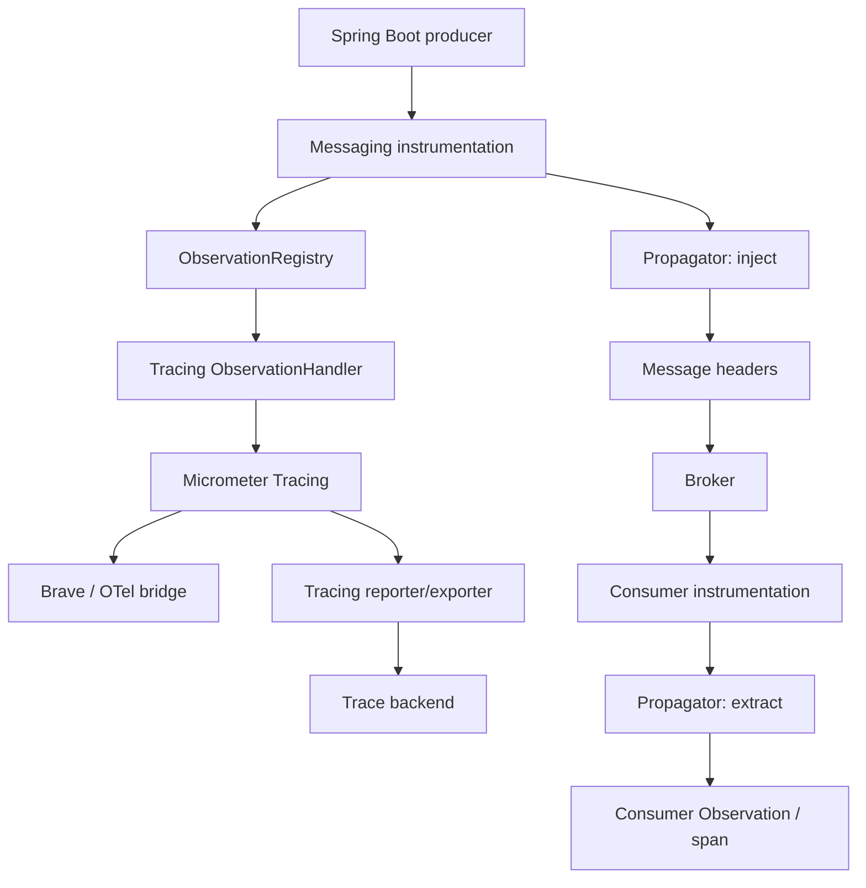
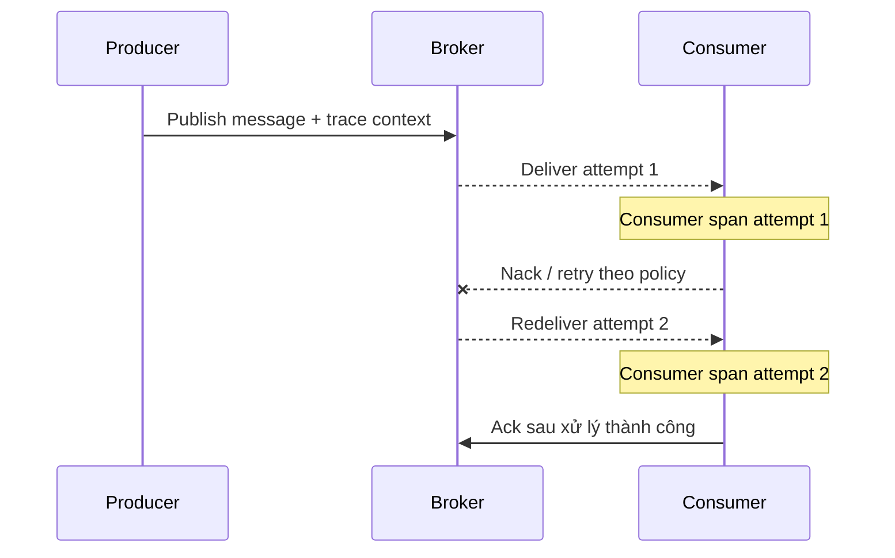
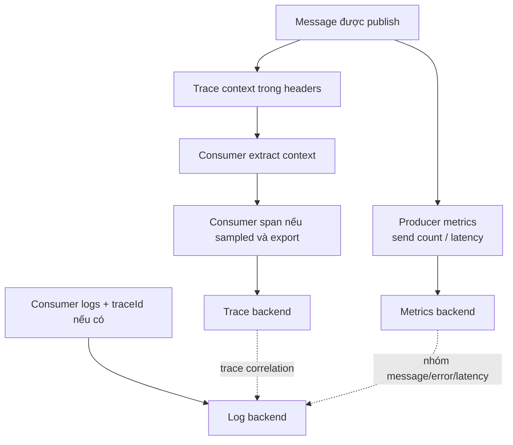

# Context qua messaging trong Spring Boot

Một service nhận HTTP request, phát message vào Kafka hoặc RabbitMQ rồi trả phản hồi nhanh. Consumer khác xử lý message vài giây sau, có thể trên thread hoặc máy khác. Nếu trace context chỉ nằm trong `ThreadLocal` của producer, consumer sẽ không biết message bắt nguồn từ request nào. Trace bị tách đoạn và người vận hành khó theo dõi hành trình nghiệp vụ end-to-end.

**Context propagation qua messaging** là cách mang thông tin ngữ cảnh qua ranh giới message bằng metadata/header, để producer và consumer có thể liên kết đúng trace và span. Trong Spring Boot, điều này liên quan tới Micrometer Observation, Micrometer Tracing, instrumentation của Spring Kafka/Spring AMQP, định dạng propagation như W3C Trace Context hoặc B3, và cách xử lý bất đồng bộ.

Bài **Context qua messaging** thuộc chương **Context propagation** của module **SPRING_BOOT_OBSERVABILITY**. Module tập trung thiết lập observability cho Spring Boot bằng Micrometer Observation, metrics, logs và distributed tracing; học propagation ngữ cảnh, tag/cardinality, exporter, sampling và liên kết tín hiệu để điều tra lỗi, độ trễ, hành vi ứng dụng trên môi trường thực.

## 1. Mục tiêu học tập

Sau bài học, bạn có thể:

- Giải thích vì sao `ThreadLocal` hoặc MDC không tự đi theo message qua Kafka, RabbitMQ hay queue.
- Phân biệt context cục bộ trong thread với trace context được serialize vào message headers.
- Mô tả producer **inject** trace context và consumer **extract** context trước khi tạo span xử lý.
- Hiểu quan hệ giữa message send span, receive/process span và trace cha.
- Nhận biết chiến lược liên kết trace phù hợp với queue dài, retry, redelivery và batch consume.
- Hiểu cách Spring Boot/Spring messaging instrumentation hỗ trợ observation và propagation.
- Bảo vệ headers, baggage và metadata khỏi dữ liệu nhạy cảm hoặc cardinality cao.
- Điều tra trường hợp trace bị tách, mất context, sai parent, log thiếu trace ID hoặc không tìm thấy trace trong backend.

## 2. Vì sao messaging cần propagation riêng?

Với HTTP đồng bộ, client có thể gửi request headers trong lúc server xử lý request. Tracer inject trace context vào HTTP headers và server extract khi nhận. Messaging có vòng đời khác:

- Producer tạo message tại một thời điểm.
- Broker có thể giữ message trong queue một khoảng thời gian.
- Consumer nhận message trên process, thread hoặc máy khác.
- Message có thể được retry, redeliver hoặc xử lý bởi nhiều consumer.
- Producer và consumer không nhất thiết tồn tại đồng thời.

Context đang mở trên thread producer **không thể chuyển nguyên đối tượng sang consumer**. Message phải mang phần context cần thiết dưới dạng dữ liệu có thể serialize, thường qua headers.

### Ba loại context cần phân biệt

| Loại | Ví dụ | Vòng đời | Qua broker tự động? |
| --- | --- | --- | --- |
| Thread-local tracing scope | Span hiện hành trong thread producer | Trong phạm vi thread/scope | Không |
| Logging MDC | `traceId`, `spanId` trong log | Theo cơ chế MDC và scope | Không |
| Trace propagation headers | `traceparent`, `tracestate`, B3 headers | Serialize cùng message | Chỉ khi instrumentation cấu hình đúng |

MDC giúp log record có trường tương quan; nó không thay thế trace propagation. Tương tự, `Observation.Scope` hoặc `SpanInScope` trong producer không thể giữ nguyên xuyên queue hoặc network.

## 3. Trace context trong message headers

Trace context thường mang thông tin cần để nhận diện trace và quan hệ span:

| Trường | Ý nghĩa | Lưu ý |
| --- | --- | --- |
| Trace ID | Định danh toàn trace | Các span liên quan thường chia sẻ trace ID |
| Span ID | Định danh một span | Mỗi span có ID riêng |
| Parent relationship | Liên kết span con với span trước | Có thể là parent trực tiếp hoặc link |
| Trace flags | Sampling decision theo format | Không thay thế cấu hình sampling |
| Trace state | Thông tin mở rộng theo vendor/implementation | Không tự chỉnh nếu không hiểu semantics |
| Baggage | Metadata được chủ đích truyền giữa service | Giới hạn tên, giá trị và dữ liệu được phép |

### W3C Trace Context

W3C Trace Context định nghĩa các header thường gặp:

- `traceparent`: mang version, trace ID, parent ID và trace flags.
- `tracestate`: mang thông tin trạng thái bổ sung theo vendor/implementation.

Ví dụ minh họa:

```text
traceparent: 00-4bf92f3577b34da6a3ce929d0e0e4736-00f067aa0ba902b7-01
```

Đây là giá trị minh họa theo cấu trúc W3C; không sao chép vào ứng dụng thật. Consumer không tự tạo `traceparent` bằng cách nối các ID tùy ý. Hãy để propagator/instrumentation encode và decode context, kiểm tra định dạng và xử lý giá trị sai theo chuẩn.

### B3 propagation

Trong hệ sinh thái Brave/Zipkin, B3 là định dạng phổ biến. Tùy cấu hình, có thể gặp dạng single header `b3` hoặc nhiều header:

```text
X-B3-TraceId
X-B3-SpanId
X-B3-ParentSpanId
X-B3-Sampled
```

W3C và B3 là **các định dạng khác nhau**. Nếu producer serialize B3 nhưng consumer chỉ đọc W3C, consumer có thể không nhận parent context và tạo root trace mới. Các hệ thống hỗ trợ nhiều format có thể cấu hình đọc/ghi một hoặc nhiều format; phải kiểm tra producer, middleware và consumer.

### Headers không phải payload

Trace headers là metadata kỹ thuật, không nên gộp vào business payload chỉ để consumer đọc. Giữ chúng trong message headers giúp không đổi schema nghiệp vụ và hỗ trợ middleware quản lý metadata. Tuy vậy, headers vẫn được lưu/truyền qua broker, nên không đưa secrets, token hoặc dữ liệu cá nhân vào trace headers/baggage.

## 4. Luồng inject và extract

Producer **inject** context của span hiện hành vào message headers trước khi gửi. Consumer **extract** headers thành parent context và tạo span xử lý trong context đó.



1. **Inject:** lấy context của span hiện hành, mã hóa thành header theo propagator (ví dụ W3C hoặc B3), đưa vào message trước khi gửi.
2. **Extract:** đọc headers đã nhận, xác thực/giải mã thành context, sau đó tạo span mới dựa trên context vừa extract.

Không extract sau khi đã bắt đầu span root độc lập rồi kỳ vọng tracer tự thay parent. Consumer phải lấy context **trước khi** tạo span xử lý.

### Parent-child hay span link?

| Tình huống | Mô hình có thể phù hợp | Lý do |
| --- | --- | --- |
| Một request phát một message, một consumer xử lý ngay | Consumer span là con của send span/parent theo instrumentation | Quan hệ nhân quả trực tiếp |
| Message nằm trong queue lâu | Span xử lý có link tới context producer, tùy API | Không giữ span cha mở trong lúc chờ |
| Batch gộp nhiều message từ nhiều trace | Consumer span link nhiều trace contexts | Một parent đơn không đại diện đủ nguồn |
| Fan-out sang nhiều consumer | Mỗi consumer có span riêng liên hệ context nguồn | Thể hiện các nhánh xử lý |
| Retry/redelivery | Mỗi lần xử lý có span riêng liên quan lần gửi/attempt | Phân biệt lỗi attempt và kết quả cuối |

Span link hữu ích khi một span có nhiều nguyên nhân/context liên quan hoặc parent-child làm cây trace khó diễn giải. Chọn semantics theo hành vi messaging thật; không buộc mọi flow vào cây cha–con giả tạo.

## 5. Micrometer Tracing và Spring Boot

Micrometer Observation là điểm tích hợp chung cho các thành phần được instrument. Khi có tracing bridge như Brave hoặc OpenTelemetry, Observation tracing handler có thể tạo spans. Các thư viện messaging tương thích cũng có thể tạo observation cho producer/consumer và hỗ trợ truyền context qua headers.



Các trách nhiệm:

- `ObservationRegistry` quản lý lifecycle observation; không phải broker header store.
- Tracing bridge thực thi API tracing bên dưới Micrometer; không tự sửa business payload.
- Propagator inject/extract context; messaging instrumentation quyết định thời điểm gọi.
- Broker chuyển tiếp message headers theo khả năng/cấu hình; không nhất thiết hiểu trace semantics.
- Tracing exporter/reporter gửi spans tới backend; pipeline này khác metrics exporter.

### Phiên bản và auto-instrumentation

Khả năng auto-instrumentation thay đổi theo phiên bản Spring Boot, Spring Kafka, Spring AMQP, Micrometer Tracing và client library. Không giả định **chỉ thêm tracing bridge là đủ** để mọi producer/consumer tự propagate headers.

Trong dự án thực, kiểm tra:

1. Producer/consumer được tạo bởi Spring container hay tự khởi tạo ngoài Spring.
2. Messaging library có observation/tracing instrumentation và có đang bật không.
3. Template/listener container có cấu hình observation theo phiên bản đang chạy không.
4. Propagator format nào được chọn và cả hai đầu có thể đọc/ghi format đó không.
5. Headers có bị transform, whitelist, strip hoặc ghi đè bởi converter, interceptor, gateway hay broker policy không.

Nếu auto-instrumentation đã tạo producer/consumer spans và truyền trace headers, không tự inject thêm theo cách lặp hoặc ghi đè context.

## 6. Spring Kafka

Với Spring Boot 3.x dùng Spring Kafka, dependency minh họa:

```kotlin
dependencies {
    implementation("org.springframework.boot:spring-boot-starter-actuator")
    implementation("org.springframework.kafka:spring-kafka")
    implementation("io.micrometer:micrometer-tracing-bridge-brave")
    runtimeOnly("io.zipkin.reporter2:zipkin-reporter-brave")
}
```

Spring Boot BOM nên quản lý các phiên bản tương thích. Đây là stack Brave/Zipkin minh họa; ứng dụng có thể dùng OpenTelemetry bridge hoặc backend khác.

### Quan sát producer và listener

Spring Kafka có các điểm cấu hình observation cho producer template và listener container. Tên API cần đối chiếu phiên bản; ví dụ khái quát:

```java
// Minh họa với phiên bản Spring Kafka có các API này.
kafkaTemplate.setObservationEnabled(true);
factory.getContainerProperties().setObservationEnabled(true);
```

Đây không phải cấu hình đầy đủ mọi phiên bản. Kiểm tra method có mặt trong version đang dùng và áp dụng lên bean/template/factory mà Spring thực sự sử dụng. Nếu đã có auto-configuration, đừng tạo template thứ hai chỉ để bật observation rồi tiếp tục gửi qua template cũ.

### Tags và message metadata

| Metadata | Vị trí phù hợp | Ghi chú |
| --- | --- | --- |
| `application`, `environment`, `region` | Common metrics tags hoặc resource attributes | Deployment metadata ổn định |
| Topic/queue name | Tag/attribute theo convention và danh mục có giới hạn | Tránh topic sinh động theo entity |
| `operation=send|receive|process` | Low-cardinality observation key-value | Tập hữu hạn |
| `outcome=success|error|rejected` | Low-cardinality nếu định nghĩa thống nhất | Phân biệt lỗi kỹ thuật và kết quả nghiệp vụ |
| `messageId` | Log hoặc trace attribute có kiểm soát | Không làm metric label |
| `traceId` | Trace context / log correlation | Không đưa vào metrics |
| Payload | Business message | Không sao chép vào observation tags |

## 7. RabbitMQ và Spring AMQP

Với RabbitMQ, nguyên tắc vẫn là producer inject context vào AMQP message headers và consumer extract context khi nhận. Spring Boot/Spring AMQP có thể kết hợp observation và Micrometer Tracing tùy phiên bản cùng cấu hình.

Dependency nền minh họa:

```kotlin
dependencies {
    implementation("org.springframework.boot:spring-boot-starter-actuator")
    implementation("org.springframework.boot:spring-boot-starter-amqp")
    implementation("io.micrometer:micrometer-tracing-bridge-brave")
    runtimeOnly("io.zipkin.reporter2:zipkin-reporter-brave")
}
```

Đây là cấu hình cho stack Spring Boot 3.x quản lý version qua BOM. Broker connection, credentials, virtual host, exchange, queue và binding cần cấu hình riêng. Dependency không tạo RabbitMQ server hay topology message.

### Message headers trong Spring AMQP

Với Spring AMQP, metadata của message nằm trong headers của message properties. Converter, message post-processor hoặc instrumentation có thể thêm/đọc headers. Nếu tự xử lý trace headers:

- Dùng propagator của tracing stack thay vì tự dựng `traceparent` hoặc B3 từ chuỗi.
- Bảo đảm header được giữ khi converter chuyển payload giữa object và message.
- Không ghi đè propagation headers hiện hành bằng trace ID cũ lấy từ payload.
- Kiểm tra giới hạn header size, charset và kiểu dữ liệu mà broker/client hỗ trợ.

Consumer có thể nhận message cũ từ trước khi tracing được bật. Nếu không có trace headers hoặc header không hợp lệ, ứng dụng cần chính sách rõ ràng: tạo root trace mới hoặc tiếp tục xử lý không có parent; đừng làm thất bại nghiệp vụ chỉ vì thiếu trace metadata.

## 8. Ví dụ nguyên lý bằng Micrometer Propagator

API propagator inject/extract theo một carrier bất kỳ. Carrier ở đây là Map minh họa; adapter cho Kafka/Rabbit phải ánh xạ Setter/Getter vào kiểu header cụ thể của client.

### 8.1. Inject ở producer

```java
import io.micrometer.tracing.Span;
import io.micrometer.tracing.Tracer;
import io.micrometer.tracing.propagation.Propagator;
import java.util.Map;

public class TraceHeaderWriter {
    private final Tracer tracer;
    private final Propagator propagator;

    public TraceHeaderWriter(Tracer tracer, Propagator propagator) {
        this.tracer = tracer;
        this.propagator = propagator;
    }

    public void injectCurrentContext(Map<String, String> headers) {
        Span current = tracer.currentSpan();
        if (current == null) {
            return;
        }
        propagator.inject(
            current.context(),
            headers,
            (carrier, key, value) -> carrier.put(key, value)
        );
    }
}
```

`Map<String, String>` là carrier đơn giản để giải thích API. Với Kafka, setter cần ghi string vào `RecordHeaders`; với AMQP, setter cần ghi vào message properties/headers phù hợp. Trong production, kiểm tra header đã có, kiểu dữ liệu và tránh inject context nhiều lần.

`tracer.currentSpan()` có thể trả `null` khi code chạy ngoài tracing scope. Đây không nhất thiết là lỗi; scheduled job hoặc message độc lập có thể bắt đầu root trace mới theo thiết kế.

### 8.2. Extract ở consumer

```java
import io.micrometer.tracing.Span;
import io.micrometer.tracing.propagation.Propagator;
import java.util.Map;

public class TraceHeaderReader {
    private final Propagator propagator;

    public TraceHeaderReader(Propagator propagator) {
        this.propagator = propagator;
    }

    public Span startConsumerSpan(Map<String, String> headers) {
        Span.Builder extracted = propagator.extract(
            headers,
            (carrier, key) -> carrier.get(key)
        );
        return extracted.name("messaging.process").start();
    }
}
```

Đây là minh họa dùng Map làm carrier. Implementation thực cần dùng API headers của client, xác định span kind/name/tag conventions và kết thúc span trong `finally`. Với queue có độ trễ dài hoặc batch nhiều message, quyết định parent hay link theo semantics tracing; không mặc định cây cha–con cho mọi trường hợp.

Consumer sau khi tạo span còn phải mở scope trong lúc xử lý:

```java
Span span = traceHeaderReader.startConsumerSpan(headers);
try (Tracer.SpanInScope ignored = tracer.withSpan(span)) {
    try {
        orderHandler.handle(message);
        span.tag("outcome", "success");
    } catch (RuntimeException ex) {
        span.tag("outcome", "error");
        span.error(ex);
        throw ex;
    }
} finally {
    span.end();
}
```

Đoạn này giả định `tracer` có cùng implementation/configuration với reader. Không mở scope trước khi extract context. Nếu messaging library đã tạo consumer observation/span tự động, **không tạo thêm span consumer thủ công** bao quanh đúng callback đó.

## 9. Queue latency, retry và redelivery

Messaging tách thời điểm gửi khỏi thời điểm xử lý. Cần phân biệt:

- **Publish/send latency:** thời gian ứng dụng chuẩn bị và gửi message.
- **Queue delay:** thời gian message đợi trong broker trước khi consumer nhận.
- **Processing latency:** thời gian consumer thực thi handler.
- **End-to-end business latency:** từ khi nghiệp vụ bắt đầu đến khi có kết quả cuối; có thể gồm queue delay, retry và các bước khác.

Span gửi message kết thúc khi producer hoàn thành publish/nhận xác nhận theo semantics client; nó không nên nằm mở hàng giờ để chờ consumer. Consumer span tạo khi nhận message, mang context hoặc link tới trace nguồn theo thiết kế. Nếu cần end-to-end time, dùng timestamp nghiệp vụ có kiểm soát hoặc metric/message age; không giữ span sống suốt thời gian chờ queue.

### Retry và redelivery



Mỗi attempt nên có dấu vết riêng để phân biệt lần thất bại với lần thành công. Context gốc có thể được giữ để liên kết attempts; metadata message ID, operation hoặc retry count có thể hỗ trợ chẩn đoán theo conventions. Không dùng retry count động hoặc exception text không giới hạn làm metric tags.

| Tình huống | Quan sát đề xuất | Cần tránh |
| --- | --- | --- |
| Consumer lỗi, broker redeliver | Span riêng cho lần nhận/xử lý, liên kết context nguồn | Ghi đè trace ID cũ bằng ID tùy ý |
| Retry nội bộ trong callback | Span attempt riêng hoặc event phù hợp | Một span kéo dài không rõ retry |
| Dead-letter queue | Ghi nhận kết quả chuyển dead-letter và lý do chuẩn hóa | Ghi payload hoặc credentials vào span |
| Batch consume nhiều message | Span batch có links tới nhiều contexts nếu hỗ trợ | Chọn ngẫu nhiên một message làm parent |
| Reprocess thủ công | Trace mới và link nguồn nếu là lần chạy nghiệp vụ mới | Giả vờ đó là lần thực thi ban đầu |

### Duplicate delivery và idempotency

Broker có thể redeliver message khi ack bị mất hoặc consumer gặp lỗi sau khi hoàn thành một phần công việc. Trace propagation **không bảo đảm message chỉ được xử lý một lần**. Idempotency key, deduplication và transaction/outbox thuộc về thiết kế nghiệp vụ/messaging; trace ID không thay thế mã idempotency.

## 10. Context qua các kiểu xử lý bất đồng bộ

### Thread pool và `@Async`

Nếu consumer nhận message rồi đẩy xử lý vào executor, context ở thread nhận không tự được sao chép sang worker. Dùng context propagation của Micrometer/Spring phù hợp, chẳng hạn task decorator hoặc instrumentation executor, rồi kiểm tra:

1. Task chạy trên executor đã cấu hình.
2. Context được capture khi submit và restore khi worker thực thi.
3. Scope/MDC được khôi phục về trạng thái ban đầu sau task.
4. Hai message đồng thời không nhìn thấy trace ID của nhau.

### Reactor

Với `Mono`/`Flux`, context nên theo reactive execution context thay vì phụ thuộc duy nhất vào `ThreadLocal`. Instrumentation cần tương thích Reactor Context, scheduler và cách Spring Boot cấu hình propagation. Không giữ `SpanInScope` qua publisher dài sống hoặc nhiều subscriber.

### Scheduled consumer và job độc lập

Scheduled poller có thể không có trace cha từ inbound request. Có thể tạo root span/observation cho mỗi lần poll hoặc batch. Nếu poller xử lý message có trace headers, tạo spans/links phù hợp với context từng message; đừng gán mọi message vào parent của scheduler span nếu làm sai quan hệ nhân quả.

## 11. Baggage và bảo mật message metadata

**Baggage** là metadata có thể truyền xuyên service cùng trace context nếu propagator và cấu hình cho phép. Nó hữu ích cho thông tin tương quan có kiểm soát, nhưng không phải kho lưu trữ tùy ý cho business message.

| Dữ liệu | Có nên propagate? | Lý do |
| --- | --- | --- |
| Trace context cần cho parent/link | Có | Cốt lõi để liên kết trace |
| Correlation category hữu hạn | Có thể, nếu được duyệt | Hỗ trợ phân tích cross-service |
| Tenant identifier | Chỉ khi chính sách yêu cầu | Có thể nhạy cảm/cardinality cao |
| User email/phone | Không nên | Dữ liệu cá nhân |
| Authorization token/cookie | Không | Secret không được xuất telemetry |
| Full message payload | Không qua baggage | Payload thuộc message schema và có thể rất lớn |
| Order ID | Chỉ ở log/trace attribute khi được phép | Không dùng làm metric label |

### Ranh giới tin cậy của broker

Message headers có thể đến từ producer bên ngoài hoặc nguồn không tin cậy. Consumer cần extract context theo định dạng chuẩn, xử lý header sai an toàn; không dùng trace context để quyết định quyền truy cập/danh tính; không tin baggage như dữ liệu đã xác thực; giới hạn header size và trường được propagate; xóa hoặc thay thế headers không được phép khi chuyển qua ranh giới trust.

Trace ID chỉ giúp tương quan telemetry. Nó **không phải credential, identity proof hay chữ ký message**.

## 12. Sampling và liên kết các tín hiệu

Sampling decision có thể được truyền trong context tùy tracer/policy. Tuy nhiên:

- Sampled flag không bảo đảm mọi reporter/exporter đều gửi thành công.
- Consumer có thể chạy sau producer; backend có thể nhận spans không cùng thứ tự.
- Retry hoặc consumer vẫn có thể ghi metrics ngay cả khi trace không được xuất.
- Metrics và logs có pipeline riêng; không lấy số trace lưu làm số message đã xử lý nếu không xét sampling.



Khi metrics cho thấy consumer error rate tăng nhưng trace không đủ, kiểm tra sampling, exporter/reporting, broker headers và log correlation trước khi kết luận instrumentation hỏng.

## 13. Troubleshooting

| Triệu chứng | Nguyên nhân có thể | Hướng kiểm tra |
| --- | --- | --- |
| Producer và consumer có trace ID khác | Context chưa inject/extract hoặc format không tương thích | Kiểm tra headers, B3/W3C |
| Consumer tạo root span mới | Extract quá muộn hoặc message không có headers | Extract trước khi tạo consumer span |
| Producer span có nhưng consumer không có | Consumer instrumentation tắt hoặc export lỗi | Kiểm tra listener, tracing handler, reporter |
| Cùng trace ID nhưng không có parent | Quan hệ parent/link bị chuyển đổi hoặc thiếu context | Kiểm tra span IDs và semantics |
| Trace ID mất sau executor | Thread-local context không propagate | Kiểm tra task decorator/context propagation |
| MDC có trace ID cũ | Scope không được đóng/restore đúng | Kiểm tra cleanup và concurrency |
| Header mất sau broker | Converter, interceptor, whitelist hoặc broker policy strip header | So sánh trước publish và sau receive |
| Header có nhưng không decode | Producer/consumer dùng format khác hoặc giá trị sai | Kiểm tra propagator format và kiểu header |
| Baggage không tới consumer | Chưa bật propagation hoặc key không allow-list | Kiểm tra cấu hình baggage |
| Batch chỉ có một parent | Nhiều input contexts nhưng mô hình chọn một parent | Cân nhắc span links |
| Retry tạo trace mới ngoài ý muốn | Header bị tạo lại khi redelivery | Giữ context nguồn, tạo span attempt riêng |
| Metrics tăng nhưng không thấy trace | Sampling, reporter/backend hoặc ingestion lỗi | Kiểm tra tracing pipeline |

### Checklist theo thứ tự

1. **Producer:** message được tạo trong scope nào? Có span hiện hành không? Context nào được inject?
2. **Message:** headers sau serialize có `traceparent` hoặc B3 fields hợp lệ không?
3. **Broker:** headers có được giữ qua converter, routing, persistence và redelivery không?
4. **Consumer:** extract có xảy ra trước consumer span? Có dùng đúng propagator?
5. **Async execution:** context có capture/restore khi chuyển executor/reactive boundary?
6. **Reporter:** spans đã gửi tới backend chưa? Có sampling, network hoặc auth issue?
7. **Logs:** trace ID/span ID được đưa vào MDC đúng scope? Có context cũ bị rò?
8. **Security:** propagation headers/baggage có vượt ranh giới trust hoặc mang dữ liệu nhạy cảm không?

## 14. Thực hành: nối trace qua một message

**Bối cảnh:** `order-service` nhận HTTP request tạo đơn hàng, phát message `orders.created`. `inventory-service` nhận message, kiểm tra và giữ hàng. Khi consumer lỗi, broker có thể redeliver.

### Phần A — Chuẩn bị

1. Dùng Spring Boot 3.x, Actuator và một Micrometer Tracing bridge (Brave hoặc OpenTelemetry) nhất quán.
2. Chọn propagation format producer/consumer cùng hỗ trợ, chẳng hạn W3C hoặc B3.
3. Bật observation/instrumentation ở message template và listener container theo đúng phiên bản messaging library.
4. Cấu hình reporter/exporter và backend thử nghiệm; chọn sampling đủ cao.
5. Cấu hình log correlation nhưng không đưa payload, token hoặc dữ liệu cá nhân vào MDC/baggage.

### Phần B — Các ca kiểm chứng

| Ca | Hành vi | Kết quả mong đợi |
| --- | --- | --- |
| A — Thành công | Producer gửi, consumer xử lý và ack | Có producer/consumer spans liên kết theo context |
| B — Consumer exception | Handler ném exception | Consumer span ghi nhận lỗi theo instrumentation |
| C — Redelivery | Message được gửi lại sau nack/timeout | Có attempt mới liên hệ trace context nguồn |
| D — Không có inbound trace | Scheduled job phát message độc lập | Có root trace/job span theo thiết kế |
| E — Async executor | Consumer chuyển xử lý sang worker | Worker log/span giữ đúng trace context |
| F — Header format mismatch | Producer ghi B3, consumer chỉ extract W3C | Trace bị tách; thống nhất format thì liên kết được |
| G — Header bị strip | Converter bỏ trace headers | Consumer mất parent; sửa whitelist thì giữ context |
| H — Baggage nhạy cảm | Thử đưa token vào baggage ở test | Chính sách ngăn field đó propagate/export |

### Phần C — Quan sát các tín hiệu

1. Gửi HTTP request và ghi lại `traceId` trong log của order-service nếu đã cấu hình MDC.
2. Xem message headers trong môi trường test, xác nhận propagation fields được inject.
3. Khi consumer nhận message, kiểm tra trace ID được extract và span xử lý có span ID riêng.
4. Làm lỗi consumer có chủ đích; phân biệt error span của attempt với outcome cuối sau retry.
5. So sánh producer send duration và consumer processing duration; không xem chúng là toàn bộ queue delay nếu chưa đo message age/backlog.
6. Xem metrics message send/receive/error, log và trace trong cùng khoảng thời gian.
7. Chạy đồng thời nhiều messages, xác minh không có trace ID hoặc MDC bị lẫn giữa worker threads.

### Câu hỏi tự đánh giá

1. Vì sao `ThreadLocal` của producer không truyền được context qua Kafka hoặc RabbitMQ?
2. `traceparent` khác `tracestate` như thế nào?
3. Khi nào consumer span nên là child và khi nào span link phù hợp hơn?
4. Vì sao không giữ producer span mở cho tới khi consumer xử lý xong message?
5. Điều gì xảy ra nếu producer inject B3 nhưng consumer chỉ extract W3C?
6. Vì sao redelivered message có thể cần span attempt mới nhưng vẫn liên hệ trace context ban đầu?
7. Vì sao `traceId` hữu ích cho log correlation nhưng không nên là metric tag?
8. Làm thế nào đảm bảo headers không mang token hoặc PII qua ranh giới trust?
9. Nếu metrics consumer tăng nhưng không thấy trace, cần kiểm tra pipeline/bước nào?
10. Vì sao trace propagation không thay thế idempotency và deduplication?

## 15. Ghi nhớ

**Context qua messaging** phải được truyền bằng metadata đi cùng message, thường là trace headers theo W3C hoặc B3. Producer inject context của span hiện hành trước khi publish; consumer extract trước khi tạo span xử lý. Scope và MDC chỉ tồn tại trong phạm vi thực thi cục bộ, nên chúng không tự vượt queue, process hoặc thread khác.

Trong Spring Boot, Micrometer Observation và Tracing kết hợp instrumentation của Spring Kafka/Spring AMQP có thể tự động tạo spans và hỗ trợ propagation khi dependency, cấu hình và phiên bản tương thích. Hãy xác minh headers ở cả hai đầu, xử lý retry/redelivery và async boundary có chủ đích, chọn parent/link đúng semantics, và giới hạn baggage/dữ liệu nhạy cảm. Metrics cho thấy xu hướng message và latency, logs hỗ trợ tương quan theo trace ID, còn distributed tracing theo dõi đường đi của message qua nhiều dịch vụ. Thiết kế đúng các lớp này giúp điều tra lỗi và độ trễ xuyên messaging mà vẫn kiểm soát cardinality, bảo mật và chi phí quan sát.
