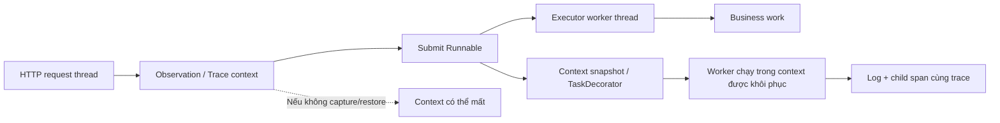
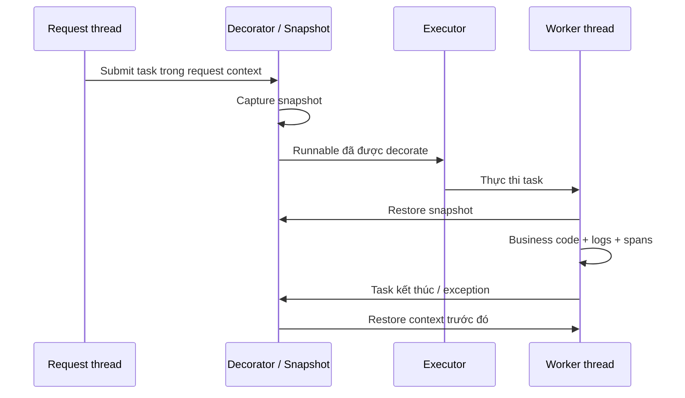
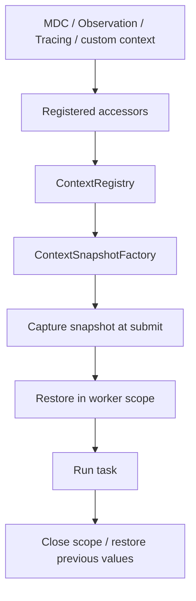

# Context qua executor trong Spring Boot

Trong ứng dụng Spring Boot, một request thường bắt đầu trên thread xử lý HTTP rồi gọi các service, repository hoặc client khác. Khi công việc được chuyển sang **executor** để chạy bất đồng bộ, nó có thể tiếp tục trên một worker thread khác. Những dữ liệu gắn với thread hiện tại như **ThreadLocal**, MDC của logging hoặc tracing context có thể không tự đi theo ranh giới đó.

**Context qua executor** là việc chuyển ngữ cảnh cần thiết từ thread gửi công việc sang thread thực thi, duy trì trong đúng thời gian chạy và khôi phục trạng thái worker sau khi hoàn thành. Đây là nền tảng để giữ Trace ID/Span ID, log correlation và các thông tin quan sát xuyên suốt công việc bất đồng bộ.

Bài thuộc chương **Context propagation** của module **SPRING_BOOT_OBSERVABILITY**. Mục tiêu là hiểu vì sao context bị mất khi đổi thread, cách dùng **TaskDecorator** và **ContextPropagatingTaskDecorator**, vai trò của Micrometer Context Propagation, cách áp dụng với **@Async / CompletableFuture** và scheduler, cùng cách kiểm thử để bảo đảm metrics, logs và distributed traces phản ánh đúng một hoạt động.

## 1. Vấn đề: request đổi thread thì context có thể biến mất

Giả sử một request **POST /orders** đi vào **order-service**. Framework tạo tracing context và logging integration đặt Trace ID/Span ID trong MDC. Sau đó service gửi một tác vụ sang executor:

```java
public void createOrder(Order order) {
    orderExecutor.execute(() -> processOrder(order));
}
```

Thread xử lý HTTP và worker thread thường là hai thread riêng. Một giá trị được giữ trong **ThreadLocal** của thread đầu tiên không tự xuất hiện ở thread thứ hai.

Hệ quả có thể thấy:

- Log trước khi submit có Trace ID nhưng log trong worker không có.
- Worker tạo một span mới không có quan hệ parent với request ban đầu.
- Trace backend hiển thị hai trace độc lập thay vì một trace có span con.
- Baggage hoặc correlation metadata biến mất sau khi chuyển executor.
- Một số context tự quản lý (tenant, security context, locale) không được chuyển nếu không có cơ chế phù hợp.

**Không phải mọi dữ liệu context đều được phép hoặc cần truyền đi.** Chỉ truyền những context cần thiết, có accessor và chính sách rõ ràng; tránh sao chép bí mật hay dữ liệu lớn vào mọi tác vụ.

### Hình dung luồng trước và sau khi propagation



Điểm quan trọng nằm ở **capture** context tại lúc submit, **restore** khi worker bắt đầu chạy và **restore lại trạng thái trước đó** sau khi task kết thúc.

## 2. ThreadLocal, MDC và tracing context

### 2.1. ThreadLocal gắn dữ liệu với thread

**ThreadLocal<T>** cung cấp một giá trị riêng cho mỗi thread. Framework và thư viện có thể dùng nó để lưu context hiện hành:

```java
private static final ThreadLocal<String> REQUEST_ID =
        new ThreadLocal<>();

void handleRequest() {
    REQUEST_ID.set("req-123");
    try {
        process();
    } finally {
        REQUEST_ID.remove();
    }
}
```

Nếu process gọi executor.execute(...), worker thread không tự nhìn thấy giá trị req-123, bởi nó có ThreadLocal map riêng.

ThreadLocal hữu ích cho code đồng bộ theo thread, nhưng nó không phải một cơ chế truyền context qua thread boundary.

### 2.2. MDC là context phục vụ logging

SLF4J MDC thường được triển khai dựa trên context gắn với thread. Tracing integration có thể đặt các trường như **traceId** và **spanId** trong MDC để log pattern sử dụng.

Ví dụ:

```java
MDC.put("request.id", requestId);
try {
    log.info("Starting order");
} finally {
    MDC.remove("request.id");
}
```

MDC ở thread submit không tự được sao chép sang worker. Nếu worker dùng thread pool lâu sống, việc tự set mà không clear còn có thể khiến giá trị của task trước xuất hiện trong log của task sau.

### 2.3. Tracing context lưu quan hệ span

Micrometer Tracing và tracing bridge quản lý ngữ cảnh span hiện hành. Khi một Observation/span được mở trong scope, các lời gọi instrumented bên trong có thể tạo span con.

Khi chuyển sang executor, nếu context không được truyền đúng:

- Worker có thể không có span hiện hành.
- Một span mới có thể được tạo như root trace khác.
- Log trong worker có thể thiếu Trace ID.
- Child HTTP client span có thể không nối với request gốc.

**Mục tiêu của context propagation** là giữ đúng context logic qua ranh giới thực thi, chứ không chỉ copy chuỗi Trace ID. Việc khôi phục scope đúng còn cho phép instrumentation tạo quan hệ parent-child và đóng span đúng vòng đời.

## 3. Context qua executor cần ba giai đoạn

Một propagation mechanism đáng tin cậy xử lý ba giai đoạn:

| Giai đoạn | Thời điểm | Trách nhiệm |
| --- | --- | --- |
| Capture | Thread gửi task | Chụp các context được đăng ký tại lúc submit |
| Restore | Worker bắt đầu task | Đưa snapshot vào context hiện hành của worker |
| Cleanup/restore | Task hoàn thành hoặc ném lỗi | Khôi phục context cũ, không để rò sang task kế tiếp |

Luồng:



Nếu chỉ copy dữ liệu mà không cleanup, thread pool có thể tái sử dụng cùng worker và làm context lẫn giữa các request. Nếu capture quá muộn ở worker, context ban đầu có thể đã mất. Capture phải gắn với thời điểm task được gửi đi.

## 4. Spring TaskDecorator là gì?

Spring cung cấp giao diện **TaskDecorator** để bọc một **Runnable** trước khi executor thực thi nó. Decorator có thể capture context ở thread submit, rồi restore context quanh task chạy trên worker.

Giao diện khái niệm:

```java
@FunctionalInterface
public interface TaskDecorator {
    Runnable decorate(Runnable runnable);
}
```

Decorator không tạo thread pool và không thay thế executor. Nó thay đổi cách task được bọc trước khi thực thi.

### 4.1. Tự viết decorator cho MDC (chỉ dùng khi phạm vi rất hẹp)

Ví dụ dưới đây minh họa sao chép MDC map:

```java
import java.util.Map;
import org.slf4j.MDC;
import org.springframework.core.task.TaskDecorator;

public class MdcTaskDecorator implements TaskDecorator {

    @Override
    public Runnable decorate(Runnable runnable) {
        Map<String, String> callerContext = MDC.getCopyOfContextMap();

        return () -> {
            Map<String, String> previousContext = MDC.getCopyOfContextMap();
            try {
                if (callerContext == null) {
                    MDC.clear();
                } else {
                    MDC.setContextMap(callerContext);
                }
                runnable.run();
            } finally {
                if (previousContext == null) {
                    MDC.clear();
                } else {
                    MDC.setContextMap(previousContext);
                }
            }
        };
    }
}
```

Cách này chỉ xử lý MDC. Nó **không tự truyền Micrometer Observation, tracing scope, baggage, security context hoặc các ThreadLocal khác**. Chỉ sử dụng nếu ứng dụng thật sự chỉ cần MDC và đã kiểm thử việc khôi phục context trên worker.

Không nên phát triển decorator riêng bằng cách copy toàn bộ ThreadLocal nội bộ của JVM/framework. Những implementation details này không phải hợp đồng công khai ổn định.

## 5. ContextPropagatingTaskDecorator và Micrometer Context Propagation

Với ứng dụng Spring Boot tích hợp Micrometer Observation/Tracing, cách phù hợp hơn thường là dùng **ContextPropagatingTaskDecorator** của Spring Framework kết hợp với Micrometer Context Propagation.

ContextPropagatingTaskDecorator được giới thiệu trong Spring Framework 6.1. Nó sử dụng cơ chế **ContextSnapshot** để capture và restore những context có accessor đã đăng ký, thay vì chỉ copy MDC.

### 5.1. Dependency

Trong Spring Boot 3.x, Actuator và tracing dependencies thường đưa Micrometer observability vào ứng dụng. Nếu project không có module context propagation trong dependency graph, có thể cần thêm artifact tương ứng, với phiên bản do Spring Boot dependency management quản lý:

```xml
<dependency>
    <groupId>io.micrometer</groupId>
    <artifactId>context-propagation</artifactId>
</dependency>
```

Cần kiểm tra dependency tree của project trước khi thêm thủ công để tránh kéo vào một version Micrometer không tương thích với Spring Boot BOM.

### 5.2. Cấu hình ThreadPoolTaskExecutor

Ví dụ Spring Boot 3.2+ / Spring Framework 6.1+:

```java
import org.springframework.context.annotation.Bean;
import org.springframework.context.annotation.Configuration;
import org.springframework.core.task.support.ContextPropagatingTaskDecorator;
import org.springframework.scheduling.concurrent.ThreadPoolTaskExecutor;

import java.util.concurrent.Executor;

@Configuration
public class AsyncConfiguration {

    @Bean(name = "applicationTaskExecutor")
    public Executor applicationTaskExecutor() {
        ThreadPoolTaskExecutor executor = new ThreadPoolTaskExecutor();
        executor.setCorePoolSize(8);
        executor.setMaxPoolSize(16);
        executor.setQueueCapacity(200);
        executor.setThreadNamePrefix("app-worker-");
        executor.setTaskDecorator(new ContextPropagatingTaskDecorator());
        executor.initialize();
        return executor;
    }
}
```

Các thông số pool chỉ là ví dụ. Cần điều chỉnh theo CPU, workload, thời gian xử lý và giới hạn của downstream. Không tăng pool vô hạn để bù cho tác vụ blocking hoặc dependency chậm.

ContextPropagatingTaskDecorator capture snapshot khi decorate/submit theo cơ chế của Spring/Micrometer, đưa các context có accessor vào worker trong thời gian thực thi và khôi phục trạng thái sau đó. Để propagation hoạt động, context cần được thư viện tương ứng đăng ký accessor. Việc có decorator mà không có accessor cho một loại context **không tự làm loại context đó xuất hiện**.

### 5.3. Cấu hình cho @Async

Có thể kết hợp executor với @EnableAsync:

```java
import org.springframework.context.annotation.Configuration;
import org.springframework.scheduling.annotation.EnableAsync;

@Configuration
@EnableAsync
public class AsyncMethodConfiguration {
}
```

Service:

```java
import org.springframework.scheduling.annotation.Async;
import org.springframework.stereotype.Service;

@Service
public class OrderAsyncService {

    @Async("applicationTaskExecutor")
    public void processOrder(String orderReference) {
        // Worker thread thực hiện nghiệp vụ.
        // Context được decorator hỗ trợ có thể hiện diện tại đây.
        process(orderReference);
    }

    private void process(String orderReference) {
        // Business work
    }
}
```

Chỉ rõ tên executor giúp tránh vô tình dùng executor mặc định không có decorator. @Async cũng cần được gọi qua Spring proxy; self-invocation trong cùng bean thường không đi qua proxy và có thể không chạy bất đồng bộ như kỳ vọng.

Không mặc định mọi @Async trong ứng dụng tự động dùng executor vừa tạo. Kiểm tra bean name, qualifier, cấu hình async executor và cách framework resolve executor.

## 6. ContextRegistry và ContextSnapshot hoạt động ra sao?

Micrometer Context Propagation cung cấp các khái niệm chính:

- **ContextRegistry:** danh mục các ThreadLocalAccessor và ContextAccessor mà ứng dụng có thể dùng để chuyển dữ liệu giữa các context mechanisms.
- **ThreadLocalAccessor:** mô tả cách đọc, ghi và xóa một loại ThreadLocal cụ thể.
- **ContextSnapshot:** snapshot của các giá trị context đã được đăng ký tại thời điểm capture.
- **ContextSnapshotFactory:** tạo snapshot theo cấu hình và registry tương ứng.
- **Scope:** phạm vi context được áp dụng tạm thời; đóng scope sẽ khôi phục giá trị trước đó.

Luồng khái niệm:



### 6.1. Không phải mọi ThreadLocal được tự động capture

Một accessor phải được đăng ký để Context Propagation biết cách đọc/ghi giá trị. Các thư viện Spring/Micrometer có thể đăng ký accessor cho những context mà chúng tích hợp. Context tùy biến của ứng dụng cần accessor thích hợp nếu muốn được truyền.

Không dùng ThreadLocal tự tạo rồi giả định ContextPropagatingTaskDecorator biết về nó. Trước tiên phải kiểm tra accessor đã được đăng ký trong ContextRegistry hay chưa.

### 6.2. Vì sao cần restore giá trị trước đó?

Worker thread trong pool được tái sử dụng. Task A có thể chạy với Trace ID A, rồi worker được dùng cho task B. Khi task A kết thúc, scope phải khôi phục trạng thái trước đó. Nếu không, task B có thể ghi log nhầm Trace ID A.

Vì vậy cleanup không phải thao tác phụ; nó là phần bắt buộc của isolation giữa các tác vụ.

### 6.3. Snapshot capture tại thời điểm nào?

Context phải được capture trên thread đang có request/Observation khi task được submit. Nếu ứng dụng chỉ capture sau khi task đã được đưa qua một queue trung gian và context nguồn đã đóng, snapshot có thể rỗng hoặc sai.

Với task được schedule chạy trong tương lai, cần xác định rõ context nào có ý nghĩa: context của lúc schedule hay context của lúc thực thi. Hầu hết tác vụ nền độc lập không nên vô tình kế thừa trace của một request đã kết thúc.

## 7. Kết hợp với Micrometer Observation và Tracing

Khi ứng dụng sử dụng Observation, tracing handler có thể mở span trong scope hiện hành. Khi tác vụ được chuyển đúng context sang executor, hoạt động bên trong có cơ hội trở thành span con của request/operation đã submit task.

Ví dụ:

```java
import io.micrometer.observation.Observation;
import io.micrometer.observation.ObservationRegistry;
import org.springframework.stereotype.Service;

import java.util.concurrent.Executor;

@Service
public class OrderWorkflow {

    private final ObservationRegistry observationRegistry;
    private final Executor applicationTaskExecutor;

    public OrderWorkflow(
            ObservationRegistry observationRegistry,
            Executor applicationTaskExecutor) {
        this.observationRegistry = observationRegistry;
        this.applicationTaskExecutor = applicationTaskExecutor;
    }

    public void submit(String channel) {
        Observation.createNotStarted(
                    "order.submit",
                    observationRegistry
                )
                .lowCardinalityKeyValue("channel", normalize(channel))
                .observe(() -> applicationTaskExecutor.execute(
                        () -> reserveInventory()
                ));
    }

    private String normalize(String channel) {
        return "mobile".equalsIgnoreCase(channel) ? "mobile" : "web";
    }

    private void reserveInventory() {
        // Gọi service/repository/client đã được instrument.
    }
}
```

Ví dụ này minh họa context được capture trong lúc execute(...) được gọi bên trong Observation scope. Tuy nhiên, observe(...) ở đây kết thúc khi task được submit, không phải khi task bất đồng bộ hoàn tất. Vì vậy span order.submit chỉ phản ánh **thời gian submit**, không phản ánh thời gian worker thực thi.

Nếu muốn span nghiệp vụ bao trọn thời gian task, cần tạo Observation/span trong chính worker và duy trì quan hệ với parent context được truyền qua snapshot, hoặc dùng API bất đồng bộ phù hợp. Không được giữ một scope mở trên thread request rồi đóng scope đó ở worker thread khác.

### 7.1. Đo thời gian thực thi trong worker

Một mẫu dễ hiểu là task được decorate để mang context parent; trong worker mở Observation cho công việc thực thi:

```java
public void submit(String channel) {
    Observation parent = Observation.createNotStarted(
            "order.submit",
            observationRegistry);

    parent.lowCardinalityKeyValue("channel", normalize(channel));
    parent.observe(() -> applicationTaskExecutor.execute(() ->
            Observation.createNotStarted(
                        "order.process",
                        observationRegistry)
                    .lowCardinalityKeyValue("channel", normalize(channel))
                    .observe(this::reserveInventory)
    ));
}
```

Mẫu này cho phép Observation order.process bắt đầu/kết thúc trên worker thread. Parent context có thể được truyền bởi executor decorator, tùy tracing implementation và context snapshot. Cần kiểm chứng backend rằng span có cùng Trace ID và quan hệ cha phù hợp; nếu API/handler đang dùng không tạo parent-child như mong đợi, không tự gán Trace ID bằng tay.

Trong hệ thống lớn, nên thiết kế rõ ranh giới giữa “submit task” và “process task”:

- order.submit đo thao tác gửi công việc.
- order.process đo tác vụ chạy thật.
- Queue wait có thể là một measurement riêng nếu cần.
- Parent-child hoặc span links phải phản ánh đúng quan hệ nghiệp vụ và thời gian.

### 7.2. Không dùng cùng một Observation object tùy tiện ở nhiều threads

Một Observation có lifecycle và scope. Không dùng chung một instance để start ở request thread, stop ở worker thread và đồng thời thay đổi key-values từ nhiều threads nếu API/lifecycle không hỗ trợ cách sử dụng đó. Thay vào đó, truyền context theo cơ chế chính thức và tạo Observation trong đúng execution scope.

## 8. @Async, CompletableFuture và callback

### 8.1. @Async

Với @Async, context propagation phụ thuộc executor thực sự được Spring sử dụng. Cấu hình executor có ContextPropagatingTaskDecorator là một lựa chọn phổ biến. Kiểm tra:

- @Async("applicationTaskExecutor") có chọn đúng executor không?
- Bean có được gọi qua Spring proxy không?
- TaskDecorator có được gắn trước khi executor khởi tạo không?
- Các context accessors tương ứng đã đăng ký chưa?
- Logs/trace trong worker có được khôi phục đúng không?

### 8.2. CompletableFuture

CompletableFuture.supplyAsync(...) nếu không truyền executor có thể dùng common ForkJoinPool, không phải executor Spring đã cấu hình. Khi cần context propagation, truyền executor rõ ràng:

```java
CompletableFuture<OrderResult> future =
        CompletableFuture.supplyAsync(
                () -> processOrder(order),
                applicationTaskExecutor
        );
```

Nếu dùng thenApplyAsync, thenComposeAsync hoặc whenCompleteAsync, hãy chỉ định executor khi cần kiểm soát thread và context. Các continuation không có executor riêng có thể chạy trên thread hoàn tất stage trước đó hoặc theo cơ chế của CompletableFuture; không suy đoán tất cả callback chạy trên worker đã chọn ở stage đầu.

Ví dụ chuỗi:

```java
CompletableFuture.supplyAsync(
        () -> loadOrder(orderId),
        applicationTaskExecutor
).thenApplyAsync(
        this::calculate,
        applicationTaskExecutor
).thenApplyAsync(
        this::reserve,
        applicationTaskExecutor
);
```

TaskDecorator được áp dụng cho từng task mà executor nhận. Với chuỗi async dài, xác minh context ở **mỗi callback** chứ không chỉ ở stage đầu.

### 8.3. Callback từ thư viện bên ngoài

Một thư viện có thể gọi callback trên thread do chính nó quản lý. Nếu callback cần context, executor của ứng dụng không tự kiểm soát các thread đó. Tùy thư viện, cần:

- Cung cấp executor/callback executor có decorator.
- Bọc callback bằng snapshot capture/restore.
- Dùng context propagation API chuyên biệt của thư viện.
- Tránh dùng ThreadLocal thủ công làm cầu nối xuyên callback.

Không thể giải quyết mọi thread boundary chỉ bằng cấu hình một ThreadPoolTaskExecutor.

## 9. Scheduler và tác vụ chạy định kỳ

@Scheduled thường chạy trên scheduler thread, tách khỏi request thread. Nhiều tác vụ định kỳ là công việc nền độc lập, **không nên kế thừa trace của request đã kích hoạt một sự kiện trước đó**.

Ví dụ cấu hình scheduler:

```java
import org.springframework.context.annotation.Bean;
import org.springframework.context.annotation.Configuration;
import org.springframework.core.task.support.ContextPropagatingTaskDecorator;
import org.springframework.scheduling.concurrent.ThreadPoolTaskScheduler;

@Configuration
public class SchedulerConfiguration {

    @Bean
    ThreadPoolTaskScheduler taskScheduler() {
        ThreadPoolTaskScheduler scheduler = new ThreadPoolTaskScheduler();
        scheduler.setPoolSize(4);
        scheduler.setThreadNamePrefix("scheduled-");
        scheduler.setTaskDecorator(new ContextPropagatingTaskDecorator());
        return scheduler;
    }
}
```

Việc decorator có áp dụng cho task scheduler hay không còn phụ thuộc phiên bản Spring Framework và loại task scheduling API. Nếu dùng một scheduler khác hoặc callback được tạo ở ranh giới khác, kiểm tra integration thực tế. Với công việc nền không có parent request, nên tạo một root Observation/span mới cho lần chạy đó.

### 9.1. Scheduled job như một trace độc lập

```java
import io.micrometer.observation.Observation;
import io.micrometer.observation.ObservationRegistry;
import org.springframework.scheduling.annotation.Scheduled;
import org.springframework.stereotype.Component;

@Component
public class ReconciliationJob {

    private final ObservationRegistry registry;

    public ReconciliationJob(ObservationRegistry registry) {
        this.registry = registry;
    }

    @Scheduled(fixedDelayString = "PT1M")
    public void reconcile() {
        Observation.createNotStarted("reconciliation.run", registry)
                .lowCardinalityKeyValue("job", "reconciliation")
                .observe(this::runReconciliation);
    }

    private void runReconciliation() {
        // Công việc định kỳ độc lập.
    }
}
```

Mỗi lần chạy có thể tạo một trace root mới nếu tracing handler/sampler/exporter được cấu hình. Đặt operation name ổn định và tags cardinality thấp; không gắn timestamp hoặc job execution ID vào metric labels.

## 10. Bảo vệ context isolation và chống rò dữ liệu

### 10.1. Không để context của task trước lọt sang task sau

Giả sử một worker chạy hai tasks:

```text
Worker-1:
  Task A: traceId=A
  Task B: không có trace context
```

Nếu Task A không restore context cũ trong finally, Task B có thể ghi log nhầm trace A. Triệu chứng thường chỉ xuất hiện dưới tải hoặc khi thread được tái sử dụng.

Dùng decorator có scope/cleanup chuẩn, tránh code tự MDC.put(...) mà không restore. Với decorator tự viết, phải lưu trạng thái trước đó và phục hồi nó trong finally, không chỉ gọi MDC.clear() một cách mù quáng nếu worker có context hợp lệ trước khi vào task.

### 10.2. Không propagate mọi thứ

Context có thể chứa:

- Trace/span identifiers.
- Correlation ID.
- Tenant context.
- Security principal/authorization data.
- Locale hoặc request-scoped information.
- Baggage.

Trước khi propagate cần hỏi:

1. Worker có thực sự cần context này không?
2. Giá trị có nhạy cảm hay chứa credential không?
3. Nó có còn hợp lệ khi task bắt đầu muộn hơn không?
4. Task có tồn tại lâu hơn request ban đầu không?
5. Có cần copy một số metadata thành input bất biến thay vì giữ toàn bộ context request?

Đối với tác vụ chạy nền lâu sau khi request trả response, giữ nguyên request scope/security context có thể không còn đúng về mặt nghiệp vụ hoặc bảo mật. Hãy truyền dữ liệu cần thiết theo contract rõ ràng.

### 10.3. Context snapshot không phải bản sao sâu của mọi object

Snapshot ghi nhận các giá trị thông qua accessors. Nếu giá trị là một object mutable, snapshot không tự bảo đảm deep copy object đó. Không thay đổi chung một mutable context từ nhiều threads mà không synchronization. Với metadata cần bất biến, ưu tiên immutable values hoặc bản sao được thiết kế rõ.

## 11. Metrics, logs và traces khi qua executor

Context propagation giúp giữ liên kết các tín hiệu, nhưng mỗi tín hiệu vẫn có pipeline riêng.

| Tín hiệu | Tác động khi context được truyền | Điều cần kiểm chứng |
| --- | --- | --- |
| Logs | MDC có thể có Trace ID/Span ID trong worker | Log pattern và MDC accessor |
| Tracing | Span trong worker có thể nối với context parent | Trace ID, Span ID, parent relation |
| Metrics | Observation trong worker có thể ghi Timer/counter | Metrics handler, MeterRegistry, tags |
| Baggage/custom context | Có thể chuyển qua accessor đã đăng ký | Allowlist, scope, quyền riêng tư |

Luồng điều tra một task chậm:

1. Metrics cho thấy order.process p95 tăng.
2. Trace hiển thị span xử lý trong worker kéo dài.
3. Logs cùng Trace ID chỉ ra database timeout hoặc retry.
4. Executor metrics cho biết active workers/queue depth có tăng không.
5. Đối chiếu thread dump nếu nghi lock contention hoặc thread starvation.

**Không đưa Trace ID vào metric tags.** Trace ID có cardinality rất cao. Liên kết bằng span context/MDC, hoặc exemplars khi registry/backend hỗ trợ.

### 11.1. Context propagation không làm sampling biến mất

Nếu parent trace bị head sampling loại ở đầu request, việc truyền context sang worker không tự tạo lại một trace được backend lưu. Nếu parent đã được lấy mẫu, child spans có thể được ghi theo chính sách parent-based sampler. Tail sampling tại Collector cũng chỉ xử lý những spans đã đến Collector.

Metrics Observation handler có thể vẫn ghi Timer trong khi không có trace được xuất cho request đó. Vì vậy metrics counts và số traces hiển thị không nhất thiết bằng nhau.

## 12. Kiểm thử context qua executor

Đây là phần quan trọng nhất trước khi triển khai. Không chỉ xác nhận task chạy thành công; cần xác nhận context đúng và không rò sang task kế tiếp.

### 12.1. Kiểm tra MDC trong worker

Ví dụ test khái niệm cho decorator MDC tự viết:

```java
import static org.junit.jupiter.api.Assertions.assertEquals;

import java.util.concurrent.ExecutorService;
import java.util.concurrent.Executors;
import java.util.concurrent.Future;

import org.junit.jupiter.api.Test;
import org.slf4j.MDC;

class MdcPropagationTest {

    @Test
    void propagatesMdcAndRestoresWorkerContext() throws Exception {
        ExecutorService raw = Executors.newSingleThreadExecutor();
        try {
            raw.submit(() -> MDC.put("worker.marker", "previous")).get();

            MdcTaskDecorator decorator = new MdcTaskDecorator();
            MDC.put("traceId", "trace-A");

            Future<String> result = raw.submit(
                    decorator.decorate(() -> MDC.get("traceId"))
            );

            assertEquals("trace-A", result.get());

            // Context của submitter vẫn còn trên thread hiện tại.
            assertEquals("trace-A", MDC.get("traceId"));
            MDC.remove("traceId");

            String workerAfter = raw.submit(
                    () -> MDC.get("worker.marker")
            ).get();
            assertEquals("previous", workerAfter);
        } finally {
            MDC.clear();
            raw.shutdownNow();
        }
    }
}
```

Test trên minh họa decorator MDC đơn giản; muốn kiểm tra ContextPropagatingTaskDecorator cần thiết lập accessors và kiểm tra context types tương ứng. Khi đóng executor, phải chờ task hoàn tất hoặc dùng lifecycle phù hợp trong test.

### 12.2. Các ca kiểm thử cần có

| Ca kiểm thử | Kỳ vọng |
| --- | --- |
| Submit trong trace A | Worker thấy cùng Trace ID khi accessor/integration được cấu hình |
| Submit khi không có context | Worker không nhận context còn sót từ task trước |
| Task ném exception | Scope được khôi phục trong mọi trường hợp |
| Worker thread được tái sử dụng | Task sau không nhận MDC/Trace ID của task trước |
| Nhiều task đồng thời | Context của task không trộn chéo |
| Callback CompletableFuture | Mỗi async stage có context theo executor/API đã cấu hình |
| Scheduler chạy định kỳ | Tác vụ độc lập tạo root context mới, không thừa request context |
| Context tùy biến | Có accessor và cleanup đúng |
| Baggage | Chỉ truyền keys được phê duyệt |
| Không có tracing sampling | Metrics có thể còn, traces có thể không xuất |

### 12.3. Kiểm chứng trên trace backend

Tạo một request gọi @Async service:

- Span HTTP server làm parent.
- Span nghiệp vụ trong worker xuất hiện cùng Trace ID.
- Span client call bên trong worker có quan hệ đúng nếu client instrumented.
- Worker logs có Trace ID/Span ID tương ứng.
- Khi task hoàn tất, không có log của request kế tiếp mang Trace ID cũ.

Tên span và quan hệ chi tiết tùy instrumentation; điều cần xác minh là **Trace ID cùng quan hệ parent/link đúng theo thiết kế**.

## 13. Những lỗi thường gặp

| Triệu chứng | Nguyên nhân có thể | Cách xử lý |
| --- | --- | --- |
| Logs trong worker mất Trace ID | MDC không được propagate hoặc accessor thiếu | Cấu hình decorator/accessor và kiểm tra worker |
| Worker tạo trace mới thay vì span con | Tracing context không được capture/restore | Kiểm tra snapshot, scope và thời điểm submit |
| @Async không dùng decorator | Đang dùng executor khác hoặc gọi self-invocation | Chọn executor rõ ràng, gọi qua Spring proxy |
| CompletableFuture mất context | Dùng common pool hoặc callback executor khác | Truyền executor có decorator cho các async stages |
| Trace ID của task trước xuất hiện ở task sau | Context không được cleanup/restore | Dùng scope đúng và kiểm thử worker reuse |
| Context tùy biến không được truyền | Không đăng ký accessor | Đăng ký ThreadLocalAccessor/context accessor |
| @Scheduled thừa context request cũ | Scheduler hoặc callback giữ context không mong muốn | Tạo root observation riêng, bảo đảm cleanup |
| Task span quá ngắn | Span được đóng lúc submit, task chạy sau | Tạo Observation trong worker hoặc dùng API async phù hợp |
| Span cha đóng trước child | Sai lifecycle/parent context, task bất đồng bộ | Thiết kế quan hệ và lifecycle; không đóng scope trên thread khác |
| Có MDC nhưng trace backend thiếu span | MDC chỉ là logging context | Kiểm tra tracing handler/exporter/sampler riêng |
| Metrics có nhưng trace không có | Sampling hoặc tracing exporter | Phân biệt metrics và tracing pipeline |
| Dữ liệu tenant/security bị dùng lại | Propagate context nhạy cảm hoặc snapshot mutable | Allowlist, immutable context và kiểm tra cleanup |
| Không thấy khác biệt khi bật decorator | Task không đi qua executor đó hoặc context không có accessor | Xác định thread/executor thực tế, kiểm tra registry |
| Hiệu năng giảm sau bật propagation | Capture/restore nhiều context hoặc task quá nhỏ | Chỉ propagate cần thiết, đo overhead và cân nhắc batch |

## 14. Hiệu năng và thiết kế executor

Context propagation có overhead của capture/restore, đặc biệt khi task rất nhỏ và được submit với tần suất lớn. Cần đo bằng workload thực thay vì giả định không đáng kể.

Các nguyên tắc:

- Chỉ đăng ký và truyền các context cần thiết.
- Không đưa payload request lớn vào ThreadLocal/context.
- Dùng executor có kích thước, queue capacity và rejection policy rõ ràng.
- Không tạo một thread pool mới cho mỗi request.
- Theo dõi active workers, queue depth, task duration và reject count.
- Tránh tạo nhiều async hops không mang lại lợi ích.
- Giới hạn baggage/attributes và không chứa secrets.
- Kiểm thử khi task hoàn tất bình thường, exception, timeout và cancellation.

### 14.1. Rejection policy và context

Khi executor từ chối task do queue đầy, decorator đã capture context nhưng task có thể không bao giờ chạy. Không được giả định task đã được xử lý chỉ vì execute(...) được gọi. Cần ghi nhận rejection và xử lý theo semantics nghiệp vụ.

Nếu dùng CallerRunsPolicy, task có thể chạy ngay trên thread gọi khi pool quá tải. Trong trường hợp đó, context hiện hành đã có thể đúng, nhưng decorator vẫn phải khôi phục trạng thái cẩn thận. Test cả đường worker bình thường lẫn caller-runs/rejected execution.

### 14.2. Không lẫn queue wait với task execution time

Nếu một task đợi 2 giây trong queue rồi chạy 100 ms, Timer chỉ bọc phần Runnable.run() sẽ đo khoảng 100 ms. Muốn biết user-facing delay, cần đo cả queue wait hoặc đo end-to-end parent operation. Context propagation giữ trace liên tục nhưng không tự instrument thời gian chờ queue.

## 15. Bài thực hành: giữ Trace ID qua executor

Mục tiêu là xây dựng một service Spring Boot có HTTP request, executor worker, logs và distributed trace liền mạch.

### Chuẩn bị

Dùng Spring Boot 3.x với các tích hợp phù hợp:

- spring-boot-starter-actuator
- Micrometer Tracing bridge, ví dụ micrometer-tracing-bridge-otel
- OpenTelemetry OTLP exporter phù hợp
- Micrometer context-propagation nếu chưa có trong dependency graph
- Trace backend/Collector trong môi trường lab

### Bước 1 — Cấu hình executor

Tạo bean ThreadPoolTaskExecutor với ContextPropagatingTaskDecorator. Đặt thread prefix rõ như order-worker- để dễ kiểm tra thread trong log.

### Bước 2 — Tạo endpoint và async service

Tạo endpoint HTTP gọi service bằng @Async("applicationTaskExecutor"). Bên trong worker ghi log và gọi một client có instrumentation. Đảm bảo method được gọi qua Spring proxy.

### Bước 3 — Bật tracing sampling trong lab

Dùng sampling cao trong môi trường test để dễ tìm traces. Cấu hình OTLP endpoint tới Collector/backend có thể truy cập. Không sử dụng sampling 100% vô thời hạn cho production traffic lớn.

### Bước 4 — So sánh có/không decorator

Chạy cùng một request hai lần trên executor test:

- Không decorator: quan sát log/trace context có thể bị mất.
- Có decorator và accessor: quan sát worker logs và spans có context đúng.

Không kết luận chỉ dựa trên việc log có trường traceId; kiểm tra Trace ID và parent-child trong trace backend.

### Bước 5 — Kiểm tra cleanup

Dùng single-thread executor để bảo đảm worker được tái sử dụng:

1. Task A chạy trong Trace ID A.
2. Task B chạy không có trace context.
3. Xác nhận log của B không mang Trace ID A.
4. Lặp lại với task A ném exception để xác minh cleanup trong finally.

### Bước 6 — Đo lifecycle đúng

Tạo một Observation trong worker cho order.process, đo thời lượng từ lúc worker bắt đầu đến lúc kết thúc. Nếu cần đo thời gian queue, tạo metric riêng cho thời gian chờ. Không giữ scope của request thread mở để đóng từ worker.

### Bước 7 — Thử CompletableFuture

Chạy supplyAsync và mọi thenApplyAsync qua executor đã decorate. Ghi thread name và Trace ID ở mỗi stage để kiểm tra không có stage nào vô tình chuyển sang common pool hoặc executor không có context support.

### Bước 8 — Thử scheduler độc lập

Tạo scheduled job có Observation root riêng. Xác nhận nó không kế thừa Trace ID của một request đã kết thúc và logs của mỗi lần chạy có correlation phù hợp.

### Bước 9 — Kiểm tra metrics/logs/traces

- Metrics đo số tác vụ, thời gian xử lý, queue wait và lỗi.
- Logs trong worker có Trace ID/Span ID phù hợp.
- Trace backend hiển thị quan hệ operation và client spans.
- Sampling có thể làm thiếu trace nhưng không nên làm mất Counter/Timer metrics.

### Bước 10 — Kiểm tra bảo mật

Không truyền access token, authorization header, thông tin người dùng hoặc raw payload vào baggage/attributes. Chỉ propagate context đã được phê duyệt và kiểm soát quyền truy cập backend.

### Checklist nghiệm thu

| Điều cần chứng minh | Kết quả mong đợi |
| --- | --- |
| Thread boundary | Worker thread khác request thread được nhận diện |
| Capture | Snapshot được lấy tại thời điểm submit |
| Restore | Context thích hợp xuất hiện trong worker |
| Cleanup | Task kết thúc/exception đều khôi phục trạng thái trước |
| MDC | Log correlation đúng trong worker |
| Tracing | Span có cùng Trace ID và quan hệ đúng |
| @Async | Đúng executor và Spring proxy |
| CompletableFuture | Tất cả async stages quan trọng dùng executor phù hợp |
| Scheduler | Background job có root context độc lập |
| Metrics | Timer/Counter phản ánh thời gian và kết quả đúng |
| Cardinality | Không có Trace ID/request ID trong metric tags |
| Security | Không propagate bí mật hoặc dữ liệu không được phép |

## 16. Những nguyên tắc cần ghi nhớ

1. **ThreadLocal không tự đi qua executor.** Mỗi worker thread có context riêng; muốn giữ context cần capture và restore có chủ đích.
2. **Dùng TaskDecorator để kiểm soát task boundary.** Với hệ sinh thái Micrometer/Spring hiện đại, ContextPropagatingTaskDecorator là lựa chọn tích hợp nên cân nhắc.
3. **Accessor quyết định loại context được truyền.** Có decorator mà không có accessor cho context tùy biến thì giá trị đó vẫn không được capture.
4. **Cleanup/restore là bắt buộc.** Thread pool tái sử dụng worker; task sau không được nhận MDC hoặc Trace ID của task trước.
5. **Chọn đúng executor cho @Async và CompletableFuture.** Không mặc định common pool hoặc mọi callback đều dùng executor đã cấu hình.
6. **Span lifecycle phải khớp thời gian task thực thi.** Không đóng Observation của request ngay sau submit rồi kỳ vọng nó đo được toàn bộ tác vụ nền.
7. **Scheduled jobs thường cần root trace riêng.** Không vô tình mang context của request cũ vào công việc độc lập.
8. **Propagate tối thiểu và an toàn.** Baggage, security context và metadata tùy biến cần allowlist, scope và chính sách riêng.
9. **Kiểm thử cả đường lỗi và thread reuse.** Chỉ thấy Trace ID trong một task thành công chưa đủ chứng minh isolation đúng.
10. **Liên kết đúng metrics, logs và traces.** Metrics cho xu hướng tổng hợp; logs dùng correlation; traces cho hành trình request. Context propagation giữ liên hệ giữa chúng qua ranh giới thread.

Context qua executor là một phần thiết yếu của observability khi ứng dụng Spring Boot sử dụng bất đồng bộ. Khi capture, restore và cleanup được cấu hình đúng, Trace ID, span relationship và log correlation có thể tiếp tục qua worker threads; đồng thời metrics phản ánh đúng thời gian và kết quả của công việc. Điều đó giúp điều tra độ trễ, lỗi và hành vi ứng dụng xuyên các bước xử lý mà không làm lẫn context giữa những request độc lập.
