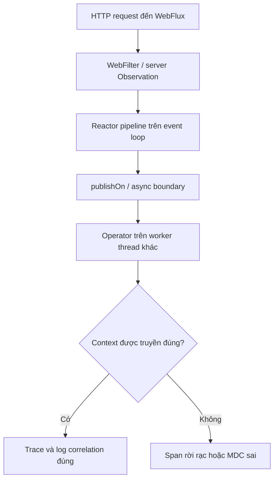
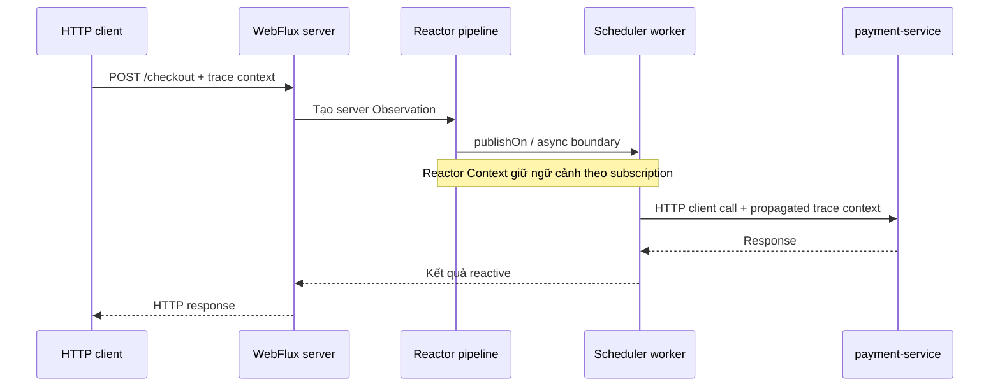
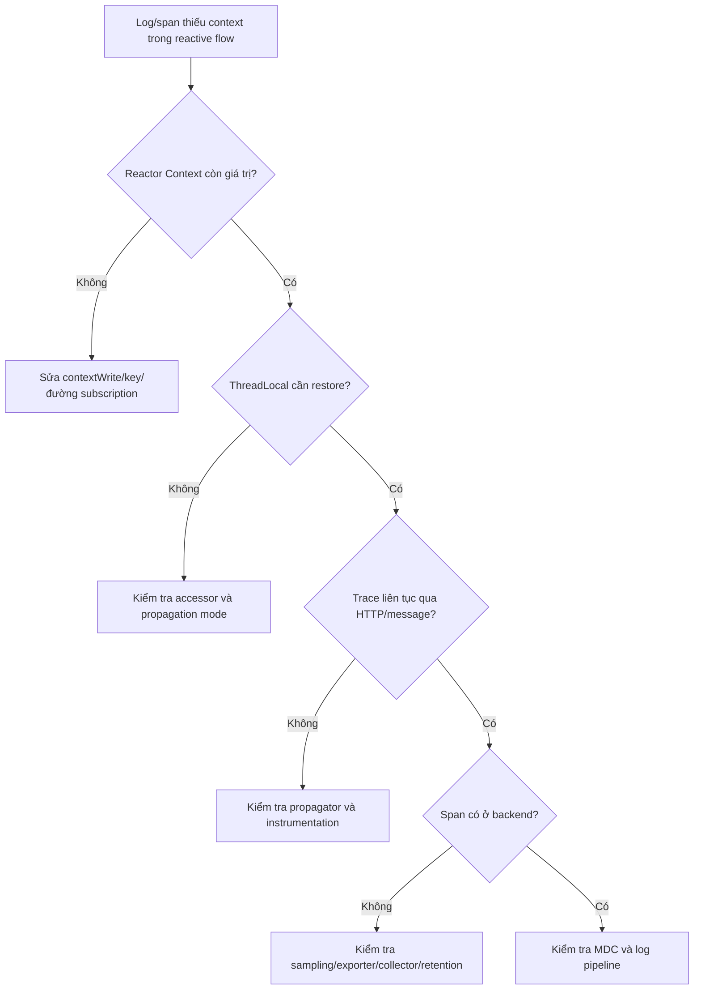

# Context qua reactive pipeline trong Spring Boot

Trong Spring WebFlux, một request có thể đi qua nhiều operator Reactor, chuyển từ event-loop thread sang scheduler khác rồi tiếp tục xử lý bất đồng bộ. Nếu trace context, Observation hoặc thông tin tương quan chỉ nằm trong `ThreadLocal`, operator chạy ở thread khác có thể không còn đọc được dữ liệu đó. Hệ quả là span con không nối vào trace gốc hoặc log thiếu `traceId`. Để xử lý, cần hiểu **Reactor Context** và **Micrometer Context Propagation**.

Bài **“Context qua reactive pipeline”** thuộc chương **Context propagation** của module **SPRING_BOOT_OBSERVABILITY**. Module hướng dẫn thiết lập observability cho Spring Boot bằng Micrometer Observation, metrics, logs và distributed tracing; bài này giải thích cách context đi qua reactive pipeline, tương tác giữa Reactor Context và ThreadLocal, và cách giữ trace/log correlation khi xử lý bất đồng bộ.

**Nguyên tắc:** trong code Reactor, dùng Context của Reactor làm ngữ cảnh theo subscriber; dùng Micrometer Context Propagation khi cần chuyển qua ranh giới với API hoặc thư viện dựa trên ThreadLocal. Không giả định ThreadLocal tự đi theo reactive chain chỉ vì code thuộc cùng một HTTP request.

## 1. Vì sao reactive pipeline cần cơ chế context riêng?

Trong lập trình imperative, thư viện có thể lưu thông tin hiện hành trong ThreadLocal, như span hiện hành hoặc MDC fields phục vụ log correlation. Reactive pipeline không bảo đảm mọi operator chạy trên cùng thread. `publishOn(Schedulers.parallel())` có thể chuyển xử lý downstream sang worker thread khác; `flatMap` phối hợp nhiều publisher bất đồng bộ. ThreadLocal đặt trên thread A không tự xuất hiện trên thread B.



Ví dụ dễ gặp vấn đề sau khi đổi scheduler:

```java
static final ThreadLocal<String> REQUEST_ID = new ThreadLocal<>();

Mono<String> pipeline =
        Mono.just("order-42")
            .doOnNext(value -> log(REQUEST_ID.get()))
            .publishOn(Schedulers.parallel())
            .map(value -> "request=" + REQUEST_ID.get());
```

Ngay cả khi thread gọi `subscribe()` đã đặt `REQUEST_ID`, operator sau khi đổi scheduler có thể đọc `null` hoặc giá trị không liên quan. Scheduler tái sử dụng thread còn có thể làm dữ liệu rò từ tác vụ trước. Không tự đặt/xóa ThreadLocal trong từng operator; cần cơ chế khôi phục theo scope và reset giá trị cũ khi callback kết thúc.

## 2. Reactor Context theo subscription

Reactor cung cấp `Context` và `ContextView` để lưu metadata gắn với **subscription**. Context có API bất biến: ghi key bằng cách tạo context mới với `put`, không chia sẻ một map mutable theo thread.

| API | Vai trò |
| --- | --- |
| `contextWrite(...)` | Ghi/cập nhật context cho các operator ở phía upstream |
| `deferContextual(...)` | Đọc context tại thời điểm subscription |
| `ContextView` | Giao diện đọc context |
| `contextCapture()` | Chụp ThreadLocal đã đăng ký accessor lúc subscribe rồi đưa vào Reactor Context |
| `publishOn(...)` / `subscribeOn(...)` | Điều khiển scheduler, không phải API ghi context |

Ví dụ:

```java
Mono<String> greeting =
        Mono.deferContextual(ctx ->
                Mono.just("tenant=" + ctx.get("tenant")))
            .contextWrite(ctx -> ctx.put("tenant", "tenant-a"));
```

`contextWrite` thường được đặt ở cuối chuỗi vì subscription lan truyền ngược từ subscriber về nguồn. Nó cung cấp context cho các operator phía upstream; do đó `deferContextual` phía trên đọc được `tenant-a`. Hãy suy nghĩ theo hướng subscription, không theo hướng dữ liệu `onNext` đi xuôi.

Context được phân vùng theo subscriber. Hai request đồng thời có thể dùng cùng pipeline nhưng giữ tenant/request reference khác nhau. Dùng key có namespace rõ ràng, tránh object mutable dùng chung và không lưu bí mật không cần thiết.

## 3. Reactor Context và ThreadLocal khác nhau

| Tiêu chí | Reactor Context | ThreadLocal |
| --- | --- | --- |
| Gắn với | Subscription/reactive execution | Thread hiện tại |
| Khi đổi thread | Vẫn theo subscription | Không tự di chuyển |
| Truy cập | ContextView/API Reactor | get() |
| Tính chất | API bất biến | Mutable per-thread |
| Phù hợp | Reactive operators | Thư viện imperative/callback |
| Rủi ro | Đọc sai hướng contextWrite | Mất context hoặc rò dữ liệu nếu không reset |

Micrometer Context Propagation là cầu nối giữa Reactor Context, ThreadLocal và các context khác có accessor tương ứng. Nó không thay thế Reactor Context và không biến mọi biến static thành request-scoped.

## 4. Các thành phần của Micrometer Context Propagation

Thư viện `io.micrometer:context-propagation` cung cấp:

| Thành phần | Trách nhiệm |
| --- | --- |
| `ThreadLocalAccessor` | Đọc, đặt và reset một giá trị ThreadLocal theo key |
| `ContextAccessor` | Chuyển đổi một loại context dạng map/context |
| `ContextRegistry` | Quản lý các accessor đã đăng ký |
| `ContextSnapshot` | Chứa snapshot và hỗ trợ khôi phục giá trị trong một phạm vi thực thi |
| `ReactorContextAccessor` | Cầu nối để thư viện hiểu Reactor Context/ContextView |

Từ Reactor 3.5, Reactor Core hỗ trợ SPI Micrometer Context Propagation. `ReactorContextAccessor` được nạp bằng service loading; ứng dụng không cần tự khởi tạo accessor nội bộ này. Cần các dependency `reactor-core` và `io.micrometer:context-propagation` tương thích.

Accessor mô tả key, cách lấy giá trị, cách khôi phục và cách reset ThreadLocal. Ưu tiên accessor tích hợp sẵn của Micrometer/Spring/Tracing; không tạo accessor trùng. Chỉ đăng ký dữ liệu thật sự cần qua ranh giới và có quy tắc reset rõ ràng.

## 5. Default mode và automatic mode

| Chế độ | Đặc điểm |
| --- | --- |
| Default/limited mode | Một số operator được chọn hỗ trợ khôi phục ThreadLocal từ Reactor Context, ví dụ `handle` và `tap` khi accessor phù hợp có mặt |
| Automatic mode | Khôi phục ThreadLocal state từ Reactor Context xuyên các operator/thread boundary theo cơ chế Reactor |

Bật automatic mode bằng hook:

```java
import reactor.core.publisher.Hooks;

Hooks.enableAutomaticContextPropagation();
```

Nên bật lúc ứng dụng khởi động, trước khi tạo subscription cần propagation. Chế độ này áp dụng cho **subscription mới**; bật sau khi pipeline đã subscribe không phải cách sửa đáng tin cậy cho subscription đang chạy. Automatic mode vẫn cần nguồn context và accessor hợp lệ; nó không tự tạo context từ hư không và không thay thế trace propagation qua HTTP/message.

Trong các phiên bản Spring Boot hỗ trợ, có thể cấu hình:

```yaml
spring:
  reactor:
    context-propagation: auto
```

Đối chiếu property với phiên bản Spring Boot của dự án. Ưu tiên cấu hình do Boot quản lý, tránh bật hook ở nhiều nơi.

## 6. Ghi và đọc context qua nhiều tầng service

Định nghĩa service:

```java
import reactor.core.publisher.Mono;

public final class OrderService {
    static final String REQUEST_REF = "requestRef";

    public Mono<String> loadOrder(String orderId) {
        return Mono.deferContextual(ctx -> {
            String ref = ctx.getOrDefault(REQUEST_REF, "unknown");
            return Mono.just("order=" + orderId + ", ref=" + ref);
        });
    }
}
```

Tầng tạo pipeline ghi context:

```java
@GetMapping("/orders/{id}")
public Mono<String> getOrder(@PathVariable String id) {
    return orderService.loadOrder(id)
            .contextWrite(ctx ->
                    ctx.put(OrderService.REQUEST_REF, "req-7f31"));
}
```

Reference trong ví dụ được hard-code để minh họa. Ứng dụng thật phải tạo/nhận giá trị ở đúng ranh giới và không đặt thông tin cá nhân/bí mật vào Context nếu không có chính sách rõ ràng.

Các service có thể compose publisher mà không chuyền context qua tham số ở mọi method:

```java
public Mono<String> loadOrderAndPayment(String orderId) {
    return orderService.loadOrder(orderId)
            .flatMap(order ->
                    paymentService.findPayment(orderId)
                            .map(payment -> order + ", " + payment));
}
```

Nếu các operator nằm trong cùng subscription, mỗi tầng có thể đọc context bằng `deferContextual`. Không gọi `subscribe()` bên trong service để tạo subscription độc lập; điều đó tách vòng đời, error handling, cancellation và context khỏi caller.

## 7. Đổi scheduler và contextCapture()

Reactor Context gắn với subscriber nên vẫn có thể đọc sau `publishOn` hoặc `subscribeOn`. Vấn đề là các API đọc ThreadLocal bên trong callback, vì ThreadLocal không tự đi theo scheduler.

```java
Mono<String> pipeline =
        Mono.deferContextual(ctx -> Mono.just(ctx.get("requestRef")))
            .publishOn(Schedulers.parallel())
            .flatMap(value ->
                    Mono.deferContextual(ctx ->
                            Mono.just(value + ":" + ctx.get("tenant"))))
            .contextWrite(ctx -> ctx
                    .put("requestRef", "req-91")
                    .put("tenant", "tenant-a"));
```

`subscribeOn(scheduler)` ảnh hưởng nơi subscription và upstream work bắt đầu. `publishOn(scheduler)` chuyển xử lý signal downstream từ vị trí operator đó sang scheduler đã chọn. Cả hai không phải API ghi context.

Khi reactive chain bắt đầu từ code imperative có ThreadLocal, `contextCapture()` có thể chụp các ThreadLocal đã đăng ký accessor tại thời điểm subscription:

```java
Mono<String> result =
        Mono.deferContextual(ctx ->
                Mono.just("tenant=" + ctx.get("tenant")))
            .contextCapture();
```

Cần nhớ:

- Chụp ở **thời điểm subscribe**, không phải lúc tạo publisher.
- Nếu ThreadLocal đã bị xóa trước subscribe, snapshot không có giá trị mong đợi.
- Accessor phải được đăng ký trong ContextRegistry.
- Dữ liệu tạo tự nhiên trong reactive chain nên ghi bằng contextWrite, không dùng contextCapture thay thế.
- Không dùng block() để ép pipeline về imperative chỉ nhằm đọc ThreadLocal.

## 8. Observation và tracing context trong WebFlux

Micrometer Observation đại diện cho một hoạt động; tracing handler có thể chuyển Observation thành span. Giữ observation/trace context xuyên pipeline giúp span con gắn đúng trace và log correlation đúng scope.



Phân biệt các lớp:

1. **Reactor Context nội bộ:** dữ liệu theo subscriber.
2. **Observation/Tracing context:** thông tin được framework/bridge giữ và chuyển qua accessor.
3. **ThreadLocal/MDC:** view theo thread cho thư viện imperative và logger.
4. **Distributed trace context:** header như W3C `traceparent` qua HTTP hoặc carrier của message.

Reactor Context không tự gửi sang service khác. HTTP client được instrument đúng sẽ dùng tracing propagator inject trace context vào request outbound; service nhận extract để tiếp tục trace. Tự đặt key `traceId` trong Reactor Context không tự tạo span hoặc thay thế W3C propagation.

## 9. Spring Boot và ranh giới @Async

Spring Boot observability dùng Micrometer Context Propagation để chuyển Observation context qua threads và reactive pipelines. Trong reactive operators, ThreadLocal không mặc định được khôi phục ở mọi operator. Property `spring.reactor.context-propagation` có thể đặt `auto` ở các phiên bản hỗ trợ.

```yaml
spring:
  application:
    name: reactive-order-service
  reactor:
    context-propagation: auto

management:
  tracing:
    sampling:
      probability: 0.1
```

`probability: 0.1` chỉ là ví dụ sampling, không phải khuyến nghị chung. Chọn sampling theo tải, ngân sách và nhu cầu điều tra. Test end-to-end có thể cần tỷ lệ cao hơn để xác minh trace.

Task executor là ranh giới khác với Reactor. Với `@Async` hoặc `AsyncTaskExecutor` auto-configured, Spring Boot có property riêng:

```yaml
spring:
  task:
    execution:
      propagate-context: true
```

Nếu tự cấu hình executor, có thể dùng `ContextPropagatingTaskDecorator`:

```java
@Bean
ContextPropagatingTaskDecorator contextPropagatingTaskDecorator() {
    return new ContextPropagatingTaskDecorator();
}
```

Decorator phải được kết nối với executor thực sự sử dụng nó; khai báo bean không bảo đảm mọi executor tùy chỉnh đều được bọc. Property cho Reactor và property cho task execution phục vụ các ranh giới khác nhau.

## 10. Lỗi phổ biến

| Triệu chứng | Nguyên nhân có thể | Cách xử lý |
| --- | --- | --- |
| ThreadLocal.get() trả null sau publishOn | Thread khác, chưa restore | Dùng Reactor Context và Context Propagation |
| Log có MDC của request khác | ThreadLocal không reset/restored đúng | Dùng accessor/scope; kiểm tra cleanup |
| Span con thành root trace mới | Tracing context mất ở async/client boundary | Kiểm tra bridge, propagation, instrumentation |
| deferContextual không tìm thấy key | contextWrite đặt sai vị trí hoặc thiếu key | Kiểm tra hướng subscription |
| contextCapture không lấy value | Thiếu accessor hoặc subscribe sau khi ThreadLocal bị clear | Đăng ký accessor, xác nhận thời điểm subscribe |
| WebFlux có metric nhưng không trace | Thiếu tracing handler/exporter hoặc sampling | Kiểm tra tracing pipeline riêng |
| @Async mất context dù Reactor auto bật | Executor là ranh giới riêng | Bật task execution propagation hoặc decorator |
| Context rò giữa subscriber | Mutable object dùng chung hoặc cleanup sai | Dùng context theo subscriber; tránh mutable shared values |
| Gọi subscribe() trong service | Tách subscription khỏi caller | Trả Mono/Flux để caller compose |

Không nên:

```java
public void sendNotification(String orderId) {
    notificationClient.send(orderId).subscribe();
}
```

Ưu tiên compose:

```java
public Mono<Void> sendNotification(String orderId) {
    return notificationClient.send(orderId);
}
```

Caller kết hợp publisher vào reactive chain; subscriber cuối cùng sở hữu vòng đời thực thi.

## 11. Kiểm thử context qua thread boundary

```java
import org.junit.jupiter.api.Test;
import reactor.core.publisher.Mono;
import reactor.core.scheduler.Schedulers;
import reactor.test.StepVerifier;

class ReactorContextTest {
    @Test
    void contextIsAvailableAfterSchedulerSwitch() {
        Mono<String> result =
                Mono.deferContextual(ctx -> Mono.just(ctx.get("requestRef")))
                    .publishOn(Schedulers.parallel())
                    .flatMap(value ->
                            Mono.deferContextual(ctx ->
                                    Mono.just(value + ":" + ctx.get("tenant"))))
                    .contextWrite(ctx -> ctx
                            .put("requestRef", "req-test")
                            .put("tenant", "tenant-test"));

        StepVerifier.create(result)
                .expectNext("req-test:tenant-test")
                .verifyComplete();
    }
}
```

Test này chứng minh Reactor Context có thể đọc sau khi scheduler đổi. Nó **không chứng minh ThreadLocal tự restore**; đó là test riêng cần ThreadLocalAccessor và chế độ propagation tương ứng.

Khi kiểm thử automatic mode, xác nhận dependency tương thích, accessor đã đăng ký, hook/property bật trước subscription, callback đọc được ThreadLocal đã restore và giá trị được reset sau callback. Kiểm tra cả success, exception và cancellation; test chỉ chạy trên single thread có thể che giấu lỗi.

## 12. Quy trình chẩn đoán khi trace/log context bị mất

1. **Xác định ranh giới:** operator trước/sau publishOn, subscribeOn, flatMap hay executor; đây là Reactor scheduler hay @Async?
2. **Kiểm tra Reactor Context:** dùng deferContextual ở hai phía. Nếu Context còn nhưng ThreadLocal thiếu, vấn đề nằm ở restoration/accessor.
3. **Kiểm tra accessor/chế độ:** dependency có mặt? ThreadLocalAccessor đã đăng ký? Reactor ở limited hay automatic? Property Boot đã được nạp?
4. **Kiểm tra tracing:** registry nào đang dùng? Có tracing handler/bridge? HTTP client có instrumentation?
5. **Kiểm tra outbound propagation:** W3C traceparent được inject/extract qua từng service chưa? Không log toàn bộ headers nếu có token/credential.
6. **Kiểm tra logs:** MDC có được restore? Encoder có xuất traceId/spanId? ThreadLocal có được clear?
7. **Kiểm tra sampling/exporter:** nếu app có span nhưng backend không có, kiểm tra sampler, OTLP exporter, Collector và retention.



## 13. Bài thực hành WebFlux

Thực hiện trong local/test:

1. Thêm `spring-boot-starter-webflux` và `spring-boot-starter-actuator` qua dependency management của Spring Boot.
2. Tạo endpoint trả `Mono`, ghi `requestRef` bằng `contextWrite` và đọc bằng `deferContextual`.
3. Chèn `publishOn(Schedulers.parallel())` rồi đọc lại Context; xác nhận giá trị theo subscriber giữ nguyên.
4. Tạo ThreadLocal giả lập, đăng ký accessor và bật automatic propagation. Đọc ThreadLocal ở scheduler khác; kiểm tra cleanup kể cả khi exception.
5. Thêm Observation nghiệp vụ; xác minh Timer nếu metrics handler hoạt động và span nếu tracing handler hoạt động.
6. Tạo nhánh `Mono.error(...)` và cancellation; xác nhận context không rò sang request tiếp theo.
7. Gọi service khác bằng HTTP client có instrumentation; xác nhận trace context được inject outbound và service nhận tiếp tục cùng trace.

## 14. Câu hỏi tự kiểm tra

1. Vì sao ThreadLocal không phải nguồn context đáng tin cậy qua mọi operator Reactor?
2. Reactor Context gắn với thread hay subscription?
3. contextWrite tác động phần nào khi subscription lan truyền?
4. Khi nào dùng deferContextual thay cho ThreadLocal.get()?
5. ThreadLocalAccessor và ContextSnapshot có vai trò gì?
6. Default/limited mode khác automatic mode thế nào?
7. Vì sao bật Hooks.enableAutomaticContextPropagation() trước subscription?
8. contextCapture chụp ThreadLocal lúc nào?
9. spring.reactor.context-propagation=auto có thay W3C traceparent không?
10. Vì sao @Async cần cấu hình executor propagation riêng?
11. Nếu Reactor Context còn key nhưng MDC thiếu traceId, cần kiểm tra tầng nào?
12. Vì sao service không nên gọi subscribe() bên trong nghiệp vụ?
13. Metrics vẫn tăng mà spans rời nhau có thể xảy ra khi nào?
14. Làm sao kiểm thử cleanup khi pipeline lỗi/cancel?
15. Vì sao không đặt mọi metadata vào metric tags hoặc baggage?

## Tài liệu tham khảo

- [Spring Boot Observability — Context Propagation](https://docs.spring.io/spring-boot/reference/actuator/observability.html): cấu hình Reactor propagation và propagation cho @Async.
- [Reactor Reference — Context-Propagation Support](https://projectreactor.io/docs/core/release/reference/advanced-contextPropagation.html): Reactor Context, limited/automatic mode, contextCapture và hook.
- [Micrometer Context Propagation — Purpose](https://docs.micrometer.io/context-propagation/reference/purpose.html): ThreadLocalAccessor, ContextRegistry, ContextSnapshot và kịch bản chuyển context.
- [Micrometer Tracing — Context Propagation](https://docs.micrometer.io/tracing/reference/configuring.html): accessor cho span/baggage và Reactor Context.

## Kết luận

**Context qua reactive pipeline phải được quản lý theo subscription, không thể dựa vào giả định một request luôn ở trên cùng một thread.** Reactor Context lưu metadata theo subscriber; Micrometer Context Propagation hỗ trợ chuyển đổi giữa Reactor Context và ThreadLocal khi có accessor; Spring Boot có thể bật automatic propagation cho Reactor và cấu hình riêng cho task executor.

Khi cần trace/log correlation trong WebFlux, hãy kiểm tra từng ranh giới: Reactor operator, scheduler, imperative callback, HTTP client hoặc message boundary. Dùng Observation và tracing instrumentation để duy trì span relationship, dùng MDC cho logs khi được cấu hình, và dùng metrics theo dõi xu hướng tổng hợp. Propagation đúng giúp tín hiệu giữ ngữ cảnh xuyên reactive flow mà không phải biến trace ID thành metric label hoặc tự quản lý ThreadLocal trong từng operator.

