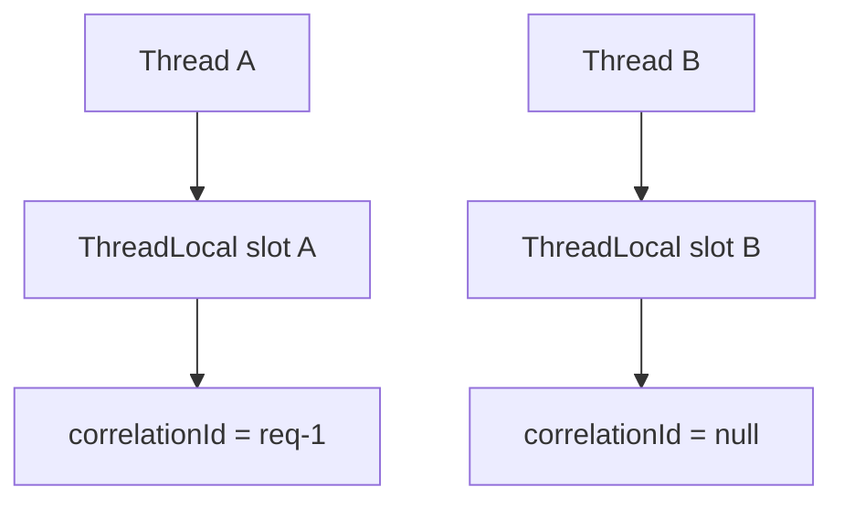
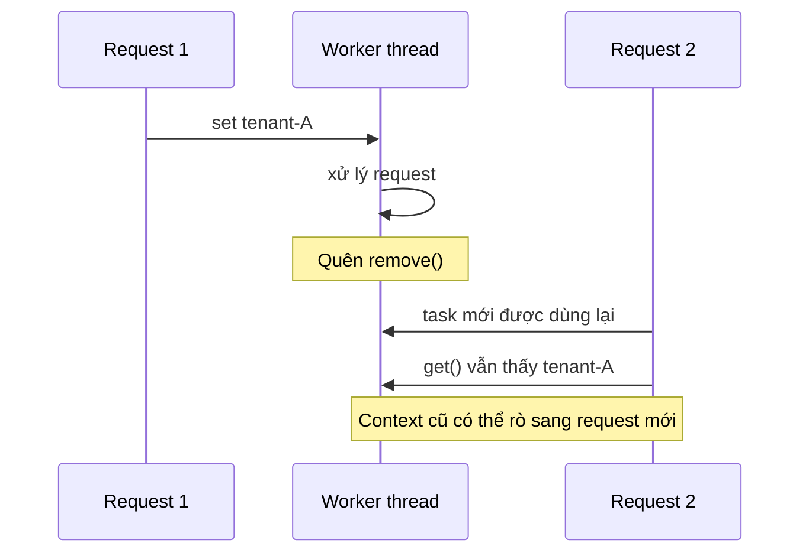
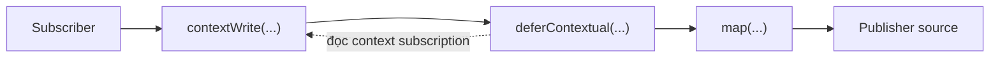
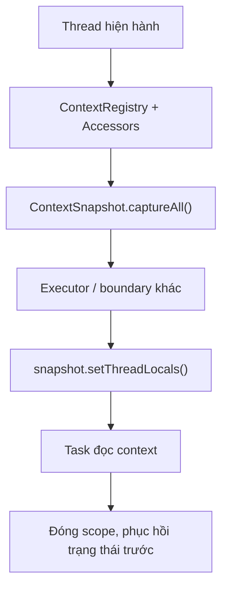

# ThreadLocal và Reactor Context trong Spring Boot

Một request `POST /checkout` có thể đi qua nhiều service, executor và reactive operator trước khi hoàn tất. Ở đầu request, tracing tạo `traceId`; logging có thể đưa `traceId`/`spanId` vào MDC; ứng dụng có thể gắn thêm tenant hoặc thông tin phục vụ chẩn đoán. Khi code chạy trên cùng thread, các thư viện thường đọc được context hiện hành. Nhưng khi tác vụ chuyển sang thread khác hoặc Reactor đổi scheduler, dữ liệu có thể biến mất, bị lẫn giữa requests hoặc xuất hiện sai trong logs.

Bài **ThreadLocal và Reactor Context** thuộc chương **Context propagation** của module **SPRING_BOOT_OBSERVABILITY**. Module tập trung vào Micrometer Observation, metrics, logs và distributed tracing, trong đó context propagation, tags/cardinality, exporter và sampling giúp liên kết tín hiệu để điều tra lỗi, độ trễ và hành vi ứng dụng trên môi trường thực.

Sau bài học, bạn có thể giải thích sự khác nhau giữa `ThreadLocal` và Reactor `Context`, hiểu vì sao ThreadLocal dễ gặp vấn đề với thread pool/reactive code, dùng Micrometer Context Propagation để capture/restore context ở ranh giới phù hợp, và kiểm thử rằng tracing/logging context không bị mất hoặc rò giữa các requests.

## 1. Context là gì và vì sao cần propagation?

**Context** là dữ liệu đi kèm một thao tác trong lúc nó được thực thi. Ví dụ trong một request:

| Dữ liệu context | Mục đích |
| --- | --- |
| `traceId`, `spanId` | Nối logs và spans với request đang điều tra |
| Span/Observation hiện hành | Tạo span con đúng parent và ghi nhận scope |
| `correlationId` | Tra cứu các sự kiện liên quan theo chính sách ứng dụng |
| Locale hoặc tenant đã được xác thực | Giữ ngữ cảnh xử lý khi chuyển sang tác vụ con |
| Security context | Duy trì principal/authority theo cơ chế bảo mật của framework |

Context propagation là quá trình **chuyển đúng những dữ liệu được phép** từ nơi tạo tác vụ sang nơi thực thi tác vụ, rồi khôi phục trạng thái trước đó sau khi tác vụ hoàn thành.

Không phải mọi dữ liệu đều cần propagation. Hãy chỉ truyền những trường có mục đích rõ ràng, cần thiết trong phạm vi tin cậy và có vòng đời xác định. Không dùng context propagation để phát tán password, access token, thông tin thanh toán hay dữ liệu cá nhân qua các dịch vụ.

## 2. ThreadLocal hoạt động như thế nào?

`ThreadLocal<T>` cung cấp một giá trị riêng cho **mỗi thread**. Khi thread A gọi `set(value)`, lời gọi `get()` trên thread A nhận giá trị đó; thread B có vùng lưu trữ riêng và không tự thấy giá trị của A.

```java
public final class RequestContext {
    private static final ThreadLocal<String> CORRELATION_ID =
        new ThreadLocal<>();

    private RequestContext() {}

    public static void set(String value) {
        CORRELATION_ID.set(value);
    }

    public static String get() {
        return CORRELATION_ID.get();
    }

    public static void clear() {
        CORRELATION_ID.remove();
    }
}
```

Mã trên minh họa API, không phải một context holder đủ tính năng cho production. Điểm cần chú ý là ThreadLocal không biết request nào đang sở hữu giá trị. Nó chỉ biết thread hiện tại.



Nếu code chạy đồng bộ trên A, `ThreadLocal.get()` có thể đọc được context đã đặt. Khi task chạy trên B, nó không tự kế thừa slot của A. Cần cơ chế capture/restore hoặc một mô hình context khác.

### Dùng ThreadLocal phải dọn trong finally

Thread pool thường tái sử dụng worker thread cho nhiều requests. Nếu request trước đặt giá trị nhưng không xóa, request tiếp theo có thể đọc phải dữ liệu cũ:

```java
try {
    RequestContext.set(correlationId);
    handleRequest();
} finally {
    RequestContext.clear();
}
```

Phải xóa cả khi code ném exception. `remove()` xóa giá trị của thread hiện hành; chỉ gọi `set(null)` thường không diễn đạt rõ ý định giải phóng giá trị của slot.

**Không giữ context trong field static mutable thông thường** rồi giả định thread-safety. ThreadLocal giới hạn giá trị theo thread, nhưng không tự giải quyết propagation, lifetime hay dữ liệu nhạy cảm.

## 3. Vì sao ThreadLocal nguy hiểm với thread pool?

Với thread pool, một số ít worker threads xử lý rất nhiều tasks. Thread không kết thúc sau mỗi request, nên giá trị ThreadLocal cũng có thể sống qua ranh giới request nếu không dọn.



Rủi ro thường gặp:

- **Context leakage:** tenant, correlation ID hoặc principal của request trước xuất hiện ở request sau.
- **Context mất:** task chuyển sang thread khác nhưng không capture context.
- **Khôi phục sai:** task con đặt một context mới nhưng không phục hồi context cha.
- **Memory retention:** object lớn được giữ lại qua thread-local slot trong thời gian dài.
- **Sai trace parent:** span mới được tạo ở thread không có current span nên trở thành root hoặc nối nhầm.

Một `try/finally` đúng cách giảm nguy cơ rò tại thread hiện tại, nhưng không tự truyền context qua executor. Cần giải quyết riêng **propagation** và **cleanup**.

## 4. Reactor Context là gì?

Reactor `Context` là kho dữ liệu **gắn với subscriber/subscription**, được dùng trong reactive pipeline. Nó không gắn trực tiếp với một thread. Vì vậy một pipeline có thể đổi thread/scheduler nhưng vẫn truy cập được context thuộc subscription nếu operator và thư viện sử dụng Reactor Context đúng cách.

```java
import reactor.core.publisher.Mono;

Mono<String> result =
    Mono.deferContextual(context -> {
        String correlationId = context.get("correlationId");
        return Mono.just("processing " + correlationId);
    })
    .contextWrite(context ->
        context.put("correlationId", "checkout-req-42"));
```

`deferContextual` đọc context tại lúc subscription, còn `contextWrite` tạo context cho các operator upstream nhìn thấy. Trong Reactor, context là immutable theo cách sử dụng API: thao tác `put` trả về một context mới, không sửa một map dùng chung tùy tiện.

### Chiều nhìn context trong pipeline

Context trong Reactor có quy tắc quan trọng: `contextWrite` tác động tới các operator **ở phía upstream của nó** (gần nguồn khi đọc từ trái sang phải theo cách biểu diễn pipeline), bởi context được truyền từ subscriber ngược lên chuỗi operator.



Vì thứ tự này khác với cách nhiều người hình dung dữ liệu chảy từ publisher xuống subscriber, hãy viết một test nhỏ khi thêm `contextWrite` hoặc di chuyển operator. Đừng đoán context sẽ nhìn thấy ở mọi vị trí trong pipeline.

## 5. So sánh ThreadLocal và Reactor Context

| Thuộc tính | `ThreadLocal` | Reactor `Context` |
| --- | --- | --- |
| Gắn với | Thread | Subscription/subscriber context |
| Phù hợp với | Code đồng bộ, API dựa vào thread hiện hành | Reactive pipeline |
| Khi đổi thread | Không tự truyền | Theo subscription context nếu operator dùng đúng |
| Khi tái sử dụng thread | Có nguy cơ rò dữ liệu nếu không `remove()` | Không gắn state trực tiếp vào worker thread |
| Cách đọc | `ThreadLocal.get()` | `deferContextual`, `Mono/Flux` context APIs |
| Cập nhật | Ghi slot của thread hiện tại | Trả về context mới qua `contextWrite` |
| Tích hợp logging/tracing | Nhiều thư viện dùng thread-local scope/MDC | Cần bridge/context propagation phù hợp |

Không nên kết luận một cơ chế “tốt hơn trong mọi trường hợp”. Spring MVC, servlet filters và thư viện đồng bộ có thể dùng ThreadLocal hợp lý trong phạm vi request thread. WebFlux/Reactor cần dựa vào subscription context. Ứng dụng kết hợp cả hai cần một cầu nối có vòng đời rõ ràng.

## 6. Micrometer Context Propagation làm cầu nối

Micrometer Context Propagation cung cấp abstraction để **capture context từ một nơi và restore ở nơi khác**. Các thành phần thường gặp:

- `ThreadLocalAccessor`: mô tả cách đọc, ghi và xóa một loại ThreadLocal.
- `ContextRegistry`: đăng ký các accessors để biết context nào có thể được capture/restore.
- `ContextSnapshot`: snapshot các giá trị context hiện hành.
- `ContextSnapshot.Scope`: scope khôi phục giá trị cho thread hiện tại và hoàn nguyên khi đóng.
- Reactor integration: hỗ trợ đọc/ghi giữa Reactor Context và các thread-local accessors đã đăng ký.



Context Propagation không tự biết mọi biến static hay field của ứng dụng. Phải đăng ký accessor cho context cần truyền, dùng integration phù hợp và giới hạn phạm vi của snapshot.

## 7. Đăng ký ThreadLocalAccessor và capture/restore

Ví dụ sau minh họa accessor cho `RequestContext` ở mục 2:

```java
import io.micrometer.context.ThreadLocalAccessor;
import io.micrometer.context.ContextRegistry;

public final class CorrelationIdAccessor
        implements ThreadLocalAccessor<String> {

    public static final String KEY = "correlationId";

    @Override
    public Object key() {
        return KEY;
    }

    @Override
    public String getValue() {
        return RequestContext.get();
    }

    @Override
    public void setValue(String value) {
        RequestContext.set(value);
    }

    @Override
    public void setValue() {
        RequestContext.clear();
    }
}

// Đăng ký một lần trong quá trình khởi tạo:
ContextRegistry.getInstance()
    .registerThreadLocalAccessor(new CorrelationIdAccessor());
```

API `ThreadLocalAccessor` có thể có khác biệt chữ ký/phương thức giữa các phiên bản Micrometer Context Propagation; ví dụ này thể hiện ý tưởng getter/setter/clear. Hãy dùng đúng API của dependency đang quản lý và tránh đăng ký cùng accessor nhiều lần trong mỗi request.

Sau khi accessor đã được đăng ký:

```java
import io.micrometer.context.ContextSnapshot;
import java.util.concurrent.Executor;

void submitWithContext(Executor executor, Runnable task) {
    ContextSnapshot snapshot = ContextSnapshot.captureAll();
    executor.execute(() -> {
        try (ContextSnapshot.Scope scope = snapshot.setThreadLocals()) {
            task.run();
        }
    });
}
```

Đường thực thi:

1. Request thread có correlation ID trong `RequestContext`.
2. `captureAll()` lấy các giá trị có accessor đã đăng ký.
3. Runnable được gửi tới executor.
4. Trong worker thread, `setThreadLocals()` cài giá trị snapshot vào thread hiện tại.
5. Task chạy và đọc được correlation ID.
6. Khi scope đóng, các giá trị trước đó được khôi phục để worker thread không bị nhiễm context của task vừa chạy.

**Scope phải được đóng**, vì executor tái sử dụng thread. Không tự tạo một snapshot ở startup rồi dùng lại cho mọi requests; snapshot cần được capture ở đúng ranh giới khi tác vụ được gửi.

## 8. Dùng Reactor Context và Context Propagation cùng nhau

Trong reactive application, nên xem Reactor Context là nguồn context theo subscription. Micrometer Context Propagation có thể kết nối Reactor Context với ThreadLocal khi accessors đã đăng ký và integration được bật.

Một ví dụ thủ công dùng `contextCapture()`:

```java
import io.micrometer.context.ContextRegistry;
import reactor.core.publisher.Mono;

Mono<String> work =
    Mono.deferContextual(ctx ->
        Mono.just("correlationId=" + ctx.get("correlationId")))
    .contextCapture();
```

`contextCapture()` capture các thread-local values có accessor đã đăng ký tại thời điểm subscription và đưa chúng vào Reactor Context để pipeline dùng. Do semantics và vị trí subscription quan trọng, phải xác minh với code thực, đặc biệt khi có nhiều `subscribeOn`, `publishOn`, nested subscriptions hoặc custom source.

Một ví dụ rõ ràng hơn khi giá trị vốn đã nằm trong Reactor Context:

```java
Mono<String> work =
    Mono.deferContextual(ctx ->
        Mono.just("tenant=" + ctx.get("tenant")))
    .contextWrite(ctx -> ctx.put("tenant", "tenant-blue"));
```

Trường hợp này không cần ThreadLocal để đọc `tenant`. Dữ liệu có thể theo subscription xuyên scheduler mà không phải copy thủ công vào mỗi thread, miễn là các operators vẫn nằm trong cùng reactive chain.

### Automatic context propagation

Reactor cung cấp chế độ automatic context propagation khi ứng dụng bật hook tương ứng, ví dụ:

```java
import reactor.core.publisher.Hooks;

// Gọi một lần khi khởi động, sau khi cấu hình ContextRegistry/accessors.
Hooks.enableAutomaticContextPropagation();
```

Hook này cho phép Reactor tích hợp context propagation với registered ThreadLocalAccessors qua các ranh giới subscription phù hợp. **Đây là thay đổi ở phạm vi toàn JVM/Reactor**, có thể thêm overhead và làm thay đổi khả năng thấy ThreadLocal của code cũ. Chỉ bật khi hiểu tác động, kiểm tra version Reactor/Micrometer, và ưu tiên cấu hình qua Spring Boot integration nếu phiên bản cung cấp cách cấu hình được hỗ trợ.

Automatic propagation không tự truyền mọi biến ThreadLocal, không thay thế việc đăng ký accessor và không làm Reactor Context biến thành một ThreadLocal toàn cục. Cần kiểm thử các đường subscribe/cancel/error thực tế.

## 9. publishOn, subscribeOn và context

Trong Reactor, `publishOn` có thể chuyển việc xử lý các operator tiếp theo sang scheduler khác; `subscribeOn` ảnh hưởng nơi subscription và quá trình upstream bắt đầu. Thread thực thi có thể thay đổi nhiều lần trong một pipeline:

```java
import reactor.core.publisher.Mono;
import reactor.core.scheduler.Schedulers;

Mono<String> result =
    Mono.deferContextual(ctx ->
        Mono.just("trace=" + ctx.getOrDefault("traceId", "missing")))
    .publishOn(Schedulers.parallel())
    .map(value -> value + " processed")
    .contextWrite(ctx -> ctx.put("traceId", "trace-123"));
```

Context thuộc subscription, không thuộc thread cụ thể. Vì vậy đổi scheduler không đồng nghĩa Reactor Context bị mất. Nhưng nếu một callback tự gọi API ThreadLocal trực tiếp, nó cần một bridge/integration để ThreadLocal được phục hồi tại điểm callback.

Ví dụ đọc đúng trong reactive pipeline:

```java
Mono.deferContextual(ctx -> {
    String traceId = ctx.get("traceId");
    return Mono.just(traceId);
});
```

Trong khi callback sau không tự bảo đảm có giá trị nếu thiếu bridge phù hợp:

```java
Mono.fromRunnable(() -> {
    String traceId = RequestContext.get();
    use(traceId);
});
```

Không giả định `ThreadLocal.get()` luôn trả đúng trace ID trong reactive callback. Nếu code phụ thuộc vào ThreadLocal, phải có propagation bridge được kiểm thử hoặc chuyển API để đọc context theo cách reactive.

## 10. Spring Boot, WebFlux và WebClient

Spring Boot có thể cấu hình Observation/Tracing và hỗ trợ context propagation cho các stack tương ứng. Behavior phụ thuộc version, dependencies và cách tạo client.

Với WebFlux:

- Ưu tiên `WebClient.Builder` do Spring quản lý để nhận các customizers/observation integrations thích hợp.
- Tránh tạo `WebClient.builder()` riêng ngoài cấu hình nếu cần tracing/metrics propagation mặc định.
- Đọc Reactor Context qua `deferContextual` trong reactive flow.
- Kiểm tra `traceId`/`spanId` ở client và server spans sau khi request thật chạy qua test server.
- Đừng gọi blocking API trên event-loop để “giữ context”; blocking có thể làm giảm throughput hoặc deadlock.

Với `@Async` hoặc `TaskExecutor`:

- Kiểm tra executor nào thực sự được dùng và có context decorator/integration nào được cấu hình.
- Nếu cần truyền ThreadLocal, dùng Micrometer Context Propagation hoặc integration phù hợp của Spring.
- Tránh đăng ký accessor/decorator lặp lại trong mỗi lần submit.
- Đóng scope/khôi phục context kể cả khi task throw exception hoặc bị hủy.

Một ứng dụng có thể đồng thời sử dụng servlet thread-local context và Reactor Context. Không lấy một cơ chế làm nguồn sự thật toàn cục cho tất cả mọi ranh giới; cần định nghĩa rõ dữ liệu nào nằm ở đâu, lúc nào được capture và nơi nào được restore.

## 11. Tracing, Observation và MDC

Trong Spring Boot observability, tracing thường dùng scope để xác định span hiện hành. Logging integration có thể đưa `traceId` và `spanId` vào MDC để các dòng log liên quan có thể tìm cùng trace.

Ví dụ một pattern Logback thường gặp:

```text
%d{yyyy-MM-dd HH:mm:ss.SSS} trace=%X{traceId:-} span=%X{spanId:-} %-5level %logger - %msg%n
```

Pattern chỉ có ích nếu tracing integration đã đặt MDC values trong scope. Khi task chạy ở thread khác mà context không được truyền, log có thể:

- Không có `traceId`/`spanId`.
- Có trace ID cũ do ThreadLocal/MDC không được dọn.
- Có ID của một request khác nếu custom code chia sẻ state sai cách.

Micrometer Context Propagation có thể hỗ trợ capture/restore các ThreadLocal có accessor, nhưng phải xác minh integration MDC thực tế của logging/tracing stack. Không copy tất cả MDC fields vô điều kiện; chỉ các trường cần thiết và được cho phép.

**Liên kết tín hiệu:** metrics cho biết mức độ ảnh hưởng (RPS, error rate, p95); traces cho biết một request đi qua những span nào; logs theo trace ID cung cấp thông tin sự kiện. Sampling có thể khiến một request có metric và log nhưng không có trace được lưu. Do đó không đưa trace ID vào metric tags để cố liên kết dashboard.

## 12. Context propagation và security

Context propagation có thể chuyển cả dữ liệu bảo mật nếu accessor đăng ký không đúng. Security context đặc biệt nhạy cảm vì có thể mang principal/authorities và ảnh hưởng tới quyền thực thi.

Các nguyên tắc:

1. Chỉ propagate context thật sự cần cho task và có chủ sở hữu rõ ràng.
2. Dùng cơ chế Spring Security được hỗ trợ cho security context, tránh tự sao chép principal/token vào ThreadLocal tùy tiện.
3. Không truyền access token, refresh token, password hoặc cookie trong baggage, MDC hay Observation tags.
4. Khi qua ranh giới dịch vụ, chỉ gửi HTTP/message headers được phê duyệt; không phát tán toàn bộ context nội bộ.
5. Giới hạn kích thước và thời gian sống của context data.
6. Xóa/restore state sau task; không để một request kế tiếp thừa hưởng quyền hoặc tenant của request trước.

Trace context kỹ thuật (ví dụ W3C `traceparent`) không phải credential và không thay security context. Ngược lại, baggage không nên được dùng để mang dữ liệu xác thực.

## 13. Kiểm thử ThreadLocal và Reactor Context

Một test tốt phải chứng minh cả **context được truyền đúng** và **context không rò sang task tiếp theo**.

### Test Reactor Context

```java
import org.junit.jupiter.api.Test;
import reactor.core.publisher.Mono;
import reactor.test.StepVerifier;

class ReactorContextTest {
    @Test
    void readsValueFromSubscriptionContext() {
        Mono<String> source = Mono.deferContextual(ctx ->
            Mono.just(ctx.get("correlationId")))
            .contextWrite(ctx -> ctx.put("correlationId", "req-42"));

        StepVerifier.create(source)
            .expectNext("req-42")
            .verifyComplete();
    }
}
```

Test xác nhận một publisher đọc được giá trị từ Reactor Context. Nó không chứng minh ThreadLocal/MDC hoặc tracing exporter đã được liên kết.

### Test cleanup trên thread được tái sử dụng

Ví dụ kiểm tra thủ công với executor đơn luồng:

```java
import java.util.concurrent.ExecutorService;
import java.util.concurrent.Executors;
import java.util.concurrent.Future;
import org.junit.jupiter.api.Test;
import static org.junit.jupiter.api.Assertions.*;

class ThreadLocalCleanupTest {
    @Test
    void clearsValueBeforeWorkerIsReused() throws Exception {
        ExecutorService executor = Executors.newSingleThreadExecutor();
        try {
            Future<String> first = executor.submit(() -> {
                try {
                    RequestContext.set("request-A");
                    return RequestContext.get();
                } finally {
                    RequestContext.clear();
                }
            });

            Future<String> second = executor.submit(RequestContext::get);

            assertEquals("request-A", first.get());
            assertNull(second.get());
        } finally {
            executor.shutdownNow();
        }
    }
}
```

Nếu bỏ `clear()` trong task thứ nhất, test có thể quan sát giá trị cũ ở task tiếp theo vì executor đơn luồng tái sử dụng cùng worker. Test này minh họa cleanup, chưa kiểm tra Micrometer snapshot bridge.

### Test propagation qua executor

Khi dùng Micrometer Context Propagation, test nên:

- Đăng ký accessor đúng một lần.
- Set giá trị trên thread kiểm thử.
- Capture `ContextSnapshot`.
- Submit task vào executor khác thread.
- Trong task, assert giá trị được restore.
- Đóng `Scope` và submit task tiếp theo để assert giá trị đã được khôi phục/clear.

Với tracing, bổ sung tracer/exporter in-memory và assert span con có cùng trace ID, parent span ID phù hợp. Với logging, capture log event và xác minh MDC fields đúng ở task, sau đó không còn ở task tiếp theo.

## 14. Các lỗi thường gặp

| Hiện tượng | Nguyên nhân có thể | Hướng xử lý |
| --- | --- | --- |
| `ThreadLocal.get()` trả `null` trong async task | Task chạy thread khác | Capture/restore context hoặc dùng context native của framework |
| Request sau thấy tenant/trace ID cũ | Quên `remove()` hoặc không đóng scope | Dùng `try/finally`, kiểm tra thread reuse |
| Reactor `Context` không có key | `contextWrite` đặt sai vị trí hoặc key khác tên | Kiểm tra operator order, subscription và key |
| `ThreadLocal` có giá trị trong MVC nhưng mất trong WebFlux | Reactive pipeline đổi thread hoặc thiếu bridge | Dùng Reactor Context, bật integration được hỗ trợ |
| Span con thành root | Current span không được truyền | Kiểm tra scope và propagation qua executor/client |
| Log không có trace ID | MDC integration/scope không hoạt động | Kiểm tra tracing logging integration và async context |
| Log có ID request cũ | MDC/ThreadLocal bị rò | Restore/clear trên mọi nhánh |
| ContextSnapshot trống | Accessor chưa đăng ký hoặc capture sai thời điểm | Kiểm tra ContextRegistry và thread nguồn |
| Automatic propagation làm tăng overhead | Hook toàn cục phục hồi nhiều ThreadLocals | Giới hạn accessors, đánh giá hiệu năng, chỉ bật khi cần |
| Baggage chứa dữ liệu nhạy cảm | Dùng propagation như kho thông tin nghiệp vụ | Loại bỏ trường, chỉ truyền context tối thiểu |
| Security context bị sai trong task | Truyền thủ công không đúng mô hình security | Dùng integration Spring Security được hỗ trợ |

## 15. Tình huống thực tế: traceId mất sau khi chuyển executor

**Bối cảnh giả định:** checkout-service nhận request, log ở controller có `traceId`, nhưng một tác vụ gửi qua executor ghi log `traceId` rỗng. Trace backend hiển thị span HTTP server nhưng không thấy span nghiệp vụ chạy nền.

**Bước 1 — Xác định ranh giới:** controller chạy trên servlet thread; task chạy trên worker thread của executor. ThreadLocal của servlet thread không tự xuất hiện ở worker.

**Bước 2 — Kiểm tra scope:** xác minh span hiện hành đã được mở đúng trong request và vẫn còn hiệu lực tại thời điểm capture. Nếu task tiếp tục sau khi request kết thúc, cần mô hình span/lifecycle rõ ràng, không giữ scope request mở tùy tiện.

**Bước 3 — Kiểm tra propagation:** cấu hình task decorator/integration hoặc Micrometer Context Propagation với accessors thích hợp. Capture ở lúc submit, restore trong task, đóng scope sau xử lý.

**Bước 4 — Kiểm tra cleanup:** dùng executor tái sử dụng thread để xác nhận task kế tiếp không đọc giá trị trace/tenant cũ.

**Bước 5 — Xác minh tracing end-to-end:** dùng test tracer/exporter để kiểm tra span nền có parent phù hợp; log capture xác nhận trace ID; không chỉ nhìn một log line.

**Bước 6 — Phân tích ranh giới request:** nếu công việc nền cần tiếp tục sau response, hãy xác định rõ span có nên là child của request, span liên kết (link) hay một trace độc lập. Không duy trì request scope chỉ để giữ context cho tác vụ kéo dài.

Kết quả mong đợi là task có đúng ngữ cảnh kỹ thuật cần thiết, không thừa hưởng dữ liệu của request khác và có vòng đời observability phù hợp với bản chất công việc.

## 16. Bài tập tự kiểm tra

**Bài 1.** Vì sao `ThreadLocal` hoạt động trong controller nhưng trả `null` bên trong executor task?

*Gợi ý:* Hai đoạn code chạy trên hai thread khác nhau; giá trị ThreadLocal không tự propagate.

**Bài 2.** Một worker thread phục vụ request A rồi request B. A đặt tenant vào ThreadLocal nhưng không xóa. Rủi ro là gì?

*Gợi ý:* Thread được tái sử dụng nên B có thể đọc tenant của A. Cần cleanup trong finally và kiểm thử thread reuse.

**Bài 3.** Reactor `Context` gắn với thread hay subscription?

*Gợi ý:* Subscription. Nó có thể đi qua scheduler changes trong cùng reactive chain nếu operator sử dụng context đúng.

**Bài 4.** `contextWrite` không làm `deferContextual` đọc được key. Bạn kiểm tra điều gì trước?

*Gợi ý:* Vị trí `contextWrite` trong operator chain, chiều propagation từ subscriber về upstream, key name và việc publisher đã subscribe chưa.

**Bài 5.** Tại sao phải đóng `ContextSnapshot.Scope` trong try-with-resources?

*Gợi ý:* Để phục hồi trạng thái ThreadLocal trước đó trên worker thread, tránh rò context sang task kế tiếp.

**Bài 6.** Bật `Hooks.enableAutomaticContextPropagation()` có làm mọi ThreadLocal của ứng dụng tự được truyền không?

*Gợi ý:* Không. Cần accessor đã đăng ký, integration phù hợp và phải xét phạm vi/overhead; hook không biết mọi biến tùy ý.

**Bài 7.** Có nên đưa access token vào Reactor Context để mọi operator lấy dùng không?

*Gợi ý:* Không tùy tiện. Chỉ dùng security integration phù hợp, giới hạn phạm vi và không đưa token vào baggage/logs/traces.

**Bài 8.** Unit test Reactor Context pass có chứng minh MDC trace ID đi qua WebClient và executor không?

*Gợi ý:* Không. Cần integration tests qua đúng WebClient/executor và kiểm tra spans/logging scope thực tế.

## 17. Ghi nhớ

- **ThreadLocal gắn giá trị với thread**, còn **Reactor Context gắn giá trị với subscription**. Chúng phục vụ các mô hình thực thi khác nhau.
- Thread pool tái sử dụng worker; luôn restore/clear ThreadLocal trong scope/finally để ngăn context cũ rò sang request mới.
- Reactor Context có semantics riêng: `contextWrite` tác động tới operators upstream; dùng `deferContextual` để đọc và test khi thay đổi thứ tự operators.
- **Micrometer Context Propagation** dùng accessors, registry và snapshot để capture/restore context qua executor hoặc bridge giữa Reactor Context và ThreadLocal.
- Automatic propagation là hook có phạm vi rộng; phải đăng ký accessor, kiểm tra version/overhead và không giả định nó truyền mọi dữ liệu.
- Trong Spring Boot observability, tracing scope, MDC, WebClient, `@Async` và security context cần integration đúng; một trace ID thiếu ở task thường là dấu hiệu propagation boundary chưa được xử lý.
- Chỉ propagate **context tối thiểu, an toàn và cần thiết**. Kiểm thử cả việc context đến đúng task lẫn việc nó được khôi phục/xóa trước khi worker được tái sử dụng.
