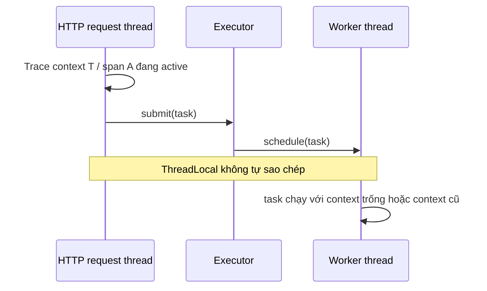
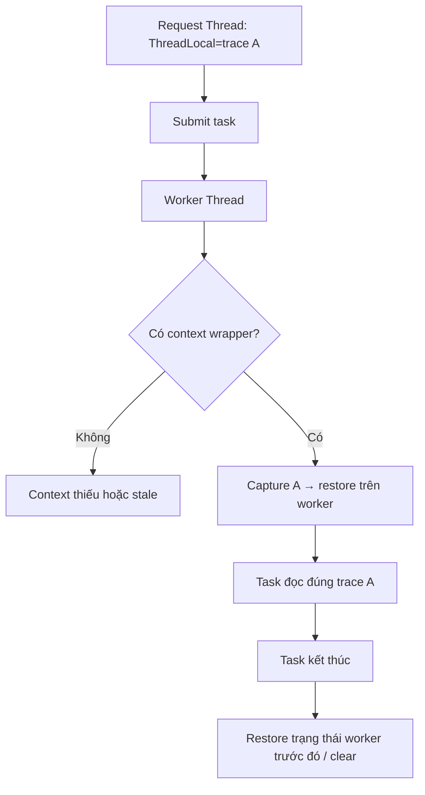

# Context propagation trong async task

Một request HTTP đến Order Service, service kiểm tra dữ liệu rồi đưa công việc gửi hóa đơn sang thread pool để xử lý nền. Ở request thread, log có Trace ID và Span ID; nhưng khi worker thread bắt đầu chạy, log lại không có các giá trị này. Trace backend chỉ thấy span HTTP ban đầu, còn phần gửi hóa đơn biến mất khỏi trace. Đây là tình huống điển hình khi **context không được propagate qua ranh giới bất đồng bộ**.

Bài **Context propagation trong async task** thuộc chương **Context propagation** của module **SPRING_BOOT_OBSERVABILITY**. Module học cách thiết lập observability cho Spring Boot bằng Micrometer Observation, metrics, logs và distributed tracing; nắm context propagation, tag/cardinality, exporter, sampling và liên kết tín hiệu để điều tra lỗi, độ trễ, hành vi ứng dụng trong môi trường thực.

> **Điểm cốt lõi:** Một async task thường chạy trên thread khác với thread đã nhận request. Context lưu trong **ThreadLocal** như tracing scope hoặc MDC **không tự động chuyển sang thread mới**. Cần capture context ở nơi submit task, restore context khi task thực thi và phục hồi trạng thái trước đó sau khi task kết thúc. Với tracing, worker có thể tạo span con mới; nó không cần và không nên dùng chung Span ID với span của request thread.

## 1. Mục tiêu học tập

Sau bài này, bạn có thể:

1. Giải thích vì sao context lưu trong ThreadLocal không tự đi qua Executor, CompletableFuture hoặc @Async.
2. Phân biệt capture, propagation, restore và cleanup context.
3. Cấu hình Spring task executor với TaskDecorator hoặc ContextPropagatingTaskDecorator.
4. Dùng ContextSnapshot và ThreadLocalAccessor để propagate context tùy chỉnh.
5. Hiểu vai trò của ObservationRegistry, Micrometer Tracing và MDC trong correlation.
6. Truyền context đúng khi dùng CompletableFuture, Reactor và các tác vụ bất đồng bộ.
7. Ngăn rò rỉ Trace ID hoặc dữ liệu người dùng giữa các task trên thread pool.
8. Phân biệt span con với span mới liên kết bằng Span Link tùy ngữ nghĩa công việc.
9. Kiểm thử propagation có tính xác định và điều tra sự cố khi trace bị đứt.

## 2. Context propagation giải quyết vấn đề gì?

Trong xử lý đồng bộ, một request có thể đi qua nhiều method trên cùng thread. Tracing scope hoặc MDC thường dựa trên ThreadLocal để trả lời “context hiện tại là gì?”. Khi chương trình submit task sang executor, worker thread có thể được lấy từ pool và đã từng thực hiện task khác.



Nếu context không được truyền:

- Log ở worker thiếu traceId/spanId.
- Tracing có thể tạo trace mới không liên quan request ban đầu.
- Một số log có thể mang context cũ nếu thread pool bị rò ThreadLocal.
- Observation con không nhận parent đúng, cây trace bị tách.
- Security hoặc tenant context có thể mất, dẫn tới hành vi sai nếu code phụ thuộc các context đó.

**Context propagation** là cơ chế chuyển các giá trị ngữ cảnh phù hợp qua ranh giới thực thi để code ở worker đọc được context đúng với task đang chạy.

### 2.1 Những loại context thường gặp

| Context | Thông tin | Nơi thường được lưu | Tác dụng khi async |
|---|---|---|---|
| Tracing context | Trace ID, Span ID hiện hành, baggage/parent | Tracer scope, thường có ThreadLocal accessor | Giữ quan hệ parent-child và trace continuity. |
| Logging context | MDC fields như traceId, spanId, request category | SLF4J MDC / Logback MDC | Log worker có thể tìm theo trace. |
| Security context | Principal, authorities | Spring SecurityContextHolder | Bảo toàn người gọi khi nghiệp vụ được phép chạy dưới danh tính đó. |
| Tenant context | Tenant ID hoặc partition | Custom ThreadLocal/framework context | Tách dữ liệu tenant chính xác. |
| Locale/request metadata | Locale, correlation metadata | Request context hoặc custom accessor | Giữ thông tin cần thiết cho worker. |
| Reactor Context | Context gắn với subscription | Reactor Context | Truyền context theo pipeline reactive, không phụ thuộc thread cụ thể. |

Không phải mọi dữ liệu đều nên được propagate. Chỉ truyền những giá trị thực sự cần thiết; tránh copy toàn bộ request object, credentials hoặc dữ liệu nhạy cảm vào task background chỉ vì tiện.

## 3. Vì sao ThreadLocal không tự đi qua thread pool?

ThreadLocal gắn giá trị với **thread hiện tại**. Khi request thread ghi:

```java
TraceContextHolder.set("trace-123");
```

giá trị nằm trong slot của request thread. Khi executor chạy task trên worker khác, lời gọi:

```java
TraceContextHolder.get();
```

đọc slot của worker thread, không phải slot của request thread.

Thread pool làm vấn đề tinh tế hơn: worker được tái sử dụng. Nếu task trước ghi ThreadLocal mà không xóa, task tiếp theo có thể đọc nhầm dữ liệu cũ. Do đó cleanup không phải chi tiết tùy chọn; nó là điều kiện đúng đắn của propagation.



### 3.1 Capture phải xảy ra ở thời điểm submit

Một snapshot context cần được lấy khi code còn ở request context:

```text
Request thread:
  active trace = T
  capture snapshot T
  executor.submit(wrap(snapshot, task))

Worker thread:
  restore snapshot T
  run task
  close scope / restore context trước đó
```

Nếu chỉ đọc ThreadLocal khi task bắt đầu trên worker, có thể đã quá muộn: worker không có context của request submit. Cần wrapper hoặc executor integration thực hiện capture ở phía submit, không phải lúc worker bắt đầu tự tìm context.

## 4. Context propagation khác với tạo một span mới

Hai thao tác có quan hệ nhưng không giống nhau:

- **Propagate context:** chuyển context hiện hành qua ranh giới thread để công việc có thể tiếp tục trong cùng trace.
- **Tạo span:** bắt đầu một đơn vị công việc có Span ID riêng, với parent context được lấy từ context đã propagate.

Ví dụ:

```text
HTTP server span:
  traceId = T
  spanId  = A

Submit async task với context:
  traceId = T
  current span context = A

Worker tạo span:
  traceId = T
  spanId  = B
  parentSpanId = A
```

Span mới trên worker có ID B; parent là span A. Nếu chỉ propagate context nhưng không instrument công việc worker, trace có thể tiếp tục context mà không có span chi tiết cho phần việc. Nếu tạo span mà không có parent context hợp lệ, tracer có thể bắt đầu trace độc lập.

**Không dùng lại Span ID A làm Span ID của worker.** Mỗi span mới cần ID riêng.

### 4.1 Khi nào không nên giữ task thành span con?

Một task được đẩy vào queue và chạy nhiều giờ sau có thể không còn phù hợp với lifetime của HTTP request đã submit. Nếu bắt buộc giữ request span mở hàng giờ, trace có thể rất dài và tốn tài nguyên; parent span có thể đã kết thúc trước task.

Tùy mô hình nghiệp vụ và messaging semantics, có thể tạo **trace mới** cho consumer/job rồi đính kèm **Span Link** tới span producer/request. Link thể hiện quan hệ nhân quả mà không bắt buộc child span nằm trong lifetime của parent. Chọn theo ý nghĩa “cùng một hoạt động” hay “một công việc độc lập được kích hoạt bởi hoạt động trước”.

## 5. Các lớp API quan trọng trong Micrometer và Spring

| API/thành phần | Vai trò | Dùng khi |
|---|---|---|
| ObservationRegistry | Quản lý observation lifecycle và handlers | Instrument nghiệp vụ để tạo metrics/traces. |
| io.micrometer.tracing.Tracer | Truy cập span hiện hành, tạo span qua tracing facade | Cần thao tác tracing cụ thể. |
| ContextRegistry | Đăng ký ThreadLocalAccessor/context accessor | Muốn snapshot biết cách đọc/ghi context. |
| ThreadLocalAccessor | Định nghĩa lấy, đặt và xóa giá trị context | Context tùy chỉnh hoặc tích hợp thư viện. |
| ContextSnapshot | Snapshot các context đã đăng ký; có thể mở scope restore tạm thời | Capture khi submit, restore khi chạy. |
| TaskDecorator | Bọc Runnable trước khi executor thực thi | Propagate context vào Spring TaskExecutor. |
| ContextPropagatingTaskDecorator | TaskDecorator của Spring dùng Micrometer Context Propagation | Chuyển context đã đăng ký sang task. |
| Reactor Context | Context gắn với subscription reactive | Propagation trong Mono/Flux pipeline. |

Micrometer Context Propagation là lớp cầu nối giữa context model dạng ThreadLocal và context model như Reactor Context. Nó không thay thế tracer, logger hoặc security framework; nó cung cấp cơ chế capture/restore cho những accessor đã đăng ký.

## 6. Cấu hình Spring @Async với ContextPropagatingTaskDecorator

Trong Spring Framework 6.1+, có ContextPropagatingTaskDecorator thuộc package org.springframework.core.task.support. Nó dùng Micrometer Context Propagation để capture/restore những context có accessor thích hợp.

### 6.1 Dependencies

Với Spring Boot có Actuator và Micrometer Observation/Tracing, dependency quản lý có thể đã cung cấp các thành phần cần thiết. Nếu dùng riêng Context Propagation, artifact là io.micrometer:context-propagation. Ví dụ Gradle khi cần khai báo trực tiếp (phiên bản nên theo dependency management/BOM của dự án):

```groovy
dependencies {
    implementation 'org.springframework.boot:spring-boot-starter-actuator'
    implementation 'io.micrometer:context-propagation'
}
```

Nếu tracing thực sự cần export, còn phải khai báo tracing bridge/starter và exporter phù hợp phiên bản Spring Boot. Chỉ có Context Propagation không tự tạo trace backend.

### 6.2 Khai báo executor và decorator

```java
import org.springframework.context.annotation.Bean;
import org.springframework.context.annotation.Configuration;
import org.springframework.core.task.TaskExecutor;
import org.springframework.core.task.support.ContextPropagatingTaskDecorator;
import org.springframework.scheduling.annotation.EnableAsync;
import org.springframework.scheduling.concurrent.ThreadPoolTaskExecutor;

@Configuration(proxyBeanMethods = false)
@EnableAsync
public class AsyncConfiguration {

    @Bean(name = "applicationTaskExecutor")
    public TaskExecutor applicationTaskExecutor() {
        ThreadPoolTaskExecutor executor = new ThreadPoolTaskExecutor();
        executor.setCorePoolSize(4);
        executor.setMaxPoolSize(8);
        executor.setQueueCapacity(100);
        executor.setThreadNamePrefix("app-async-");
        executor.setTaskDecorator(new ContextPropagatingTaskDecorator());
        executor.initialize();
        return executor;
    }
}
```

**Cấu hình này có ý nghĩa gì?**

- @EnableAsync bật cơ chế thực thi method @Async bằng executor.
- ThreadPoolTaskExecutor quản lý worker threads, tránh tạo thread mới cho mỗi task.
- ContextPropagatingTaskDecorator bọc task để propagate các context đã đăng ký với Micrometer.
- Thread prefix hỗ trợ nhận diện worker trong logs/thread dump.
- Queue capacity và pool size là thông số vận hành, cần căn cứ workload; các số trong ví dụ không phải cấu hình production phổ quát.

ContextPropagatingTaskDecorator có trong Spring Framework 6.1+. Với Spring Boot 3.x dùng Framework 6.1 trở lên, API này khả dụng; nếu dự án khóa Framework cũ hơn, cần nâng cấp theo compatibility hoặc viết decorator với ContextSnapshot.

### 6.3 Dùng @Async

```java
import org.slf4j.Logger;
import org.slf4j.LoggerFactory;
import org.springframework.scheduling.annotation.Async;
import org.springframework.stereotype.Service;

@Service
public class InvoiceService {
    private static final Logger log =
            LoggerFactory.getLogger(InvoiceService.class);

    @Async("applicationTaskExecutor")
    public void sendInvoice(String orderReference) {
        log.info("Sending invoice for order");
        // Gọi hệ thống hóa đơn ở đây.
    }
}
```

Khi method được gọi qua Spring proxy từ một bean khác, task được gửi tới executor named applicationTaskExecutor. Nếu decorator và các context accessors được cấu hình, MDC/tracing context đã đăng ký có thể xuất hiện trong worker. **Self-invocation** (một method trong cùng object gọi method @Async của chính object đó) thường bỏ qua proxy và không chạy async như kỳ vọng.

Không truyền toàn bộ HTTP request hoặc mutable request-scoped object sang background task. Thường chỉ truyền định danh cần thiết hoặc immutable command, rồi worker lấy dữ liệu qua service/persistence theo quyền truy cập phù hợp.

### 6.4 @Async không bảo đảm task thành công

@Async chỉ xác định cách dispatch. Cần xem xét:

- Executor queue đầy và từ chối task.
- Lỗi phát sinh trong method async.
- Return type void khiến caller không nhận kết quả trực tiếp; dùng Future/CompletableFuture khi cần theo dõi.
- Request thread kết thúc trước khi worker chạy; tracing span có thể cần kết thúc độc lập hoặc dùng link tùy semantics.
- Context propagation đúng nhưng task vẫn thất bại vì dependency, timeout hoặc dữ liệu đã thay đổi.

Propagation giữ metadata đúng; nó không xử lý retry, durability hoặc delivery guarantees.

## 7. Tự viết TaskDecorator với ContextSnapshot

ContextPropagatingTaskDecorator là lựa chọn ngắn gọn khi dùng accessor đã đăng ký. Nếu cần điều khiển cụ thể, có thể capture snapshot lúc Spring gọi decorate(...) và mở scope khi task chạy.

```java
import io.micrometer.context.ContextSnapshot;
import io.micrometer.context.ContextSnapshotFactory;
import org.springframework.core.task.TaskDecorator;

public final class SnapshotTaskDecorator implements TaskDecorator {

    private final ContextSnapshotFactory snapshotFactory =
            ContextSnapshotFactory.builder().build();

    @Override
    public Runnable decorate(Runnable task) {
        // decorate thường chạy tại submit side:
        // capture context của thread gửi task.
        ContextSnapshot snapshot = snapshotFactory.captureAll();

        return () -> {
            // Scope.close() restore context cũ của worker.
            try (ContextSnapshot.Scope scope = snapshot.setThreadLocals()) {
                task.run();
            }
        };
    }
}
```

Đây là ví dụ API Micrometer Context Propagation; hãy đối chiếu chữ ký với phiên bản dependency đã khóa. captureAll() chỉ capture những context mà ContextRegistry nhận diện qua accessor. Nếu tracing/MDC/custom context chưa có accessor hoặc integration thích hợp, snapshot không thể tự đoán cách lấy giá trị.

**Tránh tự làm decorator kiểu “get ThreadLocal rồi set ở worker” mà không restore trạng thái trước đó.** Worker thread pool được tái sử dụng; khi task kết thúc phải phục hồi giá trị cũ hoặc clear đúng cách để task kế tiếp không đọc context của task trước.

### 7.1 Tại sao dùng try-with-resources?

snapshot.setThreadLocals() trả về một scope. Đóng scope sẽ phục hồi giá trị context đã tồn tại trên worker trước khi task bắt đầu. Nếu task ném exception, try-with-resources vẫn gọi close().

Mẫu tổng quát:

```java
ContextSnapshot snapshot = snapshotFactory.captureAll();

executor.execute(() -> {
    try (ContextSnapshot.Scope ignored = snapshot.setThreadLocals()) {
        doWork();
    }
});
```

Không gọi setThreadLocals() rồi quên close; đó là lỗi dễ khiến MDC/ThreadLocal rò giữa các tác vụ.

## 8. Propagate custom ThreadLocal bằng ThreadLocalAccessor

Micrometer chỉ capture những context mà registry biết. Nếu ứng dụng tự tạo tenant context hoặc correlation metadata bằng ThreadLocal, đăng ký ThreadLocalAccessor tương ứng.

Ví dụ đơn giản:

```java
import io.micrometer.context.ContextRegistry;
import io.micrometer.context.ThreadLocalAccessor;

public final class TenantContext {

    private static final ThreadLocal<String> CURRENT = new ThreadLocal<>();

    private TenantContext() {}

    public static String get() {
        return CURRENT.get();
    }

    public static void set(String tenantId) {
        CURRENT.set(tenantId);
    }

    public static void clear() {
        CURRENT.remove();
    }

    public static void registerAccessor() {
        ContextRegistry.getInstance().registerThreadLocalAccessor(
                new ThreadLocalAccessor<String>() {
                    @Override
                    public Object key() {
                        return "tenantId";
                    }

                    @Override
                    public String getValue() {
                        return TenantContext.get();
                    }

                    @Override
                    public void setValue(String value) {
                        if (value == null) {
                            TenantContext.clear();
                        } else {
                            TenantContext.set(value);
                        }
                    }

                    @Override
                    public void reset() {
                        TenantContext.clear();
                    }
                });
    }
}
```

Đăng ký accessor **một lần trong giai đoạn khởi động**, không gọi lại trên từng request. Cấu hình thật cần dùng accessor API tương thích với version và tránh thay đổi singleton ContextRegistry trong lúc nhiều tasks đang chạy.

### 8.1 Snapshot chỉ chứa các context được hỗ trợ

Khi TenantContext đã đăng ký:

```java
TenantContext.set("tenant-a");

ContextSnapshot snapshot = ContextSnapshotFactory.builder()
        .build()
        .captureAll();

TenantContext.clear();

try (ContextSnapshot.Scope ignored = snapshot.setThreadLocals()) {
    // Worker hiện có thể đọc tenant-a.
    String tenant = TenantContext.get();
}
```

Khi scope đóng, trạng thái tenant context trước đó trên thread hiện hành được phục hồi. Trong production, không tự đưa tenant ID thành span/metric tags cardinality cao nếu không cần; tenant context chủ yếu phục vụ routing/authorization và nên được kiểm soát riêng.

### 8.2 Custom context không thay thế Spring Security

Spring Security có cơ chế riêng để propagate SecurityContext qua executor, ví dụ DelegatingSecurityContextAsyncTaskExecutor. Khi ứng dụng dùng Spring Security, ưu tiên tích hợp chính thức phù hợp version; không tự copy principal/authorities bằng ThreadLocalAccessor chung nếu điều đó bypass security lifecycle hoặc tạo rò danh tính.

Tương tự, không propagate transaction context qua thread pool chỉ bằng cách copy ID. Transaction manager/thread-bound resources có quy tắc riêng; hãy dùng transaction boundary mới trong worker khi cần, không chia sẻ connection/session không thread-safe.

## 9. CompletableFuture và Executor

CompletableFuture.supplyAsync(...) dùng common ForkJoinPool nếu không truyền executor. Khi ứng dụng có task executor được instrument, hãy truyền executor đó để propagation được thực hiện theo cấu hình.

### 9.1 Dùng Spring-managed executor

```java
import java.util.concurrent.CompletableFuture;
import java.util.concurrent.Executor;
import org.springframework.beans.factory.annotation.Qualifier;
import org.springframework.stereotype.Service;

@Service
public class OrderWorkflow {

    private final Executor applicationTaskExecutor;

    public OrderWorkflow(
            @Qualifier("applicationTaskExecutor") Executor executor) {
        this.applicationTaskExecutor = executor;
    }

    public CompletableFuture<String> createOrderAsync() {
        return CompletableFuture.supplyAsync(
                this::performOrderWork,
                applicationTaskExecutor);
    }

    private String performOrderWork() {
        return "created";
    }
}
```

Khai báo bean executor và decorator từ phần trước. Không giả định CompletableFuture.supplyAsync(...) tự dùng executor của Spring.

### 9.2 Nhiều stage có thể đổi thread

```java
CompletableFuture.supplyAsync(this::loadOrder, executor)
        .thenApplyAsync(this::calculateTotal, executor)
        .thenApplyAsync(this::formatResult, executor);
```

Các stage Async có thể chạy trên executor được truyền (hoặc common pool nếu overload không truyền executor). Nếu mỗi boundary cần context, executor/decorator phải bao phủ các lần dispatch. Các stage non-async có thể chạy trên thread hoàn tất stage trước; không nên phụ thuộc thread cụ thể mà phải dựa trên context abstraction.

Với future được kết hợp từ nhiều trace contexts khác nhau, không thể “propagate tất cả” thành một parent duy nhất mà không có quy tắc. Cần chọn context chủ đạo, hoặc tạo span mới với links tới các nguồn liên quan nếu use case hỗ trợ.

## 10. Reactor: Context gắn với subscription, không phải ThreadLocal thuần túy

Trong Reactor, execution có thể di chuyển giữa threads. Reactor Context được gắn với subscription và truyền theo pipeline; đây là nơi tự nhiên để lưu reactive context. Tự dựa vào ThreadLocal xuyên publishOn/subscribeOn dễ sai.

### 10.1 Ví dụ context theo subscription

```java
import reactor.core.publisher.Mono;

Mono<String> flow =
        Mono.deferContextual(context -> {
            String requestId = context.get("requestId");
            return Mono.just("processing " + requestId);
        })
        .contextWrite(context -> context.put("requestId", "req-42"));
```

deferContextual đọc context ở lúc subscription; contextWrite gắn giá trị vào Reactor Context. Context không được đọc như mutable thread state; nó gắn với subscriber và lan truyền theo các operator phù hợp.

### 10.2 Từ Reactor Context sang ThreadLocal và ngược lại

Micrometer Context Propagation cung cấp accessor/cầu nối để tích hợp các context đã đăng ký với Reactor. Tùy cấu hình, Reactor instrumentation có thể restore ThreadLocal values khi callback chạy và capture context phù hợp ở các ranh giới operator.

Trong những ứng dụng Spring Boot/Micrometer/Reactor hỗ trợ, có thể bật automatic context propagation có chủ đích:

```java
import reactor.core.publisher.Hooks;

public final class ReactorContextConfiguration {
    public static void enableContextPropagation() {
        Hooks.enableAutomaticContextPropagation();
    }
}
```

Đây là hook toàn cục trong Reactor; bật một lần trong cấu hình ứng dụng, không bật/tắt cho từng request. Phải đọc hướng dẫn phiên bản Reactor và Micrometer tương ứng: automatic propagation có thể có overhead, và không nên giả định mọi Reactor version/callback style có semantics giống nhau.

Khi chỉ cần ThreadLocal restoration ở một số operator, các operator Micrometer như contextCapture() có thể phù hợp hơn, nhưng cần xác định rõ capture side và subscription lifecycle. Đừng thêm nhiều cơ chế propagation cùng lúc mà không kiểm tra chúng có ghi đè cùng key hay không.

### 10.3 @Async và Reactor là hai mô hình khác nhau

- @Async dispatch method qua Spring TaskExecutor; TaskDecorator có thể wrap Runnable.
- Reactor truyền context qua subscription; TaskDecorator không thay thế Reactor Context.
- Một pipeline có thể gọi blocking executor, khi đó cần propagation ở cả ranh giới Reactor ↔ executor.
- Nếu framework đã instrument reactive stack, tránh chèn custom wrapper trùng chức năng.

## 11. Context propagation với Micrometer Observation và Tracing

Observation có lifecycle và scope. Khi mở Observation scope, context hiện hành có thể được sử dụng bởi tracing handler, logging correlation và instrumentation con.

Một luồng đồng bộ:

```java
Observation.createNotStarted("invoice.send", observationRegistry)
        .contextualName("send invoice")
        .observe(() -> invoiceGateway.send());
```

Nếu observe chạy đồng bộ, Observation helper quản lý scope trong callback. Nếu callback chỉ submit task rồi trả về, Observation ở caller có thể stop ngay khi task được enqueue, trong khi worker thực tế chưa chạy.

**Đây là lỗi đo async rất phổ biến:**

```java
// Sai nếu muốn đo toàn bộ thời gian worker thực thi.
observation.observe(() -> executor.execute(this::sendInvoice));
```

Observation kết thúc khi lệnh execute trả về, chứ không đợi sendInvoice xong. Với async work, hãy sở hữu lifecycle ở worker hoặc tạo observation/span riêng trong worker dưới context đã được propagate.

### 11.1 Ví dụ worker tạo Observation/span riêng

```java
import io.micrometer.observation.Observation;
import io.micrometer.observation.ObservationRegistry;

public class InvoiceWorker implements Runnable {

    private final ObservationRegistry observations;

    public InvoiceWorker(ObservationRegistry observations) {
        this.observations = observations;
    }

    @Override
    public void run() {
        Observation.createNotStarted("invoice.send", observations)
                .contextualName("send invoice")
                .observe(this::sendToProvider);
    }

    private void sendToProvider() {
        // Gọi provider ở đây.
    }
}
```

Nếu TaskDecorator đã propagate context cha đúng, Observation mới ở worker có thể trở thành span con của context hiện hành. Việc tracing handler tạo span phụ thuộc tracing được cấu hình và context được giữ sống theo semantics; hãy kiểm tra trace thực tế. Không bắt buộc custom code phải gọi tracer.nextSpan() khi Observation đã tạo span đúng ranh giới.

### 11.2 Tracing context và MDC có thể được propagate cùng nhau

Micrometer Tracing có integration để đưa traceId và spanId hiện hành vào MDC. Context Propagation có thể restore các accessor tương ứng trên worker, giúp logging correlation hoạt động.

Nếu code tự tạo MDC fields riêng, cần nhớ chúng không tự đồng nhất với tracer context. Việc đặt MDC.put("traceId", ...) không tự tạo span, không inject HTTP traceparent và không bảo đảm propagation tới service khác. Ưu tiên tracing integration quản lý ID, chỉ dùng MDC cho correlation fields phù hợp.

## 12. Cleanup và rủi ro rò context

Thread pool tái sử dụng thread, nên context sau task phải được phục hồi. Mẫu đúng là capture snapshot, mở scope, chạy task và close scope trong mọi nhánh.

### 12.1 Minh họa rò MDC

Sai:

```java
executor.execute(() -> {
    MDC.put("traceId", requestTraceId);
    doWork();
    // Quên MDC.clear/remove.
});
```

Worker có thể chạy task khác và giữ traceId cũ, tạo log sai correlation. Dùng context snapshot/decorator; nếu quản lý MDC thủ công, lưu trạng thái cũ và restore trong finally thay vì chỉ clear bừa bãi giá trị có thể thuộc scope trước.

### 12.2 Không phải lúc nào clear cũng đúng

Worker có thể đã có context trước khi wrapper mở scope. ContextSnapshot.Scope.close() được thiết kế để phục hồi trạng thái trước đó. Gọi MDC.clear() sau wrapper có thể xóa context hợp lệ của caller hoặc framework nếu wrapper lồng nhau. Hãy để cơ chế scope sở hữu cleanup tương ứng.

### 12.3 Cancellation và exception

Task có thể kết thúc do hoàn tất, exception, interrupt hoặc cancel. Cleanup phải chạy trong tất cả trường hợp:

```java
try (ContextSnapshot.Scope ignored = snapshot.setThreadLocals()) {
    task.run();
} // close luôn chạy kể cả khi task.run() ném exception
```

Nếu dùng Future cancel, hãy đảm bảo task có cooperative cancellation và các Observation/spans trong worker được stop đúng lúc công việc thực sự kết thúc. Propagation không tự ngăn leak tài nguyên hay dừng hoạt động.

## 13. Kiểm thử context propagation

Không nên chỉ kiểm tra “task chạy được”. Cần xác nhận context đúng ở worker và không bị rò sang task tiếp theo.

### 13.1 Kiểm tra custom ThreadLocal

Test concept:

```java
import static org.junit.jupiter.api.Assertions.assertEquals;
import java.util.concurrent.ExecutorService;
import java.util.concurrent.Executors;
import java.util.concurrent.Future;
import io.micrometer.context.ContextSnapshot;
import io.micrometer.context.ContextSnapshotFactory;
import org.junit.jupiter.api.Test;

class ContextPropagationTest {

    @Test
    void restoresCapturedTenantOnWorker() throws Exception {
        TenantContext.registerAccessor();
        TenantContext.set("tenant-a");
        ContextSnapshotFactory factory =
                ContextSnapshotFactory.builder().build();
        ContextSnapshot snapshot = factory.captureAll();

        ExecutorService executor = Executors.newSingleThreadExecutor();
        try {
            Future<String> result = executor.submit(() -> {
                try (ContextSnapshot.Scope ignored = snapshot.setThreadLocals()) {
                    return TenantContext.get();
                }
            });
            assertEquals("tenant-a", result.get());
        } finally {
            executor.shutdownNow();
            TenantContext.clear();
        }
    }
}
```

Ví dụ dùng ExecutorService với shutdown tường minh để tương thích Java 17. Trong dự án thật, đăng ký accessor một lần trong test setup, cô lập ContextRegistry giữa tests và đảm bảo cleanup ở cả worker.

### 13.2 Kiểm tra context cleanup trên worker

Sau khi task đã chạy và scope đóng, submit task thứ hai **không có snapshot** trên cùng single-thread executor; task thứ hai nên thấy context trống hoặc baseline riêng của worker, không được thấy tenant-a. Đây là kiểm tra quan trọng để phát hiện ThreadLocal leakage.

### 13.3 Kiểm thử tracing

Để xác nhận tracing thực tế:

1. Gửi một HTTP request qua instrumented endpoint.
2. Submit async task bằng executor có decorator.
3. Trong worker, tạo một Observation/span riêng.
4. Xuất trace tới test reporter/collector phù hợp.
5. Xác minh Trace ID được giữ, Span ID của worker mới, parent relationship đúng.
6. Tạo task tiếp theo trên cùng worker không có parent và kiểm tra không nhận Trace ID của request cũ.
7. Thử cả nhánh exception/cancel để xác nhận scope được đóng.

Không dùng Thread.sleep dài để đo timing trong test. Dùng latch/future và test instrumentation có kiểm soát; nếu cần đo duration chính xác, dùng Micrometer MockClock cho phần metric.

## 14. Điều tra sự cố context bị mất

**Tình huống:** API request log có trace ID, nhưng log từ worker không có; trace backend chỉ hiện HTTP server span.

Quy trình điều tra:

1. **Xác định executor thực tế:** @Async đang dùng bean nào? CompletableFuture có dùng common pool không? Có raw new Thread hay thư viện tự quản lý thread không?
2. **Kiểm tra dispatch point:** snapshot được capture ở thread submit chưa? Có decorator/context-propagating executor thực sự bọc task không?
3. **Kiểm tra accessor:** tracer/MDC/custom context đã có accessor hoặc integration phù hợp trong registry chưa?
4. **Kiểm tra worker:** Tracer.currentSpan() là null, span context cũ hay context hiện tại? Log thread name và IDs trong môi trường test.
5. **Kiểm tra parent-child:** worker có tạo span mới dưới context parent không? Nếu task có lifecycle độc lập, có cần span link/trace mới không?
6. **Kiểm tra cleanup:** sau task, worker có giữ ThreadLocal của request trước không?
7. **Kiểm tra exporter/sampling:** span có thể được tạo nhưng bị sampling, chưa end hoặc collector drop; đừng quy mọi trường hợp thiếu trace cho propagation.
8. **Kiểm chứng:** chạy hai task nối tiếp trên một worker để chắc chắn không missing context và không leakage.

### 14.1 Các triệu chứng và nguyên nhân

| Triệu chứng | Nguyên nhân có thể | Việc cần kiểm tra |
|---|---|---|
| Worker log không có traceId | Context chưa được capture/restore. | TaskDecorator hoặc ContextSnapshot. |
| Worker có traceId nhưng không có span nghiệp vụ | Không tạo Observation/span trong worker. | Instrument đúng ranh giới async. |
| Worker có traceId khác request | Context propagation mất, bắt đầu trace mới. | HTTP/task context tại dispatch boundary. |
| Log worker mang traceId của task trước | ThreadLocal không cleanup hoặc wrapper lỗi. | Scope close/restore và thread pool reuse. |
| Một async method không chạy async | Self-invocation hoặc executor qualifier sai. | Spring proxy và bean executor. |
| CompletableFuture thiếu context | Dùng common pool không instrumented. | Truyền executor được cấu hình. |
| Reactor context mất sau publishOn | Dựa vào ThreadLocal hoặc bridge chưa cấu hình. | Reactor Context và Micrometer propagation support. |
| Span hiện nhưng parent sai | Snapshot capture sai thời điểm hoặc scope lồng nhau. | Capture lúc submit, parent context và nesting. |
| Có traceId trong log nhưng trace không thấy | Sampling, exporter, collector, retention. | Tracing pipeline và sample policy. |
| Tenant/security context bị trộn | Accessor/cleanup sai hoặc copy mutable data. | Context ownership, reset và framework integration. |

## 15. Các nguyên tắc an toàn khi propagate context

- **Chỉ propagate dữ liệu cần thiết:** trace context, correlation metadata và request attributes có chủ đích.
- **Không copy secrets vào baggage/logs:** baggage có thể truyền qua nhiều dịch vụ và được exporter lưu lại.
- **Security context có semantics riêng:** dùng Spring Security async integration; không mặc định copy principal/credentials bằng ThreadLocalAccessor chung.
- **Không dùng context làm nguồn dữ liệu tin cậy duy nhất:** tenant ID hoặc authorization phải được validate ở boundary thích hợp.
- **Không giữ HTTP request scope lâu:** worker dài nên nhận command bất biến hoặc ID nghiệp vụ, rồi đọc dữ liệu qua service.
- **Không propagate transaction resources bừa bãi:** DB connection/session/thread-bound resource thường không thread-safe.
- **Cleanup luôn được bảo đảm:** exception, cancellation, timeout đều phải đóng scope.
- **Kiểm soát cardinality:** context fields không tự động trở thành metric tags; nếu đưa vào metrics, phải giới hạn tập giá trị.
- **Sampling riêng với propagation:** tracing context có thể tiếp tục truyền ngay cả khi span không được ghi.

## 16. So sánh các cách propagation

| Cách | Capture ở đâu | Restore ở đâu | Hợp với |
|---|---|---|---|
| ContextPropagatingTaskDecorator | Khi task được decorate/submit | Trước khi Runnable chạy | Spring TaskExecutor, @Async. |
| ContextSnapshot thủ công | Trước dispatch | Trong wrapper ở worker | Custom executor hoặc tích hợp đặc thù. |
| DelegatingSecurityContextAsyncTaskExecutor | Theo Spring Security integration | Trong async task | SecurityContext, không thay tracing propagation. |
| Reactor Context | Khi xây subscription qua contextWrite/nguồn context | Trong các operator qua subscriber context | Mono/Flux pipeline. |
| HTTP/message instrumentation | Tại boundary injection | Khi service nhận extract | Liên dịch vụ qua wire protocol. |
| Span Link | Khi tạo span mới và liên kết context nguồn | Không phải ThreadLocal restore | Async/batch work có quan hệ nhân quả nhưng không phải child trực tiếp. |

Không có một công cụ duy nhất thay thế tất cả. **Chọn cơ chế theo boundary**: executor, reactive subscription, HTTP, messaging hay security context. Một luồng có thể kết hợp nhiều boundary và cần propagation ở từng chỗ.

## 17. Bài tập thực hành

**Bài 1 — ThreadLocal bị mất.** Một request thread đặt Trace ID T1 rồi gọi CompletableFuture.supplyAsync(task) không truyền executor. Vì sao worker có thể không đọc được T1? Hãy sửa để dùng executor được cấu hình context propagation.

**Bài 2 — Rò context.** Một single-thread executor chạy task A với tenant-a, sau đó chạy task B không có tenant. Task B lại đọc được tenant-a. Hãy giải thích lỗi cleanup và đề xuất test bắt regression.

**Bài 3 — @Async không async.** Một bean gọi method @Async khác nằm trong cùng class. Method vẫn chạy trên request thread. Hãy giải thích self-invocation và cách tổ chức bean/proxy đúng.

**Bài 4 — Trace và Span ID.** Request span có Trace ID T, Span ID A. Worker được propagate context rồi tạo Observation span mới. ID nào nên giữ, ID nào nên mới, parentSpanId là gì?

**Bài 5 — Async job kéo dài.** HTTP request enqueue job và trả 202 Accepted. Worker chạy 30 phút sau. Vì sao giữ parent HTTP span mở 30 phút có thể không hợp lý? Khi nào trace mới và Span Link có thể tốt hơn?

**Bài 6 — Reactor context.** Pipeline dùng publishOn và callback không còn thấy ThreadLocal như mong đợi. Hãy phân biệt Reactor Context với ThreadLocal và nêu lựa chọn Context Propagation/automatic propagation theo version.

**Bài 7 — Lỗi sau task.** Task ném exception, nhưng MDC vẫn được giữ trên worker. Hãy chỉ ra chỗ cần đặt scope/cleanup và cách bảo đảm cleanup qua mọi nhánh.

**Bài 8 — Security context.** Ứng dụng muốn propagate username và authorities qua executor. Tại sao không nên tự đưa credentials vào custom baggage/ThreadLocal rồi dùng chung với tracing? Nêu integration phù hợp.

### Gợi ý trả lời

1. Common pool không nhận ThreadLocal của submitter; truyền executor có ContextPropagatingTaskDecorator hoặc bọc bằng ContextSnapshot.
2. Worker thread tái sử dụng, scope không được đóng; test chạy hai task liên tiếp trên single-thread executor và xác nhận task B không thấy tenant A.
3. Spring proxy không can thiệp self-invocation; chuyển async method sang bean khác hoặc gọi qua proxy.
4. Trace ID T giữ nguyên; Span ID mới B; parentSpanId=A.
5. Lifetime HTTP đã kết thúc và job là công việc độc lập; trace mới liên kết bằng Span Link có thể phù hợp.
6. Reactor Context gắn với subscription; ThreadLocal gắn với thread. Chọn bridge/operator theo phiên bản và tránh giả định tự động.
7. Dùng try-with-resources cho ContextSnapshot.Scope hoặc finally restore trạng thái cũ.
8. Dùng Spring Security async integration phù hợp; không biến credentials thành baggage hoặc log fields.

## 18. Tài liệu tham khảo chính thức

- [Micrometer Context Propagation](https://docs.micrometer.io/context-propagation/reference/): ContextRegistry, ThreadLocalAccessor, ContextSnapshot, executor và Reactor integration.
- [Micrometer Tracing](https://docs.micrometer.io/tracing/reference/): Tracer, Span, context và correlation logging.
- [Micrometer Observation](https://docs.micrometer.io/micrometer/reference/observation/introduction.html): Observation lifecycle, scope và handlers.
- [Spring Framework — Task Execution and Scheduling](https://docs.spring.io/spring-framework/reference/integration/scheduling.html): TaskExecutor, @Async và TaskDecorator.
- [Spring Framework — ContextPropagatingTaskDecorator Javadoc](https://docs.spring.io/spring-framework/docs/current/javadoc-api/org/springframework/core/task/support/ContextPropagatingTaskDecorator.html): decorator tích hợp Micrometer Context Propagation.
- [Spring Boot — Observability](https://docs.spring.io/spring-boot/reference/actuator/observability.html): context propagation, Observation và cấu hình observability.
- [Reactor Reference — Context](https://projectreactor.io/docs/core/release/reference/advancedFeatures/context.html): Context gắn với subscription và operator context.
- [Reactor API — Hooks](https://projectreactor.io/docs/core/release/api/reactor/core/publisher/Hooks.html): automatic context propagation hooks.
- [Spring Security — Concurrency Support](https://docs.spring.io/spring-security/reference/servlet/integrations/concurrency.html): propagation SecurityContext qua executor.
- [OpenTelemetry — Context Propagation](https://opentelemetry.io/docs/concepts/context-propagation/): propagation qua process boundaries và context.

**Ghi nhớ:** Context propagation trong async task phải đúng ở bốn bước: **capture tại nơi gửi, restore tại worker, chạy công việc trong scope, cleanup khi kết thúc**. Spring ContextPropagatingTaskDecorator và Micrometer ContextSnapshot giúp nối ThreadLocal-based context qua executor; Reactor Context giải quyết context theo subscription; tracing instrumentation tạo Span ID mới cho công việc mới dưới parent context thích hợp. Khi làm đúng, metrics đo đúng thời gian worker, logs giữ correlation và trace có quan hệ nhân quả rõ ràng mà không để context của task trước rò sang task sau.
