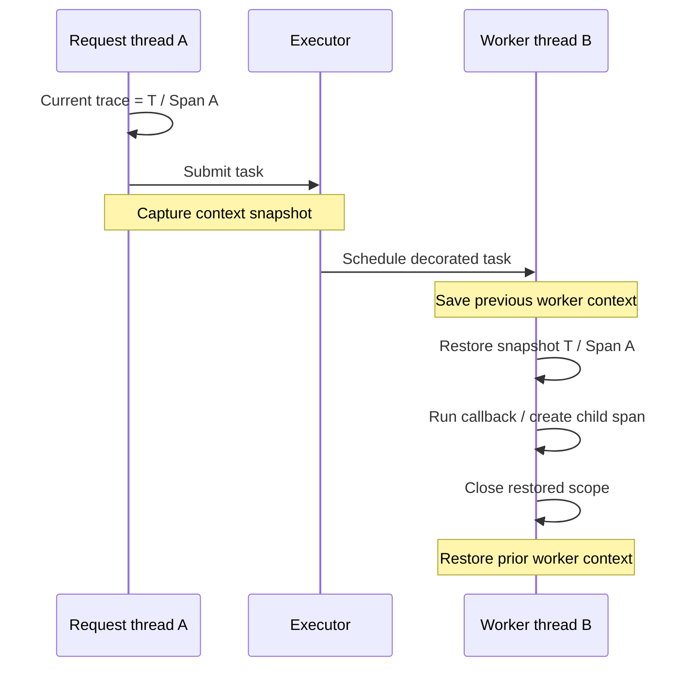

# Mất trace context khi tự tạo thread

Một request đi vào ứng dụng Spring Boot, tạo một trace và bắt đầu xử lý checkout. Trong service, lập trình viên dùng `new Thread(...)` để gửi công việc sang một thread khác. Request ban đầu vẫn có trace ID, nhưng log bên trong thread mới lại không có `traceId`; span của tác vụ nền xuất hiện như một trace độc lập, hoặc không xuất hiện trong Zipkin/trace backend.

Đây là một lỗi phổ biến khi **tự tạo thread hoặc chuyển công việc sang executor mà không truyền context**. Trong Java, nhiều integration tracing lưu context hiện hành bằng `ThreadLocal` hoặc cơ chế gắn với thread. Thread mới không tự kế thừa giá trị ThreadLocal của thread gọi. Vì vậy, việc một observation/span đang current ở thread A không bảo đảm thread B nhìn thấy cùng trace context.

Bài học thuộc chương **Context propagation** của module **SPRING_BOOT_OBSERVABILITY**. Module tập trung thiết lập observability cho Spring Boot bằng Micrometer Observation, metrics, logs và distributed tracing; học cách truyền ngữ cảnh, kiểm soát tag/cardinality, exporter, sampling và liên kết tín hiệu để điều tra lỗi, độ trễ và hành vi ứng dụng trong môi trường thực. Mục tiêu ở đây là hiểu vì sao trace context mất khi tự tạo thread, cách khôi phục context đúng nơi công việc chạy và cách xác minh trace sau khi sửa.

## Mục tiêu học tập

Sau bài này, bạn có thể:

1. Giải thích tại sao trace context trong thread hiện tại không tự xuất hiện trong một thread mới.
2. Phân biệt **truyền dữ liệu nghiệp vụ**, **truyền trace context** và **giữ vòng đời của span/observation**.
3. Nhận diện các lỗi khi dùng `new Thread`, `ExecutorService`, `CompletableFuture` và `@Async`.
4. Sử dụng cơ chế context propagation phù hợp như Spring `TaskDecorator`, `ContextPropagatingTaskDecorator` hoặc Micrometer Context Propagation.
5. Bảo đảm scope được mở/đóng trong thread thực thi và span chỉ kết thúc khi công việc thực sự hoàn tất.
6. Tránh rò rỉ trace context giữa các task khi dùng thread pool tái sử dụng.
7. Kiểm tra context qua HTTP downstream, logs/MDC và tracing backend.
8. Phân biệt context propagation trong thread với propagation qua HTTP, message broker và Reactor.

## 1. Trace context nằm ở đâu khi ứng dụng đang chạy?

Khi Spring Boot nhận một HTTP request đã được instrument, tracing integration có thể tạo một server span và đặt span context tương ứng thành **current context** trong phạm vi xử lý. Code được gọi đồng bộ trong cùng phạm vi có thể tạo child span mà không cần truyền trace ID qua từng tham số.

Mô hình khái niệm:

```text
HTTP request thread A
  current trace context = Trace T / Span A
      |
      +-- controller
      +-- checkout service
      +-- payment application service
      +-- client call
```

Khi thread A gọi phương thức đồng bộ, những đoạn code chạy trên cùng thread có thể sử dụng context hiện hành. Nhưng nếu công việc chuyển sang thread B:

```text
Thread A                              Thread B
------------------------------       ------------------------------
current = Trace T / Span A
executor.execute(task)  -----------> task bắt đầu chạy
                                     current = none (nếu không propagate)
                                     log không có traceId
                                     span mới có thể thành root
```

**Thread B có ThreadLocal riêng.** Java không tự sao chép các giá trị ThreadLocal của thread gửi sang thread thực thi. Đây là nguyên nhân cơ bản khiến tracing context có thể mất khi code chuyển luồng.

### 1.1. Context không phải biến toàn cục

Trace context thường bao gồm trace ID, span ID và thông tin sampling/parent cần thiết. Nó được quản lý bởi tracing implementation và scope tương ứng. Ứng dụng không nên tự coi một biến static hoặc một trường singleton chứa “trace hiện tại” là giải pháp; nhiều request chạy đồng thời sẽ ghi đè lẫn nhau.

Cũng không nên tự lưu trace ID vào một biến instance của Spring service để dùng ở task sau. Singleton service phục vụ nhiều request cùng lúc. Dữ liệu theo request phải được truyền qua tham số nghiệp vụ hoặc context propagation được thiết kế cho execution boundary.

### 1.2. Current context chỉ có ý nghĩa trong phạm vi thực thi

Một scope mở trong thread A cần được đóng đúng trên thread sở hữu nó. Không mở scope ở thread A rồi chuyển đối tượng `Scope` sang thread B để đóng tùy ý. Scope có thể quản lý ThreadLocal hoặc trạng thái theo thread; dùng sai thread dễ gây context sai hoặc rò rỉ.

**Quy tắc:** capture context ở thread gửi task; restore context khi task bắt đầu chạy; đóng scope/khôi phục context ngay trong thread thực thi sau khi callback kết thúc.

## 2. Ví dụ lỗi: tự tạo thread mà không propagate context

Giả sử controller đã có server span hiện hành. Service dùng cách sau:

```java
import org.springframework.stereotype.Service;

@Service
class ReceiptService {

    void scheduleReceipt(String orderId) {
        new Thread(() -> {
            sendReceipt(orderId);
        }).start();
    }

    private void sendReceipt(String orderId) {
        // Công việc gửi email hoặc tạo hóa đơn.
    }
}
```

Đoạn code này minh họa vấn đề chứ không phải cách triển khai thread an toàn cho production. Thread mới không tự kế thừa trace context của request gọi. Các biểu hiện có thể gặp:

- Log trong `sendReceipt` không có trace ID/span ID.
- Một observation tạo trong `sendReceipt` trở thành root span mới thay vì child của request checkout.
- Trace UI chỉ hiển thị checkout request; công việc gửi receipt không xuất hiện trong cùng trace.
- Nếu tự truyền trace ID qua biến nhưng không tạo/khôi phục context tương ứng, log có thể có ID nhưng tracer vẫn không thiết lập quan hệ parent-child.
- Thread do request tạo ra không được quản lý bởi executor lifecycle, dễ gây tăng thread, khó shutdown và khó giới hạn tải.

### 2.1. Tự truyền trace ID trong tham số chưa đủ

Ví dụ:

```java
void scheduleReceipt(String orderId, String traceId) {
    new Thread(() -> {
        log.info("traceId={}", traceId);
        sendReceipt(orderId);
    }).start();
}
```

Đoạn này chỉ truyền một chuỗi để in log. Nó **không khôi phục toàn bộ trace context**, không đặt span hiện hành, không tạo parent relationship và không tự động inject header khi task gọi downstream HTTP.

Tự nhét ID vào log có thể tạo cảm giác hai hoạt động liên quan trong khi trace backend vẫn có hai trace riêng. Hãy để tracing library capture/restore context thay vì tự chế một phần của cơ chế.

## 3. Không chỉ thiếu trace: vòng đời span cũng có thể sai

Một lỗi khác là mở observation trong thread gọi rồi dừng ngay sau khi submit công việc:

```java
Observation observation = Observation.createNotStarted(
        "receipt.send", observationRegistry).start();

try (Observation.Scope scope = observation.openScope()) {
    executor.execute(() -> sendReceipt(orderId));
} finally {
    observation.stop();
}
```

`executor.execute(...)` thường chỉ đưa task vào hàng đợi và trả về. Vì vậy `observation.stop()` có thể chạy **trước khi sendReceipt thực sự bắt đầu hoặc hoàn tất**. Khi ấy duration chỉ đo thời gian submit, không đo thời gian gửi receipt. Ngoài ra, thread thực thi không tự có current context.

Cần tách rõ ba câu hỏi:

| Câu hỏi | Điều cần làm |
|---|---|
| Tác vụ nền thuộc request nào? | Capture và truyền trace context hoặc tạo quan hệ link phù hợp |
| Tác vụ nền mất bao lâu? | Tạo observation/span với lifecycle bao quanh phần công việc thực thi thật |
| Ai quản lý task và tài nguyên thread? | Dùng executor/task executor được quản lý, có giới hạn và shutdown phù hợp |

### 3.1. Hai mô hình lifecycle thường gặp

**Mô hình A — Task là công việc con nằm trong thời gian request cha còn sống.** Task chạy và hoàn tất trước khi request cha kết thúc, và context có thể được capture/restore. Child span được tạo khi task thực thi.

**Mô hình B — Task sống lâu hơn request.** Request chỉ gửi lệnh/enqueue và trả response; công việc thực tế chạy sau đó. Không nên giữ parent scope mở đến khi tác vụ nền có thể hoàn tất sau nhiều phút/giờ. Hãy xác định semantics: tạo một trace mới cho consumer với span link tới context producer, hoặc dùng mô hình messaging propagation mà framework quy định. Việc giữ quan hệ phải phản ánh đúng vòng đời nghiệp vụ và giới hạn retention.

## 4. Giải pháp trong Spring: quản lý executor và TaskDecorator

Với Spring Framework, `TaskDecorator` cho phép bao bọc `Runnable` trước khi executor chạy. Đây là một điểm mở rộng phù hợp để capture context ở lúc submit và khôi phục ở lúc thực thi.

Với Spring Framework 6.1 trở lên, có `ContextPropagatingTaskDecorator` hỗ trợ tích hợp Micrometer Context Propagation. Trong ứng dụng Spring Boot 3.x, khả năng và hành vi cụ thể phụ thuộc phiên bản Spring Framework/Micrometer đi kèm.

### 4.1. Cấu hình TaskExecutor dùng context propagation

Ví dụ cấu hình:

```java
import org.springframework.context.annotation.Bean;
import org.springframework.context.annotation.Configuration;
import org.springframework.core.task.TaskExecutor;
import org.springframework.core.task.support.ContextPropagatingTaskDecorator;
import org.springframework.scheduling.concurrent.ThreadPoolTaskExecutor;

@Configuration(proxyBeanMethods = false)
class BackgroundTaskConfiguration {

    @Bean
    TaskExecutor applicationTaskExecutor() {
        ThreadPoolTaskExecutor executor = new ThreadPoolTaskExecutor();
        executor.setCorePoolSize(4);
        executor.setMaxPoolSize(16);
        executor.setQueueCapacity(200);
        executor.setThreadNamePrefix("app-worker-");
        executor.setTaskDecorator(new ContextPropagatingTaskDecorator());
        executor.initialize();
        return executor;
    }
}
```

Trong ví dụ này:

- Thread pool giới hạn số thread và queue, tránh tạo thread không kiểm soát theo request.
- `ContextPropagatingTaskDecorator` bọc tác vụ bằng cơ chế capture/restore context có sẵn.
- Context được khôi phục khi task chạy; sau khi callback hoàn tất, context trước đó của thread worker được khôi phục.
- Các accessor cần truyền phải được đăng ký/được integration hỗ trợ. Decorator không tự đoán mọi loại dữ liệu tùy chỉnh trong ứng dụng.

**Lưu ý:** `ContextPropagatingTaskDecorator` thuộc Spring Framework mới hơn (6.1+). Với Spring Boot 3.0/3.1 dùng Spring Framework cũ hơn, cần chọn phiên bản tương thích hoặc tự cấu hình TaskDecorator dựa trên Micrometer Context Propagation. Không nâng riêng Spring Framework ngoài dependency management của Boot chỉ để copy ví dụ.

### 4.2. Gửi task qua TaskExecutor

```java
import org.springframework.core.task.TaskExecutor;
import org.springframework.stereotype.Service;

@Service
class ReceiptService {
    private final TaskExecutor applicationTaskExecutor;

    ReceiptService(TaskExecutor applicationTaskExecutor) {
        this.applicationTaskExecutor = applicationTaskExecutor;
    }

    void scheduleReceipt(String orderId) {
        applicationTaskExecutor.execute(() -> sendReceipt(orderId));
    }

    private void sendReceipt(String orderId) {
        // Thực hiện gửi receipt.
    }
}
```

Ở đây, decorator được cấu hình trên executor quản lý việc thực thi. Nếu task được submit khi request có trace context hiện hành, cơ chế propagation có thể khôi phục context đó tại thread worker, tùy các accessor/integration được cài đặt.

Tuy nhiên, ví dụ này **không tự tạo observation riêng để đo thời gian gửi receipt**. Tracing context được truyền là một việc; đo lifecycle công việc là việc khác. Nếu cần span thể hiện tác vụ gửi receipt, tạo observation bên trong callback để lifecycle bắt đầu/kết thúc đúng tại worker.

### 4.3. Đo tác vụ tại thread thực thi

```java
import io.micrometer.observation.Observation;
import io.micrometer.observation.ObservationRegistry;
import org.springframework.core.task.TaskExecutor;
import org.springframework.stereotype.Service;

@Service
class ObservedReceiptService {
    private final TaskExecutor applicationTaskExecutor;
    private final ObservationRegistry observationRegistry;

    ObservedReceiptService(
            TaskExecutor applicationTaskExecutor,
            ObservationRegistry observationRegistry) {
        this.applicationTaskExecutor = applicationTaskExecutor;
        this.observationRegistry = observationRegistry;
    }

    void scheduleReceipt(String orderId) {
        applicationTaskExecutor.execute(() ->
                Observation.createNotStarted(
                                "receipt.send", observationRegistry)
                        .contextualName("send receipt")
                        .lowCardinalityKeyValue("operation", "send-receipt")
                        .observe(() -> {
                            sendReceipt(orderId);
                            return null;
                        })
        );
    }

    private void sendReceipt(String orderId) {
        // Gọi mail provider hoặc tạo hóa đơn thực tế.
    }
}
```

Với decorator được cấu hình, context upstream có thể được khôi phục khi callback bắt đầu. Observation `receipt.send` được tạo và chạy **bên trong thread worker**, nhờ vậy thời lượng phản ánh công việc thực tế. Khi tracing handler hoạt động, span tác vụ có thể được tạo trong context cha đã phục hồi.

Đây vẫn là ví dụ minh họa: `sendReceipt` cần xử lý lỗi và retry theo chính sách nghiệp vụ; nếu công việc sống lâu hơn request, cần cân nhắc mô hình parent/link thay vì gắn một span con vào request đã kết thúc. Không đưa `orderId` thành low-cardinality tag; nếu cần correlation nghiệp vụ, phải xét chính sách high-cardinality, privacy và retention.

## 5. Micrometer Context Propagation: capture và restore

Micrometer Context Propagation cung cấp abstraction để **chụp context từ nguồn hiện tại và khôi phục nó ở một nơi thực thi khác**. Nó hữu ích khi chuyển giữa các cơ chế dùng ThreadLocal và cơ chế context khác.

Các khái niệm chính:

| Thành phần | Vai trò |
|---|---|
| `ThreadLocalAccessor` | Định nghĩa cách đọc/ghi/reset một loại giá trị ThreadLocal |
| `ContextRegistry` | Đăng ký accessor để context propagation biết loại context nào có thể capture/restore |
| `ContextSnapshot` | Ảnh chụp những giá trị context đã được capture |
| `ContextSnapshotFactory` | Tạo snapshot theo registry và cấu hình |
| `Scope` | Phạm vi khôi phục snapshot vào thread hiện tại; đóng scope để khôi phục giá trị trước đó |
| `TaskDecorator` | Bọc task để capture/restore ở ranh giới submit/execute |

Một integration tracing có thể đăng ký accessor cho trace context/MDC để context snapshot biết cách lấy và khôi phục chúng. Không phải mọi ThreadLocal trong ứng dụng đều tự động được capture. Với context tự định nghĩa, phải đăng ký accessor phù hợp hoặc dùng cơ chế tích hợp riêng.

### 5.1. Mô hình capture/restore



Mấu chốt là **capture ở phía gửi và restore ở phía chạy**. Chỉ restore một snapshot mặc định hoặc một context null cũng có thể làm mất context; chỉ capture mà không khôi phục lại trạng thái worker trước đó có thể gây context leakage.

### 5.2. Mẫu dùng snapshot khi tự kiểm soát Runnable

Trong những trường hợp không dùng được Spring `TaskDecorator` có sẵn, có thể dùng Micrometer Context Propagation trực tiếp. API cụ thể cần đối chiếu version đang dùng; một pattern minh họa là:

```java
import io.micrometer.context.ContextSnapshot;
import io.micrometer.context.ContextSnapshotFactory;

ContextSnapshotFactory snapshotFactory =
        ContextSnapshotFactory.builder().build();

void submitWithContext(Executor executor, Runnable task) {
    ContextSnapshot snapshot = snapshotFactory.captureAll();
    executor.execute(snapshot.wrap(task));
}
```

`snapshot.wrap(task)` trả về tác vụ được bao quanh bởi logic khôi phục snapshot khi chạy và đóng scope sau khi hoàn thành. Để hoạt động đúng, các `ThreadLocalAccessor` liên quan phải được đăng ký trong registry mà factory sử dụng. Cách tạo factory, accessor mặc định và thời điểm auto-registration phụ thuộc phiên bản Micrometer Context Propagation và integrations có mặt.

**Không chụp một snapshot một lần rồi tái sử dụng cho mọi request.** Mỗi lần submit cần capture context của đúng request/task hiện hành. Snapshot không phải đối tượng dùng chung toàn ứng dụng để lưu “trace hiện tại”.

### 5.3. Đăng ký accessor cho ThreadLocal tùy chỉnh

Giả sử hệ thống có một context nội bộ riêng `TenantContext` được lưu bằng ThreadLocal. Để propagate nó, cần accessor xác định cách đọc, ghi và reset:

```java
import io.micrometer.context.ThreadLocalAccessor;

final class TenantContextAccessor
        implements ThreadLocalAccessor<String> {

    static final String KEY = "tenant";

    @Override
    public Object key() {
        return KEY;
    }

    @Override
    public String getValue() {
        return TenantContext.get();
    }

    @Override
    public void setValue(String value) {
        TenantContext.set(value);
    }

    @Override
    public void setValue() {
        TenantContext.clear();
    }
}
```

`TenantContext` là ví dụ giả định. Khi đăng ký accessor vào `ContextRegistry` phù hợp, snapshot có thể capture/restore giá trị context đó cùng những context khác đã đăng ký.

Cần kiểm soát chặt dữ liệu được propagate: một tenant identifier có thể nhạy cảm trong một số hệ thống; không đưa nó vào span attributes/logs một cách tự động chỉ vì accessor có thể truyền nó giữa thread. **Propagation và xuất dữ liệu telemetry là hai quyết định riêng.**

## 6. Vì sao không dùng InheritableThreadLocal làm giải pháp chung?

Java có `InheritableThreadLocal`, cho phép thread mới kế thừa giá trị từ thread cha tại thời điểm thread được tạo. Điều này có vẻ giải quyết vấn đề, nhưng không phù hợp làm giải pháp tổng quát cho thread pool.

Lý do:

1. **Thread pool tái sử dụng thread:** worker thường được tạo từ lúc khởi động, trước request. Giá trị được kế thừa lúc tạo worker không phản ánh context của request submit task sau này.
2. **Context stale:** một thread mới có thể giữ context được copy từ thread cha tại lúc sinh, trong khi request đã kết thúc hoặc context đã thay đổi.
3. **Không giải quyết mọi ranh giới:** các cơ chế scheduler, executor, reactive context hoặc messaging không nhất thiết tạo thread theo quan hệ cha-con Java.
4. **Nguy cơ giữ tham chiếu:** context được kế thừa có thể giữ đối tượng lâu hơn dự kiến.
5. **Không quản lý lifecycle span:** kế thừa giá trị không tự tạo child span, không đóng scope, không kết thúc observation đúng lúc.

Do đó, dùng cơ chế capture/restore theo **mỗi lần submit task** và khôi phục trạng thái cũ của worker là phù hợp hơn. Nếu một thư viện hoặc framework dùng InheritableThreadLocal cho mục đích khác, không đồng nghĩa có thể dựa vào nó để truyền trace qua mọi thread.

## 7. Context propagation với CompletableFuture và @Async

### 7.1. `CompletableFuture`

Một ví dụ dễ mất context:

```java
CompletableFuture.supplyAsync(
        () -> paymentClient.authorize(request),
        rawExecutor
);
```

Nếu `rawExecutor` không có propagation decorator/wrapper, task có thể chạy mà không có trace context của thread gọi. Chỉ truyền một `CompletableFuture` không tự làm context đi cùng nó; Future đại diện cho kết quả bất đồng bộ, không phải context container.

Có thể sử dụng executor đã được wrap/configure propagation:

```java
CompletableFuture.supplyAsync(
        () -> paymentClient.authorize(request),
        contextAwareExecutor
);
```

`contextAwareExecutor` phải capture context tại thời điểm submit và restore context khi callback thực thi. Cần xác minh wrapper thực tế cho loại Executor đang sử dụng; không đặt tên biến này rồi mặc định một raw executor có hành vi đó.

Nếu chuỗi có nhiều callback `thenApplyAsync`/`thenComposeAsync`, mỗi bước có thể chuyển sang executor khác. Hãy bảo đảm mọi executor tham gia đều có chính sách propagation hoặc callback chủ động tạo ranh giới context phù hợp.

### 7.2. Spring `@Async`

`@Async` sử dụng executor được Spring lựa chọn/cấu hình. Cần xác định bean executor thực sự đang được dùng và gắn TaskDecorator tương ứng cho executor đó.

Ví dụ:

```java
import org.springframework.scheduling.annotation.Async;
import org.springframework.stereotype.Service;

@Service
class AsyncPaymentService {

    @Async("applicationTaskExecutor")
    public CompletableFuture<String> reconcile(String paymentId) {
        String result = doReconciliation(paymentId);
        return CompletableFuture.completedFuture(result);
    }

    private String doReconciliation(String paymentId) {
        return "reconciled";
    }
}
```

`@Async` cần được bật bằng cấu hình Spring thích hợp và method phải được gọi qua Spring proxy; gọi nội bộ từ cùng object có thể không đi qua proxy. `applicationTaskExecutor` là tên executor ví dụ ở phần cấu hình.

Khi kiểm thử:

- Gọi method từ một bean khác qua proxy.
- Xác nhận executor tên đúng được dùng.
- Kiểm tra context hiện hành trong callback.
- Kiểm tra span duration kết thúc khi công việc thực sự hoàn tất.
- Kiểm tra worker thread không mang trace ID của task trước sang task kế tiếp.

**Không dựa vào tên executor hoặc annotation để suy ra propagation đã hoạt động.** Chỉ đo/quan sát runtime mới xác minh được.

## 8. Context propagation với Reactor khác ThreadLocal đồng bộ

Trong Spring WebFlux/Reactor, execution có thể chuyển thread theo scheduler và tín hiệu. Reactor dùng `Context` gắn với subscription; nó không tương đương một ThreadLocal cố định.

Nếu một đoạn code làm:

```java
Mono<Order> pipeline;

try (Observation.Scope scope = observation.openScope()) {
    pipeline = orderService.loadOrder();
}
return pipeline;
```

scope chỉ bao quanh thời điểm **xây dựng publisher**, trong khi publisher thường chạy khi subscriber đăng ký và có thể chạy trên thread khác. Vì vậy không bảo đảm trace context còn đúng trong lúc xử lý signal.

Đối với Reactor:

- Dùng instrumentation tích hợp Spring Boot/Micrometer/Observation tương thích với phiên bản Reactor.
- Hiểu cách context được truyền theo `Reactor Context` và cơ chế Micrometer Context Propagation.
- Tránh tự mở scope đồng bộ quanh đoạn assemble `Mono`/`Flux` rồi kỳ vọng nó bao toàn bộ lifecycle.
- Khi dùng `publishOn`/`subscribeOn`, xác minh context được giữ qua scheduler boundary.
- Test cả completion, error và cancellation vì lifecycle có thể kết thúc theo các signal khác nhau.

Một HTTP endpoint WebFlux có thể đã được instrument tự động. Nếu trace mất ở callback custom hoặc scheduler, hãy khoanh đúng điểm chuyển context thay vì tạo thêm root span bằng tay cho toàn bộ pipeline.

## 9. Tách task ngắn hạn khỏi công việc nền lâu dài

Đây là quyết định quan trọng về semantics, không chỉ là kỹ thuật ThreadLocal.

### Trường hợp A: task ngắn nằm trong request

Ví dụ request cần chạy hai phép tính song song và chờ cả hai hoàn thành trước khi trả response. Context của request có thể được capture cho từng task; mỗi task thực thi trong scope đã khôi phục. Các child spans có thể thuộc trace request cha. Parent span chỉ kết thúc sau khi các công việc cần thiết hoàn tất.

### Trường hợp B: request chỉ enqueue công việc

Ví dụ checkout phát event “send receipt”, trả response ngay, còn consumer xử lý sau vài giây. Giữ parent request span mở đến lúc email gửi xong có thể không phù hợp. Mô hình thường có:

```text
checkout request trace
  └─ producer span: publish receipt message

background consumer trace
  └─ consumer span: send receipt
       link -> producer span context
```

Có thể dùng propagation qua message headers và parent-child hoặc span link theo semantic conventions của messaging stack. Khi consumer khởi động, nó khôi phục message context đúng cách; không dựa vào ThreadLocal của request đã kết thúc.

### Trường hợp C: task định kỳ không có request cha

Cron/job/batch bắt đầu từ scheduler có thể tạo root span riêng. Nó không cần giả lập trace ID của request trước đó. Nếu job xử lý nhiều message có trace nguồn, span links có thể biểu diễn nhiều đầu vào thay vì chọn bừa một parent.

**Câu hỏi cần đặt trước khi chọn kỹ thuật:** tác vụ này là phần đồng bộ của request, một child ngắn hạn, hay một công việc độc lập sau khi request đã trả lời? Câu trả lời quyết định thời điểm tạo/kết thúc span và kiểu liên kết phù hợp.

## 10. Rò rỉ context trong thread pool: lỗi khó phát hiện

Thread pool tái sử dụng worker. Nếu code tự set ThreadLocal nhưng không restore/reset, task tiếp theo trên cùng worker có thể thấy context cũ.

Ví dụ anti-pattern:

```java
executor.execute(() -> {
    TenantContext.set(tenantId);
    doWork();
    // Quên TenantContext.clear()
});
```

Tình huống tương tự có thể xảy ra với MDC hoặc custom context. Hậu quả:

- Log của request B mang trace ID hoặc tenant từ request A.
- Child span được tạo dưới parent sai.
- Dữ liệu theo tenant/request bị lẫn giữa các task.
- Lỗi chỉ xuất hiện khi scheduler phân phối hai task liên tiếp cho cùng worker, khó tái hiện.

Mẫu an toàn khi quản lý ThreadLocal thủ công là lưu giá trị cũ, set giá trị mới, rồi khôi phục/clear trong `finally`. Nhưng với trace context và nhiều loại accessor, ưu tiên cơ chế Micrometer/Spring đã được thiết kế để capture/restore đồng bộ các context liên quan.

### Cách chứng minh worker đã được khôi phục

Một kiểm thử hữu ích:

1. Gửi task A trong trace A tới executor.
2. Gửi task B trong trace B tới cùng một worker (có thể dùng single-thread executor để tạo điều kiện tái sử dụng).
3. Ghi current trace ID ở đầu mỗi task.
4. Xác nhận task A thấy A, task B thấy B.
5. Submit một task C không có trace context và xác nhận nó **không thấy A hoặc B**.
6. Kiểm tra logs/MDC và child spans, không chỉ giá trị trace ID in ra.

Task C rất quan trọng: nó phát hiện context cũ bị giữ lại ngay cả khi A và B riêng lẻ có vẻ đúng.

## 11. Tình huống điều tra: trace bị đứt sau khi đưa công việc vào executor

Một endpoint `POST /checkout` trả phản hồi sau 250 ms. Sau đó worker gửi receipt và gọi payment reconciliation. Dashboard cho thấy request ban đầu có trace; log worker lại không có trace ID và Zipkin hiển thị một root span mới.

### Dữ liệu ban đầu

```text
HTTP POST /checkout (SERVER)                 250 ms
  validate cart                               20 ms
  enqueue receipt task                         3 ms

worker thread:
  send receipt                                800 ms   (trace riêng hoặc không có)
  payment reconciliation                      500 ms   (không parent như kỳ vọng)
```

Đây là dữ liệu giả định. Nó không chứng minh executor là nguyên nhân duy nhất, nhưng cho thấy một ranh giới cần kiểm tra.

### Quy trình điều tra

**Bước 1 — Xác nhận code thực sự chuyển thread.** Kiểm tra `new Thread`, `ExecutorService`, `CompletableFuture`, `@Async` hoặc scheduler; ghi nhận executor nào chạy callback, thread name và thời điểm submit/start/end.

**Bước 2 — Kiểm tra context trước khi submit.** Ở thread request, xác nhận có current trace/span và observation scope đúng tại điểm submit. Nếu context đã mất ở đây, decorator không thể khôi phục context không tồn tại.

**Bước 3 — Kiểm tra executor wiring.** Xác nhận task chạy trên executor có TaskDecorator hoặc wrapper propagation; tránh trường hợp Spring bean được cấu hình nhưng code thực tế gọi một raw executor được tạo bên trong class.

**Bước 4 — Kiểm tra accessor và integration.** Context snapshot chỉ khôi phục các context được registry/accessor hỗ trợ. Xác nhận tracing bridge và logging integration đã đăng ký context cần truyền.

**Bước 5 — Kiểm tra lifecycle.** Observation/span của worker cần bắt đầu/kết thúc trong callback thật. Nếu parent request đã kết thúc trước khi worker chạy, xem lại semantics: tác vụ có nên là trace độc lập có span link tới producer không?

**Bước 6 — Kiểm tra thread reuse.** Dùng single-thread executor trong test để submit task có trace A, trace B, rồi task không có context. Xác nhận không có ID cũ trong log hoặc span.

**Bước 7 — Xác nhận trên backend.** Dùng trace kiểm thử có sampling được bật phù hợp; kiểm tra trace ID, parent span ID, service name, duration và logs liên quan. Nếu exporter có batch delay, chờ pipeline xử lý theo chính sách test thay vì nhầm độ trễ ingestion với mất context.

### Kết luận có thể rút ra

Nếu context có trên request thread, task decorator đã được thực thi, worker thấy đúng parent context và span xuất hiện đúng trace ID, propagation qua ranh giới executor đã hoạt động trong kịch bản kiểm thử đó.

Nếu task chạy sau khi request kết thúc, một trace độc lập liên kết bằng span link có thể đúng hơn một child span treo dưới parent đã hoàn tất. Mục tiêu là **mô tả chính xác quan hệ công việc**, không cố làm mọi log/trace có cùng một ID bằng mọi giá.

## 12. Mất context ở đâu? Bảng chẩn đoán nhanh

| Triệu chứng | Nguyên nhân có thể | Kiểm tra |
|---|---|---|
| Cùng thread có trace ID, thread mới không có | ThreadLocal không được capture/restore | Executor, TaskDecorator, ContextSnapshot |
| Log có trace ID nhưng span là root mới | Chỉ truyền chuỗi ID, không khôi phục tracer context | Current span và parent context trong worker |
| Span worker có parent sai | ThreadLocal/MDC cũ bị rò rỉ hoặc snapshot sai thời điểm | Task trước trên cùng worker, restore/clear |
| Task async rất dài nhưng span ngắn | Observation stop khi submit hoặc khi Future được trả về | Đặt lifecycle ở callback thực thi |
| Không có trace sau khi chuyển sang WebFlux scheduler | Context Reactor không được giữ đúng | Reactor Context, instrumentation và scheduler boundary |
| HTTP downstream có trace ID mới | Context không được inject hoặc header bị loại | Client instrumentation, propagator, gateway headers |
| Có context lúc submit nhưng không có khi worker chạy | Executor raw hoặc decorator không được áp dụng | Thread name, bean executor thực tế, accessor |
| Task không có trace nhưng lại mang ID request cũ | Worker thread context không được reset | Task cleanup và test reuse |
| Chỉ một số async callback mất context | Một callback dùng executor khác hoặc API khác | Mọi executor trong chuỗi CompletableFuture |
| Zipkin không thấy trace dù log có ID | Sampling, reporter, exporter, collector hoặc retention | Sampling và pipeline độc lập với context hiện hành |

## 13. Context propagation không thay thế security boundary

Trace context thường đến từ request headers hoặc message headers. Các giá trị như `traceparent`, B3 headers hay baggage có thể được client bên ngoài gửi tới. Không dùng chúng làm bằng chứng xác thực người dùng, tenant hoặc quyền truy cập.

Khi ứng dụng phục vụ traffic bên ngoài:

- Áp dụng trust policy cho inbound trace context; có thể tiếp tục trace từ upstream tin cậy hoặc tạo trace mới tùy kiến trúc.
- Không đưa token, session cookie, email, payment data hoặc PII vào baggage.
- Giới hạn baggage size và allowlist các key được propagation.
- Không biến tenant ID từ header thành resource identity hoặc metric tag nếu chưa xác thực/chuẩn hóa.
- Giữ log correlation tách biệt với quyền truy cập logs; trace ID không phải credential để mở dữ liệu.
- Áp dụng redaction, retention và access control ở collector/backend.

**Context propagation là cơ chế liên kết telemetry và ngữ cảnh thực thi, không phải cơ chế truyền quyền.**

## 14. Checklist sửa lỗi khi tự tạo thread

Trước khi đánh dấu sự cố đã xử lý, xác minh:

1. **Nguồn context:** ngay trước khi submit task, request thread có current observation/span đúng không?
2. **Executor:** code có dùng đúng executor bean được cấu hình không, hay vẫn tạo raw Thread/Executor riêng?
3. **Capture:** context có được capture ở từng lần submit task không?
4. **Restore:** worker có khôi phục đúng trace context ở đầu callback không?
5. **Accessor:** các ThreadLocal cần thiết có accessor/integration trong context registry không?
6. **Cleanup:** sau callback, scope được đóng và trạng thái context trước của worker được khôi phục không?
7. **Parent/lifecycle:** task có thực sự là child của request không, hay request đã kết thúc và cần trace/link khác?
8. **Span timing:** span bao quanh công việc thực tế, gồm cả async completion/error/cancel phù hợp không?
9. **Logging:** MDC có traceId/spanId đúng trong worker và được xóa/khôi phục sau đó không?
10. **Downstream:** HTTP client có inject B3/W3C context và server có extract đúng không?
11. **Reactor/messaging:** nếu task chuyển sang publisher hoặc consumer, có dùng propagation model tương ứng không?
12. **Sampling/export:** sampler, reporter/exporter và backend có giữ trace kiểm thử không?
13. **Thread reuse:** test task A, task B và task không context trên cùng worker; không có context rò rỉ không?
14. **Privacy/cardinality:** không truyền dữ liệu nhạy cảm hoặc ID request thành metric labels không cần thiết?
15. **Tải:** executor có giới hạn thread/queue, rejection policy và shutdown phù hợp không?

## 15. Các lỗi thường gặp

| Anti-pattern | Hậu quả | Cách làm phù hợp |
|---|---|---|
| Dùng `new Thread` cho từng request | Không có context tự động, khó quản lý tài nguyên | Dùng Spring-managed executor và propagation |
| Truyền mỗi trace ID dưới dạng String | Log có ID nhưng tracer không có parent context | Capture/restore context snapshot/integration |
| Mở scope ở thread gọi và đóng ở worker | Vi phạm ownership/thread scope | Mỗi thread mở/đóng scope trong phạm vi của mình |
| Dừng observation ngay sau `executor.execute` | Đo thời gian enqueue thay vì thời gian task | Tạo observation trong callback thực thi |
| Nghĩ thread pool tự kế thừa ThreadLocal | Worker không thấy context request | TaskDecorator/ContextSnapshot |
| Dùng InheritableThreadLocal làm giải pháp chung | Worker tái sử dụng có context stale hoặc không có context request | Capture/restore theo từng submit |
| Tạo executor thứ hai không có decorator | Một số callback có trace, số khác mất | Rà soát toàn bộ executor trong chuỗi async |
| Quên reset custom ThreadLocal/MDC | Context task trước rò sang task sau | Scope/restore/clear trong finally |
| Coi @Async tự động truyền mọi context | Hành vi phụ thuộc executor và integration | Kiểm tra executor được chọn và test runtime |
| Bao quanh việc tạo Mono bằng scope đồng bộ | Scope kết thúc trước khi publisher chạy | Dùng Reactor Context và instrumentation phù hợp |
| Giữ parent request span mở đến khi batch chạy xong nhiều phút | Lifecycle và tài nguyên không phù hợp | Trace độc lập + links theo semantics |
| Sampling 100% để sửa mất context | Tăng chi phí nhưng không sửa propagation | Xác minh context ở worker trước |
| Gắn trace ID vào metric tags | Cardinality time series tăng mạnh | Dùng trace/log correlation và exemplar nếu hỗ trợ |

## 16. Câu hỏi tự đánh giá

**Câu 1.** Vì sao thread mới tạo bằng `new Thread(...)` không tự thấy trace ID của request hiện tại?

**Gợi ý:** Current trace context thường được quản lý theo thread (ví dụ ThreadLocal). Thread mới có trạng thái riêng; Java không tự copy context từ thread gọi.

**Câu 2.** Chỉ truyền `traceId` vào task và in vào log đã đủ để tạo child span đúng chưa?

**Gợi ý:** Chưa. Một chuỗi ID không phải current tracer context. Cần capture/restore context hoặc cơ chế tạo span với parent/link rõ ràng.

**Câu 3.** Tại sao `observation.stop()` ngay sau `executor.execute(...)` thường sai khi muốn đo thời gian xử lý task?

**Gợi ý:** execute chỉ submit task và trả về; callback có thể chạy sau đó. Observation kết thúc trước công việc thực tế nên duration bị thiếu.

**Câu 4.** `TaskDecorator` làm gì trong Spring executor?

**Gợi ý:** Bao bọc Runnable để capture/restore một số context quanh thời điểm task được thực thi. Accessor/integration phải hỗ trợ loại context cần truyền.

**Câu 5.** Vì sao không nên dùng InheritableThreadLocal để truyền trace context vào thread pool?

**Gợi ý:** Worker thường được tạo trước request và tái sử dụng; giá trị kế thừa tại thời điểm tạo không phản ánh context của từng lần submit, dễ stale hoặc rò rỉ.

**Câu 6.** Một task gửi receipt chạy sau khi request checkout đã trả response vài phút. Có luôn đúng khi tạo child span nằm trong trace request ban đầu không?

**Gợi ý:** Không. Cần xét semantics và retention. Một trace/consumer span độc lập có link tới producer context có thể phản ánh đúng lifecycle hơn.

**Câu 7.** Sau khi sửa propagation, task A có trace A và task B có trace B. Vì sao vẫn cần kiểm tra task C không có context?

**Gợi ý:** Task C phát hiện worker thread còn giữ ThreadLocal/MDC của task trước. Đây là cách kiểm tra context cleanup và thread reuse.

**Câu 8.** Dùng `ContextPropagatingTaskDecorator` có bảo đảm mọi ThreadLocal tùy chỉnh trong ứng dụng được truyền không?

**Gợi ý:** Không. Chỉ các context được accessor/integration đăng ký và hỗ trợ mới được capture/restore. Context tùy chỉnh cần accessor phù hợp.

## Kết luận

**Mất trace context khi tự tạo thread xảy ra vì thread mới hoặc worker thread không tự kế thừa context hiện hành của request**, nhất là khi tracer lưu context theo ThreadLocal. Giải pháp cần capture ở thread gửi, restore trong thread thực thi và khôi phục trạng thái cũ khi task kết thúc; Spring TaskDecorator, ContextPropagatingTaskDecorator và Micrometer Context Propagation hỗ trợ thực hiện điều đó khi được cấu hình tương thích. Đồng thời phải đặt lifecycle observation/span quanh công việc thực tế, phân biệt task ngắn với background work độc lập, và kiểm tra thread reuse để phát hiện context leakage. Trong Spring Boot observability, trace context đúng giúp liên kết logs, spans và downstream calls; nhưng sampling, exporter và backend vẫn là các lớp riêng cần xác minh trước khi kết luận trace đã được lưu đầy đủ.
