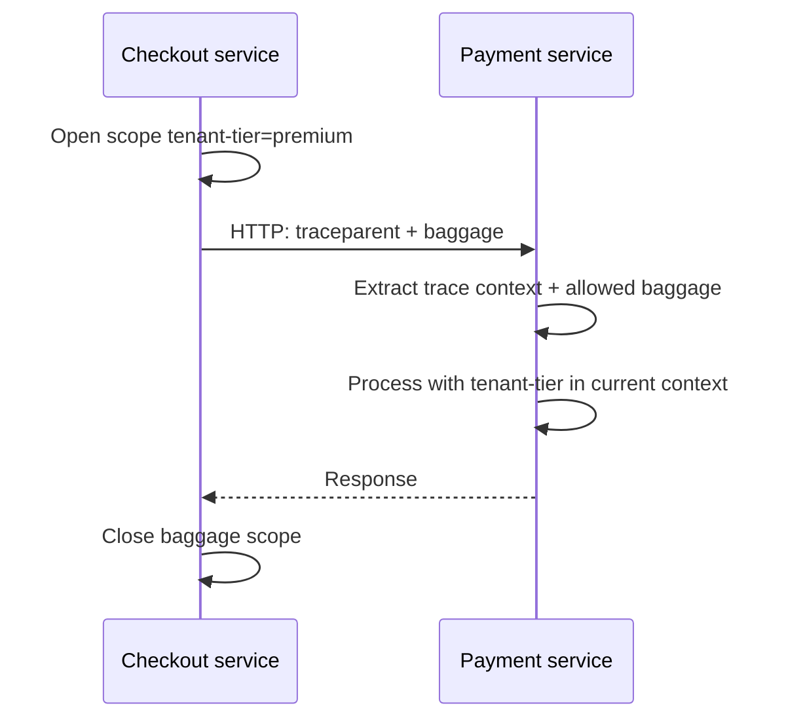

# Tạo baggage trong scope với Micrometer Tracing

## 1. Mục tiêu học tập

Khi một request đi qua nhiều service, trace context cho biết các span thuộc cùng một hành trình. Nhưng đôi khi các service còn cần một ít metadata xuyên suốt, ví dụ phân loại tenant, nhóm khách hàng, hoặc một mã phân luồng đã được cho phép. **Baggage** cung cấp cơ chế truyền các cặp key-value cùng trace context qua các ranh giới dịch vụ.

Trong chương **Baggage và correlation** của module **SPRING_BOOT_OBSERVABILITY**, bài này tập trung vào thao tác **tạo baggage trong scope** bằng Micrometer Tracing. Sau bài học, bạn có thể:

1. Giải thích baggage khác trace context, span attributes, metric tags và MDC như thế nào.
2. Tạo baggage bằng `Tracer.createBaggageInScope(...)` và quản lý vòng đời bằng try-with-resources.
3. Phân biệt baggage cục bộ, baggage được truyền từ xa và baggage được đưa vào log correlation.
4. Cấu hình `management.tracing.baggage.local-fields`, `remote-fields` và `correlation.fields` trong Spring Boot.
5. Hiểu việc inject/extract W3C `baggage` header qua HTTP và giới hạn khi đi qua async hoặc message broker.
6. Kiểm soát dữ liệu nhạy cảm, kích thước header và cardinality khi chọn baggage keys/values.
7. Kiểm tra baggage trong ứng dụng, outbound request và log, đồng thời xử lý các lỗi scope/propagation thường gặp.

Ví dụ lấy **Spring Boot 3.5.x, Java 17+, Micrometer Tracing** làm baseline. Hãy kiểm tra starter, bridge và property metadata của phiên bản đang chạy, đặc biệt khi nâng cấp Spring Boot 4.x. Bài học nằm trong module **SPRING_BOOT_OBSERVABILITY**: thiết lập Micrometer Observation, metrics, logs và distributed tracing, bao gồm context propagation, metadata, exporter, sampling và liên kết tín hiệu để điều tra lỗi/độ trễ.

## 2. Baggage là gì?

**Baggage** là tập hợp key-value được gắn với trace context và có thể được truyền từ service này sang service khác khi instrumentation/propagator được cấu hình. Ví dụ:

```text
tenant-tier=standard
experiment-cohort=control
region-hint=ap-southeast
```

Một service có thể đọc baggage nhận từ upstream và chuyển tiếp một số key đã allowlist tới downstream. Điều này hữu ích khi các bước trong một hành trình cần cùng biết metadata phân luồng, nhưng bản thân baggage **không thay thế dữ liệu nghiệp vụ** hay database.

### 2.1. Baggage khác trace context và span attributes

| Thành phần | Vai trò | Ví dụ |
| --- | --- | --- |
| Trace context | Xác định và liên kết các spans | `traceId`, `spanId`, parent, trace flags |
| Baggage | Metadata nhỏ được truyền cùng context | `tenant-tier=premium` |
| Span attributes | Mô tả một span để truy vấn trong trace backend | `payment.provider=acquirer-a` |
| Metric tags | Nhóm phép đo tổng hợp với cardinality thấp | `channel=web` |
| MDC/log correlation | Trường đưa vào log record khi logging integration cấu hình | `tenant-tier` trong MDC |
| Observation.Context map | Dữ liệu nội bộ cho handler của một Observation | Trạng thái bước nghiệp vụ |

Baggage không tự trở thành span attribute hay metric tag trong mọi instrumentation. Một tracing bridge có thể đọc baggage trong scope; logging integration có thể đưa một số baggage keys vào MDC; nhưng metrics chỉ nhận những tags được instrumentation/handler thiết kế để xuất.

**Không dùng baggage như một cách né cardinality.** Dữ liệu baggage có thể được lặp qua nhiều service và xuất hiện trong tracing/logging; nếu key-value chứa ID duy nhất, backend vẫn tốn tài nguyên và có nguy cơ tiết lộ thông tin.

### 2.2. Trace context và baggage là hai phần riêng

W3C Trace Context định nghĩa các header chính:
- `traceparent`: trace ID, parent span ID và trace flags.
- `tracestate`: dữ liệu vendor-specific có định dạng theo chuẩn.

W3C Baggage định nghĩa header:
- `baggage`: danh sách key-value được phép propagate.

Vì thế một request có thể mang cả hai header:

```http
traceparent: 00-4bf92f3577b34da6a3ce929d0e0e4736-00f067aa0ba902b7-01
baggage: tenant-tier=premium,experiment-cohort=control
```

Đây chỉ là ví dụ header minh họa. `traceparent` nối spans; `baggage` mang metadata bổ sung. Baggage không tạo trace/span mới và không quyết định parent-child relationship.

## 3. Baggage scope: tạo, sử dụng và đóng

Micrometer Tracing cung cấp `Tracer.createBaggageInScope(name, value)`. Phương thức này tạo baggage và đưa nó vào **scope hiện hành** trong thời gian đối tượng scope còn mở.

Mẫu sử dụng phổ biến:

```java
import io.micrometer.tracing.BaggageInScope;
import io.micrometer.tracing.Tracer;

public void processRequest(Tracer tracer) {
    try (BaggageInScope baggage =
                 tracer.createBaggageInScope("tenant-tier", "standard")) {
        doBusinessWork();
    }
}
```

Các điểm quan trọng:

1. `createBaggageInScope` tạo giá trị baggage và làm nó hiện hành trong phạm vi scope.
2. Code thực thi bên trong khối có thể dùng baggage; tracing instrumentation có thể đọc nó khi inject context ra HTTP/message nếu key được cấu hình remote.
3. Khi thoát khối try, `close()` khôi phục scope trước đó, tránh để baggage của request này rò sang công việc tiếp theo trên cùng thread.
4. Nếu không dùng try-with-resources, phải đóng `BaggageInScope` trong `finally`.
5. Nên tạo baggage bên trong một trace/observation scope đang hoạt động để baggage có ngữ cảnh rõ ràng và có thể được propagator sử dụng khi gửi request downstream.

**Baggage scope không phải span scope.** Scope baggage giới hạn thời gian một giá trị baggage hiện hành; nó không bắt đầu/kết thúc span và không thay cho `Observation.Scope` hoặc `Tracer.SpanInScope`.

### 3.1. Đặt baggage từ dữ liệu đã chuẩn hóa

Ví dụ một API chỉ chấp nhận hai nhóm tenant tier:

```java
private String normalizeTenantTier(String rawTier) {
    if ("premium".equalsIgnoreCase(rawTier)) {
        return "premium";
    }
    return "standard";
}
```

Sau đó:

```java
String tier = normalizeTenantTier(request.tenantTier());

try (BaggageInScope ignored =
             tracer.createBaggageInScope("tenant-tier", tier)) {
    checkoutService.process(request);
}
```

Mọi giá trị khác được gom về `standard`, nên baggage value có tập hữu hạn và ổn định. Không đưa trực tiếp header tùy ý từ client vào baggage. Client không được quyền tự gắn một giá trị bất kỳ để thay đổi routing, quyền truy cập hoặc chính sách giá.

### 3.2. Baggage có thể thay đổi hoặc được lồng scope

Một request có thể tạo scope mới bên trong scope cũ:

```text
Scope A: tenant-tier=standard
  └─ Scope B: tenant-tier=premium
       └─ gọi một thao tác cụ thể
  └─ Scope B đóng
Scope A lại hiện hành
Scope A đóng
Không còn tenant-tier trong scope của request
```

Khi scope con đóng, giá trị trước đó được khôi phục theo cơ chế context của tracing implementation. Không giữ một `BaggageInScope` trong field của singleton service; scope là đối tượng gắn với một lần thực thi, không phải trạng thái dùng chung giữa các request.

## 4. Cấu hình baggage trong Spring Boot 3.5

Spring Boot hỗ trợ ba nhóm property quan trọng dưới `management.tracing.baggage`:

| Property | Ý nghĩa | Khi nào dùng |
| --- | --- | --- |
| `management.tracing.baggage.local-fields` | Khai báo fields dùng trong tiến trình, không chủ đích propagate ra ngoài | Metadata chỉ cần cho logic/log nội bộ |
| `management.tracing.baggage.remote-fields` | Khai báo fields được truyền qua ranh giới dịch vụ | Metadata cần đến các service downstream |
| `management.tracing.baggage.correlation.fields` | Chọn baggage fields được đưa vào log correlation/MDC | Muốn tra log theo metadata đã allowlist |

Ví dụ `application.yml`:

```yaml
spring:
  application:
    name: checkout-service

management:
  tracing:
    baggage:
      local-fields:
        - operator-group
      remote-fields:
        - tenant-tier
        - experiment-cohort
      correlation:
        fields:
          - tenant-tier
```

Cấu hình thể hiện:
- `operator-group` là local baggage field, dùng trong ứng dụng hiện tại theo integration đã cấu hình.
- `tenant-tier` và `experiment-cohort` được đánh dấu là remote fields để tracing propagation có thể truyền qua dịch vụ khác.
- Chỉ `tenant-tier` được chọn để correlation vào log MDC.

Danh sách property cần được đối chiếu với Spring Boot version/BOM của dự án. Không nên chỉ copy YAML từ ví dụ mà bỏ qua điều kiện là tracing bridge, propagation type và logging integration đã hoạt động.

### 4.1. Local, remote và correlation không đồng nghĩa nhau

| Cấu hình | Có thể truyền ra downstream? | Có vào MDC/log correlation? |
| --- | --- | --- |
| Local field | Không theo cấu hình local-only | Không tự động |
| Remote field | Có, nếu propagator/client/server hỗ trợ | Không tự động |
| Correlation field | Không tự động vì chỉ là lựa chọn correlation | Có, khi field có trong baggage scope và integration hỗ trợ |

Một field có thể được khai báo vừa remote vừa correlation, như `tenant-tier` trong ví dụ. Khi đó nó có thể được propagate và cũng xuất hiện ở MDC. Hãy cân nhắc riêng **quyền truyền dữ liệu qua network** và **quyền ghi dữ liệu vào logs**; không phải field nào truyền được cũng nên log.

### 4.2. Cấu hình bằng application properties

Cùng ví dụ trên có thể biểu diễn:

```properties
management.tracing.baggage.local-fields[0]=operator-group
management.tracing.baggage.remote-fields[0]=tenant-tier
management.tracing.baggage.remote-fields[1]=experiment-cohort
management.tracing.baggage.correlation.fields[0]=tenant-tier
```

Spring Boot Binder có hỗ trợ binding collection/list; kiểm tra kết quả khi ứng dụng khởi tạo và đảm bảo không bị ghi đè bởi profile hoặc environment variables khác.

## 5. Ví dụ Spring Boot: tạo baggage trong xử lý request

Ví dụ dưới đây dùng Spring MVC, inject `Tracer` do Micrometer Tracing tích hợp với Spring Boot cung cấp. Giả sử ứng dụng đã có dependency Actuator, tracing bridge và exporter tương ứng.

### 5.1. Maven dependencies

Với Spring Boot 3.5.x và dependency management của Boot:

```xml
<dependencies>
    <dependency>
        <groupId>org.springframework.boot</groupId>
        <artifactId>spring-boot-starter-web</artifactId>
    </dependency>
    <dependency>
        <groupId>org.springframework.boot</groupId>
        <artifactId>spring-boot-starter-actuator</artifactId>
    </dependency>
    <dependency>
        <groupId>io.micrometer</groupId>
        <artifactId>micrometer-tracing-bridge-otel</artifactId>
    </dependency>
    <dependency>
        <groupId>io.opentelemetry</groupId>
        <artifactId>opentelemetry-exporter-otlp</artifactId>
    </dependency>
</dependencies>
```

Nếu dùng Brave bridge, dependency và baggage integration tương ứng sẽ khác. Không thêm cả hai tracing bridge trong cùng một ứng dụng chỉ để có baggage. Tracing exporter cần endpoint/collector thực tế; thêm dependency không có nghĩa trace đã được lưu.

### 5.2. Service tạo baggage theo scope

```java
package com.example.checkout;

import io.micrometer.tracing.BaggageInScope;
import io.micrometer.tracing.Tracer;
import org.springframework.stereotype.Service;

@Service
public class CheckoutService {
    private final Tracer tracer;
    private final PaymentClient paymentClient;

    public CheckoutService(Tracer tracer, PaymentClient paymentClient) {
        this.tracer = tracer;
        this.paymentClient = paymentClient;
    }

    public String checkout(String rawTenantTier) {
        String tier = "premium".equalsIgnoreCase(rawTenantTier)
                ? "premium" : "standard";

        try (BaggageInScope baggage =
                     tracer.createBaggageInScope("tenant-tier", tier)) {
            return paymentClient.authorize();
        }
    }
}
```

Trong ví dụ, `PaymentClient` phải sử dụng HTTP client được Spring Boot cấu hình/instrument. Khi outgoing tracing propagation hoạt động và `tenant-tier` được khai báo remote field, baggage có thể được encode vào `baggage` header.

Không dùng giá trị `rawTenantTier` trực tiếp. Bằng cách normalize trước khi tạo scope, ứng dụng giữ tập giá trị có giới hạn và không để người gọi truyền một chuỗi tùy ý sang downstream.

### 5.3. HTTP client dùng builder của Spring Boot

```java
package com.example.checkout;

import org.springframework.stereotype.Component;
import org.springframework.web.client.RestClient;

@Component
public class PaymentClient {
    private final RestClient client;

    public PaymentClient(RestClient.Builder builder) {
        this.client = builder
                .baseUrl("http://payment-service")
                .build();
    }

    public String authorize() {
        return client.post()
                .uri("/payments/authorize")
                .retrieve()
                .body(String.class);
    }
}
```

`RestClient.Builder` do Spring Boot inject có thể mang observation/tracing customizers và propagation. Nếu tự tạo client độc lập, bạn phải xác minh interceptors/propagator; không mặc định mọi `RestClient` đều inject `traceparent`/`baggage`.

### 5.4. Controller minh họa

```java
package com.example.checkout;

import org.springframework.web.bind.annotation.GetMapping;
import org.springframework.web.bind.annotation.RequestParam;
import org.springframework.web.bind.annotation.RestController;

@RestController
public class CheckoutController {
    private final CheckoutService checkoutService;

    public CheckoutController(CheckoutService checkoutService) {
        this.checkoutService = checkoutService;
    }

    @GetMapping("/demo/checkout")
    public String checkout(
            @RequestParam(defaultValue = "standard") String tenantTier) {
        return checkoutService.checkout(tenantTier);
    }
}
```

Gửi request:

```text
GET /demo/checkout?tenantTier=standard
GET /demo/checkout?tenantTier=premium
```

Hai request sẽ có trace riêng. Trong thời gian `CheckoutService.checkout` mở baggage scope, outgoing call có thể nhận baggage value tương ứng. Tên span, trace ID và việc trace được xuất hay không vẫn do tracing configuration, sampler, exporter và backend quyết định.

## 6. Đọc và sử dụng baggage ở service nhận

Ở service nhận, tracing instrumentation extract `traceparent` để dựng trace context và extract các remote baggage fields được cấu hình. Khi key đã có trong scope hiện hành, code downstream có thể dùng API của tracing implementation để truy cập baggage hoặc dùng correlation field trong MDC nếu mục tiêu chỉ là log.

Điều quan trọng là **service nhận cũng cần cấu hình field phù hợp**. Nếu producer gửi một key nhưng receiver không cho phép/không cấu hình nhận key đó, ứng dụng không nên giả định baggage sẽ có sẵn.

Mô hình:



### 6.1. Không dùng header thủ công để thay propagation

Không nên làm:

```java
// Sai: tự gắn baggage cố định, bỏ qua scope và propagator.
request.header("baggage", "tenant-tier=premium");
```

Cách này có thể ghi đè baggage hiện tại, không tuân thủ encoding/multiple members, hoặc làm lộ giá trị không được allowlist. Dùng `Tracer.createBaggageInScope` và cấu hình remote fields; tracing instrumentation sẽ inject/extract theo propagator đã chọn.

Nếu cần kiểm tra header trong test, hãy dùng mock server hoặc HTTP test fixture ở môi trường cục bộ, không log tất cả headers ở production.

## 7. Correlation: đưa baggage vào log context

Một lý do phổ biến để sử dụng baggage là đưa một metadata đã được chọn vào logs xuyên suốt các service. Spring Boot/Micrometer Tracing hỗ trợ cấu hình correlation fields để baggage được đưa vào **MDC** (Mapped Diagnostic Context) trong log scope.

Ví dụ `tenant-tier` được khai báo trong:

```yaml
management:
  tracing:
    baggage:
      remote-fields:
        - tenant-tier
      correlation:
        fields:
          - tenant-tier
```

Có thể cấu hình Logback pattern có chứa MDC key:

```xml
<configuration>
  <appender name="CONSOLE" class="ch.qos.logback.core.ConsoleAppender">
    <encoder>
      <pattern>%d{HH:mm:ss.SSS} %-5level [%thread]
traceId=%X{traceId} spanId=%X{spanId}
tenantTier=%X{tenant-tier} %logger - %msg%n</pattern>
    </encoder>
  </appender>
</configuration>
```

Đoạn XML chỉ minh họa pattern; nếu dùng Spring Boot logging defaults, nên điều chỉnh logging configuration hiện có thay vì thay toàn bộ appender. MDC key thực tế phụ thuộc baggage field và tracing bridge; hãy xác minh output log của runtime.

Ví dụ log:

```text
INFO  traceId=4bf... spanId=00f... tenantTier=premium Authorize payment started
ERROR traceId=4bf... spanId=00f... tenantTier=premium Payment provider timeout
```

Các giá trị trace IDs và log trên chỉ để minh họa. Nếu `tenant-tier` không có trong scope, MDC có thể không chứa giá trị đó; log pattern sẽ hiển thị rỗng hoặc chuỗi thay thế tùy encoder.

### 7.1. Correlation fields không phải baggage forwarding

- Khai báo `correlation.fields` yêu cầu tracing/log integration đưa baggage field vào log context.
- Khai báo `remote-fields` yêu cầu field được cho phép truyền qua ranh giới dịch vụ.
- Hai danh sách phục vụ hai mục đích khác nhau.

Nếu chỉ cần log local, không tự động bật remote forwarding. Nếu cần downstream đọc, khai báo remote field và allowlist phía nhận; chỉ thêm correlation ở những service thực sự cần log value.

### 7.2. Log correlation với trace ID

`traceId`/`spanId` vốn đến từ tracing context và thường được tích hợp riêng vào MDC. Baggage thêm metadata nghiệp vụ có chọn lọc, ví dụ tier/region. Khi điều tra:
1. Tìm request bằng `traceId` để mở toàn bộ trace.
2. Dùng `tenant-tier` hoặc một correlation field khác để lọc logs nếu có quyền.
3. Dựa vào span names/duration để thấy bước chậm.
4. So với metrics tổng hợp theo tag cardinality thấp và cùng khoảng thời gian.

Không dùng baggage key như `traceId` để tự tạo một hệ thống ID song song. Cũng không đưa toàn bộ baggage vào logs; mỗi key cần mục đích và chính sách rõ ràng.

## 8. Baggage trong executor, async và reactive pipeline

Baggage thuộc current tracing context. Do đó, các quy tắc context propagation áp dụng tương tự current span.

### 8.1. Executor và `@Async`

ThreadLocal/current context không tự đi theo thread pool. Nếu code mở baggage scope trên Thread A rồi submit một tác vụ tới Thread B, worker không chắc thấy baggage trừ khi context propagation được cấu hình.

Trong Spring, có thể dùng `ContextPropagatingTaskDecorator` trên executor thực tế:

```java
import org.springframework.context.annotation.Bean;
import org.springframework.context.annotation.Configuration;
import org.springframework.core.task.support.ContextPropagatingTaskDecorator;
import org.springframework.scheduling.concurrent.ThreadPoolTaskExecutor;

@Configuration
class AsyncContextConfiguration {
    @Bean
    ThreadPoolTaskExecutor applicationTaskExecutor() {
        ThreadPoolTaskExecutor executor = new ThreadPoolTaskExecutor();
        executor.setCorePoolSize(4);
        executor.setMaxPoolSize(16);
        executor.setQueueCapacity(200);
        executor.setTaskDecorator(new ContextPropagatingTaskDecorator());
        executor.initialize();
        return executor;
    }
}
```

Baggage scope nên được mở tại nơi có giá trị và ngữ cảnh hợp lệ; decorator capture/restore context cho task theo accessor đã đăng ký. Kiểm tra đúng executor được inject vào `@Async`. Decorator không tự biến baggage thành HTTP header; outbound client instrumentation vẫn cần propagation.

### 8.2. Reactor Context

Trong WebFlux, Reactor Context gắn với subscription, không phải một ThreadLocal cố định. Micrometer Context Propagation và cấu hình Reactor phù hợp giúp context (bao gồm tracing/baggage khi accessor hỗ trợ) đi theo chuỗi reactive dù operator chuyển scheduler.

Ví dụ chế độ auto propagation của Spring Boot 3.5:

```yaml
spring:
  reactor:
    context-propagation: auto
```

Hãy kiểm tra chính xác property support/default theo bản Spring Boot. Không giả định mọi baggage/object được đặt trong Reactor Context tùy ý tự động trở thành W3C baggage header. Cross-service propagation vẫn do tracing propagator thực hiện.

### 8.3. Scope và lifecycle của reactive work

Không mở scope đồng bộ quanh lúc **tạo** `Mono` rồi đóng ngay khi method trả về nếu phần việc thật chạy lúc subscribe. Với pipeline reactive, tạo/đặt baggage trong context của subscription hoặc dùng instrumentation reactive-aware sao cho scope sống đúng trong quá trình signal. Xác minh cả complete, error và cancel; không giữ `BaggageInScope` qua nhiều thread bằng cách tự đóng ở một thread khác.

## 9. Baggage và message broker

Với Kafka/RabbitMQ hoặc broker tương tự, baggage cần được inject vào **message headers** thông qua messaging instrumentation/propagator phù hợp. Consumer extract context và baggage từ carrier headers.

```text
Checkout producer
  trace context + allowed baggage
       |
       v
Message headers:
  traceparent: ...
  baggage: tenant-tier=premium
       |
       v
Payment consumer
  extract headers -> current trace/baggage scope
```

Message có thể nằm trong queue một khoảng thời gian dài; việc giữ parent-child trace qua thời gian dài không phải lúc nào cũng đúng ngữ nghĩa. Nếu consumer xử lý nhiều messages, span links có thể phù hợp hơn. Baggage vẫn cần allowlist và giới hạn kích thước, không đưa payload/order/customer details vào headers.

Không tự copy `baggage` header vào message body trừ khi contract yêu cầu rõ; sử dụng carrier headers và instrumentation hỗ trợ. Kiểm tra producer/consumer đều dùng cùng propagator và key configuration.

## 10. Bảo mật, privacy và cardinality

Baggage có thể được propagate qua nhiều service nên dữ liệu bị phát tán rộng hơn một span attribute local. Mọi baggage value cần được coi như **dữ liệu có thể rời service**.

Không đưa vào baggage:
- Access token, refresh token, password, API key, cookie hoặc session secret.
- Email, số điện thoại, địa chỉ, số tài khoản/thẻ hoặc thông tin định danh cá nhân nếu không có cơ sở và chính sách rõ ràng.
- Request body, dữ liệu thanh toán, exception message hoặc stack trace.
- ID động không cần thiết chỉ để tìm request; dùng trace ID và log/audit phù hợp.
- Nội dung tùy ý từ client mà chưa validate/normalize.

Baggage có thể:
- Làm header tăng kích thước, vượt giới hạn proxy/gateway/server.
- Xuất hiện ở logs, tracing exporters hoặc diagnostic captures.
- Bị sao chép qua nhiều hop và trở thành dữ liệu của nhiều hệ thống bên ngoài.
- Tăng chi phí indexing và làm lộ metadata nếu backend có quyền truy cập rộng.

### 10.1. Baggage values nên hữu hạn khi có thể

Ví dụ phù hợp hơn:

| Key | Giá trị được allowlist | Mục đích |
| --- | --- | --- |
| `tenant-tier` | `standard`, `premium`, `enterprise` | Chính sách xử lý theo tier |
| `experiment-cohort` | `control`, `variant-a`, `variant-b` | Xác định nhóm thử nghiệm |
| `region-hint` | Một tập vùng triển khai | Chọn vùng dịch vụ nếu được phép |

Không đưa `tenant-id` của hàng triệu tenant vào metric tags. Nếu cần baggage theo tenant ID, phải có lý do vận hành cụ thể, allowlist theo chính sách, giới hạn độ dài, kiểm soát quyền và retention. Baggage không phải cơ chế bảo mật/authorization; không tin giá trị upstream để ra quyết định quyền truy cập hoặc giá tiền mà không xác thực ở service nhận.

### 10.2. Độ dài và số lượng baggage members

W3C Baggage đặt ra quy tắc định dạng và giới hạn xử lý để tránh header vô hạn. Các hệ thống proxy/HTTP server cũng có giới hạn header riêng. Đừng thiết kế baggage lớn; chỉ truyền vài keys ngắn, không truyền payload hay collection. Khi nhận baggage không hợp lệ hoặc quá lớn, hệ thống có thể bỏ qua một phần hoặc toàn bộ theo propagator/implementation.

Baggage propagation có thể bị tắt hoặc lọc trên các ranh giới tin cậy. Không phải mọi service nội bộ cần biết mọi metadata. Chỉ propagate những keys downstream thực sự sử dụng.

## 11. Sampling, exporter và correlation

Baggage là metadata; nó không tự quyết định một trace được sample hay export. Các trách nhiệm riêng:

| Cơ chế | Câu hỏi | Ví dụ |
| --- | --- | --- |
| Propagation | Context/baggage có đi tới service tiếp theo? | Header `traceparent`, `baggage` |
| Sampling | Span/trace có được ghi giữ? | Sampling probability |
| Exporter | Span được gửi đi đâu? | OTLP/Zipkin exporter |
| Correlation | Log nào liên quan tới trace/baggage? | MDC fields |
| Metrics | Tần suất/latency tổng hợp thế nào? | Timer/Counter, tags có cardinality thấp |

Một trace không xuất hiện ở backend có thể do sampling hoặc exporter thất bại; điều đó không chứng minh baggage không được tạo trong scope. Ngược lại, thấy baggage header ở downstream không chứng minh span đã được sample và lưu.

Trong Spring Boot 3.5, cấu hình sampling cục bộ minh họa:

```yaml
management:
  tracing:
    sampling:
      probability: 1.0
```

Chỉ dùng `1.0` trong thử nghiệm có kiểm soát; production cần sampling strategy phù hợp lưu lượng, chi phí và yêu cầu điều tra. Metrics vẫn có thể tiếp tục ghi nhận toàn bộ meter samples kể cả khi chỉ một phần traces được sample.

## 12. Kiểm chứng tạo baggage trong scope

Để kiểm thử end-to-end, chuẩn bị hai service có tracing bridge/exporter và HTTP instrumentation phù hợp.

### 12.1. Kiểm tra tại producer

- Xác nhận `Tracer` được inject và `createBaggageInScope` tạo scope trước outbound call.
- Kiểm tra giá trị được normalize/allowlist.
- Xác nhận `tenant-tier` được khai báo trong `remote-fields`.
- Gọi outbound client đã được Spring Boot instrument.
- Trong test mock HTTP server, kiểm tra request có `baggage` header phù hợp; tránh in toàn header ở production.

### 12.2. Kiểm tra tại receiver

- Xác nhận server nhận header và có remote field tương ứng trong cấu hình.
- Kiểm tra code trong request scope có thể dùng baggage value theo API/tracing integration được chọn.
- Xác nhận trace ID và parent span ID liên kết đúng với upstream.
- Xác nhận baggage không được giữ lại ở request kế tiếp trong cùng thread.
- Nếu field vào MDC, kiểm tra log pattern chỉ hiển thị field đã allowlist.

### 12.3. Kiểm tra khi scope đóng

Một bài test cần bao gồm:
1. Mở baggage `tenant-tier=premium`.
2. Thực thi code trong scope.
3. Đóng scope bằng try-with-resources.
4. Bắt đầu một execution mới không có baggage này.
5. Xác nhận giá trị không rò từ execution trước sang execution sau.

Nếu test chỉ assert header outbound mà không assert cleanup, lỗi rò baggage qua thread pool vẫn có thể tồn tại.

## 13. Troubleshooting

| Triệu chứng | Nguyên nhân thường gặp | Hướng xử lý |
| --- | --- | --- |
| Không thấy baggage ở downstream | Field chưa khai báo remote, client không instrument, propagator không hỗ trợ | Kiểm tra remote-fields, builder và request headers |
| Có `traceparent` nhưng không có `baggage` | Chưa tạo baggage, remote field thiếu hoặc baggage propagation bị lọc | Kiểm tra scope và config cả hai phía |
| Baggage có ở producer nhưng mất tại service B | Receiver không allowlist/extract key hoặc ingress xóa header | Kiểm tra cấu hình receiver và gateway |
| MDC không có baggage | Chưa khai báo correlation field, log outside scope hoặc MDC integration khác | Kiểm tra correlation.fields và logging pattern |
| Baggage xuất hiện ở request kế tiếp | Scope không được đóng/restore đúng | Dùng try-with-resources, kiểm tra task decorator/thread reuse |
| Baggage mất trong `@Async` | Current context không propagate qua executor | Dùng ContextPropagatingTaskDecorator trên đúng executor |
| Baggage mất trong WebFlux | Code dựa ThreadLocal thuần túy hoặc propagation mode không phù hợp | Kiểm tra Reactor Context và context propagation |
| HTTP header quá lớn | Quá nhiều keys hoặc giá trị dài | Giới hạn keys/length, bỏ payload và metadata không cần |
| Metadata nhạy cảm lộ trong logs | Remote fields/correlation fields quá rộng | Thu hồi keys, lọc logging, rà soát retention/access |
| Span không thấy nhưng baggage header có | Sampling/exporter/backend issue | Kiểm tra tracing pipeline riêng |
| Metric có quá nhiều series | Đã chuyển baggage vào metric tags động | Bỏ tag dynamic, dùng nhóm hữu hạn |
| Giá trị downstream không đáng tin | Tin header từ client/upstream như dữ liệu đã xác thực | Validate/normalize và kiểm tra authorization tại service sở hữu nghiệp vụ |

## 14. Checklist production

- [ ] Mỗi baggage key có mục đích rõ ràng và owner.
- [ ] Chỉ dùng một tập remote fields nhỏ; service nhận chỉ cho phép những key cần thiết.
- [ ] Local fields không bị propagate ngoài ý muốn.
- [ ] Correlation fields được chọn riêng và chỉ đưa vào logs khi cần.
- [ ] Baggage scope được quản lý bằng try-with-resources/finally.
- [ ] Không lưu `BaggageInScope` trong singleton hoặc field dùng chung.
- [ ] Executor/reactive/message pipeline có propagation được kiểm thử.
- [ ] HTTP clients dùng builder/instrumentation có trace propagation.
- [ ] Không có token, password, cookie, PII hoặc payload trong baggage.
- [ ] Giới hạn độ dài và số lượng baggage values để tránh header bloat.
- [ ] Không đưa baggage ID động vào metric tags; dùng cardinality budget.
- [ ] Sampling và exporter được kiểm tra độc lập với baggage propagation.
- [ ] Log MDC chỉ có fields allowlist, không in toàn bộ headers.
- [ ] Đã kiểm thử cả success, exception, cancellation, thread reuse và request kế tiếp.

## 15. Câu hỏi tự luyện

1. `Tracer.createBaggageInScope("tenant-tier", "premium")` thay đổi điều gì trong scope hiện hành?
2. Vì sao cần đóng `BaggageInScope` trong try-with-resources?
3. `remote-fields`, `local-fields` và `correlation.fields` khác nhau ở mục tiêu nào?
4. Khi một field đã là remote field, nó có mặc nhiên được đưa vào MDC không?
5. W3C `traceparent` và `baggage` header mang hai loại dữ liệu gì?
6. Vì sao không nên đưa access token hoặc email vào baggage?
7. Nếu baggage mất trong `@Async`, cần kiểm tra executor và context propagation như thế nào?
8. Vì sao một `Mono` có thể cần scope gắn với subscription thay vì scope đồng bộ quanh lúc tạo publisher?
9. Baggage header có mặt nhưng không thấy trace trong backend; sampling/exporter có thể giải thích ra sao?
10. Nếu muốn log theo `tenant-tier`, cần cấu hình remote field, correlation field và MDC pattern như thế nào?
11. Một dịch vụ nhận baggage `tenant-tier=premium` từ request ngoài Internet có thể dùng nó để cấp quyền ngay không? Vì sao?
12. Vì sao không nên chuyển `workflowId` thành low-cardinality metric tag chỉ vì nó đã có trong baggage?

## Tài liệu tham khảo

- [Micrometer Tracing — Baggage](https://docs.micrometer.io/tracing/reference/api.html)
- [Micrometer Tracing — Propagation](https://docs.micrometer.io/tracing/reference/propagation.html)
- [Spring Boot 3.5 — Tracing and Baggage](https://docs.spring.io/spring-boot/3.5/reference/actuator/tracing.html)
- [Spring Boot 3.5 — Common Application Properties](https://docs.spring.io/spring-boot/3.5/appendix/application-properties/index.html)
- [Spring Framework — Context Propagation](https://docs.spring.io/spring-framework/reference/integration/observability.html)
- [OpenTelemetry — Baggage](https://opentelemetry.io/docs/concepts/signals/baggage/)
- [W3C — Baggage Specification](https://www.w3.org/TR/baggage/)
- [W3C — Trace Context](https://www.w3.org/TR/trace-context/)
