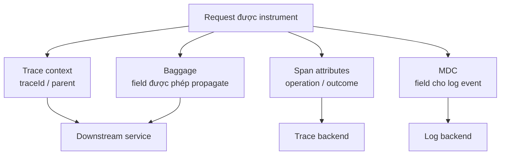
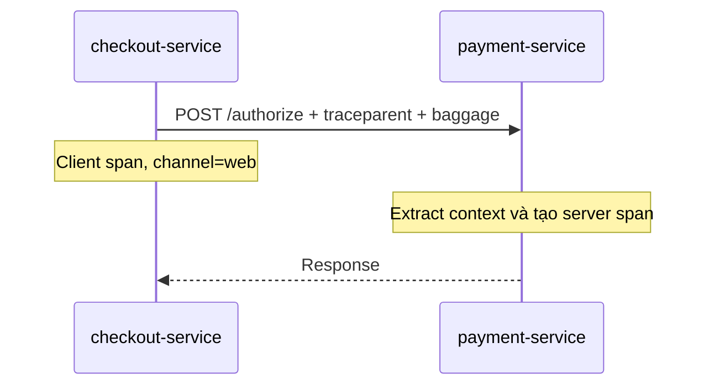
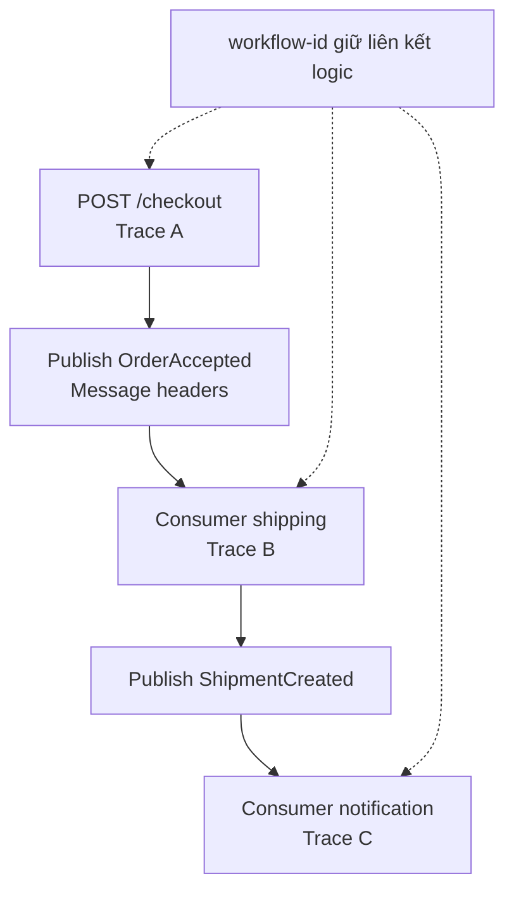

# Correlation fields trong Spring Boot Observability

Khi một request POST /checkout đi qua gateway, checkout-service, payment-service và inventory-service, đội vận hành cần biết những tín hiệu nào thuộc cùng một request và cần field nào để tìm đúng sự kiện trong logs/traces. Trace ID giúp nối spans của một distributed trace. Nhưng trong nhiều tình huống, đội vận hành còn cần trường tương quan có ý nghĩa như kênh giao dịch, mã luồng xử lý hoặc nhóm nghiệp vụ.

Bài **Correlation fields** thuộc chương **Baggage và correlation** của module **SPRING_BOOT_OBSERVABILITY**. Module hướng dẫn xây dựng observability cho Spring Boot bằng Micrometer Observation, metrics, logs và distributed tracing; học context propagation, tags/cardinality, exporter, sampling và cách liên kết tín hiệu để điều tra lỗi, độ trễ và hành vi ứng dụng trên môi trường thực.

Trong bài này, ta thiết kế correlation fields có mục đích, phân biệt **trace context**, **span attributes**, **baggage** và **MDC**, xem cách Spring Boot/Micrometer truyền trường tương quan, và kiểm thử để bảo đảm dữ liệu xuất hiện đúng nơi mà không rò rỉ qua ranh giới dịch vụ.

## 1. Correlation field là gì?

**Correlation field** là một trường dữ liệu được chọn để hỗ trợ tìm kiếm hoặc liên kết những log events, spans hay hoạt động liên quan.

| Field | Mục đích có thể có | Điều cần lưu ý |
| --- | --- | --- |
| traceId | Nối spans cùng một distributed trace | Tracing system quản lý; không dùng làm metric label |
| spanId | Xác định một span cụ thể | Dùng để tra đoạn xử lý, không phải định danh nghiệp vụ |
| correlationId | Liên kết sự kiện trong một luồng nghiệp vụ | Phải xác định ai tạo, phạm vi và cách truyền |
| tenantTier | Phân biệt nhóm tenant ở mức được phép chia sẻ | Chỉ dùng nếu tập giá trị nhỏ và policy cho phép |
| channel | Nhóm nguồn giao dịch như web/mobile/partner | Chuẩn hóa thành tập giá trị hữu hạn |
| orderId | Tra cứu một giao dịch trong hệ nghiệp vụ | Cardinality cao, có thể nhạy cảm; không làm metric tag mặc định |
| userEmail | Nhận diện người dùng | Dữ liệu cá nhân; không dùng làm correlation field mặc định |

Không có danh sách correlation fields dùng đúng cho mọi ứng dụng. Field phải gắn với **một câu hỏi vận hành cụ thể**: cần lọc logs theo luồng nào, tìm spans theo dimension nào, hoặc liên kết một giao dịch đã được cấp quyền tra cứu ra sao.

Correlation field không phải lúc nào cũng cần được truyền giữa các service. Một trường chỉ cần để phân nhóm trong một span có thể giữ làm span attribute. Một trường cần xuất hiện trong logs của downstream có thể cần baggage propagation. Một mã chỉ tồn tại trong hệ thống nghiệp vụ có thể được tra qua database thay vì mang theo mọi request.

## 2. Trace context, span attributes, baggage và MDC không giống nhau

| Cơ chế | Chứa gì? | Tự truyền sang service khác? | Nơi thường dùng |
| --- | --- | --- | --- |
| **Trace context** | Trace ID, parent context và sampling flags | Có, khi instrumentation inject/extract đúng | Nối spans qua HTTP/messaging |
| **Span attributes** | Thuộc tính mô tả một span | Không tự thành baggage | Lọc/search span trong trace backend |
| **Baggage** | Field context được định nghĩa để truyền qua process boundary | Có thể, khi khai báo remote propagation | Mang correlation data tối thiểu qua nhiều hop |
| **MDC** | Trường của logging context hiện hành | Không tự gửi qua network | Thêm trace/correlation fields vào log events |

Một field có thể được dùng ở nhiều nơi, nhưng đó là **những quyết định cấu hình riêng**. Ví dụ channel=web có thể là span attribute để tìm traces, được đưa vào MDC để tìm logs, hoặc là baggage nếu downstream thật sự cần nhận giá trị đó. Không nên bật cả ba chỉ vì tiện.



Sơ đồ mô tả những con đường có thể được cấu hình, không có nghĩa mọi field tự động đi qua mọi nhánh. Tracing SDK, Micrometer bridge, logging integration và propagator phải được thiết lập tương ứng.

## 3. Trace ID và correlation ID: dùng cái nào?

**Trace ID** do tracing implementation quản lý và định danh một trace. Khi các service propagate cùng trace context, các spans có thể được gom vào một trace thống nhất.

**Correlation ID** thường là mã ứng dụng hoặc mã luồng xử lý, có thể được tạo từ gateway, hệ thống upstream hoặc nghiệp vụ. Nó có thể tồn tại trước khi trace được tạo, qua nhiều trace khác nhau hoặc qua một quy trình bất đồng bộ dài hơn vòng đời HTTP request.

| So sánh | Trace ID | Correlation ID |
| --- | --- | --- |
| Ai quản lý? | Tracer/SDK và propagator | Hợp đồng ứng dụng hoặc hệ thống upstream |
| Phạm vi | Một distributed trace | Theo quy trình nghiệp vụ được định nghĩa |
| Có parent/child spans? | Có trong trace model | Không; chỉ là giá trị liên kết |
| Được sample? | Trace có thể bị loại khỏi lưu trữ | Field correlation không tự bị sampling, nhưng log/record có thể không được lưu |
| Thay thế nhau? | Không phải lúc nào | Không phải lúc nào |

Ví dụ: một đơn hàng được xử lý đồng bộ, sau đó chuyển sang queue để giao hàng vài phút sau. Có thể có **hai traces** khác nhau cho hai giai đoạn, nhưng một workflow correlation ID được phép giữ lại để tìm các log events liên quan. Nếu cố dùng một trace ID duy nhất làm mã đơn hàng, sẽ nhầm lẫn giữa định danh kỹ thuật và định danh nghiệp vụ.

Không nhận correlation ID từ client rồi mặc nhiên tin cậy nó. Có thể chuẩn hóa, giới hạn độ dài/ký tự, tạo ID mới tại ranh giới tin cậy hoặc lưu ID upstream sau khi kiểm tra. Correlation ID không được dùng thay authentication, authorization hay idempotency key nếu chưa thiết kế cho mục đích đó.

## 4. Thiết kế một bộ correlation fields nhỏ

Giả sử checkout-service cần:

- Tìm tất cả spans của cùng một HTTP request: dùng trace context do tracer quản lý.
- Tìm logs về cùng một lần checkout trong service: correlation ID đã được xác thực/chuẩn hóa.
- Tìm nhóm giao dịch theo kênh: channel có tập giá trị web, mobile, partner, other.
- Giúp downstream phân loại tác vụ: chỉ propagate channel nếu downstream có mục đích cụ thể và field không chứa dữ liệu cá nhân.

Một hợp đồng minh họa:

```yaml
correlation:
  fields:
    workflow-id:
      source: generated-at-trusted-boundary
      log: true
      span: true
      baggage: false
    channel:
      source: normalized-request-metadata
      allowed-values: [web, mobile, partner, other]
      log: true
      span: true
      baggage: true
    order-id:
      source: business-database
      log: false
      span: false
      baggage: false
forbidden:
  - authorization
  - cookie
  - access-token
  - password
  - user-email
  - payment-card-data
```

Đây là **mẫu hợp đồng do đội phát triển tự định nghĩa**, không phải cấu hình Spring Boot/Micrometer có thể đọc trực tiếp. Tổ chức cần chuyển hợp đồng thành code, logging config, tracing/baggage config, collector policy và tests.

### Mỗi field cần có owner và giới hạn

Với từng field, cần ghi rõ: ai tạo giá trị và ở ranh giới nào; hệ thống nào được phép ghi đè; có được tin cậy khi nhận từ request/header bên ngoài không; có được xuất sang span, log, baggage hoặc metrics không; tập giá trị/độ dài/kích thước tối đa là bao nhiêu; dữ liệu được lưu bao lâu và ai được tìm kiếm.

Nếu không trả lời được các câu hỏi này, chưa nên propagate field rộng khắp hệ thống.

## 5. Baggage: field tương quan qua nhiều service

**Baggage** là các cặp key/value được gắn vào tracing context và có thể được propagate tới downstream. Với W3C Baggage, dữ liệu thường đi trong HTTP header `baggage`, trong khi `traceparent` truyền thông tin trace context. Hai header có mục đích khác nhau.

Ví dụ minh họa:

```text
traceparent: 00-<trace-id>-<parent-span-id>-01
baggage: channel=web,workflow-id=wf-7f29
```

Đây là header giả định đã được encoding đúng cho giá trị thực; không copy các placeholder thành request thật. Không đưa access token, email, địa chỉ, số thẻ hoặc body giao dịch vào baggage.

Baggage hữu ích khi service downstream thật sự cần một giá trị context không nằm trong trace ID, ví dụ nhóm kênh đã chuẩn hóa. Nhưng mỗi hop có thể thêm header bytes, và một baggage field có thể đi ra ngoài tổ chức nếu request gọi API đối tác. Cần giới hạn:

- Chỉ các key nằm trong allowlist.
- Số field và tổng kích thước header.
- Độ dài và tập ký tự của từng value.
- Ranh giới được phép inject (nội bộ, partner, internet).
- Quy tắc extract: không tự động tin giá trị do bên ngoài gửi.

**Baggage không phải nơi lưu hồ sơ người dùng hoặc metadata nghiệp vụ tùy ý.** Hãy giữ dữ liệu tối thiểu, không nhạy cảm và có mục đích truyền tiếp rõ ràng.

## 6. Cấu hình baggage và correlation fields trong Spring Boot

Trong các dòng Spring Boot 3.x có Micrometer Tracing auto-configuration, một cấu hình minh họa thường có dạng:

```yaml
management:
  tracing:
    baggage:
      remote-fields:
        - channel
        - workflow-id
      local-fields:
        - internal-processing-mode
      correlation:
        fields:
          - channel
          - workflow-id
```

Ý nghĩa khái quát:

- **remote-fields**: baggage fields được cấu hình để propagate qua ranh giới process theo tracing implementation/propagator.
- **local-fields**: baggage fields dùng trong phạm vi local context, không chủ định gửi ra remote bằng cấu hình này.
- **correlation.fields**: baggage fields được đưa vào logging correlation context/MDC theo integration của Spring Boot.

Tên property và behavior cần đối chiếu phiên bản Spring Boot/Micrometer đang dùng. Không phải mọi field trong remote-fields tự động trở thành span attribute, metric tag hoặc field trong mọi logger; mỗi chức năng có cơ chế riêng.

**Quan trọng:** khai báo workflow-id trong remote-fields đồng nghĩa cho phép nó rời service hiện tại qua propagation. Chỉ làm điều đó khi đã xét ranh giới tin cậy và quyền truy cập của downstream. Nếu chỉ muốn xuất field vào logs local, không cần remote propagation.

### Chọn nơi cấu hình

| Yêu cầu | Nơi cần xem |
| --- | --- |
| Bật tracing và xác suất sampling | management.tracing.* phù hợp với version |
| Cho phép baggage gửi qua process | management.tracing.baggage.remote-fields |
| Baggage chỉ dùng nội bộ context local | management.tracing.baggage.local-fields |
| Gắn baggage fields vào log correlation | management.tracing.baggage.correlation.fields |
| Thêm attributes vào observation/span | Observation convention hoặc tracing instrumentation |
| Nhóm metrics theo dimension ổn định | Low-cardinality Observation key-values / meter tags |
| Lọc hoặc giới hạn dữ liệu ở pipeline | Logging/tracing exporter và collector processors |

Đừng cố giải quyết mọi correlation bằng một property. Trước khi thêm key vào config, xác định rõ field có cần **được truyền**, **được ghi vào log**, **được lưu trên span**, hay **được dùng để tổng hợp metric**.

## 7. Dùng baggage field trong code

Micrometer Tracing cung cấp abstraction để thao tác baggage, nhưng API cụ thể có thể thay đổi theo version và bridge. Một cách tiếp cận phù hợp là inject abstraction BaggageManager/Tracer được Spring cấu hình, tạo hoặc cập nhật field theo đúng vòng đời, sau đó đóng scope nếu API trả scope.

Ví dụ dưới đây là **mã minh họa về luồng xử lý**, không cố định chữ ký của mọi phiên bản:

```java
// Pseudocode: kiểm tra API BaggageManager của version đang dùng.
try (BaggageInScope ignored =
         baggageManager.createBaggageInScope("channel", normalizedChannel)) {
    paymentClient.authorize();
}
```

Mục tiêu là field chỉ tồn tại trong scope cần thiết và được khôi phục khi scope đóng. Không lưu một baggage object mutable trong singleton rồi ghi đè giá trị theo từng request; nhiều requests có thể chạy đồng thời.

Nếu code sử dụng Observation, có thể thêm **span/observation attributes** theo hợp đồng riêng:

```java
Observation.createNotStarted("checkout.submit", observationRegistry)
    .lowCardinalityKeyValue("channel", normalizedChannel)
    .observe(() -> checkout());
```

Đoạn này minh họa một low-cardinality tag cho metrics/observation handler. Nó **không thay thế baggage propagation** và không tự đảm bảo field xuất hiện trong MDC. Dùng cùng tên field ở các tín hiệu cần naming contract, nhưng vẫn phải cấu hình từng đường.

## 8. Đưa correlation fields vào logs bằng MDC

MDC (Mapped Diagnostic Context) là cơ chế logging thường dùng để gắn một số trường vào log events của thread hiện hành. Ví dụ Logback pattern:

```text
%d{yyyy-MM-dd HH:mm:ss.SSS} level=%-5level trace=%X{traceId:-} span=%X{spanId:-} workflow=%X{workflow-id:-} channel=%X{channel:-} %logger - %msg%n
```

Khi tracing/logging integration được cấu hình, traceId và spanId có thể được đặt trong MDC trong lúc span scope hiện hành hoạt động. Correlation fields từ baggage có thể được đưa vào MDC nếu đã khai báo theo cơ chế correlation fields và integration đúng.

Một log event giả định:

```text
2026-11-22T09:45:01.230Z INFO trace=4b... span=91... workflow=wf-7f29 channel=web checkout.payment.authorized
```

Giá trị trên chỉ minh họa. Log thực tế nên sử dụng structured fields có schema ổn định nếu backend hỗ trợ JSON logs; không cần nhồi mọi field vào message dạng text.

### MDC cũng cần context propagation

MDC thường dựa trên ThreadLocal. Nếu tác vụ chuyển sang worker thread, correlation fields có thể biến mất hoặc còn giá trị cũ nếu không được restore/clear. Với @Async, executor hoặc reactive code, cần kiểm tra Micrometer Context Propagation và integration logging thực tế.

Không gọi MDC.put() trong một request rồi quên MDC.remove() hoặc restore trạng thái trước đó. Tốt hơn là sử dụng integration scope-aware; nếu tự quản lý, luôn dùng try/finally để hoàn nguyên. Không sao chép tất cả MDC fields từ request đầu vào sang mọi task hoặc service.

## 9. Correlation fields trong metrics: chọn lọc rất chặt

Metrics cần tổng hợp trên nhiều requests. Chỉ các field có **tập giá trị nhỏ và ổn định** mới nên trở thành low-cardinality tags/dimensions.

| Field | Làm metric tag? | Lý do |
| --- | --- | --- |
| channel=web/mobile/partner/other | Có thể | Tập giá trị hữu hạn |
| outcome=accepted/rejected/error | Có thể | Phân loại hoạt động ổn định |
| region=ap-southeast-1 | Có thể nếu region set được kiểm soát | Phục vụ so sánh vùng |
| traceId | Không | Hầu như mỗi request một giá trị |
| workflowId | Thường không | Có thể duy nhất theo luồng |
| orderId | Không | Cardinality cao và có thể nhạy cảm |
| email hoặc token | Không | Dữ liệu cá nhân/secret |

Giả sử một metric có 4 channel, 3 outcomes và 5 regions, số tổ hợp tối đa từ ba dimensions là:

\[
4 \times 3 \times 5 = 60
\]

Nếu thêm workflowId có 100.000 giá trị, tiềm năng thành 6 triệu tổ hợp trước các dimensions khác. Điều này có thể làm tăng bộ nhớ, chi phí ingest và thời gian truy vấn.

**Correlation không có nghĩa là phải đặt cùng một field vào metrics.** Dùng trace ID để điều tra một request cụ thể; dùng low-cardinality dimensions để tổng hợp; dùng logs hoặc hệ thống nghiệp vụ được phân quyền cho những nhu cầu tra cứu theo mã giao dịch.

## 10. Propagation qua HTTP và ranh giới tin cậy

Khi service A gọi service B, HTTP client instrumentation có thể inject trace context và baggage. Server B extract chúng khi tạo server span.



Quy tắc:

1. Dùng HTTP clients được Spring Boot quản lý/instrument để tránh bỏ qua observation/tracing configuration.
2. Dùng W3C Trace Context hoặc propagation format được hai bên hỗ trợ; trace context và baggage là hai phần riêng.
3. Trước khi gửi ra partner, lọc baggage fields theo allowlist. Không gửi toàn bộ baggage nội bộ.
4. Khi nhận header từ bên ngoài, giới hạn số field, kích thước và ký tự; không xem giá trị như authorization claims.
5. Nếu downstream không cần một correlation field, đừng truyền nó chỉ để “phòng khi cần”.

Correlation field do client cung cấp có thể bị giả mạo để gây nhầm lẫn trong log search hoặc tạo chi phí bằng cách đẩy cardinality. Tại ingress boundary, nên validate/normalize hoặc thay bằng ID do hệ thống tin cậy tạo. Không dựa vào correlation field để cho phép người dùng truy cập dữ liệu.

## 11. Async, messaging và các workflow dài

Trong cùng một trace, context thường được truyền qua HTTP hoặc message headers bằng instrumentation. Tuy nhiên, **workflow correlation** đôi khi kéo dài qua nhiều messages và nhiều traces; đây là lý do không nên đồng nhất workflow ID với trace ID.



Trong sơ đồ, workflow-id là correlation field xuyên workflow; trace A, B và C có thể tách nhau theo ranh giới bất đồng bộ. Tùy tracing semantic convention, quan hệ giữa producer/consumer spans có thể dùng parent hoặc span links. Không ép toàn bộ workflow dài thành một trace duy nhất nếu backend, sampling và retention không được thiết kế cho điều đó.

Với executor và async tasks:

- Capture context tại điểm submit, restore trong task và đóng scope sau khi hoàn tất.
- Xác định tác vụ nền nên là child span của request, span được liên kết (link), hay một trace mới có correlation field chung.
- Không giữ request scope mở sau khi response đã kết thúc chỉ để giữ context cho tác vụ kéo dài.
- Kiểm tra cả log MDC và trace parent trong task; một field xuất hiện trong log không chứng minh span relation đúng.

Với Kafka/RabbitMQ, dùng instrumentation/propagator cho message headers nếu hỗ trợ. Không tự serialize toàn bộ MDC hoặc baggage vào message payload.

## 12. Correlation và sampling

Sampling quyết định trace nào được ghi/xuất theo chính sách tracer. Correlation fields trong logs có thể vẫn được ghi ngay cả khi trace không được sample. Do đó:

- Log chứa trace ID **không đảm bảo** trace tồn tại trong backend.
- Một correlation ID ở logs có thể liên kết sự kiện ngay cả khi trace bị drop, nếu logs được lưu độc lập.
- Metrics có thể phản ánh toàn bộ requests trong khi backend chỉ nhận một phần traces.
- Đừng tăng metric cardinality bằng cách đưa trace ID/correlation ID vào labels để bù cho sampling.
- Nếu cần giữ traces của requests lỗi hoặc chậm, cân nhắc sampler/pipeline phù hợp, ví dụ tail-based sampling ở collector; không coi correlation field là cơ chế sampling.

Một chiến lược hợp lý là dùng metrics để phát hiện xu hướng, logs có trường correlation tối thiểu để tìm sự kiện, và traces được sample theo policy phục vụ phân tích chi tiết. Nếu sự cố yêu cầu trace của mọi request cụ thể, phải xác định sampling policy trong môi trường điều tra và giới hạn thời gian/traffic.

## 13. Kiểm thử correlation fields

Kiểm thử cần xác minh field xuất hiện đúng tín hiệu, được propagate đúng ranh giới và không rò sang tác vụ khác.

| Test | Điều cần chứng minh |
| --- | --- |
| Unit test chuẩn hóa | Input không tin cậy được chuyển thành tập giá trị được phép |
| Observation test | Span/observation có tên và low-cardinality fields cần thiết |
| Baggage test | Chỉ remote fields trong allowlist được inject/extract |
| Logging test | MDC/structured log có trace/correlation fields đúng scope |
| Executor test | Context được capture/restore và worker không giữ giá trị cũ |
| HTTP integration test | Client inject và server extract propagation headers |
| Message integration test | Producer/consumer truyền context/correlation theo policy |
| Security test | Header giả mạo, quá dài hoặc key bị cấm không được tin/propagate |

### Ví dụ kiểm thử chuẩn hóa field

```java
enum Channel {
    WEB, MOBILE, PARTNER, OTHER
}

final class CorrelationFields {
    private CorrelationFields() {}

    static Channel normalizeChannel(String raw) {
        if (raw == null) return Channel.OTHER;
        return switch (raw.toLowerCase(java.util.Locale.ROOT)) {
            case "web" -> Channel.WEB;
            case "mobile" -> Channel.MOBILE;
            case "partner" -> Channel.PARTNER;
            default -> Channel.OTHER;
        };
    }
}
```

```java
import org.junit.jupiter.api.Test;
import static org.junit.jupiter.api.Assertions.*;

class CorrelationFieldsTest {
    @Test
    void normalizesOnlyAllowedChannels() {
        assertEquals(Channel.WEB,
            CorrelationFields.normalizeChannel("WEB"));
        assertEquals(Channel.MOBILE,
            CorrelationFields.normalizeChannel("mobile"));
        assertEquals(Channel.PARTNER,
            CorrelationFields.normalizeChannel("partner"));
        assertEquals(Channel.OTHER,
            CorrelationFields.normalizeChannel("customer-92831"));
        assertEquals(Channel.OTHER,
            CorrelationFields.normalizeChannel("person@example.test"));
    }
}
```

Test cho thấy đầu vào tùy ý không trở thành correlation tag tùy ý. Nó **không** chứng minh field đã được thêm vào baggage, span hoặc MDC; mỗi pipeline cần integration test riêng.

### Kiểm thử rò rỉ giữa requests

Với executor đơn luồng, chạy hai tác vụ liên tiếp: tác vụ đầu đặt field workflow-id, tác vụ sau xác nhận không còn giá trị cũ. Khi dùng Micrometer Context Propagation, capture snapshot trong task đầu, restore trong scope của task; sau khi đóng scope, task thứ hai phải thấy context trước đó hoặc trạng thái rỗng như thiết kế. Với MDC, capture log events để xác minh đúng trace/workflow trong từng task.

Không dùng dữ liệu khách hàng hoặc token thật làm test sentinel. Dùng giá trị giả có thể nhận diện, sau đó tìm trong outbound headers, logs, span attributes và collector output để xác nhận field cấm không xuất hiện.

## 14. Sự cố thường gặp

| Hiện tượng | Nguyên nhân có thể | Cách kiểm tra |
| --- | --- | --- |
| Trace liên kết được nhưng logs thiếu workflow-id | Field không nằm trong correlation fields/MDC integration | Kiểm tra config và log pattern/encoder |
| Logs có traceId nhưng backend không tìm thấy trace | Sampling hoặc exporter/collector/backend | Kiểm tra sampler và pipeline tracing |
| Downstream không nhận baggage | Field chưa khai báo remote, propagator không tương thích hoặc client không instrument | Kiểm tra inject/extract headers ở hai đầu |
| Downstream nhận field không mong muốn | Allowlist quá rộng hoặc gateway forward toàn bộ baggage | Thu hẹp remote fields tại từng trust boundary |
| Correlation field cũ xuất hiện trong request mới | MDC/ThreadLocal không được restore/clear | Kiểm tra scope, executor và finally |
| Một correlation ID xuất hiện ở nhiều tenant | ID do client cung cấp không được validate hoặc không có namespace | Tạo/chuẩn hóa ID tại ingress và không dùng làm quyền |
| Metric series tăng nhanh | Dùng workflow/trace ID làm dimensions | Loại field khỏi low-cardinality metric tags |
| Correlation search quá nhiều kết quả | Field không đủ duy nhất trong phạm vi tìm kiếm | Kết hợp time range, service, trace ID hoặc mã sự kiện |
| Header baggage quá lớn | Quá nhiều fields hoặc value không giới hạn | Giới hạn kích thước/số key và chỉ truyền tối thiểu |
| Một field có giá trị khác giữa các service | Nguồn không rõ, nhiều bên được phép ghi đè | Xác định owner, source-of-truth và quy tắc trust |

## 15. Tình huống thực tế: tìm một checkout qua nhiều service

**Bối cảnh giả định:** khách hàng gửi checkout. Gateway tạo một workflow correlation ID, checkout-service gọi payment, sau đó publish sự kiện để shipping xử lý bất đồng bộ. Payment gặp timeout và retry; vài phút sau shipping xử lý message.

Một cách thiết kế:

1. Gateway hoặc checkout-service tại ranh giới tin cậy tạo workflow-id ngẫu nhiên, không chứa PII; validate header upstream nếu có.
2. Tracing instrumentation tạo trace ID cho HTTP request. Client/server spans được nối qua trace propagation.
3. channel được chuẩn hóa thành web/mobile/partner/other và gắn vào span/metrics ở nơi phù hợp.
4. Nếu payment cần channel, chỉ field này được phép đi trong baggage qua HTTP nội bộ. Không truyền workflow-id nếu downstream không cần nó.
5. Application logs có traceId, spanId và workflow-id trong MDC/structured fields theo policy.
6. Khi publish message, chỉ các correlation fields cần thiết được đưa vào message headers; consumer có thể tạo trace mới nhưng giữ workflow correlation để nối hành trình nghiệp vụ.
7. Khi điều tra, tìm metrics để xác định tần suất lỗi, traces để xem từng attempt và logs theo workflow-id/trace ID để nối các event đã được lưu.

Không đưa workflow-id vào metric dimensions vì mỗi workflow có thể tạo một giá trị. Không lưu payment token hoặc email trong baggage. Nếu cần tra chi tiết đơn hàng, dùng workflow ID để gọi hệ thống nghiệp vụ có phân quyền, không biến telemetry thành bản sao dữ liệu nhạy cảm.

## 16. Bài tập tự kiểm tra

**Bài 1.** Một service muốn tìm spans cùng request và tìm logs cùng workflow nghiệp vụ kéo dài qua nhiều message. Nên dùng field nào?

*Gợi ý:* Trace ID cho các spans thuộc cùng trace; workflow correlation ID cho luồng nghiệp vụ có thể trải qua nhiều traces.

**Bài 2.** Một field có trong correlation.fields nhưng không xuất hiện trong downstream HTTP request. Vì sao?

*Gợi ý:* Correlation fields chủ yếu phục vụ logging/MDC. Muốn truyền remote phải cấu hình baggage remote field và instrumentation inject/extract đúng.

**Bài 3.** Tại sao không nên thêm workflow-id vào metric tag?

*Gợi ý:* Giá trị gần như duy nhất sẽ tăng cardinality/time series và chi phí, trong khi metrics cần dimensions để tổng hợp.

**Bài 4.** Gateway nhận baggage user-email từ Internet. Có nên chuyển nguyên vẹn vào các service nội bộ?

*Gợi ý:* Không. Validate key/value, loại field không được phép và chỉ forward allowlist đã phê duyệt.

**Bài 5.** Log có trace ID nhưng trace backend không có trace. Có mâu thuẫn không?

*Gợi ý:* Không nhất thiết. Sampling, exporter, collector hoặc backend có thể không lưu trace; logs là pipeline độc lập.

**Bài 6.** Correlation field xuất hiện trong log của request sau dù request trước đã kết thúc. Điều tra đâu trước?

*Gợi ý:* MDC/ThreadLocal cleanup, executor context restoration và scope lifetime.

**Bài 7.** channel là một field có bốn giá trị hợp lệ. Có thể đưa vào baggage và metric tag cùng lúc không?

*Gợi ý:* Có thể nếu có mục đích riêng cho cả hai, tập giá trị được chuẩn hóa và việc remote propagation được phép. Đây vẫn là hai cấu hình độc lập.

**Bài 8.** Vì sao correlation ID không nên được dùng thay authorization hoặc idempotency key?

*Gợi ý:* Correlation ID chỉ phục vụ tìm kiếm/liên kết. Nó không có hợp đồng bảo mật, tính duy nhất hoặc semantics giao dịch cần cho hai mục đích kia.

## 17. Ghi nhớ

- **Correlation fields** là các trường được chọn để tìm kiếm/liên kết tín hiệu; mỗi field cần mục đích, owner, source và policy rõ ràng.
- **Trace context** nối spans; **span attributes** mô tả span; **baggage** có thể truyền field qua process; **MDC** đưa field vào log events. Chúng không thay thế nhau.
- **Trace ID** phù hợp với một distributed trace; **workflow/correlation ID** có thể liên kết nhiều traces trong một quy trình nghiệp vụ dài.
- Trong Spring Boot, remote-fields, local-fields và correlation.fields phục vụ các lựa chọn propagation/log correlation khác nhau; xác minh property theo version.
- Chỉ truyền baggage **tối thiểu và được allowlist** qua ranh giới tin cậy; không truyền token, PII hoặc dữ liệu thanh toán.
- Chỉ dùng correlation fields có **cardinality thấp** làm metric dimensions; không dùng trace ID, workflow ID hoặc order ID làm metric labels mặc định.
- Kiểm thử riêng span, baggage, MDC, executor và HTTP/message boundaries; xác minh cả propagation đúng lẫn cleanup để không rò dữ liệu giữa requests.
