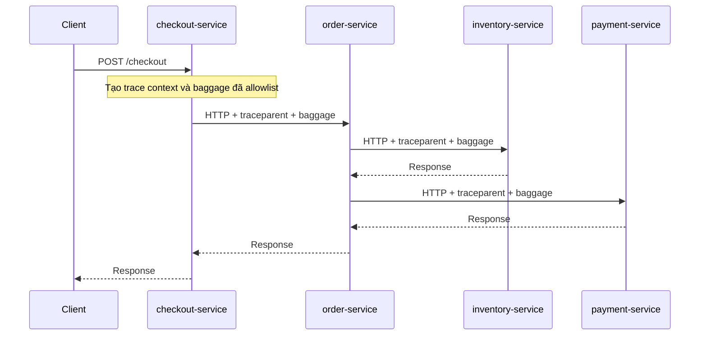

# Baggage trong HTTP header với Spring Boot

**Baggage** là tập các cặp key-value được truyền cùng distributed trace qua ranh giới dịch vụ. Nó cho phép một dịch vụ gửi một lượng metadata nhỏ, đã được lựa chọn, để các dịch vụ downstream có thể dùng cho định tuyến logic, phân loại xử lý hoặc hỗ trợ điều tra. Trong HTTP, W3C Baggage được biểu diễn bằng header **baggage**; header này đi cùng nhưng có ý nghĩa khác với **traceparent** và **tracestate**.

Trong module **SPRING_BOOT_OBSERVABILITY**, baggage là một phần của hệ thống correlation giữa metrics, logs và distributed tracing. Spring Boot với Micrometer Tracing có thể cấu hình những trường baggage được propagate qua HTTP và những trường được đưa vào logging correlation. Bài này tập trung vào cú pháp HTTP header, cách cấu hình propagation, lựa chọn dữ liệu, giới hạn kích thước/cardinality và các rủi ro bảo mật khi metadata đi qua nhiều service.

## 1. Baggage giải quyết vấn đề gì?

Giả sử một request bắt đầu ở checkout-service, sau đó đi qua order-service, inventory-service và payment-service. Các dịch vụ cần biết một số metadata chung để phân loại luồng xử lý, ví dụ:

- Kênh tiếp nhận: web hoặc mobile.
- Nhóm thử nghiệm: checkout-v2.
- Khu vực logic: apac hoặc eu.
- Mã chiến dịch nội bộ đã được phê duyệt, nếu thực sự cần cho chẩn đoán.

Nếu mỗi service tự đọc header nghiệp vụ, tự đổi tên field và tự chuyển tiếp, metadata có thể bị mất hoặc không nhất quán. Baggage cung cấp một cơ chế chuẩn hóa để các key-value đã được cho phép đi theo trace context.



Mỗi service có thể đọc những baggage fields được cấu hình và tiếp tục propagate chúng khi gọi downstream bằng HTTP client đã instrument. Baggage không thay thế request body, authorization, transaction context hoặc dữ liệu nghiệp vụ cần lưu bền vững.

Baggage hữu ích khi cần truyền metadata nhỏ xuyên dịch vụ, hỗ trợ phân loại logs và điều tra cùng một luồng xử lý. Không dùng nó để truyền payload lớn, credentials, dữ liệu cá nhân, trạng thái giao dịch có tính bền vững hoặc IDs duy nhất thành metric labels.

## 2. Phân biệt traceparent, tracestate và baggage

Ba header thường xuất hiện cùng nhau nhưng có mục đích khác nhau.

| HTTP header | Vai trò | Nội dung điển hình |
| --- | --- | --- |
| **traceparent** | Truyền danh tính và quan hệ của trace/span hiện hành | Version, Trace ID, Parent Span ID, trace flags |
| **tracestate** | Mang state dành cho vendor hoặc tracing system tham gia trace | Các member theo quy ước W3C/vendor |
| **baggage** | Mang metadata key-value của ứng dụng xuyên dịch vụ | channel=web, tenant-tier=standard |

Ví dụ request:

```http
POST /orders HTTP/1.1
Host: order-service
traceparent: 00-4bf92f3577b34da6a3ce929d0e0e4736-00f067aa0ba902b7-01
tracestate: vendorA=opaque-state
baggage: channel=web,tenant-tier=standard
Content-Type: application/json

{"items":[{"sku":"A-100","quantity":1}]}
```

Ở đây, traceparent giúp bên nhận nối span mới vào trace nếu context hợp lệ và được chấp nhận. Tracestate không phải nơi đặt field nghiệp vụ tùy ý; baggage chứa các cặp key-value được truyền theo chính sách ứng dụng.

**Baggage không xác định parent span.** Nếu bỏ traceparent nhưng vẫn gửi baggage, dịch vụ nhận có thể thấy baggage mà không có quan hệ trace parent như mong muốn. Ngược lại, trace vẫn có thể được nối dù không có baggage.

## 3. Cú pháp W3C Baggage trong HTTP

W3C Baggage định nghĩa header có tên baggage, mang một hoặc nhiều member được ngăn cách bằng dấu phẩy. Member có dạng khái quát:

```text
key=value
key=value;property=value
```

Ví dụ:

```http
baggage: channel=web,tenant-tier=standard,region=apac
```

Một member có thể có properties theo cú pháp đặc tả, ví dụ:

```http
baggage: channel=web;source=checkout,tenant-tier=standard
```

Các lưu ý:

- Key/value tuân theo quy tắc token và percent-encoding của W3C Baggage; không tự nối chuỗi tùy ý nếu value có ký tự đặc biệt.
- Dấu phẩy phân tách members; dấu chấm phẩy phân tách properties của member.
- Header có thể được biểu diễn qua nhiều dòng header theo quy tắc HTTP; intermediary/client phải xử lý việc kết hợp hợp lệ.
- Không tự viết parser bằng cách split dấu phẩy đơn giản nếu cần tuân thủ đầy đủ escaping, encoding và properties.
- Cần xem xét duplicate keys và hành vi xử lý theo thư viện/implementation; tránh tạo contract phụ thuộc vào thứ tự hoặc key trùng.

Một số ký tự trong value cần percent-encode theo quy tắc baggage. Ví dụ:

```text
baggage: campaign=summer%20sale,channel=web
```

Đây là minh họa biểu diễn. Hãy để thư viện tracing/baggage chuẩn xử lý mã hóa thay vì tự ghép header bằng chuỗi.

Baggage không phải arbitrary HTTP header forwarding. Không sao chép toàn bộ request headers vào baggage. Những header như Authorization, Cookie, Set-Cookie hoặc headers chứa thông tin cá nhân có mục đích và độ nhạy cảm riêng. Baggage là danh sách metadata được chọn, không phải túi chứa mọi header đầu vào.

## 4. Spring Boot và Micrometer Tracing propagate baggage ra sao?

Spring Boot có thể tự cấu hình tracing khi các dependency phù hợp có mặt. Micrometer Tracing cung cấp abstraction cho tracer; bridge tương ứng kết nối với tracing implementation, chẳng hạn OpenTelemetry. HTTP client/server instrumentation xử lý inject/extract trace context và baggage theo propagator được cấu hình.

Với Spring Boot 3.x, những cấu hình thường gặp gồm:

- **management.tracing.baggage.remote-fields**: các baggage fields được propagate qua mạng.
- **management.tracing.baggage.correlation.fields**: các baggage fields được đưa vào logging correlation, thường thông qua MDC integration.
- **management.tracing.baggage.local-fields**: các field baggage chỉ được quản lý cục bộ, không tự propagate qua network.

Tên property và behavior cụ thể cần đối chiếu đúng phiên bản Spring Boot/Micrometer đang dùng. Không mặc định mọi version 3.x có cùng mọi tính năng hoặc cùng behavior.

### 4.1. Ví dụ application.yml

```yaml
spring:
  application:
    name: checkout-service

management:
  tracing:
    sampling:
      probability: 1.0
    baggage:
      remote-fields:
        - channel
        - tenant-tier
      correlation:
        fields:
          - channel
          - tenant-tier
      local-fields:
        - internal-debug-mode
```

Ý nghĩa:

| Cấu hình | Mục đích |
| --- | --- |
| remote-fields | Cho phép các baggage fields được propagate qua ranh giới mạng theo tracing integration |
| correlation.fields | Cho phép các field được đưa vào log correlation nếu logging integration hỗ trợ |
| local-fields | Quản lý field trong context cục bộ, không chủ động gửi nó ra service khác |
| sampling.probability | Cấu hình tracing sampling; không phải chính sách chọn baggage |

Sampling 1.0 chỉ nên dùng trong lab hoặc thời gian kiểm thử có kiểm soát. Trong production cần cân nhắc traffic và chi phí traces. Baggage propagation và trace sampling là hai cơ chế riêng: baggage có thể tồn tại ở request được xử lý mà trace không được lấy mẫu để xuất.

### 4.2. Remote fields phải là allowlist

Đừng thêm một field vào remote-fields chỉ vì nó có trong request. Hãy xác định service downstream nào thực sự cần field, giá trị hợp lệ là gì, field có nhạy cảm hay không, giới hạn độ dài và số lượng members, và cách xử lý khi field không có hoặc sai định dạng.

Ví dụ channel=web/mobile/other có tập giá trị nhỏ và mục đích rõ ràng. customer-email, access-token hoặc raw URL không phải baggage fields phù hợp trong một hệ thống thông thường.

## 5. Bật tracing dependencies và HTTP instrumentation

Ví dụ dependencies Maven với Spring Boot 3.x:

```xml
<dependencies>
    <dependency>
        <groupId>org.springframework.boot</groupId>
        <artifactId>spring-boot-starter-actuator</artifactId>
    </dependency>
    <dependency>
        <groupId>io.micrometer</groupId>
        <artifactId>micrometer-tracing-bridge-otel</artifactId>
    </dependency>
    <dependency>
        <groupId>io.opentelemetry</groupId>
        <artifactId>opentelemetry-exporter-otlp</artifactId>
    </dependency>
</dependencies>
```

Spring Boot BOM/parent nên quản lý các version tương thích. Nếu ứng dụng chỉ cài metrics registry mà không có tracing bridge/exporter, đừng kỳ vọng baggage tự được inject/extract theo tracing context.

Đối với HTTP client, dùng builder do Spring Boot quản lý để các customizers/observation instrumentation có thể được áp dụng. Ví dụ Spring Boot 3.2+ với Spring Framework 6.1+:

```java
import org.springframework.context.annotation.Bean;
import org.springframework.context.annotation.Configuration;
import org.springframework.web.client.RestClient;

@Configuration
public class HttpClientConfiguration {

    @Bean
    RestClient inventoryClient(RestClient.Builder builder) {
        return builder
                .baseUrl("http://inventory-service:8081")
                .build();
    }
}
```

Khi tracing instrumentation và propagation đã được cấu hình, lời gọi qua client instrumented có thể inject traceparent và baggage đã được cho phép. Nếu tự tạo HTTP client thô ngoài cơ chế auto-configuration, baggage/tracing context có thể không được inject như dự kiến.

## 6. Tạo và đọc baggage trong ứng dụng

Có hai việc riêng:

- **Đọc context đã được extract:** service nhận HTTP request có thể sử dụng baggage đã được propagator đưa vào context hiện hành.
- **Tạo/cập nhật baggage:** service có thể đặt field theo API của tracing implementation hoặc Micrometer Tracing abstraction đang dùng, rồi field được propagate tới downstream nếu cấu hình cho phép.

Tránh tự viết code thao tác chuỗi header baggage trực tiếp trong controller. Thay vào đó, dùng API tracing/baggage và các scope để bảo đảm giá trị chỉ tồn tại trong khoảng cần thiết.

Ví dụ với Micrometer Tracing API:

```java
import io.micrometer.tracing.BaggageInScope;
import io.micrometer.tracing.Tracer;
import org.springframework.stereotype.Component;

@Component
public class CheckoutBaggage {

    private final Tracer tracer;

    public CheckoutBaggage(Tracer tracer) {
        this.tracer = tracer;
    }

    public void process(String channel, Runnable action) {
        String normalized = normalizeChannel(channel);

        try (BaggageInScope baggage =
                     tracer.createBaggageInScope("channel", normalized)) {
            action.run();
        }
    }

    private String normalizeChannel(String value) {
        if ("mobile".equalsIgnoreCase(value)) {
            return "mobile";
        }
        if ("web".equalsIgnoreCase(value)) {
            return "web";
        }
        return "other";
    }
}
```

Ví dụ minh họa dùng API Micrometer Tracing có BaggageInScope. Cần xác minh interface/API đúng theo version bridge đang dùng. createBaggageInScope gắn field vào phạm vi hiện hành; khi scope đóng, context trước đó được khôi phục. Để gửi field qua HTTP, vẫn cần remote propagation configuration và một client được instrument.

### 6.1. Baggage scope không phải lưu trữ lâu dài

Một baggage field có scope gắn với trace/context hiện hành. Nó không phải nơi lưu trạng thái đơn hàng hoặc tenant profile. Nếu công việc được đưa vào queue để xử lý sau hàng giờ, cần xác định cách serialize/propagate context qua message broker theo hợp đồng riêng; không giữ một scope của request HTTP mở vô thời hạn.

### 6.2. Chuẩn hóa trước khi ghi

Không truyền nguyên chuỗi do client cung cấp. Chuẩn hóa theo allowlist:

```java
String channel = switch (rawChannel.toLowerCase(Locale.ROOT)) {
    case "web" -> "web";
    case "mobile" -> "mobile";
    default -> "other";
};
```

Đoạn code trên chỉ minh họa nhóm giá trị. Trong ứng dụng, cần xử lý null, whitespace và quy tắc nghiệp vụ phù hợp. Chuẩn hóa metadata không được thay đổi quyết định nghiệp vụ hoặc che giấu input không hợp lệ.

## 7. Baggage và log correlation

Baggage có thể hữu ích cho logs khi các field được chọn vào correlation fields. Điều này cho phép log của nhiều service cùng chứa metadata chung như channel hoặc tenant tier, bên cạnh Trace ID/Span ID do tracing integration cung cấp.

Ví dụ cấu hình:

```yaml
management:
  tracing:
    baggage:
      remote-fields:
        - channel
      correlation:
        fields:
          - channel
```

Khi logging correlation được cấu hình và context hiện hành được duy trì, log có thể trông như sau:

```text
INFO  [checkout-service,4bf92f3577b34da6a3ce929d0e0e4736,00f067aa0ba902b7] channel=web Starting checkout
INFO  [order-service,4bf92f3577b34da6a3ce929d0e0e4736,19ac2efb45102d3a] channel=web Reserving order
INFO  [inventory-service,4bf92f3577b34da6a3ce929d0e0e4736,6ac51d4ae77e9102] channel=web Stock reserved
```

Đây là log minh họa, không phải pattern mặc định bắt buộc. Format thực tế phụ thuộc logging configuration, MDC integration và layout của ứng dụng.

### Baggage correlation khác Trace ID

- Trace ID trả lời: những spans này thuộc cùng một trace nào?
- Span ID trả lời: đây là span cụ thể nào?
- Baggage field như channel=web trả lời: luồng xử lý này có metadata nào được truyền kèm?
- Log correlation đưa các giá trị phù hợp vào log để lọc/tìm kiếm.

Baggage không thay thế Trace ID/Span ID. Hai request cùng channel=web không thuộc cùng trace. Không dùng baggage value thay cho correlation identifier duy nhất.

### Không gắn baggage vào metric labels tùy tiện

Một số baggage fields có số giá trị thấp có thể được dùng làm metric tags nếu được thiết kế rõ ràng. Nhưng không tự động chuyển mọi baggage sang metrics. Nếu một field như order-id hoặc customer-id được dùng làm label, cardinality có thể tăng theo số request/khách hàng. Giữ metrics cho nhóm tổng hợp, dùng logs/traces cho điều tra từng request.

## 8. Baggage, trace context và context qua executor

Baggage thường được gắn với tracing context hiện hành. Khi công việc chuyển sang executor, context có thể bị mất nếu ThreadLocal/tracing scope không được propagate.

Ví dụ một HTTP request đặt channel=web, rồi submit tác vụ:

```java
executor.execute(() -> processOrder());
```

Nếu executor không truyền context, worker có thể không nhìn thấy baggage. Trong Spring Framework 6.1+ với Micrometer Context Propagation, có thể cấu hình ContextPropagatingTaskDecorator trên ThreadPoolTaskExecutor để capture/restore context có accessor đã đăng ký.

```java
import org.springframework.context.annotation.Bean;
import org.springframework.context.annotation.Configuration;
import org.springframework.core.task.support.ContextPropagatingTaskDecorator;
import org.springframework.scheduling.concurrent.ThreadPoolTaskExecutor;

import java.util.concurrent.Executor;

@Configuration
public class AsyncConfiguration {

    @Bean("applicationTaskExecutor")
    Executor applicationTaskExecutor() {
        ThreadPoolTaskExecutor executor = new ThreadPoolTaskExecutor();
        executor.setCorePoolSize(8);
        executor.setMaxPoolSize(16);
        executor.setQueueCapacity(200);
        executor.setThreadNamePrefix("app-worker-");
        executor.setTaskDecorator(new ContextPropagatingTaskDecorator());
        executor.initialize();
        return executor;
    }
}
```

Propagation phụ thuộc accessor đã đăng ký cho context cần chuyển. Có decorator không có nghĩa mọi ThreadLocal hoặc baggage tùy biến đều tự động được biết đến. Kiểm tra đúng integration và version.

Worker thread phải khôi phục context trước đó. Executor tái sử dụng worker threads; decorator cần restore context khi task kết thúc hoặc ném exception. Nếu không, baggage của request A có thể rò sang task B trên cùng worker.

Không giữ một BaggageInScope mở trong thread submit rồi đóng scope từ thread khác. Dùng snapshot/context propagation hoặc tạo scope mới trong worker theo API phù hợp; scope phải được mở và đóng đúng thread/lifecycle.

Nếu task chạy lâu sau khi request hoàn tất, baggage của request ban đầu có thể không còn hợp lệ. Với job nền kéo dài, cân nhắc truyền metadata cần thiết thành input bất biến đã được allowlist, và thiết kế trace link/new root span thay vì cố kéo dài toàn bộ request context.

## 9. Baggage và context propagation qua HTTP

Một HTTP client/server instrumented có thể tự inject/extract W3C Baggage. Luồng cơ bản:

1. Service đầu tiên nhận request.
2. Tracing instrumentation trích traceparent và baggage theo propagator.
3. Ứng dụng kiểm tra/chuẩn hóa field theo contract.
4. Baggage được gắn trong context scope hiện hành.
5. HTTP client instrumented inject các fields được phép vào request downstream.
6. Service kế tiếp extract headers và dùng baggage theo cùng chính sách.

Header ví dụ:

```http
traceparent: 00-4bf92f3577b34da6a3ce929d0e0e4736-00f067aa0ba902b7-01
baggage: channel=web,tenant-tier=standard
```

Không tự gán cùng một Trace ID cho mọi request trong một tenant chỉ vì baggage có tenant-tier=standard. Trace context được quản lý độc lập.

### 9.1. Baggage từ client bên ngoài là input không đáng tin

Một client có thể gửi:

```http
baggage: channel=web,tenant-tier=admin,debug=true
```

Không được mặc nhiên tin các values này. Nếu tenant-tier ảnh hưởng quyền hạn hoặc debug=true kích hoạt behavior nhạy cảm, request có thể bị giả mạo metadata.

**Baggage không phải cơ chế authorization.** Phải lấy quyền và danh tính từ hệ thống xác thực/ủy quyền đáng tin cậy. Nếu cho phép client gửi một số baggage keys, hãy validate values, loại bỏ keys ngoài allowlist và không để chúng quyết định đặc quyền.

### 9.2. Gateway và trust boundary

Ở ranh giới Internet hoặc giữa các miền tin cậy, có thể cần loại bỏ hoặc ghi đè baggage từ nguồn không đáng tin trước khi propagate nội bộ. Một gateway có thể drop những keys không được chấp nhận, normalize values theo allowlist, chỉ giữ fields downstream cần, giới hạn số members và tổng kích thước, và không chuyển dữ liệu nhạy cảm qua boundary.

Chính sách cần áp dụng thống nhất; nếu chỉ một service lọc còn service khác tin trực tiếp, baggage vẫn có thể bị lạm dụng.

## 10. Giới hạn kích thước và cardinality của baggage

Baggage được truyền qua HTTP headers, nên kích thước lớn có thể bị proxy, server hoặc client từ chối. Các hệ thống có thể đặt giới hạn khác nhau cho tổng header size, số members, độ dài key/value và encoding.

Không giả định mọi dịch vụ đều chấp nhận một baggage header có kích thước không giới hạn. Hãy xác định một budget nhỏ cho toàn hệ thống, thử qua các gateway/proxy và theo dõi header rejection.

| Hạng mục | Quy tắc nên áp dụng |
| --- | --- |
| Số baggage members | Chỉ vài field có nhu cầu rõ ràng |
| Key | Tên ngắn, ổn định, theo contract |
| Value | Độ dài giới hạn và tập giá trị được phê duyệt |
| Tổng header size | Nhỏ hơn giới hạn thấp nhất trong toàn tuyến |
| Properties | Chỉ sử dụng khi có nhu cầu tương thích rõ |
| Unknown keys | Loại bỏ tại trust boundary hoặc không sử dụng |
| Duplicate keys | Tránh tạo; quy định xử lý thống nhất |

Các giới hạn cụ thể phụ thuộc thư viện, SDK, proxy và backend; hãy đo ở hệ thống thật, không coi một con số cấu hình của một thành phần là giới hạn chung của toàn mạng.

### 10.1. Cardinality của baggage không giống metric cardinality, nhưng vẫn có chi phí

Baggage value không tự trở thành metric label. Tuy nhiên, nếu ứng dụng chuyển baggage thành span attributes hoặc log fields, các giá trị đa dạng có thể làm tăng index, storage và chi phí tìm kiếm.

- channel=web/mobile có vài giá trị và thường dễ tổng hợp.
- order-id thay đổi theo mỗi đơn hàng.
- request-id gần như duy nhất từng request.
- email vừa đa dạng vừa có thể là PII.

Không đưa các giá trị duy nhất vào baggage trừ khi có yêu cầu correlation rõ ràng, đã được duyệt về quyền riêng tư và có giới hạn lưu trữ. Trace ID đã có cơ chế riêng để nhận diện trace.

## 11. Baggage và sampling

Baggage propagation và tracing sampling có liên quan nhưng độc lập.

- **Propagation** quyết định metadata đi qua các ranh giới nào.
- **Sampling** quyết định trace/span nào được ghi nhận/xuất theo chính sách.
- **Baggage** mang key-value metadata.
- **Trace context** xác định danh tính và quan hệ spans.

Nếu trace không được lấy mẫu ở đầu, baggage vẫn có thể được xử lý trong request context tùy instrumentation/propagator, nhưng sẽ không có trace đầy đủ trong backend. Ngược lại, một trace được lấy mẫu vẫn có thể không có baggage field nếu field không được cấu hình hoặc bị lọc ở gateway.

Ví dụ Spring Boot 3.x trong lab:

```yaml
management:
  tracing:
    sampling:
      probability: 1.0
    baggage:
      remote-fields:
        - channel
```

Cấu hình này minh họa việc bật sampling cao và remote baggage field trong môi trường kiểm thử. Sampling 1.0 không phải yêu cầu để baggage hoạt động; nó chỉ giúp dễ quan sát trace được xuất trong lab.

Trong production, cân nhắc sampling và chi phí tracing độc lập. Đừng đặt một baggage value như debug=true để ép mọi request vào sampling 100% nếu không có chính sách rõ ràng và bảo vệ trust boundary.

## 12. Bảo mật và quyền riêng tư

Baggage có thể được chuyển qua nhiều dịch vụ, gateway, collector và tracing backend. Mỗi dịch vụ có thể log hoặc lưu baggage nếu instrumentation/correlation được cấu hình. Vì thế, một field tưởng như “chỉ là metadata nội bộ” có thể lan rộng hơn dự kiến.

Không đưa vào baggage:

- Password, API key, secret, access/refresh token.
- Cookie hoặc Authorization header.
- Số thẻ, dữ liệu thanh toán hoặc thông tin xác thực.
- Email, số điện thoại, địa chỉ hoặc định danh cá nhân khi chưa có cơ sở và phê duyệt.
- Nội dung request/response, SQL parameters hoặc payload.
- Security principal/role có thể bị giả mạo từ client.

Nguyên tắc bảo vệ:

1. Allowlist fields: chỉ truyền những key đã được phê duyệt.
2. Validate values: kiểm tra dạng, độ dài và tập giá trị.
3. Trust boundary: lọc hoặc ghi đè dữ liệu không tin cậy khi vào hệ thống.
4. Data minimization: tránh truyền field mà downstream không dùng.
5. Access control: hạn chế ai xem trace/log backend.
6. Retention: đặt thời gian lưu tương xứng với mục đích.
7. TLS: bảo vệ đường truyền, nhưng mã hóa không biến dữ liệu nhạy cảm thành dữ liệu được phép ghi.
8. Redaction: lọc attributes/log fields ở nguồn và các pipeline phù hợp.

Không dùng baggage làm nguồn quyết định tenantId có quyền truy cập tài nguyên hay không. Quyền phải được kiểm tra dựa trên danh tính đã xác thực và authorization policy của hệ thống.

## 13. Troubleshooting baggage trong HTTP

| Triệu chứng | Nguyên nhân có thể | Cách kiểm tra |
| --- | --- | --- |
| Service nhận có trace nhưng không có baggage | Chưa khai báo remote field, propagator không hỗ trợ hoặc header bị lọc | Kiểm tra config, header ở boundary và dependency/version |
| Baggage có ở service A nhưng mất ở B | HTTP client không instrumented, gateway bỏ header, field không nằm allowlist | Dùng client builder do Boot quản lý, kiểm tra từng hop |
| Baggage có trong header nhưng không có MDC | Chưa khai báo correlation field hoặc logging integration chưa cấu hình | Kiểm tra correlation.fields, MDC và log pattern |
| Log của worker không có baggage | Context không qua executor | TaskDecorator, accessor và snapshot |
| Giá trị baggage bị thay đổi | Service normalize hoặc ghi lại value | Kiểm tra contract và ownership của field |
| Baggage từ client kích hoạt behavior đặc quyền | Tin input không đáng tin | Bỏ field/validate; authorization không dựa vào baggage |
| HTTP 431 hoặc request bị từ chối | Header vượt giới hạn ở proxy/server | Giảm số fields/độ dài, kiểm tra giới hạn từng hop |
| Backend index tăng nhanh | Baggage được copy vào attributes/logs với nhiều giá trị | Giảm dynamic fields và giới hạn indexing |
| Trace có nhưng không có baggage field | Sampling không bảo đảm mọi baggage được export | Kiểm tra remote fields và span attributes riêng |
| Baggage có nhưng trace bị tách | Trace context propagation lỗi | Kiểm tra traceparent, parent span và instrumented clients |
| Field trùng hoặc parse không nhất quán | Duplicate members/khác implementation | Chuẩn hóa header tại boundary, tránh duplicate keys |
| Baggage rò từ request trước | Scope/ThreadLocal không được restore | Kiểm tra cleanup, worker reuse và context decorator |

### Quy trình debug theo từng hop

1. Gửi một request lab có traceparent hợp lệ và một baggage field đã allowlist.
2. Quan sát request đến service đầu tiên; xác nhận field đã extract vào context theo API phù hợp.
3. Gọi downstream qua HTTP client instrumented.
4. Kiểm tra outgoing header ở môi trường test/log network an toàn.
5. Xác nhận service downstream extract được field.
6. Kiểm tra baggage field có xuất hiện trong correlation/logs nếu cấu hình có yêu cầu.
7. Kiểm tra trace backend: cùng Trace ID và span quan hệ phù hợp.
8. Tắt field trong remote-fields để xác minh nó không còn được propagate.
9. Thử value dài/không hợp lệ trong lab để kiểm tra validation và giới hạn.
10. Đảm bảo test không in token, cookie hoặc dữ liệu nhạy cảm.

Không log toàn bộ headers ở production để debug. Header có thể chứa credential và thông tin cá nhân.

## 14. Bài thực hành: truyền channel qua nhiều HTTP services

Mục tiêu là truyền một field baggage channel có tập giá trị nhỏ từ checkout-service tới order-service và inventory-service, rồi xác minh log correlation và trace context.

### Chuẩn bị

- Spring Boot 3.x với Actuator.
- Micrometer Tracing bridge, ví dụ OpenTelemetry.
- OTLP traces exporter và trace backend/Collector lab.
- HTTP client được Spring Boot quản lý.
- Hai service lab hoặc mock downstream.
- Không dùng customer PII hay credentials làm baggage.

### Bước 1 — Khai báo chính sách field

Ở những service cần propagate, cấu hình:

```yaml
management:
  tracing:
    baggage:
      remote-fields:
        - channel
      correlation:
        fields:
          - channel
```

Chỉ dùng field channel trong bài lab; không thêm các header khác một cách tự động.

### Bước 2 — Tạo baggage trong scope

Dùng Tracer và BaggageInScope như ví dụ phần 6, chuẩn hóa value thành web, mobile hoặc other. Bảo đảm scope đóng trong try-with-resources.

### Bước 3 — Tạo HTTP client instrumented

Inject RestClient.Builder do Spring Boot quản lý và tạo client downstream. Không tự ghép baggage header bằng chuỗi trong business method.

### Bước 4 — Gửi request qua hai service

Gọi checkout-service, sau đó để order-service gọi inventory-service. Xác nhận mỗi boundary nhận và chuyển channel đúng theo allowlist. Dùng network inspection trong lab nếu cần.

### Bước 5 — Xác minh trace context

Trong backend, xác nhận các spans thuộc cùng Trace ID nếu propagation hoạt động; parent span IDs phản ánh các lời gọi tương ứng. Kiểm tra riêng baggage field: nó không xác định parent-child relation.

### Bước 6 — Kiểm tra log correlation

Khi channel được cấu hình làm correlation field và MDC integration hoạt động, kiểm tra log của từng service có giá trị phù hợp. Nếu worker thread tham gia, kiểm tra context propagation qua executor.

### Bước 7 — Thử trust boundary

Gửi baggage từ client với key không được allowlist hoặc value không hợp lệ. Xác nhận gateway/service xử lý theo chính sách, không sử dụng field đó để cấp quyền hoặc thay đổi tenant identity.

### Bước 8 — Thử giới hạn

Tạo baggage với nhiều members hoặc value dài trong môi trường test. Ghi nhận tầng nào từ chối hoặc loại bỏ request. Đặt một budget thấp, nhất quán với proxy và service trong tuyến.

### Bước 9 — Thử sampling riêng

Giảm tracing sampling trong lab. Quan sát rằng số traces backend thấy giảm, nhưng việc validate/propagate baggage không nhất thiết giảm cùng tỷ lệ. So sánh với logs và metrics để hiểu các pipeline riêng biệt.

### Checklist nghiệm thu

| Điều cần chứng minh | Tiêu chí đạt |
| --- | --- |
| Phân biệt headers | Nêu đúng vai trò traceparent, tracestate, baggage |
| HTTP format | Đọc được key-value members và hiểu encoding/properties |
| Allowlist | Chỉ remote fields đã phê duyệt được propagate |
| Instrumentation | HTTP client inject/extract qua tracing integration |
| Scope | Baggage được đặt và đóng đúng vòng đời |
| Correlation | Field được chọn xuất hiện trong logs khi cấu hình hỗ trợ |
| Trace topology | Cùng Trace ID/parent relation được kiểm tra độc lập với baggage |
| Trust boundary | Input không tin cậy được validate hoặc loại bỏ |
| Security | Không có secret/PII trong baggage |
| Limits | Số member và kích thước header nằm trong budget |
| Context qua executor | Worker không làm mất hoặc rò baggage |
| Sampling | Hiểu sampling của traces không đồng nghĩa với propagation |

## 15. Những nguyên tắc cần nhớ

1. **Baggage là metadata key-value được truyền cùng context**, không phải nội dung trace, authorization token hoặc kho lưu trữ nghiệp vụ.
2. **traceparent, tracestate và baggage có mục đích khác nhau.** Traceparent nối spans; tracestate dành cho vendor state; baggage mang metadata được chọn.
3. **Dùng allowlist remote fields.** Chỉ truyền field downstream thật sự cần, có contract và giá trị hợp lệ.
4. **Dùng API tracing/baggage thay vì tự ghép header.** Scope phải đóng đúng để context không rò sang request khác.
5. **Dùng HTTP clients đã được instrument.** Nếu client bỏ qua tracing integration, trace/baggage headers có thể không được inject.
6. **Không tin baggage từ client ngoài.** Validate tại trust boundary; quyền truy cập phải dựa trên authentication/authorization thực.
7. **Giữ payload nhỏ và cardinality có kiểm soát.** Tránh ID động, raw URL, PII và secrets.
8. **Correlation fields là lựa chọn riêng.** Chỉ đưa các field cần thiết vào MDC/logs, không sao chép mọi baggage.
9. **Context qua executor cần capture/restore/cleanup.** Không để baggage của task trước lọt sang worker task kế tiếp.
10. **Propagation, sampling và metrics export là các cơ chế độc lập.** Baggage có thể được truyền mà trace không được lưu; metrics vẫn có thể ghi nhận request.
11. **Kết hợp ba tín hiệu đúng mục đích.** Metrics xác định xu hướng, traces mô tả hành trình, logs giải thích sự kiện; baggage chỉ bổ sung metadata chung có kiểm soát.

Baggage trong HTTP header giúp metadata đã được cho phép đi cùng distributed trace qua các dịch vụ Spring Boot. Khi field được allowlist, chuẩn hóa, giới hạn và khôi phục đúng scope, nó hỗ trợ log correlation và phân tích luồng xử lý. Việc tách bạch baggage với trace identifiers, authorization và metric labels giúp hệ thống observability giữ được tính liên kết mà vẫn kiểm soát cardinality, chi phí và quyền riêng tư.
