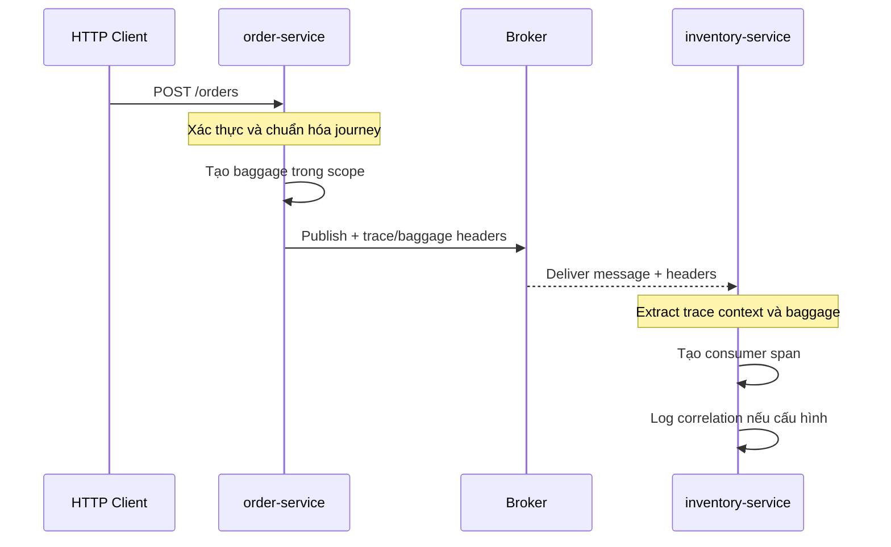

# Baggage khác trace tag như thế nào?

Một request đi qua `order-service`, `payment-service` và `inventory-service`. Nhóm vận hành muốn biết request thuộc luồng nào, chẳng hạn `journey=partner-checkout`, để các service có thể sử dụng cùng thông tin khi xử lý và ghi log. Một kỹ sư thêm `channel=partner` vào span, nhưng service tiếp theo không thấy giá trị này. Một người khác đưa `traceId` vào metric tag để tìm request cụ thể, khiến số time series tăng mạnh. Hai tình huống này bắt nguồn từ việc nhầm **baggage**, **span tag/attribute** và **metric tag**.

**Baggage** là metadata được truyền cùng trace context qua các boundary khi propagation được cấu hình. **Span tag/attribute** mô tả một span cụ thể trong trace. **Metric tag** phân loại measurements thành những nhóm time series. Chúng có thể mang cùng một giá trị nghiệp vụ, nhưng có mục tiêu, vòng đời, chi phí và phạm vi truyền khác nhau.

Bài **Baggage khác trace tag như thế nào** thuộc chương **Baggage và correlation** của module **SPRING_BOOT_OBSERVABILITY**. Module tập trung thiết lập observability cho Spring Boot bằng Micrometer Observation, metrics, logs và distributed tracing; học propagation ngữ cảnh, tag/cardinality, exporter, sampling và liên kết tín hiệu để điều tra lỗi, độ trễ, hành vi ứng dụng trên môi trường thực.

## 1. Mục tiêu học tập

Sau bài học, bạn có thể:

- Phân biệt baggage, span tag/attribute, metric tag và logging MDC.
- Giải thích vì sao gắn tag vào span không có nghĩa giá trị đó tự được truyền sang service kế tiếp.
- Mô tả baggage được inject vào và extract từ trace propagation headers như thế nào.
- Cấu hình baggage remote fields, local fields và correlation fields trong Spring Boot.
- Sử dụng baggage trong scope có giới hạn và hiểu vòng đời của giá trị hiện hành.
- Quyết định metadata nào nên propagate, ghi lên span, ghi vào log hoặc dùng làm metric tag.
- Đánh giá rủi ro trust boundary, kích thước header, privacy, cardinality và chi phí.
- Điều tra trường hợp baggage không đến downstream, MDC bị stale hoặc span có attribute nhưng service khác không nhìn thấy.

## 2. So sánh bốn khái niệm

| Khái niệm | Mục đích | Phạm vi | Có tự truyền qua service không? |
| --- | --- | --- | --- |
| **Baggage** | Mang metadata được cho phép đi cùng trace context | Các service tham gia propagation, tùy cấu hình | Có, nếu field được cấu hình remote và propagator inject/extract đúng |
| **Span tag/attribute** | Mô tả một span: bước nào, kết quả gì, dependency nào | Span cụ thể | Không mặc định; span khác phải tạo tag riêng hoặc lấy dữ liệu từ baggage/context |
| **Metric tag/label** | Chia measurements thành các nhóm time series | Meter/time series | Không; registry/exporter chỉ xuất tag của meter |
| **Logging MDC/correlation field** | Gắn dữ liệu tương quan vào log record hiện hành | Scope logging/thread hoặc execution context | Không tự qua network; có thể được copy từ baggage khi cấu hình |

### Một giá trị đi qua nhiều lớp

Giả sử request đầu vào đã được xác thực và ứng dụng cho phép propagate thuộc tính `journey=partner-checkout`:

- **Baggage:** giá trị này đi cùng trace context từ order-service sang payment-service nếu remote propagation được cấu hình.
- **Span attribute:** span payment.authorize có thể ghi `journey=partner-checkout` để backend tracing lọc span.
- **Metric tag:** timer payment.authorize.duration có thể có `channel=partner` nếu tập giá trị được giới hạn và câu hỏi vận hành cần phân nhóm latency theo channel.
- **MDC/log:** log trong scope có thể chứa journey hoặc correlation field đã cấu hình, giúp tìm các bản ghi liên quan.

Không có quy tắc tự động rằng **baggage luôn thành span attribute, span attribute luôn thành baggage, hoặc baggage luôn thành metric tag**. Muốn một giá trị xuất hiện ở nhiều tín hiệu, phải chủ động cấu hình/copy vào từng lớp theo chính sách.

## 3. Baggage là gì?

Trong distributed tracing, **baggage** là tập các cặp key/value gắn với trace hoặc execution context. Propagator có thể serialize các field được phép thành propagation metadata, gửi cùng request/message, rồi extract chúng ở service nhận.

Baggage hữu ích khi nhiều service cần cùng metadata nhỏ để chọn một nhánh xử lý đã phân loại, bổ sung context cho log/span hoặc hỗ trợ correlation theo một mã nhóm đã chuẩn hóa. Baggage **không phải** nơi chuyển business object, lưu request body, chứa authorization token hoặc làm kho dữ liệu người dùng. Mỗi field cần có chủ sở hữu, nguồn đáng tin cậy, tập giá trị/độ dài cho phép và thời hạn sử dụng.

### Baggage không phải span

Span có lifecycle: bắt đầu, hoạt động, kết thúc. Baggage là metadata của context có thể hiện diện qua nhiều spans/service trong thời gian context được giữ. Một baggage field có thể được nhiều spans đọc và từng span có thể chọn ghi nó như attribute. Ngược lại, span hiện tại có tag `payment.provider=bank-a` không có nghĩa tag đó tự động xuất hiện trong context của span con hoặc header gửi sang service khác.

### Baggage không phải toàn bộ trace context

Trace context có field phục vụ liên kết như trace ID, span ID và sampling flags. Baggage là phần metadata bổ sung. Việc propagate trace context không tự động có nghĩa mọi biến nghiệp vụ hoặc mọi trường trong MDC cũng được truyền.

## 4. Span tag/attribute là gì?

Span tag (tên gọi thường gặp trong Brave/Zipkin API) hoặc span attribute (thuật ngữ phổ biến trong OpenTelemetry) là cặp key/value mô tả một span cụ thể:

| Span | Attribute/tag minh họa |
| --- | --- |
| HTTP POST /orders | http.request.method=POST, http.route=/orders |
| inventory.reserve | operation=reserve, outcome=success |
| payment.authorize | payment.provider=partner-a, outcome=error |

Span attribute có thể hỗ trợ lọc/điều tra trace trong backend. Nó không có cardinality giống metric label: mỗi span là một record riêng. Tuy vậy, không nên thêm mọi dữ liệu vào span vì storage/index/query, giới hạn kích thước và nguy cơ lộ PII/secrets vẫn tồn tại.

### Span tag không tự propagate

Hãy xét producer span order.submit có tag customer-tier=gold, rồi gửi message sang consumer:

1. Producer thêm tag vào span hiện tại.
2. Propagator inject trace context và baggage đã cấu hình vào message headers.
3. Nếu customer-tier chỉ là span tag và không được chuyển thành baggage/message metadata, consumer không tự biết giá trị này.
4. Consumer tạo span mới. Span mới chỉ có customer-tier=gold nếu nó nhận giá trị qua cơ chế hợp lệ rồi chủ động gắn attribute.

Đây là lý do không dùng span attribute như một kênh giao tiếp ngầm giữa service.

## 5. Metric tag/label khác cả baggage lẫn span tag

Metric tag định danh một chiều của meter. Một bộ tag khác nhau có thể tạo một time series khác nhau, ví dụ:

`payment.authorize.duration{channel="partner",outcome="error"}`

Metrics cần tập giá trị **ổn định và có giới hạn** để phép tổng hợp hữu ích và chi phí nằm trong ngân sách. Không đưa traceId, spanId, orderId, email hoặc UUID mỗi request thành metric tag. Baggage có thể có giá trị khác nhau theo trace; điều đó không khiến nó trở thành metric tag an toàn.

| Dữ liệu | Baggage | Span attribute | Metric tag |
| --- | --- | --- | --- |
| channel=web/mobile/partner | Có thể propagate nếu cần | Có thể ghi lên span | Phù hợp nếu tập hữu hạn và có mục tiêu phân tích |
| outcome=success/error | Thường không cần propagate chỉ vì metric | Phù hợp cho span kết quả | Phù hợp nếu taxonomy hữu hạn |
| traceId | Đã thuộc trace context | Có sẵn trong trace context | Không dùng |
| orderId | Không nên mặc định propagate | Chỉ khi thật sự cần và được phép | Không dùng |
| tenantId có hàng nghìn giá trị | Cân nhắc rất kỹ | Chỉ theo policy | Thường không phù hợp |
| region=ap-southeast-1 | Chỉ propagate nếu service cần | Có thể ghi attribute | Có thể là common tag nếu tập region có giới hạn |

Một giá trị có thể xuất hiện ở cả ba lớp khi có lý do, nhưng phải đưa ra ba quyết định độc lập: có cần truyền đi không, có cần lưu trên span không, và có đủ cardinality thấp để phân nhóm metrics không.

## 6. Remote fields, local fields và correlation fields trong Spring Boot

Spring Boot có các thuộc tính cấu hình baggage trong nhóm `management.tracing.baggage`. Tên property và auto-configuration cần đối chiếu phiên bản Spring Boot/Micrometer đang dùng. Ví dụ cấu hình cho Spring Boot 3.x:

```yaml
spring:
  application:
    name: order-service

management:
  tracing:
    sampling:
      probability: 0.1
    baggage:
      remote-fields:
        - journey
        - support-region
      local-fields:
        - internal-processing-mode
      correlation:
        fields:
          - journey
```

Ý nghĩa:

- **Remote fields:** field được cho phép đưa vào propagation context để truyền qua service khi propagator hỗ trợ và cấu hình đúng.
- **Local fields:** field được quản lý trong baggage context ở ứng dụng nhưng không gửi qua remote propagation theo mục đích cấu hình.
- **Correlation fields:** field được dùng để bổ sung correlation vào logging context/MDC theo tích hợp Spring Boot tương ứng.
- **Sampling probability:** điều chỉnh tỷ lệ trace được lấy mẫu theo tracer/policy; không quyết định baggage nào được phép truyền.

Ví dụ chỉ khai báo tên field. Nó **không tự tạo giá trị** journey hay support-region; ứng dụng cần đặt baggage từ nguồn đã xác thực hoặc context được cho phép.

Remote baggage có thể được serialize thành header theo propagator đang dùng. Không mặc định header có tên giống hệt YAML field: format/bridge có thể chuẩn hóa tên và cách encode. Hãy kiểm tra header thực tế trên HTTP hoặc message carrier trong môi trường test.

## 7. Tạo và sử dụng baggage trong code

Micrometer Tracing cung cấp Tracer abstraction. Với một field baggage đã cấu hình và có nguồn giá trị đáng tin cậy, code có thể tạo baggage trong một scope:

```java
import io.micrometer.tracing.BaggageInScope;
import io.micrometer.tracing.Tracer;
import org.springframework.stereotype.Service;

@Service
public class OrderSubmissionService {
    private final Tracer tracer;
    private final PaymentGateway paymentGateway;

    public OrderSubmissionService(Tracer tracer,
                                  PaymentGateway paymentGateway) {
        this.tracer = tracer;
        this.paymentGateway = paymentGateway;
    }

    public PaymentResult submit(OrderCommand command) {
        // Validate/normalize trước khi đưa giá trị vào baggage.
        String journey = command.channel().metricValue();
        try (BaggageInScope baggage =
                 tracer.createBaggageInScope("journey", journey)) {
            return paymentGateway.authorize(command);
        }
    }
}

interface PaymentGateway {
    PaymentResult authorize(OrderCommand command);
}

record PaymentResult(boolean accepted) {}
```

Ví dụ minh họa việc đặt baggage trong scope bằng API Micrometer Tracing. OrderCommand, channel() và metricValue() là kiểu/phương thức giả định của ứng dụng; code thật cần validation và giới hạn giá trị. API cụ thể cần đối chiếu phiên bản Micrometer Tracing/bridge đang dùng.

### Vòng đời của scope

`BaggageInScope` được đóng khi ra khỏi `try-with-resources`. Scope giúp khôi phục trạng thái trước đó và tránh để baggage rò sang request/task khác khi thread được tái sử dụng. Không giữ scope sống vượt qua boundary bất đồng bộ hoặc qua nhiều message.

Nếu muốn truyền sang downstream HTTP call, cần đồng thời:

1. Field nằm trong cấu hình remote propagation phù hợp.
2. Có baggage active tại thời điểm gửi.
3. HTTP client được instrument hoặc dùng propagator để inject.
4. Service nhận có cấu hình extract tương ứng.

Chỉ gọi createBaggageInScope không bảo đảm mọi HTTP client tự gửi header nếu client không được instrument.

### Dữ liệu từ request phải được tin cậy trước khi thành baggage

Không lấy thẳng header tùy ý từ client rồi propagate:

```java
// Không an toàn: client có thể gửi giá trị tùy ý, dài hoặc nhạy cảm.
String journey = request.getHeader("X-Journey");
tracer.createBaggageInScope("journey", journey);
```

Hãy xác định tập giá trị cho phép trước:

```java
static String normalizeJourney(String raw) {
    if (raw == null) {
        return "unknown";
    }
    return switch (raw.toLowerCase(java.util.Locale.ROOT)) {
        case "web", "mobile", "partner" ->
            raw.toLowerCase(java.util.Locale.ROOT);
        default -> "unknown";
    };
}
```

Đây là chuẩn hóa cho metadata quan sát. Nếu journey ảnh hưởng quyền truy cập hoặc quyết định nghiệp vụ, vẫn phải xác thực nguồn bằng cơ chế identity riêng; baggage không phải bằng chứng xác thực.

## 8. Baggage và log correlation qua MDC

Log correlation giúp bản ghi log chứa một số trường từ context đang hoạt động. Trong Spring Boot, `management.tracing.baggage.correlation.fields` có thể cấu hình các baggage fields được đưa vào logging correlation khi integration phù hợp.

Ví dụ đã cấu hình journey là correlation field. Khi baggage scope hoạt động, log có thể trông như:

```text
2026-11-22T10:12:30Z INFO traceId=4bf92f... spanId=00f067... journey=partner checkout accepted
```

Đây là log minh họa; cách hiển thị thực tế tùy logging pattern/encoder, MDC integration và phiên bản. Cấu hình correlation field không tự bảo đảm log output in mọi key: logger cần pattern hoặc structured encoder đọc trường MDC tương ứng.

### Correlation không phải propagation

- `remote-fields`: cho phép baggage truyền qua propagation boundary.
- `correlation.fields`: đưa field vào log correlation/MDC trong scope hiện hành.

Một field có thể chỉ cần cho log của một service, không nhất thiết remote propagate. Ngược lại, field cần truyền downstream không nhất thiết xuất trong mọi log. Chọn đúng phạm vi giúp giảm header size và hạn chế metadata rò vào log.

### MDC và async

MDC thường gắn với execution context/thread. Khi task chuyển qua executor hoặc reactive scheduler, field correlation có thể mất hoặc bị lẫn nếu context không được capture/restore. Dùng Micrometer Context Propagation và integration phù hợp executor/Reactor; không copy MDC tùy tiện rồi để lại giá trị trên thread pool.

Khi xử lý đồng thời nhiều message, xác minh baggage/MDC được khôi phục sau mỗi task. Giá trị journey từ message A không được xuất hiện trong log của message B chạy sau trên cùng worker thread.

## 9. Propagation qua HTTP và messaging

Baggage đi theo trace context qua propagator. Với HTTP, context thường được inject vào request headers; với Kafka/RabbitMQ, context được inject vào message headers. Service nhận extract rồi đặt baggage vào execution context của nó.



Chỉ remote field được cấu hình mới nên đi qua boundary. Trong ví dụ, journey là remote field; internal-processing-mode là local field. Service nhận không nên mặc định thấy local field. Nếu cần gửi field mới, thêm vào allow-list propagation và đánh giá bảo mật trước khi triển khai.

Với messaging, producer tạo baggage trong context hoặc extract từ inbound trace context; instrumentation inject trace context và remote baggage vào headers; broker chuyển tiếp headers; consumer extract trước khi tạo span xử lý. Retry/redelivery phải giữ hoặc điều chỉnh context theo semantics đã chọn. Nếu batch gộp nhiều message từ nhiều trace, không có một baggage value duy nhất đại diện chính xác tất cả nguồn; cân nhắc span links và metadata theo từng message.

## 10. Sampling không quyết định baggage có hợp lệ không

Sampling quyết định trace nào được lưu/xuất theo policy. Baggage quyết định metadata nào được mang theo context khi propagation được cấu hình. Hai cơ chế có liên hệ qua trace context, nhưng không đồng nghĩa:

- Request không được sampled vẫn có thể mang context/baggage theo policy.
- Trace được sampled không có nghĩa mọi baggage field đều được phép truyền.
- Log có baggage correlation không chứng minh trace đã được gửi tới backend.
- Metrics vẫn có thể được ghi độc lập với việc trace có được lấy mẫu hay không.

Nếu trace không có trên backend nhưng log có trace ID và journey, kiểm tra sampling, reporter/exporter, network và ingestion. Đừng loại bỏ baggage hoặc thay metric tags chỉ để xử lý một lỗi reporter.

## 11. Cardinality, kích thước và privacy

Baggage không nhất thiết trở thành metric tag nên không trực tiếp tạo time series theo từng giá trị trong mọi cấu hình. Tuy nhiên, baggage **không miễn phí**:

- Field được serialize làm tăng kích thước HTTP/message headers.
- Giá trị được copy vào span attributes có thể tăng storage/indexing.
- Giá trị đưa vào MDC làm tăng dữ liệu logs và chi phí tìm kiếm.
- Baggage có thể truyền qua nhiều service và vượt trust boundary.
- Giá trị có số lượng lớn làm khó query, tạo noise hoặc tiết lộ dữ liệu.

| Dữ liệu | Baggage | Span attribute | Metric tag | Log/MDC |
| --- | --- | --- | --- | --- |
| journey=web/mobile/partner | Có thể nếu downstream cần | Có thể | Có thể nếu cần phân tích | Có thể |
| region=ap-southeast-1 | Chỉ nếu cần truyền | Có thể | Thường hợp lý như common tag | Có thể |
| traceId | Đã thuộc trace context | Không cần copy như business attribute | Không | Thường được tracing integration hỗ trợ |
| orderId | Thường không | Chỉ khi có lý do và được phép | Không | Chỉ log có kiểm soát/masking |
| Email/token | Không | Không | Không | Không |
| Free-form query string | Không | Không | Không | Tránh hoặc sanitize |

### Trust boundary

Một baggage value do client hoặc external producer gửi không tự nhiên trở thành đáng tin cậy chỉ vì nó nằm trong trace context. Khi nhận inbound:

1. Parse và giới hạn độ dài, số field và ký tự cho phép.
2. Chọn rõ field được propagate qua từng boundary.
3. Không dùng baggage để xác thực người dùng, kiểm tra quyền hoặc xác định tenant được phép truy cập.
4. Không propagate token, cookie, password, payment data hoặc thông tin cá nhân.
5. Xóa/ghi đè field không tin cậy nếu service chuẩn bị gửi context sang trust domain khác.
6. Thiết lập retention và quyền truy cập phù hợp cho traces/logs có metadata tương quan.

Trace ID chỉ giúp tương quan telemetry. Nó **không phải credential, identity proof hay chữ ký message**.

### Span tag và high-cardinality

Span attribute như order.id không tạo metric series theo cách metric tag, nhưng trace backend vẫn có thể lưu nhiều giá trị và index rộng. Baggage có thể propagate giá trị này tới nhiều service, nhân footprint dữ liệu. Chỉ đưa ID vào trace khi có use case điều tra rõ ràng và được policy cho phép; thường ưu tiên correlation ID có kiểm soát hoặc tra cứu trong hệ thống nghiệp vụ.

## 12. Những lỗi thiết kế thường gặp

| Sai sót | Triệu chứng | Cách sửa |
| --- | --- | --- |
| Nghĩ span tag tự truyền sang downstream | Service nhận không thấy attribute | Propagate baggage/message metadata nếu thực sự cần |
| Nghĩ baggage tự xuất hiện trên mọi span | Span attributes thiếu field | Gắn attribute có chủ đích hoặc dùng convention |
| Đưa mọi baggage thành metric tag | Cardinality tăng mạnh | Chỉ chọn tag hữu hạn phục vụ phân tích |
| Đưa traceId vào metric tag | Mỗi trace thành một series | Dùng trace context và logs để correlation |
| Không khai báo remote field | Downstream không extract được baggage | Cấu hình remote field và kiểm tra propagator |
| Chỉ khai báo correlation field | Log và downstream có phạm vi khác kỳ vọng | Phân biệt correlation với remote propagation |
| Dùng local field rồi mong downstream thấy | Giá trị biến mất ở boundary | Chỉ dùng local khi scope thực sự cục bộ |
| Lấy header client gửi và propagate thẳng | Baggage giả mạo/giá trị dài | Validate, normalize và allow-list |
| Không đóng BaggageInScope | Metadata rò sang task tiếp theo | Dùng try-with-resources, kiểm tra scope |
| Dùng baggage làm authorization | Tin nhầm dữ liệu không đáng tin | Authorization dựa trên identity/security context riêng |
| Đưa token/PII vào baggage | Lộ dữ liệu qua headers, traces, logs | Loại bỏ và thu hẹp allow-list |
| Copy MDC thủ công qua thread pool | Trace ID stale hoặc lẫn tasks | Dùng context propagation và restore đúng |
| Batch nhiều message vào một baggage chung | Metadata message này bị gán cho message khác | Dùng per-message context và span links |
| Trace không thấy nên kết luận baggage hỏng | Bỏ sót sampling/reporter issue | Kiểm tra riêng propagation và export |

## 13. Troubleshooting

| Triệu chứng | Nguyên nhân cần kiểm tra | Hướng xác minh |
| --- | --- | --- |
| Baggage có ở producer nhưng thiếu ở consumer | Field chưa remote, inject/extract không chạy hoặc header bị strip | So sánh cấu hình và headers trước/sau broker |
| Trace ID giữ nguyên nhưng baggage mất | Trace context được propagate còn baggage chưa allow-list | Kiểm tra remote-fields và propagator |
| Baggage có ở consumer nhưng span tag không có | Baggage không tự thành span attribute | Gắn attribute có chủ đích hoặc dùng convention |
| Baggage có ở app nhưng log không có | Chưa cấu hình correlation field/encoder | Kiểm tra correlation.fields, MDC và logging pattern |
| Log worker có baggage từ message trước | Scope/MDC không được restore | Kiểm tra try-with-resources và async propagation |
| HTTP có baggage nhưng Kafka không có | Messaging instrumentation chưa inject hoặc converter loại header | Kiểm tra template/container và message headers |
| Field xuất hiện ngoài trust domain | Allow-list propagation quá rộng | Giới hạn field và xử lý outbound boundary |
| Header quá lớn | Quá nhiều baggage hoặc value dài | Giảm field, giới hạn kích thước, không chứa payload |
| Metrics cardinality cao sau thay đổi baggage | Code copy baggage trực tiếp thành metric tag | Loại dynamic labels, chuẩn hóa enum |
| Trace thiếu nhưng log có trace ID | Sampling, reporter, exporter hoặc ingestion | Kiểm tra pipeline tracing độc lập |

### Trình tự điều tra

1. **Nguồn giá trị:** field được tạo ở đâu? Đã validate/normalize chưa?
2. **Scope:** baggage active trong lúc tạo outbound call/message không?
3. **Cấu hình:** field là remote, local hay correlation? Có sai phạm vi?
4. **Inject:** header propagation có được thêm vào carrier trước khi gửi?
5. **Transport:** HTTP client, broker, converter hoặc proxy có giữ header?
6. **Extract:** service nhận có cùng format/propagator và extract đúng thời điểm?
7. **Sử dụng:** code có cần copy baggage thành span attribute hoặc log field, hay đang kỳ vọng nó tự xuất hiện?
8. **Cleanup:** scope/MDC có được restore sau request/task?
9. **Export:** spans/logs đã tới backend chưa? Có sampling, reporter hoặc ingest issue?

## 14. Thực hành: dùng một field qua ba dịch vụ

**Bối cảnh:** order-service nhận request từ ba kênh web, mobile, partner. payment-service và inventory-service cần biết kênh để bổ sung context vào log. Dashboard cũng muốn xem latency thanh toán theo channel, nhưng không cần lưu mọi request ID.

### Phần A — Thiết kế metadata

1. Định nghĩa journey chỉ nhận web, mobile, partner, unknown.
2. Xác định nguồn journey là dữ liệu đã được ứng dụng xác thực/chuẩn hóa ở boundary.
3. Chỉ khai báo journey là remote baggage field nếu downstream thực sự cần.
4. Chỉ đưa journey vào correlation fields nếu log downstream cần lọc theo field này.
5. Chỉ đưa channel vào metric tag nếu dashboard cần phân tích latency và tập giá trị vẫn hữu hạn.
6. Không đưa order ID hoặc trace ID vào metric labels.

### Phần B — Các ca kiểm chứng

| Ca | Hành vi | Kết quả mong đợi |
| --- | --- | --- |
| A — Web | Request vào order-service với channel web | Baggage normalize thành journey=web |
| B — Propagation | Order gửi HTTP tới payment | Header chứa context/baggage theo propagator |
| C — Consumer | Message tới inventory | Consumer extract journey nếu remote config và header được giữ |
| D — Correlation | Log trong scope consumer | MDC có field nếu correlation cấu hình và logger xuất |
| E — Span metadata | Payment span cần lọc theo journey | Code/convention chủ động gắn attribute |
| F — Metrics | Timer thanh toán theo channel | Chỉ có bốn giá trị channel đã chuẩn hóa |
| G — Untrusted input | Client gửi channel rất dài/giả mạo | Giá trị bị từ chối hoặc chuyển unknown, không propagate chuỗi tự do |
| H — Async | Consumer xử lý qua worker pool | Không mất baggage hợp lệ và không rò sang message kế tiếp |

### Phần C — Bài tập phân loại

| Field | Câu hỏi cần tự trả lời |
| --- | --- |
| channel=partner | Downstream có cần biết? Có cần dashboard latency theo channel? |
| payment-provider=bank-a | Chỉ mô tả payment span hay service sau cũng cần? |
| orderId=ord-12345 | Có được phép ghi log/trace? Vì sao không phù hợp metric tag? |
| traceId | Đã thuộc trace context chưa? Có cần copy thành baggage? |
| authorization token | Có được phép propagate hoặc export không? |
| region=ap-southeast-1 | Có thể là common tag/resource metadata thay vì baggage không? |

### Phần D — Câu hỏi tự đánh giá

1. Vì sao span tag channel=partner ở producer không tự xuất hiện ở span consumer?
2. remote-fields, local-fields và correlation.fields khác nhau thế nào?
3. Khi baggage được truyền, có bắt buộc nó xuất hiện trong tracing backend như span attribute không?
4. Tại sao traceId thuộc trace context nhưng không nên là metric tag?
5. Nếu log cần journey nhưng downstream không cần biết, cấu hình nào phù hợp hơn remote baggage?
6. Vì sao baggage từ inbound request cần được validate trước khi propagate?
7. Khi request không được sampled, baggage có nhất thiết biến mất không?
8. Nếu baggage có ở consumer nhưng MDC không có, cần kiểm tra thành phần nào?
9. Vì sao BaggageInScope cần được đóng sau khi công việc hoàn tất?
10. Batch nhiều message từ các trace khác nhau nên dùng một baggage value chung hay metadata/link theo từng message?

## 15. Ghi nhớ

**Baggage** là metadata có thể truyền cùng trace context qua service khi remote propagation được cấu hình. **Span tag/attribute** mô tả một span cụ thể và không tự trở thành dữ liệu truyền sang downstream. **Metric tag** dùng để phân nhóm measurements, nên phải có cardinality thấp và không chứa ID từng request. **MDC/correlation field** giúp log gắn context hiện hành nhưng cũng cần cơ chế capture/restore trong async execution.

Trong Spring Boot, chọn rõ remote fields, local fields và correlation fields; tạo baggage trong scope có giới hạn; validate dữ liệu ở trust boundary; và chủ động quyết định khi nào copy metadata lên span, log hoặc metric. Baggage không phải authorization, business payload hay nơi chứa secrets. Khi tách rõ bốn vai trò và kiểm tra inject/extract, sampling, context cleanup và exporter, metrics, logs và distributed tracing có thể liên kết hiệu quả để điều tra lỗi mà vẫn kiểm soát cardinality, bảo mật và chi phí quan sát.
