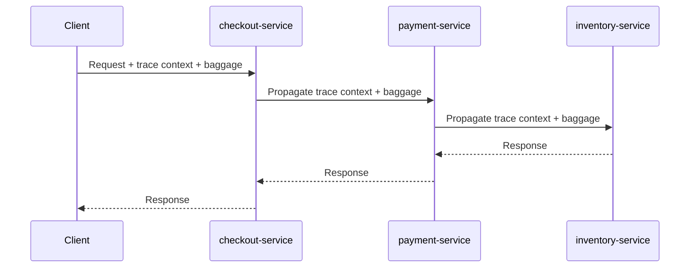
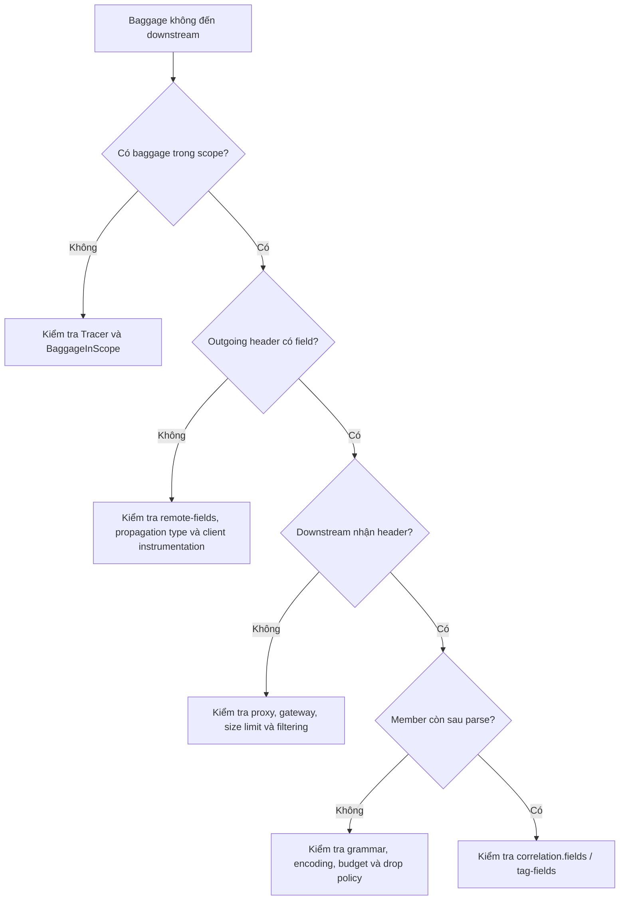

# Giới hạn kích thước baggage trong Spring Boot

Baggage giúp mang metadata nhỏ đi cùng distributed trace, chẳng hạn nhóm tenant, vùng triển khai hoặc tên workflow. Khi request đi qua nhiều dịch vụ, baggage có thể được truyền trong HTTP headers hoặc metadata của transport. Nhưng baggage không phải kho lưu trữ context tùy ý. Mỗi member làm tăng kích thước request, có thể bị proxy/server từ chối, tăng chi phí xử lý và mở rộng phạm vi dữ liệu được chia sẻ.

Bài **“Giới hạn kích thước baggage”** thuộc chương **Baggage và correlation** của module **SPRING_BOOT_OBSERVABILITY**. Module hướng dẫn thiết lập observability cho Spring Boot bằng Micrometer Observation, metrics, logs và distributed tracing; bài này giải thích giới hạn W3C Baggage, cách tính kích thước theo byte và số member, cách đặt budget, cấu hình Micrometer Tracing/Spring Boot, và cách kiểm thử propagation qua nhiều dịch vụ.

**Nguyên tắc vận hành:** chỉ đưa vào baggage metadata nhỏ, cần thiết và được phép truyền qua ranh giới dịch vụ. Đặt budget nội bộ thấp hơn giới hạn hạ tầng, kiểm tra kích thước trước khi inject, và xử lý việc thiếu baggage một cách an toàn.

## 1. Baggage là gì và vì sao kích thước quan trọng?

Baggage là các cặp key/value được mang theo trace context trong quá trình propagation. Ví dụ:

```http
traceparent: 00-4bf92f3577b34da6a3ce929d0e0e4736-00f067aa0ba902b7-01
baggage: tenant.tier=premium,region=ap-southeast-1,workflow=checkout
```

`traceparent` mang trace ID, parent span ID và trace flags theo W3C Trace Context. `baggage` mang metadata bổ sung. Hai header phục vụ hai mục đích khác nhau.

Baggage có thể đi qua nhiều service:



Một member được truyền qua nhiều hop sẽ được parse, giữ trong context và có thể serialize lại ở mỗi hop. Nếu baggage lớn, chi phí không chỉ nằm ở request đầu tiên mà lặp lại trên nhiều lời gọi downstream.

Kích thước baggage ảnh hưởng HTTP request header size, CPU/allocation khi parse và encode, network bandwidth, log volume nếu copy vào MDC, span size/indexing cost nếu chuyển thành span attributes, và privacy/security vì nhiều hệ thống có thể nhìn thấy metadata đó.

**Không nhét request payload, JWT, access token, email, địa chỉ, stack trace hoặc dữ liệu nghiệp vụ lớn vào baggage.**

## 2. Giới hạn trong W3C Baggage

W3C Baggage định nghĩa baggage string gồm danh sách các member. Trong phần Limits của chuẩn, một nền tảng **MUST propagate all list-members** khi đồng thời thỏa mãn:

| Điều kiện | Ngưỡng W3C |
| --- | ---: |
| Số list-member | Tối đa 64 |
| Kích thước baggage string | Tối đa 8.192 byte |

Nếu một trong hai điều kiện không thỏa mãn, nền tảng **MAY drop list-members** cho đến khi cả hai điều kiện được đáp ứng. Chuẩn không chỉ định member nào phải bị loại trước hoặc thứ tự chọn member. Các ngưỡng này là mức bảo đảm tối thiểu để tương thích; nền tảng có thể định nghĩa giới hạn cao hơn, nhưng vẫn nên chỉ truyền lượng thông tin hợp lý.

Ba điểm cần hiểu chính xác:

1. **64 member và 8.192 byte là hai điều kiện độc lập.** Baggage có 10 member nhưng tổng 9.000 byte vẫn vượt ngưỡng kích thước; baggage có 65 member nhưng rất ngắn vẫn vượt ngưỡng số lượng.
2. **8.192 byte là kích thước của baggage string**, không phải budget được bảo đảm cho toàn bộ HTTP request headers. Cookies, authorization, traceparent và các application headers cũng dùng chung giới hạn header của hạ tầng.
3. **Đây không phải cam kết mọi proxy chấp nhận 8.192 byte.** Gateway, web server, ingress, service mesh và HTTP client có thể áp dụng giới hạn thấp hơn; request có thể bị từ chối trước khi đến ứng dụng.

Ví dụ, nếu ingress chỉ cho phép baggage header tối đa 4 KiB, ứng dụng không thể dùng ngưỡng W3C 8 KiB làm ngân sách thực tế. Budget cần dựa trên thành phần chặt nhất trong đường đi và phải chừa chỗ cho headers khác.

Nguồn chuẩn: [W3C Baggage — mục 3.3.2 Limits](https://www.w3.org/TR/baggage/#limits).

## 3. Đếm member khác với đếm số ký tự

Baggage thường có dạng danh sách member phân cách bằng dấu phẩy:

```http
baggage: tenant.tier=premium,region=ap-southeast-1,workflow=checkout
```

Ví dụ có ba member: `tenant.tier=premium`, `region=ap-southeast-1` và `workflow=checkout`.

Mỗi member gồm key, value và có thể có properties theo cú pháp W3C. Kích thước được tính theo byte của baggage string được serialize, không thể chỉ đếm số cặp key/value hoặc số ký tự nhìn thấy.

### URL encoding làm tăng kích thước

Một số ký tự cần percent-encode khi serialize vào baggage. Độ dài Java `String.length()` đếm UTF-16 code units, không phải byte trên wire. Giá trị sau percent-encoding có thể dài hơn giá trị gốc; key, dấu phân cách, dấu bằng và properties cũng chiếm kích thước.

**Không dùng `String.length()` để khẳng định baggage tuân thủ giới hạn byte W3C.** Đo representation sau serialization của propagator thực tế hoặc dùng serializer tương ứng trong test.

## 4. Ví dụ ước lượng kích thước

Giả sử ứng dụng truyền ba metadata:

| Key | Value | Kích thước minh họa (ASCII) |
| --- | --- | ---: |
| `tenant.tier` | `premium` | 18 byte |
| `region` | `ap-southeast-1` | 22 byte |
| `workflow` | `checkout` | 16 byte |

Tổng ví dụ gồm member text và dấu phẩy:

\[
18 + 22 + 16 + 2 = 58 \text{ byte}
\]

Các số chỉ minh họa; cần đo chính xác serialized value trong implementation thực tế.

**Vượt số member:** 65 member ngắn vẫn vượt ngưỡng số lượng:

```text
baggage: k01=v1,k02=v1,...,k65=v1
```

**Vượt byte:** chỉ một member có value rất dài cũng có thể vượt ngưỡng 8.192 byte.

Không lưu một JSON lớn thành một baggage member. Dù chỉ là một member, JSON percent-encoded có thể chiếm hàng nghìn byte và mọi service downstream phải nhận dữ liệu đó dù chỉ cần một trường. Nếu cần dữ liệu chi tiết, hãy lấy từ service sở hữu dữ liệu bằng API hoặc truy vấn được phân quyền.

## 5. Phân biệt giới hạn W3C, HTTP và budget nội bộ

Không có một giới hạn HTTP header duy nhất áp dụng cho mọi deployment. Các tầng trên đường đi có thể có mức tối đa và cách báo lỗi khác nhau.

| Tầng | Điều cần kiểm tra |
| --- | --- |
| Ứng dụng tạo baggage | Member count, byte size, allowlist key/value |
| HTTP client | Request header limit, cách merge nhiều baggage fields |
| Sidecar/service mesh | Header size limit, forwarding và filtering |
| Ingress/reverse proxy | Tổng header limit, per-header limit, buffer |
| Load balancer/API gateway | Header budget và policy bảo mật |
| Web server/container | Parser limits và hành vi từ chối request |
| Service downstream | Có nhận, parse và drop baggage đúng không |
| Logs/tracing backend | Attribute size, indexing và retention |

Hệ quả có thể khác nhau: proxy trả 400 hoặc 431, client ném exception khi dựng request, service nhận request nhưng baggage đã bị loại, hoặc propagator bỏ bớt member. Hãy đo trên đúng stack, không suy đoán từ một con số chung.

### Đặt budget nội bộ thấp hơn giới hạn ngoài

Ví dụ policy:

| Chỉ tiêu | Budget minh họa |
| --- | ---: |
| Số baggage member ứng dụng cho phép | 8 |
| Tổng serialized baggage string | 1.024 byte |
| Kích thước value một member | 128 byte |
| Tên key được phép | Allowlist nhỏ |
| Định danh cá nhân | Không truyền mặc định |

Đây là budget minh họa, không phải chuẩn W3C hay mặc định Spring Boot. Tổ chức điều chỉnh theo proxy/server, nhu cầu correlation và chi phí telemetry. Budget phải tính cả baggage nhận từ upstream, không chỉ member do service hiện tại tạo.

## 6. Chọn dữ liệu nào xứng đáng đi vào baggage?

Baggage phù hợp với metadata nhỏ, tương đối ổn định trong một trace và có giá trị ở nhiều service.

| Dữ liệu | Có nên propagate? | Lý do |
| --- | --- | --- |
| `tenant.tier=premium` | Có thể, nếu được phê duyệt | Nhóm hữu hạn, hữu ích cho phân tích |
| `region=ap-southeast-1` | Có thể | Metadata triển khai nhỏ |
| `workflow=checkout` | Có thể | Ngữ cảnh nghiệp vụ ít giá trị |
| `feature.variant=b` | Cân nhắc | Hữu ích nếu tập giá trị hữu hạn |
| `request.id` | Cân nhắc | Có thể đã có correlation header/log riêng |
| `user.id` hoặc email | Không mặc định | Có thể định danh cá nhân |
| JWT/access token/cookie | Không | Bí mật xác thực |
| Full request body/JSON | Không | Quá lớn và có thể nhạy cảm |
| `traceId` | Không cần đưa thủ công | Đã có trong trace context |
| SQL/exception text | Không | Dễ dài và tiết lộ dữ liệu |

### Baggage không phải metric label

Baggage được truyền theo trace context; metric labels phục vụ aggregation. Đưa `user.id` vào baggage vẫn có rủi ro dữ liệu nhưng không tự động tạo metric series. Nếu cấu hình baggage thành span tags, giá trị sẽ sang span attributes; nếu bật log correlation, nó có thể thành MDC field.

Một giá trị baggage có thể xuất hiện trong nhiều signal. Trước khi cho phép key, phải xác định nó được gửi qua network, thêm vào span, ghi vào log hay chỉ lưu trong in-process scope.

## 7. Baggage trong Spring Boot và Micrometer Tracing

Spring Boot cung cấp API `Tracer` của Micrometer Tracing để tạo baggage trong scope hiện hành:

```java
import io.micrometer.tracing.BaggageInScope;
import io.micrometer.tracing.Tracer;
import org.springframework.stereotype.Component;

@Component
public class CheckoutBaggage {
    private final Tracer tracer;

    public CheckoutBaggage(Tracer tracer) {
        this.tracer = tracer;
    }

    public void process() {
        try (BaggageInScope baggage =
                     tracer.createBaggageInScope("workflow", "checkout")) {
            // Business logic executes while baggage is in scope.
        }
    }
}
```

`BaggageInScope` là scope cần đóng để khôi phục context trước đó. Try-with-resources giúp scope được đóng cả khi business logic ném exception.

Nếu không có tracer/trace scope phù hợp hoặc transport không được instrument, việc tạo và propagate baggage có thể không hoạt động như mong đợi.

### Khai báo remote fields

Ví dụ:

```yaml
management:
  tracing:
    baggage:
      remote-fields:
        - workflow
        - region
```

`remote-fields` khai báo các field được truyền qua network. Với W3C propagation, baggage được tự động truyền theo quy tắc W3C. Với B3, baggage không tự động được truyền theo cùng cách; cần cấu hình field tương ứng theo Spring Boot và tracing bridge. Hành vi cụ thể phụ thuộc propagation type và phiên bản.

Để baggage được truyền qua HTTP, dùng HTTP client builder do Spring Boot auto-configure, như `WebClient.Builder` hoặc `RestClient.Builder`. Tự tạo client không instrument có thể làm trace và baggage không được propagate.

### Correlation với MDC và span tags

Các nhóm cấu hình có mục đích riêng:

```yaml
management:
  tracing:
    baggage:
      remote-fields:
        - workflow
      correlation:
        fields:
          - workflow
      tag-fields:
        - workflow
```

- `remote-fields`: truyền field qua ranh giới service.
- `correlation.fields`: đưa giá trị vào logging context/MDC nếu được hỗ trợ.
- `tag-fields`: thêm baggage value thành span tag/attribute nếu bridge hỗ trợ.

Không bật cả ba chỉ vì muốn debug thuận tiện. Cùng một member có thể làm tăng header size, log volume và trace storage khi được cấu hình ở nhiều nơi.

Tham khảo [Spring Boot Tracing và Baggage](https://docs.spring.io/spring-boot/reference/actuator/tracing.html) và [Micrometer Tracing Baggage API](https://docs.micrometer.io/tracing/reference/api.html).

## 8. W3C Baggage trên wire

W3C Baggage dùng HTTP header `baggage` với danh sách member:

```http
baggage: tenant.tier=premium,region=ap-southeast-1
```

Một member có thể chứa properties sau dấu chấm phẩy theo grammar của chuẩn. Các key/value cần được encode đúng; không tự nối chuỗi đầu vào không tin cậy vào header.

Các điểm thực tế:

- Header có thể được chia thành nhiều field lines ở tầng HTTP; cần tính baggage string sau khi kết hợp theo semantics của protocol.
- Không giả định thứ tự member được giữ nguyên sau khi service parse và serialize.
- Nếu có key trùng, xử lý theo chuẩn và library; không coi duplicate như map entry đơn giản.
- Properties cũng là một phần member; đếm dấu bằng không đủ để đếm member.
- HTTP intermediary có thể lọc hoặc giới hạn headers; kiểm tra request đến và request đi ở từng hop khi debug.

Dùng propagator của Micrometer Tracing/bridge thay vì tự parse và serialize W3C header bằng string operations.

## 9. Kiểm soát baggage nhận từ bên ngoài

Baggage từ client hoặc upstream không nên mặc định được tin cậy. Client có thể gửi hàng trăm member, value rất dài, key không mong đợi hoặc metadata giả mạo.

Một biên dịch vụ nên:

1. Chỉ chấp nhận các key trong allowlist.
2. Đặt giới hạn số member và byte thấp hơn giới hạn W3C/hạ tầng nếu nghiệp vụ cho phép.
3. Giới hạn độ dài value của từng member.
4. Bỏ hoặc từ chối giá trị sai định dạng.
5. Không dùng baggage để quyết định authorization, tenant access hoặc giá giao dịch.
6. Không phản chiếu nguyên baggage đầu vào vào log/response.
7. Xác minh field quan trọng từ nguồn dữ liệu đáng tin cậy khác trước khi dùng.

**Baggage không phải security context.** `tenant.id=tenant-a` do client gửi không chứng minh caller được phép truy cập tenant-a. Authorization phải dựa trên identity/credential đã xác thực và policy của ứng dụng.

### Drop, reject hay truncate?

| Chiến lược | Hành vi | Khi phù hợp |
| --- | --- | --- |
| Drop member | Bỏ member không được phép hoặc vượt budget | Metadata chỉ hỗ trợ chẩn đoán và có thể thiếu |
| Reject request | Từ chối request khi header vi phạm protocol/security policy | Header quá lớn là vi phạm hợp đồng hạ tầng |
| Truncate value | Cắt giá trị theo quy tắc an toàn | Chỉ khi semantics cho phép |

Không cắt chuỗi mù quáng giữa ký tự UTF-8 hoặc percent escape. Truncate có thể làm value sai cú pháp hoặc gây hiểu nhầm. Với baggage observability, thường an toàn hơn khi bỏ nguyên member không hợp lệ thay vì cắt giữa key/value.

W3C cho phép nền tảng loại member khi vượt giới hạn, nhưng không quy định member nào bị loại trước. Ứng dụng cần chính sách ưu tiên riêng nếu không muốn kết quả phụ thuộc implementation.

## 10. Tạo budget theo ưu tiên và số hop

Ví dụ policy:

| Priority | Field | Lý do | Khi hết budget |
| --- | --- | --- | --- |
| 1 | `workflow` | Phân biệt luồng xử lý | Giữ nếu hợp lệ |
| 2 | `region` | Phân tích sự cố theo vùng | Giữ nếu còn chỗ |
| 3 | `tenant.tier` | Nhóm khách hàng hữu hạn | Có thể drop |
| 4 | `feature.variant` | Chỉ cần trong một số thử nghiệm | Drop trước |
| — | user ID, token, email | Không cho phép mặc định | Reject/drop |

Đây là thứ tự minh họa; W3C không định nghĩa priority. Nếu ứng dụng cần chính sách ưu tiên, thực hiện bước chuẩn hóa trước serialization và kiểm thử.

Giả sử baggage được gửi qua 6 service hop và thêm 700 byte mỗi request:

\[
700 \times 6 = 4\,200 \text{ byte-hop/request}
\]

Nếu request fan-out tới 10 downstream services, lượng dữ liệu truyền có thể cao hơn. Đây là cách hình dung chi phí network, không phải phép tính egress chính xác vì compression, framing, retry và topology ảnh hưởng.

## 11. Bảo mật và quyền riêng tư

Baggage có thể được gửi tới nhiều service và xuất hiện trong spans hoặc logs nếu cấu hình. Hãy coi baggage là dữ liệu có khả năng bị chia sẻ qua nhiều ranh giới tin cậy.

Không đưa vào baggage password, API key, bearer token, cookie/session secret, email, số điện thoại, địa chỉ, request/response body, dữ liệu thanh toán hoặc exception text dài.

Mã giả danh/hash vẫn có thể liên kết lại cá nhân. Thêm field vào `correlation.fields` có thể khiến giá trị xuất hiện trong MDC/logs; thêm vào `tag-fields` có thể đưa giá trị sang span backend. Cần xét toàn bộ pipeline, retention, quyền xem và nhà cung cấp nhận dữ liệu.

**Không dùng baggage làm nguồn authorization.** Mọi quyết định tenant access, role hoặc entitlement phải được xác minh từ security context/identity provider và policy đáng tin cậy.

## 12. Kiểm thử kích thước baggage

Không chỉ kiểm tra Java object hoặc giá trị `BaggageInScope.get()`. Cần kiểm tra **header serialized thực tế** ở outgoing request và incoming request.

### Bước 1 — Xác nhận transport

Dùng HTTP client builder do Spring Boot auto-configure để tracing và propagation được gắn vào. Nếu dùng custom client, xác minh interceptor/filter của Micrometer Tracing đã hoạt động.

### Bước 2 — Xác nhận fields

Kiểm tra `management.tracing.baggage.remote-fields`, propagation format (W3C hay B3), và field thực sự được tạo trong scope. Không cần đưa tất cả fields vào remote propagation.

### Bước 3 — Đo byte và member

Trong integration test, dùng HTTP server test hoặc mock server để quan sát baggage header đã serialize. Kiểm tra:

- Số member sau khi parse theo W3C grammar.
- Byte length của baggage string trên wire, sau encoding.
- Value có Unicode/space/comma/semicolon được encode đúng không.
- Nhiều baggage header lines có được xử lý đúng không.
- Có member nào bị drop tại client, proxy hay service nhận không.

Không dùng `String.length()` để xác định byte size. Dùng serializer/decoder của implementation hoặc đo bytes của wire value sau khi đã kết hợp header đúng protocol.

### Bước 4 — Kiểm tra từng hop

Gửi request từ service A qua B tới C. Ở môi trường test, ghi lại chỉ metadata giả và kích thước header tại từng hop:

```text
A outgoing: 3 members, 58 bytes
B incoming: 3 members, 58 bytes
B outgoing: 3 members, 58 bytes
C incoming: 3 members, 58 bytes
```

Các số chỉ minh họa. Nếu B chỉ cần `workflow` và `region`, cân nhắc bỏ member thừa trước khi gọi C để giảm dữ liệu lan truyền.

### Bước 5 — Kiểm thử vượt ngưỡng

| Ca kiểm thử | Mục tiêu |
| --- | --- |
| 1 member, value ngắn | Baseline |
| 64 members | Kiểm tra ngưỡng member W3C |
| 65 members | Xác minh policy drop/reject |
| Baggage string 8.192 byte | Kiểm tra biên size |
| Baggage string vượt 8.192 byte | Kiểm tra xử lý vượt chuẩn |
| Một value rất dài | Kiểm tra per-member budget |
| Key/value có ký tự cần encode | Kiểm tra size sau serialization |
| Header gần giới hạn proxy | Xác minh request không bị 400/431 ngoài dự kiến |
| Incoming baggage không allowlist | Xác nhận policy của service |

Test dựa trên serializer và byte count thật; không giả định source string có độ dài bằng header.

## 13. Chẩn đoán khi baggage biến mất hoặc request bị từ chối

| Hiện tượng | Nguyên nhân có thể | Cách điều tra |
| --- | --- | --- |
| A có baggage nhưng B không thấy | Field không nằm trong remote propagation, B3/W3C config khác hoặc client không instrument | Kiểm tra propagator và outgoing header tại A |
| B nhận nhưng C không nhận | B không propagate, field bị drop hoặc filter | So sánh incoming/outgoing header tại B |
| HTTP 400/431 khi baggage lớn | Proxy/server giới hạn header size | Xem ingress, gateway, server logs và budget |
| Baggage còn trong scope nhưng không có trên wire | Field chưa được khai báo remote hoặc transport không instrument | Kiểm tra remote-fields, tracer và client builder |
| Baggage có trên wire nhưng không vào MDC | correlation.fields chưa cấu hình hoặc scope không mở | Kiểm tra MDC integration và field names |
| Span không có baggage attribute | tag-fields chưa cấu hình hoặc bridge không hỗ trợ | Kiểm tra BaggageManager/bridge |
| Member mất ở một hop | Platform drop vì vượt ngưỡng hoặc policy riêng | Đo member count/byte size trước và sau hop |
| Baggage bị lặp | Header append ở nhiều nơi hoặc middleware tự nối chuỗi | Kiểm tra injector/propagator và duplicate policy |
| Trace ID còn nhưng baggage mất | Trace context và baggage có propagation riêng | Kiểm tra hai header độc lập |



Đừng kết luận trace propagation hỏng chỉ vì baggage mất: `traceparent` có thể còn trong khi baggage bị drop hoặc chưa được cấu hình truyền.

## 14. Quan sát budget mà không tạo rủi ro mới

Có thể theo dõi ở ứng dụng/collector:

- Số member được tạo và số member bị drop.
- Kích thước baggage serialized theo byte, dưới dạng histogram hoặc bucket nếu thực sự cần.
- Số request bị proxy/server từ chối do header quá lớn.
- Tỷ lệ downstream request thiếu field được kỳ vọng.
- Key names được sử dụng, không ghi value nhạy cảm.

Nếu tạo metric về baggage size, không gắn toàn bộ baggage value làm metric label. Có thể ghi histogram `observability.baggage.size` hoặc counter theo lý do drop với tập giá trị hữu hạn. Tên meter thực tế cần tuân theo taxonomy của ứng dụng.

Tránh ghi nguyên header baggage trong log. Để debug, chỉ ghi byte count, member count, key names allowlist hoặc lý do drop đã chuẩn hóa.

## 15. Bài thực hành: áp dụng budget baggage

Trong local/test, tạo một flow A → B → C dùng Micrometer Tracing.

1. Tạo field ngắn bằng `Tracer.createBaggageInScope("workflow", "checkout")`.
2. Cấu hình `workflow` trong `management.tracing.baggage.remote-fields` nếu cần truyền field theo propagation strategy đang sử dụng.
3. Dùng `WebClient.Builder` hoặc `RestClient.Builder` do Spring Boot auto-configure; xác minh baggage truyền qua B và C.
4. Thêm `workflow` vào `correlation.fields`, kiểm tra MDC. Thử `tag-fields` trong test và xác nhận span attribute khi bridge hỗ trợ.
5. Tạo 65 member hoặc baggage string lớn hơn 8.192 byte bằng dữ liệu giả; đo serialized value và quan sát policy của implementation/gateway/downstream.
6. Đặt budget ví dụ 8 member, 1 KiB tổng serialized size, 128 byte/value; chuẩn hóa allowlist và drop member thấp ưu tiên.
7. Làm Collector/backend lỗi trong test; xác nhận request nghiệp vụ vẫn theo SLO và baggage không được dùng làm điều kiện authorization.

Không gửi request cực lớn vào môi trường shared/production.

## 16. Những hiểu lầm thường gặp

| Hiểu lầm | Cách hiểu đúng |
| --- | --- |
| 8.192 byte là giới hạn của mọi HTTP headers | Đây là ngưỡng baggage string W3C; proxy/server có thể thấp hơn |
| Tối đa 64 member nghĩa là tổng size luôn an toàn | Một member rất dài vẫn vượt byte threshold |
| Chỉ cần đếm ký tự Java String | Phải xét byte của serialized representation |
| W3C bắt buộc drop member thứ 65 | Chuẩn cho phép drop member đến khi đáp ứng limits, không quy định thứ tự |
| Baggage luôn propagate với mọi propagation type | W3C mang baggage; B3 cần cấu hình field theo implementation |
| Có BaggageInScope nghĩa mọi client gửi header | Transport/client phải được instrument và field phải được cấu hình |
| remote-fields tự đưa baggage vào MDC | correlation.fields phục vụ logs; tag-fields phục vụ span tags |
| Trace ID mất khi baggage bị drop | Trace context và baggage là các header/context riêng |
| Baggage là nơi lưu tenant authorization | Baggage không đáng tin để quyết định quyền truy cập |
| Hash email/user ID giải quyết privacy và size | Hash vẫn có thể liên kết cá nhân và tốn header bytes |
| Có thể copy toàn bộ baggage vào logs để debug | Log volume và phạm vi dữ liệu tăng; chỉ log metadata được phép |

## 17. Câu hỏi tự kiểm tra

1. W3C Baggage quy định hai điều kiện nào để nền tảng phải propagate toàn bộ list-members?
2. Vì sao giới hạn 64 member và 8.192 byte cần kiểm tra độc lập?
3. Vì sao 8.192 byte không phải ngân sách bảo đảm cho toàn bộ HTTP request headers?
4. `String.length()` khác byte length của baggage trên wire thế nào?
5. Những tầng nào có thể giới hạn hoặc loại baggage trong đường đi request?
6. Vì sao ứng dụng nên đặt budget nội bộ thấp hơn giới hạn chặt nhất hạ tầng?
7. remote-fields, correlation.fields và tag-fields phục vụ ba mục đích gì?
8. Vì sao B3 và W3C có hành vi baggage propagation khác nhau trong Spring Boot?
9. Vì sao không đưa JWT, email, request body hoặc user ID vào baggage?
10. Khi baggage mất nhưng traceparent còn, cần kiểm tra gì?
11. Vì sao truncation tùy tiện có thể làm hỏng encoding hoặc semantics?
12. Cần kiểm tra gì để chứng minh baggage truyền đúng qua A → B → C?
13. Metric baggage size nên gắn dimensions nào và nên tránh gắn gì?
14. Khi proxy trả 431, cần điều tra budget ở những tầng nào?
15. Vì sao baggage không được dùng làm security/authorization context?

## Tài liệu tham khảo

- [W3C Baggage — Propagation format for distributed context](https://www.w3.org/TR/baggage/): grammar, list-members và giới hạn ở mục 3.3.2.
- [Spring Boot — Tracing và Baggage](https://docs.spring.io/spring-boot/reference/actuator/tracing.html): tạo baggage bằng Tracer, remote fields, MDC correlation và span tags.
- [Micrometer Tracing — Baggage API](https://docs.micrometer.io/tracing/reference/api.html): tạo/lấy baggage trong scope, cấu hình propagation và baggage tags.
- [Spring Boot 3.5 — Tracing](https://docs.spring.io/spring-boot/3.5/reference/actuator/tracing.html): tham khảo cấu hình baggage theo dòng phiên bản.

## Kết luận

**Giới hạn baggage phải được quản lý theo số member, byte sau serialization và giới hạn thực tế của toàn bộ hạ tầng HTTP.** W3C Baggage yêu cầu truyền tất cả member khi baggage string có không quá 64 member và không quá 8.192 byte; khi vượt một trong hai ngưỡng, nền tảng được phép loại member. Proxy, gateway và server vẫn có thể áp dụng giới hạn thấp hơn.

Với Spring Boot, hãy khai báo có chọn lọc `remote-fields`, `correlation.fields` và `tag-fields`, dùng transport đã được instrument, và đặt budget nội bộ thấp hơn giới hạn hạ tầng. Chỉ truyền metadata nhỏ, không nhạy cảm và có ích cho downstream; đo kích thước trên wire, kiểm thử từng hop và xử lý baggage thiếu một cách an toàn. Baggage hỗ trợ trace/log correlation, nhưng không phải kho dữ liệu, metric label hay security context.

