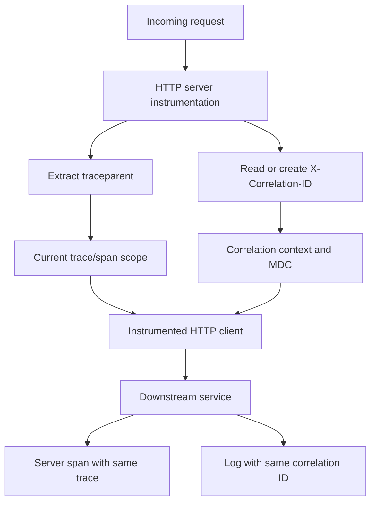

# Theo dõi correlation ID xuyên service

## 1. Mục tiêu và bối cảnh

Một yêu cầu của người dùng có thể đi qua API Gateway, order service, payment service, inventory service rồi tiếp tục ở một worker xử lý message. Khi một bước thất bại, đội vận hành cần tìm được các log ở nhiều service, mở trace tương ứng và phân biệt các lần retry của cùng một hành trình. **Correlation ID** là định danh giúp liên kết những bản ghi hoặc sự kiện có liên quan theo một quy ước của ứng dụng.

Bài thuộc chương **Baggage và correlation** của module **SPRING_BOOT_OBSERVABILITY**. Module hướng dẫn thiết lập observability cho Spring Boot bằng Micrometer Observation, metrics, logs và distributed tracing; học context propagation, tag/cardinality, exporter, sampling và liên kết tín hiệu để điều tra lỗi, độ trễ và hành vi ứng dụng trên môi trường thực.

Sau bài học, bạn có thể:

1. Phân biệt correlation ID, request ID, business ID, trace ID và span ID.
2. Thiết kế contract correlation nhất quán cho HTTP request, message và background job.
3. Nhận ID ở ingress một cách an toàn, kiểm tra định dạng và tạo ID mới khi cần.
4. Truyền correlation ID qua HTTP client và message headers mà không ghi đè trace context.
5. Gắn correlation ID vào MDC để đưa vào logs và cleanup đúng sau request.
6. Hiểu Spring Boot/Micrometer Tracing đã cung cấp log correlation từ trace/span IDs như thế nào.
7. Phối hợp custom correlation ID, baggage, tracing, logs và metrics mà không tăng cardinality hay làm lộ dữ liệu.
8. Kiểm thử end-to-end và xử lý lỗi propagation, retry, async, Reactor và queue.

**Baseline ví dụ:** Spring Boot 3.5.x, Java 17+, Spring MVC và Micrometer Tracing. Bài dùng header ứng dụng X-Correlation-ID, tách biệt với W3C Trace Context.

## 2. Correlation ID là gì?

Correlation ID là một định danh kỹ thuật dùng để liên kết log record, request hoặc sự kiện thuộc cùng một hành trình theo contract của hệ thống.

```text
Client
  |
  | X-Correlation-ID: corr-7f31a
  v
API Gateway
  |
  | X-Correlation-ID: corr-7f31a
  v
Order service
  |
  | X-Correlation-ID: corr-7f31a
  v
Payment service
  |
  | X-Correlation-ID: corr-7f31a
  v
Payment provider adapter
```

Các service ghi cùng một ID để người vận hành tìm log liên quan. ID này không nhất thiết biểu diễn quan hệ thời gian hoặc cha-con giữa thao tác; nó là khóa tương quan theo quy ước ứng dụng.

### 2.1. Phân biệt các loại ID

| Loại ID | Phạm vi | Mục đích | Ví dụ |
| --- | --- | --- | --- |
| **Trace ID** | Một distributed trace | Gom các span trong trace | W3C trace ID gồm 32 ký tự hex |
| **Span ID** | Một span | Định danh một thao tác cụ thể | 16 ký tự hex |
| **Correlation ID** | Theo contract ứng dụng/nghiệp vụ | Liên kết logs hoặc sự kiện của một workflow | corr-7f31a |
| **Request ID** | Một request attempt | Định danh một lần gọi HTTP | req-9d8c |
| **Business ID** | Thực thể/giao dịch nghiệp vụ | Tra cứu đơn hàng hoặc thanh toán | order-1042 |

Các ID có thể liên hệ nhưng không đồng nghĩa:
- Một trace có thể gồm nhiều HTTP requests, message và spans.
- Một correlation ID có thể được giữ qua retry hoặc các bước async để liên kết workflow dài.
- Mỗi lần retry có thể có request ID và span mới; business ID vẫn giữ nguyên.
- Một workflow có thể kéo dài qua nhiều trace hoặc job.
- Business ID có thể có cardinality lớn hoặc chứa dữ liệu nhạy cảm; không tự động dùng làm metric tag.

**Không gọi mọi ID là trace ID.** Dùng đúng thuật ngữ giúp người vận hành biết cần tìm trong trace backend, log backend hay hệ thống nghiệp vụ.

### 2.2. Khi nào dùng trace ID, khi nào cần custom correlation ID?

Khi Micrometer Tracing đã cấu hình, Spring Boot mặc định có thể đưa traceId và spanId vào MDC để log correlation. Với một distributed trace được lưu đầy đủ, hai giá trị này thường đủ để mở trace rồi xem cây span.

Custom correlation ID vẫn có ích khi:
- Một workflow nghiệp vụ kéo dài qua nhiều trace hoặc queue lâu ngày.
- Nhiều lần retry cần được liên kết thành một hành trình.
- Một yêu cầu hỗ trợ có reference ID từ ticket hoặc API contract.
- Một batch/job cần nối lại với request khởi tạo sau thời gian dài.

Nếu không có yêu cầu rõ ràng cho custom ID, ưu tiên traceId để liên kết logs với trace. Tránh tạo ID thứ hai chỉ vì log cần một chuỗi định danh.

## 3. Hai lớp correlation cần hoạt động cùng nhau

Để quan sát chính xác một luồng xuyên service, cần phân biệt:

1. **Tracing propagation:** truyền trace context như W3C traceparent để tạo quan hệ span cha-con.
2. **Application correlation propagation:** truyền custom correlation ID như X-Correlation-ID để liên kết logs/sự kiện theo contract nghiệp vụ.



Hai cơ chế cần nhất quán trong một request nhưng không thay thế nhau:

- traceparent chứa trace ID, parent span ID và flags theo W3C Trace Context.
- X-Correlation-ID là header ứng dụng tự định nghĩa, không thuộc W3C Trace Context.
- Tracing instrumentation có thể tự inject/extract traceparent.
- Custom header thường cần filter/interceptor hoặc messaging middleware.
- MDC chỉ gắn dữ liệu vào log trong execution scope hiện hành; nó không tự truyền qua network.

Nếu downstream có cùng correlation ID nhưng trace ID khác, đó có thể là workflow dài hạn đã bắt đầu một trace mới. Điều này hợp lệ khi có quy ước rõ ràng; không nên kết luận tracing bị đứt chỉ dựa vào custom ID.

## 4. Contract cho correlation ID

Chọn một header thống nhất cho toàn hệ thống, ví dụ:

```http
X-Correlation-ID: corr-7f31a8f4
```

| Quy tắc | Khuyến nghị |
| --- | --- |
| Tên header | Dùng một tên thống nhất theo contract hiện hữu |
| Ai tạo? | Gateway hoặc service ingress tin cậy |
| Giữ ID từ client? | Chỉ khi trust boundary và format cho phép |
| ID thiếu hoặc sai | Tạo ID mới |
| Độ dài | Giới hạn rõ, ví dụ tối đa 64 ký tự |
| Ký tự | Allowlist chữ ASCII, số, dấu chấm, gạch ngang, gạch dưới |
| Bí mật? | Không; không dùng làm token hoặc quyền truy cập |
| Downstream | Chỉ truyền qua các service được cho phép |
| Logging | Ghi thành field có cấu trúc riêng |
| Metrics | Không tạo tag theo từng correlation ID |

Tên header X-Correlation-ID là quy ước ứng dụng, không phải W3C Trace Context. Nếu tổ chức đã có một header chuẩn, nên dùng đúng header đó thay vì tạo thêm nhiều biến thể cho cùng mục đích.

### 4.1. Chính sách ở ingress

**Gateway là nguồn tin cậy:** gateway tạo correlation ID, downstream nhận và chuyển tiếp ID đó.

**Cho phép client cung cấp ID:** service chấp nhận giá trị hợp lệ theo contract; nếu không hợp lệ hoặc quá dài thì tạo ID mới. ID do bên ngoài gửi vẫn chỉ là metadata tương quan, không xác thực danh tính người dùng.

Không ghi trực tiếp giá trị header tùy ý vào logs hoặc forward vô điều kiện. Header có thể chứa CR/LF, chuỗi quá dài, ký tự điều khiển hoặc dữ liệu cá nhân. Validate và giới hạn trước khi sử dụng. Allowlist ký tự không chứng minh người gửi đáng tin cậy; cần kiểm soát network/authentication của gateway nếu gateway là nguồn authoritative.

## 5. Tạo và giữ ID trong Spring Boot 3.5

Ví dụ dùng OncePerRequestFilter để nhận header, validate, tạo UUID nếu thiếu/sai, gắn ID vào request attribute, đưa ID vào MDC, trả ID trong response và cleanup MDC.

### 5.1. Filter

```java
package com.example.observability;

import jakarta.servlet.FilterChain;
import jakarta.servlet.ServletException;
import jakarta.servlet.http.HttpServletRequest;
import jakarta.servlet.http.HttpServletResponse;
import org.slf4j.MDC;
import org.springframework.stereotype.Component;
import org.springframework.web.filter.OncePerRequestFilter;

import java.io.IOException;
import java.util.UUID;
import java.util.regex.Pattern;

@Component
public class CorrelationIdFilter extends OncePerRequestFilter {
    public static final String HEADER = "X-Correlation-ID";
    public static final String ATTRIBUTE =
            CorrelationIdFilter.class.getName() + ".correlationId";
    public static final String MDC_KEY = "correlationId";

    private static final Pattern SAFE_ID =
            Pattern.compile("[A-Za-z0-9._-]{1,64}");

    @Override
    protected void doFilterInternal(
            HttpServletRequest request,
            HttpServletResponse response,
            FilterChain chain)
            throws ServletException, IOException {

        String incoming = request.getHeader(HEADER);
        String correlationId = isSafe(incoming)
                ? incoming
                : UUID.randomUUID().toString();

        String previous = MDC.get(MDC_KEY);
        request.setAttribute(ATTRIBUTE, correlationId);
        response.setHeader(HEADER, correlationId);
        MDC.put(MDC_KEY, correlationId);

        try {
            chain.doFilter(request, response);
        } finally {
            if (previous == null) {
                MDC.remove(MDC_KEY);
            } else {
                MDC.put(MDC_KEY, previous);
            }
        }
    }

    private static boolean isSafe(String value) {
        return value != null && SAFE_ID.matcher(value).matches();
    }
}
```

Giải thích:
- SAFE_ID giới hạn độ dài/ký tự, giảm nguy cơ header injection hoặc log forging.
- ID thiếu/sai được thay bằng UUID do ứng dụng tạo.
- Request attribute giữ ID đã normalize cho controller/service.
- Response header giúp caller dùng ID trong hỗ trợ và điều tra.
- try/finally restore MDC ngay cả khi filter chain ném exception.
- Không dùng correlation ID để xác thực, phân quyền hoặc quyết định giá tiền.

Filter mẫu này xử lý request đồng bộ trên servlet thread. Với Servlet async dispatch, executor hoặc callback, phải kiểm tra lifecycle thực tế và context propagation; không giả định MDC tự đi theo thread.

### 5.2. Controller đọc ID đã chuẩn hóa

```java
package com.example.observability;

import jakarta.servlet.http.HttpServletRequest;
import org.springframework.web.bind.annotation.GetMapping;
import org.springframework.web.bind.annotation.RestController;

@RestController
public class OrderController {
    private final OrderService orderService;

    public OrderController(OrderService orderService) {
        this.orderService = orderService;
    }

    @GetMapping("/orders/demo")
    public String createDemo(HttpServletRequest request) {
        String id = (String) request.getAttribute(
                CorrelationIdFilter.ATTRIBUTE);
        orderService.createOrder(id);
        return "accepted";
    }
}
```

Controller lấy ID sau khi filter đã normalize. Tránh đọc lại raw header ở từng service vì dễ bỏ qua quy tắc validate hoặc dùng giá trị khác với ID đã ghi vào MDC.

### 5.3. Truyền ID xuống service nghiệp vụ

```java
package com.example.observability;

import org.springframework.stereotype.Service;

@Service
public class OrderService {
    private final PaymentClient paymentClient;

    public OrderService(PaymentClient paymentClient) {
        this.paymentClient = paymentClient;
    }

    public void createOrder(String correlationId) {
        // Xử lý order...
        paymentClient.authorize(correlationId);
    }
}
```

Truyền ID thành tham số tường minh giúp code dễ kiểm thử, nhất là khi công việc rời request thread. Tránh custom static ThreadLocal trong mọi service và giả định nó luôn đúng.

## 6. Propagate custom ID qua HTTP

Spring Boot tracing instrumentation có thể tự inject/extract traceparent khi client được tạo từ builder auto-configured. X-Correlation-ID là header ứng dụng, cần truyền riêng.

Ví dụ RestClient thêm header trên outbound call:

```java
package com.example.observability;

import org.springframework.stereotype.Component;
import org.springframework.web.client.RestClient;

@Component
public class PaymentClient {
    private final RestClient client;

    public PaymentClient(RestClient.Builder builder) {
        this.client = builder
                .baseUrl("http://payment-service")
                .build();
    }

    public String authorize(String correlationId) {
        return client.post()
                .uri("/payments/authorize")
                .header(CorrelationIdFilter.HEADER, correlationId)
                .retrieve()
                .body(String.class);
    }
}
```

Ở request này:
- X-Correlation-ID do code ứng dụng thêm.
- traceparent được tracing instrumentation inject tự động nếu Micrometer Tracing và builder đã cấu hình.
- Không tự tạo traceparent từ correlation ID.
- Không dùng correlation ID để thay trace ID hoặc span ID.

Với RestTemplate, ưu tiên RestTemplateBuilder do Boot inject; với WebClient, ưu tiên WebClient.Builder auto-configured. Client tự tạo ngoài Spring có thể bỏ qua observation/tracing interceptors.

### 6.1. Downstream service

Payment service có thể dùng cùng filter. Khi nhận request:
1. Validate X-Correlation-ID.
2. Giữ ID hợp lệ theo workflow.
3. Ghi ID vào MDC trong request scope.
4. Để tracing server instrumentation extract traceparent riêng.
5. Log custom correlation ID và trace/span IDs nếu pattern đã cấu hình.

Không cần thêm custom ID thành baggage chỉ để truyền một HTTP header do ứng dụng kiểm soát. Nếu muốn metadata đi theo tracing context qua nhiều transport, baggage có thể phù hợp; cần quyết định rõ để tránh truyền lặp hoặc không nhất quán.

## 7. Khi nào dùng baggage cho correlation metadata?

Micrometer Tracing hỗ trợ tạo baggage trong scope:

```java
import io.micrometer.tracing.BaggageInScope;
import io.micrometer.tracing.Tracer;

public void processWithBaggage(Tracer tracer, String correlationId) {
    try (BaggageInScope baggage =
                 tracer.createBaggageInScope(
                         "correlation-id", correlationId)) {
        doBusinessWork();
    }
}
```

Nếu baggage field được cấu hình để propagate, tracing instrumentation có thể truyền metadata qua transport mà Micrometer Observation instrument. Spring Boot có thể dùng:

```yaml
management:
  tracing:
    baggage:
      remote-fields:
        - correlation-id
      correlation:
        fields:
          - correlation-id
```

Phân biệt:
- remote-fields chọn baggage fields được propagate.
- correlation.fields chọn baggage keys đưa vào MDC; nó không thay remote propagation.
- tag-fields có thể thêm baggage thành span tags/attributes; chỉ dùng khi cần và đã đánh giá cardinality/privacy.
- Với W3C propagation, baggage dùng W3C baggage header.
- Với B3, baggage không mặc nhiên propagate giống W3C; remote-fields có thể cấu hình trường cần gửi.

**Chọn một nguồn authoritative.** Nếu filter tạo X-Correlation-ID nhưng một service khác tạo baggage correlation-id độc lập, logs có thể chứa hai ID khác nhau. Nếu dùng cả header và baggage, định nghĩa cách ánh xạ và kiểm thử inbound/outbound.

| Yêu cầu | Lựa chọn thường phù hợp |
| --- | --- |
| API cần trả ID để caller liên hệ hỗ trợ | Custom header X-Correlation-ID |
| Liên kết log với trace hiện hành | Spring Boot default traceId + spanId MDC correlation |
| Metadata nhỏ đi theo tracing context qua transport có instrumentation | Micrometer baggage |
| Metadata chỉ dùng trong request hiện tại | Request attribute/application context |
| Tra cứu đơn hàng | Business ID trong database/audit |
| Nhóm số liệu tổng hợp | Metrics tags cardinality thấp |

Đừng propagate tất cả loại ID chỉ vì có thể làm được. Mỗi trường cần mục đích, owner, format, trust boundary và retention rõ ràng.

## 8. Log correlation trong Spring Boot

### 8.1. Correlation mặc định từ Micrometer Tracing

Khi Micrometer Tracing được cấu hình, Spring Boot mặc định thêm log correlation dựa trên MDC traceId và spanId. Dạng mặc định thường tương tự:

```text
[803B448A0489F84084905D3093480352-3425F23BB2432450]
```

Đây là chuỗi ghép từ trace ID và span ID để tìm span tương ứng trong trace backend. Có thể đổi định dạng bằng logging.pattern.correlation.

Ví dụ:

```yaml
logging:
  pattern:
    correlation: "[%X{traceId:-}-%X{spanId:-}] "
```

Dấu cách cuối tách correlation prefix khỏi tên logger. Không cần tự viết filter để ghép trace/span IDs chỉ nhằm thay format log nếu mặc định đã đáp ứng.

### 8.2. Thêm custom correlation ID vào Logback

Nếu ứng dụng còn có custom X-Correlation-ID, thêm MDC key vào logging pattern hiện tại:

```text
%d{yyyy-MM-dd HH:mm:ss.SSS} %-5level
[%X{traceId:-}-%X{spanId:-}]
[correlationId=%X{correlationId:-}]
%logger{36} - %msg%n
```

Ví dụ log:

```text
INFO  [trace=4bf...,span=00f...] [correlationId=corr-7f31a8f4]
      Order accepted
INFO  [trace=4bf...,span=11a...] [correlationId=corr-7f31a8f4]
      Calling payment service
ERROR [trace=4bf...,span=22b...] [correlationId=corr-7f31a8f4]
      Payment provider timed out
```

Các log có thể thuộc những span khác nhau nhưng cùng custom correlation ID. traceId thường liên kết spans trong một trace; custom ID có thể liên kết nhiều attempt hoặc workflow dài hơn.

Không thay toàn bộ logging config chỉ để thêm một field. Cập nhật pattern hiện có và kiểm tra output thực tế vì Logback, Log4j2, JSON encoder và profile có thể khác nhau.

### 8.3. MDC không tự propagate qua thread

MDC thường dựa trên ThreadLocal. Filter đặt MDC trên servlet thread không làm nó tự xuất hiện ở worker thread của @Async, executor hoặc callback. Khi chuyển execution:
- Dùng Micrometer Context Propagation/Spring ContextPropagatingTaskDecorator cho các context có accessor phù hợp.
- Hoặc truyền correlation ID tường minh như tham số.
- Restore/clear MDC khi task hoàn tất.
- Không giữ ID request trước trong thread pool.

Với job async kéo dài, định nghĩa ID thuộc workflow/job hay request ban đầu. Ghi nó vào message metadata hoặc job context, thay vì dựa trên ThreadLocal đã hết scope.

## 9. Propagation qua message broker và background jobs

HTTP headers không tự đi theo Kafka, RabbitMQ hoặc queue. Nếu cần giữ correlation ID xuyên message:
1. Producer lấy correlation ID từ context hoặc tham số nghiệp vụ.
2. Ghi vào message header theo contract.
3. Consumer validate header và gắn vào context của lần xử lý.
4. Ghi correlation ID vào log trong consumer scope.
5. Tracing instrumentation/propagator xử lý traceparent và baggage riêng.

```text
Order service
  correlationId = corr-7f31a8f4
  trace context = traceparent ...
       |
       v
Message headers:
  X-Correlation-ID: corr-7f31a8f4
  traceparent: ...
       |
       v
Payment worker
  correlationId = corr-7f31a8f4
  consumer span belongs to propagated trace or is linked
```

Consumer có thể xử lý batch chứa nhiều correlation IDs. Không đặt một ID duy nhất trong singleton state hoặc thread pool; context phải thuộc từng message/task.

### 9.1. Correlation ID không phải idempotency key

Correlation ID có thể được giữ qua retry để liên kết logs. Idempotency key có mục tiêu ngăn xử lý giao dịch trùng; nó có semantics uniqueness và retention riêng. Không dùng correlation ID thay idempotency key, vì một correlation ID có thể nhóm nhiều thao tác khác nhau.

## 10. Metrics, cardinality và tracing sampling

Correlation ID hữu ích cho logs và search cụ thể, nhưng hầu như **không phù hợp làm metric tag**.

Ví dụ sai:

```java
registry.counter("payment.attempts",
        "correlationId", correlationId).increment();
```

Mỗi request có thể tạo bộ tags mới, khiến cardinality và time series tăng theo traffic. Thay vào đó:

```java
registry.counter("payment.attempts",
        "outcome", success ? "success" : "failure",
        "provider", normalizedProvider).increment();
```

outcome và provider phải có tập giá trị hữu hạn. Correlation ID nằm trong logs và có thể propagate qua baggage/trace context; metrics tập trung vào tổng hợp.

Sampling traces là cơ chế khác:
- Metrics có thể ghi các lần instrument đã đăng ký.
- Traces có thể chỉ export một tỷ lệ theo sampler.
- Custom correlation ID vẫn có thể xuất hiện trong logs dù trace tương ứng không được sample/export.
- Có ID trong log không chứng minh trace đã tồn tại ở backend.

Trong điều tra, dùng logs để tìm correlation ID và sự kiện; dùng trace ID để mở cây span nếu trace được lưu; dùng metrics để xác định mức độ phổ biến theo thời gian/service/route.

## 11. Bảo mật và độ tin cậy

Correlation ID là định danh kỹ thuật, không phải bí mật. Cách nhận và propagate vẫn cần kiểm soát:

- Không dùng làm xác thực hoặc phân quyền.
- Validate header, giới hạn chiều dài/ký tự, tránh CR/LF và log forging.
- Không ghép email, điện thoại, địa chỉ, số tài khoản/thẻ hoặc token vào ID.
- Không tin client: ID hợp lệ về cú pháp vẫn có thể bị tái sử dụng để gây nhầm lẫn logs.
- Không dùng làm secret; ID có thể xuất hiện trong response headers, logs, traces và ticket hỗ trợ.
- Giới hạn log exposure và retention.
- Không log toàn bộ request headers vì có thể chứa Authorization, Cookie và dữ liệu nhạy cảm.
- Không cho client quyết định routing, price hoặc quota bằng ID; service phải xác minh nghiệp vụ.

UUID ngẫu nhiên có thể phù hợp khi cần ID khó đoán, nhưng điều đó không biến correlation ID thành token bảo mật.

## 12. Kiểm thử correlation ID xuyên service

Một test end-to-end cần kiểm tra cả log correlation và propagation, không chỉ assert một header.

### 12.1. HTTP flow

1. Gửi request tới order service với X-Correlation-ID hợp lệ.
2. Xác nhận filter giữ ID và response có cùng header.
3. Gửi request không có ID; xác nhận service tạo ID mới.
4. Gửi ID quá dài hoặc chứa ký tự bị cấm; xác nhận service sinh ID mới.
5. Xác nhận logs order service có custom correlation ID và trace/span IDs nếu tracing bật.
6. Dùng RestClient.Builder instrumented gọi payment service; xác nhận custom header được truyền.
7. Ở payment service, xác nhận filter nhận cùng ID và log có cùng correlation ID.
8. Kiểm tra traceparent được tracing instrumentation inject/extract; trace IDs và parent span IDs cần phù hợp.
9. Gây exception/timeout, xác nhận MDC cleanup và request kế tiếp không thừa ID cũ.

### 12.2. Async và messaging

- Submit task qua executor có context propagation; kiểm tra custom ID trong MDC/logic đúng task.
- Xử lý hai task đồng thời với hai IDs khác nhau; đảm bảo không trộn log.
- Gửi message có correlation ID trong headers; consumer đọc đúng và cleanup sau xử lý.
- Kiểm thử retry: ID giữ cùng workflow hay request attempt có ID riêng theo contract.
- Kiểm thử cancellation, timeout và task bị từ chối để đảm bảo cleanup.

### 12.3. Log có cấu trúc

Nếu log JSON, có thể có field riêng:

```json
{
  "timestamp": "2026-11-22T10:20:30Z",
  "level": "INFO",
  "service": "order-service",
  "correlationId": "corr-7f31a8f4",
  "traceId": "4bf92f3577b34da6a3ce929d0e0e4736",
  "spanId": "00f067aa0ba902b7",
  "message": "Order accepted"
}
```

Đây là ví dụ schema, không phải định dạng mặc định của Spring Boot. Field cần được cấu hình trong JSON encoder/structured logging. Dùng field riêng thay vì parse correlation ID từ chuỗi message.

## 13. Troubleshooting

| Triệu chứng | Nguyên nhân có thể | Cách kiểm tra |
| --- | --- | --- |
| Mỗi service tạo correlation ID khác nhau | Downstream không nhận/forward header hoặc filter luôn replace | Kiểm tra header tại từng hop và trust policy |
| Logs cùng correlation ID nhưng trace IDs khác | Workflow qua nhiều trace/retry/job hoặc tracing context bị tách | So sánh nghiệp vụ, parent/links và định nghĩa ID |
| Trace cùng trace ID nhưng log thiếu correlation ID | Filter/MDC chưa chạy hoặc log ngoài scope | Kiểm tra filter order, logging pattern và MDC lifecycle |
| Log ở worker thiếu correlation ID | MDC không propagate hoặc task không nhận ID | Truyền tường minh/ContextPropagatingTaskDecorator |
| Request tiếp theo dùng ID request trước | MDC không cleanup trên thread pool | Dùng finally, kiểm tra restore/clear |
| Outbound thiếu X-Correlation-ID | RestClient không gắn header | Kiểm tra request bằng mock server |
| Có correlation ID nhưng không có trace | Client không được instrument hoặc tracing chưa có | Kiểm tra RestClient.Builder, bridge, propagator |
| Có traceparent nhưng không có custom ID | Chỉ tracing propagation hoạt động | Thêm app-level header hoặc baggage theo contract |
| Có X-Correlation-ID nhưng downstream span thành root | Custom header không tạo trace parent | Kiểm tra W3C traceparent riêng |
| Header bị đổi liên tục | Format upstream không đạt validation | Đồng bộ contract/allowlist |
| Search log theo ID trả quá nhiều dữ liệu | ID bị tái sử dụng rộng hoặc workflow dài | Kiểm tra phạm vi, thời gian và loại sự kiện |
| Metric series tăng đột biến | Correlation ID bị dùng làm metric tag | Xóa tag động, dùng tags hữu hạn |
| Không thấy trace dù log có trace ID | Sampling, exporter hoặc retention | Kiểm tra trace pipeline riêng |
| Message consumer mất ID | Producer không gửi header hoặc consumer không đọc | Kiểm tra message headers/middleware |
| ID xuất hiện ngoài service dự kiến | Propagation vượt trust boundary | Allowlist service/hop và lọc ở gateway |

## 14. Quy tắc production

1. Chọn một correlation ID owner rõ ràng: gateway hoặc service ingress tin cậy.
2. Chuẩn hóa tên header và contract giữa các nhóm dịch vụ.
3. Validate, giới hạn chiều dài/ký tự; tạo ID mới nếu thiếu hoặc sai policy.
4. Dùng correlation ID để liên kết workflow/logs; dùng trace ID/span ID để điều hướng trong trace backend.
5. Để Micrometer Tracing xử lý traceparent; không dựng header trace bằng correlation ID.
6. Dùng filter/interceptor cho HTTP; message headers/middleware cho broker.
7. Đưa ID vào MDC trong scope ngắn và cleanup bằng finally.
8. Với async/reactive, dùng context propagation hoặc truyền ID tường minh.
9. Không đưa correlation ID vào metric tags; không biến nó thành baggage/attribute nếu không có use case.
10. Chỉ truyền metadata qua trust boundary được phép; không dùng ID như credential.
11. Có test cho success, exception, retry, async, thread reuse và message consumption.
12. Dùng metrics để đo xu hướng, logs để tìm sự kiện và traces để hiểu quan hệ thời gian/cha-con.

## 15. Câu hỏi tự luyện

1. Trace ID và custom correlation ID khác nhau ở mục đích nào?
2. Workflow qua ba service và hai retry: ID nào giữ nguyên, ID nào có thể thay đổi?
3. Vì sao Spring Boot đã có log correlation từ traceId/spanId nhưng tổ chức vẫn cần X-Correlation-ID?
4. Vì sao X-Correlation-ID không tự tạo parent span ở downstream?
5. Vì sao cần validate header và tạo ID mới khi giá trị inbound không hợp lệ?
6. MDC trong filter cần cleanup ở đâu và vì sao?
7. Khi RestClient truyền custom correlation header, thành phần nào truyền traceparent?
8. Khi nào dùng baggage thay vì custom HTTP header?
9. Vì sao correlation ID không phù hợp làm metric tag?
10. Logs cùng correlation ID nhưng trace IDs khác nhau có luôn là lỗi không?
11. Cần kiểm tra gì khi correlation ID biến mất trong @Async worker?
12. Correlation ID và idempotency key có thể thay thế nhau không?

## Tài liệu tham khảo

- [Spring Boot 3.5 — Tracing and Logging Correlation IDs](https://docs.spring.io/spring-boot/3.5/reference/actuator/tracing.html)
- [Spring Boot 3.5 — Common Application Properties](https://docs.spring.io/spring-boot/3.5/appendix/application-properties/index.html)
- [Micrometer Tracing — Propagation](https://docs.micrometer.io/tracing/reference/propagation.html)
- [Micrometer Tracing — Baggage API](https://docs.micrometer.io/tracing/reference/api.html)
- [Spring Framework — Context Propagation](https://docs.spring.io/spring-framework/reference/integration/observability.html)
- [OpenTelemetry — W3C Trace Context](https://opentelemetry.io/docs/specs/otel/context/api-propagators/)
- [W3C — Trace Context](https://www.w3.org/TR/trace-context/)
- [W3C — Baggage](https://www.w3.org/TR/baggage/)

