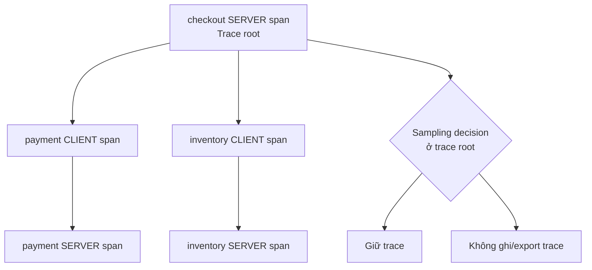
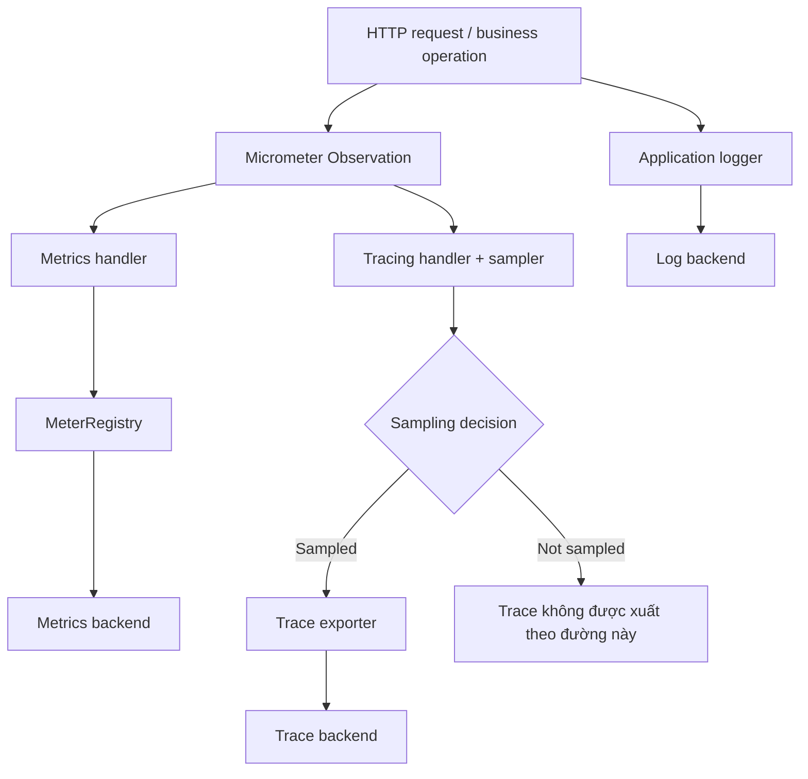
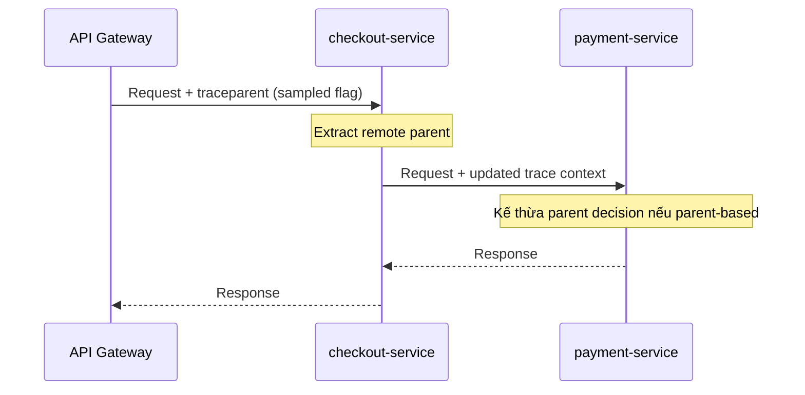
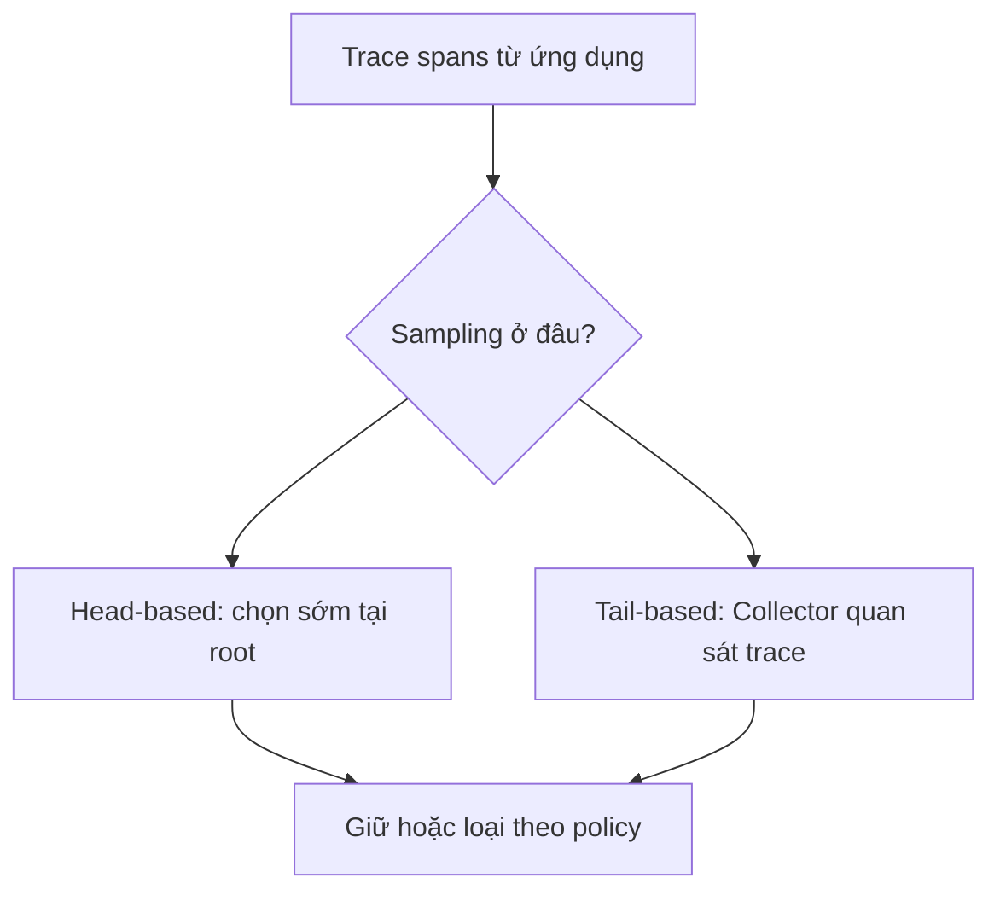

# Mặc định 10 phần trăm trong distributed tracing của Spring Boot

Một ứng dụng Spring Boot có thể nhận hàng chục nghìn requests mỗi phút. Nếu lưu mọi distributed trace, chi phí ingest, lưu trữ và truy vấn có thể tăng nhanh. Nếu chỉ lấy một phần traces, hệ thống vẫn có thể cung cấp góc nhìn tổng quan mà giảm lượng dữ liệu tracing. Trong hệ sinh thái Spring Boot 3.x với Micrometer Tracing, xác suất sampling mặc định thường được đặt ở **10%**: một lựa chọn ban đầu giữa khả năng điều tra và chi phí.

Bài **Mặc định 10 phần trăm** thuộc chương **Sampling** của module **SPRING_BOOT_OBSERVABILITY**. Module hướng dẫn thiết lập observability cho Spring Boot bằng Micrometer Observation, metrics, logs và distributed tracing; học context propagation, tags/cardinality, exporter, sampling và liên kết tín hiệu để điều tra lỗi, độ trễ và hành vi ứng dụng trên môi trường thực.

Mục tiêu bài học là hiểu chính xác ý nghĩa của `management.tracing.sampling.probability=0.1`, biết xác suất này ảnh hưởng tới trace nào, phân biệt quyết định lấy mẫu ở đầu trace với quyết định ở từng span, hiểu quan hệ parent-based qua nhiều service, và không nhầm sampling của tracing với việc bỏ metrics hoặc logs.

## 1. Sampling 10% có nghĩa gì?

**Sampling** là quyết định chọn một phần traces để ghi nhận và/hoặc xuất sang trace backend. Khi xác suất lấy mẫu được cấu hình ở `0.1`, một sampler xác suất có thể chọn xấp xỉ **10% các trace roots đủ điều kiện** trong dài hạn.

Điều đó **không có nghĩa**:

- Cứ đúng 10 requests thì luôn có 1 trace được giữ.
- Mọi nhóm 100 requests đều có chính xác 10 traces.
- Chỉ 10% spans của mỗi trace được ghi, còn 90% spans khác bị bỏ ngẫu nhiên.
- Metrics hoặc application logs cũng tự động chỉ còn 10%.
- Trace đã được chọn chắc chắn xuất hiện trên giao diện backend; exporter, collector và backend vẫn có thể lỗi.

Ví dụ một tập 1.000 requests độc lập, nếu sampler thực sự áp xác suất 0.1 cho từng root trace, số traces được chọn **kỳ vọng** là 100. Kết quả thực tế có thể thấp hơn hoặc cao hơn. Với mô hình xác suất độc lập lý tưởng, độ lệch chuẩn của số traces được chọn là:

\[
\sqrt{n p (1-p)}
= \sqrt{1000 \times 0.1 \times 0.9}
\approx 9.49
\]

Đây là mô hình xác suất minh họa, không phải lời cam kết cho một batch thực tế. Parent-based sampling, sampler tùy chỉnh, các SDK và chính sách upstream có thể làm điều kiện chọn mẫu phức tạp hơn.

## 2. Cấu hình xác suất sampling trong Spring Boot

Với những dòng Spring Boot có Micrometer Tracing auto-configuration, property thường dùng là:

```yaml
management:
  tracing:
    sampling:
      probability: 0.1
```

`0.1` là xác suất 10% theo sampler được cấu hình. Trong Spring Boot 3.x, đây là giá trị mặc định phổ biến của sampling probability khi dùng tracing auto-configuration mặc định. Hãy kiểm tra tài liệu và effective configuration của **đúng phiên bản Spring Boot đang chạy**, vì bridge, starter hoặc cấu hình SDK tùy chỉnh có thể thay đổi sampler thực tế.

Ví dụ có tên ứng dụng và endpoint OTLP:

```yaml
spring:
  application:
    name: checkout-service

management:
  tracing:
    sampling:
      probability: 0.1
  otlp:
    tracing:
      endpoint: http://localhost:4318/v1/traces
```

Địa chỉ trên minh họa OTLP/HTTP; collector phải nhận đúng protocol và endpoint. `localhost` trong container là container ứng dụng, không mặc nhiên là container collector. Nếu chọn Zipkin/Brave hoặc OTel SDK tùy chỉnh, property/exporter tương ứng cần được cấu hình riêng.

### Khi nào thay đổi xác suất?

| Môi trường/tình huống | Hướng lựa chọn | Lý do |
| --- | --- | --- |
| Local development | 1.0 có thể hữu ích | Dễ nhìn thấy spans khi học và debug |
| Automated test | 1.0 hoặc sampler deterministic | Kết quả dễ kiểm chứng |
| Staging có traffic hạn chế | Có thể chọn tỷ lệ cao | Cần xác minh propagation và instrumentation |
| Production traffic lớn | 0.1 là điểm bắt đầu, không phải đáp án cố định | Cân bằng khả năng quan sát, chi phí và dung lượng |
| Incident cần trace đầy đủ có thời hạn | Điều chỉnh có kiểm soát hoặc policy chọn lọc | Tập trung điều tra và giới hạn chi phí |

Không tăng lên 100% trên production vô thời hạn chỉ vì một trace bị thiếu. Trước tiên kiểm tra sampler, exporter, collector, backend và context propagation; việc nâng sampling không sửa được endpoint OTLP sai hay spans chưa được instrument.

## 3. Trace root và các span con

Một request checkout có thể tạo server span ở checkout-service, sau đó tạo client span gọi payment-service và inventory-service. **Một quyết định sampling ở đầu trace có thể ảnh hưởng tới toàn bộ trace qua nhiều service**.



Sơ đồ minh họa kết quả ở mức trace. Nếu trace được giữ, các spans được instrument trong trace có thể đi qua pipeline xuất. Nếu trace bị loại theo quyết định ở đầu, không nên kỳ vọng một span con ở payment tự xuất hiện như một trace đầy đủ độc lập, trừ khi có cơ chế khác được thiết kế rõ ràng.

Với **parent-based sampler**, span con thường kế thừa sampling decision từ parent. Điều này giúp trace có tính nhất quán: một service không tự quyết định giữ span con trong khi service cha đã bỏ trace theo chính sách parent-based. Cơ chế cụ thể tùy sampler/bridge.

### Parent-based và probability-based

- **Probability-based sampler** quyết định dựa trên xác suất/thuật toán sampling, thường tại root khi chưa có parent decision.
- **Parent-based sampler** xem decision của parent trước; chỉ khi không có parent (root span) mới áp dụng root sampler như probability-based sampler.
- **Remote parent** có thể mang sampling flag từ service upstream. Service downstream có thể kế thừa quyết định đó thay vì áp dụng tỷ lệ cục bộ mới.

Vì vậy, nếu gateway đã chọn trace, các services sau thường cần tiếp tục giữ trace đó để hoàn chỉnh distributed trace. Ngược lại, nếu upstream không sample, service downstream không nên tự ý đổi trace thành sampled trừ khi kiến trúc sampling của hệ thống cho phép và đã kiểm chứng ảnh hưởng.

## 4. Tại sao không có đúng một trace trong mỗi mười request?

Sampling probability là **xác suất**, không phải bộ đếm chia đều. Giả sử 10 requests đi qua root sampler với xác suất 0.1:

| Số traces được giữ | Có thể xảy ra? | Giải thích |
| --- | --- | --- |
| 0 | Có | Tất cả lần chọn đều không được sample |
| 1 | Có | Kết quả gần với kỳ vọng 10% |
| 2 hoặc nhiều hơn | Có | Có thể nhiều request cùng được chọn |
| 10 | Có về mặt xác suất | Rất hiếm nếu các lần chọn độc lập, nhưng không thể tuyên bố tuyệt đối bằng 0 |

Không nên kiểm tra sampling bằng một test chỉ gửi đúng 10 requests rồi assert có đúng 1 trace. Test đó sai về bản chất thống kê và sẽ chập chờn.

Với một sampler xác suất độc lập, số traces được giữ gần đúng theo kỳ vọng `n × p` khi n đủ lớn. Observed trace count còn chịu ảnh hưởng của traffic, retries, parent decision, exporter failures, dropped spans và các request không tạo span.

## 5. Sampling không giống metrics sampling hay log sampling

Spring Boot Observability có các pipeline riêng:



Với cấu hình thông thường:

- **Metrics** có thể tiếp tục đếm toàn bộ requests được instrumentation đo, dù chỉ một phần traces được sample.
- **Logs** được ghi theo logging policy riêng. Chúng không tự động giảm còn 10% chỉ vì trace sampling là 0.1.
- **Traces** chịu sampling decision. Backend có thể chỉ nhận một phần trace roots.

Không suy ra số requests từ số traces trong backend nếu chưa biết sampling rate và pipeline health. Cũng không dùng traceId làm metric label để nối từng request; cardinality sẽ rất cao.

### Ví dụ về sự khác nhau

Giả sử một giờ có 50.000 HTTP requests, metrics Timer ghi nhận đủ 50.000 lần, application logs ghi 3.000 sự kiện theo mức log, và tracing probability 0.1 chọn khoảng 5.000 traces trong mô hình lý tưởng. Ba con số này khác nhau vì **chúng đo ba loại dữ liệu khác nhau**. Nếu trace backend chỉ thấy 4.600 traces, cần xét sampling, root count, retries, exporter/collector và ingest; không tự kết luận 400 requests thiếu metric.

## 6. Sampling và context propagation

Trace context thường truyền qua HTTP headers như W3C `traceparent`. Header chứa trace ID, parent span ID và flags có liên quan tới sampling. Nhờ propagation, downstream có thể biết parent trace đã được quyết định sample hay không.



Điểm cần nhớ:

1. Sampling decision có thể được mang trong trace context qua process boundary.
2. Parent-based sampler giúp downstream tuân theo quyết định upstream khi có parent hợp lệ.
3. W3C `traceparent` là một phần của tracing context; baggage là cơ chế riêng.
4. Không tin trace headers tùy tiện từ Internet như bằng chứng về danh tính hoặc quyền truy cập.
5. Nếu một service bỏ header hoặc dùng propagator không tương thích, trace có thể bị tách và mỗi service áp dụng sampler như một root riêng.

Một trace ID giống nhau trên logs không đủ chứng minh parent-child đúng. Cần kiểm tra spans/parent IDs và trace context qua từng hop trong test tích hợp.

## 7. 10% không tự nói đang dùng head-based hay tail-based sampling

`probability: 0.1` biểu diễn xác suất trong cấu hình sampler, nhưng **không tự nói toàn bộ kiến trúc đang dùng head-based hay tail-based sampling**.

### Head-based sampling

Quyết định được đưa ra sớm khi trace bắt đầu hoặc khi root span được tạo. Ưu điểm là giảm dữ liệu ngay từ application, tiết kiệm network và storage. Hạn chế là chưa biết request sẽ thất bại hoặc chậm về sau.

Ví dụ một request có xác suất 0.9 bị loại ngay ở đầu; dù nó timeout sau 5 giây, trace có thể không tồn tại ở backend. Metrics/logs có thể vẫn ghi nhận timeout.

### Tail-based sampling

Tail-based sampling thường được thực hiện ở collector hoặc một thành phần có khả năng giữ spans đủ lâu để quyết định sau khi quan sát trace. Nó có thể ưu tiên giữ traces có lỗi hoặc latency cao, dù chúng không nằm trong tỷ lệ random sample thông thường. Nhưng yêu cầu hạ tầng, memory, buffering, trace completeness và cấu hình phức tạp hơn.



Nếu muốn **giữ tất cả traces có lỗi** bằng tail-based sampling, không thể chỉ đặt `management.tracing.sampling.probability=0.1` rồi kỳ vọng Spring Boot mặc định tự làm điều đó. Phải cấu hình collector tail sampler, bảo đảm nhận đủ spans trước quyết định và xét cách application/parent sampler phát trace data. Một head sampler loại bỏ toàn bộ dữ liệu trước collector thì tail sampler không thể khôi phục spans đã không được gửi.

## 8. Xác suất 10% và chi phí tracing

Giả sử mỗi request tạo trung bình 6 spans, traffic là 2.000 requests/giây và probability sampling là 0.1. Trong mô hình đơn giản mà 10% root traces được giữ và các spans trong trace được giữ đầy đủ:

\[
2{,}000 \times 0.1 = 200\ \text{traces/giây}
\]

\[
200 \times 6 = 1{,}200\ \text{spans/giây}
\]

Nếu tăng sampling lên 1.0, lượng trace/spans dự kiến tăng khoảng 10 lần trong cùng giả định. Đây là **ước lượng tải**, không phải số liệu cam kết; trace có thể có số spans khác nhau, instrumentation không đầy đủ, sampler/parent decisions khác và exporter có thể drop data.

Chi phí chịu ảnh hưởng bởi:

- Số trace roots được giữ.
- Số spans trung bình mỗi trace và kích thước attributes/events.
- Sampling rate, retry traffic và số hop trong distributed request.
- Export batch, collector buffer/queue và throughput.
- Retention, indexing, query và dashboard ở trace backend.
- Số lượng custom attributes/high-cardinality values có chi phí lưu/search cao.

Giảm sampling không thay thế việc giảm span attributes dư thừa, payload nhạy cảm hoặc span names động. Cần điều chỉnh cả instrumentation, tag/cardinality và retention.

## 9. Chọn xác suất theo mục tiêu và lưu lượng

Không có một tỷ lệ sampling phù hợp cho mọi hệ thống:

| Nhu cầu | Hướng cân nhắc |
| --- | --- |
| Debug local, demo propagation | 1.0 trong thời gian ngắn |
| Staging ít traffic, kiểm tra end-to-end | Tỷ lệ cao để bao phủ test |
| Production, lưu lượng vừa | 0.1 có thể là điểm xuất phát nếu ngân sách cho phép |
| Production, lưu lượng rất lớn | Thấp hơn 0.1 hoặc chiến lược chọn lọc/tail-based |
| Cần điều tra lỗi hiếm | Kết hợp metrics/log alerts với policy giữ trace lỗi ở collector nếu kiến trúc đáp ứng |
| Dịch vụ có yêu cầu audit | Dùng audit/event pipeline có cam kết lưu trữ riêng; không coi trace sampling là audit log |

Khi đánh giá, theo dõi **trace volume thực**, export errors, collector drops, backend ingestion và chi phí. Không chỉ nhìn cấu hình probability để suy ra số lượng dữ liệu được lưu.

Nếu có `N` trace roots đủ điều kiện và xác suất sampling `p`, kỳ vọng số trace roots được chọn là:

\[
E[\text{sampled roots}] = N \times p
\]

Với 2.000.000 roots và `p=0.1`, số kỳ vọng là 200.000. Con số này không đồng nghĩa với 200.000 traces chắc chắn xuất hiện ở backend; exporter, collector hoặc backend có thể loại/mất dữ liệu sau quyết định sampling.

## 10. Cấu hình và vận hành trong Spring Boot

Một cấu hình profile minh họa có thể tách development và production:

```yaml
# application-dev.yml
management:
  tracing:
    sampling:
      probability: 1.0
```

```yaml
# application-prod.yml
management:
  tracing:
    sampling:
      probability: 0.1
```

Các file profile chỉ là ví dụ. Cần xác nhận profile active, externalized configuration, biến môi trường và custom tracer bean có ghi đè sampler hay không. Property có tên đúng nhưng profile không active thì không tác động runtime.

Trong hệ OTel, nếu ứng dụng dùng SDK tự cấu hình ngoài auto-configuration của Spring Boot, sampler có thể được đặt ở SDK thay vì property. Tránh cấu hình hai nơi rồi không biết sampler nào thắng. Kiểm tra startup configuration, beans và một test trace thực tế.

**Đừng bật xác suất cao bằng hot change mà không đánh giá tải:** tăng từ 0.1 lên 1.0 có thể nhân tải exporter/backend gần 10 lần theo giả định trace count ổn định. Nếu cần nâng sampling trong incident, giới hạn phạm vi service/traffic và thời gian, theo dõi queue/backpressure rồi đưa cấu hình về mức vận hành sau điều tra.

## 11. Kiểm thử sampling probability

Không nên viết unit test gửi 10 requests rồi assert đúng 1 trace. Với probability 0.1, kết quả của mẫu nhỏ biến động mạnh. Hãy tách các loại xác minh:

| Loại test | Mục tiêu | Cách làm |
| --- | --- | --- |
| Configuration test | Effective property bằng giá trị mong đợi | Khởi tạo Spring context theo profile và đọc cấu hình |
| Sampler unit test | Quyết định của sampler theo input cụ thể | Dùng sampler deterministic/test fixture phù hợp SDK |
| Statistical test | Tỷ lệ quan sát gần xác suất cấu hình trên đủ mẫu | Tạo tập lớn, dùng khoảng sai số thống kê |
| Propagation integration test | Child spans kế thừa sampling decision | Request qua client/server test và assert trace flags/IDs |
| Export pipeline test | Dữ liệu sampled tới collector | In-memory exporter hoặc receiver test |

### Kiểm tra cấu hình và metrics độc lập

Một integration test nên xác minh hai điều tách biệt:

1. Sampling property của tracing được nạp đúng.
2. Metrics Timer vẫn được ghi khi tracing sampler không chọn trace, nếu pipeline metrics được cấu hình độc lập.

Đừng assert trace count bằng metric count; hai đại lượng khác nhau.

### Statistical sanity check

Nếu test sampler xác suất độc lập với `n=10.000`, `p=0.1`, kỳ vọng 1.000 traces và độ lệch chuẩn lý tưởng:

\[
\sqrt{10{,}000 \times 0.1 \times 0.9} = 30
\]

Có thể định nghĩa vùng chấp nhận rộng hơn vài độ lệch chuẩn để giảm test flaky. Test này chỉ hợp lý với sampler có tính chất xác suất độc lập; không áp dụng máy móc cho parent-based/remote-sampled traffic hoặc custom sampler.

Không gọi exporter thật tới production trong unit test. Dùng in-memory exporter, mock/receiver và test environment tách biệt.

## 12. Khi metrics và traces có số lượng khác nhau

Giả sử ứng dụng có:

- 100.000 requests được HTTP server Timer ghi nhận.
- 10.000 trace roots được sampler chọn ở mức probability 0.1 trong mô hình lý tưởng.
- Một trace trung bình có 5 spans.

Trace backend có thể nhận khoảng 50.000 spans, chứ không phải 10.000 span; **trace count và span count khác nhau**. Metrics count là số lần đo theo định nghĩa meter, còn trace roots là số distributed traces được chọn.

Nếu số liệu thực tế khác xa dự kiến, kiểm tra:

1. Metrics có đếm retries/health checks/management requests hay không.
2. Trace sampling thực sự áp dụng ở root hay bị upstream parent decision chi phối.
3. Services có tạo spans và propagate context đầy đủ không.
4. Exporter/collector có dropped spans, throttling hoặc queue đầy không.
5. Backend có giới hạn ingest, filter, retention hoặc query sai service/time range không.

Một tỷ lệ `traces / requests` thấp hơn 10% chưa chắc sampler sai: có thể một số requests không tạo trace root tại service này vì chúng là child của gateway trace. Một tỷ lệ cao hơn cũng có thể xuất phát từ các service tự tạo root do propagation bị đứt.

## 13. Sampling không bảo vệ dữ liệu nhạy cảm

Không nên coi 10% là cơ chế privacy. Nếu một request chứa access token trong span attribute và sampler chọn trace đó, secret vẫn được export. Sampling chỉ quyết định **trace nào được giữ**, không tự làm sạch nội dung của trace được giữ.

Các quy tắc:

- Không ghi Authorization, Cookie, password, token hoặc request/response body nhạy cảm vào spans.
- Dùng route template thay cho raw URL có ID/query.
- Chuẩn hóa exception category thay cho exception message tự do khi message có thể chứa PII/secret.
- Giữ span names ổn định, không nhúng order ID hay user ID.
- Baggage chỉ truyền fields tối thiểu, có allowlist và giới hạn kích thước.
- Dùng metrics tags low-cardinality; không thêm trace ID làm dimension.

Nếu muốn bỏ dữ liệu nhạy cảm, làm ở instrumentation/source hoặc pipeline transformation được kiểm chứng. Không dựa vào việc “đa số trace đã bị sample out” để cho phép thu thập secrets.

## 14. Sự cố thường gặp

| Hiện tượng | Nguyên nhân có thể | Hướng kiểm tra |
| --- | --- | --- |
| Chỉ thấy xấp xỉ 10% traces | Sampling đang hoạt động như cấu hình | Đối chiếu traffic roots và exporter/backend health |
| Gửi 10 requests không có trace | Kết quả xác suất ở mẫu nhỏ | Tăng số mẫu hoặc dùng deterministic test |
| Metrics count nhiều hơn traces | Metrics không theo tracing sampling | Bình thường; xác minh pipeline độc lập |
| Downstream không có span nhưng upstream có | Propagation, instrumentation hoặc exporter downstream | Kiểm tra headers, client/server spans và exporter |
| Service downstream sample khác upstream | Parent-based behavior không được dùng hoặc parent context mất | Kiểm tra sampler và propagation format |
| Traces nhiều hơn mong đợi | Nhiều root traces do context đứt, custom sampler | Kiểm tra trace IDs mới ở mỗi service |
| Trace được sample nhưng backend không thấy | Exporter/collector/network/backend drop | Kiểm tra export errors và dropped spans |
| Tăng probability nhưng không thêm trace | Property chưa active hoặc SDK custom sampler ghi đè | Kiểm tra effective config và tracer bean |
| Trace backend có ít spans dù trace roots đủ | Instrumentation thiếu spans hoặc collector drop | Kiểm tra span count và pipeline |
| Error hiếm không có trace | Head sampling đã loại trace trước khi lỗi phát sinh | Kết hợp logs/metrics hoặc thiết kế tail-based sampling |
| Chi phí tăng mạnh sau deploy | Sampling rate tăng, spans/attributes nhiều hơn | Đo root/trace/span volume và chi phí ingest |

## 15. Tình huống thực tế: payment timeout không có trace

**Bối cảnh giả định:** checkout-service ghi nhận 20.000 requests trong một giờ. Metrics cho thấy 1,2% payment calls timeout. Tracing probability đang là 0.1, nhưng người vận hành tìm một request timeout cụ thể và không thấy trace.

Quy trình hợp lý:

1. Xác nhận request có được instrumentation tạo trace root hay là child của gateway trace.
2. Kiểm tra trace decision từ upstream; nếu parent không sampled và sampler parent-based, downstream có thể kế thừa quyết định bỏ trace.
3. Kiểm tra exporter/collector có hoạt động và không drop spans; sampling 10% không có nghĩa backend luôn nhận đủ 10%.
4. Dùng metrics để xác định tỷ lệ timeout theo payment client và time window.
5. Dùng logs có trace/correlation fields theo policy để tìm sự kiện timeout, dù trace không được lưu.
6. Nếu cần tái hiện, thực hiện test trong staging với sampling cao hơn hoặc deterministic test; không bật 100% toàn production vô thời hạn.
7. Nếu yêu cầu giữ traces lỗi trong production, đánh giá tail-based sampling ở collector với đủ dữ liệu, buffer, memory và bảo đảm spans không bị head sampler loại trước khi tới collector.

Một request lỗi không có trace **không chứng minh lỗi không xảy ra**, và cũng không nhất thiết chứng minh sampler sai. Sampling là một phần của thiết kế quan sát; metrics và logs vẫn cần cung cấp bằng chứng độc lập.

## 16. Bài tập tự kiểm tra

**Bài 1.** `management.tracing.sampling.probability=0.1` có bảo đảm cứ 100 requests sẽ lưu đúng 10 traces không?

*Gợi ý:* Không. Đây là xác suất/kỳ vọng trên tập đủ lớn, không phải chia đều theo batch.

**Bài 2.** Vì sao metric Timer count có thể là 50.000 còn trace backend chỉ có 5.000 traces?

*Gợi ý:* Metrics và tracing là hai pipeline. Sampling có thể chỉ giữ khoảng 10% root traces trong khi metrics vẫn đo toàn bộ requests được instrument.

**Bài 3.** Gateway đã sample một trace. Vì sao payment-service không nên tự áp probability 0.1 độc lập cho span con?

*Gợi ý:* Parent-based sampler thường kế thừa parent decision để toàn trace nhất quán. Service con không được tùy tiện tách trace theo policy riêng.

**Bài 4.** Một trace bị head sampler loại ngay ở root; collector tail sampler có thể giữ lại spans lỗi của trace đó không?

*Gợi ý:* Không nếu spans không được gửi tới collector. Tail sampler chỉ quyết định trên dữ liệu mà nó nhận được.

**Bài 5.** Muốn kiểm tra probability 0.1, có nên gửi đúng 10 requests rồi assert có đúng một trace?

*Gợi ý:* Không. Mẫu quá nhỏ và kết quả ngẫu nhiên; dùng deterministic sampler test hoặc statistical test trên đủ nhiều roots với khoảng sai số.

**Bài 6.** Tăng sampling từ 0.1 lên 1.0 có thể ảnh hưởng gì?

*Gợi ý:* Số traces/spans, network, exporter queues, collector memory, backend ingest/storage/indexing và chi phí có thể tăng gần 10 lần theo cùng giả định.

**Bài 7.** Sampling 10% có làm 90% application logs tự bị bỏ không?

*Gợi ý:* Không. Logging pipeline độc lập, trừ khi hệ thống có log sampling policy riêng.

**Bài 8.** Vì sao probability sampling không phải biện pháp bảo vệ token trong trace?

*Gợi ý:* Trace được chọn vẫn giữ dữ liệu nhạy cảm; cần loại bỏ/che dữ liệu tại nguồn hoặc pipeline đã kiểm chứng.

## 17. Ghi nhớ

- **Sampling probability 0.1** biểu diễn xác suất chọn trace khoảng 10% theo sampler; đó là kỳ vọng thống kê, không phải cam kết mỗi nhóm 10 requests có đúng một trace.
- Với **parent-based sampling**, trace con thường kế thừa quyết định của parent để các spans trong distributed trace nhất quán; kiểm tra propagation nếu mỗi service tạo root riêng.
- **Metrics, logs và traces có pipeline độc lập**. Metrics có thể đếm toàn bộ requests và logs có thể vẫn được ghi dù traces chỉ giữ một phần.
- **Head-based sampling** quyết định sớm; **tail-based sampling** quyết định ở collector sau khi quan sát dữ liệu. Tail sampling không thể phục hồi spans đã bị head sampler loại trước đó.
- 10% không phải tỷ lệ phù hợp cho mọi môi trường. Chọn theo traffic, nhu cầu điều tra, exporter/collector capacity, storage, retention và chi phí.
- Không kiểm thử xác suất bằng cách gửi đúng 10 requests rồi đòi đúng một trace; dùng sampler deterministic hoặc statistical test đủ mẫu.
- Sampling **không phải cơ chế bảo mật**. Không đưa secrets/PII vào spans, baggage, logs hoặc metric tags, kể cả khi phần lớn traces bị loại.
