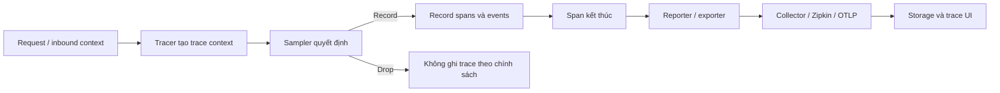
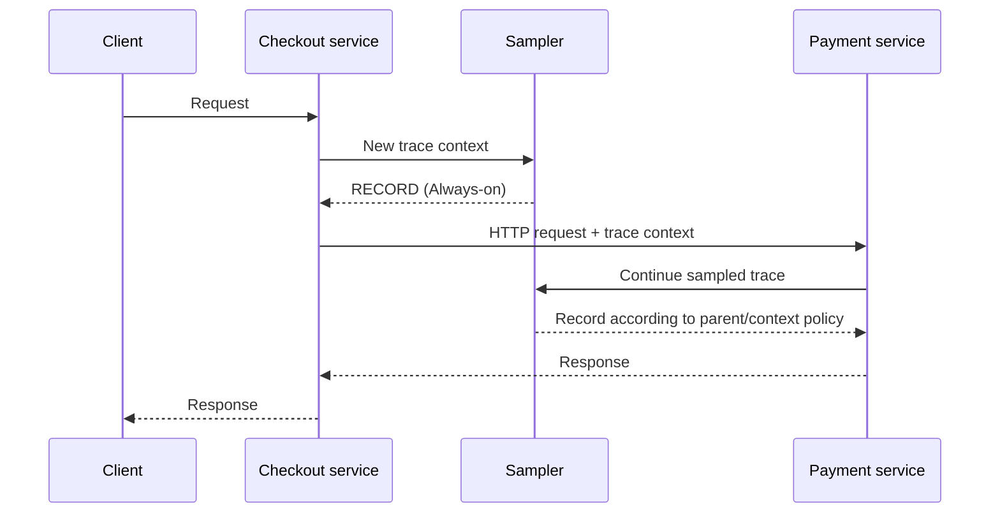
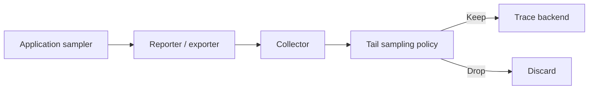

# Always-on sampler trong distributed tracing

Một dịch vụ Spring Boot đang điều tra lỗi timeout hiếm gặp. Dashboard metrics cho biết tỷ lệ lỗi tăng nhẹ, nhưng nhóm vận hành không tìm được trace của request thất bại. Một cách nhanh để loại trừ khả năng sampling đã bỏ trace là tạm thời dùng **Always-on sampler**: chọn ghi nhận mọi trace đủ điều kiện ngay từ đầu. Trong môi trường kiểm thử có lưu lượng thấp, đây cũng là cách đơn giản để xác minh instrumentation, context propagation và exporter.

Tuy nhiên, **Always-on sampler không đồng nghĩa mọi telemetry chắc chắn được lưu ở backend**. Nó chỉ thay đổi quyết định sampling ở lớp tracer; span vẫn có thể không được kết thúc đúng, reporter/exporter có thể lỗi, collector có thể drop dữ liệu hoặc backend không giữ được trace. Trong production, chọn tất cả trace cũng có thể làm tăng đáng kể CPU, network, bộ nhớ hàng đợi và dung lượng lưu trữ.

Bài học thuộc chương **Sampling** của module **SPRING_BOOT_OBSERVABILITY**. Module hướng dẫn thiết lập observability cho Spring Boot bằng Micrometer Observation, metrics, logs và distributed tracing; học context propagation, tag/cardinality, exporter, sampling và liên kết các tín hiệu để điều tra lỗi, độ trễ và hành vi ứng dụng thực tế. Bài này giải thích ý nghĩa, cách cấu hình, giới hạn và cách vận hành **Always-on sampler** trong hệ tracing.

## Mục tiêu học tập

Sau bài này, bạn có thể:

1. Giải thích Always-on sampler chọn trace như thế nào và phân biệt sampling với span recording, propagation, reporting và storage.
2. Hiểu head-based sampling và tác động của quyết định sampling ở root span tới các service downstream.
3. Cấu hình sampling probability bằng Spring Boot và nhận biết cách cấu hình sampler trực tiếp của Brave hoặc OpenTelemetry.
4. Dùng Always-on trong test/lab có kiểm soát để xác minh trace path.
5. Đánh giá chi phí khi chọn toàn bộ trace trong môi trường có lưu lượng lớn.
6. Phân biệt “đã được sample” với “đã export thành công” và “đã được backend lưu”.
7. Kết hợp traces với metrics, logs, cardinality và privacy để điều tra sự cố.
8. Thiết kế chính sách sampling production phù hợp, có giới hạn và có khả năng quan sát.

## 1. Sampling nằm ở đâu trong pipeline tracing?

Một request có thể tạo ra nhiều spans khi đi qua controller, service, HTTP client, database và message broker. Nếu mọi request đều tạo và xuất toàn bộ span, hệ thống có thể phát sinh volume dữ liệu rất lớn. **Sampling** là cơ chế chọn một phần trace để ghi nhận/export theo chính sách.



Always-on sampler chọn nhánh **Record** cho mọi trace đủ điều kiện theo chính sách sampler tại điểm quyết định. Nó không tự đảm bảo tất cả bước phía sau đều thành công.

Cần tách năm khái niệm:

| Khái niệm | Câu hỏi | Ví dụ |
|---|---|---|
| **Sampling decision** | Trace có được chọn để ghi nhận không? | Always-on chọn mọi trace |
| **Recording** | Span attributes/events có được ghi trong quá trình thực thi không? | Tracer ghi span lifecycle |
| **Propagation** | Context có được truyền qua boundary không? | HTTP client inject traceparent/B3 |
| **Export/reporting** | Span đã kết thúc có được gửi đi không? | Zipkin reporter hoặc OTLP exporter |
| **Ingestion/storage** | Backend có nhận, lưu và cho truy vấn dữ liệu không? | Collector và trace database |

Một test có thể xác nhận sampler chọn trace nhưng không chứng minh exporter đã gửi. Một HTTP request có trace context cũng chưa chứng minh downstream ghi cùng trace. Đây là những tầng độc lập.

## 2. Always-on sampler là gì?

**Always-on sampler** là chính sách lấy mẫu luôn chọn ghi nhận trace thay vì chỉ chọn một xác suất nhỏ. Tùy tracing implementation, tên API có thể là:

- Brave: **Sampler.ALWAYS_SAMPLE**.
- OpenTelemetry SDK: **Sampler.alwaysOn()**.
- Spring Boot/Micrometer Tracing: có thể cấu hình probability bằng **management.tracing.sampling.probability: 1.0** trong các phiên bản hỗ trợ thuộc tính này.

Tất cả các ví dụ thể hiện cùng ý tưởng “chọn toàn bộ trace tại điểm head-sampling”, nhưng chúng **không phải cùng một API** và không nên trộn vào cùng một ứng dụng mà không có thiết kế tracer implementation rõ ràng.

### 2.1. “Always-on” nói về quyết định sampling

Nếu một trace mới đến và sampler được hỏi quyết định, Always-on trả về lựa chọn record/sample. Trong mô hình head-based sampling, quyết định thường xảy ra sớm khi trace được khởi tạo hoặc khi inbound context được xử lý.

Điều này có nghĩa:

- Root trace mới đủ điều kiện sẽ được chọn ghi nhận.
- Quyết định có thể được truyền tới service sau thông qua trace flags/B3 sampled flag.
- Các span được instrument trong trace có cơ hội được ghi và xuất.
- Các đoạn code chưa được instrument vẫn không tự sinh span.
- Exporter/backend vẫn có thể mất dữ liệu sau khi sampler đã chọn.

**Always-on không tạo instrumentation cho thư viện chưa được hỗ trợ**, không sửa context propagation và không biến một metric thành trace.

### 2.2. Không đồng nghĩa “luôn có trace cho mọi request”

Có thể có request không hiển thị trace dù cấu hình sampler luôn chọn:

- Request không đi qua instrumentation tạo span.
- Inbound context hoặc tracing handler không được cấu hình đúng.
- Span chưa được kết thúc vì lỗi lifecycle.
- Reporter/exporter gặp lỗi hoặc queue bị đầy.
- Collector từ chối payload hoặc mất kết nối.
- Backend hết retention, không lưu hoặc query sai khoảng thời gian/service.
- Một service downstream không hỗ trợ propagator hoặc không nhận được context.
- Có một sampler khác ở tầng collector/backend tiếp tục lọc dữ liệu.

Do đó, kết luận chính xác là **sampler ở lớp đã cấu hình chọn mọi trace được hỏi đến nó**, không phải “hệ thống cam kết lưu mọi request”.

## 3. Head-based sampling và quyết định Always-on

Head-based sampling quyết định sớm, thường trước khi biết toàn bộ kết quả xử lý. Nó có ưu điểm là giảm chi phí ngay từ đầu khi không chọn trace, nhưng không có đủ thông tin về lỗi hoặc độ trễ cuối cùng.



Trong mô hình parent-based, service con thường tôn trọng sampling decision đã có ở parent. Cách cụ thể phụ thuộc tracer, propagator và cấu hình. Nếu một gateway xóa header hoặc downstream không extract đúng, trace có thể bị tách hoặc có quyết định khác.

### 3.1. So sánh Always-on với xác suất 10%

| Đặc điểm | Always-on | Probability 10% |
|---|---|---|
| Quyết định cho trace mới đủ điều kiện | Chọn ghi nhận toàn bộ | Chọn theo xác suất cấu hình |
| Dễ kiểm thử instrumentation | Cao, không phải chờ mẫu ngẫu nhiên | Có thể cần nhiều lần chạy |
| Khả năng giữ trace hiếm | Tốt hơn ở lớp sampler này | Có khả năng bỏ trace hiếm |
| Lượng spans đầu vào | Có thể gần toàn bộ traffic instrumented | Thường thấp hơn nhiều |
| Chi phí reporter/backend | Cao nhất trong hai lựa chọn nếu traffic tương đương | Thường thấp hơn |
| Có bảo đảm backend lưu đủ không? | Không | Không |
| Phù hợp điển hình | Lab, test, debug có thời hạn | Production khi phù hợp ngân sách |

Probability sampling không nhất thiết tạo đúng 10 trace trong mỗi 100 request nhỏ. Đó là tỷ lệ kỳ vọng theo cơ chế sampler, có thể khác trên một cửa sổ ngắn do ngẫu nhiên, parent-based decisions, filtering và drop ở các tầng khác.

### 3.2. Sampling không làm thay đổi request nghiệp vụ

Sampler quyết định dữ liệu tracing nào được record. Nó không nên thay đổi kết quả xử lý checkout, response HTTP, transaction DB hay logic retry. Nếu việc bật tracing làm đổi hành vi nghiệp vụ, cần điều tra side effects hoặc lỗi instrumentation; không coi đó là semantics bình thường của sampling.

Metrics được instrument độc lập có thể tiếp tục đo toàn bộ request ngay cả khi trace sampler chọn một phần. Đây là lý do không nên dùng số trace đã lưu làm mẫu số duy nhất để tính SLI toàn dịch vụ.

## 4. Cấu hình Always-on qua Spring Boot

Trong các phiên bản Spring Boot 3.x có hỗ trợ thuộc tính sampling của Micrometer Tracing, cách cấu hình đơn giản nhất thường là đặt probability bằng **1.0**:

```yaml
spring:
  application:
    name: checkout-service

management:
  tracing:
    sampling:
      probability: 1.0
```

**1.0** biểu thị xác suất 100% trong cơ chế probability sampling được auto-configuration sử dụng. Cần kiểm tra phiên bản Spring Boot/Micrometer đang chạy và implementation tracer được chọn. Không áp dụng thuộc tính này một cách mù quáng cho mọi pipeline hoặc custom sampler.

### 4.1. Cấu hình theo profile lab

Có thể tạo cấu hình profile riêng cho lab:

```yaml
# application-tracing-lab.yml
management:
  tracing:
    sampling:
      probability: 1.0
```

Kích hoạt profile qua biến môi trường hoặc tham số chạy của Spring Boot theo quy ước dự án. Profile này giúp thử nghiệm dễ quan sát, nhưng phải có guardrail để không bị bật nhầm trong production.

Ví dụ:

```bash
java -jar app.jar --spring.profiles.active=tracing-lab
```

Trong CI integration test, cấu hình test riêng có thể đặt sampling 100% khi test cần xác minh export. Không dùng chung profile lab cho tất cả môi trường.

### 4.2. Khi ứng dụng khai báo custom Sampler bean

Nếu ứng dụng tự cung cấp sampler trực tiếp cho tracer hoặc bridge, custom bean có thể khiến auto-configuration mặc định không còn là nguồn quyết định. Khi ấy chỉ thay đổi **management.tracing.sampling.probability** có thể không tạo ra tác dụng như kỳ vọng.

Hãy kiểm tra:

1. Tracer implementation thực tế là Brave hay OpenTelemetry.
2. Có bean/customizer sampler tự khai báo hay không.
3. Spring Boot auto-configuration nào còn áp dụng.
4. Sampler có được inject vào tracer được dùng trong request path không.
5. Downstream có kế thừa sampling decision hay có policy riêng.

Không tạo hai sampler cạnh tranh và không giả định property sẽ override mọi custom implementation.

## 5. Cấu hình trực tiếp theo tracer implementation

Các ví dụ sau diễn tả API ở lớp implementation. Chọn **một** theo tracer thực tế của ứng dụng.

### 5.1. Brave

Brave có sampler constant Always sample. Ví dụ API khái niệm:

```java
import brave.sampler.Sampler;

Sampler sampler = Sampler.ALWAYS_SAMPLE;
```

Trong ứng dụng Spring Boot tích hợp Micrometer Tracing bridge Brave, không nên tự tạo một Sampler rời rồi không nối nó vào tracer đang được auto-configured. Nếu thật sự cần cấu hình trực tiếp, phải dùng extension point/bean được phiên bản Boot và bridge hỗ trợ để sampler đó được áp vào Brave tracing component mà request thực sự sử dụng.

**Đừng cấu hình đồng thời** sampler xác suất ở Boot và một Brave sampler tùy chỉnh mà không xác định nguồn quyết định cuối cùng.

### 5.2. OpenTelemetry SDK

OpenTelemetry SDK có sampler Always-on:

```java
import io.opentelemetry.sdk.trace.samplers.Sampler;

Sampler sampler = Sampler.alwaysOn();
```

Đây là API thuộc OpenTelemetry SDK. Nó không phải cấu hình cho Brave bridge. Nếu dùng Micrometer Tracing bridge Brave, đoạn code trên không tự thay đổi sampler Brave.

### 5.3. Vì sao cần phân biệt?

Micrometer Tracing cung cấp abstraction chung để ứng dụng ít phụ thuộc implementation. Nhưng sampler cụ thể là một phần của tracer SDK/implementation. Cấu hình phù hợp phải đi qua đúng auto-configuration hoặc extension point của implementation đã chọn.

Trước khi đổi sampler, kiểm tra dependency graph, bean wiring và startup diagnostics của đúng phiên bản ứng dụng. Không trộn class Brave và OpenTelemetry trong cùng ví dụ triển khai chỉ vì cả hai đều có API Sampler.

## 6. Ảnh hưởng của Always-on tới tải và chi phí

Nếu ứng dụng xử lý 2.000 request/giây, mỗi trace có trung bình 8 spans, và tất cả được sample, khối lượng đầu vào lý thuyết là:

```text
2.000 traces/second × 8 spans/trace
= 16.000 spans/second
```

Đây là phép tính minh họa trước khi tính các message/DB spans phát sinh thêm hoặc sampling/drop ở các downstream. Một trace có thể có số spans rất khác nhau tùy instrumentation và fan-out.

Chi phí có thể xuất hiện ở:

- **Ứng dụng:** CPU tạo span, serialize attributes/events, context bookkeeping.
- **Bộ nhớ:** exporter queue/buffer, batch processor và dữ liệu chờ gửi.
- **Mạng:** request/response ingest, retransmission, TLS và payload.
- **Collector/reporter:** xử lý, batching, retry, queue và backpressure.
- **Storage:** ingest rate, index, retention và replication.
- **Query/UI:** index/search trên khối lượng dữ liệu lớn.
- **Vận hành:** cảnh báo, dashboard và chi phí xử lý dữ liệu nhạy cảm.

### 6.1. Chi phí không chỉ tỷ lệ với request count

Một endpoint gọi 20 dependency có thể tạo nhiều spans hơn endpoint chỉ thực hiện một truy vấn nội bộ. Tracing attributes lớn, stack/event payload, exception details và số links cũng làm tăng payload bytes.

Dự báo capacity cần đo trên workload thực:

1. Requests/giây theo nhóm endpoint.
2. Trung bình và p95 số spans trên mỗi trace.
3. Payload bytes/span và bytes/trace.
4. Tỷ lệ request thành công/lỗi và hành vi retry.
5. Reporter/exporter queue, drops và retries.
6. Backend ingest/storage/indexing throughput.
7. Retention và replication factor.

### 6.2. Ví dụ ước tính sơ bộ

Giả sử có 500 request/giây, trung bình 10 spans/trace, trung bình 1,2 KB/span:

```text
500 × 10 × 1.2 KB
= 6,000 KB/s
≈ 6 MB/s
≈ 518 GB/day (decimal, before compression/overhead)
```

Đây chỉ là phép tính thô, không phải dự báo storage chính xác. Compression, protocol overhead, indexing, replication, attribute size, retries và retention làm số thực tế khác đáng kể. Tuy nhiên, nó cho thấy Always-on có thể tạo volume lớn ngay cả khi số request nhìn không quá cao.

## 7. Always-on trong test và CI

Always-on rất hữu ích khi muốn test tracing một cách xác định:

- Không phải chạy nhiều lần để hy vọng trace được sample.
- Dễ kiểm tra span cha/con và propagation giữa hai service.
- Có thể xác nhận exporter/backend nhận được trace test.
- Giúp phân biệt vấn đề instrumentation với việc sampling ngẫu nhiên bỏ dữ liệu.

Một test strategy:

1. Tạo profile test với sampling probability 1.0 hoặc sampler test chọn tất cả.
2. Dùng trace exporter/reporter test trong bộ nhớ nếu chỉ cần xác minh span tree.
3. Dùng backend/container cô lập ở một số ít integration test cần kiểm tra ingestion thật.
4. Gửi một request qua hai service.
5. Assert trace ID được duy trì, span ID riêng biệt và parent relation hợp lý.
6. Kiểm tra error path và async boundary.
7. Tắt/dọn backend và executor sau test.

### 7.1. Đừng assert mọi request production đều có trace

Test chạy trong môi trường test có sampler deterministic, nhưng production có thể probability sampling hoặc policy khác. Không viết business test phụ thuộc Zipkin UI phải có trace cho từng lần request. Thay vào đó, test context propagation và export trong test phù hợp; test logic nghiệp vụ nên độc lập với sampling.

### 7.2. Kiểm tra propagation độc lập export

Một bài test có thể xác minh:

- Worker nhận current trace context đúng.
- Outbound HTTP có traceparent hoặc B3 headers.
- Downstream tạo server span cùng trace.

Ba assertion này kiểm tra context/propagation. Nếu backend trống, kiểm tra exporter riêng. Không gộp chúng thành một lỗi “Always-on không hoạt động”.

## 8. Always-on không thay thế tail sampling

Always-on thường là quyết định head-sampling ở đầu trace. Nó chọn record mọi trace tại điểm đó, nhưng không biết request sẽ chậm hay lỗi ở cuối.

**Tail sampling** là chiến lược chờ đến khi có thêm span/dữ liệu của trace rồi mới quyết định giữ trace nào, ví dụ:

- Giữ toàn bộ trace có error.
- Giữ trace có duration vượt ngưỡng.
- Giữ một tỷ lệ trace bình thường.
- Giữ trace của một service/operation quan trọng.

Tail sampling thường cần collector có khả năng buffer các spans theo trace, đủ memory và cấu hình timeout/decision wait. Không phải cứ cấu hình probability 1.0 ở ứng dụng là đã có tail sampling.

### 8.1. Vì sao không thể drop sớm rồi giữ lại ở tail?

Nếu head sampler từ chối recording/export span, collector có thể không bao giờ nhận đủ dữ liệu để đánh giá trace đó. Muốn tail sampling có quyền quyết định trên toàn bộ trace, pipeline upstream phải chuyển các spans cần thiết tới collector, hoặc dùng cơ chế recording/transport phù hợp. Điều này có thể làm volume đến collector vẫn lớn dù backend cuối chỉ lưu một phần.

### 8.2. Một pipeline có thể có nhiều lớp sampling



Ví dụ application luôn record, collector chỉ giữ trace lỗi hoặc chậm. Chính sách này có thể hữu ích, nhưng phải dự báo tải ở bước B/C: **backend chỉ lưu ít không có nghĩa ứng dụng và collector chỉ xử lý ít**.

## 9. Parent-based sampling và propagation flags

Trong distributed tracing, request từ upstream có thể mang sampling decision. Parent-based sampler thường kế thừa decision đó để trace nhất quán giữa các services.

Với W3C Trace Context, traceparent có trace flags. Với B3, có sampled/debug indicators. Những giá trị này là dữ liệu propagation, không phải credential.

Các tình huống cần xem xét:

- Root service chọn Always-on, downstream có nên kế thừa không?
- Upstream không sampled nhưng downstream có một policy bắt buộc giữ trace riêng không?
- Gateway có rewrite/drop headers hay không?
- Một request bên ngoài có thể tự gửi sampled flag để ép hệ thống tạo trace volume lớn không?
- Tổ chức có trust boundary và policy cho inbound sampling flags như thế nào?

**Không tin vô điều kiện sampling flag từ Internet.** Cấu hình sampler có thể tôn trọng parent decision theo implementation; nếu đầu vào không đáng tin, cần thiết kế trust policy hoặc tạo root context mới ở boundary phù hợp. Tránh để client bất kỳ ép ứng dụng ghi toàn bộ payload trace chỉ bằng header.

## 10. Privacy, cardinality và bảo vệ dữ liệu

Always-on làm tăng lượng span được ghi; do đó mọi thông tin không phù hợp trong attributes/events/baggage có khả năng được thu thập thường xuyên hơn.

Không đưa vào spans:

- Authorization header, cookie, API key, access token.
- Số thẻ thanh toán, credential hoặc secret.
- Email, điện thoại, địa chỉ hoặc PII nếu không có cơ sở và kiểm soát phù hợp.
- Raw request/response body nhạy cảm.
- Query string chứa token hoặc dữ liệu người dùng.

Span names nên ổn định, ví dụ **checkout.payment.authorize**, không gắn order ID hoặc user ID vào tên. Attributes nên theo allowlist và semantic conventions; dữ liệu có cardinality cao phải có mục đích, quyền truy cập và retention rõ ràng.

### 10.1. Trace ID không phải metric label

Khi Always-on tạo nhiều trace, trace ID vẫn là identifier có cardinality cao. Không thêm trace ID vào metric tags để liên kết metrics và traces. Dùng log correlation hoặc exemplar khi backend hỗ trợ.

Metrics nên đo toàn bộ lưu lượng phù hợp với SLI. Nếu sampling trace giảm xuống 10%, số trace trong backend không được dùng làm denominator của tỷ lệ lỗi checkout.

### 10.2. Kiểm soát quyền truy cập

Trace data có thể tiết lộ route, tên service, dependency, exception và một phần metadata request. Hãy thiết lập:

- Quyền đọc trace theo nhóm vận hành.
- TLS/authentication giữa ứng dụng, collector và backend.
- Redaction ở instrumentation hoặc collector.
- Retention phù hợp mục đích điều tra.
- Audit access và policy xóa dữ liệu.
- Giới hạn attribute count/size và payload.

Always-on chỉ nên được bật ở nơi chính sách dữ liệu và chi phí cho phép.

## 11. Metrics và logs vẫn cần thiết khi dùng Always-on

Ngay cả khi sampling 100%, traces không thay thế metrics/logs:

| Tín hiệu | Câu hỏi chính |
|---|---|
| Metrics | Có bao nhiêu request lỗi? p95/p99 thay đổi thế nào trên toàn traffic? |
| Logs | Lỗi nào xảy ra, message/stack trace và quyết định nghiệp vụ nào được ghi? |
| Traces | Một request mẫu/được giữ đi qua service và dependency nào, mỗi span kéo dài bao lâu? |

Nếu Always-on làm backend trace có đủ dữ liệu trong một giai đoạn debug, dùng trace để tìm dependency hoặc gap instrumentation. Dùng metrics để lượng hóa mức độ ảnh hưởng cho toàn bộ request. Logs giúp tìm exception/retry cụ thể, nhất là khi trace không được ingest do exporter lỗi.

Một log có trace ID không đảm bảo span đã được lưu; ngược lại, backend có trace nhưng log correlation thiếu cũng có thể xảy ra. Ba pipelines cần được vận hành và kiểm chứng riêng.

## 12. Chẩn đoán: Always-on đã bật nhưng trace vẫn thiếu

| Hiện tượng | Nguyên nhân có thể | Cách kiểm tra |
|---|---|---|
| Không có trace nào | Tracer/bridge chưa được cấu hình hoặc không có instrumentation | Kiểm tra ObservationRegistry, tracing handler, dependencies và startup config |
| Chỉ có trace ở service đầu | Downstream không nhận context hoặc không export | Kiểm tra client injection, server extraction, propagator và reporter |
| Trace có nhưng thiếu child spans | Code chưa instrument, async context mất hoặc span lifecycle sai | Kiểm tra từng boundary/thread và instrumentations |
| Có trace ID trong log nhưng backend trống | Exporter/reporter/collector/storage lỗi | Xem exporter logs/metrics, ingestion status và retention |
| Trace xuất hiện trễ | Reporter/collector batching và async ingestion | Kiểm tra queue/batch/flush behavior |
| Có nhiều trace nhưng dashboard tăng tải | Volume Always-on vượt capacity | Đo spans/trace, payload size, ingest rate và storage |
| Downstream có trace ID khác | Header bị drop hoặc propagator không tương thích | Xác nhận B3/W3C headers và extraction ở hai đầu |
| Trace vẫn bị drop dù app Always-on | Collector/backend có policy sampling/drop khác | Kiểm tra pipeline sampling và filter ở từng tầng |
| Một client ép sampled flag | Inbound context được tin không đúng boundary | Xem trust policy cho inbound trace headers |

### Quy trình kiểm tra có thứ tự

1. Xác nhận sampler thực sự được áp dụng cho tracer đang chạy, không bị custom bean override.
2. Tạo một request test có instrumentation đã biết.
3. Quan sát current trace context và span lifecycle ở service đầu.
4. Kiểm tra trace headers outbound và context ở service sau.
5. Xác nhận span kết thúc và reporter thực hiện send.
6. Kiểm tra response từ Zipkin/collector hoặc trạng thái OTLP exporter.
7. Tìm trace bằng ID/service/time window phù hợp.
8. Đối chiếu policy filter/tail sampling/retention ở backend.
9. Kiểm tra metrics và logs để xác định tác động thực tế.

Không thay probability lên 1.0 thêm lần nữa nếu sampler đã chọn tất cả. Hãy tìm đúng nơi dữ liệu bị mất.

## 13. Tình huống thực tế: bật Always-on để điều tra timeout hiếm

Một dịch vụ checkout xử lý 700 request/giây. Tỷ lệ timeout payment khoảng 0,05%, tương ứng một số ít lỗi mỗi phút. Sampling 5% khiến nhóm vận hành đôi khi không có trace của request lỗi. Họ cân nhắc bật Always-on.

### Đánh giá trước khi bật

**Bước 1 — Định lượng volume.** Ước tính spans/trace, bytes/span, spans/giây và dung lượng theo ngày. 700 request/giây có thể tạo vài nghìn spans/giây nếu mỗi request gọi nhiều dependency.

**Bước 2 — Kiểm tra capacity.** Xác nhận reporter queue, collector throughput, backend ingest/indexing và storage còn dư địa. Xem thời gian retention cần cho cuộc điều tra.

**Bước 3 — Privacy review.** Xác nhận attributes không chứa payment credential hoặc request body nhạy cảm. Kiểm tra access control và retention.

**Bước 4 — Giới hạn phạm vi và thời gian.** Nếu có thể, áp dụng Always-on ở môi trường staging, một service/route có kiểm soát hoặc một cửa sổ debug có phê duyệt vận hành. Không bật toàn bộ hệ thống vô thời hạn chỉ vì một lỗi hiếm.

### Trong thời gian điều tra

- Theo dõi reporter/collector queue, drop, error và latency.
- So sánh tỷ lệ trace hiển thị với request count từ metrics.
- Lấy một số trace có timeout, đối chiếu child spans payment client/server.
- Dùng logs cùng trace ID để tìm retry, timeout policy và provider response.
- Xác định nguyên nhân bằng cách so sánh với trace thành công và số liệu dependency.

### Sau khi điều tra

1. Khôi phục sampling policy phù hợp production.
2. Kiểm tra config hiệu lực trên mọi instance/pod.
3. Xác nhận throughput/exporter/storage trở về mức dự kiến.
4. Rà soát trace data đã lưu theo retention và privacy policy.
5. Chuyển hiểu biết thu được thành metrics/alerts có cardinality thấp, chẳng hạn error rate và latency theo dependency/route.
6. Chỉ giữ spans/attributes thực sự cần cho điều tra về sau.

**Kết luận tình huống:** Always-on có thể giúp tìm một trace hiếm ở thời điểm debug, nhưng cách vận hành bền vững là dùng metrics để phát hiện/định lượng, tracing policy có chủ đích để giữ dữ liệu phù hợp và logs để giải thích sự kiện.

## 14. Các anti-pattern cần tránh

| Anti-pattern | Hậu quả | Cách làm phù hợp |
|---|---|---|
| Giữ Always-on vĩnh viễn trên traffic lớn mà không capacity plan | Tăng tải ứng dụng, collector và storage | Đo volume và chọn sampling policy có ngân sách |
| Nghĩ probability 1.0 bảo đảm backend lưu đủ traces | Bỏ qua exporter/collector/backend drop | Giám sát toàn pipeline |
| Bật property nhưng có custom Sampler bean khác | Cấu hình mong đợi không tác động tracer đang dùng | Kiểm tra bean và auto-configuration thực tế |
| Trộn Brave và OpenTelemetry Sampler API | Cấu hình sai implementation | Chọn tracer implementation, cấu hình đúng extension point |
| Dùng trace count để tính request error rate | Sampling bias và missing export làm sai mẫu số | Dùng metrics có instrumentation độc lập |
| Tin mọi inbound sampled flag | Client ngoài có thể làm tăng trace volume | Thiết kế trust boundary và sampler policy |
| Coi Always-on là tail sampling | Chọn trace trước khi biết kết quả cuối | Dùng collector tail policy nếu cần quyết định sau |
| Gắn traceId vào metric tag | Bùng nổ cardinality | Exemplar/log correlation |
| Đưa token/PII vào span vì “debug cần hết” | Rò rỉ dữ liệu qua trace pipeline | Allowlist, redaction, access control |
| Chỉ test thấy trace trên UI | Không biết lỗi nằm ở context, sampling hay backend | Test từng tầng độc lập |
| Dùng Always-on trong mọi CI test | Tốn thời gian/storage không cần thiết | Test sampler deterministic và exporter test/in-memory |
| Chỉ tăng sampling khi trace thiếu | Có thể lỗi do propagation/export | Kiểm tra điểm đầu tiên dữ liệu bị mất |

## 15. Checklist triển khai Always-on an toàn

Trước khi bật sampler trong bất kỳ môi trường nào:

1. **Mục đích:** đang cần test, lab, incident debugging hay production policy?
2. **Implementation:** tracer đang dùng Brave hay OpenTelemetry? Sampler nào thực sự được inject?
3. **Auto-configuration:** thuộc tính Spring Boot có hiệu lực hay bị custom Sampler bean override?
4. **Head/parent semantics:** quyết định của root trace có được downstream kế thừa đúng không?
5. **Propagation:** B3/W3C headers được inject/extract ở mọi service cần thiết?
6. **Instrumentation:** các span mong muốn thực sự được tạo; async lifecycle/context đúng?
7. **Exporter:** reporter/OTLP exporter hoạt động, queue/flush/retry được quan sát?
8. **Backend:** ingest/storage/query capacity đủ cho volume Always-on?
9. **Cardinality:** span names và attributes ổn định, không có metric labels theo trace ID?
10. **Privacy:** payload, header, baggage, exception và PII được allowlist/redact?
11. **Security:** TLS/authentication, access control, retention và audit đã sẵn sàng?
12. **Metrics:** SLI/error rate/latency tiếp tục đo toàn traffic độc lập với trace sampling?
13. **Operational guardrail:** có phạm vi, thời gian bật, người phụ trách và điều kiện tắt?
14. **Verification:** có trace kiểm thử xuyên service, và test riêng cho export/collector?
15. **Rollback:** sampling policy production ban đầu được lưu để khôi phục ngay sau debug?

## 16. Câu hỏi tự đánh giá

**Câu 1.** Always-on sampler làm gì?

**Gợi ý:** Chọn ghi nhận tất cả trace đủ điều kiện tại lớp sampler nơi nó được áp dụng; không bảo đảm exporter/backend lưu mọi span.

**Câu 2.** Đặt probability bằng 1.0 có tự tạo span cho mọi method Java không?

**Gợi ý:** Không. Sampling chỉ quyết định trên trace/span được tracer/instrumentation khởi tạo; method chưa được instrument không tự tạo span.

**Câu 3.** Ứng dụng chọn Always-on nhưng Zipkin không có trace. Nên kiểm tra gì?

**Gợi ý:** Tracer/bridge, instrumentation, span end, reporter, endpoint, network, collector, backend, retention và query; không chỉ kiểm tra probability.

**Câu 4.** Vì sao dùng Always-on trong lab nhưng cân nhắc kỹ production?

**Gợi ý:** Lab có tải nhỏ và cần trace dễ quan sát; production có volume, chi phí network/storage, privacy và capacity lớn hơn.

**Câu 5.** Sampling 10% có nghĩa chính xác 10 trong mỗi 100 request sẽ xuất hiện không?

**Gợi ý:** Không. Đây là tỷ lệ kỳ vọng theo cơ chế sampler, không cam kết tỷ lệ chính xác cho từng cửa sổ nhỏ; còn chịu ảnh hưởng parent decision và pipeline drop.

**Câu 6.** Always-on ở ứng dụng có đồng nghĩa tail sampling không?

**Gợi ý:** Không. Always-on thường là head decision; tail sampling quyết định sau khi collector có đủ dữ liệu của trace.

**Câu 7.** Có nên dùng số spans trong backend để tính tỷ lệ lỗi toàn dịch vụ?

**Gợi ý:** Không. Sampling/export/retention làm tập trace không nhất thiết đại diện. Dùng metrics với mẫu số request/giao dịch rõ.

**Câu 8.** Inbound request gửi sampled=1 có được tin vô điều kiện không?

**Gợi ý:** Không. Trace headers là dữ liệu không đáng tin từ boundary bên ngoài; cần policy phù hợp để tránh bị ép ghi telemetry và tăng chi phí.

**Câu 9.** Vì sao trace ID không nên là metric label khi bật Always-on?

**Gợi ý:** Mỗi trace thường có ID riêng, khiến số time series tăng theo lưu lượng và cardinality rất cao. Dùng correlation/exemplar.

**Câu 10.** Muốn dùng Always-on để test exporter, cần assertion nào ngoài current trace context?

**Gợi ý:** Xác nhận span đã kết thúc, reporter/exporter gửi được, collector/backend nhận và truy vấn được trace test theo ID.

## Kết luận

**Always-on sampler chọn ghi nhận mọi trace đủ điều kiện tại điểm sampling được cấu hình**, rất hữu ích cho lab, CI và điều tra có thời hạn. Trong Spring Boot, có thể cấu hình xác suất 1.0 ở các phiên bản hỗ trợ, hoặc dùng API Always-on của đúng tracer implementation như Brave hay OpenTelemetry. Quyết định này không thay thế instrumentation, context propagation, span lifecycle, reporter/exporter và backend storage; mỗi lớp cần được kiểm chứng riêng. Trước khi dùng trên production, phải ước tính spans/giây, payload, collector/storage capacity, privacy và retention; đồng thời giữ metrics và logs làm tín hiệu độc lập để lượng hóa tác động toàn dịch vụ.
