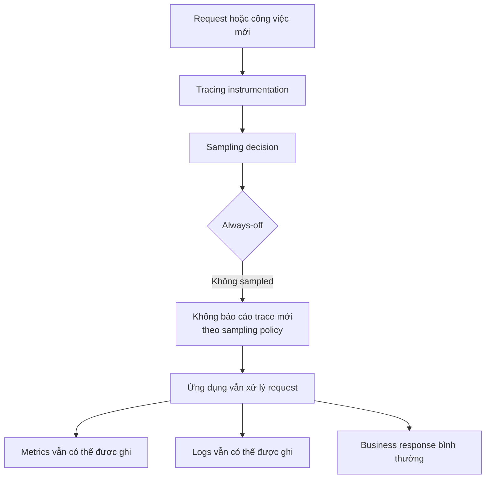
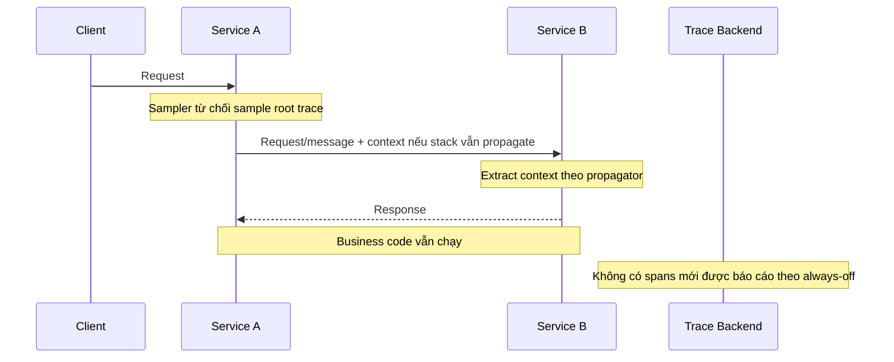
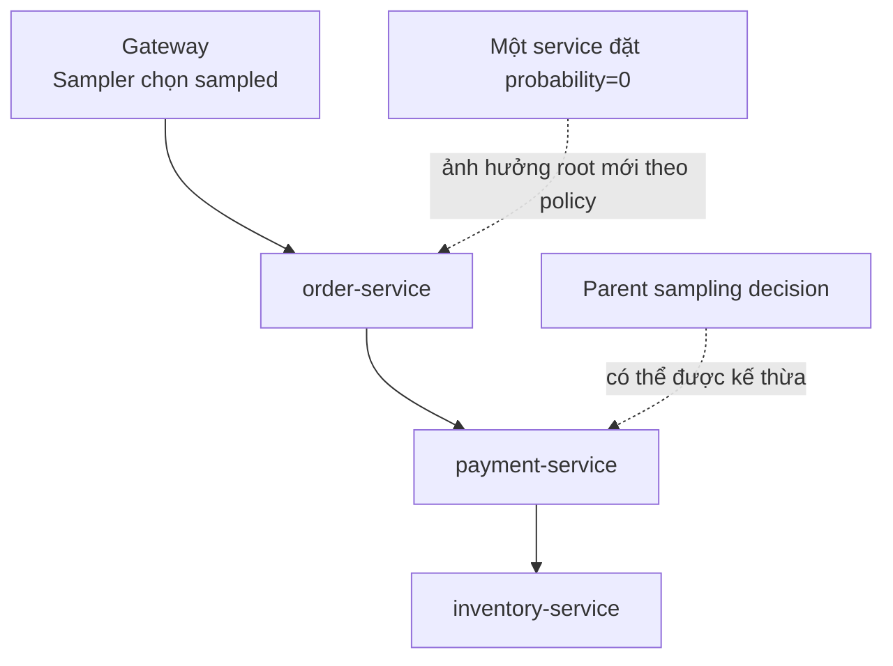

# Always-off sampler trong Spring Boot

Một ứng dụng Spring Boot đã tích hợp distributed tracing, nhưng môi trường thử nghiệm không được phép gửi spans tới backend; hoặc một service cần tạm ngừng ghi trace trong khi metrics và logs vẫn phục vụ vận hành. Một cách biểu đạt chính sách sampling là **always-off sampler**: mọi trace mới đủ điều kiện quyết định sampling đều bị từ chối lấy mẫu.

Trong Micrometer Tracing, sampling quyết định trace nào được ghi nhận và báo cáo theo chính sách của tracer. **Always-off** là chính sách không chọn trace mới để lưu/xuất. Điều này không đồng nghĩa ứng dụng ngừng tạo metrics, ngừng ghi logs, hay chắc chắn xóa hết trace context đang được truyền từ upstream.

Bài **Always-off sampler** thuộc chương **Sampling** của module **SPRING_BOOT_OBSERVABILITY**. Module tập trung thiết lập observability cho Spring Boot bằng Micrometer Observation, metrics, logs và distributed tracing; học propagation ngữ cảnh, tag/cardinality, exporter, sampling và liên kết tín hiệu để điều tra lỗi, độ trễ, hành vi ứng dụng trên môi trường thực.

## 1. Mục tiêu học tập

Sau bài học, bạn có thể:

- Giải thích ý nghĩa của always-off sampler và phân biệt nó với việc tắt toàn bộ tracing instrumentation.
- Cấu hình xác suất sampling bằng 0 trong Spring Boot khi dùng auto-configuration tương thích.
- Hiểu vai trò của sampler ở điểm quyết định root trace và ảnh hưởng của sampling decision đã nhận từ parent.
- Phân biệt recording/exporting spans với propagating trace context.
- Nhận biết ảnh hưởng riêng tới metrics, logs/MDC, baggage và distributed traces.
- Chọn trường hợp sử dụng phù hợp và đánh giá rủi ro khi tắt tracing trong production.
- Kiểm tra chính sách qua logs, trace backend, headers và metrics thay vì dựa trên một dấu hiệu.
- Tránh cấu hình nhiều sampler hoặc tự tạo tracer làm xung đột Spring Boot.

## 2. Sampling làm gì?

Distributed tracing tạo spans để mô tả các bước của một request hoặc công việc. Ở hệ thống có nhiều request, việc ghi và lưu toàn bộ trace có thể tăng CPU, network, storage, indexing và chi phí truy vấn. **Sampling** là cơ chế chọn tập trace được ghi nhận/báo cáo theo một policy.

| Chính sách | Ý nghĩa khái quát | Mục đích |
| --- | --- | --- |
| Always-on | Chọn mọi trace mới theo policy | Debug môi trường nhỏ hoặc yêu cầu quan sát đầy đủ khi tải thấp |
| Probability-based | Chọn theo xác suất | Cân bằng độ bao phủ và chi phí |
| Always-off | Không chọn trace mới tại điểm quyết định của sampler | Tạm ngừng recording/export trace theo policy |
| Rate-limited | Giới hạn số trace được chọn trong một khoảng | Kiểm soát tải theo lưu lượng |
| Custom/conditional | Chọn theo thuộc tính hoặc rule | Ưu tiên một số route, lỗi hoặc nhóm request |

Always-off là chính sách từ chối ở mức cao nhất. Nó có thể phù hợp với môi trường local không có tracing backend, kiểm thử nhằm xác minh hệ thống vẫn hoạt động khi không lưu trace, hoặc policy tạm thời đã được phê duyệt.

### Sampler không phải exporter

| Thành phần | Trả lời câu hỏi |
| --- | --- |
| Sampler | Trace nào được chọn để recording/reporting? |
| Tracing bridge | API Micrometer được nối với Brave hay implementation khác như thế nào? |
| Reporter/exporter | Span đã được ghi nhận sẽ được gửi đi bằng cơ chế nào? |
| Backend | Trace đã nhận được lưu và hiển thị ra sao? |
| Propagator | Context được inject/extract qua HTTP hoặc message headers thế nào? |

Nếu exporter lỗi mạng, trace có thể đã được sampled nhưng không đến backend. Nếu sampler always-off, trace mới có thể không được báo cáo dù exporter hoạt động bình thường. Hai tình huống cần cách chẩn đoán khác nhau.

## 3. Always-off nghĩa là gì?

Với một **root trace mới** cần quyết định sampling, always-off trả về quyết định không sampled. Theo tracing stack đang dùng, các spans tương ứng thường không được recording/reporting tới backend tracing.



Always-off **không phải circuit breaker của ứng dụng**. Nó không quyết định request được cho phép hay bị từ chối, không dừng controller/service, không tắt business logic và không thay thế security policy.

### Không sampled không có nghĩa trace context biến mất

Trace context có thể mang trace ID và sampling flags. Khi upstream đã gửi context, service downstream có thể extract context để duy trì quan hệ trace, ngay cả khi policy hiện tại không chọn trace mới.

Vì thế cần phân biệt:

- **Không sampled:** trace không được chọn để recording/reporting theo quyết định sampling.
- **Không có context:** request/message không mang trace context hợp lệ hoặc context không được extract.
- **Không export được:** span đã được ghi nhận nhưng reporter/exporter/network/backend gặp lỗi.

Các trạng thái này không tương đương. Một log vẫn có thể có trace ID trong khi tracing backend không lưu trace. Ngược lại, nếu context không đến service, log có thể không có trace ID dù ứng dụng có tracing bridge.

## 4. Cấu hình Spring Boot bằng probability bằng 0

Với Spring Boot 3.x đã cấu hình Micrometer Tracing và auto-configuration sampling tương thích, có thể đặt sampling probability bằng 0:

```yaml
spring:
  application:
    name: order-service

management:
  tracing:
    sampling:
      probability: 0.0
```

Giá trị **0.0** là xác suất chọn trace mới bằng 0 trong sampler xác suất do Spring Boot cấu hình. Đây là cách khai báo thường dùng khi muốn chính sách mặc định từ chối root traces mới theo cơ chế probability-based của stack.

### Cấu hình theo profile

Ví dụ môi trường local tắt sampling:

```yaml
management:
  tracing:
    sampling:
      probability: 0.0
```

Một profile khác có thể đặt xác suất phù hợp với mục tiêu quan sát, chẳng hạn:

```yaml
management:
  tracing:
    sampling:
      probability: 0.1
```

Không coi **0.1** là chuẩn chung cho production. Tỷ lệ phù hợp phụ thuộc lưu lượng, kích thước span, retention, chi phí backend, yêu cầu điều tra và chính sách dữ liệu. Quản lý property theo môi trường và kiểm tra **cấu hình cuối cùng** sau khi profile, environment variables và deployment overrides được áp dụng.

### Probability bằng 0 có phạm vi nào?

Property này điều khiển sampling probability mà Spring Boot cấu hình cho tracing stack tương ứng. Nó không:

- Xóa trace đã được backend lưu từ trước.
- Ngăn mọi log record có trace ID.
- Xóa baggage hoặc mọi header propagation.
- Tắt Micrometer metrics.
- Tắt Observation lifecycle.
- Bảo đảm trace downstream có parent đã sampled bị đổi thành unsampled trong mọi tracer/bridge.

Với policy có parent-based behavior, sampling decision đã được truyền từ upstream có thể được kế thừa thay vì tính lại như root độc lập. Phải kiểm tra semantics của bridge và propagation configuration đang chạy.

## 5. Always-off trong Brave

Khi dùng Micrometer Tracing với Brave bridge, Brave cung cấp sampler để quyết định có sampled trace hay không. API Brave có hằng **Sampler.NEVER_SAMPLE** cho chính sách không chọn trace mới theo sampler đó.

Ví dụ sử dụng trực tiếp Brave trong ứng dụng tự quản lý Tracing:

```java
import brave.Tracing;
import brave.sampler.Sampler;

public class StandaloneBraveConfiguration {
    public Tracing createTracing() {
        return Tracing.newBuilder()
            .localServiceName("order-service")
            .sampler(Sampler.NEVER_SAMPLE)
            .build();
    }
}
```

Đây là ví dụ **Brave standalone** để diễn giải API sampler. Không tạo một Tracing instance thứ hai bên cạnh tracer do Spring Boot/Micrometer auto-configure quản lý. Trong Spring Boot, ưu tiên property sampling của Boot hoặc cơ chế override bean được tài liệu đúng phiên bản hỗ trợ.

### Cẩn trọng với parent đã sampled

Trong distributed trace, các span con thường cần tuân thủ sampling decision mà upstream truyền qua context, để một trace không bị chia thành các phần sampled/unsampled thiếu nhất quán. Sampler quyết định không chọn **root trace mới** không nhất thiết có nghĩa service downstream có thể tùy ý ghi đè sampling flag của trace cha.

Ví dụ:

1. Request đi vào gateway và được sampler ở gateway chọn sampled.
2. Gateway inject trace context có sampled decision vào HTTP headers.
3. order-service extract context và tạo span con.
4. Cách Brave/Micrometer xử lý parent context quyết định span con có kế thừa parent sampling decision hay không; không suy luận từ một property xác suất đơn lẻ.

Nếu yêu cầu là **không ghi bất kỳ span nào từ service này**, kể cả span thuộc trace cha đã sampled, thì chỉ đặt probability 0 có thể chưa đáp ứng. Cần đánh giá policy theo parent context và exporter/recording behavior của phiên bản đang dùng. Không thay đổi propagation hoặc strip headers tùy tiện vì có thể làm đứt correlation giữa các service.

### Không dùng hai bridge cùng lúc để ép sampling

Nếu ứng dụng chọn Brave, dùng Brave bridge tương ứng. Nếu chọn OpenTelemetry, dùng OpenTelemetry bridge tương ứng. Thêm cả hai rồi tạo nhiều Tracer, sampler và exporter riêng dễ gây nhiều bean, context không thống nhất và khó xác định policy có hiệu lực.

## 6. Propagation khác recording

Đây là điểm cần nắm chắc khi vận hành always-off. Trace context có thể được truyền qua service mà không đồng nghĩa span đã được ghi và xuất.



### Bốn câu hỏi riêng biệt

| Câu hỏi | Thành phần cần kiểm tra |
| --- | --- |
| Có trace context inbound không? | HTTP/message headers, propagator, extraction |
| Sampling decision nào đang áp dụng? | Sampler và parent context |
| Span có được ghi nhận không? | Tracing implementation, recording lifecycle |
| Span có đến backend không? | Reporter/exporter, network, auth, ingestion |

Không dùng kết quả của một câu hỏi để trả lời cả bốn. Backend không có trace có thể do sampling, exporter lỗi hoặc trace chưa tới thời gian truy vấn.

### Có nên xóa propagation headers khi always-off?

Không tự động. Xóa headers có thể làm mất khả năng downstream tương quan với upstream, gây trace đứt đoạn và làm giảm hiệu quả điều tra ở các service vẫn có sampling riêng. Nếu chính sách tổ chức yêu cầu không truyền tracing metadata qua trust boundary, hãy thực hiện ở gateway/egress policy có thiết kế và đánh giá ảnh hưởng tới toàn bộ tracing.

Always-off là **sampling decision**, không phải chính sách lọc header hay bảo vệ dữ liệu toàn diện.

## 7. Metrics và logs còn hoạt động không?

Sampling tracing và ghi metrics là hai pipeline khác nhau. Khi tracing sampler không chọn trace, meter do Micrometer quản lý vẫn có thể ghi measurements.

| Tín hiệu | Ảnh hưởng thường gặp của always-off | Điều cần kiểm tra |
| --- | --- | --- |
| Counter/Timer/Gauge | Vẫn hoạt động nếu registry và instrumentation metrics bật | Actuator metrics, exporter và backend |
| Observation lifecycle | Observation vẫn có thể start/stop | Có handlers nào đang đăng ký? |
| Metrics từ Observation | Meter handler có thể tiếp tục ghi metric | Sampling policy có chỉ áp dụng tracing handler không? |
| Trace spans | Trace mới bị từ chối recording/reporting theo policy | Parent-based behavior và bridge |
| Logs | Logger vẫn hoạt động | MDC, logging level và pipeline |
| Trace ID trong logs | Có thể còn nếu context được propagate/tích hợp | Không suy ra trace đã export |
| Baggage | Có thể tiếp tục theo context và remote propagation config | Allow-list, privacy và header propagation |

### Observation có thể tạo nhiều tín hiệu

Một Observation có thể được xử lý bởi nhiều ObservationHandler: handler metrics và handler tracing có trách nhiệm khác nhau. Tracing sampler always-off không mặc định tắt meter handler. Vì vậy, Timer/counter vẫn có thể tăng trong khi backend tracing không có spans tương ứng.

Nếu muốn tắt **toàn bộ tracing instrumentation**, đó là quyết định khác với chỉ từ chối sampling. Hãy xác định mục tiêu:

- Không lưu trace mới nhưng giữ metrics/logging: chọn sampling policy.
- Không tạo hoặc không đăng ký tracing instrumentation: cấu hình tracing integration phù hợp phiên bản, cân nhắc ảnh hưởng tới context/log correlation.
- Không gửi tracing metadata ra khỏi boundary: áp dụng policy propagation/egress riêng.

Không gộp ba mục tiêu này thành một property probability bằng 0.

## 8. Trường hợp sử dụng always-off

| Trường hợp | Vì sao có thể phù hợp? | Rủi ro cần lưu ý |
| --- | --- | --- |
| Local environment không chạy trace backend | Tránh export trace lỗi/không cần thiết | Mất trace để debug nếu cần |
| Kiểm thử metrics độc lập | Xác nhận metrics không phụ thuộc sampling trace | Phải kiểm tra riêng trace path ở test khác |
| Môi trường tạm thời bị giới hạn lưu trace | Giảm dữ liệu trace được gửi trong giai đoạn đã phê duyệt | Có thể mất bằng chứng sự cố |
| Workload không cần tracing theo policy | Giảm overhead/reporting | Cần chứng minh metrics/logs đủ để vận hành |
| Kiểm thử fallback khi telemetry backend down | Xác nhận business path không phụ thuộc trace backend | Không nhầm lỗi export với sampler |

### Không nên dùng always-off mặc định cho mọi production

Nếu tắt toàn bộ traces, đội vận hành có thể khó xác định dependency nào gây latency, request đi qua service nào và exception bắt nguồn ở đâu. Metrics có thể cho biết tỷ lệ lỗi tăng; logs có thể cho biết exception; nhưng thiếu traces làm giảm khả năng tái dựng đường đi của request trong kiến trúc nhiều service.

Nếu chi phí là lý do, cân nhắc probability-based, rate-limited, tail-based (nếu collector/backend hỗ trợ), hoặc policy giữ một phần lỗi/latency cao. Những cơ chế này cần thiết kế riêng và không tự có chỉ vì dùng Micrometer Tracing.

## 9. Kiểm tra always-off trong Spring Boot

Nên xác minh bằng ít nhất hai góc nhìn: **span có được lưu/xuất không** và **những tín hiệu khác vẫn hoạt động thế nào**.

### 9.1. Kiểm tra cấu hình cuối cùng

Xem giá trị profile và environment đang có hiệu lực:

```yaml
management:
  tracing:
    sampling:
      probability: 0.0
```

Kiểm tra environment variables, command-line arguments, config server hoặc profile override có thay đổi property này không. Nếu tracing được tùy biến bằng bean sampler, xác định bean nào thực sự được auto-configuration sử dụng.

Không expose endpoint cấu hình nhạy cảm hoặc environment details công khai chỉ để debug sampling.

### 9.2. Gửi một request thử nghiệm

Tạo request đã instrument, sau đó kiểm tra:

1. Business response có được trả theo logic ứng dụng không.
2. Counter/Timer metrics có ghi measurements không.
3. Logs có được tạo không; trace ID có thể có hoặc không tùy propagation/context.
4. Trace backend có nhận spans mới sau khoảng thời gian reporter/ingestion bình thường không.
5. Log exporter/reporter có báo lỗi network/auth không.

Kết quả “không có trace trong backend” chỉ là bằng chứng phù hợp với always-off khi đã xác nhận endpoint/backend hoạt động và không có parent-sampled context khác ảnh hưởng.

### 9.3. Dùng Actuator metrics để kiểm tra pipeline độc lập

Nếu đã expose endpoint:

```http
GET /actuator/metrics
GET /actuator/metrics/http.server.requests
GET /actuator/metrics/process.uptime
```

Các meter có thể tiếp tục trả measurements dù tracing không ghi trace mới. Tên meter có thể khác theo phiên bản và instrumentation; đây là ví dụ phổ biến, không phải danh sách bảo đảm cho mọi ứng dụng.

### 9.4. Ma trận kiểm chứng

| Ca | Sampling/config | Kết quả mong đợi |
| --- | --- | --- |
| A — Root mới | Probability 0.0, không có parent | Không có trace mới được chọn để báo cáo |
| B — Metrics | Cùng request với A | Counter/Timer vẫn tăng nếu metrics handler/registry bật |
| C — Logs | Cùng request với A | Log vẫn được ghi theo logging configuration |
| D — Inbound unsampled context | Nhận context unsampled | Context có thể tiếp tục được truyền theo tracer |
| E — Inbound sampled parent | Nhận context đã sampled | Child span phụ thuộc parent-based semantics của bridge; phải xác minh |
| F — Exporter lỗi | Sampling cho phép trace nhưng endpoint không truy cập | Không có backend trace vì export failure, khác always-off |
| G — Sampling bật lại | Probability khác 0 theo profile test | Có thể thấy trace mới sau khi config có hiệu lực |

### Vì sao không đếm trace bằng Counter request?

Nếu muốn so sánh số request với số traces đã lưu, cần biết sampling policy và reporter success. HTTP Timer/Counter đếm request theo instrumentation metrics; trace backend chỉ có tập được sample và export thành công. Chênh lệch giữa hai số **không tự chứng minh mất dữ liệu**.

## 10. Parent-based behavior và nhiều service

Một request có thể bắt đầu ở gateway được sampled, rồi đi qua các service downstream. Nếu service downstream cài always-off nhưng tôn trọng sampling decision upstream truyền qua context, hành vi trace con phụ thuộc implementation/policy. Vì thế, cần phân biệt **tắt sampling cho root mới ở một service** với **không ghi mọi span trong service đó**.



Đây là sơ đồ khái niệm, không phải bảo đảm mọi bridge/config dùng cùng thuật toán parent-based. Kiểm tra tracing implementation, cách sampler auto-configure, incoming sampling flag, custom sampler/handler và reporter filters.

Nếu yêu cầu là "service X không được lưu trace trong bất kỳ trường hợp nào", cần làm rõ với yêu cầu trace continuity của các service khác. Có thể cần policy ở collector/backend, nhưng phải chấp nhận trace thiếu span ở một đoạn và không tự xóa headers để che vấn đề.

## 11. Security và governance

Always-off có thể giảm dữ liệu trace mới được xuất, nhưng không phải biện pháp xóa dữ liệu cũ hay thay thế data governance.

| Mối quan tâm | Điều cần làm |
| --- | --- |
| Trace cũ đã tồn tại | Dùng retention/delete policy ở backend theo quy trình phê duyệt |
| Baggage/header inbound | Vẫn validate, allow-list và giới hạn kích thước |
| Log correlation | Xác định log nào còn chứa IDs/PII và retention tương ứng |
| Metrics labels | Tiếp tục quản lý cardinality; sampling tracing không làm metric tags an toàn hơn |
| Exporter credentials | Quản lý secrets và network dù tạm tắt sampling |
| Compliance policy | Xác định dữ liệu không được thu thập, không dựa duy nhất vào sampler |

Nếu lý do tắt tracing là dữ liệu nhạy cảm, phải đánh giá cả metrics, logs, baggage, headers và trace backend. Một field không xuất trong span vẫn có thể lọt vào log hoặc metric tag nếu instrumentation khác ghi nó.

## 12. Lỗi cấu hình thường gặp

| Sai sót | Triệu chứng | Cách xử lý |
| --- | --- | --- |
| Đặt property sai prefix | Sampling vẫn khác 0 | Kiểm tra đúng management.tracing.sampling.probability và phiên bản |
| Profile khác override probability | Local là 0 nhưng deployment vẫn sample | Xem cấu hình cuối cùng của process |
| Nghĩ probability 0 tắt metrics | Actuator không có dữ liệu như kỳ vọng | Kiểm tra metrics handler/registry riêng |
| Nghĩ probability 0 xóa trace context | Service downstream mất correlation ngoài dự kiến | Phân biệt sampling với propagation |
| Parent đã sampled nhưng mong child luôn bị tắt | Vẫn thấy một số span downstream | Xác minh parent-based behavior |
| Reporter hỏng nhưng quy lỗi cho sampler | Log export lỗi dù probability khác 0 | Kiểm tra network/auth/endpoint |
| Tạo thêm Brave Tracing riêng trong Spring Boot | Nhiều tracer/sampler, bean conflict hoặc trace rời | Dùng auto-configured Micrometer Tracer |
| Bật cả Brave và OTel bridge | Context/export behavior khó đoán | Chọn một tracing implementation |
| Tắt sampler rồi xóa hết log correlation | Mất khả năng điều tra bổ trợ | Giữ hoặc tắt MDC theo policy riêng |
| Nghĩ always-off xóa dữ liệu cũ | Backend vẫn còn trace trước đó | Dùng retention/delete workflow |
| Bật 100% sampling để thử rồi quên trả lại | Chi phí và lượng trace production tăng | Quản lý profile và deployment override |

## 13. Thực hành: kiểm chứng Always-off sampler

**Bối cảnh:** ứng dụng Spring Boot có HTTP metrics, Micrometer Tracing với Brave bridge và Zipkin reporter trong môi trường test. Cần kiểm tra khi sampling bằng 0, business path và metrics vẫn hoạt động, đồng thời xác định trace context có còn được propagate hay không.

### Phần A — Chuẩn bị

1. Chọn một tracing bridge duy nhất và cấu hình reporter/backend thử nghiệm hợp lệ.
2. Bật Actuator metrics endpoint có bảo vệ phù hợp.
3. Đặt management.tracing.sampling.probability bằng 0.0 trong profile test.
4. Tạo HTTP endpoint có meter/observation để kiểm tra business path.
5. Ghi lại thời điểm test và phân biệt dữ liệu mới với trace cũ trong backend.

### Phần B — Chạy kiểm thử

| Ca | Thao tác | Câu hỏi cần xác minh |
| --- | --- | --- |
| A | Gửi request root mới | Có trace mới được ghi/xuất không? |
| B | Đọc Actuator meter | HTTP Timer/Counter có measurements không? |
| C | Đọc application logs | Business log có được tạo không? |
| D | Gửi request có inbound unsampled context | Downstream có giữ context theo policy không? |
| E | Gửi request có parent sampled trong môi trường test | Child span hành xử theo parent-based semantics nào? |
| F | Tạm dừng Zipkin, bật sampling trong test | Có log lỗi reporter/export thay vì lỗi sampler không? |
| G | Bật lại backend | Dữ liệu mới có xuất sau khi reporter hoạt động không? |

### Phần C — Viết kết luận

Ghi lại sampling config cuối cùng, implementation/bridge, kết quả từng ca, cách context đi qua HTTP/message, tình trạng metrics/logs và bằng chứng từ tracing backend. Nêu rõ đâu là kết luận về sampling decision, đâu là exporter và đâu là propagation.

### Câu hỏi tự đánh giá

1. Always-off sampler từ chối điều gì?
2. Vì sao probability 0 không đồng nghĩa mọi trace context bị xóa?
3. Sampler, propagator và reporter có nhiệm vụ khác nhau thế nào?
4. Nếu log có trace ID nhưng Zipkin không có trace, cần kiểm tra khả năng nào?
5. Vì sao metrics vẫn có thể ghi khi tracing sampler không chọn trace?
6. Khi parent đã sampled, vì sao service đặt probability 0 vẫn cần kiểm tra parent-based behavior?
7. Nếu mục tiêu là không ghi bất kỳ span nào từ một service, vì sao chỉ thay sampling probability có thể chưa đủ?
8. Vì sao always-off không xóa traces đã tồn tại trong backend?
9. Khi sampling bị tắt vì privacy, những pipeline dữ liệu nào vẫn cần đánh giá?
10. Vì sao không nên tạo thêm một Brave Tracing instance bên cạnh auto-configuration của Spring Boot?

## 14. Ghi nhớ

**Always-off sampler** là chính sách từ chối lấy mẫu trace mới tại điểm quyết định sampling. Trong Spring Boot dùng Micrometer Tracing auto-configuration tương thích, xác suất **management.tracing.sampling.probability: 0.0** là cách thông dụng để yêu cầu không sample root traces mới theo sampler xác suất. Với Brave, **Sampler.NEVER_SAMPLE** diễn đạt cùng ý tưởng ở API Brave khi tự quản lý tracer.

Always-off **không đồng nghĩa** metrics, logs, baggage hoặc trace context chắc chắn biến mất. Parent context đã sampled có thể ảnh hưởng spans con theo semantics của tracer; propagation, recording, reporting và backend ingestion là các bước khác nhau. Hãy xác minh bridge, cấu hình cuối cùng, parent decision và reporter trước khi kết luận. Nếu cần tắt toàn bộ tracing hoặc ngăn metadata vượt trust boundary, đó là các chính sách riêng cần thiết kế rõ. Tiếp tục kiểm soát cardinality, privacy, logs và baggage ngay cả khi sampler đang tắt để observability Spring Boot vẫn an toàn và có giá trị vận hành.
