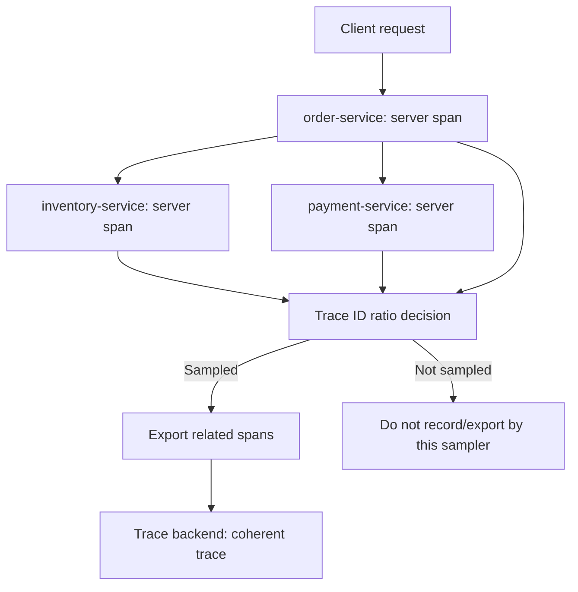
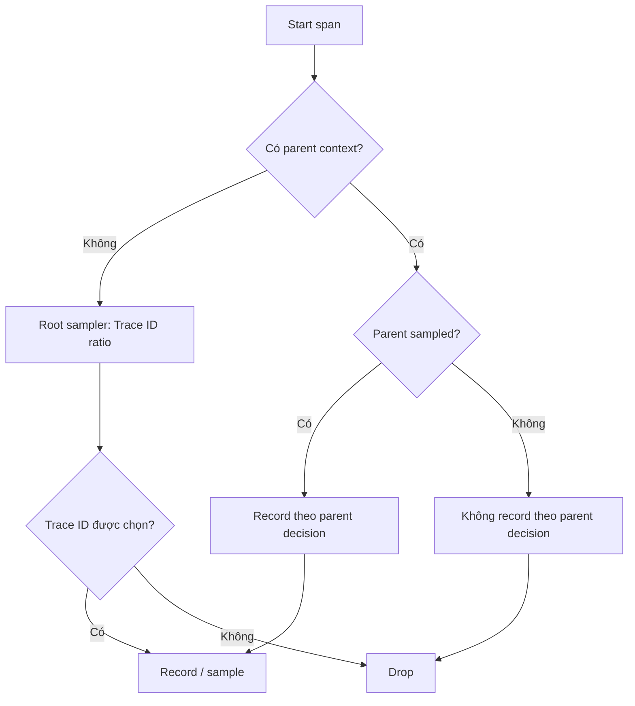
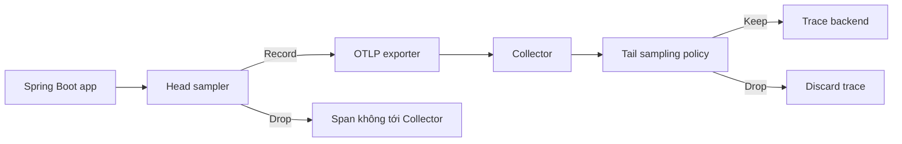

# Trace ID ratio sampler trong Spring Boot Observability

**Trace ID ratio sampler** là cơ chế lấy mẫu distributed traces dựa trên Trace ID và một tỷ lệ cấu hình. Thay vì chọn độc lập từng span, sampler đưa ra quyết định ở cấp trace sao cho những spans thuộc cùng một trace có kết quả sampling nhất quán trong phạm vi sampler và parent context được áp dụng. Cách này giúp kiểm soát lượng telemetry được ghi/xuất, giảm chi phí lưu trữ và giữ được một mẫu traces có thể điều tra.

Trong module **SPRING_BOOT_OBSERVABILITY**, sampling là một phần của pipeline tracing bên cạnh Micrometer Observation, Micrometer Tracing, context propagation, exporter và trace backend. Bài này tập trung vào Trace ID ratio sampler: ý nghĩa của tỷ lệ, cách quyết định gắn với Trace ID, sự khác nhau giữa head sampling và tail sampling, cách cấu hình xác suất trong Spring Boot, và cách đọc kết quả sampling khi đối chiếu metrics, logs và distributed traces.

## 1. Sampling giải quyết bài toán gì?

Một ứng dụng Spring Boot có thể tạo nhiều spans cho mỗi request. Một request HTTP có thể tạo server span, các spans cho nghiệp vụ, database, HTTP client và các lời gọi downstream. Với tải cao, tổng lượng spans có thể tăng rất nhanh.

Giả sử một service nhận 2.000 requests mỗi giây và trung bình mỗi request tạo 7 spans:

\[
2\,000 \times 7 = 14\,000 \text{ spans/giây}
\]

Nếu lưu toàn bộ dữ liệu, hệ thống tracing phải tiếp nhận, xử lý, index và giữ một lượng spans lớn. Sampling giúp chọn một phần traces đại diện để giảm lượng dữ liệu.

**Trace ID ratio sampler** đưa ra quyết định theo tỷ lệ mục tiêu, ví dụ 10% traces. Nếu trace được chọn, các spans thuộc trace đó có thể được ghi/xuất theo chính sách sampler và instrumentation. Nếu không được chọn, trace thường không được xuất như một trace đầy đủ tới backend.

Mục tiêu chính:

- Giảm network traffic và ingestion vào trace backend.
- Kiểm soát CPU, bộ nhớ, index và storage cost của hệ tracing.
- Duy trì một mẫu traces có ích để quan sát đường đi của request.
- Áp dụng một tỷ lệ có thể dự đoán thay vì lưu toàn bộ traces.
- Giữ tính nhất quán của quyết định lấy mẫu giữa các spans trong cùng trace khi context được truyền đúng.

Sampling không thay thế metrics để đo request rate/error rate trên toàn bộ traffic. Nó cũng không sửa context propagation, không tạo spans cho code chưa instrument và không khôi phục traces đã bị loại trước khi tới Collector.

## 2. Trace ID ratio sampler hoạt động theo ý tưởng nào?

Một Trace ID ratio sampler dùng Trace ID làm đầu vào cho phép quyết định có tính ổn định. Về khái niệm, sampler có thể ánh xạ Trace ID vào một miền số và so sánh với ngưỡng tương ứng tỷ lệ mong muốn.

```text
Input: Trace ID
       |
       v
   Deterministic mapping
       |
       v
  Value nằm trong [0, 1)
       |
       +---- value < 0.10 ----> RECORD / SAMPLE
       |
       +---- value >= 0.10 ---> DROP
```

Đây là mô hình khái niệm, không phải pseudocode của một thuật toán cụ thể. Chi tiết cách trích xuất/ánh xạ Trace ID có thể khác theo OpenTelemetry SDK version và sampler implementation. Ứng dụng nên cấu hình sampler qua API/framework chính thức thay vì tự viết phép hash Trace ID.

| Ratio | Ý nghĩa dự kiến | Cách dùng điển hình |
| ---: | --- | --- |
| 0.0 | Không chọn trace mới theo ratio sampler | Kiểm thử pipeline không ghi trace mới |
| 0.01 | Khoảng 1% trace | Traffic rất lớn, ngân sách tracing thấp |
| 0.05 | Khoảng 5% trace | Một mẫu nhỏ để quan sát xu hướng |
| 0.10 | Khoảng 10% trace | Cấu hình tham khảo cho môi trường có tải |
| 0.50 | Khoảng 50% trace | Môi trường test hoặc traffic vừa |
| 1.0 | Chọn mọi trace mới theo ratio sampler | Lab hoặc debug ngắn hạn có kiểm soát |

Tỷ lệ là **kỳ vọng thống kê trên một tập trace đủ lớn**, không phải cam kết mọi cửa sổ một giây đều có đúng số trace theo tỷ lệ. Với lưu lượng nhỏ, chênh lệch thực tế có thể lớn.

## 3. Vì sao sampling nên thực hiện ở cấp trace?

Một distributed trace có thể gồm nhiều spans từ nhiều dịch vụ. Nếu mỗi span được chọn độc lập, trace có thể bị chia cắt: service đầu có span nhưng service sau không có, hoặc ngược lại. Khi đó timeline trở nên khó đọc và khó xác định quan hệ parent-child.

Một sampler dựa trên Trace ID có thể tạo quyết định nhất quán bằng cách dùng cùng Trace ID làm đầu vào. Khi các service truyền context đúng, việc quyết định ở những điểm tiếp nhận trace có thể cùng hướng tới một kết quả.



Sơ đồ rút gọn mô tả quyết định ở cấp trace. Trong triển khai thực tế, mỗi SDK có thể tạo span tại những thời điểm khác nhau; parent-based logic và sampled flag trong context ảnh hưởng tới các quyết định tiếp theo.

Trace ID giống nhau là điều kiện quan trọng, nhưng chưa đủ. Để có trace liền mạch còn cần instrumentation, HTTP client/server inject/extract context, propagation format tương thích, sampler tôn trọng parent context, exporter và backend nhận dữ liệu. Trace ID ratio sampler không tự nối hai trace độc lập và không tự truyền Trace ID qua HTTP.

## 4. Trace ID ratio sampling và parent-based sampling

Hai khái niệm thường được dùng cùng nhau nhưng không đồng nghĩa:

- **Trace ID ratio sampler** quyết định theo tỷ lệ dựa trên Trace ID khi nó là sampler được áp dụng cho trace mới.
- **Parent-based sampler** quyết định dựa trên sampled decision của parent nếu có parent context, và dùng sampler gốc cho những trường hợp không có parent phù hợp.

Một cấu hình parent-based với ratio sampler có thể được hiểu như sau:



Đây là cách giải thích khái niệm phổ biến của parent-based sampling. Một SDK có thể cấu hình nhánh cho remote parent sampled, remote parent not sampled, local parent sampled, local parent not sampled và root span riêng. Vì thế khi cần kiểm soát chính xác, hãy kiểm tra sampler thực tế mà bridge/SDK đã tạo.

Giả sử ingress/service đầu tiên đã quyết định trace được lấy mẫu. Khi request đi qua các service khác, chúng nên tôn trọng sampled context đã nhận thay vì độc lập chọn lại. Điều này giúp giữ các spans liên quan trong cùng trace.

Ngược lại, nếu upstream đã quyết định không lấy mẫu, một downstream service thường không nên tự ý tạo một trace đầy đủ tách rời mà không có chính sách rõ ràng. Nếu cần thu thập trace lỗi hoặc slow requests, có thể cân nhắc tail sampling ở tầng Collector, nhưng tail sampler chỉ nhìn thấy spans đã được gửi tới Collector.

Remote parent và trust boundary: sampled flag đến từ bên ngoài không phải dữ liệu authorization. Nó ảnh hưởng tới quyết định tracing theo propagation policy, nhưng không được dùng để cấp quyền truy cập hoặc bỏ qua chính sách bảo mật.

## 5. Cấu hình sampling probability trong Spring Boot

Với Spring Boot 3.x có Micrometer Tracing và tracing bridge phù hợp, cấu hình thường gặp là:

```yaml
management:
  tracing:
    sampling:
      probability: 0.10
```

Giá trị này biểu diễn xác suất sampling cho cấu hình tracing do Spring Boot/Micrometer quản lý. Trong setup dùng OpenTelemetry bridge, implementation có thể dùng ratio-based sampler kết hợp parent-based behavior theo cấu hình/version.

**Không suy luận từ property name rằng mọi version/bridge đều khởi tạo cùng một class sampler hoặc cùng chi tiết thuật toán.** Nếu cần bảo đảm semantics ở mức SDK, kiểm tra version Spring Boot, Micrometer Tracing bridge và OpenTelemetry SDK đang được dependency management đưa vào.

### 5.1. Môi trường lab

```yaml
spring:
  application:
    name: order-service

management:
  tracing:
    sampling:
      probability: 1.0
  otlp:
    tracing:
      endpoint: http://localhost:4318/v1/traces
```

Sampling 1.0 làm cho sampler xác suất chọn tất cả trace mới theo ratio policy trong phạm vi cấu hình. Endpoint OTLP/HTTP minh họa giả định có Collector/backend lắng nghe tại host/port đó.

Khi ứng dụng chạy trong container khác Collector, localhost thường chỉ trỏ về chính container ứng dụng. Dùng service DNS có thể truy cập, ví dụ http://otel-collector:4318/v1/traces.

### 5.2. Môi trường production

```yaml
management:
  tracing:
    sampling:
      probability: 0.05
```

Chọn 5% chỉ là ví dụ. Tỷ lệ thích hợp phải dựa trên request volume, số spans mỗi request, kích thước span, chi phí backend, độ hiếm của lỗi và nhu cầu điều tra. Không chuyển sampling từ 5% lên 100% lâu dài chỉ để giải quyết một sự cố ngắn hạn mà chưa đánh giá ingestion/storage capacity.

### 5.3. Cấu hình qua môi trường

```yaml
management:
  tracing:
    sampling:
      probability: ${TRACING_SAMPLING_PROBABILITY:0.10}
```

Biến môi trường cho phép đặt tỷ lệ theo deployment environment. Cần validate giá trị nằm trong miền hợp lệ của framework (thường từ 0.0 đến 1.0) và kiểm soát thay đổi để tránh cấu hình sai làm bật/tắt tracing ngoài ý muốn.

## 6. Tính chất của ratio: ổn định theo Trace ID, không phải lấy mẫu mỗi span

Một sampler dựa trên Trace ID có thể cho kết quả ổn định khi nhiều nơi áp dụng cùng cách quyết định trên cùng Trace ID và policy. Điều này khác với việc tung một đồng xu mới ở mỗi lần tạo span.

| Trace | Trace ID | Kết quả ratio sampler 10% |
| --- | --- | --- |
| A | 4bf92f3577b34da6a3ce929d0e0e4736 | Được chọn (giả định) |
| B | 8a12... | Bị loại (giả định) |
| C | b1c4... | Bị loại (giả định) |
| D | 0f31... | Được chọn (giả định) |

Các kết quả ở bảng chỉ minh họa, không được dùng làm test vector cho SDK.

Nếu hai service dùng cấu hình sampler không tương thích hoặc không tuân thủ parent decision, cùng một trace có thể bị xử lý không nhất quán. Để tránh điều này, thống nhất propagation format, dùng parent-based behavior phù hợp, quản lý config tập trung và kiểm tra trace topology sau khi thay SDK/bridge.

Tỷ lệ 10% thường áp dụng cho các trace mới theo sampler, không đồng nghĩa mỗi service sẽ xuất đúng 10% số lần gọi của nó trong một cửa sổ ngắn. Các service có traffic và fan-out khác nhau; số spans có thể khác đáng kể.

## 7. Head sampling và Tail sampling

**Trace ID ratio sampler thường là một lựa chọn head sampler** tại thời điểm trace bắt đầu hoặc span root được tạo. Quyết định xảy ra sớm để tiết kiệm chi phí ngay ở ứng dụng.

Head sampling:
- Quyết định được đưa ra sớm.
- Dễ phân phối qua nhiều ứng dụng và parent context.
- Giảm lượng spans được ghi/xuất từ nguồn.
- Không biết trước request có chậm hoặc lỗi ở cuối hay không.
- Nếu bị loại ở đầu, Collector không thể khôi phục các spans chưa được gửi.

Ví dụ request chỉ bị timeout sau 5 giây. Nếu head sampler loại trace ngay khi request bắt đầu, hệ thống có thể không có timeline chi tiết để xem timeout đó.

Tail sampling quyết định sau khi Collector đã nhận spans của trace trong một khoảng thời gian chờ. Nó có thể ưu tiên traces có error status, vượt ngưỡng duration hoặc thuộc operation quan trọng. Tail sampling cần giữ dữ liệu tạm trong bộ nhớ/queue và bảo đảm các spans cùng Trace ID đến đúng bộ xử lý có khả năng đưa ra quyết định chung. Nó không thể xem các spans mà ứng dụng đã drop từ head sampler.



Nếu head ratio quá thấp, tail sampler có rất ít cơ hội giữ error traces vì phần lớn traces đã bị loại ở nguồn.

## 8. Sampling và W3C Trace Context propagation

W3C traceparent mang Trace ID, Parent Span ID và trace flags. Trace flags bao gồm sampled bit theo mô hình W3C. Một dịch vụ nhận request có thể dùng parent context để tạo child span và đưa ra quyết định sampling nhất quán.

```http
traceparent: 00-4bf92f3577b34da6a3ce929d0e0e4736-00f067aa0ba902b7-01
```

Phần cuối 01 trong ví dụ thể hiện sampled flag được đặt. Tuy nhiên, ý nghĩa của cờ này trong một môi trường cụ thể phải được xử lý theo tracing specification và SDK policy; nó không phải lệnh authorization hay cam kết backend đã lưu trace.

Nếu service downstream không nhận traceparent, nó có thể bắt đầu trace mới với Trace ID khác. Backend có thể hiển thị hai trace thay vì một trace liên dịch vụ. Sampling không sửa propagation; cần instrument HTTP client/server và bảo đảm context headers được inject/extract đúng.

## 9. Ảnh hưởng tới metrics và logs

**Trace sampling không phải metrics sampling.** Một ứng dụng có thể ghi HTTP Timer và Counter cho toàn bộ request, trong khi chỉ xuất một phần traces.

| Tín hiệu | Vai trò sampling/collection | Hệ quả |
| --- | --- | --- |
| Metrics Counter/Timer | Thường ghi cho mỗi hoạt động đã instrument, theo pipeline metrics riêng | Dùng đo request rate/error rate/latency trên toàn traffic |
| Trace spans | Bị quyết định bởi head/tail sampling và exporter | Backend chỉ lưu tập spans được giữ |
| Logs | Theo logging policy độc lập | Có thể có logs ngay cả khi trace bị loại |
| Exemplars | Liên kết một số measurements với trace nếu hỗ trợ | Không làm mọi sample có trace |

Giả sử trong 1.000 request có 30 lỗi và sampler 10%. Không thể kết luận backend sẽ có đúng 100 traces hoặc đúng 3 traces lỗi. Mẫu được chọn có tính thống kê, không nhất thiết đại diện chính xác cho lỗi hiếm trong từng cửa sổ ngắn.

Một log có thể ghi Trace ID ngay cả khi trace bị sampling drop hoặc exporter lỗi, tùy logging/tracing implementation và thời điểm context được tạo. Tìm thấy Trace ID trong log không chứng minh trace đã được lưu.

Khi điều tra:
1. Dùng metrics để xác định phạm vi lỗi/độ trễ.
2. Tìm logs theo correlation fields.
3. Tìm trace bằng Trace ID nếu trace đã được giữ và ingest.
4. Nếu không có trace, kiểm tra sampling, exporter, Collector và retention.

## 10. Sampling và baggage/correlation

Baggage là metadata được truyền cùng trace context, trong khi sampling quyết định spans có được ghi/xuất hay không. Hai cơ chế có quan hệ nhưng độc lập.

Một request có baggage channel=mobile. Dịch vụ có thể extract baggage để phục vụ logic/correlation dù quyết định head sampling là drop, tùy propagation implementation. Tuy nhiên nếu trace không được ghi/xuất, baggage không tự làm backend có trace để tìm kiếm.

Không dùng baggage value để thay Trace ID hoặc sampled flag. Không đưa Trace ID hoặc request ID vào metric labels để bù cho trace sampling vì sẽ gây high cardinality.

Một chính sách sampling nâng cao có thể xem xét attributes ở Collector (tail sampling) sau khi nhận spans, nhưng phải bảo đảm các attributes có giá trị hợp lệ và không bị giả mạo tại trust boundary. Baggage từ client ngoài không được mặc nhiên tin làm cơ sở cấp quyền hoặc giữ trace ưu tiên.

## 11. Ước lượng số spans và chi phí

Ước lượng ban đầu giúp chọn tỷ lệ sampler:

\[
S = R \times P \times N \times 86\,400
\]

Trong đó R là request rate (requests/second), P là tỷ lệ sampling (0 đến 1), N là số spans trung bình mỗi request, S là số spans dự kiến mỗi ngày.

Ví dụ 2.000 requests/giây, ratio 0.05 và 8 spans/request:

\[
2\,000 \times 0.05 \times 8 \times 86\,400
= 69\,120\,000 \text{ spans/ngày}
\]

Đây vẫn là khối lượng lớn. Tỷ lệ 5% không tự bảo đảm chi phí nhỏ nếu traffic nền rất cao.

Nếu kích thước span trung bình sau serialization là 1,5 KB, lượng dữ liệu thô minh họa là:

\[
69\,120\,000 \times 1.5 \text{ KB}
\approx 103.7 \text{ GB/ngày}
\]

Đây là phép tính giản lược, chưa tính compression, protocol overhead, batching, replication, index, metadata, retention và chi phí storage thực tế. Kích thước span khác nhau đáng kể theo số attributes/events.

Ở mức ước lượng, tăng ratio từ 5% lên 10% có thể tăng gấp đôi số traces được chọn nếu traffic và spans/request không đổi. Nhưng backend cost không luôn tuyến tính vì index cardinality, fan-out, query workload, batching, retries và storage layout.

Theo dõi:
- Spans received/accepted/dropped.
- Export failures và queue size.
- Collector memory/CPU.
- Backend ingestion và storage growth.
- Query latency và retention.
- Tỷ lệ trace có error/slow spans trong mẫu.

## 12. Chọn tỷ lệ sampler theo mục đích

| Môi trường/tình huống | Cách cân nhắc |
| --- | --- |
| Local development | Có thể dùng 100% để quan sát từng luồng khi traffic thấp |
| Integration test | Dùng 100% hoặc tỷ lệ cao để assertion dễ dự đoán |
| Staging | Dùng tỷ lệ đủ lớn để kiểm tra trace topology và exporter |
| Production traffic thấp | Có thể giữ tỷ lệ cao hơn nếu capacity và privacy policy cho phép |
| Production traffic lớn | Chọn tỷ lệ dựa trên span volume và backend budget |
| Điều tra incident ngắn hạn | Tăng ratio có thời hạn, có theo dõi capacity và phê duyệt vận hành |
| Cần giữ error/slow traces | Cân nhắc tail sampling, đồng thời bảo đảm traces đến Collector |
| Workload batch/ngắn | Kiểm tra lifecycle/export flush; ratio không giải quyết process kết thúc trước khi export |

Không dùng cùng một tỷ lệ cho mọi loại workload một cách máy móc. HTTP requests, message consumers, scheduled jobs và batch operations có thể có số spans và giá trị điều tra khác nhau. Cần xem cách sampler áp dụng cho root spans, remote parents và các trace mới.

## 13. Troubleshooting Trace ID ratio sampler

| Triệu chứng | Nguyên nhân có thể | Cách kiểm tra |
| --- | --- | --- |
| Có request nhưng không có trace | Trace bị ratio sampler loại | Kiểm tra sampling probability và volume đủ lớn |
| Có log Trace ID nhưng không tìm được trace | Sampled-out, exporter lỗi hoặc retention/query sai | Kiểm tra sampled decision, exporter/Collector/backend |
| Downstream có trace mới khác Trace ID | Mất traceparent hoặc client/server chưa instrument | Kiểm tra propagation headers ở từng hop |
| Có root span nhưng thiếu child spans | Sampling/propagation không nhất quán, instrumentation thiếu | Kiểm tra parent context và client instrumentation |
| Ratio 10% nhưng cửa sổ ngắn không đúng 10% | Mẫu nhỏ và dao động thống kê | So trên lượng traces lớn và cùng cửa sổ |
| Tất cả traces đều xuất | Probability 1.0, parent sampled hoặc sampler khác | Kiểm tra cấu hình hiệu lực và parent-based behavior |
| Không trace nào xuất | Probability 0.0, exporter/receiver lỗi hoặc thiếu tracing bridge | Kiểm tra lần lượt sampler, exporter và Collector |
| Tỷ lệ backend thấp hơn cấu hình | Export failures, tail sampling, downstream drops | Đối chiếu spans sampled, sent, received, stored |
| Tỷ lệ backend cao hơn dự kiến | Nhiều nguồn/service, parent-sampled decisions hoặc query đếm sai | Phân biệt root traces với spans và nguồn telemetry |
| Thay đổi ratio nhưng kết quả không đổi | Parent decision chi phối hoặc config chưa reload | Xác minh config runtime, propagation và rollout |
| Errors hiếm không có trace | Head sampling bỏ qua request trước khi biết kết quả | Tail sampling với đủ spans tới Collector |
| Collector tail sampler không giữ trace lỗi | Head drop ở app, trace phân tán sai Collector hoặc policy không match | Kiểm tra head ratio, trace routing và tail policy |
| Metrics counts khác số traces | Đây là hai pipeline và sampling khác nhau | Dùng metrics cho tổng traffic, traces cho mẫu |
| Logs có baggage nhưng trace mất | Baggage/context vẫn được đọc, trace bị drop hoặc export lỗi | Kiểm tra riêng propagation và sampling |
| Tải Collector tăng bất ngờ | Ratio tăng, spans/request tăng hoặc retry | Theo dõi ingest rate, payload, queue và cấu hình |

Quy trình điều tra:
1. Xác minh tracing bridge và exporter thực tế.
2. Đọc sampling probability sau khi cấu hình được áp dụng.
3. Gửi tập requests đủ lớn để quan sát ratio thống kê.
4. Kiểm tra Trace ID và sampled flag ở ranh giới dịch vụ trong lab.
5. Đối chiếu ứng dụng, Collector và backend bằng metrics tự giám sát.
6. Kiểm tra tail sampling hoặc processor có drop spans sau head sampler không.
7. Kiểm tra time range, service name, tenant/project và retention khi truy vấn UI.
8. Không thay đổi đồng thời ratio, propagation và exporter nếu chưa cô lập được nguyên nhân.

## 14. Bài thực hành: xác minh Trace ID ratio sampler

Mục tiêu là chứng minh sampling áp dụng theo trace context, hiểu chênh lệch giữa metrics và traces, và tính được chi phí gần đúng.

### Chuẩn bị

- Spring Boot 3.x application có Actuator.
- Micrometer Tracing bridge, ví dụ OpenTelemetry.
- OTLP traces exporter.
- OpenTelemetry Collector và trace backend/UI trong môi trường lab.
- Một endpoint HTTP tạo được ít nhất một business Observation hoặc HTTP client call.

### Bước 1 — Thiết lập baseline 100%

Cấu hình sampling probability thành 1.0 trong lab. Gửi một số requests và xác nhận traces xuất hiện ở backend. Kiểm tra root span, service name và child spans nếu có instrumentation.

### Bước 2 — Đổi thành 10%

Cập nhật cấu hình thành 0.10 và khởi động/rollout ứng dụng theo cách môi trường yêu cầu. Gửi tập requests đủ lớn. Đếm số traces được backend lưu và so với số requests đã gửi.

Không yêu cầu một cửa sổ ngắn phải có đúng 10%. So sánh trên mẫu đủ lớn và nhớ rằng request có thể không tạo trace vì exporter/Collector lỗi.

### Bước 3 — Đối chiếu metrics

Kiểm tra HTTP request Timer/Counter trên metrics backend. Số request trong metrics thường bao gồm cả requests không có trace được lưu. Giải thích vì sao đây là kết quả đúng.

### Bước 4 — Kiểm tra parent-based propagation

Tạo lời gọi từ service A sang B bằng HTTP client instrumented. Xác nhận child span ở B giữ cùng Trace ID khi trace được lấy mẫu. Thử một client không instrumented trong lab để thấy context có thể bị mất.

### Bước 5 — Gây lỗi có kiểm soát

Tạo endpoint test có thể trả lỗi hoặc chờ lâu. Với head sampling 10%, một số request lỗi có thể không có trace. Ghi nhận hạn chế này và không nhầm nó với lỗi instrumentation.

### Bước 6 — Thử tail sampling nếu Collector hỗ trợ

Cấu hình tail sampling policy trong lab để giữ error traces trong những spans Collector đã nhận. Kiểm tra Collector nhận đủ spans của trace và không drop ở head sampler trước đó.

### Bước 7 — Ước lượng chi phí

Ghi request rate, ratio, spans/request và payload size ước lượng. Tính spans/ngày và lượng dữ liệu thô. So sánh với quota/retention backend.

### Bước 8 — Kiểm tra log correlation

Tạo logs chứa Trace ID/Span ID theo logging integration. Xác minh log vẫn có thể được ghi ngay cả khi trace không xuất hiện; dùng metrics để xem tổng số lỗi.

### Bước 9 — Kiểm tra thay đổi cấu hình

Thử biến môi trường điều khiển sampling probability. Xác nhận rollout/config refresh thực sự áp dụng giá trị mới. Ghi rõ thời điểm thay đổi để không trộn dữ liệu trước/sau trong cùng một phép so sánh.

### Checklist nghiệm thu

| Điều cần chứng minh | Kết quả mong đợi |
| --- | --- |
| Ratio semantics | Giải thích đúng 0.0, 0.1 và 1.0 |
| Trace-level decision | Không coi mỗi span là một lần tung đồng xu độc lập |
| Parent-based behavior | Child spans tôn trọng sampled parent theo cấu hình |
| Spring Boot config | Biết cấu hình probability và kiểm tra version/bridge |
| Propagation | Trace ID nối qua HTTP khi instrumentation hoạt động |
| Head vs tail | Nêu được giới hạn của quyết định sớm và yêu cầu của tail sampling |
| Metrics independence | Metrics phản ánh rộng hơn tập traces được lưu |
| Cost estimate | Tính được spans/day và lượng dữ liệu gần đúng |
| Failure analysis | Phân biệt sampled-out với exporter/backend failure |
| Security | Sampling không được dùng như authorization policy |

## 15. Những nguyên tắc cần nhớ

1. **Trace ID ratio sampler lấy mẫu theo tỷ lệ dựa trên Trace ID**, giúp quyết định có tính nhất quán ở cấp trace.
2. **Ratio là tỷ lệ kỳ vọng trên tập đủ lớn**, không phải cam kết số lượng chính xác trong mọi cửa sổ ngắn.
3. **Parent-based behavior giữ quyết định của trace context**, giúp spans downstream không tự ý chia thành trace khác.
4. **Spring Boot probability property là cấu hình cấp framework/bridge**; kiểm tra version và sampler hiệu lực nếu cần semantics SDK cụ thể.
5. **Head sampling tiết kiệm chi phí sớm nhưng có thể bỏ lỡ errors/slow requests** vì chưa biết kết quả khi request bắt đầu.
6. **Tail sampling chỉ xử lý spans đã đến Collector**; nó không khôi phục dữ liệu bị drop ở nguồn.
7. **Metrics và logs có pipeline riêng.** Metrics vẫn có thể đếm toàn traffic khi trace chỉ lấy mẫu một phần.
8. **Context propagation là điều kiện để trace liên dịch vụ liền mạch.** Ratio sampler không tự inject/extract traceparent.
9. **Tính chi phí theo request rate, spans/request và sampling ratio**, rồi theo dõi ingestion, queue, storage và retention.
10. **Không dùng sampled flag hay baggage làm authorization.** Sampling là chính sách telemetry, không phải chính sách bảo mật.
11. **Kết hợp metrics, logs và traces**: metrics phát hiện xu hướng, traces cho timeline của một mẫu request, logs giúp xác minh diễn biến.

Trace ID ratio sampler là một công cụ nền tảng để kiểm soát lượng distributed traces trong Spring Boot Observability. Khi cấu hình đúng tỷ lệ, tôn trọng parent context và kiểm tra exporter/backend, nhóm phát triển có thể giữ một mẫu traces hữu ích mà vẫn dự đoán được chi phí. Kết hợp với metrics cho toàn bộ traffic và logs có correlation, sampling giúp điều tra lỗi và độ trễ có trọng tâm mà không đánh đồng “không có trace” với “request không xảy ra”.
