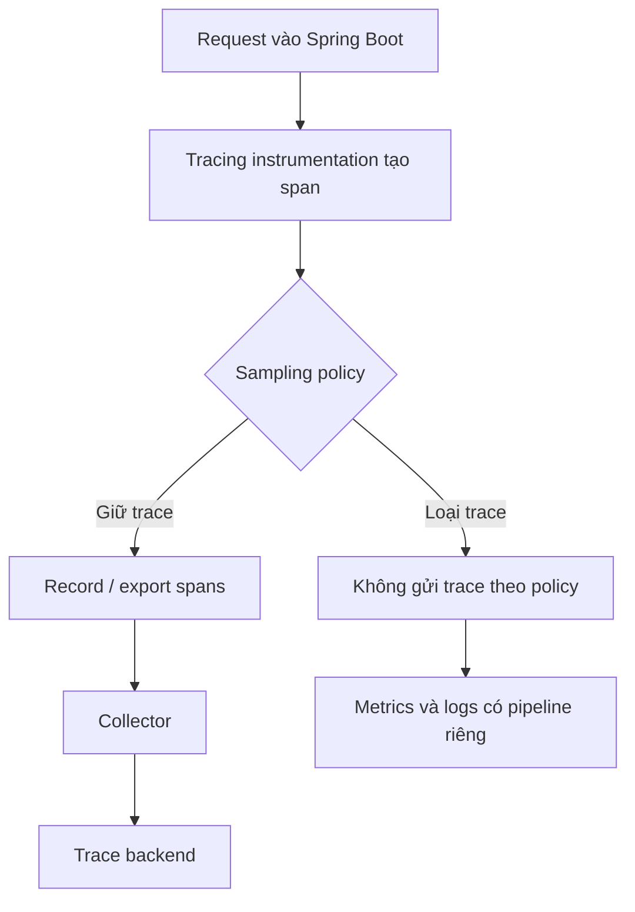
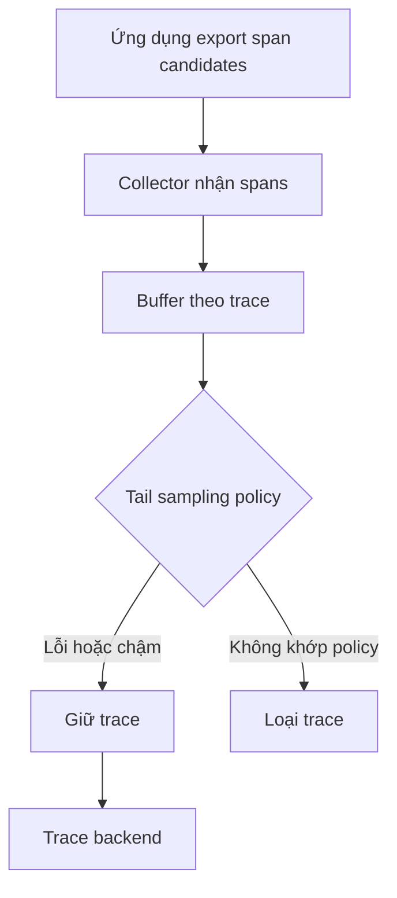
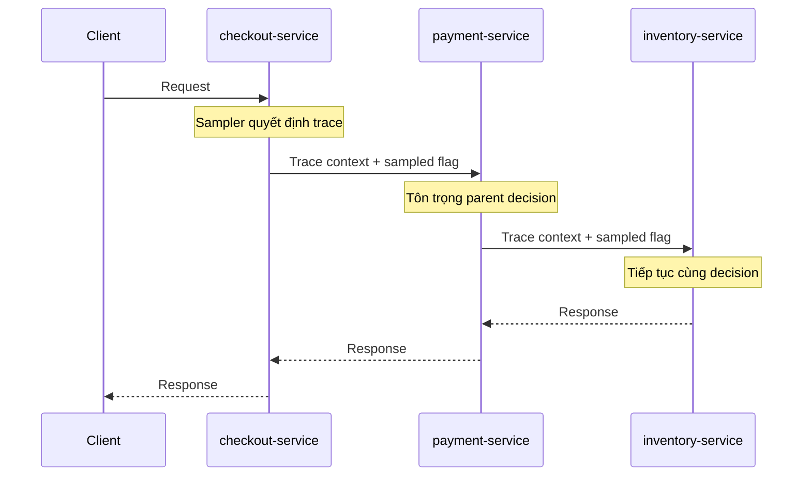
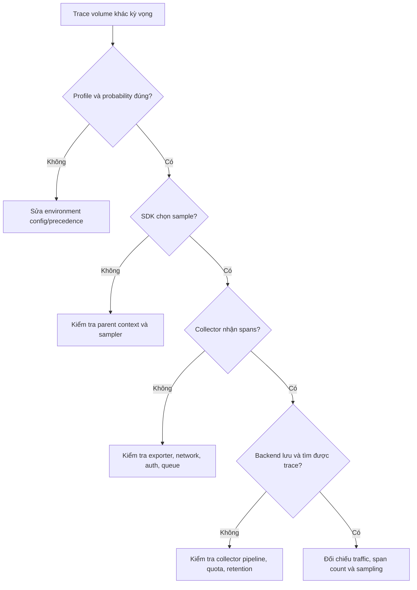

# Sampling theo môi trường trong Spring Boot

Một hệ thống Spring Boot có thể tạo hàng triệu spans mỗi ngày. Nếu lưu mọi trace ở mọi môi trường, chi phí truyền, xử lý, lưu trữ và truy vấn tăng nhanh. Nếu sampling quá thấp, đội vận hành lại có thể không tìm thấy trace của lỗi hiếm. Vì vậy, **sampling policy cần phù hợp với môi trường và mục tiêu vận hành**: development cần debug dễ dàng, staging cần dữ liệu kiểm thử, production cần cân bằng độ bao phủ và chi phí.

Bài **“Sampling theo môi trường”** thuộc chương **Sampling** của module **SPRING_BOOT_OBSERVABILITY**. Module hướng dẫn thiết lập observability cho Spring Boot bằng Micrometer Observation, metrics, logs và distributed tracing. Bài này giải thích head sampling, tail sampling, cấu hình Spring Boot theo profile và environment variable, propagation giữa service, chi phí, kiểm thử và troubleshooting.

**Sampling chủ yếu quyết định trace/span nào được ghi và xuất trong tracing pipeline.** Nó không tự giảm HTTP metrics, không thay thế log level và không phải cơ chế kiểm soát quyền truy cập dữ liệu.

## 1. Sampling giải quyết vấn đề gì?

Một distributed trace có thể chứa HTTP server/client spans, database spans, messaging spans và các bước nghiệp vụ. Sampling chọn một phần traces để ghi nhận/xuất theo policy nhằm giữ đủ dữ liệu điều tra, giới hạn ingest/retention và duy trì khả năng phân tích.



Nếu trace được chọn, spans được propagate và export có thể cho thấy đường đi qua nhiều service. Nếu trace bị loại ở đầu pipeline, trace backend có thể không có dữ liệu để điều tra dù request vẫn xử lý bình thường.

## 2. Phân biệt head sampling và tail sampling

### Head sampling

**Head sampler** quyết định sớm, thường khi span gốc hoặc trace đầu tiên được tạo. Quyết định có thể dựa trên xác suất, parent context hoặc thuộc tính có sẵn lúc bắt đầu.

Với xác suất 10%, trong một tập request đủ lớn khoảng 10% traces được chọn theo hành vi sampler. Sampler chưa biết request sẽ chậm hay phát sinh lỗi về sau. Quyết định có thể được truyền xuống services thông qua sampled flag trong trace context.

Head sampling tiết kiệm tài nguyên sớm, nhưng có thể bỏ qua request trở nên bất thường ở cuối quá trình xử lý.

### Tail sampling

**Tail sampling** trì hoãn quyết định tới khi collector nhận các spans liên quan và có đủ thông tin để đánh giá trace, ví dụ:

- Trace có error status hoặc exception.
- Tổng duration vượt ngưỡng.
- HTTP status thuộc nhóm cần quan sát.
- Trace thuộc service hoặc route quan trọng theo policy.



Tail sampling có thể giữ trace lỗi dù lỗi xuất hiện ở cuối request. Đổi lại, collector phải nhận và tạm giữ spans, gom đủ trace trong một khoảng thời gian, có buffer và policy phù hợp. Cấu hình tail sampling không khôi phục được spans đã bị SDK head sampler loại trước khi gửi đến collector.

| Tiêu chí | Head sampling | Tail sampling |
| --- | --- | --- |
| Thời điểm quyết định | Sớm, khi trace/span bắt đầu | Sau khi collector nhận thông tin cần thiết |
| Thông tin quyết định | Context và thuộc tính lúc bắt đầu | Có thể dựa trên lỗi/duration cuối |
| Tiết kiệm băng thông | Có thể loại sớm | Thường gửi spans ứng viên tới collector |
| Giữ trace lỗi hiếm | Không bảo đảm nếu đã loại sớm | Có thể ưu tiên nếu collector nhận đủ trace |
| Hạ tầng | Sampler trong SDK/bridge | Collector có state, buffer và tail-sampling processor |
| Rủi ro chính | Bỏ lỡ sự kiện phát sinh về sau | Tốn bộ nhớ, thiếu spans khi trace đến trễ/quá tải |

Không gọi xác suất head sampling là tail sampling. Hai cơ chế có thể kết hợp nhưng phải xác định rõ tầng nào loại trace và tầng nào chịu trách nhiệm giữ trace quan trọng.

## 3. Cấu hình sampling trong Spring Boot

Spring Boot cung cấp property để điều chỉnh xác suất sampling của tracing:

```yaml
management:
  tracing:
    sampling:
      probability: 0.1
```

Giá trị thường biểu diễn xác suất từ 0.0 đến 1.0:

| Giá trị | Ý nghĩa khái niệm |
| ---: | --- |
| 0.0 | Không chọn trace mới theo xác suất này |
| 0.01 | Xác suất 1% |
| 0.05 | Xác suất 5% |
| 0.1 | Xác suất 10% |
| 0.5 | Xác suất 50% |
| 1.0 | Chọn 100% trace mới theo sampler xác suất |

Đây là xác suất của sampler được cấu hình, không phải bảo đảm cứ 100 request luôn có chính xác N trace. Kết quả chịu ảnh hưởng của số request, sampler implementation, parent context, sampling ở upstream và lỗi export.

Giá trị mặc định có thể khác theo dòng Spring Boot, tracing bridge và cấu hình ứng dụng. Hãy khai báo tường minh theo môi trường thay vì phụ thuộc vào default ngầm.

## 4. Dùng Spring Profiles để đặt sampling theo môi trường

Cấu hình mặc định trong `application.yml`:

```yaml
spring:
  application:
    name: checkout-service

management:
  tracing:
    sampling:
      probability: 0.1
```

Development:

```yaml
# application-dev.yml
management:
  tracing:
    sampling:
      probability: 1.0
```

Staging:

```yaml
# application-staging.yml
management:
  tracing:
    sampling:
      probability: 0.5
```

Production:

```yaml
# application-prod.yml
management:
  tracing:
    sampling:
      probability: 0.05
```

Các tỷ lệ trên chỉ là ví dụ policy, không phải khuyến nghị chung. Development có thể cần 100% traces để debug; production có thể chọn 1%, 5% hoặc cao hơn tùy traffic, ngân sách và SLO.

Kích hoạt profile bằng biến môi trường:

```bash
SPRING_PROFILES_ACTIVE=dev
```

Hoặc khi chạy JAR:

```bash
java -jar app.jar --spring.profiles.active=staging
```

Trên Windows PowerShell:

```powershell
$env:SPRING_PROFILES_ACTIVE = "dev"
java -jar app.jar
```

Chỉ bật profile tương ứng với môi trường triển khai. Không phụ thuộc vào thao tác sửa cấu hình thủ công sau khi đóng gói image.

### Nhiều YAML documents trong một file

Có thể dùng `spring.config.activate.on-profile` để quản lý nhiều cấu hình trong một file:

```yaml
management:
  tracing:
    sampling:
      probability: 0.1
---
spring:
  config:
    activate:
      on-profile: dev
management:
  tracing:
    sampling:
      probability: 1.0
---
spring:
  config:
    activate:
      on-profile: staging
management:
  tracing:
    sampling:
      probability: 0.5
---
spring:
  config:
    activate:
      on-profile: prod
management:
  tracing:
    sampling:
      probability: 0.05
```

Đảm bảo file được parse theo Spring Boot Config Data; profile đang active phải đúng và precedence được kiểm tra. Với hệ thống lớn, file profile riêng hoặc external configuration thường dễ review hơn.

## 5. Quản lý sampling bằng environment variable

Nếu deployment platform quản lý tỷ lệ sampling, đặt biến môi trường có tên `TRACING_SAMPLING_PROBABILITY` và bind giá trị qua cơ chế configuration của Spring Boot. Ví dụ cấu hình runtime cho development:

```bash
TRACING_SAMPLING_PROBABILITY=1.0
```

Production minh họa:

```bash
TRACING_SAMPLING_PROBABILITY=0.05
```

Trong `application.yml`, property vẫn là `management.tracing.sampling.probability`; deployment cần cung cấp biến theo quy ước binding tương ứng hoặc ánh xạ qua external config. Kiểm tra giá trị thực tế đã bind trong process.

Cách quản lý tập trung giúp một image chạy ở nhiều môi trường, policy được review cùng release manifest và không cần sửa source code. Rủi ro là giá trị sai có thể làm export tăng đột biến hoặc giảm gần về 0. Cần validation, monitoring chi phí và rollback.

External config, command-line arguments, profile và environment variables có thể ghi đè nhau theo precedence của Spring Boot. Đừng chỉ đọc file YAML trong repository rồi kết luận giá trị runtime đúng.

## 6. Chọn tỷ lệ theo môi trường

| Môi trường | Mục tiêu | Tỷ lệ khởi đầu minh họa | Chú ý |
| --- | --- | ---: | --- |
| Local developer | Debug request và xem span tree | 1.0 | Có thể giảm khi test tải |
| CI/test | Kiểm chứng instrumentation | 1.0 cho test nhỏ | Tránh load test tạo quá nhiều traces |
| Development shared | Quan sát tích hợp | 0.5–1.0 | Traffic giả lập có thể lớn |
| Staging | Kiểm tra gần production | 0.25–0.5 | Cân bằng coverage và load |
| Production | Incident response và xu hướng | 0.01–0.1 | Căn cứ traffic, chi phí và SLO |
| Production canary | So sánh phiên bản mới | Cao hơn có kiểm soát | Giới hạn thời gian và ngân sách |

Các số chỉ minh họa. Để chọn tỷ lệ:

1. Ước lượng request/second và số spans trung bình mỗi trace.
2. Đo bytes trung bình của trace sau serialization.
3. Tính ingest dự kiến ở các mức sampling.
4. Xác định loại sự cố cần điều tra: lỗi hiếm, latency tail, dependency timeout hoặc lỗi theo route.
5. Kiểm tra storage, query latency và retention.
6. Thử ở staging/canary, theo dõi collector queue và backend ingest.
7. Chốt tỷ lệ, thời hạn áp dụng và owner chịu trách nhiệm.

Service ít traffic có thể cần tỷ lệ cao để có đủ traces; 10% trên service rất lớn vẫn có thể tạo lượng spans đáng kể.

## 7. Sampling nhất quán qua service boundary

Một trace có thể đi qua `checkout-service`, `payment-service` và `inventory-service`. Nếu service đầu quyết định không sample nhưng downstream tự quyết định độc lập, hệ thống có thể tạo trace rời rạc hoặc chỉ giữ một phần spans.

Với **parent-based sampling**, services downstream thường tôn trọng sampled decision được truyền trong trace context của parent. W3C Trace Context dùng header `traceparent` với trace flags, gồm sampled flag. B3 cũng có cơ chế truyền sampling state riêng.



Nếu mỗi service cấu hình xác suất khác nhau, hãy xác minh sampler có parent-based behavior hay không và remote parent sampled/unsampled được xử lý thế nào. Không giả định mọi bridge hay custom sampler có cùng semantics.

Policy cần được quản lý theo trace chain, không chỉ theo từng repository. Ở trust boundary, không để client không tin cậy ép hệ thống giữ 100% traces bằng cách tự gửi sampled flag; biên dịch vụ cần quản lý trust và policy.

## 8. Sampling ảnh hưởng gì tới metrics và logs?

Sampling traces không phải công tắc tổng thể cho observability.

| Signal | Tác động của trace sampling | Cách kiểm soát riêng |
| --- | --- | --- |
| Distributed traces | Quyết định traces/spans được ghi và export | Head/tail sampling policy |
| Metrics | Không tự giảm Counter, Timer, Gauge | Instrumentation, MeterRegistry, filters, cardinality |
| Logs | Không tự giảm log events | Log level, routing, filtering, retention |
| Audit records | Không được thay thế bằng sampled trace | Audit/transaction system riêng |
| Baggage | Không quyết định trực tiếp field nào được propagate | Allowlist, size limit, propagation policy |

Một ứng dụng có thể ghi HTTP request metrics cho toàn bộ request nhưng chỉ export 5% traces. Khi đó, metric error rate là cơ sở phù hợp hơn để đánh giá HTTP 5xx toàn traffic; số traces trong backend không đại diện cho mọi request.

Logs cũng có thể được ghi cho request không có trace được lưu. Log correlation có thể thiếu trace ID hữu ích hoặc trace backend không có span tương ứng.

**Không dùng tỷ lệ trace sample để suy ra error rate của toàn bộ traffic**, nhất là khi sampling ưu tiên lỗi hoặc dùng tail sampling.

## 9. Probability sampler khác tail sampling ở Collector

Cấu hình Spring Boot:

```yaml
management:
  tracing:
    sampling:
      probability: 0.05
```

thường mô tả xác suất sampling ở tracing SDK/bridge của ứng dụng. Nó không cấu hình tail sampling policy tại OpenTelemetry Collector.

Nếu muốn giữ traces có lỗi hoặc duration cao, kiến trúc có thể là:

```text
Spring Boot tracing SDK
  -> export span candidates
  -> OpenTelemetry Collector
  -> tail_sampling processor
  -> traces backend
```

Collector phải nhận spans ứng viên trước khi quyết định. Nếu SDK đã loại trace bằng head sampler thấp và không export spans, collector không thể khôi phục trace đó từ dữ liệu đã mất.

Tail sampling cần kiểm tra:

- Collector nhận spans từ các services tham gia trace.
- Các spans cùng trace đến cùng decision point hoặc có cơ chế phân phối/đồng bộ phù hợp.
- Decision wait đủ lâu để nhận spans cần thiết.
- Buffer/decision cache đủ sức chứa theo traces đồng thời.
- Policy cho status error, latency, service và attributes rõ ràng.
- Timeout, late spans và collector restart có hành vi được hiểu.
- Pipeline có metrics theo dõi dropped spans, queue và memory.

Tail sampling có thể yêu cầu SDK gửi nhiều spans hơn, làm tăng network và collector load. Đặt head sampling thấp trước tail sampling sẽ loại sớm traces mà tail policy cần xem. Nếu kết hợp nhiều tầng, mô tả rõ luồng candidates và policy của mỗi tầng.

## 10. Ước lượng chi phí sampling

Ước lượng đơn giản số spans/ngày:

\[
\text{Spans/day} \approx R \times 86\,400 \times P \times S
\]

Trong đó `R` là request/second trung bình, `P` là tỷ lệ traces được sample từ 0 đến 1 và `S` là số spans trung bình trong một trace.

Ví dụ giả định:

- 200 request/second.
- Sampling probability 0.05.
- 8 spans/trace.

\[
200 \times 86\,400 \times 0.05 \times 8
= 6\,912\,000 \text{ spans/day}
\]

Đây là ước lượng tải spans, không phải số byte hoặc chi phí tiền. Kích thước span, attributes, events, retries, burst traffic, batching, compression và retention đều ảnh hưởng.

| Sampling probability | Lượng spans tương đối |
| ---: | ---: |
| 1% | 1x |
| 5% | 5x |
| 10% | 10x |
| 25% | 25x |
| 50% | 50x |
| 100% | 100x |

Quan hệ trên giả định các yếu tố khác giữ nguyên. Parent decisions, tail sampling và export failures có thể làm số liệu thực khác đi.

Sampling thấp không tự giảm CPU instrumentation của spans đã tạo trước quyết định, metrics cardinality, log volume hay baggage size. Theo dõi ingest bytes, dropped spans, exporter errors và collector memory thay vì chỉ nhìn tỷ lệ.

## 11. Sampling ưu tiên lỗi và latency

Probability sampling phù hợp để lấy mẫu nền, nhưng không bảo đảm giữ lỗi hiếm. Nếu cần ưu tiên lỗi hoặc latency, cân nhắc:

- Tail sampling tại Collector giữ trace có error status.
- Tail sampling giữ trace vượt latency threshold.
- Rule ưu tiên route quan trọng trong thời gian thử nghiệm.
- Sampling tạm thời cao hơn trong canary/incident response.
- Policy dựa trên metadata được xác thực và giới hạn.

Cẩn trọng với rule theo tenant hoặc user. Nếu client tự khai báo baggage để được ưu tiên sampling, họ có thể làm tăng chi phí hoặc thao túng telemetry. Chỉ dùng thuộc tính do hệ thống đáng tin cậy xác thực.

### Không thể giữ trace mà SDK đã loại

1. SDK head sampling chọn 5%.
2. Request lỗi thuộc 95% bị loại.
3. Collector không nhận spans của request đó.
4. Tail policy không nhìn thấy trace để giữ.

Nếu yêu cầu phải giữ mọi lỗi, cần thiết kế con đường sampling phù hợp từ SDK/collector, thay vì chỉ thêm rule lỗi vào collector sau khi head sampler đã loại phần lớn traces.

## 12. Quản lý thay đổi sampling

Sampling probability là tham số vận hành có thể làm thay đổi mạnh chi phí.

1. **Có owner:** đội observability hoặc service owner chịu trách nhiệm policy.
2. **Có default tường minh:** không phụ thuộc ngầm vào framework default.
3. **Có override theo environment:** dev/staging/prod được review.
4. **Có guardrail:** validate giá trị và cảnh báo thay đổi bất thường.
5. **Có quota:** giới hạn ingest/backend và collector resources.
6. **Có rollback:** biết quay lại policy trước đó.
7. **Có thời hạn:** sampling tăng tạm thời phải có ngày kết thúc.
8. **Có ghi nhận:** dashboard/runbook mô tả tỷ lệ và cách sampler hoạt động.

Khi cần tăng sampling trong incident, xác định service/route và thời gian bật/tắt; ước lượng ingest bổ sung; kiểm tra collector queue, CPU, memory và backend quota; xác minh propagation; khôi phục tỷ lệ sau khi có đủ bằng chứng. Nếu tail sampling đã giữ lỗi, có thể không cần tăng toàn bộ head sampling, nhưng phải xác minh pipeline nhận được spans ứng viên.

## 13. Chẩn đoán khi trace volume không đúng kỳ vọng

| Triệu chứng | Nguyên nhân khả dĩ | Cách kiểm tra |
| --- | --- | --- |
| Dev không có đủ traces | Profile không active, probability bị override hoặc exporter lỗi | Kiểm tra active profile, effective property và exporter |
| Production volume tăng đột biến | Probability cao, traffic burst, spans/trace tăng | Kiểm tra runtime config, RPS và span count |
| Trace chỉ có span một service | Propagation hoặc parent sampling không nhất quán | Kiểm tra traceparent/B3 và instrumentation |
| Trace lỗi không được giữ | Head sampler đã drop hoặc tail policy không match | Kiểm tra SDK sampler và Collector policy |
| Metrics có request nhưng traces ít | Sampling bình thường hoặc tracing export lỗi | Xem sampling, exporter errors và collector |
| SDK chọn sample nhưng backend thiếu | Network, auth, queue, collector hoặc backend ingest lỗi | Theo dõi exporter/collector telemetry |
| Staging có trace nhiều hơn prod bất thường | Profile/config khác, traffic khác | So sánh effective config và traffic |
| Tăng probability nhưng volume không tăng | Parent unsampled, sai profile hoặc pipeline drop | Kiểm tra sampled flag và export pipeline |
| Collector memory tăng khi tail sampling | Buffer/decision wait/trace concurrency cao | Kiểm tra processor config và resource limits |

Quy trình kiểm tra:

1. Xác minh profile thực sự active ở pod/process.
2. Xác minh giá trị `management.tracing.sampling.probability` đã bind.
3. Kiểm tra tracing bridge và sampler được tạo từ cấu hình nào.
4. Gửi request test, xác minh trace context/sample flag qua services.
5. Kiểm tra span được tạo, export và collector nhận.
6. Kiểm tra Collector processor/exporter và backend ingestion.
7. Đối chiếu trace volume với traffic, spans/trace và tỷ lệ sample.
8. Kiểm tra metrics/logs riêng để xác nhận request vẫn xảy ra khi trace vắng mặt.



Không kết luận instrumentation hỏng chỉ vì số traces thấp; sampling có thể hoạt động đúng theo policy.

## 14. Bài thực hành: cấu hình sampling theo profile

Thực hiện trong local/test.

1. Dùng `application-dev.yml` với probability 1.0, `application-staging.yml` với 0.5 và `application-prod.yml` với 0.05. Đây là các con số cho bài thực hành.
2. Chạy ứng dụng lần lượt với profile dev, staging và prod. Xác minh profile active và giá trị cấu hình thực tế; nếu dùng config server/environment variables, xác minh precedence.
3. Gửi cùng một tập request test qua từng profile, đủ lớn để quan sát xu hướng. Không so sánh vài request rồi đòi tỷ lệ thực tế chính xác tuyệt đối.
4. Ở test backend, đếm traces được lưu và số request được tạo. Tính tỷ lệ quan sát:

\[
\text{Observed sample ratio} =
\frac{\text{Số traces được lưu}}{\text{Số request test}}
\]

Đây là phép đo gần đúng; cần xét exporter errors, filters, parent sampling và trường hợp một request tạo nhiều root operations.
5. Cho request gọi service downstream. Xác minh các spans cùng trace ID nếu trace được chọn; service con tôn trọng sampled decision. Kiểm tra cả parent sampled và unsampled.
6. Đối chiếu HTTP metrics count/rate với số request gửi. Metrics không được giảm theo probability tracing trong cấu hình thông thường.
7. Nếu có Collector, thử tail sampling trong môi trường riêng. Đảm bảo SDK không loại sớm traces mà policy cần xem; đo memory, decision wait và dropped spans.

## 15. Câu hỏi tự kiểm tra

1. Sampling trong distributed tracing giải quyết vấn đề gì?
2. Head sampling khác tail sampling ở thời điểm và dữ liệu dùng ra quyết định thế nào?
3. Vì sao tail sampling không khôi phục trace đã bị SDK head sampler loại trước khi export?
4. `management.tracing.sampling.probability` dùng để cấu hình gì?
5. Vì sao nên đặt sampling probability tường minh theo môi trường?
6. Spring Profiles và environment variables có lợi ích/rủi ro nào?
7. Vì sao parent-based sampling quan trọng khi trace đi qua nhiều service?
8. Sampled flag trong trace context có vai trò gì?
9. Sampling traces có tự giảm HTTP Timer/Counter hoặc log events không?
10. Vì sao không dùng số traces backend làm error rate toàn request?
11. Service có 200 RPS, xác suất 5% và trung bình 8 spans/trace tạo khoảng bao nhiêu spans/ngày?
12. Vì sao probability 1.0 trong production có thể gây chi phí lớn?
13. Muốn giữ trace lỗi hiếm, cần điều kiện nào ở SDK và Collector?
14. Khi profile prod có probability đúng nhưng trace volume thấp, cần kiểm tra tầng nào?
15. Khi tăng sampling trong incident, cần guardrail và rollback ra sao?

## Tài liệu tham khảo

- [Spring Boot Observability — Tracing](https://docs.spring.io/spring-boot/reference/actuator/tracing.html): cấu hình sampling probability và tracing trong Spring Boot.
- [Micrometer Tracing Reference](https://docs.micrometer.io/tracing/reference/): tracing bridge, sampler và context propagation.
- [OpenTelemetry — Sampling](https://opentelemetry.io/docs/concepts/sampling/): head sampling, parent-based sampling và sampling decisions.
- [OpenTelemetry Collector — Tail Sampling Processor](https://github.com/open-telemetry/opentelemetry-collector-contrib/tree/main/processor/tailsamplingprocessor): tail-sampling processor, policy, decision wait và giới hạn vận hành.
- [W3C Trace Context](https://www.w3.org/TR/trace-context/): trace context và trace flags được propagate giữa các dịch vụ.

## Kết luận

**Sampling theo môi trường là policy vận hành cần được cấu hình, kiểm thử và quản lý như một phần của observability contract.** Spring Boot có thể đặt xác suất sampling qua `management.tracing.sampling.probability`, kết hợp Spring Profiles hoặc environment variables để có mức phù hợp cho dev, staging và production. Head sampling quyết định sớm và tiết kiệm tài nguyên; tail sampling có thể chọn trace lỗi/chậm sau khi collector nhận đủ spans nhưng đòi hỏi buffer và pipeline phù hợp.

Khi triển khai, hãy thống nhất parent-based behavior và sampled flag qua service boundary, theo dõi chi phí/volume và có rollback cho thay đổi sampling. Trace sampling không tự giảm metrics hay logs; dùng metrics để đo quy mô toàn traffic, traces để điều tra request được giữ và logs để bổ sung chi tiết trong đúng ngữ cảnh.

