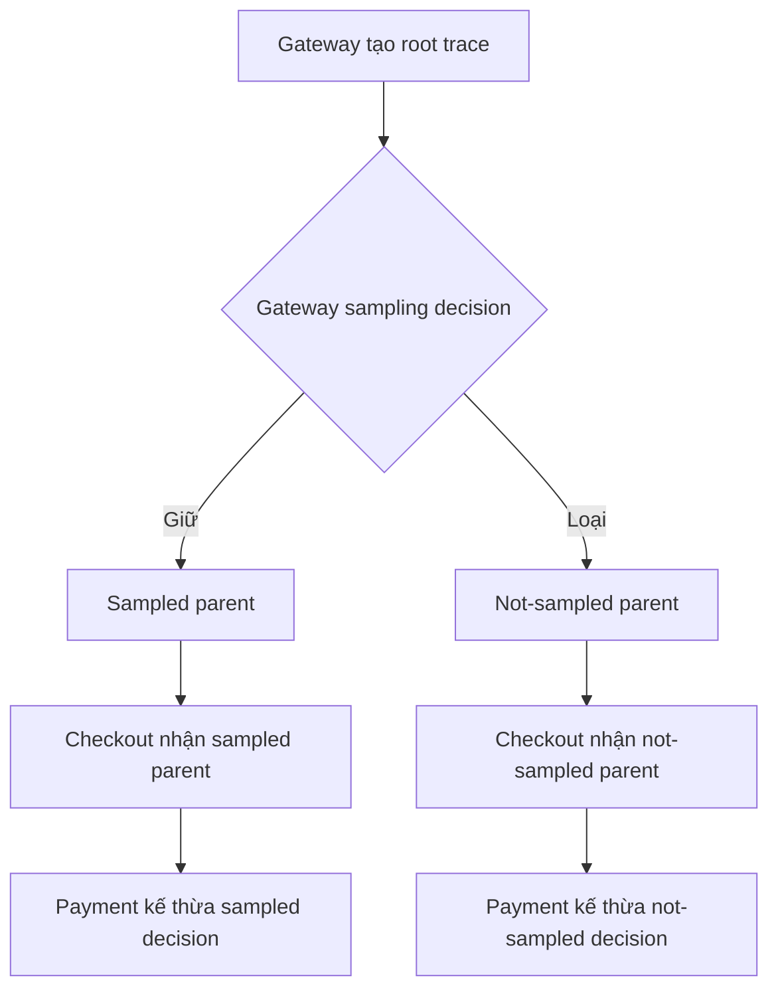
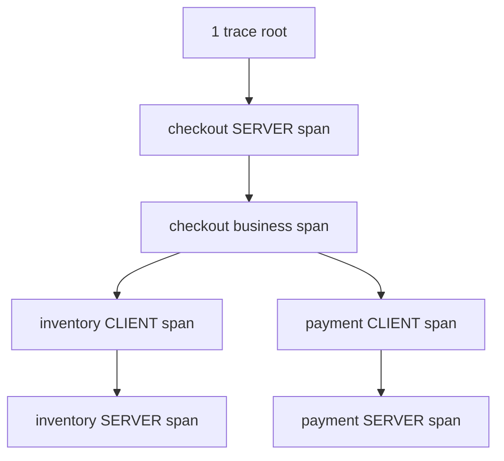
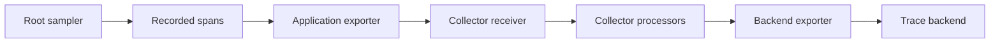

# Kiểm tra sampling thực tế trong Spring Boot

Đã đặt `management.tracing.sampling.probability: 0.1` nhưng trace backend chỉ hiện một số request. Đây có phải sampling hoạt động đúng, hay exporter đang làm mất dữ liệu? Muốn trả lời, cần kiểm tra toàn bộ đường đi từ cấu hình có hiệu lực, quyết định sampler ở trace root, propagation sang service con, đến exporter, collector và backend.

Bài **Kiểm tra sampling thực tế** thuộc chương **Sampling** của module **SPRING_BOOT_OBSERVABILITY**. Module hướng dẫn thiết lập observability cho Spring Boot bằng Micrometer Observation, metrics, logs và distributed tracing; học context propagation, tags/cardinality, exporter, sampling và cách liên kết các tín hiệu để điều tra lỗi, độ trễ và hành vi ứng dụng trên môi trường thực.

Mục tiêu bài học là xây dựng quy trình có thể lặp lại để xác minh sampling trong ứng dụng đang chạy. Ta phân biệt giá trị cấu hình với sampler thực tế, đếm đúng trace roots và spans, kiểm tra parent-based decisions, đo tỷ lệ trong điều kiện kiểm soát và tìm điểm đầu tiên dữ liệu bị mất. Một con số trên trace UI không đủ để tự kết luận sampler đúng hoặc sai.

## 1. Sampling thực tế cần kiểm tra điều gì?

Sampling là quyết định giữ hay loại trace/spans theo một policy. Trong một hệ thống phân tán, cần phân biệt ít nhất năm câu hỏi:

| Câu hỏi | Bằng chứng cần tìm |
| --- | --- |
| Ứng dụng đang dùng sampler nào? | Effective configuration, tracer/SDK bean và sampler implementation |
| Bao nhiêu trace roots được chọn? | Số root operations đủ điều kiện và sampling decisions |
| Downstream có kế thừa quyết định không? | Trace context headers/flags và parent span relationship |
| Span đã rời JVM chưa? | Exporter success/failure, queue và retry metrics/logs |
| Trace đã đến backend chưa? | Collector received/dropped counters và backend ingestion/query |

Không gộp các con số sau thành một:

- **Request count:** số HTTP/business requests theo metric đã định nghĩa.
- **Trace root count:** số trace bắt đầu tại một ranh giới cụ thể.
- **Sampled trace count:** số root traces được sampler quyết định giữ.
- **Span count:** số spans trong các traces được ghi nhận.
- **Exported span count:** số spans exporter gửi thành công hoặc giao cho pipeline.
- **Stored trace count:** số traces backend thực sự lưu và truy vấn được.

Các số liệu này khác nhau tự nhiên. Một HTTP server request có thể là child span của trace bắt đầu ở gateway, một trace có thể có nhiều spans, và một sampled span vẫn có thể không tới backend nếu exporter hoặc collector lỗi.

## 2. Bước đầu: xác minh cấu hình có hiệu lực

Với Spring Boot có Micrometer Tracing auto-configuration, cấu hình xác suất thường có dạng:

```yaml
management:
  tracing:
    sampling:
      probability: 0.1
```

Đặt property trong file không chứng minh runtime đang sử dụng giá trị đó. Cần xác minh:

1. Profile thực tế được active, ví dụ `prod` hay `staging`.
2. Environment variables, command-line arguments và externalized configuration có ghi đè property không.
3. Có custom tracer, SDK hoặc sampler bean nào thay thế auto-configuration không.
4. Bridge thực tế là OpenTelemetry hay Brave, và sampler implementation nào đang được dùng.
5. Các service upstream có đưa remote sampling decision vào trace context không.

Với Actuator, có thể dùng endpoint/config inspection được bảo vệ để xem property phù hợp nếu ứng dụng expose nó và quyền cho phép. Không expose toàn bộ `/actuator/env` ra Internet chỉ để kiểm tra. Cách khác là ghi startup log đã kiểm soát cho effective sampling config hoặc kiểm tra bean/runtime config trong integration test.

Ví dụ profile:

```yaml
# application-staging.yml
management:
  tracing:
    sampling:
      probability: 1.0
```

```yaml
# application-prod.yml
management:
  tracing:
    sampling:
      probability: 0.1
```

Nếu profile staging không active, giá trị staging không có tác dụng. Nếu SDK được tạo thủ công với sampler riêng, property của Spring Boot có thể không kiểm soát SDK đó. Tránh cấu hình hai nguồn rồi không biết nguồn nào thắng.

## 3. Tạo phép thử có ranh giới rõ ràng

Muốn đo tỷ lệ, trước tiên phải định nghĩa **đơn vị sampling**. Thường ta quan tâm số trace roots được tạo ở một ingress boundary, không phải đếm mọi HTTP request tại mọi service.

Một phép thử có kiểm soát nên:

- Dùng một route test hoặc workload xác định, tránh trộn health checks và management requests.
- Tạo requests mới độc lập tại ingress để mỗi request có cơ hội tạo trace root.
- Không gửi trace context mẫu từ client, trừ khi đang cố ý test remote-parent behavior.
- Ghi nhận số requests đã gửi, số root spans được tạo, số sampled decisions và số spans xuất thành công.
- Dùng time window xác định và chờ exporter/collector flush theo giới hạn có kiểm soát.
- Chạy cùng cấu hình và traffic pattern khi so sánh hai lần thử.

Ví dụ một request test bằng curl:

```bash
curl --fail-with-body \
  -H "X-Test-Run: sampling-check-01" \
  http://localhost:8080/test/trace
```

Header `X-Test-Run` chỉ là metadata kiểm thử trong ví dụ. Nó không phải sampling header và không thay thế `traceparent`. Route test cần tồn tại trong ứng dụng và không nên expose thao tác chẩn đoán nhạy cảm ở production.

### Đừng đếm nhầm request thành trace root

Nếu gateway tạo root trace rồi checkout-service nhận remote parent, checkout span là child chứ không phải root. Nếu gửi 1.000 requests qua gateway và đếm số roots tại checkout, có thể nhận 0 root mới dù tracing đang hoạt động tốt. Hãy đếm tại đúng ranh giới tạo trace.

## 4. Phân biệt probability sampling và parent-based sampling

Trong nhiều tracing SDK, sampler được cấu thành từ hai quyết định:

- Nếu span có parent hợp lệ, **parent-based policy** có thể kế thừa sampling decision của parent.
- Nếu span là root, sampler gốc (ví dụ xác suất) mới quyết định theo policy cục bộ.

Vì vậy, giá trị 0.1 ở checkout không nhất thiết có nghĩa 10% requests đến checkout sẽ được chọn độc lập. Nếu gateway đã quyết định sampled hoặc not-sampled, checkout có thể kế thừa remote parent decision.



Trong kiến trúc parent-based, các service con thường giữ nhất quán decision của trace cha. Nếu mỗi service tự tạo root do thiếu propagation, tỷ lệ trace backend có thể tăng và các spans bị tách thành nhiều traces.

Khi test probability cục bộ, tạo requests không có remote parent tại boundary đang được kiểm tra. Khi test propagation, cố ý gửi remote parent với sampled/not-sampled flag và xác minh child behavior theo sampler đã cấu hình.

## 5. Sampling flag trong trace context

Với W3C Trace Context, header `traceparent` chứa version, trace ID, parent ID và trace flags. Bit sampled là một phần của flags. Ví dụ minh họa:

```text
traceparent: 00-4bf92f3577b34da6a3ce929d0e0e4736-00f067aa0ba902b7-01
```

Ví dụ trên minh họa một header có sampled flag được bật theo định dạng W3C. Nó không phải token xác thực và không cho biết exporter đã thành công. Giá trị flag có thể được thay đổi tại ranh giới theo policy được phép; không được coi remote header do client tùy ý gửi là danh tính tin cậy.

Khi kiểm tra propagation:

1. Quan sát request outbound từ service cha qua test server hoặc instrumentation test.
2. Xác nhận trace ID được giữ theo cùng trace.
3. Xác nhận parent span ID ở service con liên kết với client span tương ứng.
4. Xác nhận sampled flag được xử lý theo parent-based policy.
5. Kiểm tra một request sampled và một request not-sampled để so sánh.

Không log toàn bộ headers trong production để debug. Chỉ ghi trường đã được phê duyệt hoặc dùng test receiver cô lập; tuyệt đối không làm lộ Authorization, Cookie hoặc token.

## 6. Kiểm tra bằng deterministic sampler trước

Khi viết unit/integration test, sampler deterministic dễ xác minh hơn probability sampler. Ví dụ dùng sampler cố định luôn sample hoặc luôn drop trong test fixture của SDK:

```java
// Pseudocode: API cụ thể tùy tracing bridge/SDK.
Sampler sampler = alwaysOnSampler();

// Tạo tracer/test SDK với sampler deterministic.
// Gọi operation đã instrument.
// Assert span được tạo và ghi vào in-memory exporter.
```

Một bài test khác có thể dùng sampler luôn drop để chứng minh:

- Trace không được ghi/export theo tracing pipeline đó.
- Metrics Timer vẫn được ghi nếu metrics handler hoạt động độc lập.
- Application logs tuân theo logging configuration riêng.

Không cần gửi dữ liệu tới backend production để chứng minh semantics của sampler. Dùng in-memory exporter hoặc test exporter phù hợp implementation.

### Kiểm tra property binding trong Spring context

Integration test có thể khởi tạo application context theo profile test và xác minh effective configuration/bean được tạo. Tên class/property cụ thể phải theo Spring Boot và Micrometer version. Không nên chỉ assert file YAML có chuỗi `0.1` vì test đó không xác minh runtime binding hoặc custom sampler override.

## 7. Statistical test cho xác suất 10%

Với root traces độc lập, mỗi trace có xác suất chọn `p`, số trace được chọn có thể mô hình hóa bằng phân phối nhị thức:

\[
X \sim \mathrm{Binomial}(n,p)
\]

Kỳ vọng và độ lệch chuẩn:

\[
E[X] = np
\]

\[
\sigma = \sqrt{np(1-p)}
\]

Ví dụ `n=10.000` trace roots đủ điều kiện, `p=0.1`:

\[
E[X] = 1.000
\]

\[
\sigma = \sqrt{10.000 \times 0.1 \times 0.9} = 30
\]

Kết quả 970, 1.020 hay 1.040 có thể đều hợp lý tùy vùng chấp nhận và assumptions. Không yêu cầu chính xác 1.000. Một test thống kê nên dùng tolerance dựa trên độ lệch chuẩn hoặc confidence interval đã chọn, và tránh quá nhạy với một lần chạy.

**Lưu ý assumptions:** phân phối nhị thức chỉ phù hợp nếu các lần chọn roots độc lập với xác suất tương ứng. Parent-based remote sampling, custom sampler deterministic theo trace ID, rate limiting, traffic không đồng nhất hoặc test không đếm đúng root population có thể làm mô hình này không còn phù hợp.

Đối với production, dùng cửa sổ đủ dài và nhiều root traces; không bật workload lớn chỉ để đạt số mẫu thống kê nếu việc đó gây tải hoặc phát sinh chi phí không cần thiết.

## 8. Đếm trace roots, traces và spans đúng cách

Một trace thường chứa nhiều spans. Một request server có thể tạo server span, một observation nghiệp vụ và nhiều client spans. Vì thế span count có thể lớn hơn trace count nhiều lần.



Ví dụ một trace có 6 spans. Nếu sampler giữ 100 trace roots, backend có thể thấy xấp xỉ 600 spans, nếu instrumentation đầy đủ và không có drops. Không so sánh sampled spans với HTTP request count như thể hai đại lượng giống nhau.

Nên thu thập ít nhất:

| Counter/measurement | Ý nghĩa |
| --- | --- |
| Ingress requests | Tổng request đi vào boundary |
| Trace roots started | Số root spans được tạo |
| Root sampling decisions: sampled | Số roots được giữ |
| Spans ended | Số spans đã hoàn tất |
| Exporter successes/failures | Số spans/batches export thành công hoặc lỗi |
| Collector received/dropped | Số spans collector nhận hoặc loại |
| Backend stored/searchable | Số traces có thể truy vấn sau ingest |

Các con số trên cần được thu qua instrumentation/test harness/SDK exporter metrics/collector telemetry tương ứng. Không phải mọi Spring Boot app tự tạo sẵn một meter cho từng dòng trong bảng.

## 9. Kiểm tra exporter và collector sau sampling

Nếu sampler chọn trace nhưng backend không thấy, điểm mất dữ liệu có thể nằm sau sampler:



Kiểm tra theo từng điểm:

1. **SDK/exporter:** exporter có flush batch, timeout, retry và shutdown đúng không?
2. **Network:** DNS, route, TLS, auth, protocol và endpoint đúng không?
3. **Collector receiver:** collector có nhận spans và tăng received count không?
4. **Processor:** batch, memory limiter, tail sampler hoặc filter có drop data không?
5. **Backend exporter:** có throttling, rejected payload, auth error hoặc retry exhaustion không?
6. **Query:** đang tìm đúng service name, tenant, environment, region và time window không?

Một span được sampler ghi nhận trong SDK không đồng nghĩa collector đã nhận. Exporter có thể lỗi, collector có thể đầy queue hoặc processor có thể drop. Hãy xác định **điểm đầu tiên số lượng giảm bất thường**.

### Dấu hiệu quan sát pipeline

Tùy collector và exporter, telemetry của pipeline có thể cung cấp counters như số spans received, sent, refused hoặc dropped. Tên metric thay đổi theo distribution/version; hãy xem metric names thật của collector trước khi viết alert. Đừng hard-code tên đoán từ ví dụ trên mạng.

## 10. So sánh metrics và logs trong cùng phép thử

Một test sampling thực tế nên dùng các tín hiệu độc lập để hiểu kết quả:

| Tín hiệu | Kỳ vọng khi trace sampling drop | Điều cần kiểm tra |
| --- | --- | --- |
| HTTP server Timer | Thường vẫn ghi request nếu metrics instrumentation hoạt động | COUNT, route/status tags |
| Business Counter | Vẫn tăng nếu nghiệp vụ gọi increment | Định nghĩa một lần logic hay nhiều attempts |
| Application log | Vẫn ghi theo level/config riêng | Log sampling/filter, MDC và async propagation |
| Distributed trace | Không được export theo sampling decision đã drop | Sampler và downstream parent policy |
| Exporter/collector metrics | Có thể không thấy spans bị drop ở head sampler | So sánh đúng counter ở từng stage |

Không đặt `traceId` làm metric tag để đối chiếu từng request. Đây là high-cardinality field. Dùng một test-run ID hữu hạn trong môi trường kiểm thử, trace search hoặc logs được bảo vệ để đối chiếu; không mang ID riêng từng request vào metric labels.

## 11. Quy trình kiểm tra sampling ở staging

Một runbook staging có thể thực hiện như sau:

1. **Chuẩn bị:** chọn một service ingress, xác định sampler/bridge, profile, exporter và collector.
2. **Xác minh config:** kiểm tra effective probability và đảm bảo custom SDK không ghi đè ngoài ý muốn.
3. **Baseline:** gửi một nhóm requests không có remote trace parent; đếm root spans và sampled roots.
4. **Statistical run:** gửi đủ số root requests có kiểm soát, ghi lại n, p, số roots được chọn và tolerance.
5. **Propagation run:** tạo request sampled và not-sampled qua gateway rồi kiểm tra client/server trace IDs, parent IDs và flags.
6. **Export run:** so sánh recorded spans, exporter success/failure, collector received/dropped và backend stored.
7. **Signal cross-check:** xác nhận metrics/logs có hành vi độc lập như mong đợi.
8. **Cleanup:** dừng workload test, phục hồi sampling config theo profile, xóa dữ liệu giả nếu policy yêu cầu và lưu kết quả kiểm tra.

Không chạy statistical test trên production traffic thật rồi kết luận từ một batch nhỏ. Hãy dùng staging hoặc một traffic cohort có scope rõ ràng; nếu phải kiểm tra production, giới hạn thời gian/lưu lượng và theo dõi chi phí.

## 12. Các lỗi diễn giải thường gặp

| Kết luận sai | Vì sao sai | Cách kiểm tra đúng |
| --- | --- | --- |
| Gửi 10 requests phải có đúng 1 trace | Sampling là xác suất, không chia đều | Dùng mẫu lớn hoặc deterministic test |
| Trace count bằng HTTP request count | Request có thể là child và một trace chứa nhiều requests/spans | Đếm trace roots tại đúng boundary |
| Probability property là sampler đang chạy | Profile hoặc custom SDK có thể override | Kiểm tra effective config và runtime bean |
| Sampler chọn trace tức backend đã lưu | Exporter/collector/backend còn có thể drop | So sánh từng stage |
| Không thấy trace nghĩa request không chạy | Sampling có thể loại trace | Dùng metrics/logs độc lập |
| Downstream phải tự lấy mẫu 10% | Parent-based policy có thể kế thừa upstream | Kiểm tra remote parent/sampled flag |
| Trace có 10 spans nghĩa đã lấy 10 requests | Trace và span là đơn vị khác nhau | Đếm root traces và spans riêng |
| Tăng probability sẽ sửa lỗi propagation | Sampling không sửa mất context/header | Kiểm tra inject/extract và parent IDs |
| Không thấy lỗi trong trace nghĩa service không lỗi | Head sampler có thể loại trace trước khi lỗi phát sinh | Dùng logs/metrics hoặc tail-based sampling |
| 10% sampling bảo vệ dữ liệu nhạy cảm | Trace được chọn vẫn có thể chứa secrets | Sanitize dữ liệu tại nguồn/pipeline |

## 13. Tình huống thực tế: staging chỉ thấy 4% traces

**Bối cảnh giả định:** checkout-service được cấu hình probability 0.1. Staging gửi 5.000 requests nhưng trace backend chỉ tìm thấy khoảng 200 traces, tương đương 4% request count.

Không nên kết luận ngay sampler chỉ hoạt động 4%. Hãy điều tra theo thứ tự:

**Bước 1 — Xác định mẫu số.** 5.000 có phải 5.000 trace roots mới không? Có health checks, remote parent từ gateway hoặc nhiều requests con không? Nếu đếm toàn bộ HTTP requests ở checkout thì đây không phải mẫu số phù hợp.

**Bước 2 — Kiểm tra config.** Đảm bảo profile staging active và sampler runtime thực sự dùng probability 0.1. Tìm custom tracer/SDK bean và config từ environment.

**Bước 3 — Kiểm tra parent decision.** Nếu gateway chỉ gửi một phần traces hoặc remote parent có sampled=false, checkout có thể kế thừa decision. Đếm các roots riêng với các remote-parent spans.

**Bước 4 — Kiểm tra exporter.** Xem số sampled roots/recorded spans ở application và số export failures. Nếu SDK recorded nhiều hơn backend stored, có thể lỗi xảy ra sau sampling.

**Bước 5 — Kiểm tra collector.** Đối chiếu spans received, processor drops, tail-sampling policy, memory limiter và backend exporter. Một tail sampler có thể có policy riêng khiến output khác đầu vào.

**Bước 6 — Kiểm tra truy vấn.** Xác nhận service name, environment, tenant và time range. Backend UI có thể đang áp filter hoặc retention khác.

**Bước 7 — Chạy cohort kiểm soát.** Gửi một tập root requests độc lập, xác minh effective sampler, dùng in-memory/collector telemetry để so sánh decision và output. Chỉ khi đã loại trừ remote parent, config override và export drops mới đánh giá tỷ lệ 4% là bất thường.

## 14. Bài tập tự kiểm tra

**Bài 1.** Có property probability 0.1 trong YAML nhưng runtime chỉ chọn 2%. Bạn kiểm tra gì trước?

*Gợi ý:* Active profile, externalized config, custom tracer/SDK sampler và upstream parent decisions. File YAML không chứng minh sampler runtime.

**Bài 2.** Gateway tạo 1.000 root traces; checkout nhận 1.000 requests nhưng không có root spans. Có nhất thiết tracing hỏng?

*Gợi ý:* Không. Checkout có thể nhận remote parent và tạo child spans; đếm root tại gateway.

**Bài 3.** Exporter ghi nhận 100 spans sent nhưng backend chỉ tìm được 80 spans. Kiểm tra những tầng nào?

*Gợi ý:* Collector received/dropped, processors, backend exporter rejects/throttling, backend ingest và query filters/time range.

**Bài 4.** Muốn chứng minh sampler drop trace không làm mất metrics. Nên thiết kế test thế nào?

*Gợi ý:* Dùng sampler deterministic drop, chạy operation đã instrument, assert trace không xuất nhưng Timer/Counter vẫn ghi vào registry.

**Bài 5.** Có nên assert đúng 100 sampled traces trong một lần gửi 1.000 roots với p=0.1?

*Gợi ý:* Không. Dùng binomial expectation/variance và tolerance thống kê; hoặc deterministic sampler cho unit test.

**Bài 6.** Backend hiển thị 10.000 spans. Có thể kết luận có 10.000 requests được sample?

*Gợi ý:* Không. Một trace có nhiều spans, spans có thể là client/server/internal. Đếm root traces riêng.

**Bài 7.** Vì sao tail sampler không thể giữ một trace mà application head sampler đã không export?

*Gợi ý:* Collector không nhận dữ liệu để ra quyết định. Tail sampling chỉ áp dụng trên spans đã tới thành phần tail sampler.

**Bài 8.** Sampling rate đúng 10%, nhưng chỉ tìm thấy một phần traces trong backend. Bạn nên xem thêm số liệu nào?

*Gợi ý:* Export success/failure, collector received/dropped, backend ingestion, tenant/service/time-range query và retention.

## 15. Ghi nhớ

- **Kiểm tra sampling thực tế là kiểm tra toàn pipeline**: effective config → root decision → child propagation → exporter → collector → backend.
- probability 0.1 là xác suất của sampler trong điều kiện áp dụng, không bảo đảm 10% của mọi HTTP request tại mọi service.
- **Đếm trace roots riêng với spans và HTTP requests**. Downstream thường nhận parent trace thay vì tạo root mới.
- Kiểm tra **parent-based decision và W3C sampled flag** khi các service có tỷ lệ hoặc trace IDs khác nhau.
- Dùng **deterministic sampler** để test semantics; dùng statistical test với đủ mẫu và tolerance để kiểm tra probability.
- Metrics và logs là pipeline độc lập; sampler drop trace không tự động làm Timer/Counter hoặc application logs dừng ghi.
- Nếu sampler đã chọn trace mà backend không thấy, kiểm tra exporter, collector drops, backend ingestion và truy vấn trước khi thay probability.
- Không dùng trace ID làm metric tag và không coi sampling là bảo vệ privacy; dữ liệu nhạy cảm phải được loại bỏ tại nguồn hoặc pipeline đã kiểm chứng.
