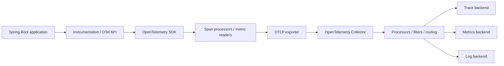

# OpenTelemetry trong Spring Boot

Một request đi vào ứng dụng Spring Boot, truy vấn database, gọi dịch vụ thanh toán rồi phát message để xử lý nền. Khi độ trễ tăng, đội vận hành cần biết request đã đi qua đâu, bước nào chậm, lỗi xuất hiện ở service nào và log nào liên quan tới trace. Metrics cho thấy xu hướng tổng thể; logs ghi sự kiện; distributed traces mô tả hành trình của những thao tác đã được instrument. Để tạo và trao đổi các tín hiệu đó theo mô hình chung, **OpenTelemetry (OTel)** cung cấp API, SDK, instrumentation và giao thức OTLP.

OpenTelemetry là bộ tiêu chuẩn và công cụ mã nguồn mở để tạo, xử lý và xuất telemetry, bao gồm traces, metrics và logs. Trong Spring Boot, OTel có thể tích hợp qua OpenTelemetry SDK/agent hoặc phối hợp với các abstraction của Micrometer như Observation và Micrometer Tracing. Kiến trúc phù hợp phụ thuộc phiên bản Spring Boot, dependency, exporter và pipeline backend.

Bài học thuộc chương **OpenTelemetry** của module **SPRING_BOOT_OBSERVABILITY**. Module hướng dẫn thiết lập observability cho Spring Boot bằng Micrometer Observation, metrics, logs và distributed tracing; học context propagation, tag/cardinality, exporter, sampling và liên kết tín hiệu để điều tra lỗi, độ trễ và hành vi ứng dụng trên môi trường thực. Bài này cung cấp nền tảng để hiểu OTel trong Spring Boot và kiểm chứng dữ liệu từ ứng dụng đến backend.

## Mục tiêu học tập

Sau bài này, bạn có thể:

1. Giải thích OpenTelemetry là gì và vì sao cần chuẩn hóa telemetry.
2. Phân biệt OTel API, SDK, instrumentation, OTLP exporter, Collector và observability backend.
3. Mô tả kiến trúc tích hợp OTel với Spring Boot và vai trò của Micrometer Observation/Tracing.
4. Chọn mô hình instrumentation: Spring Boot Actuator/Micrometer, OTel Java Agent hoặc OTel SDK trực tiếp.
5. Cấu hình service/resource metadata, exporter endpoint và context propagation.
6. Phân biệt trace/span, metric instrument và log record; hiểu cách liên kết tín hiệu.
7. Hiểu sampling, batching, retry, collector pipelines và các điểm dữ liệu có thể bị drop.
8. Kiểm soát cardinality, privacy, secrets và chi phí telemetry.
9. Chẩn đoán lỗi từ instrumentation đến OTLP Collector/backend.
10. Triển khai OTel theo giai đoạn, tránh trùng instrumentation hoặc xung đột SDK/exporter.

## 1. OpenTelemetry giải quyết vấn đề gì?

Một hệ thống phân tán có thể dùng nhiều ngôn ngữ, framework và backend quan sát. Nếu mỗi thành phần tự định nghĩa trace ID, metric names, log fields, propagation headers và exporter riêng, việc nối dữ liệu và thay backend trở nên khó khăn.

OpenTelemetry cung cấp các thành phần và quy ước chung:

- **API:** giao diện mà thư viện/ứng dụng sử dụng để tạo spans, metrics và log telemetry.
- **SDK:** triển khai API, quản lý providers, processors, readers, samplers và exporters.
- **Instrumentation:** tự động hoặc thủ công tạo telemetry quanh HTTP, database, messaging, framework và code nghiệp vụ.
- **Context propagation:** truyền trace context qua process, thread và protocol boundary.
- **OTLP:** giao thức truyền telemetry tới collector hoặc backend hỗ trợ.
- **Collector:** nhận, xử lý, định tuyến và xuất telemetry sang một hoặc nhiều đích.
- **Semantic conventions:** quy ước tên và thuộc tính để telemetry có ngữ nghĩa nhất quán.

OpenTelemetry không tự động giải thích mọi hành vi ứng dụng và không bảo đảm mọi request đều được thu thập. Ứng dụng vẫn cần instrumentation, propagation, sampling và pipeline được cấu hình đúng.

### 1.1. Ba tín hiệu chính

| Tín hiệu | Nội dung | Câu hỏi thường trả lời |
|---|---|---|
| **Traces** | Trace gồm spans có quan hệ, thời gian, attributes, events và status | Một request đi qua đâu? Bước nào chậm? |
| **Metrics** | Phép đo tổng hợp như counter, gauge, histogram | Có bao nhiêu request? Error rate/latency đổi thế nào? |
| **Logs** | Bản ghi sự kiện có timestamp, severity, body và attributes | Điều gì đã xảy ra? Có exception nào? |

Ba tín hiệu bổ sung nhau. Một trace mẫu không thay thế throughput toàn hệ thống; metric tổng hợp không chứa mọi sự kiện của request; log không tự thể hiện timeline phân tán.

### 1.2. Telemetry pipeline tổng quát



Đây là kiến trúc tham khảo. Ứng dụng có thể export trực tiếp tới backend hoặc dùng Micrometer registry/exporter khác. Collector không bắt buộc trong mọi hệ thống nhỏ, nhưng hữu ích để quản lý tập trung pipeline, credentials, routing và chính sách xử lý.

## 2. Các thành phần OpenTelemetry

### 2.1. OpenTelemetry API và SDK

API cho phép code/instrumentation lấy tracer, meter, logger và tạo telemetry. Ứng dụng có thể phụ thuộc API mà không phải biết backend nào lưu dữ liệu.

SDK triển khai API và quản lý các thành phần:

| Thành phần | Trách nhiệm |
|---|---|
| TracerProvider | Tạo tracer và quản lý tracing configuration |
| SpanProcessor | Nhận sự kiện span start/end và chuyển span tới exporter |
| Sampler | Quyết định trace/span có được record theo chính sách |
| MeterProvider | Quản lý meter, readers, views và metric export |
| LoggerProvider | Quản lý log records nếu dùng OTel Logs SDK |
| Resource | Mô tả thực thể phát telemetry: service, version, environment |
| Exporter | Chuyển telemetry ra OTLP hoặc backend/định dạng khác |

Ứng dụng có OTel API nhưng không có SDK/exporter hiệu lực có thể không có pipeline xuất dữ liệu như mong đợi. Vì vậy phải kiểm tra provider và SDK runtime thực tế.

### 2.2. Instrumentation

**Automatic instrumentation** dùng agent hoặc framework integration để quan sát thư viện đã hỗ trợ mà ít sửa source, ví dụ HTTP, JDBC, messaging hoặc runtime metrics.

**Manual instrumentation** do developer thêm vào phần code nghiệp vụ cần quan sát, như authorize payment, reserve inventory hoặc reconcile order.

Automatic instrumentation giảm công sức nhưng không hiểu hết ngữ nghĩa domain. Manual instrumentation bổ sung ngữ cảnh nghiệp vụ nhưng cần đặt ranh giới rõ để tránh tạo spans trùng.

### 2.3. OTLP và Collector

**OTLP (OpenTelemetry Protocol)** là giao thức truyền telemetry qua HTTP/protobuf hoặc gRPC tùy exporter, endpoint và cấu hình. OTLP không đồng nghĩa với Zipkin API hoặc Prometheus scrape.

Collector có thể nhận dữ liệu qua receivers, áp dụng processors như batch, memory limiter, transform/filter hoặc tail sampling khi cấu hình, rồi định tuyến tới exporters. Component availability phụ thuộc distribution/phiên bản Collector.

## 3. OpenTelemetry và Micrometer trong Spring Boot

Spring Boot có hệ observability dựa trên **Micrometer Observation**, **Micrometer Metrics** và **Micrometer Tracing**. OpenTelemetry có thể kết nối với các abstraction này, nhưng hai hệ API không phải một.

| Thành phần | Vai trò |
|---|---|
| Micrometer Observation | Mô hình hóa thao tác và lifecycle observation |
| Micrometer Metrics | API/registry cho counter, timer, gauge |
| Micrometer Tracing | Abstraction tracing cho spans và context |
| OTel API/SDK | API/implementation cho traces, metrics, logs |
| Micrometer Tracing OTel bridge | Nối Micrometer Tracing với OTel tracer |
| OTLP exporter | Xuất telemetry OTel theo OTLP |
| Collector/backend | Tiếp nhận, xử lý, lưu và truy vấn |

Một Observation có thể được nhiều ObservationHandler quan sát: metrics handler tạo meter, tracing handler tạo span, logging integration bổ sung correlation. Observation không tự động trở thành mọi tín hiệu; handlers cần được cấu hình.

### 3.1. Tránh duplicate instrumentation

Nếu OTel Java Agent tạo HTTP server/client spans, đồng thời Spring Boot/Micrometer instrument cùng boundary, trace có thể có spans lặp.

Xác định instrumentation owner cho từng ranh giới: HTTP server, HTTP client, JDBC, messaging và domain operations. Có thể phối hợp nhiều công cụ ở các ranh giới khác nhau, nhưng phải kiểm tra trace tree thay vì bật mọi integration mặc định.

## 4. Chọn mô hình tích hợp OTel với Spring Boot

| Mô hình | Cách hoạt động | Khi phù hợp | Điểm cần lưu ý |
|---|---|---|---|
| Spring Boot + Micrometer | Actuator, Observation, Metrics, Tracing và bridge/export integration | Dự án muốn giữ abstraction Micrometer | Quản lý bridge, registry, exporter và version |
| OTel Java Agent | Agent inject instrumentation vào JVM | Cần instrument thư viện được hỗ trợ | Tránh trùng Spring/Micrometer instrumentation |
| OTel SDK trực tiếp | App dùng OTel API/SDK và instrumentation | Nhu cầu custom OTel sâu | Quản lý provider, exporter, resource và context |

Trước khi thêm dependency, hãy biết dự án đã có Micrometer chưa, tracer hiện tại là Brave hay OTel, agent có đang chạy không, metrics scrape hay push, logs được export thế nào và backend nhận OTLP trực tiếp hay qua Collector.

Nếu đã dùng Micrometer Observation và cần backend OTel, bridge phù hợp giúp giữ API nhất quán. Nếu dùng OTel SDK hoặc agent, hoạch định migration để tránh hai SDK/provider cạnh tranh.

## 5. Cấu hình Spring Boot dùng OpenTelemetry bridge

Gradle minh họa cho **Spring Boot 3.x dùng Micrometer Tracing với OTel bridge**:

```groovy
dependencies {
    implementation 'org.springframework.boot:spring-boot-starter-actuator'
    implementation 'io.micrometer:micrometer-tracing-bridge-otel'
    runtimeOnly 'io.opentelemetry:opentelemetry-exporter-otlp'
}
```

Dependency và version phải theo Spring Boot/Micrometer BOM. Không gán version độc lập khi BOM đang quản lý. Không thêm Brave bridge song song với OTel bridge nếu chưa có kiến trúc rõ ràng.

### 5.1. Service name và endpoint OTLP

Ví dụ YAML cho một số cấu hình Spring Boot 3.x:

```yaml
spring:
  application:
    name: checkout-service

management:
  tracing:
    sampling:
      probability: 0.10

  otlp:
    tracing:
      endpoint: http://otel-collector:4318/v1/traces
```

Property prefix, transport mặc định và endpoint behavior phụ thuộc phiên bản Boot. Đối chiếu reference configuration và quan sát endpoint thực tế exporter sử dụng.

- spring.application.name là một nguồn service name trong nhiều tích hợp.
- sampling probability 0.10 minh họa head-based probability; metrics không vì vậy chỉ đo 10% request.
- Port 4318 thường dùng OTLP/HTTP; path /v1/traces là đường traces OTLP/HTTP.
- otel-collector là hostname giả định trong mạng container/cluster.

Nếu ứng dụng chạy ngoài network của Collector, hostname/localhost có thể không đúng. Dùng endpoint triển khai thật, TLS/authentication và trust store tương ứng.

### 5.2. Resource attributes và service identity

Resource mô tả **nơi telemetry được tạo**, khác attributes của span hoặc metric point.

```text
service.name=checkout-service
service.version=1.42.0
deployment.environment.name=production
service.instance.id=checkout-pod-7f9c
```

Tên key chuẩn có thể thay đổi theo semantic conventions/version. Thống nhất resource metadata giữa application, agent và collector. Không dùng request ID, user ID hoặc trace ID làm resource attribute vì resource áp dụng rộng cho process/service.

## 6. OpenTelemetry Java Agent

OpenTelemetry Java Agent là automatic instrumentation cho JVM, thường gắn lúc khởi động bằng tham số -javaagent.

Ví dụ:

```bash
java \
  -javaagent:/opt/otel/opentelemetry-javaagent.jar \
  -Dotel.service.name=checkout-service \
  -Dotel.exporter.otlp.endpoint=http://otel-collector:4317 \
  -Dotel.traces.sampler=parentbased_traceidratio \
  -Dotel.traces.sampler.arg=0.10 \
  -jar app.jar
```

Đây là cấu hình Java Agent, không phải cú pháp Spring Boot management.*. Port 4317 thường dùng OTLP/gRPC; 4318 thường dùng OTLP/HTTP. Khớp receiver và agent version; quản lý agent jar trong image/build và pin version.

Ưu điểm là instrument framework phổ biến mà ít sửa code. Giới hạn là agent không hiểu hết domain, có thể tạo spans trùng với Spring/Micrometer, và nâng version có thể thay span names/attributes. Cần đo overhead và kiểm thử trace tree.

## 7. Manual instrumentation với OpenTelemetry API

Automatic instrumentation không hiểu mọi bước nghiệp vụ. Khi cần đo một thao tác, có thể dùng OTel API trực tiếp hoặc Micrometer Observation.

```java
import io.opentelemetry.api.trace.Span;
import io.opentelemetry.api.trace.SpanKind;
import io.opentelemetry.api.trace.Tracer;
import io.opentelemetry.context.Scope;

class PaymentAuthorizationService {
    private final Tracer tracer;
    private final PaymentGateway gateway;

    PaymentAuthorizationService(Tracer tracer, PaymentGateway gateway) {
        this.tracer = tracer;
        this.gateway = gateway;
    }

    PaymentResult authorize(PaymentRequest request) {
        Span span = tracer.spanBuilder("payment.authorize")
                .setSpanKind(SpanKind.INTERNAL)
                .startSpan();

        try (Scope scope = span.makeCurrent()) {
            span.setAttribute("payment.operation", "authorize");
            span.setAttribute("payment.provider", "provider-a");
            return gateway.authorize(request);
        } catch (RuntimeException error) {
            span.recordException(error);
            span.setStatus(
                    io.opentelemetry.api.trace.StatusCode.ERROR);
            throw error;
        } finally {
            span.end();
        }
    }
}
```

Các kiểu PaymentGateway, PaymentRequest và PaymentResult là ví dụ nghiệp vụ. Tracer phải được cấu hình từ SDK/bridge. makeCurrent mở scope để instrumentation downstream dùng span hiện hành; close khôi phục context cũ; span.end hoàn tất thời gian đo.

### 7.1. Scope và Span có lifecycle riêng

Scope quản lý current context. Kết thúc scope khôi phục context trước đó, không đồng nghĩa span đã kết thúc. Span end hoàn tất thời gian đo và cho phép processor/exporter xử lý span.

Với async task, không kết thúc span ngay khi submit Future. Lifecycle phải bao quanh callback thực thi và context phải capture/restore đúng boundary.

### 7.2. Dùng Micrometer Observation khi phù hợp

```java
Observation.createNotStarted(
        "payment.authorize", observationRegistry)
    .contextualName("authorize payment")
    .lowCardinalityKeyValue("payment.operation", "authorize")
    .lowCardinalityKeyValue("payment.provider", "provider-a")
    .observe(() -> gateway.authorize(request));
```

Khi metrics/tracing handlers được cấu hình, Observation có thể tạo metrics và span. Không tạo đồng thời OTel span thủ công bao cùng callback nếu không có mục đích rõ ràng.

Low-cardinality values như operation/provider có tập hữu hạn. Order ID, email, trace ID hoặc raw URL có cardinality cao và có thể nhạy cảm. Tuân thủ allowlist, privacy policy và khả năng index backend.

## 8. Context propagation với OpenTelemetry

Distributed tracing cần truyền SpanContext qua HTTP headers, message headers, thread/executor, Reactor/async callback và RPC boundary.

W3C Trace Context là propagator phổ biến:

```http
traceparent: 00-0af7651916cd43dd8448eb211c80319c-b7ad6b7169203331-01
```

Client instrumentation inject context; server instrumentation extract rồi tạo span liên kết nếu propagation tương thích. Proxy drop header hoặc propagator lệch có thể làm trace bị tách.

OTel Java dùng Context và scope hiện hành; context không tự đi qua mọi executor hoặc thread mới. Với Spring executor, Micrometer Context Propagation và ContextPropagatingTaskDecorator có thể hỗ trợ trong phiên bản phù hợp. Với OTel SDK trực tiếp, dùng context wrapper tương thích. Không chuyển một Scope tùy ý sang thread khác để đóng.

Baggage là metadata context có thể propagate khi cấu hình hỗ trợ. Nó không tự động là span attribute và có thể đi qua network headers. Không đưa token, authorization, PII hoặc payload nhạy cảm vào baggage; kiểm soát allowlist, size và trust boundary.

## 9. Sampling trong OpenTelemetry

Sampling quyết định trace nào được record/export:

- **Head sampling:** quyết định sớm khi trace bắt đầu; tiết kiệm tải khi drop sớm nhưng chưa biết request có lỗi/chậm ở cuối.
- **Tail sampling:** quyết định sau khi Collector nhận thêm spans; cần buffer/capacity và thường thực hiện ở Collector/pipeline.

Ví dụ Java Agent dùng parent-based trace ID ratio sampler:

```bash
-Dotel.traces.sampler=parentbased_traceidratio
-Dotel.traces.sampler.arg=0.10
```

Tên sampler/property phụ thuộc phiên bản Agent/SDK. Với Spring Boot Micrometer tracing, management.tracing.sampling.probability là cách cấu hình head probability trong các phiên bản hỗ trợ.

Sampling traces không nên làm giảm metrics nghiệp vụ nếu metrics được instrument độc lập. Không dùng số spans lưu ở backend làm mẫu số SLI toàn traffic.

Parent-based sampling giúp downstream kế thừa sampling decision. Inbound flags đến từ ranh giới bên ngoài; hệ thống cần trust policy và không cho client bất kỳ ép ứng dụng export toàn bộ trace.

Tail sampling cần giữ spans theo trace ID trong thời gian chờ quyết định. Nếu head sampler đã bỏ spans ở ứng dụng, tail sampler không thể khôi phục dữ liệu chưa được gửi.

## 10. Metrics với OpenTelemetry và Micrometer

OpenTelemetry Metrics cung cấp mô hình instruments và export. Micrometer Metrics có API/registry riêng. Spring Boot thường dùng Micrometer, đồng thời có thể xuất sang backend qua Prometheus, OTLP hoặc registry phù hợp.

Ví dụ khái niệm OTel counter:

```java
LongCounter counter = meter
        .counterBuilder("checkout.orders.accepted")
        .setDescription("Accepted checkout orders")
        .setUnit("{order}")
        .build();

counter.add(1);
```

API tùy OTel version. Nếu dự án đã dùng Micrometer, cân nhắc đăng ký meter qua MeterRegistry hoặc Observation thay vì tạo OTel MeterProvider độc lập khiến hai hệ metrics khó quản lý.

Histogram ghi nhận phân bố giá trị như request duration. Backend tính percentile khi exporter/backend hỗ trợ. Kiểm tra instruments, views, temporality, bucket boundaries và output; không giả định p95 luôn có sẵn.

Metric time series được định danh bởi metric name và tổ hợp attributes/labels. Tránh user ID, order ID hoặc trace ID; dùng service, environment, route template, method, status group và operation. OTel views có thể điều chỉnh aggregation/attributes; Micrometer dùng MeterFilter và tag policies.

## 11. Logs và correlation

OTel Logs data model có log record với timestamp, severity, body, attributes, resource và trace context khi có. Trong Spring Boot, Logback vẫn có thể tạo log; integration/bridge mới đưa log sang OTel pipeline.

Hai nhu cầu riêng:

1. **Log correlation:** in trace ID/span ID trong structured log hoặc MDC để tìm log theo trace.
2. **Log export:** chuyển log records vào backend qua appender/agent/collector.

Log có trace ID không chứng minh span đã export; span có thể tồn tại mà log correlation chưa được cấu hình.

Trace ID/span ID có cardinality rất cao và không nên là metric labels. Dùng log correlation, trace search hoặc exemplar nếu backend hỗ trợ. Không ghi access token, cookie, password, số thẻ, request body nhạy cảm hoặc PII không cần thiết vào logs/spans.

## 12. OpenTelemetry Collector: receiver, processor, exporter

Collector đứng giữa ứng dụng và backend để app không phải biết từng đích. Ví dụ pipeline minh họa:

```yaml
receivers:
  otlp:
    protocols:
      grpc:
        endpoint: 0.0.0.0:4317
      http:
        endpoint: 0.0.0.0:4318

processors:
  memory_limiter:
    check_interval: 1s
    limit_mib: 512
  batch:
    timeout: 5s
    send_batch_size: 1024

exporters:
  debug:
    verbosity: basic

service:
  pipelines:
    traces:
      receivers: [otlp]
      processors: [memory_limiter, batch]
      exporters: [debug]
    metrics:
      receivers: [otlp]
      processors: [memory_limiter, batch]
      exporters: [debug]
    logs:
      receivers: [otlp]
      processors: [memory_limiter, batch]
      exporters: [debug]
```

Component availability và YAML schema phụ thuộc Collector distribution/version. Debug exporter phục vụ kiểm tra, **không phải backend lưu trữ production**.

Collector thường xử lý và chuyển telemetry; nó không tự là trace database hoặc metrics TSDB lâu dài. Backend nhận dữ liệu đảm nhiệm storage, query, retention, alerting và UI.

Batch processor gom telemetry để giảm network overhead. Queue/retry hấp thụ một số gián đoạn nhưng không có dung lượng vô hạn; downstream chậm có thể làm queue đầy và telemetry bị drop.

Theo dõi exporter failures/retries, queue size, enqueue failures, Collector memory/CPU, receiver accepted/refused, dropped records và backend ingest latency. Observability pipeline cũng cần observability.

## 13. Bảo mật, privacy và chi phí

**Network và identity:** dùng TLS/mTLS hoặc cơ chế xác thực được hỗ trợ; giới hạn receiver chỉ cho nguồn đáng tin. Không expose OTLP ports công khai khi không cần.

**Secrets:** không hard-code token trong application YAML hoặc image. Dùng secret manager/secret mount và rotation.

**Privacy:** không đưa credentials, payment data, personal identifiers hoặc payload nhạy cảm vào span events, baggage, log body hay metric attributes.

**Cardinality:** metric attributes cần tập giá trị thấp và ổn định; span attributes linh hoạt hơn nhưng vẫn phải xét index cost, search performance và privacy.

**Retention:** traces có thể có volume lớn; đặt retention theo mục đích điều tra và yêu cầu dữ liệu.

**Sampling:** thiết kế policy theo traffic, spans/trace, error/latency needs và backend capacity. Always-on toàn hệ thống có thể quá tốn kém.

**Collector boundary:** chỉ cho phép processors/exporters đã được duyệt; quản lý transform/redaction và route để tránh gửi dữ liệu ngoài chính sách.

## 14. Kiểm chứng OpenTelemetry trong Spring Boot

Kiểm tra theo pipeline:

1. **Startup:** xác nhận tracer/SDK/bridge, exporter và resource config được khởi tạo.
2. **Instrumentation:** gửi request test tới HTTP endpoint và domain operation đã instrument.
3. **Context:** kiểm tra current trace/span, outbound header và downstream extraction.
4. **Sampling:** dùng sampler deterministic trong test để tránh ngẫu nhiên bỏ trace.
5. **Export:** kiểm tra endpoint, protocol, TLS/authentication và error logs.
6. **Collector:** xác nhận receiver nhận telemetry, processor không loại nhầm và exporter gửi đi.
7. **Backend:** tìm trace theo ID, service name và thời gian; kiểm tra metrics/logs nếu pipeline có.
8. **Correlation:** xác minh logs mang trace context và metrics không có trace ID labels.
9. **Failure path:** thử exception, timeout, async task và Collector unavailable trong test.
10. **Capacity/privacy:** kiểm tra volume, queue/drop, resource attributes và dữ liệu nhạy cảm.

### 14.1. Bảng chẩn đoán nhanh

| Triệu chứng | Lớp cần kiểm tra |
|---|---|
| Không tạo span nào | API/SDK/agent, instrumentation, Observation handlers |
| Có span ở service A nhưng trace tách ở B | Propagator, HTTP/messaging header, proxy, async context |
| Span đúng trong memory nhưng backend không có | Sampler, processor, exporter, Collector, storage |
| Metrics có nhưng traces thiếu | Metrics và traces có SDK/exporter/sampler riêng |
| Trace có nhưng logs thiếu trace ID | MDC/log correlation và context scope |
| Có trace nhưng span lặp | Agent và Spring/Micrometer duplicate instrumentation |
| Collector queue tăng và drop | Downstream capacity, retry, memory limiter |
| Metrics tăng series đột biến | Attribute cardinality và tag policy |
| Service name bị chia nhóm | Resource attributes không thống nhất |
| Trace duration sai với async task | Span lifecycle kết thúc quá sớm hoặc thiếu context |

### 14.2. Test một trace xuyên hai service

Một integration test nên khởi động hai Spring Boot service và Collector test hoặc in-memory exporter; dùng sampling deterministic; gửi request từ service A sang B; assert trace ID chung, span ID riêng và parent relationship đúng semantics; xác minh Collector nhận span và backend test query được khi test nhắm tới ingestion.

Không cần mọi unit test đều dùng Zipkin/Jaeger/Tempo UI. Phần lớn test kiểm tra context và span lifecycle trong bộ nhớ; chỉ một số E2E test xác minh Collector/backend thật.

## 15. Lộ trình triển khai theo giai đoạn

**Giai đoạn 1 — Khảo sát hiện trạng.** Liệt kê Spring Boot/Micrometer versions, tracing bridge, Java Agent, registry, exporter và backend. Xác định ai sở hữu mỗi instrumentation boundary.

**Giai đoạn 2 — Chuẩn hóa service identity.** Thống nhất service name, version, environment và resource attributes; tránh duplicate hoặc giá trị theo request.

**Giai đoạn 3 — Bật baseline telemetry.** Xác minh HTTP metrics, JVM metrics, server/client spans và log correlation cho một service đại diện.

**Giai đoạn 4 — Kết nối OTLP/Collector.** Thiết lập network, TLS/auth, receiver, processors, exporter và monitoring cho Collector.

**Giai đoạn 5 — Instrument nghiệp vụ.** Thêm Observation hoặc OTel spans cho reserve inventory, authorize payment và publish event; tránh instrument trùng.

**Giai đoạn 6 — Thiết kế sampling/retention.** Ước tính spans/trace và dung lượng; thử head/tail sampling; giữ metrics cho SLI toàn traffic.

**Giai đoạn 7 — Kiểm thử và rollout canary.** So sánh duplicate spans, overhead CPU/memory, exporter drops, cardinality và dữ liệu nhạy cảm.

**Giai đoạn 8 — Vận hành liên tục.** Có dashboard cho ứng dụng lẫn Collector, cảnh báo khi mất telemetry và quy trình điều tra liên kết metrics/logs/traces.

Bắt đầu với một service đại diện giúp xác định dependency/configuration cần chuẩn hóa trước khi mở rộng toàn hệ thống.

## 16. Các anti-pattern cần tránh

| Anti-pattern | Hậu quả | Cách làm phù hợp |
|---|---|---|
| Nghĩ OTel là một backend | Lẫn SDK, Collector và storage | Hiểu pipeline từng lớp |
| Chỉ thêm API dependency | Thiếu SDK/provider/exporter | Kiểm tra runtime provider |
| Chạy Agent và Spring instrumentation trùng boundary | Duplicate spans và chi phí | Chọn owner cho từng integration |
| Trộn Brave bridge và OTel bridge tùy tiện | Tracer setup mơ hồ | Chọn implementation chủ đạo |
| Coi OTLP là Prometheus scrape | Sai transport/endpoint | Dùng exporter/receiver đúng |
| Dùng localhost trong container gọi Collector ngoài | Sai network namespace | Dùng service DNS thực |
| Sampling 100% vô thời hạn | Volume/storage vượt capacity | Sampling policy có ngân sách |
| Dùng trace count làm mẫu số SLI | Sampling/export bias | Dùng metrics độc lập |
| Thêm traceId/userId vào metric attributes | Cardinality và privacy risk | Metric dimensions ổn định |
| Ghi toàn bộ payload/request headers | Rò credentials/PII | Allowlist, redaction |
| Tưởng Collector tự lưu telemetry lâu dài | Mất dữ liệu nếu không có backend | Kết nối backend có retention |
| Chỉ theo dõi application health | Không phát hiện exporter drop | Quan sát telemetry pipeline |
| Tạo span đồng bộ quanh Future submit | Duration không đo async task | Lifecycle span theo callback |
| Resource attributes theo request | Service identity bị phân mảnh | Resource metadata ổn định |

## 17. Checklist trước production

1. **Kiến trúc:** dùng Micrometer bridge, Java Agent hay OTel SDK trực tiếp? Có tài liệu instrumentation ownership?
2. **Compatibility:** Spring Boot, Micrometer, OTel SDK/Agent và Collector versions có tương thích?
3. **Provider:** tracer/meter/logger providers được khởi tạo và có nguồn authoritative?
4. **Service resource:** service.name/version/environment/instance id nhất quán, không chứa request data?
5. **Instrumentation:** HTTP, database, messaging và domain spans đủ nhưng không duplicate?
6. **Context:** W3C/B3 propagators, thread/executor/Reactor/message context hoạt động?
7. **Sampling:** head/tail, parent-based và trust boundary được định nghĩa?
8. **Export:** OTLP protocol, endpoint, TLS/auth, batch, retry và queue được xác minh?
9. **Collector:** receiver/processor/exporter, memory limiter, health và drop metrics được theo dõi?
10. **Backend:** ingest, query, index, retention và access control phù hợp?
11. **Metrics:** histogram/cardinality/unit/temporality khớp dashboard và SLI?
12. **Logs:** log bridge/correlation và privacy policy rõ?
13. **Security:** không có token/PII trong attributes, baggage, logs hoặc metric labels?
14. **Capacity:** đo overhead ứng dụng, spans/sec, payload, queue, storage và query cost?
15. **Testing:** có unit/integration/E2E test cho context, sampling và export?
16. **Rollout:** canary, rollback, ownership và quy trình khi telemetry mất đã rõ?

## 18. Câu hỏi tự đánh giá

**Câu 1.** OpenTelemetry gồm những lớp chính nào?

**Gợi ý:** API, SDK, instrumentation, context propagation, OTLP, Collector và backend.

**Câu 2.** Có OTel API trong dependency nhưng không thấy trace. Cần kiểm tra gì?

**Gợi ý:** SDK/provider, instrumentation, sampler, span lifecycle, exporter, endpoint, Collector, backend và query.

**Câu 3.** Micrometer Observation có phải cùng API với OpenTelemetry API không?

**Gợi ý:** Không. Observation là abstraction Micrometer; bridge/integration có thể nối nó tới OTel tracer.

**Câu 4.** Vì sao không bật Java Agent và Spring auto-instrumentation cùng boundary mà không kiểm tra?

**Gợi ý:** Có thể duplicate spans, metadata và overhead; cần chọn instrumentation owner.

**Câu 5.** OTLP port 4317 và 4318 thường dùng cho gì?

**Gợi ý:** Nhiều deployment dùng 4317 cho OTLP/gRPC và 4318 cho OTLP/HTTP. Phải khớp receiver/protocol.

**Câu 6.** Collector có phải trace database không?

**Gợi ý:** Không mặc định. Collector nhận, xử lý và export; backend storage đảm nhiệm lưu trữ/truy vấn.

**Câu 7.** Sampling trace 10% có nghĩa metrics chỉ đếm 10% request không?

**Gợi ý:** Không nếu metrics được instrument/export độc lập.

**Câu 8.** Vì sao resource service name khác span attribute request ID?

**Gợi ý:** Resource mô tả thực thể phát telemetry ổn định; request ID thay đổi theo hoạt động.

**Câu 9.** Trace context đúng nhưng backend không có trace. Nên kiểm tra gì?

**Gợi ý:** Span end, sampler, exporter, queue/batch, Collector receiver/processor/exporter, storage và retention.

**Câu 10.** Vì sao không thêm trace ID vào metric labels?

**Gợi ý:** Cardinality tăng mạnh. Dùng log correlation hoặc exemplar nếu backend hỗ trợ.

## Kết luận

**OpenTelemetry cung cấp mô hình chuẩn để instrument, xử lý và xuất traces, metrics và logs trong hệ thống phân tán.** Khi tích hợp với Spring Boot, cần hiểu mối quan hệ giữa Micrometer Observation/Tracing, OTel API/SDK, Java Agent, OTLP exporter, Collector và backend. Hãy chọn kiến trúc instrumentation rõ ràng, truyền context đúng qua HTTP/thread/async boundaries, chuẩn hóa resource metadata, đặt sampling theo capacity và bảo vệ telemetry như dữ liệu vận hành nhạy cảm. Cuối cùng, xác minh pipeline từ span/metric/log được tạo đến Collector và backend; liên kết ba tín hiệu để điều tra sự cố thay vì xem một trace hoặc dashboard riêng lẻ là bằng chứng đầy đủ.
