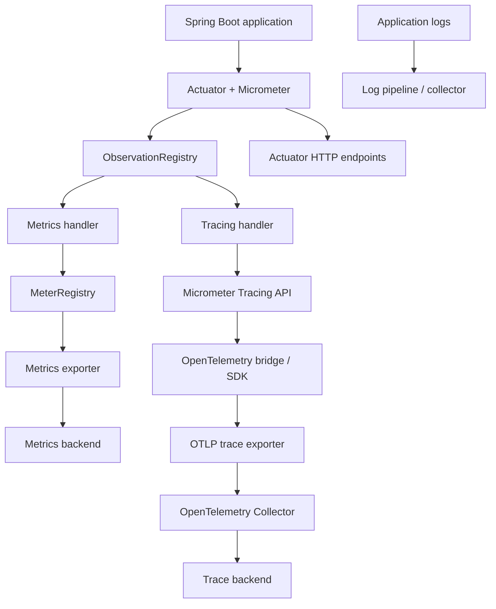
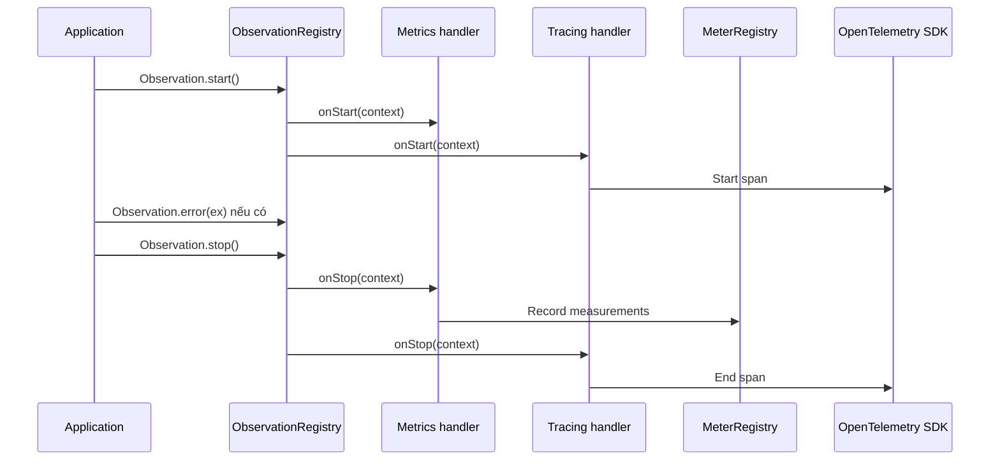
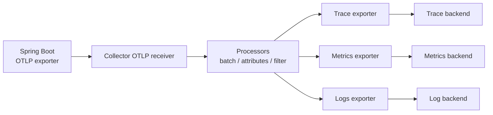

# Actuator hỗ trợ OpenTelemetry trong Spring Boot

Một ứng dụng Spring Boot có thể expose `/actuator/health` để kiểm tra trạng thái, `/actuator/metrics` để đọc measurements và gửi distributed traces tới một OpenTelemetry Collector. Các chức năng này thường được triển khai cùng nhau, nhưng không phải một endpoint duy nhất làm tất cả. **Spring Boot Actuator** cung cấp hạ tầng quản trị và quan sát; **Micrometer Observation/Tracing** tạo tín hiệu ở cấp ứng dụng; **OpenTelemetry bridge, SDK và exporter** đưa traces (và, khi cấu hình riêng, metrics) vào hệ sinh thái OpenTelemetry.

Bài **Actuator hỗ trợ OpenTelemetry** thuộc chương **OpenTelemetry** của module **SPRING_BOOT_OBSERVABILITY**. Module tập trung thiết lập observability cho Spring Boot bằng Micrometer Observation, metrics, logs và distributed tracing; học context propagation, tag/cardinality, exporter, sampling và liên kết tín hiệu để điều tra lỗi, độ trễ và hành vi ứng dụng trên môi trường thực.

## 1. Mục tiêu học tập

Sau bài học, bạn có thể:

- Giải thích Actuator đóng vai trò gì khi ứng dụng Spring Boot dùng OpenTelemetry.
- Phân biệt Actuator endpoints với OTLP exporter endpoint và OTLP receiver của Collector.
- Mô tả mối liên hệ giữa Micrometer Observation, Micrometer Tracing, OpenTelemetry bridge/SDK và backend.
- Cấu hình dependency nền và endpoint quản trị trong Spring Boot.
- Hiểu luồng export spans qua OTLP và khác biệt giữa HTTP/protobuf và gRPC.
- Phân biệt metrics từ Micrometer với OpenTelemetry traces; biết khi nào cần registry/exporter riêng.
- Thiết kế resource attributes, sampling, tags và quyền truy cập phù hợp.
- Chẩn đoán trường hợp Actuator hoạt động nhưng Collector không nhận trace, hoặc backend có trace nhưng metrics/logs không xuất hiện.

## 2. Actuator và OpenTelemetry giải quyết những phần nào?

**Spring Boot Actuator** là tập chức năng quản trị và quan sát ứng dụng Spring Boot. Nó có các endpoints như health, info, metrics, env hoặc prometheus tùy dependency, cấu hình expose và security. Actuator cho phép kiểm tra tình trạng và đọc một số dữ liệu runtime.

**OpenTelemetry (OTel)** là hệ sinh thái observability độc lập implementation, gồm API, SDK, semantic conventions, instrumentation, context propagation và OTLP protocol. OTel định nghĩa cách tạo, xử lý và xuất telemetry như traces, metrics và logs.

**Micrometer** là façade observability thường được Spring Boot tích hợp. Micrometer Observation mô tả một operation; các handlers có thể biến operation thành metrics và tracing spans. Với OpenTelemetry bridge, Micrometer Tracing sử dụng OpenTelemetry bên dưới để quản lý spans/context và exporter tương ứng gửi spans tới Collector/backend.

| Thành phần | Trách nhiệm | Ví dụ |
| --- | --- | --- |
| Spring Boot Actuator | Endpoint quản trị/quan sát ứng dụng | `/actuator/health`, `/actuator/metrics` |
| Micrometer Observation | Lifecycle observation và handlers | `http.server.requests`, custom business observation |
| Micrometer Tracing API | API trace/span mà ứng dụng hoặc handlers sử dụng | `Tracer`, `Span` |
| OpenTelemetry bridge/SDK | Tạo span context, propagation và xử lý trace theo OTel | `micrometer-tracing-bridge-otel`, OTel SDK |
| OTLP exporter | Gửi telemetry đến receiver | OTLP trace exporter |
| OpenTelemetry Collector | Nhận, xử lý và chuyển tiếp telemetry | OTLP receiver, processors, exporters |
| Observability backend | Lưu, truy vấn và hiển thị tín hiệu | Trace search, dashboard, alert |

### Sơ đồ tổng thể



**Actuator không phải OTLP Collector.** Nó không tự trở thành receiver tại `/actuator/otlp` chỉ vì ứng dụng có OpenTelemetry bridge. Endpoint `/actuator/metrics` là API để đọc metrics trong ứng dụng; OTLP exporter là client gửi telemetry ra receiver đã được triển khai.

## 3. Các Actuator endpoints thường gặp

Việc endpoint nào tồn tại và được expose phụ thuộc starter, registry, cấu hình và security.

| Endpoint | Vai trò | Điều không nên suy luận |
| --- | --- | --- |
| `GET /actuator/health` | Trạng thái ứng dụng và health contributors | Không chứng minh traces đã xuất |
| `GET /actuator/info` | Thông tin ứng dụng được cấu hình | Không phải telemetry backend |
| `GET /actuator/metrics` | Liệt kê tên meter Micrometer | Không phải truy vấn time-series lịch sử |
| `GET /actuator/metrics/{name}` | Measurements và available tags của meter | Không thay thế PromQL hoặc query backend |
| `GET /actuator/prometheus` | Scrape metrics nếu Prometheus registry có mặt và endpoint được expose | Không phải OTLP endpoint |

### Expose endpoint cần thiết

Ví dụ `application.yml`:

```yaml
management:
  endpoints:
    web:
      exposure:
        include: health,info,metrics
```

Cấu hình này expose ba endpoint qua web khi dependencies và management web server phù hợp. Nó không bật tracing exporter, không tạo OpenTelemetry Collector và không tự expose endpoint scrape Prometheus. Nếu cần `/actuator/prometheus`, ứng dụng phải có Prometheus registry và expose endpoint đó.

**Expose không đồng nghĩa public.** Một endpoint đã expose vẫn có thể bị Spring Security, network policy hoặc management port giới hạn. Không expose toàn bộ endpoints chỉ để thử nghiệm nhanh ở production.

### Actuator metrics là snapshot trong ứng dụng

Ví dụ:

```http
GET /actuator/metrics/http.server.requests
```

Endpoint trả measurements như count/total time và available tags của meter mà registry hiện biết. Nó không phải nơi OpenTelemetry backend lưu trace. Nếu cần xem latency p95 trong 30 phút hoặc tìm trace của một request, hãy truy vấn metrics/tracing backend tương ứng.

## 4. Micrometer Observation nối với OpenTelemetry như thế nào?

Spring Boot dùng Micrometer Observation để instrument các operation. Một Observation có thể có tên, low-cardinality key-values, high-cardinality values, error và lifecycle. `ObservationRegistry` điều phối handlers đã cài đặt.

Khi application có metrics handler, Observation có thể tạo Counter/Timer hoặc meter phù hợp. Khi có tracing handler kết hợp OpenTelemetry bridge, cùng Observation có thể tạo span. Hai nhánh cùng quan sát một operation nhưng có **recording semantics và pipeline export riêng**.



Sơ đồ mô tả trường hợp cả hai handler đang được cấu hình. Nó không có nghĩa mọi Observation bắt buộc tạo trace hay metrics; điều đó phụ thuộc instrumentation, filters và handlers thực tế.

### Observation và OTel API không phải cùng một API

| API/lớp | Dùng khi |
| --- | --- |
| `Observation` / `ObservationRegistry` | Instrument operation theo mô hình Spring/Micrometer với nhiều handler |
| `io.micrometer.tracing.Tracer` | Thao tác tracing qua API Micrometer |
| `io.opentelemetry.api.trace.Tracer` | Ứng dụng chủ động dùng OTel API trực tiếp |
| OpenTelemetry SDK | Cấu hình provider, processor, exporter và resource cho OTel |
| Actuator | Kiểm tra endpoints/runtime information của ứng dụng |

Trong ứng dụng Spring Boot dùng Micrometer Observation, hãy ưu tiên Observation cho custom operation cần cả metrics và tracing. Chỉ dùng OTel API trực tiếp khi có lý do rõ ràng và hiểu cách tích hợp với lifecycle/SDK do Spring Boot quản lý; tránh tạo OTel SDK/provider độc lập thứ hai ngoài auto-configuration.

## 5. Dependency cơ bản cho Spring Boot dùng OpenTelemetry

Ví dụ cho Spring Boot 3.x dùng Gradle Kotlin DSL và Spring Boot dependency management:

```kotlin
dependencies {
    implementation("org.springframework.boot:spring-boot-starter-actuator")
    implementation("io.micrometer:micrometer-tracing-bridge-otel")
    runtimeOnly("io.opentelemetry:opentelemetry-exporter-otlp")
}
```

Vai trò:

- `spring-boot-starter-actuator`: endpoints và hạ tầng quan sát/quản trị của Spring Boot.
- `micrometer-tracing-bridge-otel`: nối Micrometer Tracing API với OpenTelemetry.
- `opentelemetry-exporter-otlp`: exporter hỗ trợ gửi telemetry bằng OTLP khi được cấu hình và auto-configure đúng phiên bản.

Spring Boot BOM nên quản lý phiên bản tương thích của Spring Boot, Micrometer và OpenTelemetry. Không thêm version ngẫu nhiên cho từng dependency hoặc đồng thời thêm Brave bridge nếu ứng dụng đã chọn OTel bridge.

### Actuator không bắt buộc phải có OTLP exporter để đọc metrics

Nếu chỉ cần `/actuator/metrics`, registry Micrometer trong ứng dụng có thể đã đủ. Nếu muốn export metrics ra backend bằng OTLP, cần registry/exporter metrics phù hợp, ví dụ Micrometer OTLP registry theo phiên bản. OTel trace bridge/exporter và Micrometer metrics exporter là hai cấu hình có thể độc lập.

### Không phải mọi thư viện đều tự động instrument

Actuator và OTel bridge không tự động tạo span chi tiết cho mọi thư viện bên thứ ba. HTTP server, HTTP client, database, Kafka, RabbitMQ hoặc messaging instrumentation phụ thuộc phiên bản Spring, client builder, module instrumentation và cấu hình thực tế. Ưu tiên client/template được Spring quản lý và quan sát luồng end-to-end để xác minh.

## 6. Cấu hình trace export qua OTLP

Để trace xuất hiện ở backend, ứng dụng cần exporter và receiver thực sự nhận được dữ liệu. Thông thường một OpenTelemetry Collector được đặt giữa ứng dụng và backend.

Ví dụ sơ đồ endpoint OTLP/HTTP:

```text
Application exporter
    |
    | OTLP/HTTP protobuf
    v
http://otel-collector:4318/v1/traces
    |
    v
OpenTelemetry Collector
    |
    v
Trace backend
```

Cổng `4318` thường được dùng cho OTLP/HTTP; `4317` thường được dùng cho OTLP/gRPC theo cấu hình triển khai phổ biến. Endpoint cụ thể phụ thuộc receiver, transport và network của Collector.

### Property theo phiên bản Spring Boot

Các dòng Spring Boot có thể thay đổi property group và auto-configuration cho OTLP tracing. Trong những phiên bản hỗ trợ cấu hình OTLP tracing qua management properties, cấu hình có thể có dạng:

```yaml
management:
  tracing:
    sampling:
      probability: 0.1
  otlp:
    tracing:
      endpoint: http://otel-collector:4318/v1/traces
```

**Phải đối chiếu property metadata của đúng phiên bản Spring Boot đang dùng.** Không copy property này sang dòng Boot cũ hơn hoặc stack tự cấu hình exporter nếu property không được hỗ trợ. Nếu phiên bản yêu cầu tạo exporter/processor bean, dùng cơ chế auto-configuration hoặc builder được tài liệu đúng phiên bản chỉ định; không đăng ký nhiều exporter/provider song song.

### Endpoint OTLP khác Actuator endpoint

`/actuator/health` và `/actuator/metrics` là HTTP endpoints do ứng dụng expose cho người vận hành. `/v1/traces` là path OTLP/HTTP thường được receiver của Collector cung cấp. Ứng dụng là **client gửi** trace tới Collector; nó không nhận trace qua Actuator path này.

### Cấu hình sampling

`management.tracing.sampling.probability` điều chỉnh sampling policy do Spring Boot cấu hình khi stack tương thích. Ví dụ `0.1` tương đương policy xác suất khoảng 10% cho trace được quyết định theo sampler đó; số mẫu trong tập ngắn có thể không đúng chính xác 10%. Production cần lựa chọn theo lưu lượng, dung lượng span, retention và yêu cầu điều tra.

Không dùng tỷ lệ sampling như cơ chế bảo vệ dữ liệu. Những trường nhạy cảm không được thu thập phải được loại bỏ/kiểm soát ở instrumentation, baggage, logs và exporter.

## 7. Resource attributes: định danh service trong OpenTelemetry

OTel resource attributes mô tả **nguồn phát telemetry**, ví dụ service, môi trường hoặc phiên bản triển khai. Chúng khác span attributes:

| Loại | Ví dụ | Phạm vi |
| --- | --- | --- |
| Resource attribute | `service.name=order-service` | Telemetry phát ra từ resource/process tương ứng |
| Resource attribute | `deployment.environment.name=production` | Môi trường triển khai |
| Resource attribute | `service.version=2.4.1` | Phiên bản ứng dụng |
| Span attribute | `http.route=/orders/{id}` | Một span/request |
| Span attribute | `payment.provider=partner-a` | Một operation |
| Metric attribute/tag | `outcome=error` | Một meter/time-series dimension |

Tên semantic convention và property cấu hình resource phụ thuộc phiên bản OTel/Spring Boot. Giữ `service.name` ổn định, dùng giá trị môi trường/version chuẩn hóa và kiểm tra resource đã xuất ở Collector/backend.

Ví dụ khai báo môi trường bằng biến deployment:

```yaml
spring:
  application:
    name: order-service

management:
  tracing:
    sampling:
      probability: 0.1
```

Tên ứng dụng có thể được dùng làm service name bởi auto-configuration tích hợp. Đừng giả định mọi stack tự động biến `spring.application.name` thành mọi resource attributes; kiểm tra resource thực tế hoặc cấu hình rõ theo property/SDK support của phiên bản.

### Resource không phải baggage

`service.name` định danh process/service tạo telemetry. Baggage mang metadata theo trace context giữa các service. Không đưa service.name vào baggage cho từng request để thay thế resource attribute.

## 8. Metrics, traces và logs khi bật OpenTelemetry

Actuator hỗ trợ quan sát các tín hiệu nhưng từng tín hiệu có thể đi theo pipeline riêng:

| Tín hiệu | Nguồn trong Spring Boot | Đích xuất có thể dùng | Actuator liên quan |
| --- | --- | --- | --- |
| Metrics | Micrometer meters/Observation | Prometheus, OTLP metrics registry hoặc backend khác | `/actuator/metrics`, `/actuator/prometheus` |
| Traces | Micrometer Tracing/OTel bridge hoặc OTel instrumentation | OTLP trace exporter | Tracing configuration; không phải endpoint đọc trace lịch sử |
| Logs | SLF4J/Logback hoặc logging framework | Agent/collector/log exporter phù hợp | Logging pattern/configuration, không phải Actuator metrics endpoint |

### Metrics không bị sampling theo trace tự động

Một request có thể không được lấy mẫu trace nhưng Timer/Counter vẫn ghi nhận. Do đó:

- Không dùng số trace đã lưu để tính tổng request nếu sampling khác 100%.
- Không đưa `traceId` hoặc `spanId` vào metric labels.
- Dùng low-cardinality tags như route template, method, outcome và service.
- Dùng time-series backend để phân tích rate, histogram, p95/p99 và lịch sử.

### Logs và trace correlation

Khi tracing integration đưa trace/span IDs vào MDC, logging pattern có thể xuất chúng:

```yaml
logging:
  pattern:
    correlation: "[%X{traceId:-},%X{spanId:-}] "
```

Đây là ví dụ pattern cho logging setup tương thích của Spring Boot. Nó chỉ tác động định dạng log; không export log lên OTLP và không đảm bảo mọi background thread có MDC nếu context propagation chưa được cấu hình.

Nếu cần xuất logs bằng OpenTelemetry, cần cấu hình log appender/agent/collector pipeline phù hợp. Không suy luận rằng bật OTel tracing bridge đã gửi cả logs lẫn metrics.

## 9. Custom Observation trong ứng dụng

Giả sử cần đo operation dự trữ hàng và tạo span khi có tracing handler. Có thể dùng Micrometer Observation:

```java
import io.micrometer.observation.Observation;
import io.micrometer.observation.ObservationRegistry;
import org.springframework.stereotype.Service;

@Service
public class InventoryService {
    private final ObservationRegistry observationRegistry;
    private final InventoryClient client;

    public InventoryService(ObservationRegistry observationRegistry,
                            InventoryClient client) {
        this.observationRegistry = observationRegistry;
        this.client = client;
    }

    public Reservation reserve(ReserveCommand command) {
        Observation observation = Observation
            .createNotStarted("inventory.reserve", observationRegistry)
            .lowCardinalityKeyValue("operation", "reserve")
            .start();

        try (Observation.Scope scope = observation.openScope()) {
            try {
                Reservation result = client.reserve(command);
                observation.lowCardinalityKeyValue("outcome", "success");
                return result;
            } catch (RuntimeException ex) {
                observation.lowCardinalityKeyValue("outcome", "error");
                observation.error(ex);
                throw ex;
            }
        } finally {
            observation.stop();
        }
    }
}

interface InventoryClient {
    Reservation reserve(ReserveCommand command);
}

record ReserveCommand(String sku, int quantity) {}
record Reservation(String reservationId) {}
```

Ví dụ là custom observation ở ranh giới nghiệp vụ. Nếu meter và tracing handlers đã được cấu hình, cùng observation có thể tạo metrics và span. Không bọc thêm Timer thủ công và custom span cho cùng phép đo nếu sẽ ghi duplicate latency/operation. Đảm bảo `Observation.Scope` được đóng và `observation.stop()` luôn chạy, kể cả khi có exception.

### Low-cardinality và high-cardinality

- Low-cardinality: `operation=reserve`, `outcome=success|error`, `region=ap-southeast-1`.
- High-cardinality: `orderId`, `userId`, `traceId`, URL có ID cụ thể.

Low-cardinality values có thể trở thành metric tags. Span attributes có thể chi tiết hơn nhưng vẫn cần giới hạn để bảo vệ storage/privacy. Không dùng baggage hoặc resource attributes như cách lách cardinality.

## 10. OpenTelemetry Collector đứng ở đâu?

Collector thường nhận OTLP từ ứng dụng, xử lý qua receivers/processors và xuất tới một hoặc nhiều backends. Nó là thành phần hạ tầng riêng, không phải bean hoặc endpoint Actuator trong ứng dụng.



Collector có thể gom nhiều nguồn, batch dữ liệu, thêm/xóa attributes, sampling ở một số kiến trúc và route tới backend. Mỗi processor/exporter cần cấu hình riêng. Ứng dụng không nên gửi dữ liệu tới endpoint không tin cậy hoặc endpoint public không được xác thực.

### Ứng dụng và Collector cần thống nhất

1. Transport: OTLP/HTTP hay OTLP/gRPC.
2. Endpoint/port/path và TLS.
3. Authentication headers hoặc cơ chế bảo vệ.
4. Resource attributes và semantic conventions.
5. Sampling policy ở SDK và/hoặc Collector, tránh kỳ vọng sai giữa head/tail sampling.
6. Export timeout, retry, batch và giới hạn tài nguyên.

OTLP exporter có thể gửi thành công từ ứng dụng nhưng Collector vẫn drop dữ liệu ở processor hoặc exporter backend thất bại. Khi debug, kiểm tra cả hai phía.

## 11. Bảo mật Actuator và OTLP

Actuator web endpoints và OTLP export endpoints có ranh giới bảo mật khác nhau:

| Thành phần | Hướng truy cập | Điều cần bảo vệ |
| --- | --- | --- |
| `/actuator/health` | Người vận hành/monitor gọi vào app | Chỉ expose chi tiết health theo policy |
| `/actuator/metrics` | Người vận hành gọi vào app | Có thể lộ tên meter, tags và metadata |
| `/actuator/env` | Người có quyền quản trị gọi vào app | Có thể lộ configuration nhạy cảm; không expose rộng |
| OTLP exporter endpoint | Ứng dụng chủ động gửi ra Collector | TLS, auth, network egress và endpoint tin cậy |
| Collector receiver | Ứng dụng/agent gửi vào Collector | Authentication, network policies và resource limits |

### Nguyên tắc thực hành

1. Expose đúng Actuator endpoints cần thiết; dùng security/network restrictions.
2. Không public `/actuator/env` hoặc `/actuator/configprops` chỉ để debug thuận tiện.
3. Bảo vệ OTLP receiver; không coi cổng 4317/4318 là mặc định an toàn trên internet.
4. Quản lý OTLP auth headers/secrets qua secret store, không hardcode trong source code.
5. Không export token, cookie, password, request body hoặc PII trong span attributes/baggage/logs.
6. Chuẩn hóa tags/resource attributes, hạn chế cardinality và payload size.
7. Có chính sách retention, access control và deletion ở backend.

Sampling không thay thế privacy filtering. Một span không được sampled không có nghĩa logs hoặc metrics cùng request cũng không chứa dữ liệu nhạy cảm.

## 12. Troubleshooting: Actuator có nhưng OpenTelemetry không nhận trace

| Triệu chứng | Nguyên nhân cần kiểm tra | Hướng xác minh |
| --- | --- | --- |
| `/actuator/health` chạy nhưng không thấy trace | Actuator không chứng minh tracing exporter hoạt động | Kiểm tra bridge, SDK, exporter và Collector |
| `/actuator/metrics` có meter nhưng backend metrics trống | Chưa cấu hình metrics exporter/registry hoặc scrape | Kiểm tra Micrometer registry, scrape target/OTLP metrics |
| App tạo span nhưng Collector không nhận | Endpoint, transport, DNS, firewall, TLS hoặc auth | Kiểm tra exporter logs và Collector receiver |
| Collector nhận nhưng backend trống | Processor/filter/exporter backend lỗi | Kiểm tra Collector logs/telemetry |
| Chỉ có root spans, thiếu downstream spans | HTTP/messaging client chưa instrument hoặc propagation mismatch | Kiểm tra builder, headers và context propagation |
| Trace bị tách thành nhiều root | W3C/B3 mismatch hoặc header bị strip | So sánh inject/extract hai đầu |
| Trace ít hơn số request | Sampling thấp hoặc reporter/exporter drop | Kiểm tra sampling và export stats |
| Logs có trace ID nhưng backend không có trace | Trace chưa sample hoặc export thất bại | Phân biệt propagation, recording và export |
| Attribute/resource thiếu | Resource config hoặc convention khác dự kiến | Kiểm tra telemetry tại Collector |
| Duplicate spans hoặc duration | OTel instrumentation và custom Observation cùng bọc một operation | Loại instrumentation trùng |
| Actuator metrics endpoint 404 | Chưa expose, thiếu Actuator hoặc base path/port khác | Kiểm tra dependency và exposure config |
| `/actuator/prometheus` 404 | Thiếu Prometheus registry hoặc endpoint chưa expose | Kiểm tra registry và exposure |

### Trình tự điều tra

1. Xác nhận dependencies: Actuator, đúng tracing bridge, OTLP exporter và instrumentation thư viện.
2. Xác định tracing implementation đang hoạt động; tránh tạo đồng thời hai SDK/provider.
3. Xem sampling probability/policy, test với luồng có sampling đủ cao.
4. Kiểm tra endpoint OTLP, transport, port/path, DNS, TLS và auth.
5. Xem log/export metrics của ứng dụng; phân biệt span chưa ghi với span export thất bại.
6. Kiểm tra Collector receiver, processor, exporter và backend ingestion.
7. Kiểm tra propagation qua HTTP/message headers nếu trace bị đứt giữa service.
8. Kiểm tra resource, attributes, service name và thời gian query ở backend.
9. Kiểm tra metrics và logs riêng; không coi `/actuator/metrics` là nơi đọc traces.

## 13. Bài thực hành: Actuator và OpenTelemetry Collector

**Bối cảnh:** `order-service` dùng Spring Boot Actuator, Micrometer Observation và OpenTelemetry bridge. Mục tiêu là kiểm tra Actuator endpoints trong ứng dụng, gửi traces qua OTLP tới Collector và đối chiếu ba tín hiệu.

### Phần A — Chuẩn bị

1. Thêm Actuator, Micrometer OTel bridge và OTLP exporter tương thích theo Spring Boot BOM.
2. Cấu hình `spring.application.name` và sampling probability cho môi trường test.
3. Expose `health`, `info`, `metrics`; bảo vệ endpoints theo policy.
4. Chuẩn bị Collector có OTLP receiver đúng transport/port và exporter tới trace backend.
5. Xác minh app có thể kết nối Collector qua network/TLS/auth.

### Phần B — Tạo telemetry

1. Gửi request HTTP tới controller đã được instrument.
2. Gọi `GET /actuator/health` và xác minh trạng thái.
3. Gọi `GET /actuator/metrics` để xác định meter hiện có.
4. Gọi `GET /actuator/metrics/http.server.requests` và đọc measurements/tags.
5. Tạo custom Observation `inventory.reserve` như phần 9.
6. Tìm trace trong backend theo service name và khoảng thời gian bài test.
7. Xác nhận Collector đã nhận OTLP và backend đã lưu span.

### Phần C — Ma trận kiểm chứng

| Ca | Điều kiện | Kết quả mong đợi |
| --- | --- | --- |
| A — Health | Actuator health được expose | Endpoint health phản hồi theo health contributors |
| B — Metrics | Có HTTP request | Meter có measurements nếu instrumentation/registry hoạt động |
| C — Tracing | Sampling cho phép | Trace được gửi qua OTLP và xuất hiện ở backend |
| D — Sampling thấp | Giảm probability | Số trace lưu giảm; metrics không nhất thiết giảm theo |
| E — Collector sai endpoint | Đổi port/path trong test | Export lỗi, business request vẫn chạy theo thiết kế |
| F — Propagation | Order gọi inventory | Spans liên kết đúng khi client/server được instrument |
| G — Security | Gọi endpoint quản trị bằng danh tính không có quyền | Security policy từ chối truy cập |
| H — Log correlation | Logging MDC được cấu hình | Logs trong scope chứa trace/span IDs khi có context |

### Phần D — Bài tập suy luận

1. `/actuator/health` trả UP nhưng trace backend trống. Hãy liệt kê các lớp cần kiểm tra.
2. `/actuator/metrics` có `http.server.requests` nhưng metrics backend không có dữ liệu. Có thể thiếu thành phần nào?
3. Collector nhận span nhưng trace backend không có trace. Hãy xác định bước nào còn lại trong pipeline.
4. Vì sao probability 0.1 không có nghĩa cứ 10 request sẽ có đúng một trace?
5. Vì sao cùng một Observation có thể tạo metrics và spans nhưng sampling trace không làm Counter biến mất?
6. Khi custom Observation trùng ranh giới với auto instrumentation, duplicate có thể biểu hiện ra sao?
7. Tại sao không expose `/actuator/env` công khai dù Collector receiver đã được bảo vệ?

## 14. Ghi nhớ

**Spring Boot Actuator hỗ trợ OpenTelemetry bằng cách cung cấp hạ tầng quản trị, health/metrics endpoints và tích hợp với Micrometer Observation/Tracing; Actuator tự nó không phải OpenTelemetry Collector hay OTLP receiver.** Micrometer Observation mô tả operation, handlers tạo metrics/tracing tương ứng, OpenTelemetry bridge/SDK quản lý trace context và OTLP exporter gửi spans tới Collector/backend.

Hãy phân biệt `/actuator/metrics` với OTLP `/v1/traces`, metrics registry với tracing exporter và log pipeline với cả hai. Cấu hình dependencies, sampling, resource attributes, endpoint OTLP và security theo đúng phiên bản Spring Boot. Khi điều tra, xác minh từng lớp từ instrumentation, recording, export, Collector đến backend; sau đó đối chiếu metrics và logs bằng context correlation. Thiết kế rõ các lớp này giúp ứng dụng Spring Boot liên kết metrics, logs và distributed tracing mà vẫn kiểm soát cardinality, privacy, độ tin cậy và chi phí vận hành.
