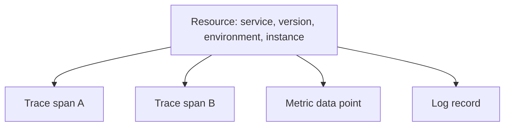
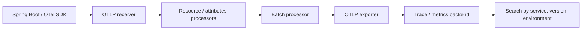

# OTEL_RESOURCE_ATTRIBUTES trong OpenTelemetry và Spring Boot

**OTEL_RESOURCE_ATTRIBUTES** là biến môi trường chuẩn của OpenTelemetry dùng để khai báo các thuộc tính của **Resource** — danh tính và bối cảnh của nguồn phát telemetry. Những thuộc tính này mô tả service, phiên bản ứng dụng, môi trường triển khai, namespace và instance. Chúng giúp trace backend, metrics backend và hệ thống logs nhóm dữ liệu theo đúng nguồn phát.

Trong module **SPRING_BOOT_OBSERVABILITY**, Spring Boot kết hợp Micrometer Observation, metrics, logs và distributed tracing. Resource attributes giúp người vận hành xác định telemetry đến từ service nào, release nào và workload nào; qua đó so sánh trước/sau deployment và khoanh vùng lỗi. Bài thuộc chương **OpenTelemetry**, tập trung vào cú pháp biến môi trường, khác biệt giữa Resource, span attributes và baggage, quan hệ với service.name/OTEL_SERVICE_NAME, cấu hình Spring Boot và xác minh Resource ở Collector/backend.

## 1. Resource là gì?

Trong OpenTelemetry, **Resource** mô tả thực thể phát ra telemetry. Với ứng dụng Spring Boot, Resource thường đại diện cho process hoặc service instance.

| Attribute | Ý nghĩa | Ví dụ |
| --- | --- | --- |
| service.name | Tên logic của service | order-service |
| service.version | Phiên bản ứng dụng | 2.4.1 |
| service.namespace | Nhóm logic của service | commerce |
| deployment.environment.name | Môi trường | production |
| service.instance.id | Định danh instance | order-pod-a81f |
| host.name | Host phát telemetry nếu được detect | node-07 |
| cloud.region | Region nếu được detect | ap-southeast-1 |

Các giá trị chỉ là ví dụ. Resource thực tế phụ thuộc SDK, resource detectors, deployment và attributes do ứng dụng cung cấp.

### Resource gắn với các tín hiệu



Nhiều spans, metric points hoặc log records do cùng một Resource phát ra có thể mang chung định danh. Resource giúp backend nhóm dữ liệu theo service instance; nó không mô tả riêng từng request.

**service.name** nên ổn định theo service logic. Request ID, order ID và Trace ID không phải Resource identity.

## 2. OTEL_RESOURCE_ATTRIBUTES dùng để làm gì?

OTEL_RESOURCE_ATTRIBUTES là biến môi trường OpenTelemetry dùng để truyền danh sách Resource attributes dạng key-value cho SDK/autoconfiguration tương thích.

Ví dụ:

```bash
OTEL_RESOURCE_ATTRIBUTES=service.namespace=commerce,service.version=2.4.1,deployment.environment.name=production
```

Trong Kubernetes Deployment:

```yaml
env:
  - name: OTEL_RESOURCE_ATTRIBUTES
    value: "service.namespace=commerce,service.version=2.4.1,deployment.environment.name=production"
```

Các cặp có dạng key=value và được phân tách bằng dấu phẩy. Key nên tuân theo semantic conventions; values cần ngắn, ổn định và không chứa secrets.

**Quan trọng:** biến môi trường chỉ có tác dụng khi thành phần đang chạy thực sự đọc nó. Không mặc định mọi thành phần Micrometer hoặc Spring Boot đều tự động xử lý mọi biến OTEL_*.

## 3. Cú pháp và quy tắc đặt attributes

Dạng tổng quát:

```text
key1=value1,key2=value2,key3=value3
```

Ví dụ:

```bash
OTEL_RESOURCE_ATTRIBUTES=service.namespace=commerce,service.version=2.4.1,deployment.environment.name=staging
```

| Thành phần | Hướng dẫn |
| --- | --- |
| Key | Tên attribute hợp lệ, ưu tiên semantic conventions |
| Value | Chuỗi ngắn, ổn định, không chứa secrets |
| Separator | Dấu phẩy giữa các cặp |
| Assignment | Dấu bằng giữa key và value |
| Duplicate keys | Tránh khai báo trùng |
| Special characters | Tuân thủ cú pháp/encoding của OpenTelemetry specification |
| Kích thước | Giữ danh sách nhỏ |

Không tự viết parser đơn giản bằng cách split dấu phẩy nếu cần hỗ trợ đầy đủ encoding và quy tắc đặc tả. Hãy để SDK/autoconfiguration xử lý. Nếu cần Resource tùy biến, sử dụng API chính thức hoặc tích hợp được hỗ trợ.

Không đặt service.version bằng timestamp mỗi lần khởi động, service.name bằng route, service.instance.id bằng request ID hoặc deployment.environment.name bằng giá trị client gửi.

## 4. service.name và OTEL_SERVICE_NAME

OpenTelemetry định nghĩa **OTEL_SERVICE_NAME** là biến môi trường chuyên biệt cho **service.name**. Khi SDK/autoconfiguration tương thích đọc cả hai, OTEL_SERVICE_NAME có precedence cao hơn service.name khai báo trong OTEL_RESOURCE_ATTRIBUTES.

Ví dụ:

```bash
OTEL_SERVICE_NAME=order-service
OTEL_RESOURCE_ATTRIBUTES=service.name=wrong-name,service.namespace=commerce,service.version=2.4.1
```

Trong môi trường tuân theo OpenTelemetry SDK environment variable specification, service.name được lấy từ OTEL_SERVICE_NAME; các attributes khác vẫn có thể được đọc từ OTEL_RESOURCE_ATTRIBUTES.

Ví dụ cấu hình Kubernetes:

```yaml
env:
  - name: OTEL_SERVICE_NAME
    value: order-service
  - name: OTEL_RESOURCE_ATTRIBUTES
    value: "service.namespace=commerce,service.version=2.4.1,deployment.environment.name=production"
```

Không khai báo service identity mâu thuẫn ở application config, environment variables, Java agent, SDK Resource builder và Collector transformations. Chọn một nguồn authoritative.

## 5. Resource khác span attributes

| Tiêu chí | Resource attributes | Span attributes |
| --- | --- | --- |
| Phạm vi | Nguồn phát telemetry | Một span cụ thể |
| Vòng đời | Process/instance/resource | Operation |
| Ví dụ | service.name, service.version, host.name | http.route, http.request.method, db.system |
| Mục đích | Nhận diện nơi phát | Mô tả công việc |
| Thay đổi theo request | Thông thường không | Có thể |

Ví dụ:

```text
Resource:
  service.name = order-service
  service.version = 2.4.1
  deployment.environment.name = production

Span:
  name = POST /orders
  http.request.method = POST
  http.route = /orders
  http.response.status_code = 201
```

Một service có thể tạo hàng triệu spans nhưng vẫn dùng chung Resource identity. Không đưa http.route, user ID hoặc Trace ID vào Resource vì chúng mô tả request/operation.

## 6. Resource khác baggage

**Baggage** là metadata key-value được truyền theo trace context qua ranh giới dịch vụ. **Resource** mô tả nguồn phát telemetry.

| Tiêu chí | Resource | Baggage |
| --- | --- | --- |
| Mục đích | Định danh service/instance/environment | Truyền metadata theo request/trace |
| Phạm vi | Process hoặc telemetry source | Trace/context hiện hành |
| Thay đổi theo request | Thường không | Có thể |
| Ví dụ | service.name=order-service | channel=mobile |
| Truyền qua HTTP | Không tự tạo baggage header | Có thể dùng W3C baggage header |
| Rủi ro | Cardinality và lộ metadata triển khai | PII, input không tin cậy, header size |

Cùng một service instance có thể xử lý request A với baggage channel=web và request B với baggage channel=mobile. Không biến channel thành Resource nếu nó thay đổi theo request.

## 7. Resource và Micrometer metrics trong Spring Boot

Spring Boot thường dùng Micrometer MeterRegistry để ghi metrics. Prometheus registry xuất exposition; OTLP registry xuất OTLP metrics. Resource mapping phụ thuộc registry/exporter.

Cần phân biệt:

- OTEL_RESOURCE_ATTRIBUTES thuộc cấu hình OpenTelemetry SDK/autoconfiguration.
- management.metrics.tags là cấu hình common tags của Micrometer.
- Resource attributes và Micrometer meter tags có thể được biểu diễn khác nhau.
- Không mặc định OTEL_RESOURCE_ATTRIBUTES tự trở thành Prometheus labels.
- Không mặc định Micrometer common tags tự trở thành OTel Resource attributes cho mọi signal.

Ví dụ Micrometer common tags:

```yaml
management:
  metrics:
    tags:
      application: order-service
      environment: production
```

Endpoint kiểm tra:

```bash
curl -s http://localhost:8080/actuator/prometheus
```

Output minh họa:

```text
http_server_requests_seconds_count{
  application="order-service",
  environment="production",
  method="GET",
  status="200"
} 42
```

Các labels trên minh họa Micrometer common tags. Không thể suy từ đó rằng OpenTelemetry Resource của trace có cùng attributes. Prometheus scrape labels, Micrometer meter tags và OTel Resource có quy tắc mapping riêng.

## 8. Cấu hình trong Spring Boot: xác định thành phần tạo Resource

Cách cấu hình phụ thuộc vào thành phần thực sự tạo OpenTelemetry Resource. Ba trường hợp chính:

1. OpenTelemetry Java Agent.
2. OpenTelemetry SDK autoconfiguration.
3. Micrometer Tracing bridge và Spring Boot auto-configuration.

Không gộp ba trường hợp thành một giả định chung.

### 8.1. OpenTelemetry Java Agent

Java Agent có cơ chế đọc các OpenTelemetry environment variables, gồm OTEL_SERVICE_NAME và OTEL_RESOURCE_ATTRIBUTES, theo version/cấu hình agent.

```bash
export OTEL_SERVICE_NAME=order-service
export OTEL_RESOURCE_ATTRIBUTES=service.namespace=commerce,service.version=2.4.1,deployment.environment.name=production

java -javaagent:/opt/otel/opentelemetry-javaagent.jar -jar app.jar
```

Đường dẫn agent chỉ là ví dụ. Phải bảo đảm version agent tương thích và tránh instrument trùng với một số instrumentation đã cấu hình thủ công.

### 8.2. SDK autoconfiguration

Nếu ứng dụng khởi tạo OpenTelemetry SDK bằng autoconfiguration tương ứng, các environment variables chuẩn có thể được SDK đọc để dựng Resource và thành phần SDK khác. Cần xác định đúng module autoconfigure và lifecycle của SDK.

Không tự tạo thêm SDK độc lập nếu Spring Boot/Micrometer Tracing đã quản lý tracing infrastructure mà không xem xét xung đột. Hai SDK/tracer có thể tạo context không tương thích hoặc hai pipeline exporter.

### 8.3. Spring Boot Micrometer Tracing

Trong ứng dụng Spring Boot dùng Micrometer Tracing bridge, Resource được xây dựng qua tích hợp framework/bridge/exporter. Các biến OTEL_* không phải lúc nào cũng được Spring Boot properties trực tiếp đọc như OpenTelemetry Java Agent.

Vì vậy:
- Xác định tracing exporter đang dùng.
- Xem bridge có sử dụng OpenTelemetry SDK và cơ chế resource config nào.
- Kiểm tra cách Resource attributes được cung cấp cho exporter phiên bản đang dùng.
- Không thêm Java agent cùng SDK exporter tùy tiện.
- Xác minh service.name và attributes ở spans/OTLP payload/Collector.

Nếu không có thành phần đọc OTEL_RESOURCE_ATTRIBUTES, chỉ khai báo biến môi trường sẽ **không tự làm metadata xuất hiện**.

### 8.4. Tự cấu hình Resource qua SDK API

Với ứng dụng tự khởi tạo OpenTelemetry SDK, Resource có thể được tạo bằng SDK API và gắn vào TracerProvider/MeterProvider/LoggerProvider tùy signal.

```java
import io.opentelemetry.api.common.Attributes;
import io.opentelemetry.sdk.resources.Resource;

Resource resource = Resource.getDefault().merge(
    Resource.create(
        Attributes.builder()
            .put("service.name", "order-service")
            .put("service.version", "2.4.1")
            .build()
    )
);
```

Ví dụ minh họa tạo/merge Resource; nó không tự cấu hình exporter hoặc Spring Boot. Cần dùng API tương thích với version OpenTelemetry SDK/BOM và gắn Resource vào provider tương ứng.

## 9. Resource detectors và merge

Ngoài attributes tự khai báo, SDK/agent có thể lấy thông tin từ resource detectors: process/runtime, host/OS, container, Kubernetes namespace/pod/container hoặc cloud metadata. Detector nào được bật phụ thuộc SDK, agent version và môi trường; không giả định chỉ chạy trong Kubernetes là mọi Kubernetes attributes tự xuất hiện.

Resource có thể được tổng hợp từ default SDK resource, environment variables, detector và attributes do ứng dụng cung cấp. Khi cùng key xuất hiện ở nhiều nguồn, quy tắc merge/precedence của SDK/agent quyết định giá trị cuối.

Ví dụ không nên có ba nguồn cùng đặt service.name lần lượt là order-service, payment-service và checkout-service mà không xác định nguồn authoritative. Hãy kiểm tra Resource cuối cùng thay vì đoán từ từng file cấu hình.

## 10. Kubernetes và Resource identity

Ví dụ Resource của workload Kubernetes:

```text
service.name = order-service
service.namespace = commerce
service.version = 2.4.1
deployment.environment.name = production
k8s.namespace.name = commerce-prod
k8s.deployment.name = order-service
k8s.pod.name = order-service-7d9c8b6f5d-a81f2
```

Tên semantic conventions Kubernetes phụ thuộc convention/schema version được triển khai; kiểm tra phiên bản thực tế.

Phân biệt:
- service.name định danh service logic, ổn định giữa replicas.
- service.instance.id định danh một instance.
- k8s.pod.name nhận diện pod.
- service.version nhận diện phiên bản release.

Nếu dùng pod name làm service.name, dashboard có thể coi mỗi pod là một service khác nhau, làm phân tán thống kê. Pod/instance identity có thể hữu ích để điều tra theo replica nhưng cần cân nhắc churn và số Resource combinations.

Không đưa request IDs, trace IDs, user IDs hoặc order IDs vào Resource.

## 11. Cardinality và chi phí metadata

Resource attributes lặp lại trên nhiều spans/metric points/log records của cùng instance. Nhiều Resource combinations có thể làm backend tăng nhóm dữ liệu, index và storage.

| Attribute | Đặc tính | Đánh giá |
| --- | --- | --- |
| service.name | Ít giá trị, ổn định | Nên có |
| service.version | Thay theo release | Hữu ích |
| deployment.environment.name | Tập hữu hạn | Hữu ích |
| k8s.namespace.name | Tập hữu hạn theo cluster | Hữu ích |
| service.instance.id | Một giá trị mỗi instance | Theo dõi số instance |
| host.name | Một giá trị mỗi host | Cân nhắc |
| request.id | Gần như duy nhất mỗi request | Không dùng |
| trace.id | Gần như duy nhất mỗi trace | Không dùng |
| user.id | Nhiều giá trị, có thể nhạy cảm | Không dùng |

Cardinality Resource không hoàn toàn đồng nhất với metric time-series cardinality, nhưng có thể ảnh hưởng grouping, indexing và chi phí backend. Với metrics, mỗi combination của metric name và attributes có thể tạo một stream/series riêng.

Các nguồn cardinality cao khác gồm span attributes, event attributes, URL raw ID, baggage được copy vào spans/logs, metric tags theo request/user/order ID và pod churn.

## 12. Bảo mật và quyền riêng tư

Không đưa vào Resource:
- API keys, passwords, access tokens, secrets.
- Database URLs có credentials.
- Email, số điện thoại, địa chỉ hoặc PII.
- Nội dung request/response.
- Customer IDs hoặc tenant IDs nếu không có nhu cầu được phê duyệt.
- Internal host/network details nếu chính sách không cho phép.

Resource attributes chỉ là metadata mô tả, không phải bằng chứng authorization. Backend không được cấp quyền dựa trên service.namespace, deployment.environment.name hoặc tenant do client/app tự khai báo. Authorization phải dựa trên identity và policy thực.

TLS bảo vệ dữ liệu trên đường truyền nhưng không làm một field nhạy cảm trở nên thích hợp để lưu trong traces, metrics hoặc logs. Loại bỏ dữ liệu không cần thiết từ nguồn vẫn là biện pháp quan trọng.

## 13. Resource attributes trong Collector và backend

OpenTelemetry Collector có thể nhận Resource cùng spans/metrics/log records, áp dụng processors để thêm, sửa, xóa hoặc chuyển đổi attributes. Backend dùng Resource để phân nhóm và hiển thị nguồn phát.



Ví dụ Resource processor:

```yaml
processors:
  resource/add_environment:
    attributes:
      - key: deployment.environment.name
        value: production
        action: upsert

service:
  pipelines:
    traces:
      receivers: [otlp]
      processors: [resource/add_environment, batch]
      exporters: [otlp/backend]
```

Đây là đoạn cấu hình minh họa cho Collector distribution có hỗ trợ resource processor; pipeline còn cần receiver/exporter được định nghĩa phù hợp. Không hardcode production vào cấu hình dùng chung cho dev/staging/prod. Kiểm soát thứ tự processor và chính sách override; không tùy tiện ghi đè service.name.

Sau khi gửi trace lab, kiểm tra service.name, version, environment, namespace, instance identity, duplicate keys và dữ liệu nhạy cảm ở span/resource details. Quan trọng là Resource sau khi SDK/agent/Collector xử lý, không chỉ biến môi trường của container.

## 14. Troubleshooting OTEL_RESOURCE_ATTRIBUTES

| Triệu chứng | Nguyên nhân có thể | Cách kiểm tra |
| --- | --- | --- |
| Không thấy Resource attributes trong trace | Không có SDK/agent đọc biến môi trường | Xác minh tracing implementation/autoconfiguration |
| service.name sai | OTEL_SERVICE_NAME, Resource config hoặc agent override | Kiểm tra nguồn cấu hình và precedence |
| Resource có ở traces nhưng không ở Prometheus labels | Hai pipeline metadata khác nhau | Xem Micrometer common tags và registry mapping |
| Chỉ có unknown_service | Không cấu hình service identity hoặc SDK không nhận application name | Xác minh Resource cuối |
| Attributes không xuất hiện ở Collector | Exporter/SDK bỏ qua hoặc Resource construction khác | Kiểm tra OTLP payload/debug output |
| Pod name không xuất hiện | Chưa bật detector hoặc chưa mapping | Kiểm tra agent/Collector detector và permissions |
| Resource attributes trùng key | Khai báo ở nhiều nguồn | Chọn authoritative source |
| service.name thay đổi giữa pods | Dùng instance-specific value làm service name | Tách service identity và instance ID |
| Backend có quá nhiều groups | Instance churn hoặc attributes động | Giảm dynamic attributes |
| Prometheus labels cardinality tăng | Micrometer tags có ID động | Kiểm tra common tags/MeterFilter |
| Biến môi trường đúng nhưng không tác dụng | Thành phần hiện tại không đọc OTel env vars | Xác định agent/autoconfig/SDK/exporter |
| Một signal có Resource, signal khác thiếu | Traces/metrics/logs dùng provider/exporter khác nhau | Kiểm tra từng pipeline |
| Environment sai ở backend | Collector upsert/override hoặc deploy config sai | Kiểm tra processors và effective Resource |

Quy trình debug:
1. Đọc environment variables của đúng container/process trong lab.
2. Xác định Java Agent, SDK autoconfiguration hay Micrometer Tracing bridge đang tạo telemetry.
3. Kiểm tra thành phần đó có hỗ trợ OTEL_SERVICE_NAME và OTEL_RESOURCE_ATTRIBUTES không.
4. Gửi request lab và kiểm tra Resource ở Collector/debug output hoặc backend.
5. Đối chiếu Resource của traces, metrics và logs riêng biệt.
6. Kiểm tra Collector processors có upsert/delete/transform keys không.
7. Kiểm tra service version/instance identity sau rollout.
8. Loại bỏ PII/secrets và xem Resource cardinality.

## 15. Bài thực hành: chuẩn hóa Resource identity cho Spring Boot

Mục tiêu là cấu hình service có tên, version và environment nhất quán trên trace backend, đồng thời hiểu khác biệt giữa OpenTelemetry Resource và Micrometer metric tags.

### Chuẩn bị

- Spring Boot 3.x application.
- Actuator và Micrometer Observation.
- Đường tracing đang hoạt động: Micrometer Tracing bridge/exporter hoặc OpenTelemetry Java Agent/SDK.
- OpenTelemetry Collector hoặc backend nhận OTLP.
- Prometheus registry nếu muốn đối chiếu metric labels.
- Môi trường lab, không dùng credentials/PII thật.

### Bước 1 — Xác định nguồn tạo Resource

Ghi rõ ứng dụng dùng Java Agent, SDK autoconfiguration hay Micrometer Tracing/Spring Boot bridge và exporter. Không giả định cả ba đọc cùng cấu hình.

### Bước 2 — Đặt service identity

Trong lab, khai báo:

```bash
OTEL_SERVICE_NAME=order-service
OTEL_RESOURCE_ATTRIBUTES=service.namespace=commerce,service.version=2.4.1,deployment.environment.name=staging
```

Khởi chạy app theo đúng thành phần đã xác định ở bước 1.

### Bước 3 — Tạo trace

Gửi request HTTP có instrumentation. Tìm trace trong backend hoặc Collector debug output. Kiểm tra service.name, namespace, version và environment.

Nếu biến môi trường không được đọc, xác định lại SDK/agent/autoconfiguration; không chỉnh span attributes bằng tay để che vấn đề.

### Bước 4 — Kiểm tra precedence

Trong lab, đặt service.name khác nhau ở OTEL_SERVICE_NAME và OTEL_RESOURCE_ATTRIBUTES. Kiểm chứng giá trị cuối theo OpenTelemetry SDK environment variable specification đối với thành phần đang đọc các biến này. Sau đó bỏ khai báo mâu thuẫn và chọn một nguồn identity duy nhất.

### Bước 5 — Đối chiếu Micrometer common tags

Cấu hình:

```yaml
management:
  metrics:
    tags:
      application: order-service
      environment: staging
```

Gọi /actuator/prometheus, đọc labels và so sánh với Resource của trace. Ghi rõ trường nào thuộc Micrometer tags, trường nào thuộc Resource.

### Bước 6 — Thay version

Đổi service.version sang 2.4.2 rồi rollout lab. Xác nhận traces mới có version mới và có thể lọc để so sánh release.

### Bước 7 — Kiểm tra instance identity

Chạy hai replicas cùng service.name nhưng khác instance ID/pod name nếu môi trường hỗ trợ. Xác nhận backend nhóm chung service nhưng vẫn phân biệt được instance.

### Bước 8 — Thử Resource processor

Nếu có Collector, upsert environment trong lab. Xác minh thứ tự processor và kết quả khi ứng dụng đã gửi environment khác. Ghi lại nguồn authoritative.

### Bước 9 — Kiểm tra cardinality và privacy

Tìm attributes theo request/user/order ID. Xóa fields không cần khỏi Resource. Xác nhận không có secrets/PII và số Resource combinations phù hợp với số service instances.

### Checklist nghiệm thu

| Điều cần chứng minh | Kết quả mong đợi |
| --- | --- |
| Resource semantics | Phân biệt Resource với span attributes và baggage |
| Environment variable | Hiểu cú pháp key=value,key=value |
| Service identity | service.name ổn định, có version/environment |
| Precedence | Biết vai trò OTEL_SERVICE_NAME khi SDK hỗ trợ |
| Runtime integration | Xác định agent/SDK/Micrometer bridge đọc cấu hình |
| Micrometer metrics | Phân biệt common tags với OTel Resource |
| Kubernetes | Tách service identity và pod/instance identity |
| Collector | Kiểm tra Resource processors và merge/override |
| Cardinality | Không có request ID/Trace ID/user ID trong Resource |
| Security | Không có secrets/PII trong metadata |
| Backend | Xác minh Resource cuối theo từng pipeline |

## 16. Những nguyên tắc cần ghi nhớ

1. **OTEL_RESOURCE_ATTRIBUTES khai báo metadata ở cấp Resource**, mô tả nguồn phát telemetry như service, version, environment hoặc instance.
2. **OTEL_SERVICE_NAME là biến chuyên biệt cho service.name**; khi SDK/autoconfiguration chuẩn hỗ trợ cả hai, nó có precedence cao hơn service.name trong Resource attributes environment variable.
3. **Resource khác span attributes và baggage.** Resource mô tả nguồn phát, span attributes mô tả operation, baggage truyền metadata theo trace context.
4. **Không mặc định Spring Boot/Micrometer đọc mọi OTEL_* variables.** Xác định agent, SDK autoconfiguration, bridge và exporter trước khi cấu hình.
5. **Micrometer common tags không phải OTEL_RESOURCE_ATTRIBUTES.** Kiểm tra mapping thực tế ở từng registry và signal.
6. **Giữ service.name ổn định theo service logic**, tách biệt với instance/pod identity và service version.
7. **Kiểm soát cardinality và quyền riêng tư.** Tránh IDs động, credentials, PII và payload trong Resource.
8. **Resource detectors và Collector processors có thể bổ sung/ghi đè metadata.** Thống nhất nguồn authoritative và kiểm tra merge result.
9. **Xác minh dữ liệu cuối ở Collector/backend.** Biến môi trường trong container chưa chứng minh SDK đã đọc hoặc exporter đã gửi.
10. **Dùng Resource để liên kết các tín hiệu đúng cách.** Metadata định danh nguồn giúp lọc metrics/traces/logs; metrics cho xu hướng tổng hợp, traces cho đường đi request và logs cho sự kiện cụ thể.

OTEL_RESOURCE_ATTRIBUTES là công cụ quan trọng để chuẩn hóa danh tính nguồn phát telemetry trong OpenTelemetry. Khi service.name, version, environment và instance được khai báo nhất quán, nhóm phát triển có thể tìm kiếm và so sánh telemetry giữa các service hoặc release. Việc phân biệt Resource với span attributes, baggage và Micrometer metric tags giúp cấu hình Spring Boot chính xác, hạn chế cardinality và tránh đưa metadata không cần thiết vào trace backend.
