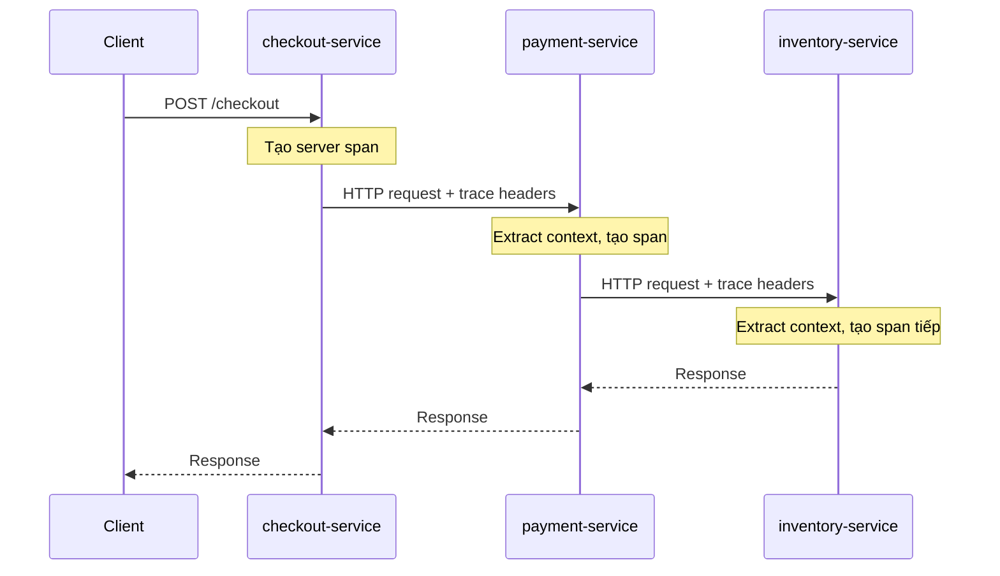
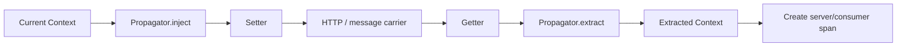
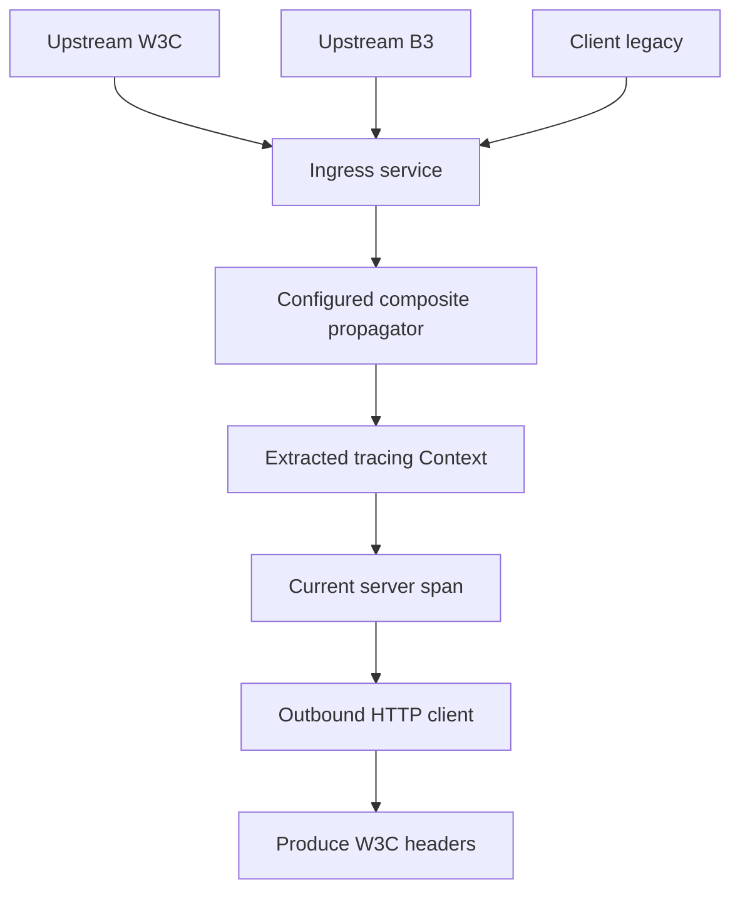
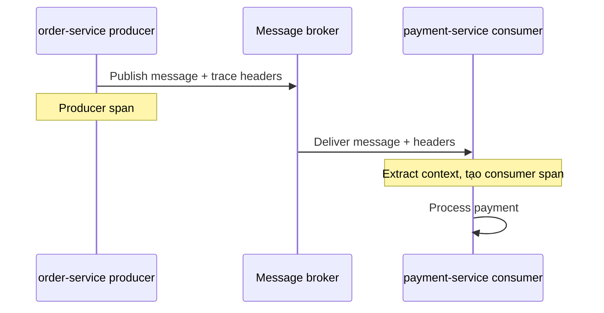
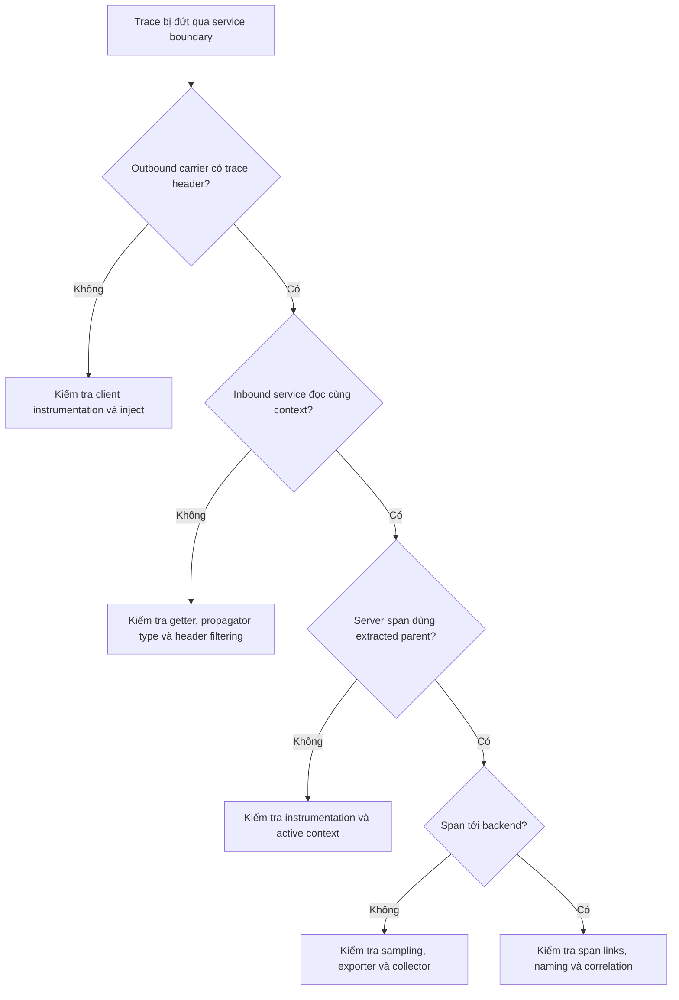

# Context propagators trong OpenTelemetry

Distributed tracing chỉ tạo được một trace xuyên nhiều dịch vụ khi mỗi thành phần biết cách **đọc context từ request đến** và **ghi context vào request đi**. OpenTelemetry thực hiện việc này bằng **context propagation**. Một *propagator* định nghĩa cách serialize và deserialize context qua một carrier như HTTP headers hoặc message metadata. Nếu service A tạo span nhưng không inject context, service B có thể bắt đầu một trace mới; nếu service B không extract đúng, quan hệ parent/child sẽ bị đứt.

Bài **“Context propagators”** thuộc chương **OpenTelemetry** của module **SPRING_BOOT_OBSERVABILITY**. Module hướng dẫn thiết lập observability cho Spring Boot bằng Micrometer Observation, metrics, logs và distributed tracing, gồm propagation ngữ cảnh, tag/cardinality, exporter, sampling và liên kết tín hiệu để điều tra lỗi, độ trễ và hành vi ứng dụng trên môi trường thực.

**Cần phân biệt ba lớp:** Context là nơi lưu execution-scoped values trong quá trình xử lý; propagator mô tả cách đưa một phần context qua ranh giới process; carrier là nơi chứa dữ liệu đã serialize, ví dụ HTTP headers. Propagator không phải exporter, không gửi span tới backend và không thay thế instrumentation của HTTP client/server.

## 1. Vì sao cần context propagation?

Giả sử `checkout-service` nhận request, gọi `payment-service` rồi gọi `inventory-service`. Mỗi process có runtime và bộ nhớ riêng. Trace context không tự đi qua mạng nếu không được serialize vào protocol metadata.



Khi propagation đúng, các spans liên quan cùng mang một trace ID; span phía nhận có quan hệ parent phù hợp; trace backend có thể hiển thị trace phân tán; logs có thể tương quan bằng trace ID/span ID nếu logging integration được cấu hình. Sampling decision cũng có thể được truyền theo trace context để service downstream áp dụng policy tương thích.

Khi propagation sai, từng service vẫn có thể ghi metrics và logs cục bộ nhưng trace bị tách thành nhiều phần, làm việc điều tra latency xuyên dịch vụ khó hơn.

## 2. Context, Propagator và Carrier

| Thành phần | Vai trò | Ví dụ |
| --- | --- | --- |
| **Context** | Lưu giá trị gắn với execution hiện tại | Span hiện hành, baggage |
| **Propagator** | Định nghĩa cách inject/extract context theo format | W3C Trace Context propagator |
| **Carrier** | Đối tượng mang key/value qua ranh giới | HTTP headers, Kafka record headers |
| **Setter** | Ghi key/value vào carrier | HTTP request header setter |
| **Getter** | Đọc key/value từ carrier | HTTP server header getter |
| **Exporter/backend** | Xuất và lưu span sau khi kết thúc | OTLP exporter, trace store |

Propagator **không tự tạo span**. Instrumentation hoặc tracing API tạo span; propagator chỉ đưa context phù hợp vào carrier hoặc lấy context từ carrier. Không phải mọi giá trị trong Context đều được serialize: propagator xử lý các trường mà format của nó định nghĩa.

## 3. Inject và extract hoạt động thế nào?

- **Inject:** lấy context hiện tại và ghi các trường cần thiết vào carrier outbound.
- **Extract:** đọc các trường từ carrier inbound và tạo context mới chứa dữ liệu đã giải mã.



Ví dụ HTTP headers:

```http
traceparent: 00-4bf92f3577b34da6a3ce929d0e0e4736-00f067aa0ba902b7-01
tracestate: vendor=value
baggage: workflow=checkout,region=ap-southeast-1
```

Đây là dữ liệu minh họa. `tracestate` là trường tùy chọn của W3C Trace Context; `baggage` thuộc W3C Baggage và không phải thành phần của `traceparent`.

HTTP server instrumentation đọc headers qua propagator đã cấu hình. Sau khi extract, server tạo span với context nhận được làm parent hoặc dùng link phù hợp theo loại xử lý. Chỉ lưu raw header thành một field trong controller không làm tracer hiểu quan hệ parent/child.

## 4. W3C Trace Context

**W3C Trace Context** là định dạng chuẩn để truyền trace context giữa các thành phần tương thích. Hai header phổ biến:

- `traceparent`: version, trace ID, parent ID và trace flags.
- `tracestate`: vendor-specific tracing state nếu có.

Ví dụ:

```http
traceparent: 00-4bf92f3577b34da6a3ce929d0e0e4736-00f067aa0ba902b7-01
```

Cấu trúc `traceparent` cho version `00`:

| Phần | Ví dụ | Ý nghĩa |
| --- | --- | --- |
| Version | `00` | Phiên bản định dạng |
| Trace ID | `4bf92f3577b34da6a3ce929d0e0e4736` | Định danh trace 16 byte, 32 ký tự hex |
| Parent ID | `00f067aa0ba902b7` | Định danh span cha 8 byte, 16 ký tự hex |
| Trace flags | `01` | Bit flags; bit thấp nhất là sampled flag |

Các ID toàn số 0 không hợp lệ. Parser cần kiểm tra syntax, version và length theo chuẩn; không chỉ kiểm tra header có tồn tại.

### Sampled flag không bảo đảm backend đã lưu trace

Flag sampled biểu thị sampling state được truyền trong context. Nó không bảo đảm span exporter đã gửi thành công, collector đã nhận, backend đã lưu hoặc dashboard có quyền truy cập. Trace vẫn có thể mất ở exporter, collector, network hoặc backend. Ngược lại, metrics độc lập vẫn có thể ghi nhận request không có trace được lưu.

### Tracestate không phải baggage

`tracestate` dành cho tracing vendor/system state theo W3C Trace Context. `baggage` mang metadata ứng dụng theo W3C Baggage. Hai loại không thay thế nhau và cần policy riêng về kích thước, privacy và propagation.

## 5. W3C Baggage Propagator

W3C Baggage truyền các cặp key/value bổ sung qua header `baggage`:

```http
baggage: tenant.tier=premium,workflow=checkout
```

Baggage có ích khi nhiều service cần metadata nhỏ như workflow hoặc region. Không chứa token, email, request body, customer data nhạy cảm hoặc payload lớn.

W3C Baggage yêu cầu platform propagate toàn bộ list-members khi baggage có không quá 64 members và baggage string không quá 8.192 bytes. Nếu vượt một trong hai ngưỡng, platform được phép drop members cho tới khi thỏa cả hai. Proxy/server thực tế có thể giới hạn header thấp hơn.

Không đưa baggage value vào metric labels. Nếu muốn đưa field vào span attributes hoặc MDC logs, phải bật cấu hình tương ứng và đánh giá privacy, cardinality và retention. Baggage không tự động xuất hiện ở mọi signal.

## 6. B3 và các định dạng propagation khác

Một số hệ thống cũ hoặc nền tảng tracing đã dùng B3. B3 có thể truyền context bằng single header `b3` hoặc nhiều headers riêng như `X-B3-TraceId`, `X-B3-SpanId`, `X-B3-Sampled`.

Ví dụ B3 multi-header:

```http
X-B3-TraceId: 4bf92f3577b34da6a3ce929d0e0e4736
X-B3-SpanId: 00f067aa0ba902b7
X-B3-Sampled: 1
```

| Format | Header thường gặp | Khi phù hợp |
| --- | --- | --- |
| W3C Trace Context | `traceparent`, `tracestate` | Liên vận giữa các hệ thống hiện đại |
| W3C Baggage | `baggage` | Metadata nhỏ được cho phép |
| B3 single | `b3` | Tương thích hệ thống B3 single header |
| B3 multi | `X-B3-*` | Tương thích hệ thống B3 multi-header |
| Jaeger/vendor | Header riêng theo implementation | Chỉ khi hệ thống hiện hữu yêu cầu |

Không bật mọi format vô điều kiện. Nhiều headers cùng tồn tại có thể gây mơ hồ nếu upstream gửi các context không khớp nhau. Chọn format được tin cậy ở từng boundary.

## 7. Composite propagator

Trong quá trình migration, một service có thể cần đọc nhiều định dạng nhưng chỉ ghi ra một định dạng chuẩn. Composite propagator ghép nhiều propagators để thực hiện inject/extract.

Chiến lược thường dùng:

- **Consume:** nhận W3C và B3 từ các upstream đã biết.
- **Produce:** chỉ gửi W3C tới downstream mới.
- **Boundary:** xác thực hoặc giới hạn trust của context nhận từ client bên ngoài.



Composite không merge nhiều trace ID thành một trace. Khi nhiều formats xuất hiện đồng thời, thứ tự và quy tắc chọn context phụ thuộc implementation; tránh gửi các context mâu thuẫn. Xác định format ưu tiên hoặc normalize ở gateway.

Composite cũng không tự chuyển baggage schema hoặc vendor state theo ngữ nghĩa nghiệp vụ. Field không có ở format nguồn không thể tự sinh ở format đích.

## 8. OpenTelemetry API: TextMapPropagator

OpenTelemetry định nghĩa `TextMapPropagator` cho carrier dạng key/value text. API có hai hoạt động:

- `inject(Context, carrier, setter)`: ghi context vào carrier.
- `extract(Context, carrier, getter)`: đọc carrier và trả context đã được bổ sung.

Setter và Getter tách logic propagation khỏi loại carrier. HTTP framework có API headers riêng; message broker có API record headers riêng. Propagator không cần biết cách framework lưu dữ liệu, chỉ cần setter/getter tôn trọng contract của carrier.

Ví dụ khái niệm với map:

```java
TextMapPropagator propagator = ...;
Context outgoing = Context.current();
Map<String, String> headers = new HashMap<>();

propagator.inject(outgoing, headers, MapSetter.INSTANCE);
```

`MapSetter` ở đây là implementation do ứng dụng định nghĩa, không phải singleton mặc định của mọi SDK:

```java
import io.opentelemetry.context.propagation.TextMapSetter;
import java.util.Map;

public enum MapSetter implements TextMapSetter<Map<String, String>> {
    INSTANCE;

    @Override
    public void set(Map<String, String> carrier, String key, String value) {
        if (carrier != null) {
            carrier.put(key, value);
        }
    }
}
```

Đọc carrier bằng Getter:

```java
import io.opentelemetry.context.propagation.TextMapGetter;
import java.util.Collections;
import java.util.Map;

public enum MapGetter implements TextMapGetter<Map<String, String>> {
    INSTANCE;

    @Override
    public Iterable<String> keys(Map<String, String> carrier) {
        return carrier == null ? Collections.emptyList() : carrier.keySet();
    }

    @Override
    public String get(Map<String, String> carrier, String key) {
        return carrier == null ? null : carrier.get(key);
    }
}
```

Sau đó extract:

```java
Context extracted = propagator.extract(
        Context.root(),
        headers,
        MapGetter.INSTANCE
);
```

Đây là ví dụ API carrier. Trong ứng dụng thật, ưu tiên instrumentation và propagator được auto-configure thay vì tự inject/extract trong mọi controller.

HTTP headers có semantics case-insensitive và có thể có nhiều values. Message broker có giới hạn kích thước, kiểu byte/string và semantics khác. Getter/Setter phải tôn trọng contract của carrier, không giả định mọi carrier là `Map<String,String>`.

## 9. Cấu hình propagators trong OpenTelemetry SDK thuần

Nếu ứng dụng tự khởi tạo OpenTelemetry SDK, có thể cấu hình `ContextPropagators` với W3C Trace Context:

```java
import io.opentelemetry.api.OpenTelemetry;
import io.opentelemetry.api.trace.propagation.W3CTraceContextPropagator;
import io.opentelemetry.context.propagation.ContextPropagators;
import io.opentelemetry.sdk.OpenTelemetrySdk;

OpenTelemetry openTelemetry =
        OpenTelemetrySdk.builder()
                .setPropagators(
                        ContextPropagators.create(
                                W3CTraceContextPropagator.getInstance()))
                .build();
```

Nếu cần cả W3C Baggage, ghép hai propagators:

```java
import io.opentelemetry.api.baggage.propagation.W3CBaggagePropagator;
import io.opentelemetry.api.trace.propagation.W3CTraceContextPropagator;
import io.opentelemetry.context.propagation.ContextPropagators;
import io.opentelemetry.context.propagation.TextMapPropagator;

TextMapPropagator propagator =
        TextMapPropagator.composite(
                W3CTraceContextPropagator.getInstance(),
                W3CBaggagePropagator.getInstance());

OpenTelemetry openTelemetry =
        OpenTelemetrySdk.builder()
                .setPropagators(ContextPropagators.create(propagator))
                .build();
```

Đây là ví dụ OpenTelemetry SDK thuần. Không cần tạo SDK riêng như thế nếu Spring Boot đã quản lý tracing qua Micrometer Tracing bridge. Trộn một global OpenTelemetry SDK tự khởi tạo với tracer do Boot quản lý có thể tạo hai context pipeline độc lập.

Dependency và phiên bản OpenTelemetry API/SDK phải tương thích, thường được quản lý bằng BOM. Chỉ thêm SDK dependency không tự instrument Spring MVC/WebFlux hoặc HTTP clients.

## 10. Spring Boot: để framework quản lý propagation

Trong ứng dụng Spring Boot dùng Micrometer Tracing, tracing bridge và instrumentation thường quản lý inject/extract cho HTTP server/client khi dùng builder được auto-configure.

Ví dụ dependencies cho bridge OpenTelemetry và OTLP exporter, theo dependency management của Spring Boot:

```groovy
dependencies {
    implementation 'org.springframework.boot:spring-boot-starter-actuator'
    implementation 'io.micrometer:micrometer-tracing-bridge-otel'
    runtimeOnly 'io.opentelemetry:opentelemetry-exporter-otlp'
}
```

Cấu hình ví dụ:

```yaml
spring:
  application:
    name: checkout-service

management:
  tracing:
    sampling:
      probability: 0.1
    propagation:
      type: w3c
  otlp:
    tracing:
      endpoint: http://otel-collector:4318/v1/traces
```

Property được hỗ trợ và giá trị hợp lệ có thể khác giữa các dòng Spring Boot; hãy kiểm tra tài liệu đúng phiên bản, đặc biệt với `management.tracing.propagation.type`. W3C thường phù hợp cho liên vận mới nếu downstream hỗ trợ.

### Dùng HTTP client đã được instrument

Ví dụ WebClient dùng builder do Boot quản lý:

```java
import org.springframework.stereotype.Component;
import org.springframework.web.reactive.function.client.WebClient;

@Component
public class PaymentClient {
    private final WebClient webClient;

    public PaymentClient(WebClient.Builder builder) {
        this.webClient = builder
                .baseUrl("http://payment-service")
                .build();
    }
}
```

Không tự tạo client ngoài cơ chế builder/observation instrumentation rồi giả định trace headers luôn được inject. Với RestClient, dùng builder tương ứng do Boot auto-configure. Với Apache HttpClient, OkHttp, gRPC hoặc message client khác, cần instrumentation tương thích.

**Exporter và propagator là hai việc riêng:** OTLP exporter gửi span đã kết thúc tới Collector; propagator inject/extract context qua request. Có OTLP endpoint không đồng nghĩa HTTP headers tự được propagate.

## 11. Propagation qua messaging và async

Với message broker, trace context thường được inject vào record headers hoặc message properties khi producer gửi, sau đó consumer extract khi xử lý.



Mô hình span tùy messaging semantics. Consumer span có thể là child hoặc link tới producer context, đặc biệt khi batch hoặc nhiều messages. Không áp dụng parent/child đơn giản cho mọi kiểu messaging.

Ở async boundary trong cùng JVM, Reactor Context, Micrometer Context Propagation hoặc executor decorator giữ context giữa threads. Qua process boundary, cần propagator trên carrier của protocol. Đây là hai vấn đề liên quan nhưng không thay thế nhau.

Nếu task được đưa vào queue nhiều giờ rồi mới chạy, trace gốc có thể đã hết retention. Cân nhắc span link, correlation metadata nhỏ và policy tracing cho background processing.

## 12. Bảo mật và trust boundary

Trace context và baggage thường đến từ header do client/upstream cung cấp. Không mặc định những giá trị này là dữ liệu xác thực.

- Không dùng trace ID, baggage hoặc tracestate để xác định user identity hay quyền tenant.
- Không đưa token, session secret, email hoặc payload nhạy cảm vào baggage.
- Giới hạn baggage member count/byte size theo W3C và hạ tầng.
- Kiểm tra header tại boundary theo security policy.
- Ở public ingress, cân nhắc tạo root trace mới hoặc kiểm soát remote parent theo trust policy.
- Không log toàn bộ headers nếu có credentials.
- Tránh cho client tự điều khiển sampled flag để ép backend lưu toàn bộ traces.
- Dùng TLS và xác thực cho đường export tới Collector/backend.

Trace context hợp lệ về cú pháp không có nghĩa upstream đáng tin. Trace context giúp correlation, không phải identity proof.

## 13. Lỗi thường gặp khi propagation

| Triệu chứng | Nguyên nhân có thể | Cách kiểm tra |
| --- | --- | --- |
| Mỗi service có trace ID khác | Không inject/extract hoặc format mismatch | Kiểm tra outgoing/incoming headers |
| Có traceparent nhưng span không nối | Không tạo server/client span từ extracted context | Kiểm tra tracing instrumentation |
| W3C service không đọc B3 | Chỉ cấu hình W3C consume | Cấu hình migration/composite phù hợp |
| Trace ID giống nhưng thiếu parent relationship | Extract sai thời điểm hoặc tạo span root thủ công | Kiểm tra tracer API và parent scope |
| Baggage mất nhưng trace vẫn nối | Baggage chưa được cấu hình/cho phép | Kiểm tra baggage propagator và allowlist |
| HTTP 400/431 | Request headers quá lớn hoặc proxy policy | Kiểm tra tổng header bytes và gateway |
| Không thấy trace backend dù headers đúng | Sampler/exporter/collector/backend lỗi | Theo dõi tracing pipeline |
| Nhiều formats gây trace không nhất quán | Upstream gửi context mâu thuẫn | Xác định format ưu tiên ở ingress |
| HTTP client không có child span | Client chưa được instrument hoặc builder custom | Dùng auto-configured builder/instrumentation |
| Async task mất context | ThreadLocal/Reactor context chưa propagate | Kiểm tra executor/context propagation |



## 14. Kiểm thử propagator end-to-end

Một bài kiểm thử cần xác minh cả inject và extract, không chỉ kiểm tra một class được tạo thành công.

1. **Chọn format:** dùng W3C Trace Context làm format chuẩn. Nếu migration từ B3, ghi rõ formats được consume và format được produce.
2. **Tạo request outbound:** tạo span hiện hành ở service A và gọi HTTP client đã instrument tới service B. Kiểm tra outgoing request có `traceparent` hợp lệ.
3. **Xác minh extraction:** ở service B, xác minh server span có cùng trace ID và parent relationship mong đợi. Không chỉ so sánh raw header; kiểm tra span context thực tế.
4. **Thêm baggage:** thêm field giả lập ngắn, không nhạy cảm. Xác nhận inject/extract khi baggage propagation được cấu hình.
5. **Kiểm tra sampled/unsampled:** xác minh downstream tôn trọng parent policy; phân biệt việc có context với việc span được export.
6. **Malformed headers:** test thiếu header, version/ID sai, header lặp, format không hỗ trợ và giá trị quá lớn.
7. **Backend:** xác minh spans đã kết thúc được export và query được. Propagation thành công không bảo đảm exporter ingest thành công.

## 15. Bài thực hành: chuẩn hóa W3C qua hệ thống có B3

Giả sử hệ thống hiện tại có gateway cũ gửi B3 và service mới dùng W3C:

1. Vẽ các ingress/egress boundaries và liệt kê format hiện dùng.
2. Chọn gateway làm điểm consume B3 và produce W3C nếu gateway có instrumentation hỗ trợ.
3. Cấu hình service mới ưu tiên W3C; chỉ giữ B3 consume ở boundary cần migration.
4. Gửi request từ client cũ qua gateway tới hai service mới.
5. Xác minh trace ID, parent relationship và sampled decision qua từng service.
6. Kiểm tra trường hợp upstream gửi đồng thời B3 và W3C nhưng context không khớp.
7. Theo dõi trace rời rạc và request bị header filtering.
8. Loại bỏ B3 consume sau khi upstream cũ đã nâng cấp và thời gian tương thích kết thúc.

Không tự nối B3 và W3C headers bằng string copy. Dùng propagator hiểu protocol và đặt quy tắc ưu tiên rõ ràng.

## 16. Câu hỏi tự kiểm tra

1. Context, propagator và carrier khác nhau thế nào?
2. Inject và extract được thực hiện ở đâu trong một HTTP call?
3. `traceparent` khác `tracestate` và `baggage` ra sao?
4. Sampled flag có bảo đảm trace đã nằm trong backend không?
5. B3 single khác B3 multi-header thế nào?
6. Vì sao service cần consume B3 nhưng produce W3C?
7. Composite propagator không giải quyết được trường hợp nào?
8. `TextMapPropagator` dùng Setter và Getter để làm gì?
9. Vì sao không tự inject/extract trong mọi controller?
10. OpenTelemetry SDK thuần khác Spring Boot Micrometer Tracing integration thế nào?
11. Vì sao OTLP exporter không thay thế HTTP context propagation?
12. Message consumer có luôn tạo child span trực tiếp của producer không?
13. Trace context có thể dùng để xác thực tenant hoặc user không?
14. Khi trace ID giống nhưng parent relationship sai, cần kiểm tra gì?
15. Kiểm thử end-to-end cần xác minh những tầng nào ngoài việc header tồn tại?

## Tài liệu tham khảo

- [OpenTelemetry — Context Propagation](https://opentelemetry.io/docs/concepts/context-propagation/): inject/extract và propagation xuyên process.
- [OpenTelemetry Java API — Context Propagation](https://opentelemetry.io/docs/languages/java/api/#context-propagation): Context Propagators và API Java.
- [W3C Trace Context](https://www.w3.org/TR/trace-context/): chuẩn traceparent và tracestate.
- [W3C Baggage](https://www.w3.org/TR/baggage/): chuẩn baggage và limits.
- [Spring Boot — Tracing](https://docs.spring.io/spring-boot/reference/actuator/tracing.html): Micrometer Tracing, propagation và baggage.
- [Micrometer Tracing Reference](https://docs.micrometer.io/tracing/reference/): bridge, propagator và API tracing.

## Kết luận

**Context propagators là cầu nối đưa trace context qua ranh giới process.** OpenTelemetry dùng mô hình inject/extract qua carrier; W3C Trace Context là format liên vận phổ biến, W3C Baggage mang metadata bổ sung, còn B3 có thể cần trong hệ thống legacy. Composite propagator hỗ trợ migration khi được cấu hình có chủ đích, với quy tắc consume/produce và trust boundary rõ ràng.

Trong Spring Boot, hãy ưu tiên tracing instrumentation và HTTP/message clients đã được auto-configure để inject/extract nhất quán. Phân biệt propagation với exporter, sampling và log correlation; kiểm tra headers ở mỗi hop, span parent relationship và dữ liệu cuối cùng trong backend. Điều đó giúp metrics, traces và logs có thể được liên kết khi điều tra lỗi và độ trễ trên môi trường thực.

