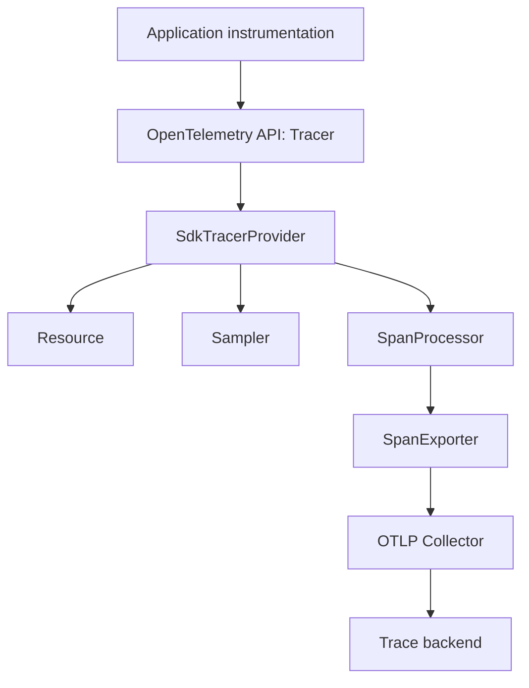
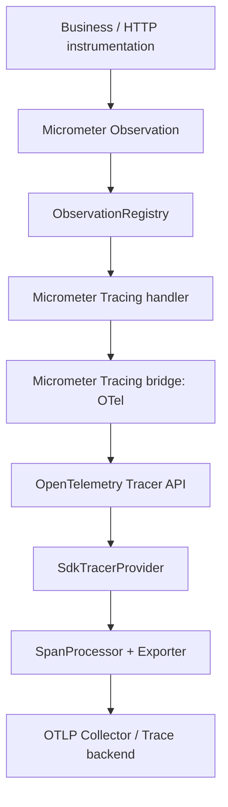
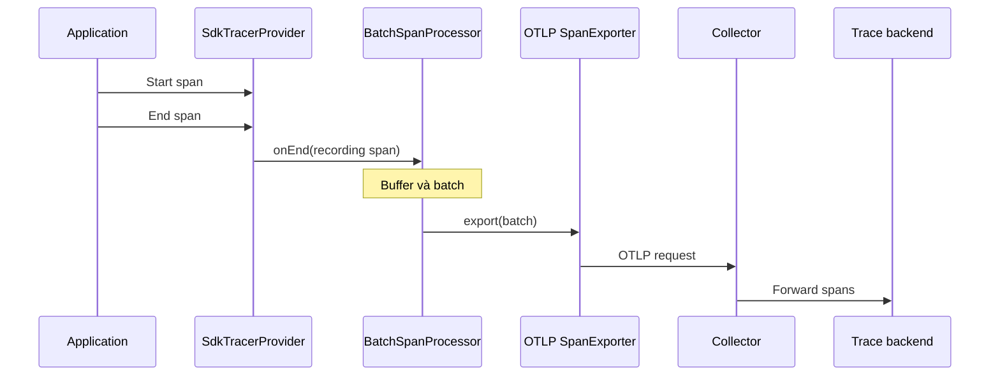

# SdkTracerProvider trong OpenTelemetry Java SDK

Trong ứng dụng Spring Boot, Micrometer Observation ghi nhận hoạt động, Micrometer Tracing có thể tạo spans, còn OpenTelemetry chuyển trace data đến collector/backend. Thành phần trung tâm ở tầng OpenTelemetry Java SDK là **SdkTracerProvider**: nó cung cấp tracer và điều phối resource, sampler, span processors, exporter cùng vòng đời spans.

Bài **SdkTracerProvider** thuộc chương **OpenTelemetry** của module **SPRING_BOOT_OBSERVABILITY**. Module hướng dẫn thiết lập observability cho Spring Boot bằng Micrometer Observation, metrics, logs và distributed tracing; học context propagation, tags/cardinality, exporter, sampling và liên kết tín hiệu để điều tra lỗi, độ trễ và hành vi ứng dụng trên môi trường thực.

Sau bài này, bạn có thể phân biệt SdkTracerProvider với Tracer API và OpenTelemetry API, cấu hình resource/sampler/processor/exporter, hiểu batch export và shutdown, và quyết định khi nào Spring Boot nên quản lý SDK hoặc khi nào ứng dụng cần tự cấu hình.

## 1. SdkTracerProvider là gì?

OpenTelemetry tách API khỏi SDK implementation:

| Thành phần | Vai trò |
| --- | --- |
| Tracer API | API instrumentation gọi để tạo spans |
| OpenTelemetry API | Entry point cung cấp tracer, propagators và các API telemetry |
| SdkTracerProvider | SDK implementation cấp tracer, tạo và quản lý trace lifecycle |
| SpanProcessor | Nhận callback khi span bắt đầu/kết thúc và xử lý span đã kết thúc |
| SpanExporter | Gửi spans đã xử lý tới collector/backend |
| Sampler | Quyết định span/trace có được ghi nhận hay không |
| Resource | Mô tả nguồn tạo telemetry, ví dụ service name/version/environment |
| ContextPropagators | Inject/extract context qua HTTP, messaging và process boundaries |

SdkTracerProvider là factory/manager cấp SDK cho các Tracer. Nó không phải trace backend, không mở server để nhận spans, và không tự gửi mọi dữ liệu ra ngoài. Nó phối hợp các sampler, processors và exporters đã đăng ký.



Khi code tạo span qua tracer do provider cấp, SDK dùng cấu hình này để tạo span context và xử lý span. Nếu sampler quyết định không ghi nhận, span có thể là non-recording; không phải mọi thao tác start span đều dẫn tới dữ liệu được export.

## 2. Phân biệt Tracer, TracerProvider và SdkTracerProvider

- **Tracer**: đối tượng instrumentation gọi để tạo spans và quản lý span scope.
- **TracerProvider**: abstraction cung cấp Tracer; code instrumented thường chỉ cần API provider.
- **SdkTracerProvider**: implementation cụ thể của OpenTelemetry SDK, quản lý sampling/processors/resources và lifecycle.

Ví dụ sử dụng API:

```java
Tracer tracer = openTelemetry.getTracer("com.example.checkout");

Span span = tracer.spanBuilder("checkout.submit").startSpan();
try (Scope scope = span.makeCurrent()) {
    checkout();
} catch (RuntimeException ex) {
    span.recordException(ex);
    span.setStatus(StatusCode.ERROR);
    throw ex;
} finally {
    span.end();
}
```

Ví dụ giả định đã có instance OpenTelemetry được cấu hình và hàm checkout là nghiệp vụ minh họa. Code nghiệp vụ thông thường không cần biết object SdkTracerProvider cụ thể; nó chỉ cần tracer/API được inject. Điều này giúp instrumentation không phụ thuộc cách SDK được cấu hình.

## 3. Vị trí trong Spring Boot Observability

Spring Boot có thể kết nối Micrometer Observation/Tracing với OpenTelemetry qua bridge:



Observation là abstraction mà ứng dụng có thể dùng để instrument hoạt động; bridge chuyển tracing signal thành span qua OpenTelemetry SDK. Provider được bridge/SDK integration sử dụng; service nghiệp vụ thường không nên tự tạo provider lần nữa.

### Chỉ nên có một tracing ownership rõ ràng

Nếu Spring Boot đã auto-configure OpenTelemetry SDK/provider, việc tự tạo một SdkTracerProvider khác có thể tạo hai pipeline:

- Một số spans đi qua Micrometer Tracing bridge, số khác qua SDK riêng.
- Resource, sampler, propagator và exporter không đồng nhất.
- Trace IDs/log correlation khó liên kết; spans có thể không tới backend mong đợi.

Hãy xác định ai sở hữu SDK lifecycle: Spring Boot, cấu hình OpenTelemetry tự quản lý, hay agent bên ngoài. Tránh trộn nhiều chủ thể nếu không có kiến trúc rõ ràng.

## 4. Dependencies cho OpenTelemetry SDK

Với Spring Boot dùng Micrometer Tracing bridge OTel, Gradle thường có dạng:

```groovy
dependencies {
    implementation 'org.springframework.boot:spring-boot-starter-actuator'
    implementation 'io.micrometer:micrometer-tracing-bridge-otel'
    runtimeOnly 'io.opentelemetry:opentelemetry-exporter-otlp'
}
```

Dependency management của Spring Boot quản lý phiên bản tương thích. Không tự ghép các phiên bản opentelemetry-api, SDK, exporter và bridge khác nhau.

Khi tự cấu hình SDK, cần thêm module SDK và exporter phù hợp:

```groovy
dependencies {
    implementation 'io.opentelemetry:opentelemetry-api'
    implementation 'io.opentelemetry:opentelemetry-sdk'
    runtimeOnly 'io.opentelemetry:opentelemetry-exporter-otlp'
}
```

Đây là dependency sketch; dùng BOM/platform tương thích với Spring Boot và Micrometer Tracing của ứng dụng. Trong app Boot đã có OTel bridge, không thêm một SDK riêng nếu chưa quyết định chuyển ownership sang custom configuration.

## 5. Cấu hình SdkTracerProvider

Ví dụ sau minh họa cách tạo SDK provider độc lập bằng OpenTelemetry Java SDK:

```java
import io.opentelemetry.api.common.AttributeKey;
import io.opentelemetry.api.common.Attributes;
import io.opentelemetry.sdk.resources.Resource;
import io.opentelemetry.sdk.OpenTelemetrySdk;
import io.opentelemetry.sdk.trace.SdkTracerProvider;
import io.opentelemetry.sdk.trace.export.BatchSpanProcessor;
import io.opentelemetry.exporter.otlp.trace.OtlpGrpcSpanExporter;

Resource serviceResource = Resource.getDefault().merge(
    Resource.create(Attributes.of(
        AttributeKey.stringKey("service.name"), "checkout-service",
        AttributeKey.stringKey("service.version"), "1.4.0"
    ))
);

OtlpGrpcSpanExporter exporter = OtlpGrpcSpanExporter.builder()
    .setEndpoint("http://localhost:4317")
    .build();

SdkTracerProvider tracerProvider = SdkTracerProvider.builder()
    .setResource(serviceResource)
    .addSpanProcessor(BatchSpanProcessor.builder(exporter).build())
    .build();

OpenTelemetrySdk openTelemetry = OpenTelemetrySdk.builder()
    .setTracerProvider(tracerProvider)
    .build();
```

Ví dụ thể hiện các thành phần chính:

1. Resource gắn metadata của service vào spans.
2. OTLP gRPC exporter gửi spans tới collector, ví dụ cổng 4317.
3. BatchSpanProcessor gom spans trước khi export.
4. SdkTracerProvider quản lý sampling và span processing.
5. OpenTelemetrySdk cung cấp API entry point cho instrumentation.

Đây là ví dụ SDK standalone, chưa phải cấu hình Spring Boot production hoàn chỉnh. Package/import của exporter phải khớp OTel SDK version đang quản lý. Không tạo provider/exporter mới mỗi request; chúng là tài nguyên cấp ứng dụng.

## 6. Propagators và W3C Trace Context

Provider tạo spans nhưng propagation cần ContextPropagators và instrumentation inject/extract. Với SDK tự quản lý, có thể cấu hình W3C Trace Context:

```java
import io.opentelemetry.context.propagation.ContextPropagators;
import io.opentelemetry.api.trace.propagation.W3CTraceContextPropagator;
import io.opentelemetry.sdk.OpenTelemetrySdk;

OpenTelemetrySdk openTelemetry = OpenTelemetrySdk.builder()
    .setTracerProvider(tracerProvider)
    .setPropagators(ContextPropagators.create(
        W3CTraceContextPropagator.getInstance()
    ))
    .build();
```

Đây là phần cấu hình cho một SDK instance. Nếu cần W3C Baggage, phải cấu hình baggage propagator hoặc composite propagator phù hợp; W3C trace context propagator không tự có nghĩa mọi baggage field đều được truyền.

Trong Spring Boot đã dùng Micrometer Tracing bridge, nên ưu tiên propagator và HTTP instrumentation do framework quản lý. Không tạo OpenTelemetrySdk thứ hai nếu đã có instance mà bridge đang sử dụng.

## 7. Resource: xác định service nào tạo span

Resource là metadata gắn với telemetry được tạo bởi process/service:

| Attribute | Ví dụ | Ý nghĩa |
| --- | --- | --- |
| service.name | checkout-service | Tên logical của service |
| service.version | 1.4.0 | Phiên bản ứng dụng |
| deployment.environment.name | production | Môi trường triển khai |
| service.instance.id | ID instance được kiểm soát | Phân biệt instance khi cần |
| host.name | hostname được phép xuất | Thông tin hạ tầng |

Không đưa pod UID, request ID hoặc user ID vào service.name. Tên service nên ổn định qua các replica để backend gộp đúng spans cùng ứng dụng.

Resource có thể được tạo từ default resource detectors rồi merge metadata do ứng dụng cung cấp. Thứ tự merge quyết định thuộc tính nào ưu tiên khi trùng key; kiểm tra semantics của Resource.merge trong version đang dùng. Không đăng ký Resource khác nhau theo từng request.

Resource khác span attributes: Resource mô tả process/service; span attributes mô tả một hoạt động; baggage truyền context qua process; metric dimensions nhóm measurements và cần cardinality thấp.

## 8. Sampler: quyết định span có được ghi nhận

Sampler được gắn vào provider khi xây dựng SDK:

```java
import io.opentelemetry.sdk.trace.samplers.Sampler;

SdkTracerProvider tracerProvider = SdkTracerProvider.builder()
    .setResource(serviceResource)
    .setSampler(
        Sampler.parentBased(
            Sampler.traceIdRatioBased(0.10)
        )
    )
    .addSpanProcessor(
        BatchSpanProcessor.builder(exporter).build()
    )
    .build();
```

Đoạn này minh họa sampler xác suất cho root trace với tỷ lệ 10% và parent-based decision cho spans có parent. Khi dùng Spring Boot auto-configuration, property có thể là management.tracing.sampling.probability; khi tự xây SdkTracerProvider, sampler được cấu hình trực tiếp ở SDK. Không cấu hình hai nơi mà không xác định sampler nào đang thực thi.

Sampler quyết định span có được ghi nhận; nếu không-recording, SpanProcessor thông thường không export span đó. Nhưng sampler không đảm bảo exporter gửi thành công các spans đã ghi nhận. Hãy đo riêng sampling decisions và export outcomes.

## 9. SpanProcessor: xử lý vòng đời span

SpanProcessor nhận lifecycle callbacks từ SDK:

| Processor | Hành vi | Khi phù hợp |
| --- | --- | --- |
| SimpleSpanProcessor | Export span ngay khi span kết thúc | Local debug/test hoặc traffic rất nhỏ |
| BatchSpanProcessor | Gom spans và export theo batch/điều kiện flush | Ứng dụng thông thường, giảm số lần gọi exporter |

Trong production, BatchSpanProcessor thường được ưu tiên để tránh một network call cho mỗi span. Nó có buffer, batch size, schedule delay và export timeout; giá trị cụ thể phụ thuộc version/configuration. Nếu buffer đầy hoặc exporter chậm, spans có thể bị drop. Cần theo dõi SDK/exporter diagnostics và cấu hình queue theo tải.

Không nên tự viết processor chỉ để log toàn bộ span data; điều đó có thể làm lộ PII, nhân đôi dữ liệu và tăng chi phí.

**SpanProcessor không phải sampler:** sampler ra quyết định sớm; processor xử lý spans đã ghi nhận; exporter gửi dữ liệu ra ngoài. Thêm processor không thể khôi phục span đã bị sampler loại.

## 10. SpanExporter và OTLP

SpanExporter chuyển spans đã kết thúc tới một đích. Với OTLP, exporter gửi dữ liệu tới collector hoặc backend tương thích.

```text
OTLP/gRPC: http://otel-collector:4317
OTLP/HTTP: http://otel-collector:4318/v1/traces
```

Đây là endpoint minh họa phổ biến. gRPC và HTTP là hai giao thức khác nhau; exporter, receiver, cổng và URL path phải khớp. Trong Docker/Kubernetes, hostname phải resolve được từ container/pod ứng dụng; localhost chỉ trỏ về cùng network namespace.



Export thành công ở SDK chỉ cho biết exporter nhận kết quả thành công theo giao thức; backend query ngay vẫn có thể chưa thấy do collector batching, ingest, indexing hoặc retention.

## 11. Shutdown và flush: không để mất batch cuối

BatchSpanProcessor có thể còn dữ liệu đang chờ khi ứng dụng dừng. Cần shutdown provider để processor flush theo cơ chế SDK và giải phóng exporter resources.

Trong ứng dụng standalone:

```java
try {
    // Application work tạo spans
} finally {
    tracerProvider.close();
}
```

Với Spring, bean custom do ứng dụng sở hữu có thể khai báo lifecycle:

```java
@Bean(destroyMethod = "close")
SdkTracerProvider tracerProvider() {
    return buildTracerProvider();
}
```

Đây chỉ là mẫu lifecycle. Nếu Spring Boot đã tạo và quản lý provider, không khai báo provider cạnh tranh hoặc tự đóng bean do framework sở hữu. Xác định rõ bean nào sở hữu exporter và processor để tránh đóng hai lần hoặc không đóng lần nào.

Flush/shutdown có timeout và không bảo đảm dữ liệu được gửi nếu process bị kill -9, container hết termination grace period hoặc network không khả dụng. Cần grace period đủ dài và giám sát drop/error.

## 12. Tích hợp với Micrometer Tracing trong Spring Boot

Hai cách tiếp cận cần phân biệt:

| Cách | Ai sở hữu provider? | Khi dùng |
| --- | --- | --- |
| Spring Boot + Micrometer bridge OTel | Spring Boot auto-configuration/SDK integration phù hợp version | Ứng dụng muốn instrument qua Observation/Micrometer Tracing |
| Custom OpenTelemetry SDK | Ứng dụng tự tạo/quản lý SdkTracerProvider, exporter, propagators | Có yêu cầu SDK đặc thù hoặc platform tự quản lý |

Với cách thứ nhất, dependencies và property có thể đủ để Spring Boot cấu hình tracing pipeline theo version. Không cần tự tạo SdkTracerProvider chỉ để đặt tên span; dùng Observation/Tracer abstraction.

Với cách thứ hai, cần tích hợp instance OpenTelemetry custom với bridge một cách chính thức và xác minh Tracer của Micrometer cùng instrumentation dùng chung provider. Không chỉ tạo một bean OpenTelemetrySdk rồi mặc định mọi cấu hình Spring Boot sẽ dùng nó.

Nếu sử dụng OpenTelemetry Java agent đồng thời với Micrometer bridge, cần quyết định instrumentation nào sở hữu HTTP/server/client spans. Hai lớp tự động instrument cùng request có thể tạo spans trùng nghĩa. Kiểm chứng bằng một trace end-to-end.

## 13. Kiểm thử SdkTracerProvider

| Test | Điều cần chứng minh |
| --- | --- |
| Resource test | Span có service.name/version mong đợi |
| Sampler test | Sampled/not-sampled decisions đúng policy |
| Processor/exporter test | Span được gửi tới in-memory/test exporter |
| Parent propagation test | Span con có trace ID và parent span ID đúng |
| Shutdown test | Batch cuối được flush khi provider đóng |
| Spring context test | Micrometer bridge và provider auto/custom thống nhất |

Ví dụ minh họa test bằng in-memory exporter (API/package phụ thuộc OTel testing version):

```java
InMemorySpanExporter exporter = InMemorySpanExporter.create();

SdkTracerProvider provider = SdkTracerProvider.builder()
    .addSpanProcessor(SimpleSpanProcessor.create(exporter))
    .build();

OpenTelemetrySdk otel = OpenTelemetrySdk.builder()
    .setTracerProvider(provider)
    .build();

Tracer tracer = otel.getTracer("checkout-test");
Span span = tracer.spanBuilder("checkout.submit").startSpan();
span.end();

assertEquals(1, exporter.getFinishedSpanItems().size());
provider.close();
```

Đây là pseudocode nhấn mạnh test strategy. Package của InMemorySpanExporter và test artifact phải theo OTel SDK version. Không dùng in-memory exporter trong production; đóng provider sau test để giải phóng processor resources.

Với BatchSpanProcessor, test nên xác minh flush/shutdown trong điều kiện kiểm soát. Không phụ thuộc một Thread.sleep cố định rồi hy vọng batch đã gửi; dùng exporter test có thể quan sát và timeout giới hạn.

## 14. Lỗi thường gặp

| Hiện tượng | Nguyên nhân có thể | Hướng kiểm tra |
| --- | --- | --- |
| Span không xuất hiện | Sampler drop, span không end hoặc processor không đăng ký | Sampling decision, lifecycle và provider |
| Tracer Micrometer khác OTel tracer mong đợi | Bridge và SDK dùng provider khác | Auto-configuration và bean ownership |
| Không thấy spans trên collector | Endpoint/protocol/network sai | OTLP receiver và exporter |
| Span thiếu service.name | Resource chưa thiết lập hoặc detector không chạy | Effective Resource |
| Batch bị drop | Queue đầy, exporter chậm hoặc timeout | Processor/exporter diagnostics |
| Mất batch cuối khi restart | Provider không shutdown/flush | Lifecycle bean và termination grace period |
| Traces tách ở downstream | Propagator hoặc HTTP instrumentation thiếu | Inject/extract headers |
| Trace tree có spans trùng | Java agent và framework cùng instrument | Chọn ownership |
| Mỗi request có root trace riêng | Parent context bị mất | W3C headers và context scope |
| Sampling property không tác dụng | Custom SDK sampler ghi đè hoặc profile sai | Runtime provider/sampler |
| Nhiều exporter clients | Tạo provider/exporter lặp lại | Singleton lifecycle cấp ứng dụng |
| Shutdown lâu | Flush timeout, queue lớn, network chậm | Batch/timeouts và grace period |

## 15. Tình huống thực tế: Spring Boot có hai trace pipelines

**Bối cảnh giả định:** sau khi thêm OTel SDK dependencies, checkout-service xuất spans qua OTLP. Trace backend lại có hai root traces cho cùng request; một trace chứa Micrometer HTTP spans, trace còn lại có custom spans từ SDK. Resource và sampling không đồng nhất.

Quy trình điều tra:

1. **Liệt kê tracing ownership:** xác định Spring Boot auto-configuration có tạo Micrometer bridge/tracer không; có custom SdkTracerProvider bean không; Java agent có chạy không.
2. **Kiểm tra tracer injection:** code Observation và custom OTel instrumentation dùng cùng OpenTelemetry provider hay hai provider khác nhau?
3. **So sánh resource:** hai pipelines có cùng service.name, service.version và environment không?
4. **So sánh propagators:** W3C Trace Context có được inject/extract trên cả hai đường không?
5. **So sánh samplers:** probability, parent-based policy và remote sampled flag có nhất quán không?
6. **Kiểm tra export:** mỗi provider có exporter/processor riêng nào? Có double export hay batch bị bỏ khi shutdown không?
7. **Chọn ownership:** ưu tiên Spring Boot/Micrometer pipeline nếu app Boot dùng Observation; chỉ giữ custom SDK nếu có yêu cầu cụ thể và đã tích hợp để instrumentation dùng chung provider.
8. **Xác minh lại:** gửi request test, kiểm tra trace ID, parent-child tree, resource và số spans; bảo đảm không còn trace tree trùng.

Tạo SDK provider thứ hai không tự làm tracing đầy đủ hơn. Nó có thể chia context, resource, sampler và exporter thành các pipeline không liên kết. Điều quan trọng là **một ownership rõ ràng và một provider thống nhất cho instrumentation cần cùng trace**.

## 16. Bài tập tự kiểm tra

**Bài 1.** SdkTracerProvider khác Tracer API ở điểm nào?

*Gợi ý:* Provider là thành phần SDK quản lý tracer, sampling và span processing; Tracer là API instrumentation dùng để tạo spans.

**Bài 2.** Thêm BatchSpanProcessor nhưng không cấu hình sampler có đủ để mọi span được export không?

*Gợi ý:* Không. Sampler có thể loại span trước khi processor xử lý; exporter cũng có thể lỗi.

**Bài 3.** Vì sao cần Resource với service.name ổn định?

*Gợi ý:* Backend cần biết service nguồn và nhóm spans cùng service qua nhiều instances.

**Bài 4.** Exporter thành công nhưng UI chưa thấy trace ngay. Có thể do đâu?

*Gợi ý:* Collector batching, ingest/index delay, backend filters, tenant hoặc time range.

**Bài 5.** Vì sao không nên tạo SdkTracerProvider cho mỗi request?

*Gợi ý:* Provider/processor/exporter là tài nguyên cấp ứng dụng; tạo lặp làm tăng thread/network clients và phân mảnh context.

**Bài 6.** BatchSpanProcessor có cần shutdown không?

*Gợi ý:* Có. Shutdown giúp flush dữ liệu còn trong batch và giải phóng exporter/processor; vẫn cần timeout và xử lý abrupt termination.

**Bài 7.** Spring Boot đã có Micrometer Tracing bridge OTel. Có nên tạo custom provider chỉ để đổi sampling?

*Gợi ý:* Thường không. Kiểm tra property/config SDK được hỗ trợ trước; custom provider cần tích hợp chính thức và không cạnh tranh framework provider.

**Bài 8.** Backend cho thấy hai root traces cùng request sau khi thêm SDK. Ba nơi cần kiểm tra?

*Gợi ý:* Hai provider/agent cùng instrument, HTTP context propagation giữa tracer và cấu hình exporter/ownership.

## 17. Ghi nhớ

- **SdkTracerProvider** là implementation trung tâm của OpenTelemetry Java SDK, cung cấp tracers và quản lý sampling, resources, span processors cùng vòng đời spans.
- **Tracer API** là thứ instrumentation dùng; provider là nơi cấu hình/điều phối SDK. Code nghiệp vụ không nên tự tạo provider.
- **Resource** mô tả service/process; **span attributes** mô tả operation; **baggage/propagator** truyền context qua process.
- **Sampler** quyết định spans có được ghi nhận; **SpanProcessor** xử lý spans đã ghi; **SpanExporter** chuyển dữ liệu ra collector/backend. Ba vai trò khác nhau.
- Dùng **BatchSpanProcessor** cho export theo batch trong hệ thống thông thường và quản lý shutdown/flush để giảm mất batch cuối.
- Trong Spring Boot, ưu tiên một tracing ownership thống nhất giữa auto-configuration, Micrometer bridge, custom SDK và agent; tránh hai provider tạo hai trace pipelines.
- Kiểm thử riêng resource, sampling, parent propagation, exporter và shutdown bằng in-memory/test exporter; đừng dùng backend production làm unit test.
