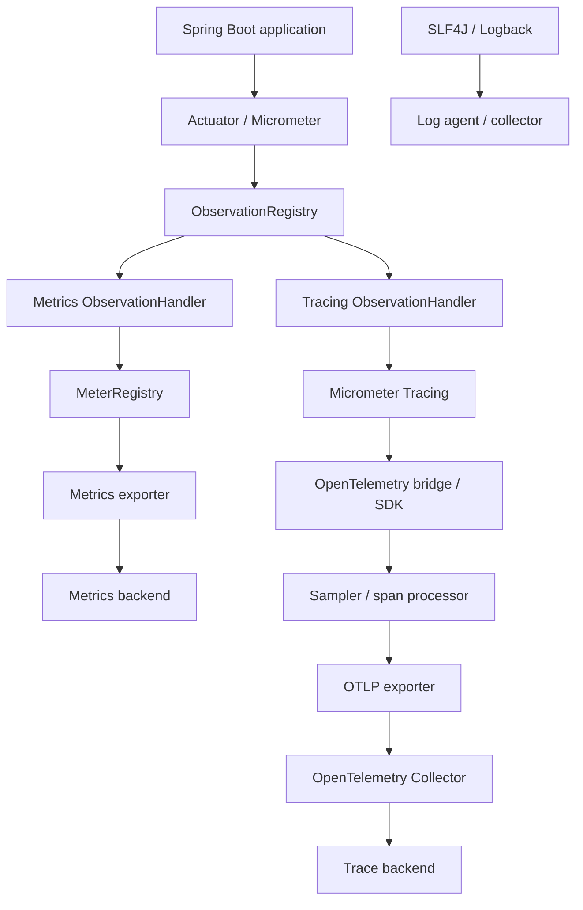
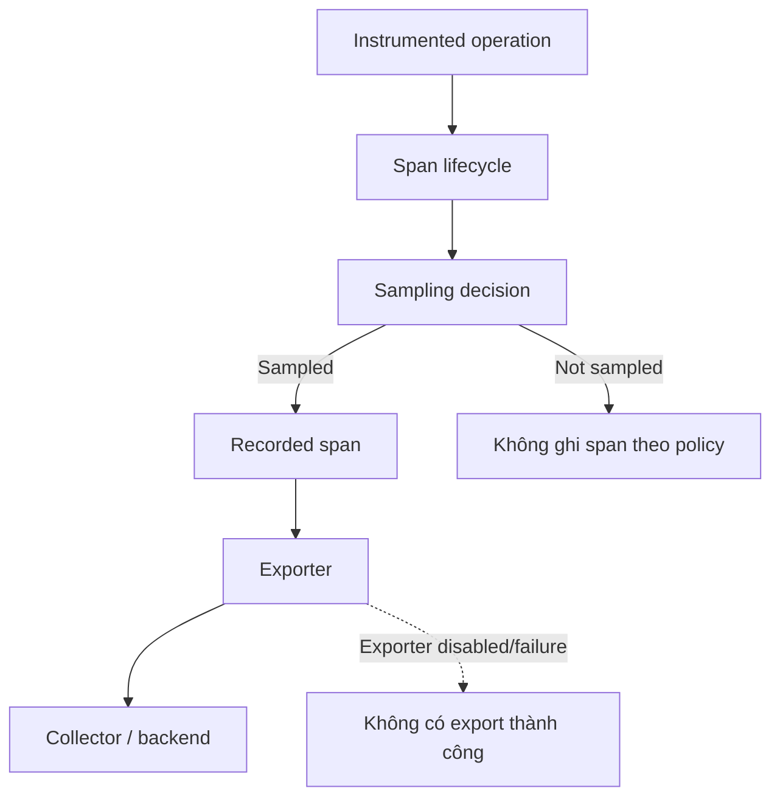

# Bật và tắt OpenTelemetry trong Spring Boot

Một ứng dụng Spring Boot có thể cần tracing ở production để điều tra độ trễ, nhưng môi trường local không chạy OpenTelemetry Collector. Nhóm vận hành muốn tạm ngừng gửi spans trong khi metrics và logs vẫn phải hoạt động. Đây là những yêu cầu khác nhau: **tắt instrumentation**, **tắt sampling**, **tắt exporter** hoặc **ngừng propagation context** có tác động riêng.

OpenTelemetry (OTel) là hệ sinh thái API, SDK, instrumentation, context propagation và OTLP export cho traces, metrics và logs. Spring Boot thường tích hợp observability qua Actuator và Micrometer Observation/Tracing. Vì vậy, bật/tắt OpenTelemetry cần được xem xét theo đúng lớp đang sử dụng; một property hoặc dependency không nhất thiết bật/tắt mọi tín hiệu.

Bài **Bật và tắt OpenTelemetry** thuộc chương **OpenTelemetry** của module **SPRING_BOOT_OBSERVABILITY**. Module tập trung thiết lập observability cho Spring Boot bằng Micrometer Observation, metrics, logs và distributed tracing; học context propagation, tag/cardinality, exporter, sampling và liên kết tín hiệu để điều tra lỗi, độ trễ và hành vi ứng dụng trên môi trường thực.

## 1. Mục tiêu học tập

Sau bài học, bạn có thể:

- Phân biệt enable/disable instrumentation, recording, sampling, exporting và propagation.
- Bật hoặc tắt tracing theo môi trường bằng cấu hình Spring Boot được phiên bản hỗ trợ.
- Hiểu tác động của việc thêm hoặc loại bỏ OTel bridge/SDK/exporter dependency.
- Giữ metrics và logs hoạt động khi chỉ tạm dừng trace export.
- Nhận biết vì sao sampling probability bằng 0 khác với việc không khởi tạo tracing.
- Thiết kế profile và deployment overrides để tránh bật tracing ngoài ý muốn.
- Kiểm tra cấu hình thực tế, trace backend, Actuator metrics và log correlation.
- Tránh lộ endpoint quản trị, secrets, PII hoặc phá vỡ trace continuity khi disable telemetry.

## 2. Các lớp có thể bật hoặc tắt

Trong một ứng dụng Spring Boot, từ “OpenTelemetry” đôi khi được dùng để chỉ toàn bộ hạ tầng, nhưng thực tế có nhiều lớp độc lập:

| Lớp | Trách nhiệm | Khi tắt thì điều gì thay đổi? |
| --- | --- | --- |
| Instrumentation | Tạo observations/spans từ HTTP, client, messaging, custom code | Không còn hoặc giảm các operation được instrument |
| Tracing bridge/SDK | Cung cấp tracer, context và span lifecycle | API tracing/handlers có thể không được cấu hình |
| Recording | Ghi span data trong quá trình xử lý | Span có thể không được lưu thành dữ liệu có thể export |
| Sampling | Chọn trace/span nào được ghi nhận | Một phần hoặc toàn bộ trace mới không được chọn |
| Exporter/reporter | Gửi telemetry ra Collector/backend | Dữ liệu có thể được tạo nhưng không chuyển tới backend |
| Propagation | Inject/extract trace context qua HTTP/message | Service có thể mất khả năng nối context qua boundary |
| Metrics pipeline | Ghi và export Counter/Timer/Gauge | Metrics có thể ngừng ghi hoặc ngừng export tùy thành phần |
| Logging pipeline | Ghi, định dạng và chuyển tiếp logs | Application logs hoặc correlation fields có thể thay đổi |

**Tắt một lớp không tự động tắt tất cả lớp còn lại.** Ví dụ sampling tắt trace recording nhưng Micrometer metrics handler vẫn có thể ghi Timer. Ngược lại, loại Actuator hoặc metrics registry có thể ảnh hưởng metrics dù tracing exporter vẫn hoạt động qua SDK được cấu hình riêng.

## 3. Kiến trúc quan sát khi bật

Spring Boot thường dùng Micrometer Observation để instrument operation. ObservationRegistry điều phối handlers: metrics handler ghi measurements vào MeterRegistry, tracing handler tạo spans thông qua Micrometer Tracing bridge. Nếu dùng OTel bridge, trace exporter gửi spans qua OTLP tới Collector.



Actuator cung cấp endpoints quản trị như health và metrics. Nó không đồng nghĩa với OTel SDK hoặc Collector. Collector là thành phần nhận telemetry ở hạ tầng riêng; ứng dụng thường gửi dữ liệu qua OTLP.

### Khi tracing được bật

Một request HTTP có thể tạo server span; HTTP client đã được instrument có thể tạo client span; Observation tùy biến có thể tạo span nghiệp vụ. Tracing bridge duy trì context, sampling chọn trace phù hợp và exporter gửi span đã được ghi nhận.

### Khi tracing được tắt

Ứng dụng vẫn có thể chạy business logic, metrics và logs. Tuy nhiên, cần xác định rõ có tắt cả tracing instrumentation hay chỉ ngừng recording/export. Nếu service nhận trace context từ upstream, việc không ghi span ở service này có thể tạo đoạn trống trong trace. Nếu xóa header, các service phía sau có thể mất cả khả năng liên kết với trace gốc.

## 4. Bật OpenTelemetry tracing trong Spring Boot

Ví dụ cho Spring Boot 3.x dùng Gradle Kotlin DSL và dependency management của Spring Boot:

```kotlin
dependencies {
    implementation("org.springframework.boot:spring-boot-starter-actuator")
    implementation("io.micrometer:micrometer-tracing-bridge-otel")
    runtimeOnly("io.opentelemetry:opentelemetry-exporter-otlp")
}
```

Vai trò:

- `spring-boot-starter-actuator`: Actuator và hạ tầng tích hợp observability.
- `micrometer-tracing-bridge-otel`: nối Micrometer Tracing API với OpenTelemetry.
- `opentelemetry-exporter-otlp`: cung cấp OTLP exporter để gửi trace data khi được cấu hình và auto-configuration tương thích.

Spring Boot BOM nên quản lý phiên bản Spring Boot, Micrometer và OTel tương thích. Không thêm Brave bridge đồng thời nếu ứng dụng đã chọn OTel bridge, trừ khi có kiến trúc riêng đã được thiết kế và kiểm chứng.

### Cấu hình endpoint và sampling

Ví dụ cấu hình cho phiên bản Spring Boot hỗ trợ management OTLP tracing properties:

```yaml
spring:
  application:
    name: order-service
management:
  tracing:
    sampling:
      probability: 0.1
  otlp:
    tracing:
      endpoint: http://otel-collector:4318/v1/traces
```

- `spring.application.name` định danh ứng dụng; cách ánh xạ sang resource `service.name` cần xác minh theo stack/version.
- `management.tracing.sampling.probability` đặt xác suất sampling cho sampler do Spring Boot cấu hình.
- Endpoint là đích OTLP/HTTP của Collector. Cổng 4318 và path /v1/traces là ví dụ phổ biến, không phải địa chỉ có sẵn ở mọi môi trường.

**Property OTLP tracing phụ thuộc phiên bản Spring Boot và dependency set.** Hãy kiểm tra configuration metadata của phiên bản thực tế. Nếu dự án tự cấu hình SDK/exporter, không thêm cấu hình thứ hai chồng lên auto-configuration.

## 5. Bật và tắt theo profile môi trường

| Môi trường | Mục tiêu quan sát gợi ý | Cấu hình thường gặp |
| --- | --- | --- |
| Local | Dễ phát triển, không cần backend ngoài | Tracing tắt hoặc sampling tùy chọn; giữ Actuator metrics local |
| Test/CI | Xác minh instrumentation, propagation và export | Bật tracing với backend test hoặc Collector tạm |
| Staging | Gần production để kiểm tra pipeline | Bật exporter, sampling có kiểm soát |
| Production | Điều tra request thực tế trong giới hạn chi phí | Bật tracing với sampling policy và exporter được vận hành |

### Ví dụ profile local và production

```yaml
# application-local.yml
management:
  tracing:
    sampling:
      probability: 0.0
```

```yaml
# application-prod.yml
management:
  tracing:
    sampling:
      probability: 0.1
  otlp:
    tracing:
      endpoint: http://otel-collector.monitoring:4318/v1/traces
```

Đây là minh họa cho hai profile; cú pháp và việc binding properties cần khớp phiên bản Boot. Local probability bằng 0 thường ngăn root traces mới được chọn bởi sampler xác suất. Production probability 0.1 chỉ là ví dụ, không phải tỷ lệ mặc định cho mọi hệ thống.

Chọn profile khi chạy, ví dụ:

```bash
java -jar app.jar --spring.profiles.active=local
```

Hoặc đưa cấu hình qua environment variables/configuration của nền tảng triển khai. Kiểm tra giá trị thực tế sau khi Spring ghép application config, profile, environment, command line và config server; đừng chỉ dựa vào file YAML trong repository.

Nếu local và production dùng cùng một image, profile/config externalized có thể quyết định sampling và endpoint. Kiểm tra pipeline release không vô tình kích hoạt profile local ở production hoặc để environment override ghi đè endpoint.

## 6. Bật/tắt qua dependency và auto-configuration

Dependency là một cách quyết định hạ tầng nào có mặt trong runtime:

| Dependency/thành phần | Bật thành phần nào? | Khi loại bỏ |
| --- | --- | --- |
| Actuator starter | Spring Boot management/Actuator infrastructure | Các Actuator endpoints và một phần auto-configuration không còn |
| Micrometer OTel tracing bridge | Adapter Micrometer Tracing sang OTel | Micrometer tracing handlers/Tracer theo OTel bridge không còn được cấu hình như trước |
| OTel OTLP exporter | Khả năng export bằng OTLP | Không dùng được exporter này; span có thể không gửi qua OTLP |
| Micrometer metrics registry/exporter | Metrics backend tương ứng | Metrics có thể còn trong registry khác hoặc chỉ ở local |
| OTel instrumentation agent/starter | Instrumentation theo cách đóng gói của agent/starter | Các spans do agent/starter tạo có thể ngừng xuất hiện |

Không loại bỏ toàn bộ Actuator chỉ để tắt trace export nếu ứng dụng vẫn cần health, metrics hoặc management endpoints. Xóa OTLP exporter cũng không nhất thiết vô hiệu hóa exporter khác đã cấu hình qua agent hoặc SDK.

### Điều kiện auto-configuration

Spring Boot thường dùng classpath, bean hiện có và properties để quyết định auto-configuration. Khi ứng dụng tự khai báo `OpenTelemetrySdk`, `TracerProvider`, `Sampler`, `SpanProcessor` hoặc exporter bean, cần hiểu auto-configuration sẽ back off hoặc kết hợp các bean ra sao.

Quy tắc thực hành:

1. Ưu tiên một tracing implementation và một nguồn cấu hình rõ ràng.
2. Không tạo OTel SDK/provider thứ hai cạnh SDK do framework/agent quản lý.
3. Không thêm exporter riêng nếu auto-configuration đã đăng ký exporter tương ứng.
4. Kiểm tra bean/configuration report ở môi trường được phép khi cần xác định cấu hình có hiệu lực.

## 7. Tắt sampling khác với tắt tracing

Sampling probability bằng 0 là cách phổ biến để từ chối sampling root traces mới khi dùng cơ chế xác suất tương ứng:

```yaml
management:
  tracing:
    sampling:
      probability: 0.0
```

Đây là **sampling policy**, không nhất thiết ngăn tracing bridge/propagator hoạt động. Với trace context inbound, parent-based semantics có thể khiến span con tuân theo quyết định sampling từ upstream. Hành vi cụ thể phụ thuộc implementation, sampler và cấu hình.

| Yêu cầu | Hướng xử lý | Điểm phải xác minh |
| --- | --- | --- |
| Giảm số trace được lưu | Hạ sampling probability hoặc dùng sampler phù hợp | Root và parent-based behavior |
| Không lấy mẫu root trace mới | Probability 0 hoặc always-off sampler được hỗ trợ | Context inbound và policy thực tế |
| Không có spans ở service trong mọi trường hợp | Đánh giá recording/export policy ở service/collector | Parent sampled, agent và custom instrumentation |
| Tắt hẳn Micrometer Tracing integration | Cấu hình dependency/auto-configuration cho tracing integration | Ảnh hưởng tới Tracer, Observation handlers và MDC |
| Không gửi trace ra ngoài | Tắt exporter/route hoặc áp policy ở egress/collector | Span có thể còn trong process; exporter khác |

Không kết luận rằng probability 0 xóa trace context hoặc mọi span con. Nếu chính sách bắt buộc không ghi bất kỳ span nào từ service, hãy kiểm thử cả request có parent sampled.

## 8. Tắt exporter khác với tắt instrumentation

Exporter chuyển span data ra Collector/backend. Nếu exporter bị bỏ cấu hình hoặc không kết nối, business code vẫn có thể tạo spans tùy implementation. Có thể vẫn còn chi phí tạo span, giữ context hoặc buffer; chỉ backend không nhận được dữ liệu thành công.



Ba trường hợp có thể cùng biểu hiện “không thấy trace”:

1. Sampler từ chối trace, không có span được export.
2. Span được ghi nhưng exporter tắt hoặc lỗi.
3. Export tới Collector thành công nhưng Collector/backend drop hoặc truy vấn sai.

Chỉ xem trace backend là chưa đủ để phân biệt. Cần kiểm tra sampler, exporter logs/metrics và Collector ingestion.

### Exporter disabled không tự xóa propagation

Nếu context propagation vẫn bật, HTTP/message headers có thể tiếp tục mang trace context ngay cả khi service không export spans. Điều này có thể hữu ích khi downstream service khác vẫn ghi trace và cần giữ correlation. Nếu boundary không tin cậy yêu cầu không truyền metadata, áp dụng policy propagation/egress riêng.

## 9. Tắt propagation là quyết định riêng

Propagation inject/extract trace context qua HTTP headers hoặc message headers. Tắt propagation có thể làm downstream tạo root trace mới hoặc không có trace ID liên kết với upstream.

Không xóa header tracing chỉ vì sampler đang tắt ở một service. Điều đó có thể làm trace bị chia thành nhiều trace độc lập tại service phía sau. Ngược lại, ở trust boundary, lọc hoặc loại headers có thể cần thiết theo security policy.

| Tình huống | Quyết định cần cân nhắc |
| --- | --- |
| Service local không có backend | Có thể tắt recording/export nhưng giữ propagation nếu cần kiểm thử |
| Downstream service đang ghi trace | Giữ context có thể giúp downstream nối trace cha |
| Gateway đi vào trust domain khác | Validate/allow-list hoặc loại metadata theo chính sách |
| External message không tin cậy | Xử lý context như metadata tương quan, không dùng làm identity |
| Tạm dừng exporter do backend sự cố | Tránh xóa context nếu không có yêu cầu security riêng |

## 10. Metrics và logs cần được quản lý độc lập

OpenTelemetry traces, Micrometer metrics và application logs không nhất thiết bật/tắt cùng nhau:

| Thay đổi | Traces | Metrics | Logs |
| --- | --- | --- | --- |
| Sampling probability = 0 | Trace mới theo sampler không được chọn | Thường vẫn ghi nếu metrics handler/registry hoạt động | Vẫn ghi theo logging config |
| Tắt OTLP trace exporter | Không tới Collector qua exporter đó | Không đổi nếu metrics pipeline riêng | Không đổi nếu log pipeline riêng |
| Tắt Micrometer tracing bridge | Micrometer tracing integration bị ảnh hưởng | Metrics handler có thể còn | Log vẫn có, trace/span MDC có thể mất |
| Tắt Actuator starter | Actuator endpoints/integration thay đổi; tracing riêng có thể còn nếu SDK/agent khác | Registry phụ thuộc dependencies còn lại | Logging framework vẫn có thể hoạt động |
| Tắt OTel SDK/agent | Tín hiệu do SDK/agent đó quản lý bị ảnh hưởng | Micrometer metrics độc lập có thể còn | SLF4J/Logback độc lập có thể còn |

### Metrics không được điều khiển bằng trace sampling

Một request không có sampled trace vẫn có thể làm tăng `http.server.requests`, business Counter hoặc Timer. Đừng dùng số trace trong backend thay cho request count khi sampling dưới 100%. Nếu muốn dừng metrics export, điều chỉnh registry/exporter metrics tương ứng, không đổi trace sampling.

### Logs và MDC

Nếu tracing integration cung cấp `traceId`/`spanId` qua MDC, tắt tracing integration có thể làm các trường correlation biến mất khỏi logs. Logger và appender vẫn có thể ghi message bình thường.

Ví dụ pattern tương quan:

```yaml
logging:
  pattern:
    correlation: "[%X{traceId:-},%X{spanId:-}] "
```

Định dạng này chỉ xuất các giá trị MDC nếu chúng tồn tại. Nó không tạo trace, không inject HTTP header và không export logs lên OTel. Nếu cần log correlation khi tracing bị tắt, có thể dùng correlation ID nghiệp vụ riêng đã được validate; không tự tạo metric label có cardinality cao.

## 11. Actuator endpoints khi OpenTelemetry tắt

Ví dụ giữ Actuator health/metrics và chỉ đặt sampling về 0:

```yaml
management:
  endpoints:
    web:
      exposure:
        include: health,info,metrics
  tracing:
    sampling:
      probability: 0.0
```

Trong ứng dụng có registry/metrics handler hoạt động, `/actuator/health` và `/actuator/metrics` vẫn có thể phục vụ kiểm tra. Sampling 0 không phải cấu hình expose endpoint; hai nhóm property giải quyết hai vấn đề khác nhau.

Nếu loại Actuator starter khỏi runtime, endpoints thường không còn như trước. Nếu chỉ tắt tracing integration, Actuator health/metrics có thể vẫn hoạt động. Không expose `/actuator/env`, `/actuator/configprops` hoặc mọi endpoints cho public chỉ để kiểm tra cấu hình.

## 12. Bật/tắt OpenTelemetry theo deployment

Trong container/Kubernetes hoặc môi trường triển khai tương tự, cấu hình thường được truyền bằng profile và environment variables. Có thể dùng relaxed binding tương ứng với properties Spring Boot, nhưng phải xác nhận tên biến theo property cụ thể và phiên bản.

Ví dụ minh họa:

```yaml
env:
  - name: SPRING_PROFILES_ACTIVE
    value: "prod"
  - name: MANAGEMENT_TRACING_SAMPLING_PROBABILITY
    value: "0.1"
```

Ví dụ đặt profile và sampling probability; endpoint OTLP có thể được cấu hình qua biến môi trường riêng theo property group đang hỗ trợ. Không đặt secret token trực tiếp trong manifest công khai hoặc repository. Dùng secret management của môi trường.

### Checklist release

1. Xác định yêu cầu là giảm sampling, dừng export, tắt instrumentation hay ngừng propagation.
2. Kiểm tra dependency graph: OTel bridge, exporter, agent và Micrometer registry.
3. Xác nhận profile/property cuối cùng trong deployment.
4. Kiểm tra Collector endpoint, TLS, auth, network và backend.
5. Xác định tác động tới traces, metrics, logs, baggage và MDC.
6. Chạy smoke test một request đồng bộ và luồng async/messaging nếu hệ thống có dùng.
7. Xác nhận Actuator endpoints vẫn đúng scope/security.
8. Có cách rollback cấu hình và theo dõi sau thay đổi.

Nhiều cấu hình sampling/exporter được bind lúc application startup. Sửa config server/environment không nhất thiết thay đổi bean hiện tại nếu không có cơ chế refresh được hỗ trợ. Một số context, tracer hoặc exporter cần restart/recreate để áp dụng. Kiểm tra cơ chế refresh của stack thay vì giả định property thay đổi tức thì.

## 13. Bảo mật và quyền riêng tư

Tắt OpenTelemetry không thay thế data governance:

- Trace cũ đã gửi vẫn nằm ở backend cho tới khi retention/deletion policy xử lý.
- Logs và metrics vẫn có thể chứa dữ liệu nhạy cảm.
- Baggage/trace headers có thể tiếp tục được propagate nếu không tắt riêng.
- Agent khác hoặc exporter khác có thể tiếp tục gửi telemetry.
- Actuator endpoints vẫn có thể lộ metadata nếu expose rộng.

| Rủi ro | Biện pháp |
| --- | --- |
| Trace chứa token, cookie, payload hoặc PII | Loại bỏ/mask ở instrumentation và processor; không dựa vào sampling |
| Exporter gửi tới endpoint không tin cậy | TLS, authentication, egress allow-list |
| Actuator lộ config | Expose tối thiểu, Spring Security/network policy |
| Baggage vượt trust boundary | Allow-list remote fields và validate inbound |
| Tắt trace nhưng log vẫn lộ dữ liệu | Audit logging pattern, structured fields, retention |
| Bật 100% sample ngoài ý muốn | Profile guardrail, config validation và alert |

## 14. Troubleshooting

| Triệu chứng | Nguyên nhân có thể | Cách kiểm tra |
| --- | --- | --- |
| Đặt sampling 0 nhưng vẫn thấy span | Parent đã sampled, agent khác, sampler bean khác hoặc trace cũ | Kiểm tra parent context, bridge, agent và khoảng thời gian |
| Không thấy trace nhưng logs có trace ID | Sampling off hoặc exporter lỗi; propagation vẫn hoạt động | Kiểm tra sampler và exporter riêng |
| Metrics biến mất khi tắt tracing | Đã loại nhầm Actuator/metrics registry hoặc metrics handler | Kiểm tra dependency và MeterRegistry |
| Logs mất trace ID nhưng vẫn có message | Tracing MDC integration bị tắt hoặc context không propagate | Kiểm tra bridge, scope và logging pattern |
| Downstream trace thành root mới | Propagation bị tắt/headers bị strip | Kiểm tra inject/extract headers |
| Tắt exporter nhưng CPU vẫn tăng | Instrumentation/recording vẫn hoạt động, buffer hoặc exporter khác còn chạy | Kiểm tra spans/processors/exporter thực tế |
| Tắt dependency nhưng span vẫn xuất hiện | OTel agent hoặc SDK khác vẫn instrument | Kiểm tra JVM arguments, agent và dependency graph |
| Local tắt nhưng staging vẫn gửi trace | Profile/environment override khác | Xác minh config effective tại process |
| Actuator health 404 sau thay đổi | Loại starter hoặc đổi management path/port | Kiểm tra dependencies và endpoint exposure |
| Collector không nhận sau khi bật | Sai OTLP transport, path, port, TLS, auth hoặc network | Kiểm tra exporter logs và receiver |
| Trace cũ vẫn xuất hiện sau khi disable | Backend hiển thị dữ liệu đã ingest trước đó | Lọc theo timestamp/service và retention |

### Quy trình điều tra

1. Xác định trace/span có mới được tạo hay đang xem dữ liệu cũ.
2. Kiểm tra tracing bridge, SDK/agent và instrumentation đang được nạp.
3. Kiểm tra sampling decision, cả root và inbound parent.
4. Kiểm tra exporter có được khởi tạo và có gửi thành công.
5. Kiểm tra Collector receiver, processor, exporter và backend ingestion.
6. Kiểm tra propagation headers nếu downstream bị đứt trace.
7. Kiểm tra metrics registry/handlers riêng nếu Actuator metrics biến mất.
8. Kiểm tra MDC/log pipeline riêng nếu correlation field thay đổi.

## 15. Thực hành: bật/tắt tracing mà vẫn giữ metrics

**Bối cảnh:** `order-service` dùng Spring Boot Actuator, Micrometer metrics, OTel tracing bridge và OTLP exporter. Nhóm vận hành muốn xác minh có thể ngừng chọn trace mới tại local trong khi metrics và logs tiếp tục hoạt động.

### Phần A — Chuẩn bị

1. Thêm Actuator, OTel bridge và OTLP exporter tương thích theo Spring Boot BOM.
2. Tạo HTTP endpoint có thể kiểm thử và custom Observation có Counter/Timer.
3. Cấu hình Collector test hoặc backend tracing đã hoạt động.
4. Expose health và metrics endpoints trong môi trường test.
5. Cấu hình log correlation nếu muốn kiểm tra MDC.

### Phần B — Chạy hai cấu hình

| Ca | Cấu hình | Kết quả cần quan sát |
| --- | --- | --- |
| A — Tracing bật | Sampling phù hợp, exporter endpoint đúng | Có trace mới ở backend sau request |
| B — Sampling tắt | Probability 0 cho root trace mới | Không thấy trace root mới theo policy; metrics/logs vẫn có thể hoạt động |
| C — Exporter lỗi | Sampling bật nhưng endpoint sai trong test | Export báo lỗi; phân biệt với sampler từ chối |
| D — Parent sampled | Gửi request có inbound sampled context | Kiểm tra child behavior theo bridge/policy |
| E — Propagation | Gọi downstream khi sampling local tắt | Xác minh headers/context có còn được truyền không |
| F — Metrics | Đọc Actuator meter sau các request | Counter/Timer vẫn tăng nếu metrics pipeline bật |
| G — Logging | Xem log correlation | MDC fields thay đổi theo tracing integration/context |

### Phần C — Viết kết quả

Ghi rõ cấu hình đã thay đổi, lớp nào bị tắt, bằng chứng trace backend, kết quả metrics, log correlation và trạng thái propagation. Nếu trace không có trong backend, xác nhận đó là sampling decision hay exporter/backend failure.

### Câu hỏi tự đánh giá

1. Vì sao tắt sampling không đồng nghĩa tắt OTel instrumentation?
2. Tại sao probability bằng 0 không nhất thiết ghi đè parent trace đã sampled?
3. Nếu muốn metrics tiếp tục hoạt động khi ngừng trace export, cần giữ thành phần nào?
4. Điều gì xảy ra với trace ID trong logs khi tracing bridge bị loại bỏ?
5. Vì sao không nên xóa tracing headers chỉ vì exporter tạm thời bị lỗi?
6. Nếu spans vẫn xuất hiện sau khi gỡ bridge dependency, cần kiểm tra agent hoặc SDK nào?
7. Vì sao Actuator health có thể hoạt động khi OTLP Collector không nhận trace?
8. Tại sao tắt exporter không nhất thiết giảm toàn bộ overhead của việc tạo spans?
9. Làm thế nào xác minh cấu hình effective sau khi Spring ghép profile và environment overrides?
10. Nếu disable tracing vì privacy, những nguồn dữ liệu nào vẫn cần audit?

## 16. Ghi nhớ

**Bật và tắt OpenTelemetry là quyết định theo lớp.** Dependency và auto-configuration quyết định instrumentation/bridge/exporter nào có mặt; sampling quyết định trace nào được ghi nhận; exporter chuyển dữ liệu tới Collector; propagator duy trì context qua HTTP/message boundary. Các lớp này có liên hệ nhưng không thay thế nhau.

Trong Spring Boot, hãy ưu tiên cấu hình profile và properties phù hợp phiên bản, quản lý dependency qua BOM và chỉ có một tracing implementation rõ ràng. Probability bằng 0 thường ngăn root traces mới được sample nhưng không tự tắt metrics, logs, baggage hoặc mọi propagation; parent-based behavior cần kiểm tra riêng. Nếu chỉ muốn tạm ngừng trace export, đừng vô tình loại Actuator hoặc metrics registry. Kiểm tra traces, metrics, logs, headers, Collector và Actuator sau mỗi thay đổi; bảo vệ endpoints, secrets và dữ liệu nhạy cảm trong mọi trạng thái enable/disable để observability vẫn có giá trị vận hành.
