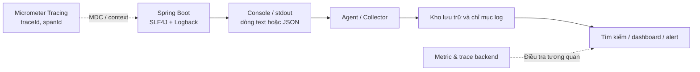

# Logging trong Spring Boot

Trong ba trụ cột observability (**logs, metrics, traces**), logging trả lời câu hỏi: **“Ứng dụng đã ghi nhận sự kiện gì, tại thời điểm nào và với ngữ cảnh nào?”** Khi một yêu cầu chậm, một giao dịch thất bại hoặc một lỗi chỉ xuất hiện trên production, log có thể giúp xác định diễn biến cụ thể. Tuy nhiên, log chỉ thực sự hữu ích khi sự kiện được chọn đúng, nội dung đủ ngữ cảnh, có thể tìm kiếm và liên kết được với metrics, distributed tracing.

Với module **SPRING_BOOT_OBSERVABILITY**, mục tiêu là thiết lập khả năng quan sát ứng dụng Spring Boot bằng Micrometer Observation, metrics, logs và distributed tracing; hiểu propagation ngữ cảnh, tag/cardinality, exporter, sampling và cách liên kết tín hiệu để điều tra lỗi, độ trễ, hành vi ứng dụng trong môi trường thực. Bài này tập trung vào **Logging** và cách đặt nó trong toàn bộ quy trình đó.

## Mục tiêu học tập

Sau bài học, bạn có thể:

- Phân biệt vai trò của log so với metric và trace; chọn mức log phù hợp với từng sự kiện.
- Viết log có cấu trúc, đủ ngữ cảnh nghiệp vụ nhưng tránh rò rỉ dữ liệu nhạy cảm.
- Cấu hình logging của Spring Boot và liên kết bản ghi log với `traceId`, `spanId` từ Micrometer Tracing.
- Giải thích các rủi ro về context propagation, cardinality, chi phí lưu trữ và mất log.
- Dùng log kết hợp metrics và tracing để điều tra một sự cố thực tế.

## 1. Logging cung cấp điều gì trong ba trụ cột?

**Log** là bản ghi rời rạc về một sự kiện: thông điệp, thời gian, mức độ nghiêm trọng và các trường ngữ cảnh. Log có thể chứa kết quả nghiệp vụ, mã lỗi, thời gian xử lý hay stack trace. Nó thường trả lời câu hỏi “đã xảy ra điều gì với yêu cầu hoặc đối tượng này?”.

| Tín hiệu | Câu hỏi chính | Ví dụ | Giới hạn cần nhớ |
| --- | --- | --- | --- |
| **Logs** | Chuyện gì đã xảy ra, với ngữ cảnh nào? | `order_submit_failed`, `orderId`, loại lỗi, `traceId` | Nhiều dữ liệu, khó dùng để tính tỷ lệ và phân vị trên toàn hệ thống |
| **Metrics** | Hệ thống đang hoạt động tốt đến mức nào? | Tỷ lệ HTTP 5xx, request/second, p95 latency | Dữ liệu đã tổng hợp, ít chi tiết cho từng yêu cầu |
| **Traces** | Một yêu cầu đã đi qua các bước, dịch vụ nào và chậm ở đâu? | Span HTTP → inventory → database | Traces có thể được sampling; một số yêu cầu sẽ không có trace được xuất |

Ba tín hiệu **bổ sung** nhau. Metrics phát hiện bất thường, traces khoanh vùng đường đi và thời gian, còn logs cung cấp dữ kiện chi tiết để giải thích sự cố. Không nên dùng log làm phương tiện duy nhất để đếm yêu cầu, tính p95 hoặc thay thế audit trail có yêu cầu pháp lý.

### Vòng đời của một bản ghi log



Trong container, cách phổ biến là ghi log ra **stdout/stderr**, để hạ tầng thu thập và chuyển tiếp. Ứng dụng không nên phụ thuộc vào một đường dẫn log cục bộ tồn tại vĩnh viễn trong container. Chuỗi thu thập phải có cơ chế xử lý tải, giới hạn lưu giữ, quyền truy cập và giám sát chính nó.

## 2. Một bản ghi log tốt cần những trường nào?

Log hữu ích phải giúp người điều tra dựng lại **sự kiện** mà không phải đoán nghĩa của một chuỗi tự do.

| Nhóm trường | Ví dụ | Tác dụng |
| --- | --- | --- |
| Thời điểm và mức độ | `timestamp`, `level=ERROR` | Xác định thứ tự và mức độ |
| Nguồn phát sinh | `service=order-service`, `environment=prod`, `logger` | Biết dịch vụ và thành phần nào ghi log |
| Sự kiện | `event=order_submit_failed` | Tìm kiếm ổn định theo loại sự kiện |
| Ngữ cảnh request | `traceId`, `spanId`, `requestId` (nếu có) | Liên kết sự kiện trong một yêu cầu |
| Ngữ cảnh nghiệp vụ có kiểm soát | `orderId`, `result`, `errorCode` | Trả lời yêu cầu/đối tượng nào bị ảnh hưởng |
| Chẩn đoán | `durationMs`, `error.type`, stack trace khi cần | Hiểu độ trễ và nguyên nhân |

Ví dụ *minh họa* về log JSON (tên trường thực tế phụ thuộc định dạng và pipeline):

```json
{
  "@timestamp": "2026-11-22T03:20:14.270Z",
  "level": "ERROR",
  "service": "order-service",
  "event": "order_submit_failed",
  "orderId": "ord-7842",
  "durationMs": 1265,
  "errorCode": "INVENTORY_TIMEOUT",
  "traceId": "4bf92f3577b34da6a3ce929d0e0e4736",
  "spanId": "00f067aa0ba902b7"
}
```

Các nguyên tắc khi đặt trường:

1. Dùng **tên sự kiện nhất quán** (`order_submit_started`, `order_submitted`, `order_submit_failed`); dễ lọc và so sánh hơn nhiều kiểu thông báo tự do.
2. Phân biệt **loại lỗi ổn định** (`INVENTORY_TIMEOUT`) với nội dung exception thay đổi theo lần chạy.
3. Ghi mã định danh nghiệp vụ **chỉ khi phù hợp quyền riêng tư**; ưu tiên ID nội bộ thay cho email, số điện thoại hoặc thông tin định danh trực tiếp.
4. Giữ kiểu dữ liệu nhất quán, ví dụ `durationMs` luôn là số và cùng đơn vị mili giây; thời gian dùng múi giờ rõ ràng, thường là UTC.
5. Mỗi sự kiện phải có giá trị điều tra. Log toàn bộ request/response body mặc định vừa tốn chi phí vừa có thể lộ dữ liệu.

**Structured logging** là cách biểu diễn trường dữ liệu ở dạng máy đọc được (thường là JSON). Việc đặt nhiều cặp `key=value` vào chuỗi thông điệp chỉ là bước chuyển tiếp: pipeline có thể phải parse lại văn bản, dễ vỡ khi định dạng thay đổi. Nếu cần truy vấn theo trường riêng, chọn encoder hoặc cấu hình JSON có khả năng đưa field nghiệp vụ vào JSON một cách có kiểm soát.

## 3. Chọn log level và vị trí ghi log

| Level | Dùng cho | Tránh |
| --- | --- | --- |
| `TRACE` | Diễn biến rất chi tiết khi điều tra tạm thời | Bật lâu trên production, đặc biệt vòng lặp nóng |
| `DEBUG` | Nhánh xử lý và trạng thái kỹ thuật cần khi gỡ lỗi | Ghi mọi biến, token hoặc payload |
| `INFO` | Sự kiện nghiệp vụ và trạng thái vận hành quan trọng | Ghi mỗi bước nhỏ của luồng bình thường |
| `WARN` | Có bất thường nhưng hệ thống đã xử lý hoặc có phương án phục hồi | Coi mọi dữ liệu đầu vào không hợp lệ là sự cố hệ thống |
| `ERROR` | Thao tác thất bại và cần được nhận biết/điều tra | Log cùng một exception ở mọi tầng rồi ném tiếp |

Ví dụ luồng đặt hàng: `INFO` cho kết quả đặt hàng thành công, `WARN` khi retry vì phía inventory tạm thời chậm, `ERROR` khi thao tác cuối cùng thất bại. Với request trả 4xx do người dùng nhập sai, mức `INFO` hoặc `WARN` có thể hợp lý hơn `ERROR`; điều này tùy chính sách vận hành.

Nên log tại **ranh giới có ý nghĩa**: nhận kết quả từ đối tác ngoài, hoàn tất thao tác nghiệp vụ, quyết định retry hoặc xác nhận lỗi cuối cùng. Nếu cùng một lỗi được đẩy từ repository lên service rồi controller, chọn nơi có đủ ngữ cảnh để ghi stack trace một lần; các tầng khác có thể thêm ngữ cảnh bằng exception hoặc span.

### Viết log bằng SLF4J

Spring Boot thường dùng API **SLF4J** với triển khai mặc định **Logback** (khi dùng starter thông dụng). Ví dụ dưới đây minh họa một service có dependency `InventoryClient` do ứng dụng cung cấp:

```java
import java.util.concurrent.TimeUnit;
import org.slf4j.Logger;
import org.slf4j.LoggerFactory;
import org.springframework.stereotype.Service;

@Service
public class OrderService {
    private static final Logger log = LoggerFactory.getLogger(OrderService.class);

    private final InventoryClient inventoryClient;

    public OrderService(InventoryClient inventoryClient) {
        this.inventoryClient = inventoryClient;
    }

    public void submit(String orderId, int itemCount) {
        long startedAt = System.nanoTime();
        try {
            inventoryClient.reserve(orderId, itemCount);
            long durationMs = TimeUnit.NANOSECONDS.toMillis(
                System.nanoTime() - startedAt
            );
            log.info(
                "event=order_submitted orderId={} itemCount={} durationMs={}",
                orderId, itemCount, durationMs
            );
        } catch (RuntimeException ex) {
            long durationMs = TimeUnit.NANOSECONDS.toMillis(
                System.nanoTime() - startedAt
            );
            log.error(
                "event=order_submit_failed orderId={} durationMs={}",
                orderId, durationMs, ex
            );
            throw ex;
        }
    }
}

interface InventoryClient {
    void reserve(String orderId, int itemCount);
}
```

Ở đây `{ }` là placeholder của SLF4J: tham số chỉ được format khi mức log được bật. Cách này phù hợp hơn phép nối chuỗi như `"order=" + orderId`, đặc biệt với log ở mức DEBUG. Việc tính toán tốn kém trước khi gọi logger vẫn phải được cân nhắc hoặc bảo vệ bằng `log.isDebugEnabled()`. Cú pháp truyền `ex` ở vị trí cuối cho phép logger ghi exception và stack trace; không cần chỉ lấy `ex.getMessage()`.

Ví dụ coi `orderId` là định danh nội bộ được phép ghi; trong hệ thống thật cần đánh giá chính sách bảo vệ dữ liệu trước khi log. `durationMs` hữu ích cho điều tra một yêu cầu, nhưng thống kê latency toàn hệ thống vẫn nên dựa vào **Micrometer Timer/metrics**, thay vì tính từ các dòng log vốn có thể bị mất hoặc lấy mẫu.

## 4. Cấu hình logging trong Spring Boot

### Log level theo package

Trong `application.yml`:

```yaml
spring:
  application:
    name: order-service

logging:
  level:
    root: INFO
    com.example.orders: INFO
```

Khi cần điều tra, có thể bật `DEBUG` tạm thời cho package hẹp, ví dụ `com.example.orders.inventory`, thay vì cho toàn ứng dụng. Không để chế độ chi tiết trong thời gian dài nếu lượng log tăng đột biến. Các mức log và cấu hình cụ thể có thể thay đổi theo profile/môi trường.

### JSON logging

**Spring Boot 3.4 trở lên** hỗ trợ structured logging tích hợp. Ví dụ xuất JSON tương thích định dạng Logstash ra console:

```yaml
logging:
  structured:
    format:
      console: logstash
```

Ngoài Logstash còn có các lựa chọn định dạng khác tùy phiên bản Spring Boot. Với bản **trước 3.4**, cần tự cấu hình encoder/appender JSON phù hợp (thường qua `logback-spring.xml` và thư viện encoder). Khi thay đổi định dạng, hãy xác minh trường `traceId`, `spanId` và trường nghiệp vụ xuất hiện đúng như hệ thống truy vấn mong đợi. **Cấu hình JSON logging không tự động gửi log đến OpenTelemetry Collector**: nếu chỉ xuất ra console, một agent hoặc collector phải đọc stdout và gửi đến backend.

### Đường đi của bản ghi log

Trong môi trường thực, thường có hai luồng độc lập:

- **Logs:** Spring Boot → stdout JSON → agent/collector → log backend (ví dụ Loki, Elasticsearch, hệ thống SIEM).
- **Traces:** Micrometer Tracing → exporter → tracing collector/backend (ví dụ Jaeger, Tempo hoặc nền tảng APM).

Metrics lại đi qua hệ thống scrape/export riêng, chẳng hạn Actuator/Micrometer và Prometheus. Có chung `traceId` giúp truy vấn tương quan nhưng không có nghĩa mọi tín hiệu được gửi qua cùng endpoint hay tự động liên kết trong giao diện.

## 5. Liên kết logs với distributed tracing

Hai trường quan trọng:

- **`traceId`:** ID của toàn bộ hành trình một request qua nhiều service.
- **`spanId`:** ID của một công việc cụ thể trong hành trình đó, chẳng hạn một HTTP server span hay lời gọi database.

Khi dùng **Micrometer Tracing** với Spring Boot 3.x, trace/span context của các đoạn xử lý được instrument có thể được đặt vào **MDC** (*Mapped Diagnostic Context*), để định dạng log đưa `traceId` và `spanId` vào bản ghi. Những dependency điển hình trong dự án dùng Gradle Kotlin DSL:

```kotlin
dependencies {
    implementation("org.springframework.boot:spring-boot-starter-actuator")
    implementation("io.micrometer:micrometer-tracing-bridge-otel")
    runtimeOnly("io.opentelemetry:opentelemetry-exporter-otlp")
}
```

Các phiên bản dependency cần được quản lý tương thích với Spring Boot BOM đang sử dụng. Để xuất traces qua OTLP HTTP, có thể cấu hình ví dụ:

```yaml
management:
  tracing:
    sampling:
      probability: 0.1
  otlp:
    tracing:
      endpoint: http://localhost:4318/v1/traces
```

Đây là ví dụ cấu hình cho stack Spring Boot 3.x và endpoint Collector có thật tại địa chỉ đó; phải điều chỉnh theo môi trường triển khai. `sampling.probability: 0.1` tương ứng mục tiêu lấy mẫu khoảng **10%** traces theo cơ chế sampling đã cấu hình, không phải “chỉ ghi 10% log”. Trace có thể không được lưu/xuất khi không được chọn, vì vậy tra `traceId` từ log có thể không tìm thấy dữ liệu trace tương ứng ở backend.

Nếu ứng dụng đã cấu hình tracing và logging pattern tương thích, log console của Spring Boot có thể tự thể hiện trace/span correlation. Khi tự thay `logging.pattern.console` hoặc dùng JSON encoder khác, phải đưa các MDC key cần thiết vào output; nếu bỏ sót, log sẽ mất khả năng liên kết dù tracing vẫn hoạt động.

### Propagation qua nhiều service và luồng bất đồng bộ

Giả sử `order-service` gọi `inventory-service` qua HTTP. Header chuẩn **W3C Trace Context** (ví dụ `traceparent`) truyền context qua ranh giới network khi client/server được instrument tương thích. Khi đó cả hai service có thể ghi cùng `traceId` nhưng `spanId` khác nhau. Chỉ tự đặt `requestId` trong từng service sẽ không tạo ra trace phân tán.

MDC thường dựa trên **ThreadLocal**. Nếu tự tạo thread, dùng executor tùy biến hoặc chạy callback bất đồng bộ, ngữ cảnh có thể không tự chuyển sang nơi thực thi mới. Với Spring MVC, WebFlux/Reactor, `@Async` hoặc message consumer, cần kiểm tra instrumentation và cấu hình **Micrometer Context Propagation** phù hợp. Không giả định trace context luôn đi theo mọi luồng.

Nếu muốn bổ sung một MDC field cho đoạn xử lý đồng bộ, giới hạn thời gian sống bằng scope:

```java
import org.slf4j.MDC;

try (MDC.MDCCloseable ignored =
         MDC.putCloseable("operation", "order-submit")) {
    log.info("event=order_validation_completed");
}
// 'operation' được gỡ khỏi MDC sau khi thoát scope.
```

Không tự tạo hoặc ghi đè `traceId`, `spanId` bằng chuỗi ngẫu nhiên trong MDC khi đang dùng tracing thực. Nếu không gỡ MDC sau request, thread được tái sử dụng có thể mang ngữ cảnh cũ sang request khác, gây nhầm lẫn và lộ dữ liệu.

## 6. Cardinality, sampling và chi phí log

**Cardinality** là số lượng giá trị phân biệt của một trường. Nó ảnh hưởng khác nhau theo nơi dữ liệu được sử dụng:

- Trong **metrics**, `orderId` hoặc `userId` làm label thường tạo cardinality rất cao, dẫn tới nhiều time series và tốn tài nguyên. Dùng các nhãn hữu hạn như `http.method`, `http.status_code`, `region` (sau khi chuẩn hóa).
- Trong **logs**, `orderId` hoặc `traceId` có thể là khóa tìm kiếm hữu ích nếu được phép sử dụng. Tuy vậy, tạo index cho mọi trường cardinality cao vẫn tốn dung lượng và ảnh hưởng tốc độ truy vấn. Đối với Loki, chẳng hạn, không nên biến mỗi `traceId` thành **stream label**.
- Trong **traces**, thuộc tính chi tiết giúp khoanh vùng sự cố nhưng số span và lượng dữ liệu xuất cần cân đối bằng chính sách sampling.

Các kỹ thuật giảm chi phí vận hành log: chọn sự kiện có giá trị; tránh log lặp; giảm DEBUG/TRACE; giới hạn độ dài thông điệp và stack trace theo chính sách; cấu hình retention theo môi trường; phân cấp dữ liệu cần truy vấn nhanh và dữ liệu lưu trữ dài hạn. Log sampling (nếu áp dụng) là chính sách riêng so với tracing sampling; cần bảo toàn sự kiện lỗi trọng yếu và dữ liệu audit theo yêu cầu.

Một hệ thống production cần nhận biết khả năng **mất log**: ứng dụng có thể crash trước khi flush, appender bất đồng bộ đầy hàng đợi, collector bị quá tải hoặc backend gián đoạn. Vì thế không dùng log thông thường làm nguồn sự thật duy nhất cho nghiệp vụ, thanh toán hay kiểm toán.

## 7. Bảo mật và tính tin cậy của log

Log thường được sao chép ra hệ thống tập trung, nhiều người có thể truy cập hơn cơ sở dữ liệu ứng dụng. Cần:

1. **Không ghi bí mật:** mật khẩu, API key, bearer token, cookie phiên, Authorization header, số thẻ hoặc toàn bộ request body chứa dữ liệu nhạy cảm.
2. **Giảm thiểu dữ liệu cá nhân:** chỉ ghi các trường thật sự cần điều tra; che/mã hóa hoặc dùng ID thay thế theo chính sách.
3. **Giữ tính toàn vẹn ngữ nghĩa:** chuẩn hóa trường input có thể chứa ký tự xuống dòng để tránh log injection; JSON encoder giúp escape ký tự nhưng không thay cho phân quyền và kiểm soát đầu vào.
4. **Phân quyền và retention:** hạn chế người đọc, có audit cho truy cập hệ thống log, quy định thời gian xóa phù hợp.
5. **Kiểm tra thời gian:** đồng bộ đồng hồ giữa các node, ghi timestamp rõ timezone; quan sát chênh lệch giữa thời điểm sự kiện và thời điểm collector nhận.

Exception message của thư viện thứ ba cũng có thể mang query string, định danh hoặc giá trị nhạy cảm. Trước khi log đầy đủ exception hoặc payload, phải xét nguồn dữ liệu và chính sách masking.

## 8. Điều tra một lỗi production bằng ba tín hiệu

**Tình huống:** khách hàng thấy thao tác đặt hàng thất bại từng đợt. `order-service` gọi `inventory-service`, có những yêu cầu mất hơn 2 giây và trả HTTP 5xx.

**Bước 1 — Nhận diện triệu chứng bằng metrics.** Quan sát tỷ lệ 5xx và p95/p99 latency theo service, route, khoảng thời gian. Nếu p95 tăng đồng thời với 5xx, thu hẹp cửa sổ sự cố. Không đưa `orderId` vào metric label để truy tìm giao dịch.

**Bước 2 — Tìm sự kiện cụ thể trong logs.** Lọc `service=order-service`, khoảng thời gian và `event=order_submit_failed`; đọc `errorCode`, `durationMs`, ID nghiệp vụ cho phép và `traceId`. Sau đó lọc log `inventory-service` cùng `traceId` để tìm timeout, retry hoặc lỗi dữ liệu. Tên field trong câu truy vấn cụ thể phụ thuộc log backend và cách ingest.

**Bước 3 — Mở trace tương ứng (nếu được lấy mẫu).** Xem đường đi HTTP → order-service → inventory-service → database, so sánh thời lượng từng span và kiểm tra span báo lỗi. Trace có thể chỉ ra thời gian chủ yếu nằm ở cuộc gọi inventory, nhưng log còn cần thiết để biết chi tiết `INVENTORY_TIMEOUT` hoặc nhánh xử lý retry.

**Bước 4 — Đối chiếu và kết luận.** Nếu logs báo timeout inventory, trace cho thấy span inventory kéo dài và metrics của inventory cũng tăng latency, giả thuyết nghẽn ở inventory mạnh hơn. Tiếp tục kiểm tra số kết nối DB, pool chờ, retry và thay đổi deployment trước khi kết luận nguyên nhân gốc.

**Bước 5 — Hành động và xác minh.** Khắc phục vấn đề đã được xác định, theo dõi 5xx/latency hồi phục, kiểm tra số log lỗi giảm. Bổ sung metric, span hoặc event log còn thiếu để lần sau khoanh vùng nhanh hơn.

Một chuỗi log theo trace có thể hình dung như sau:

```text
12:00:01.001 order-service     INFO  traceId=abc event=order_submit_started orderId=ord-7842
12:00:02.242 inventory-service WARN  traceId=abc event=inventory_call_timeout attempt=1
12:00:02.266 order-service     ERROR traceId=abc event=order_submit_failed errorCode=INVENTORY_TIMEOUT
```

Các dòng trên chỉ minh họa; `abc` được rút gọn cho dễ đọc. Trong thực tế trace ID theo W3C thường là 32 ký tự hex. Quan sát một log `ERROR` chưa đủ để khẳng định lỗi tại service ghi log; cần kiểm tra cả đường đi và các dịch vụ phụ thuộc.

## 9. Các lỗi thiết kế thường gặp và cách sửa

| Vấn đề | Hậu quả | Cách xử lý |
| --- | --- | --- |
| Chỉ log `"Something went wrong"` | Không có ngữ cảnh điều tra | Ghi `event`, loại lỗi, thông tin liên quan được phép và exception |
| Chỉ xuất text tự do, mỗi nơi một định dạng | Khó tìm kiếm hoặc phân tích | Chuẩn hóa schema, dùng JSON logging/pipeline |
| Ghi một exception ở mọi layer | Nhiễu, đếm lỗi bị phóng đại | Chọn ranh giới ghi lỗi cuối cùng, giữ stack trace cần thiết |
| Mất `traceId` sau `@Async` hoặc executor | Khó nối log giữa các bước | Bổ sung context propagation, xác minh bằng yêu cầu xuyên luồng |
| Gắn `traceId`, `orderId` làm metric label | Cardinality bùng nổ | Chỉ dùng nhãn metrics có tập giá trị hữu hạn |
| Bật DEBUG/TRACE toàn bộ production | Tăng chi phí và rủi ro lộ dữ liệu | Bật có thời hạn, theo package cụ thể |
| Log secret hoặc toàn bộ payload | Rò rỉ dữ liệu | Redaction, kiểm soát schema và quyền truy cập |
| Giả định luôn có trace cho mọi log | Mất dấu khi sampling | Tìm log độc lập, kiểm tra cấu hình tracing/exporter |

## 10. Checklist thực hành

Trên một Spring Boot service có endpoint gọi service khác, hãy thực hành theo thứ tự:

1. Thiết lập log level hợp lý và in một sự kiện `INFO` thành công, một sự kiện `WARN` được phục hồi, một sự kiện `ERROR` thất bại. Quan sát cách truyền exception để giữ stack trace.
2. Bật JSON logging nếu phiên bản hỗ trợ, hoặc cấu hình JSON encoder, rồi xác minh các trường thời gian, severity, service, event và ngữ cảnh.
3. Bật Micrometer Tracing và thiết lập một tracing exporter phù hợp. Gửi request qua hai service được instrument; so sánh `traceId` giữa logs và `spanId` ở từng bước.
4. Thử qua executor/async; nếu trace context mất, cấu hình propagation cho đúng mô hình thực thi và kiểm tra lại.
5. Tạo một lỗi có kiểm soát, dùng metrics xác định thời điểm, logs tìm sự kiện, traces tìm bước chậm (nếu trace được lưu).
6. Kiểm tra log không chứa token/PII, `orderId` không xuất hiện thành metric label, và pipeline có retention/phân quyền phù hợp.

**Tự kiểm tra:** Nếu một request có log `ERROR` với `traceId` nhưng backend tracing không tìm thấy trace, hãy nêu ít nhất ba khả năng: trace bị sampling bỏ qua, exporter/collector gặp sự cố, hoặc context/ID không được truyền nhất quán. Tiếp theo, xác định thông tin nào trong log và metrics vẫn đủ để điều tra khi không có trace.

## Ghi nhớ

Logging là **bằng chứng sự kiện** của một hệ thống có thể quan sát được. Trong Spring Boot, hãy thiết kế sự kiện log có cấu trúc, dùng đúng level, thêm ngữ cảnh nghiệp vụ phù hợp và liên kết với Micrometer Tracing qua `traceId`/`spanId`. Khi vận hành thực, cần xem cả context propagation, cardinality, sampling, quyền riêng tư, chi phí và độ tin cậy của pipeline. Logs cho chi tiết; metrics cho xu hướng; traces cho đường đi — kết hợp cả ba mới tạo được bức tranh đủ tốt để điều tra sự cố.
