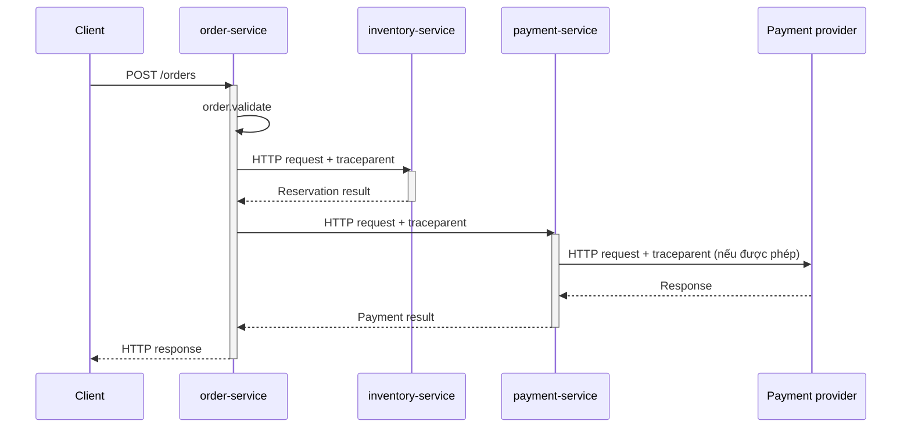
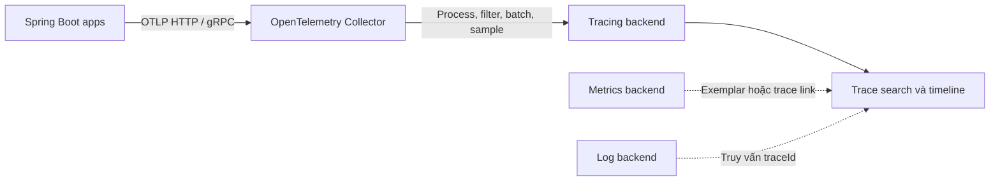

# Traces trong Spring Boot Observability

Trong ba trụ cột của observability (**metrics, logs, traces**), **trace** giúp trả lời câu hỏi: *Một yêu cầu đã đi qua những thành phần nào, mỗi bước mất bao lâu và lỗi phát sinh ở đâu?* Đây là góc nhìn đặc biệt quan trọng khi ứng dụng Spring Boot gọi nhiều dịch vụ, cơ sở dữ liệu hoặc hệ thống nhắn tin. Metrics cho thấy xu hướng và mức độ ảnh hưởng; logs ghi lại sự kiện; traces nối các thao tác thành hành trình của một yêu cầu cụ thể.

Bài này tập trung vào **distributed tracing** trong Spring Boot với **Micrometer Observation**, Micrometer Tracing và hệ sinh thái OpenTelemetry. Người học sẽ biết cách đọc trace, duy trì ngữ cảnh khi gọi xuyên dịch vụ, tạo span ở những bước nghiệp vụ cần thiết, xuất dữ liệu tới tracing backend và kết hợp các tín hiệu để điều tra sự cố trên môi trường thực.

## 1. Trace là gì?

Giả sử người dùng đặt hàng trên một hệ thống có ba dịch vụ:

1. `order-service` tiếp nhận `POST /orders` và kiểm tra đơn hàng.
2. `inventory-service` xác nhận còn hàng.
3. `payment-service` xử lý thanh toán và gọi một cổng thanh toán bên ngoài.

Khi API trả về chậm, một dòng log ở `order-service` chỉ cho biết tổng thời gian; nó không giải thích liệu hệ thống đang đợi truy vấn dữ liệu, kiểm tra tồn kho hay kết nối tới cổng thanh toán. Một **distributed trace** liên kết các thao tác này thành một luồng có thứ tự thời gian.

| Khái niệm | Ý nghĩa | Ví dụ |
| --- | --- | --- |
| **Trace** | Tập hợp các span có quan hệ nhân quả hoặc liên quan tới cùng một hành trình xử lý | Toàn bộ quá trình xử lý một yêu cầu đặt hàng |
| **Trace ID** | Mã định danh chung giúp truy xuất các span thuộc cùng trace | Một chuỗi hex 32 ký tự theo định dạng W3C |
| **Span** | Một đơn vị công việc có thời điểm bắt đầu, kết thúc, tên và metadata | `HTTP POST /orders`, `payment.authorize` |
| **Span ID** | Mã định danh riêng của một span | Một chuỗi hex 16 ký tự theo định dạng W3C |
| **Parent span** | Span cha biểu thị công việc đang bao chứa hoặc sinh ra span con | Span HTTP server của `order-service` |
| **Attributes/tags** | Thuộc tính phục vụ lọc, nhóm và hiểu ngữ cảnh span | `http.request.method=POST`, `service.name=order-service` |
| **Event** | Sự kiện tại một thời điểm bên trong span | Ghi nhận một lần retry hoặc một ngoại lệ |
| **Span status** | Kết quả thực thi ở mức tracing, có thể thể hiện lỗi | `ERROR` khi instrumentation ghi nhận lỗi |
| **Span link** | Liên kết tới một span context khác khi quan hệ cha–con không phù hợp | Consumer nhận batch gồm thông điệp từ nhiều trace |

Một trace thường có nhiều span lồng nhau. Các span trong những dịch vụ khác nhau có **cùng Trace ID**, nhưng **Span ID khác nhau**. Dữ liệu chỉ có ích khi các thành phần thống nhất quy tắc truyền ngữ cảnh và đồng hồ hệ thống đủ chính xác để đối chiếu thời gian.

### Trục thời gian của một yêu cầu

Ví dụ minh họa một yêu cầu kéo dài khoảng 870 ms:

```text
Trace: checkout request                                     0 ms -> 870 ms
order-service  POST /orders                  [==================================]
  order.validate                            [==]                              10–55
  inventory HTTP client                       [====]                           60–160
    inventory-service GET /reserve              [===]                          70–150
  payment HTTP client                                      [================]   190–840
    payment-service POST /authorize                         [===============]    200–825
      provider HTTP client                                      [===========]    260–790
```

*Các mốc thời gian chỉ để minh họa, không phải kết quả benchmark.* Có thể thấy nhánh `payment-service` chiếm phần lớn thời gian. Tuy nhiên, **không cộng thời lượng tất cả span** để suy ra thời gian tổng: các span cha bao chứa span con, nhiều nhánh có thể chạy song song. Hãy nhìn vị trí trên timeline, thời lượng *exclusive* nếu backend hỗ trợ và các khoảng chờ giữa các thao tác.

## 2. Trace chạy xuyên các dịch vụ như thế nào?

Khi `order-service` gọi `payment-service`, hai tiến trình không dùng chung biến trong bộ nhớ. Chúng cần gửi **trace context** theo giao thức giữa dịch vụ.



Với **W3C Trace Context**, một header điển hình là:

```http
traceparent: 00-4bf92f3577b34da6a3ce929d0e0e4736-00f067aa0ba902b7-01
```

Các phần lần lượt là phiên bản, Trace ID 128 bit, parent Span ID 64 bit và trace flags. Trong ví dụ, bit sampling ở cuối được bật (`01`). Khi một client span gửi yêu cầu, dịch vụ đích trích xuất context để tạo server span mới cùng Trace ID, liên kết với span gọi nó. **Không sao chép Span ID** sang span mới.

Ngoài `traceparent` còn có:

- `tracestate`: metadata phục vụ các hệ thống tracing tương thích W3C.
- `baggage`: các cặp key/value có thể truyền qua ranh giới tiến trình, độc lập với span attributes. Baggage làm tăng dữ liệu trên đường truyền và có thể đi tới dịch vụ ngoài; chỉ dùng khi thật cần và tuyệt đối không đưa bí mật, token hoặc dữ liệu cá nhân vào đó.
- Các định dạng khác như B3: gặp trong hệ thống cũ. Những dịch vụ giao tiếp phải cấu hình định dạng propagation tương thích; không nên mặc nhiên cho rằng mọi ứng dụng đều đọc được cùng một loại header.

**Propagation** giữ mối liên kết giữa các span, còn **export** là việc gửi dữ liệu span đã thu thập tới nơi lưu trữ. Một hệ thống có thể truyền Trace ID đúng nhưng không thấy trace trên giao diện do sampling, cấu hình exporter, mạng hoặc backend.

## 3. Traces trong hệ sinh thái Spring Boot

Các thành phần thường phối hợp như sau:

```text
HTTP / message / job
       |
Spring Boot instrumentation và Micrometer Observation
       |
Micrometer Tracing (bridge tới OpenTelemetry hoặc Brave)
       |
Trace context + spans
       |
Exporter (ví dụ OTLP)
       |
OpenTelemetry Collector (tùy kiến trúc)
       |
Tracing backend (Tempo, Jaeger hoặc dịch vụ tương đương)
```

**Micrometer Observation** là API dùng để mô tả một hoạt động: tên, context, tags, thời gian và lỗi. Một Observation có thể được xử lý bởi nhiều handler, chẳng hạn handler tạo metrics và handler tạo tracing span. **Micrometer Tracing** cung cấp API tracing thống nhất và bridge tới hệ sinh thái tracing như OpenTelemetry. **OpenTelemetry** định nghĩa các chuẩn/API/SDK và định dạng xuất dữ liệu phổ biến. Tracing backend lưu và hiển thị các trace để người vận hành tra cứu.

Sự phân biệt này giúp thiết kế instrumentation hiệu quả: ghi nhận một thao tác nghiệp vụ bằng Observation có thể phục vụ cả latency metric và span, với điều kiện ứng dụng đã lắp đặt các handler thích hợp. Không phải mọi log statement hay mọi method tự động tạo span.

### 3.1. Cấu hình minh họa với Spring Boot 3.x

Ví dụ Maven cho ứng dụng Spring Boot 3.x dùng Micrometer Tracing và OpenTelemetry. Giả sử ứng dụng đã có web starter tương ứng; các phiên bản dependency do Spring Boot BOM quản lý:

```xml
<dependencies>
    <dependency>
        <groupId>org.springframework.boot</groupId>
        <artifactId>spring-boot-starter-actuator</artifactId>
    </dependency>
    <dependency>
        <groupId>io.micrometer</groupId>
        <artifactId>micrometer-tracing-bridge-otel</artifactId>
    </dependency>
    <dependency>
        <groupId>io.opentelemetry</groupId>
        <artifactId>opentelemetry-exporter-otlp</artifactId>
    </dependency>
</dependencies>
```

Cấu hình `application.yml` minh họa:

```yaml
spring:
  application:
    name: order-service

management:
  tracing:
    sampling:
      probability: 1.0       # Chỉ dùng khi kiểm thử cục bộ
  otlp:
    tracing:
      endpoint: http://localhost:4318/v1/traces
```

Ở ví dụ này, `localhost:4318` là nơi **OTLP/HTTP receiver** đang lắng nghe, có thể là OpenTelemetry Collector hoặc backend nhận OTLP. Đây là địa chỉ minh họa: nếu ứng dụng chạy trong container thì `localhost` chỉ chính container đó, thường phải đổi thành hostname/DNS của Collector. Cổng `4318` thường dùng cho OTLP/HTTP, trong khi `4317` thường dùng cho OTLP/gRPC; không trộn cổng và giao thức. Collector cần cấu hình receiver, processor, exporter và pipeline traces phù hợp.

Cấu hình và artifact có thể thay đổi theo phiên bản Spring Boot và stack tracing. Khi triển khai trên Spring Boot khác dòng 3.x, hãy đối chiếu tên starter, property và dependency với tài liệu của phiên bản đang dùng. Không chèn phiên bản OpenTelemetry hoặc Micrometer tùy ý nếu đã có dependency management từ Spring Boot.

Khi chạy ứng dụng, Spring Boot có thể tự tạo observations/spans cho HTTP server và cho các HTTP client được framework quản lý. Tập instrumentation thực tế phụ thuộc vào stack (Servlet hay WebFlux), thư viện được sử dụng và cấu hình hiện hành; cần kiểm tra trên tracing backend thay vì giả định mọi lời gọi đều đã được theo dõi.

### 3.2. Giữ propagation khi gọi HTTP client

Với Spring Boot 3.2+ sử dụng `RestClient`, nên lấy `RestClient.Builder` do Spring quản lý:

```java
import org.springframework.context.annotation.Bean;
import org.springframework.context.annotation.Configuration;
import org.springframework.web.client.RestClient;

@Configuration
class ClientConfiguration {
    @Bean
    RestClient paymentRestClient(RestClient.Builder builder) {
        return builder
                .baseUrl("http://payment-service")
                .build();
    }
}
```

Builder đã được Spring Boot cấu hình là điểm tích hợp instrumentation. Nếu tự tạo client ngoài Spring, sử dụng transport riêng hoặc ghi đè cấu hình observability, header context có thể không được chèn. Tư duy tương tự áp dụng với `WebClient.Builder`, `RestTemplateBuilder` hoặc các client messaging đã được instrumented. Nên kiểm tra trace thực tế sau mỗi thay đổi thư viện HTTP/messaging.

**Đối với kết nối bên ngoài phạm vi tin cậy**, cân nhắc chính sách forwarding header: Trace ID/baggage không phải thông tin xác thực; không cho phép bên nhận quyết định quyền truy cập chỉ dựa trên tracing context.

## 4. Tạo span cho bước nghiệp vụ quan trọng

Nếu chỉ quan sát HTTP span, nhà phát triển có thể thấy `POST /orders` mất 900 ms nhưng không phân biệt thời gian kiểm tra quy tắc giảm giá và gọi phụ thuộc. Hãy thêm span cho thao tác đủ quan trọng để ảnh hưởng tới chẩn đoán; tránh tạo span cho từng dòng code hoặc hàm rất nhỏ.

Một ví dụ tạo observation ở tầng service:

```java
import io.micrometer.observation.Observation;
import io.micrometer.observation.ObservationRegistry;
import org.springframework.stereotype.Service;

@Service
public class PricingService {
    private final ObservationRegistry observationRegistry;

    public PricingService(ObservationRegistry observationRegistry) {
        this.observationRegistry = observationRegistry;
    }

    public long calculateTotal(long subtotalCents, String tier) {
        String tierGroup = "premium".equals(tier) ? "premium" : "standard";

        return Observation.createNotStarted(
                    "order.price.calculate", observationRegistry)
                .lowCardinalityKeyValue("tier", tierGroup)
                .observe(() -> subtotalCents + 250L);
    }
}
```

Khi Observation đi qua tracing handler, thao tác này có thể tạo span con của span hiện hành; metric handler phù hợp cũng có thể ghi nhận thời lượng. Mã sử dụng tên operation ổn định `order.price.calculate` và giá trị `tier` thuộc tập nhỏ. Không dùng `order-123456` làm tên span hay biến mã giao dịch thành low-cardinality tag.

Với thao tác phức tạp cần khai báo vòng đời, có thể tạo Observation rồi gọi `start()`, `openScope()`, `error(exception)` và `stop()` trong cấu trúc `try/catch/finally`. Phải đóng scope và dừng observation kể cả khi xảy ra lỗi; nếu không, thời lượng và current context có thể sai.

**Khi nào cần span riêng?** Chọn thao tác có ý nghĩa nghiệp vụ, có khả năng chậm/lỗi, có ranh giới rõ ràng: `order.validate`, `inventory.reserve`, `payment.authorize`. Với phép tính rất nhỏ, nhiều span có thể tạo overhead lớn hơn giá trị chẩn đoán.

### Span attributes và cardinality

**Cardinality** là số lượng giá trị phân biệt của một thuộc tính. Đây là vấn đề cực kỳ nhạy cảm với metrics (mỗi tập nhãn có thể tạo time series riêng) và cũng ảnh hưởng đến dung lượng/lọc dữ liệu tracing.

| Loại dữ liệu | Cách dùng phù hợp | Nên tránh |
| --- | --- | --- |
| Low-cardinality tag | `outcome=success/failure`, `payment.method=card/wallet` | `userId`, `orderId`, raw URL chứa ID |
| High-cardinality trace attribute | Mã tương quan kỹ thuật không nhạy cảm, chỉ khi thật cần truy vấn trace | Mật khẩu, email, token, dữ liệu thanh toán, payload thô |
| Span name | `HTTP POST /orders/{id}` hoặc `payment.authorize` | Tên gắn mã giao dịch hoặc URL động cho mỗi request |
| Event | `retry_scheduled` kèm số lần retry ở phạm vi phù hợp | Một event cho mỗi iteration hoặc dump toàn bộ exception object |

Trong Micrometer Observation, `lowCardinalityKeyValue(...)` có thể được dùng bởi cả metrics và tracing; `highCardinalityKeyValue(...)` dành cho tracing và không nên trở thành metric tag. **High cardinality không có nghĩa là có thể ghi dữ liệu nhạy cảm**. Với attribute và baggage, hãy áp dụng chính sách bảo mật, giới hạn độ dài và retention của tổ chức; không ghi raw request/response body hoặc header Authorization.

Tên HTTP metric/trace nên sử dụng *route template* (ví dụ `/orders/{id}`) nếu instrumentation hỗ trợ. Các tên attribute cụ thể theo OpenTelemetry semantic conventions có thể thay đổi giữa các phiên bản thư viện, vì vậy hãy kiểm tra tên thực tế trước khi viết dashboard hoặc truy vấn.

## 5. Bảo toàn trace context qua luồng bất đồng bộ

Một trace có thể bị đứt khi công việc chuyển qua thread pool, Reactor, scheduler, message broker hoặc batch consumer.

- **HTTP đồng bộ:** thư viện client có instrumentation thường chèn `traceparent` và tái sử dụng context hiện hành.
- **`@Async`/thread pool:** ngữ cảnh lưu theo thread có thể biến mất khi công việc chạy trên thread khác. Spring Framework 6.1+ có `ContextPropagatingTaskDecorator` để sao chép context Micrometer thích hợp sang task.
- **WebFlux/Reactor:** context luân chuyển qua Reactor Context; không thể dựa vào ThreadLocal/MDC thuần khi pipeline đổi thread. Dùng cơ chế context propagation mà phiên bản Spring/Reactor hỗ trợ.
- **Kafka/RabbitMQ:** cần instrumentation của producer và consumer, cơ chế trích xuất/chèn headers tương thích. Với batch, fan-out hoặc workflow dài, span links đôi khi phản ánh quan hệ tốt hơn một parent span duy nhất.
- **Scheduled/background job:** công việc không xuất phát từ request thường tạo root trace mới; không mặc định liên kết với trace HTTP đã kết thúc.

Ví dụ cấu hình executor riêng cho `@Async` với Spring Framework 6.1+:

```java
import org.springframework.context.annotation.Bean;
import org.springframework.context.annotation.Configuration;
import org.springframework.core.task.support.ContextPropagatingTaskDecorator;
import org.springframework.scheduling.concurrent.ThreadPoolTaskExecutor;

@Configuration
class AsyncConfiguration {
    @Bean("observedExecutor")
    ThreadPoolTaskExecutor observedExecutor() {
        ThreadPoolTaskExecutor executor = new ThreadPoolTaskExecutor();
        executor.setCorePoolSize(4);
        executor.setMaxPoolSize(8);
        executor.setTaskDecorator(new ContextPropagatingTaskDecorator());
        return executor;
    }
}
```

Sau khi bật `@EnableAsync` ở cấu hình phù hợp, method có thể dùng `@Async("observedExecutor")`. Decorator chỉ giúp truyền context giữa task và thread khi hệ thống đã đăng ký context accessors phù hợp. Hãy xác minh bằng Trace ID ở span trước/sau ranh giới async; **không** sửa trace bằng cách tự sao chép chuỗi Trace ID vào MDC rồi coi đó là propagation hoàn chỉnh. MDC hỗ trợ logging, còn tracing cần cả span context, parent relation và sampling state.

## 6. Sampling và chi phí vận hành

Một hệ thống có hàng chục nghìn requests/giây không nhất thiết lưu 100% trace. **Sampling** quyết định trace nào được thu thập hoặc lưu lại.

| Chiến lược | Cơ chế | Đánh đổi |
| --- | --- | --- |
| Head sampling | Quyết định gần đầu trace; ví dụ lấy mẫu theo xác suất | Ít tốn tài nguyên, nhưng có thể bỏ lỡ request lỗi hoặc chậm trước khi biết kết quả |
| Parent-based sampling | Span tiếp tục tuân theo quyết định sampling của upstream | Giúp giữ tính nhất quán giữa dịch vụ; hệ thống cần propagation đúng |
| Tail sampling | Collector/backend chờ quan sát đủ dữ liệu để chọn trace theo độ trễ, lỗi hoặc quy tắc | Linh hoạt hơn nhưng cần buffer, năng lực xử lý, và dữ liệu phải tới được nơi quyết định |

Trong cấu hình Spring Boot 3.x:

```yaml
management:
  tracing:
    sampling:
      probability: 0.10
```

Giá trị `0.10` thể hiện xác suất 10% cho quyết định sampling ở nơi cấu hình được áp dụng, **không cam kết đúng 10% trong mọi cửa sổ thời gian**. Quyết định upstream và sampling implementation cũng có thể ảnh hưởng tới kết quả. Khi kiểm thử một trace cụ thể trên máy phát triển, có thể tạm đặt `1.0` rồi đưa về cấu hình production phù hợp.

Ở production, cân nhắc traffic, chi phí ingestion/storage, nhu cầu điều tra sự cố và yêu cầu bảo vệ dữ liệu. Metrics tổng hợp vẫn nên phản ánh toàn bộ request độc lập với việc trace chỉ lưu một phần. Không suy ra tỷ lệ lỗi của cả hệ thống từ một tập trace lấy mẫu thiên lệch.

**Lưu ý:** Tail sampling ở Collector không thể khôi phục các span đã bị loại bỏ từ trước bởi head sampling ở ứng dụng. Muốn giữ các trace lỗi/độ trễ bằng tail sampling, cần thiết kế nguồn dữ liệu và pipeline tương ứng.

## 7. Kết nối traces với metrics và logs

Ba tín hiệu trả lời những câu hỏi khác nhau:

| Tín hiệu | Câu hỏi chính | Ví dụ |
| --- | --- | --- |
| **Metrics** | Bao nhiêu yêu cầu đang chậm hoặc lỗi? Mức độ có tăng theo thời gian? | p95 latency của `POST /orders` tăng từ 250 ms lên 900 ms |
| **Traces** | Yêu cầu chậm cụ thể đã đi qua đâu, span nào chiếm thời gian? | Một trace cho thấy client gọi `payment-service` mất 650 ms |
| **Logs** | Thành phần đã ghi nhận sự kiện và chi tiết lỗi gì? | Log trong `payment-service` ghi timeout khi gọi provider |

Một quy trình điều tra thực tế:

1. Quan sát dashboard metrics: error rate hoặc p95/p99 vượt ngưỡng, xác định route, service và khoảng thời gian.
2. Từ trace search, chọn các request chậm/lỗi trong khoảng đó; nếu hỗ trợ, mở **exemplar** từ metric để đi thẳng tới trace tương ứng.
3. Xem timeline và cây span: phân biệt thời gian xử lý nội bộ, thời gian chờ dependency, retry và các nhánh chạy song song.
4. Dùng `traceId` (và `spanId` khi cần) để tra log của các dịch vụ liên quan, đọc thông điệp lỗi và nghiệp vụ đi kèm.
5. Đối chiếu nhiều trace và metrics theo thời gian; một trace đơn lẻ chỉ là một mẫu, chưa đủ khẳng định nguyên nhân chung.

Ví dụ log đã được cấu hình correlation:

```text
INFO  [order-service,4bf92f3577b34da6a3ce929d0e0e4736,00f067aa0ba902b7] Order accepted
ERROR [payment-service,4bf92f3577b34da6a3ce929d0e0e4736,7a4d6af9134bf807] Gateway timeout
```

Đây là format minh họa, không phải mẫu log mặc định của mọi phiên bản. Với Micrometer Tracing, ứng dụng có thể đưa `traceId`/`spanId` vào MDC khi scope hoạt động và cấu hình pattern logging để hiển thị. Phải kiểm tra trường có thực sự xuất hiện trong request bình thường lẫn luồng async. Log không có Trace ID có thể vì không có active span, context bị mất hoặc pattern chưa được cấu hình.

**Correlation không đồng nghĩa nhân quả.** Một span chậm có thể là hậu quả của dependency quá tải, pool hết kết nối, retry, network hoặc khóa dữ liệu. Trace giúp thu hẹp nơi cần kiểm tra; hãy kết hợp metrics, logs và đo đạc bổ sung trước khi kết luận.

## 8. Exporter, Collector và tracing backend

Tracing có thể được thu thập nhưng không hiển thị nếu pipeline export lỗi. Một kiến trúc thường gặp:



Collector thường giúp tập trung ingestion, batching, retry, giới hạn và routing dữ liệu, nhưng không bắt buộc trong mọi môi trường. Backends như **Grafana Tempo** hoặc **Jaeger** cung cấp cách lưu và tìm trace; giao diện, khả năng query, exemplar và chính sách retention phụ thuộc từng triển khai.

Những điểm cần xác minh:

- Collector/backend có bật receiver OTLP tương ứng với protocol của ứng dụng không?
- DNS, mạng, TLS và quyền truy cập có cho phép exporter gửi tới endpoint không?
- `service.name` có đúng để phân biệt `order-service` và `payment-service` không?
- Có span nào bị bỏ vì sampling, giới hạn queue, rate limit hay backend từ chối dữ liệu không?
- Thời gian hiển thị trong UI có đúng timezone, retention và clock của các node không?

Trong triển khai thực, không nên mở collector công khai nếu chưa có bảo vệ thích hợp; cân nhắc TLS, xác thực, quota và lọc metadata theo yêu cầu vận hành. Collector cũng không tự đảm bảo bí mật dữ liệu nếu application đã ghi chúng vào attributes.

## 9. Những lỗi thường gặp và cách chẩn đoán

| Hiện tượng | Nguyên nhân cần kiểm tra | Cách kiểm tra/hướng xử lý |
| --- | --- | --- |
| Không thấy trace nào | Thiếu bridge/exporter, sampling, OTLP endpoint sai, Collector chưa nhận | Tạm lấy mẫu 100% trong dev, kiểm tra dependencies/config và log exporter/Collector |
| Chỉ thấy HTTP server span | Chưa instrument HTTP client, thư viện gọi ra ngoài tự khởi tạo, thiếu custom Observation | Dùng builder do Spring quản lý; thêm Observation ở bước nghiệp vụ có giá trị |
| Mỗi microservice có Trace ID khác nhau | Không truyền/đọc đúng `traceparent`, proxy xóa headers, propagation format không tương thích | Kiểm tra headers ở hai đầu và cấu hình propagator |
| Trace đứt sau `@Async`/message handler | Mất context khi đổi thread hoặc gửi/nhận message | Dùng context propagation tương ứng và kiểm tra parent/span links |
| Giao diện trace thiếu các request lỗi | Head sampling bỏ mất trước khi lỗi xuất hiện | Kết hợp metrics/logs; đánh giá tail sampling nếu cần bắt lỗi dựa trên kết quả |
| Rất nhiều span nhỏ, truy vấn chậm | Instrument quá chi tiết, event/attribute quá lớn | Giới hạn span theo operation có ý nghĩa, lọc metadata |
| Metrics tăng đột biến số time series | Dùng ID, raw URL hoặc mã giao dịch trong low-cardinality tag | Dùng route template, enum và nhóm giá trị cố định |
| Span báo thành công nhưng HTTP là lỗi | Instrumentation không ghi nhận exception/status như kỳ vọng | So sánh HTTP status, log exception và cách ghi `Observation.error(...)` |
| Dữ liệu span lệch thứ tự thời gian | Clock skew, ghi nhận timestamps khác nguồn, công việc song song | Kiểm tra đồng bộ thời gian; không suy đoán một chuỗi tuần tự từ mọi span |

Cần phân biệt **không có trace vì không được lấy mẫu** với **trace bị mất do lỗi propagation**. Trường hợp đầu có thể không có dữ liệu để tìm; trường hợp sau thường xuất hiện nhiều trace rời rạc và Trace ID thay đổi ở ranh giới dịch vụ.

## 10. Thực hành kiểm chứng end-to-end

Dùng hai dịch vụ Spring Boot để tự kiểm tra pipeline, thay `order-service` và `payment-service` bằng tên dịch vụ đang phát triển.

1. Bật Actuator, Micrometer Tracing bridge và exporter OTLP; cấu hình hai ứng dụng cùng gửi đến receiver có thể quan sát được. Trong **môi trường phát triển**, đặt sampling `1.0`.
2. Đảm bảo lời gọi `order-service → payment-service` sử dụng HTTP client có instrumentation. Thêm một Observation có tên ổn định như `payment.authorize` cho bước nghiệp vụ quan trọng.
3. Gửi một request đến API đầu vào, tra trace theo `service.name` và khoảng thời gian. Xác nhận thấy HTTP server span của hai dịch vụ và HTTP client span ở dịch vụ gọi.
4. So sánh: **Trace ID phải giống nhau** ở các span liên quan; **Span ID phải khác nhau**; parent/context phải phản ánh cạnh gọi thực tế.
5. Tạo tình huống downstream chậm hoặc trả lỗi có kiểm soát. Kiểm tra timeline, lỗi ghi trong trace, rồi đối chiếu `traceId` trong log. Không giả định mọi HTTP 4xx đều được đánh dấu `ERROR`.
6. Chuyển lời gọi qua `@Async` hoặc message broker (nếu bài thực hành có) và xác minh trace context hoặc span links tiếp tục hợp lý; thử cố tình bỏ context propagation để hiểu dấu hiệu trace đứt.
7. Giảm sampling xuống `0.10`, gửi nhiều request và quan sát số trace giảm nhưng metrics về lưu lượng/độ trễ vẫn phục vụ theo dõi tổng thể. Không dùng vài request để suy ra chính xác tỷ lệ 10%.
8. Kiểm tra attributes/logs/headers không chứa thông tin nhạy cảm; xác nhận ID động không trở thành low-cardinality metric tags.

**Kết quả mong đợi:** từ một request chậm, có thể xác định dịch vụ và span gây tốn thời gian; dùng Trace ID nối sang logs; từ metrics xác định mức độ ảnh hưởng trên nhiều request; đồng thời giải thích được những trace không hiện do sampling hoặc lỗi export.

## 11. Nguyên tắc thiết kế trace có giá trị

Một hệ thống tracing hữu ích cần thực hiện đồng thời các nguyên tắc sau:

- **Đặt tên ổn định theo operation**, ưu tiên route template và bước nghiệp vụ rõ ràng.
- **Giữ trace context xuyên ranh giới** HTTP, async, messaging; dùng link khi quan hệ không phải cha–con đơn giản.
- **Giới hạn cardinality và bảo vệ dữ liệu** ngay tại application instrumentation.
- **Chọn sampling theo mục tiêu điều tra và chi phí**, kết hợp logs/metrics để không phụ thuộc hoàn toàn vào trace mẫu.
- **Quan sát pipeline end-to-end** từ Micrometer Observation tới exporter, Collector và backend.
- **Diễn giải timeline đúng cách**: span lồng nhau, có thể song song, có thể thiếu vì sampling hoặc instrumentation; trace là bằng chứng về một lần thực thi, không tự chứng minh nguyên nhân gốc.

Khi sử dụng cùng Micrometer Observation, metrics, logs và distributed tracing trở thành những góc nhìn bổ trợ nhau trên cùng hoạt động của ứng dụng Spring Boot: **metrics phát hiện vấn đề, traces khoanh vùng hành trình xảy ra vấn đề, logs cung cấp chi tiết để xác minh và sửa lỗi**.
