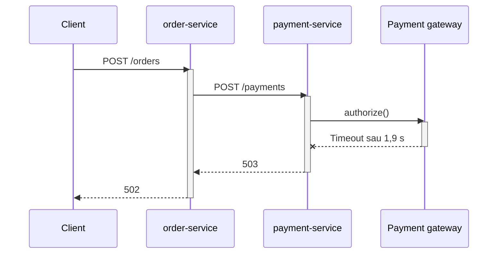
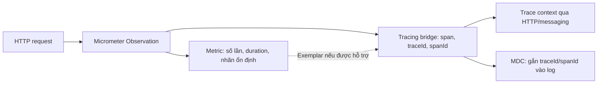

# Quan hệ giữa log, metric và trace trong Spring Boot Observability

Một dịch vụ Spring Boot có thể trả về HTTP 500, phản hồi chậm hoặc tiêu thụ CPU bất thường. Muốn tìm nguyên nhân, ta phải trả lời ba câu hỏi khác nhau: **điều gì đã xảy ra**, **mức độ ảnh hưởng lớn đến đâu**, và **yêu cầu đã đi qua những bước nào**. Log, metric và distributed trace cung cấp ba góc nhìn bổ trợ cho nhau. Khả năng liên kết các góc nhìn đó mới biến dữ liệu giám sát thành thông tin có thể dùng để điều tra.

Bài này thuộc chương **Ba trụ cột** của module **SPRING_BOOT_OBSERVABILITY**: thiết lập observability cho Spring Boot bằng Micrometer Observation, metrics, logs và distributed tracing; hiểu propagation ngữ cảnh, tag/cardinality, exporter, sampling và cách liên kết tín hiệu để tìm lỗi, độ trễ và hành vi ứng dụng trên môi trường thực.

## 1. Ba tín hiệu quan sát cùng một hệ thống

Giả sử `order-service` gọi `payment-service` và cơ sở dữ liệu để hoàn tất `POST /orders`. Trong 5 phút gần đây, người dùng báo thanh toán chậm. Mỗi tín hiệu nhìn vấn đề ở một độ phân giải khác nhau:

| Tín hiệu | Đơn vị thông tin | Câu hỏi trả lời tốt | Điểm hạn chế khi đứng riêng lẻ |
| --- | --- | --- | --- |
| **Log** | Một sự kiện có dấu thời gian và ngữ cảnh | *Lỗi cụ thể là gì?* Thư viện báo timeout ra sao? Dữ liệu nghiệp vụ nào liên quan? | Có thể có hàng nghìn dòng; thiếu ngữ cảnh chung sẽ khó ghép các dòng thuộc cùng yêu cầu. |
| **Metric** | Giá trị số được tổng hợp theo thời gian và nhóm nhãn | *Bao nhiêu yêu cầu lỗi?* p95 latency, throughput và tỷ lệ lỗi biến động thế nào? | Giá trị tổng hợp không mô tả đầy đủ đường đi và nguyên nhân của một yêu cầu cá biệt. |
| **Trace** | Cây/đồ thị các span ghi nhận một lần thực thi, thường xuyên qua nhiều dịch vụ | *Yêu cầu đã mất thời gian ở đâu?* Service nào gọi service nào, lần gọi nào thất bại? | Chỉ phản ánh những yêu cầu được ghi nhận; sampling hoặc thiếu instrumentation có thể tạo khoảng trống. |

Ví dụ từ cùng một đợt sự cố:

- **Metric:** tỷ lệ HTTP 5xx của `/orders` tăng từ 0,2% lên 8%; p95 duration tăng lên 2,4 giây.
- **Trace:** trong một yêu cầu chậm, `order-service` mất 60 ms, nhưng span gọi `payment-service` kéo dài 1,9 giây.
- **Log:** tại span của `payment-service` có sự kiện `SocketTimeoutException` khi gọi cổng thanh toán bên ngoài.

Metric xác nhận đây là hiện tượng có quy mô, trace thu hẹp vị trí có vấn đề, còn log giải thích diễn biến cụ thể. Trace hoặc log của một yêu cầu **không đủ** để suy ra tỷ lệ lỗi toàn hệ thống; metric tổng hợp **không đủ** để kết luận nguyên nhân gốc.

## 2. Cùng một yêu cầu tạo ra ba dạng dữ liệu như thế nào?

Xét luồng ví dụ:



Một hệ thống đã được instrument có thể sinh ra dữ liệu minh họa sau (số liệu và định danh chỉ dùng để giải thích):

**Log — một sự kiện riêng lẻ**

```json
{
  "timestamp": "2026-11-22T09:15:30.120Z",
  "level": "ERROR",
  "service": "payment-service",
  "traceId": "4bf92f3577b34da6a3ce929d0e0e4736",
  "spanId": "00f067aa0ba902b7",
  "event": "payment.gateway.timeout",
  "message": "Gateway không phản hồi trong thời hạn cấu hình"
}
```

**Metric — thống kê từ nhiều yêu cầu**

```text
# Ví dụ dữ liệu đã được exporter chuyển sang định dạng Prometheus
http_server_requests_seconds_count{method="POST",uri="/orders",status="502"} 84
http_server_requests_seconds_sum{method="POST",uri="/orders",status="502"} 173.4
```

`count` và `sum` ở đây là các giá trị tích lũy của một chuỗi thời gian có tập nhãn cụ thể. Muốn biết số yêu cầu/giây hay độ trễ trong 5 phút cần dùng hàm như `rate(...)`, không đọc một counter tích lũy như tốc độ tức thời. Histogram, nếu đã bật và được backend hỗ trợ, còn cho phép tính các phân vị độ trễ.

**Trace — một lần thực thi cụ thể**

```text
Trace 4bf92f3577b34da6a3ce929d0e0e4736 (khoảng 2,0 s)
└─ POST /orders                         order-service      2,0 s
   └─ HTTP POST payment-service        order-service      1,95 s
      └─ POST /payments                payment-service    1,93 s
         └─ HTTP payment-gateway       payment-service    1,90 s  ERROR
```

Các span có thể chồng lấp thời gian vì span phía client và phía server cùng mô tả hai đầu của một lệnh gọi mạng. **Không cộng máy móc duration của mọi span** để tính tổng thời gian của yêu cầu. Hãy dùng cây span và mốc bắt đầu/kết thúc để xác định nhánh chậm, thời gian chờ và mức độ song song.

### Mối quan hệ về số lượng và chi phí

Một yêu cầu có thể sinh nhiều log, một trace chứa nhiều span, còn metric thường cập nhật một hoặc vài series tổng hợp. Log và trace giữ chi tiết hữu ích nhưng thường tốn dung lượng theo lưu lượng; metric tối ưu cho các biểu đồ liên tục và cảnh báo. Vì vậy, chọn cách thu thập, thời gian lưu và sampling cần dựa trên mục đích của từng tín hiệu, thay vì đặt chúng vào cùng một chính sách.

## 3. Chìa khóa liên kết: ngữ cảnh yêu cầu và định danh

Liên kết hai dòng log ở hai microservice chỉ bằng timestamp rất dễ nhầm khi hệ thống xử lý nhiều yêu cầu đồng thời. **Trace context** cho phép các thành phần biết chúng đang xử lý cùng một trace.

Các trường quan trọng:

| Trường | Ý nghĩa | Cách dùng |
| --- | --- | --- |
| `traceId` | Định danh một trace, thường chung cho toàn bộ luồng yêu cầu phân tán | Từ log lỗi mở trace tương ứng; từ trace tìm log cùng `traceId`. |
| `spanId` | Định danh span trong một trace | Khoanh vùng log phát sinh trong một công đoạn cụ thể. |
| `parentSpanId` | Cho biết quan hệ cha-con giữa các span (thể hiện trong dữ liệu trace) | Khôi phục cấu trúc thực thi và đường đi giữa các bước. |
| `service.name` / tên dịch vụ | Xác định tiến trình/dịch vụ tạo dữ liệu | Lọc nguồn log, metric, trace theo dịch vụ. |
| `environment`, phiên bản triển khai | Thuộc tính vận hành khi được cấu hình và gắn đúng chỗ | So sánh trước/sau triển khai và phân biệt môi trường. |

Ví dụ một HTTP request được truyền sang dịch vụ tiếp theo có thể mang header theo chuẩn **W3C Trace Context**:

```http
traceparent: 00-4bf92f3577b34da6a3ce929d0e0e4736-00f067aa0ba902b7-01
```

Trong đó `4bf...` là `trace-id`, `00f...` là `parent-id` của ngữ cảnh được truyền, và `01` biểu diễn cờ sampled theo định dạng W3C. Bên nhận đọc header và có thể tạo span con thuộc cùng trace. Trạng thái sampled được diễn giải trong ngữ cảnh sampler; sự tồn tại của header **không bảo đảm** trace cuối cùng đã được lưu trong backend.

Một mối liên hệ thường gặp:



Không phải hệ thống nào cũng tự động có toàn bộ các mũi tên trên. Phải cấu hình instrumentation, tracing bridge, exporter và định dạng log phù hợp; collector/backend cũng cần nhận và lưu đúng trường tương quan.

### Correlation trong log Spring Boot

Khi dùng Micrometer Tracing đã tích hợp vào Spring Boot, ngữ cảnh tracing có thể được đưa vào **MDC** (Mapped Diagnostic Context) của logging framework. Một log được phát khi span đang hoạt động có thể kèm `traceId` và `spanId`, dưới dạng pattern văn bản hoặc trường JSON tùy cấu hình logger/encoder.

Ví dụ dòng log có tương quan:

```text
2026-11-22 16:15:30 ERROR [payment-service,4bf92f3577b34da6a3ce929d0e0e4736,00f067aa0ba902b7] Gateway timeout
```

Không nên dựa vào chính xác một mẫu ký tự cho mọi phiên bản Spring Boot: tên trường và pattern mặc định có thể khác nhau, và encoder JSON cần được cấu hình để chuyển MDC thành các trường có thể tìm kiếm. Cần kiểm tra log thực tế trong môi trường đang chạy.

**Ranh giới bất đồng bộ:** MDC thường gắn với luồng thực thi hiện tại. Khi chuyển sang executor, `CompletableFuture`, message consumer hoặc luồng reactive, trace context phải được propagation đúng cách. Một log thiếu `traceId` sau khi đổi thread chưa đủ chứng minh có lỗi ở tracer hay backend; đầu tiên phải kiểm tra chính bước truyền context. Với message broker, HTTP client tùy chỉnh và tác vụ nền, cần xác minh instrumentation thực sự tạo/extract context.

**Baggage** có thể chuyển một số giá trị ngữ cảnh theo yêu cầu, nhưng nó khác `traceId`/`spanId`, không mặc nhiên xuất hiện trong mọi log, và không nên dùng để truyền email, token, dữ liệu cá nhân hoặc giá trị không được phép chia sẻ giữa các dịch vụ.

## 4. Micrometer Observation nối logic ứng dụng với metric và trace

Trong Spring Boot, **Micrometer Observation** biểu diễn một hoạt động có vòng đời bắt đầu, kết thúc, thuộc tính và lỗi. Một Observation có thể được nhiều `ObservationHandler` xử lý: handler đo thời gian để tạo meter, handler tracing tạo span, hoặc handler tùy biến thêm cách quan sát khác. Vì thế nhóm phát triển có thể instrument **một hoạt động nghiệp vụ** mà vẫn cung cấp dữ liệu phù hợp cho cả metric và trace.

Vòng đời cơ bản:

1. Tạo Observation đặt tên ổn định cho hoạt động, ví dụ `payment.authorize`.
2. Thêm các key-value có cardinality phù hợp.
3. Khởi động Observation, thực hiện công việc; ghi lỗi nếu có.
4. Kết thúc Observation để các handler nhận tín hiệu hoàn tất.

Đoạn Java dưới đây minh họa instrument một phương thức đồng bộ bằng API `Observation.observe(...)`. Đây là ví dụ ý tưởng; chức năng tạo metric/span phụ thuộc việc ứng dụng đã cấu hình các handler tương ứng.

```java
import io.micrometer.observation.Observation;
import io.micrometer.observation.ObservationRegistry;
import org.slf4j.Logger;
import org.slf4j.LoggerFactory;
import org.springframework.stereotype.Service;

@Service
public class PaymentService {
    private static final Logger log = LoggerFactory.getLogger(PaymentService.class);
    private final ObservationRegistry observationRegistry;

    public PaymentService(ObservationRegistry observationRegistry) {
        this.observationRegistry = observationRegistry;
    }

    public void authorize(String orderId, String method, Runnable gatewayCall) {
        Observation.createNotStarted("payment.authorize", observationRegistry)
                .lowCardinalityKeyValue("payment.method", method)
                .highCardinalityKeyValue("order.id", orderId)
                .observe(() -> {
                    log.info("Bắt đầu authorize orderId={}", orderId);
                    gatewayCall.run();
                    log.info("Authorize hoàn tất orderId={}", orderId);
                });
    }
}
```

Trong ứng dụng thực tế, `method` phải là nhóm giá trị giới hạn trước như `card`, `bank_transfer`, `wallet` (hoặc `unknown`), **không** phải chuỗi đầu vào tùy ý. `orderId` chỉ nên là ID giả danh được cho phép ghi nhận; nếu không có nhu cầu điều tra bằng ID này thì bỏ hẳn. `observe(...)` quản lý start/stop quanh công việc và giúp ghi nhận exception nếu hoạt động ném lỗi; không nuốt ngoại lệ xử lý nghiệp vụ.

Khi Spring Boot đã cấu hình Observation cho HTTP, incoming server request thường đã có Observation riêng. Observation của `payment.authorize` có thể xuất hiện như công đoạn con trong trace đang hoạt động. Nếu tracing bridge/propagation chưa được thiết lập, đoạn code vẫn có thể đo hoạt động qua metric handler nhưng sẽ **không tự tạo** distributed trace có thể xem được từ nhiều dịch vụ.

### Ba nhóm thành phần dễ nhầm lẫn

| Thành phần | Vai trò | Không tự đảm bảo |
| --- | --- | --- |
| `ObservationRegistry` / Micrometer Observation | Mô hình hóa hoạt động và chuyển sự kiện cho các handler | Tồn tại metric hoặc span đã được xuất sang backend. |
| Micrometer Metrics / `MeterRegistry` | Thu thập và tổng hợp counter, timer, gauge theo nhãn | Mỗi measurement có một `traceId` để truy ngược. |
| Micrometer Tracing bridge + tracer | Tạo/tiếp nối span, truyền context, hỗ trợ correlation ID | Backend nhận trace, log đã chứa MDC hoặc trace luôn được sampling. |

Trong hệ thống Spring Boot, Actuator thường cung cấp cơ sở cho auto-instrumentation và endpoint metrics; các registry/exporter đưa metric đến Prometheus hoặc backend khác; tracing bridge kết nối với OpenTelemetry hoặc Brave; exporter/collector chuyển span đến hệ thống như Tempo/Jaeger. Log đi qua logging framework và pipeline lưu log riêng. Phiên bản Spring Boot và dependency quyết định tính năng mặc định: cần xác nhận trong ứng dụng đích, không suy từ việc chỉ thêm một dependency rằng cả ba tín hiệu đã hoạt động.

## 5. Cardinality quyết định cách liên kết dữ liệu có bền vững hay không

**Cardinality** là số tổ hợp giá trị nhãn khác nhau. Nếu gắn `userId`, `orderId` hoặc `traceId` vào metric, mỗi yêu cầu gần như tạo một chuỗi thời gian mới; chi phí bộ nhớ, lưu trữ và truy vấn có thể tăng mạnh. Trong khi đó, một span hoặc log đơn lẻ thường chấp nhận thuộc tính chi tiết hơn vì dữ liệu được lưu theo bản ghi riêng.

| Thuộc tính | Metric label (low cardinality) | Span attribute / log field (chi tiết có kiểm soát) |
| --- | --- | --- |
| `http.method` = `GET`, `POST` | Phù hợp | Phù hợp |
| `http.route` = `/orders/{id}` | Phù hợp | Phù hợp |
| `http.status_code` hoặc nhóm status | Phù hợp nếu số giá trị hữu hạn | Phù hợp |
| `payment.method` = `card`, `wallet` | Phù hợp khi đã chuẩn hóa | Phù hợp |
| `order.id`, `request.id`, `traceId` | **Không dùng làm metric label** | Có thể dùng nếu được phép, thật sự cần và được bảo vệ phù hợp |
| URL đầy đủ, query string, exception message | Thường không phù hợp | Chỉ thu thập có chọn lọc, lọc bí mật và dữ liệu cá nhân |

Ở ví dụ Java phía trên, `lowCardinalityKeyValue` dùng cho nhóm nhãn có tập giá trị hữu hạn, còn `highCardinalityKeyValue` dành cho thuộc tính cụ thể hơn mà tracing handler có thể sử dụng. Điều này **không có nghĩa** mọi high-cardinality key mặc nhiên được ghi vào log hoặc có thể tìm kiếm trong backend. Từng handler, exporter và storage có quy tắc riêng.

Một nguyên tắc quan trọng khác: sử dụng **template route** `/orders/{id}` cho metric HTTP, không dùng `/orders/832914`. Nếu cần điều tra order cụ thể, tra qua log/span có định danh được phép lưu. Làm vậy vẫn đo được tỷ lệ lỗi theo endpoint mà không nhân số series theo số đơn hàng.

## 6. Từ metric sang trace rồi đến log: một lượt điều tra hoàn chỉnh

Giả sử cảnh báo: p95 latency của `POST /orders` vượt 2 giây trong 5 phút. Một quy trình điều tra có thể thực hiện như sau.

### Bước 1 — Metric cho biết *ở đâu* và *khi nào* sự cố lan rộng

Xem đồ thị throughput, tỷ lệ lỗi, duration theo `service`, `uri` (route template), `method`, `status` và môi trường. Chọn một khoảng thời gian xảy ra vấn đề, so sánh khoảng trước và sau. Với Prometheus, số request/giây trên route có thể minh họa bằng:

```promql
sum(rate(http_server_requests_seconds_count{method="POST",uri="/orders"}[5m]))
```

Tỷ lệ 5xx ước tính trên cùng route:

```promql
sum(rate(http_server_requests_seconds_count{method="POST",uri="/orders",status=~"5.."}[5m]))
/
sum(rate(http_server_requests_seconds_count{method="POST",uri="/orders"}[5m]))
```

Để tính p95 qua histogram, cần **có bucket series** (ví dụ đã bật percentile histogram cho `http.server.requests` và exporter phát các bucket):

```promql
histogram_quantile(
  0.95,
  sum by (le) (
    rate(http_server_requests_seconds_bucket{method="POST",uri="/orders"}[5m])
  )
)
```

Tên series và tập nhãn thực tế phụ thuộc meter, exporter và cấu hình/version. Không có bucket thì câu truy vấn cuối không thể tự sinh p95; cũng không nên lấy trung bình `sum / count` rồi gọi đó là p95. Khi mẫu số tỷ lệ lỗi bằng 0 (không có traffic), dashboard phải xử lý trường hợp thiếu dữ liệu để tránh kết luận sai.

### Bước 2 — Chọn trace đại diện

Tại thời điểm metric biến động, mở trace có duration cao hoặc status lỗi. Nếu hệ thống hỗ trợ **exemplar**, một mẫu quan sát của metric (thường trong histogram) có thể mang liên kết đến trace tương ứng, cho phép mở trace trực tiếp từ biểu đồ. Đây là khả năng *tùy cấu hình và backend*, không phải thuộc tính mặc định của mọi time series.

Nếu không có exemplar, dùng công cụ tìm trace theo `service.name`, thời gian, HTTP route, trạng thái hoặc duration; xác minh rằng các thuộc tính đó thật sự được ghi và index. Không tìm thấy trace **chưa chứng minh** yêu cầu không xảy ra vì trace có thể bị sampling, bị drop, hoặc thiếu propagation/export.

### Bước 3 — Đọc các span để tìm nhánh chậm

Với trace ví dụ, so sánh `POST /orders`, HTTP client sang payment, HTTP server payment và external gateway. Nếu phần lớn thời gian nằm trong span gọi gateway, hãy kiểm tra timeout, retry và số lần gọi; nếu database span kéo dài, kiểm tra pool connection, query, lock và tải DB. Quan sát khoảng thời gian *thật sự* của các span và quan hệ cha-con, không chỉ thứ tự hiển thị.

### Bước 4 — Dùng `traceId`/`spanId` để lấy log đúng ngữ cảnh

Từ trace, tìm log cùng `traceId`, lọc thêm `spanId` hoặc `service` nếu cần. Một số hệ thống liên kết log trực tiếp trên UI trace khi field được ánh xạ đúng; hệ thống khác yêu cầu tìm kiếm thủ công. Log chi tiết có thể cho thấy exception, retry, giá trị trạng thái của dependency, hoặc quyết định fallback mà span duration không diễn đạt.

### Bước 5 — Quay lại metric để kiểm chứng giả thuyết

Nếu một trace cho thấy gateway timeout, kiểm tra metric timeout/error rate và latency **của dependency đó** có tăng cùng thời điểm không. Tách theo nhóm status hoặc vùng triển khai nếu đã có nhãn phù hợp. Tránh khẳng định toàn bộ sự cố do một trace cá biệt. Gắn kết quan sát với thay đổi triển khai, tải, cấu hình và sức khỏe dependency trước khi chốt nguyên nhân.

| Dấu hiệu | Metric giúp xác nhận | Trace giúp khoanh vùng | Log giúp giải thích |
| --- | --- | --- | --- |
| HTTP 5xx tăng | Tỷ lệ lỗi theo service/route | Span có error và công đoạn trước lỗi | Exception, response từ dependency, fallback |
| p95 tăng, lỗi ít | Histogram/timer latency | Nhánh chờ DB, network hoặc lock | Query chậm, retry, thời gian chờ pool |
| CPU tăng | CPU, throughput, saturation | Công đoạn được instrument, nếu có | Sự kiện batch, thay đổi chế độ xử lý |
| Chỉ một nhóm request gặp lỗi | Số lỗi theo nhãn ổn định | Trace đại diện từng luồng | Chi tiết tham số được phép ghi và quyết định nghiệp vụ |

## 7. Vì sao đã có trace nhưng vẫn khó liên kết cả ba tín hiệu?

### Sampling không tác động giống nhau lên từng tín hiệu

**Head sampling** quyết định thu trace sớm, thường theo tỷ lệ; **tail sampling** có thể quyết định giữ trace dựa vào toàn bộ diễn biến tại collector nếu pipeline hỗ trợ. Một trace không được giữ vẫn có thể có metric aggregate và log lỗi. Vì thế không thể lấy số trace có lỗi rồi chia tổng trace để mặc nhiên coi đó là tỷ lệ lỗi thực tế của hệ thống: việc chọn mẫu có thể tạo thiên lệch, đặc biệt khi giữ lại nhiều error/slow trace hơn.

Một cấu hình minh họa trên Spring Boot khi ứng dụng có tracing tương thích:

```yaml
management:
  tracing:
    sampling:
      probability: 0.10
```

Giá trị `0.10` minh họa tỷ lệ lấy mẫu 10% cho sampler được cấu hình theo property này; hiệu lực cuối cùng còn tùy tracing SDK, parent sampling và pipeline collector. Không nên coi đây là đảm bảo chính xác 10% trong mọi khoảng thời gian hoặc mọi dịch vụ. Khi điều tra sự cố hiếm, cần chiến lược lưu các trace lỗi/chậm phù hợp, đi kèm giới hạn chi phí và kiểm soát dữ liệu.

### Propagation bị đứt ở một ranh giới

Nếu HTTP client không inject `traceparent`, server nhận không extract, hoặc consumer không nối context từ message, sẽ xuất hiện các trace rời rạc. Cũng có trường hợp span được sinh nhưng log sau chuyển thread không mang MDC. Kiểm tra lần lượt request header, thư viện client/instrumentation, executor/reactive context, trace metadata và log encoder.

### Exporter, collector và backend xử lý từng tín hiệu độc lập

Metric xuất qua registry hoặc OTLP, span xuất qua exporter/collector, log đi qua console/appender hoặc OTLP/log collector. Một đường truyền thành công không chứng minh hai đường kia hoạt động. Khác biệt timestamp, service name, environment, retention hoặc quyền truy cập cũng làm dashboard không nối được dữ liệu. Khi tra cứu xuyên hệ thống, cần thống nhất định danh dịch vụ và quy tắc đặt tên trường.

### Error trong log không đồng nghĩa span được đánh dấu lỗi

Một exception có thể được bắt rồi fallback thành công; ngược lại HTTP 5xx có thể được trả về mà không phát log ERROR. Cần phân biệt exception được ghi nhận vào Observation/span, trạng thái HTTP và ngữ nghĩa thất bại của nghiệp vụ. Thiết lập alert dựa trên SLI/SLO hoặc metric phản ánh hành vi người dùng, không chỉ số dòng log ERROR.

## 8. Thực hành đối chiếu và các câu hỏi kiểm tra

Với một Spring Boot service đang chạy, có thể kiểm tra quan hệ giữa ba trụ cột theo trình tự:

1. Gửi một request qua ít nhất hai dịch vụ; xem metric request count và latency có tăng theo route **đã chuẩn hóa** không.
2. Trong một request được thu trace, tìm `traceId` và hai hoặc nhiều span thuộc các dịch vụ khác nhau; kiểm tra quan hệ cha-con và duration.
3. Phát log từ bên trong một span đang hoạt động; xác nhận field tương quan thực sự xuất hiện trong dữ liệu log *sau khi lưu*, không chỉ trong console local.
4. Truy vấn log bằng `traceId` rồi mở trace tương ứng; thử đường ngược lại từ trace sang log.
5. Tạo một lỗi hoặc độ trễ kiểm soát được ở môi trường thử nghiệm, rồi đối chiếu metric aggregate, span, log và hành vi khi sampling làm vắng một số trace.
6. Xem danh sách metric labels để đảm bảo không vô tình có `traceId`, `userId`, order ID hoặc URL chứa tham số biến thiên.

Tự trả lời các câu hỏi sau để chắc rằng đã hiểu mối quan hệ:

- Nếu biểu đồ p95 tăng nhưng không có trace chậm nào, cần kiểm tra những giả thuyết nào trước khi kết luận metric sai?
- Một `traceId` có thể giúp tìm log cùng yêu cầu; vì sao không nên gắn chính nó vào metric label?
- Vì sao không cộng duration của span client và span server khi tính tổng latency?
- Khi một log trong `CompletableFuture` thiếu `traceId`, những điểm truyền ngữ cảnh nào cần kiểm tra?
- Một trace được lấy mẫu có error có đủ bằng chứng để kết luận 8% request thất bại không? Cần kiểm tra metric nào?

## Kết luận

**Metric cho thấy hình mẫu và quy mô, trace cho thấy đường đi và nơi tiêu tốn thời gian, log cho thấy sự kiện và chi tiết nguyên nhân.** Trong Spring Boot, Micrometer Observation giúp biểu diễn hoạt động chung, còn tracing bridge, meter registry, context propagation, MDC và exporter/backend quyết định tín hiệu nào được tạo và có liên kết được hay không. Hệ thống observability hữu dụng khi người vận hành có thể đi từ cảnh báo metric đến một trace phù hợp, đọc log đúng ngữ cảnh, rồi quay lại metric để kiểm chứng tác động trên toàn bộ lưu lượng.
