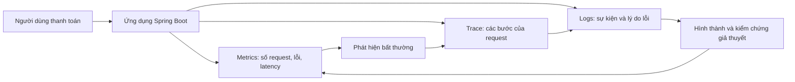
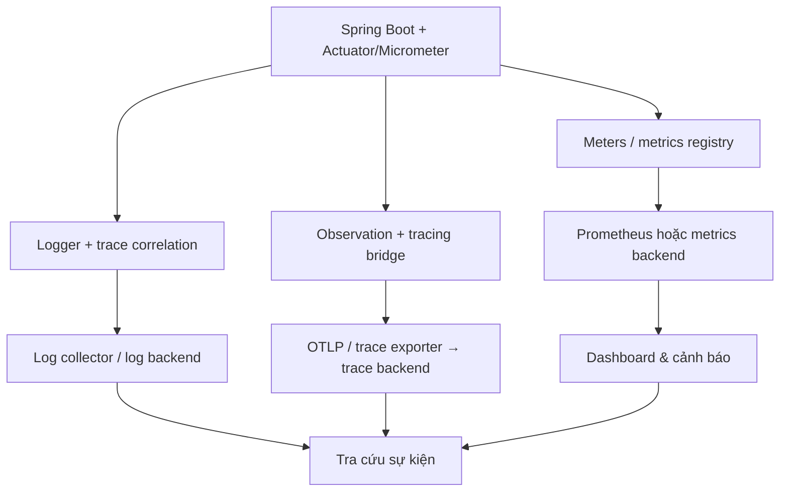

# Tín hiệu định lượng và định tính trong observability Spring Boot

Khi một ứng dụng Spring Boot chậm hoặc trả lỗi, câu hỏi đầu tiên thường là **“Mức độ ảnh hưởng lớn đến đâu?”**. Ngay sau đó là **“Điều gì đã xảy ra với những yêu cầu bị ảnh hưởng?”**. Hai câu hỏi này cần hai góc nhìn bổ sung cho nhau: **tín hiệu định lượng** để đo mức độ, tần suất và xu hướng; **tín hiệu định tính** để mô tả ngữ cảnh, diễn biến và nguyên nhân có thể xảy ra.

Trong chương **Ba trụ cột** của observability, ba loại tín hiệu chính là **metrics, logs và distributed traces**. Chúng không chia thành ba ngăn tuyệt đối: metrics chủ yếu mang tính định lượng, logs chủ yếu cung cấp ngữ cảnh định tính, còn traces kết hợp thời gian đo được với cấu trúc nhân quả của một luồng xử lý. Nắm được sự khác biệt này giúp chọn đúng tín hiệu để phát hiện lỗi, phân tích độ trễ và hiểu hành vi ứng dụng trên môi trường thực.

## 1. Phân biệt hai loại câu hỏi

Giả sử API `POST /checkout` bình thường xử lý trong vài trăm mili giây nhưng gần đây nhiều người dùng phải chờ lâu.

- **Định lượng:** Có bao nhiêu request mỗi giây? Tỷ lệ HTTP 5xx là bao nhiêu? p95 latency tăng từ mức nào lên mức nào? Sự cố bắt đầu lúc nào? Có liên quan tới một endpoint hay tất cả endpoint?
- **Định tính:** Những request chậm đã đi qua các dịch vụ nào? Lời gọi tới kho hàng có timeout không? Log ghi nhận lỗi nghiệp vụ hay lỗi kết nối? Tại sao chỉ một nhóm request bị ảnh hưởng?

Một giá trị như `p95 = 1,8 s` cho biết **mức độ** chậm, nhưng chưa chỉ ra đoạn chương trình gây chậm. Một log `inventory reservation timed out` gợi ý **điều đã xảy ra**, nhưng riêng log đó không cho biết tỷ lệ tất cả request bị ảnh hưởng. Trace của một request cho biết **lời gọi nào mất thời gian**, nhưng một trace riêng lẻ không đại diện cho toàn bộ lưu lượng.

> **Nguyên tắc:** Dùng tín hiệu định lượng để nhìn toàn cảnh, khoanh vùng thời gian và phạm vi; dùng tín hiệu có ngữ cảnh để điều tra một trường hợp cụ thể; quay lại tín hiệu định lượng để xác nhận biện pháp khắc phục có hiệu quả trên toàn hệ thống.

## 2. Metrics, logs và traces bổ sung cho nhau như thế nào?

| Tín hiệu | Thông tin nổi bật | Câu hỏi giải đáp tốt | Giới hạn khi đứng một mình |
| --- | --- | --- | --- |
| **Metrics** | Giá trị số được tổng hợp theo thời gian: số lần gọi, tỷ lệ lỗi, độ trễ, mức sử dụng tài nguyên | *Có bao nhiêu? Bao lâu? Xu hướng thay đổi ra sao?* | Thường không tái dựng được đường đi hay dữ liệu của từng request |
| **Logs** | Sự kiện có dấu thời gian, mức độ, thông điệp và trường ngữ cảnh | *Sự kiện gì xảy ra? Lỗi cụ thể nào được ghi nhận?* | Lượng bản ghi lớn; nếu thiếu cấu trúc và mã tương quan thì khó nối sự kiện |
| **Traces** | Các span có thứ tự/quan hệ cha–con, thời điểm, thời lượng và thuộc tính | *Request đi qua đâu? Bước nào chậm hoặc thất bại?* | Chi phí thu thập/lưu trữ; khi sampling có thể không có trace của request cần tìm |

Phân biệt theo nội dung thực tế thay vì chỉ theo tên tín hiệu:

- Một **log** có thể mang số, chẳng hạn `duration_ms=1200`, nhưng vẫn là bản ghi của **một sự kiện**.
- Một **trace** có các số đo `duration` cho từng span, đồng thời diễn tả quan hệ giữa các bước như `checkout → inventory → database`.
- Một **metric** có nhãn như `method=POST` hay `status=500`, nhưng nhãn chỉ dùng để chia nhóm các phép đo, không lưu toàn bộ câu chuyện của request.

### Từ một thao tác nghiệp vụ đến ba góc nhìn



Sơ đồ là một quy trình điều tra thường gặp, không phải quy định bắt buộc: đôi khi lỗi xuất hiện trong log trước khi đủ rõ trên dashboard metrics.

## 3. Phần định lượng: đo hệ thống bằng metrics

Metrics hữu ích khi cần so sánh **hàng nghìn hoặc hàng triệu lần thực thi** mà không mở từng request. Với API, một bộ chỉ số cơ bản thường dựa trên mô hình **RED**:

| RED | Diễn giải | Ví dụ khi giám sát `/checkout` |
| --- | --- | --- |
| **Rate** | Lượng công việc trên một đơn vị thời gian | 120 request/giây |
| **Errors** | Số lượng hoặc tỷ lệ request thất bại | 3% request nhận 5xx trong 5 phút |
| **Duration** | Phân bố thời gian đáp ứng | p50 = 180 ms, p95 = 1,8 s |

Ba loại meter quen thuộc trong Micrometer là:

1. **Counter:** đếm sự kiện chỉ tăng, ví dụ số lần đặt hàng thất bại. Khi xem dashboard, thường tính **tốc độ tăng** của counter theo cửa sổ thời gian thay vì chỉ đọc giá trị tích lũy.
2. **Gauge:** biểu diễn mức hiện tại, ví dụ số kết nối đang sử dụng hoặc số tác vụ đang đợi. Gauge có thể tăng hoặc giảm.
3. **Timer / DistributionSummary:** theo dõi số lần và phân bố thời lượng hoặc kích thước. Với độ trễ HTTP, `Timer` có thể cung cấp số lần gọi và tổng thời gian; histogram cần cấu hình phù hợp để tính phân vị tổng hợp.

**Không chỉ dùng trung bình.** Ví dụ 95 request chạy trong 100 ms và 5 request chạy trong 4 giây có thời gian trung bình khoảng 295 ms, trong khi phần đuôi độ trễ rất tệ. Các phân vị như p95/p99 giúp thấy nhóm request chậm, nhưng cách tính phân vị phải phù hợp với cách tổng hợp giữa các instance. Với Prometheus, **histogram** cho phép tính phân vị từ bucket đã cộng gộp; trung bình của các giá trị p95 theo instance không phải p95 toàn hệ thống.

Trong nhiều cấu hình Spring Boot dùng Micrometer, HTTP server instrumentation tạo metric logic `http.server.requests`. Khi xuất sang Prometheus, tên chuỗi thời gian và hậu tố có thể được chuyển đổi (chẳng hạn `http_server_requests_seconds_count` và `_bucket`). Tên cuối cùng phụ thuộc phiên bản, registry và cấu hình; hãy kiểm tra endpoint metrics/exporter thực tế trước khi dùng truy vấn.

Ví dụ truy vấn PromQL minh họa tỷ lệ HTTP 5xx theo cửa sổ 5 phút:

```promql
sum(rate(http_server_requests_seconds_count{status=~"5.."}[5m]))
/
sum(rate(http_server_requests_seconds_count[5m]))
```

Ví dụ p95 latency khi **đã bật và xuất histogram tương ứng**:

```promql
histogram_quantile(
  0.95,
  sum by (le) (rate(http_server_requests_seconds_bucket[5m]))
)
```

Hai truy vấn là mẫu để hiểu cách đo, không bảo đảm chạy nguyên trạng trong mọi dự án. Khi tỷ lệ lưu lượng quá nhỏ, giá trị có thể nhiễu; khi không có request, phép chia không có ý nghĩa. Nếu lỗi nghiệp vụ trả HTTP 200, cần thêm metric nghiệp vụ thay vì chỉ dựa trên mã 5xx.

## 4. Phần định tính: logs kể lại sự kiện có ngữ cảnh

Logs trả lời câu hỏi **“Ứng dụng đã nhìn thấy điều gì tại thời điểm đó?”**. Giá trị của log không chỉ nằm ở dòng thông báo, mà còn ở các trường giúp phân biệt một sự kiện với các sự kiện khác.

Ví dụ một log có cấu trúc:

```json
{
  "timestamp": "2026-11-22T03:10:15.421Z",
  "level": "WARN",
  "service": "checkout-service",
  "event": "inventory.reserve.failed",
  "reason": "downstream_timeout",
  "duration_ms": 1500,
  "traceId": "4f83a49c23a4bd73e6875a13137d2c01",
  "spanId": "9ab14c10ed3e42a7"
}
```

Đây là **dữ liệu minh họa**, không phải log có sẵn của Spring Boot. Trường `duration_ms` là định lượng; `event` và `reason` mang ý nghĩa nghiệp vụ; `traceId` và `spanId` cho phép tìm đúng trace/span tương ứng nếu hệ thống đã thiết lập correlation.

Để log có ích cho điều tra:

- Dùng sự kiện rõ nghĩa, ví dụ `inventory.reserve.failed` thay vì `something went wrong`.
- Ghi tên dịch vụ, thời điểm, mức độ, loại lỗi và ngữ cảnh ổn định. Một cấu trúc nhất quán giúp tìm kiếm và tổng hợp.
- Gắn mã tương quan khi có tracing; với Java/Spring Boot, correlation thường được đưa vào MDC qua Micrometer Tracing và cấu hình logging phù hợp.
- Tránh ghi access token, mật khẩu, dữ liệu cá nhân, toàn bộ request/response body hoặc thông tin nhạy cảm. Việc có `traceId` không làm dữ liệu trở nên an toàn để ghi.
- Không lạm dụng `ERROR` cho sự kiện có thể phục hồi và không ghi cùng một exception nhiều lần ở mỗi tầng mà thiếu giá trị bổ sung.

Logs nhiều và chi tiết không mặc nhiên tạo ra observability tốt. Thiếu mã tương quan, trường có cấu trúc và chính sách lưu giữ phù hợp thì chúng vẫn khó sử dụng khi sự cố xảy ra.

## 5. Traces nối phép đo thời gian với diễn biến xử lý

Trong distributed tracing, một **trace** mô tả hành trình của một tác vụ; các **span** đại diện cho các bước xử lý có thời điểm bắt đầu, kết thúc, thời lượng, thuộc tính và quan hệ cha–con. Một span có thể mang trạng thái lỗi và sự kiện, nhưng chỉ ghi những thuộc tính hữu ích và được phép thu thập.

Ví dụ request thanh toán đi qua nhiều thành phần:

```text
Trace T: POST /checkout                             1.750 ms
  ├─ checkout.validate                               70 ms
  ├─ inventory.reserve                             1.450 ms
  │    └─ HTTP POST inventory-service              1.420 ms
  └─ payment.authorize                               160 ms
```

Các thời lượng là ví dụ giả định. Span có thể thực thi chồng lấp, nên **không mặc định cộng thời lượng các span con** để ra tổng thời lượng của trace. Tuy nhiên, một span gọi inventory kéo dài 1.450 ms trong tổng thời gian 1.750 ms là manh mối tốt để kiểm tra phụ thuộc downstream.

**Trace vừa định lượng vừa định tính:** thời lượng chỉ ra điểm nghẽn, còn tên span, quan hệ và thuộc tính chỉ ra hoạt động tương ứng. Trace đơn lẻ vẫn chỉ là một trường hợp; cần đối chiếu với metrics để biết hiện tượng có phổ biến hay không.

## 6. Micrometer Observation trong Spring Boot liên kết các tín hiệu

Với Spring Boot dùng Micrometer, **Observation** cung cấp một cách diễn tả hoạt động có tên, ngữ cảnh và vòng đời bắt đầu/kết thúc. `ObservationRegistry` chứa các handler đang được cấu hình. Tùy vào dependencies và cấu hình:

- Handler metrics có thể biến observation thành các phép đo thời lượng/số lần thực thi.
- Handler tracing có thể tạo span và quản lý ngữ cảnh trace.
- Application logs được ghi **riêng bởi logger**; một `Observation` không tự sinh log nghiệp vụ chỉ vì được tạo.

Ví dụ quan sát thao tác giữ hàng:

```java
import io.micrometer.observation.Observation;
import io.micrometer.observation.ObservationRegistry;
import org.springframework.stereotype.Service;

@Service
public class InventoryReservationService {
    private final ObservationRegistry observationRegistry;

    public InventoryReservationService(ObservationRegistry observationRegistry) {
        this.observationRegistry = observationRegistry;
    }

    public String reserveForCheckout() {
        return Observation.createNotStarted(
                "checkout.inventory.reserve", observationRegistry)
            .lowCardinalityKeyValue("channel", "web")
            .observe(() -> {
                // Thay bằng lời gọi thực tế đến dịch vụ kho.
                return "reserved";
            });
    }
}
```

`observe(...)` mở/đóng observation quanh đoạn mã; khi đoạn mã ném exception, vòng đời observation vẫn được kết thúc theo cơ chế của API. Muốn biết error được biểu diễn ra sao trong metric/span thì phải kiểm tra handler và cách instrumentation ghi nhận lỗi thực tế. Đoạn mã chỉ minh họa custom observation, chưa phải một ứng dụng Spring Boot chạy độc lập.

Một observation có thể mang hai nhóm key-value:

| Thuộc tính | Ví dụ | Cách dùng |
| --- | --- | --- |
| **Low cardinality** | `channel=web`, `result=success` với tập giá trị hữu hạn | Thích hợp làm nhãn metrics; cũng có thể xuất hiện trong trace |
| **High cardinality** | Mã lần xử lý nội bộ khác nhau ở mỗi request | Có thể hữu ích khi tra span nhưng **không** dùng làm nhãn metrics; vẫn phải kiểm soát dữ liệu nhạy cảm |

**Cardinality** là số tổ hợp giá trị nhãn khác nhau. Gắn `customerId`, email, UUID request hay URL chứa ID thật vào metric có thể tạo hàng triệu time series, làm tăng RAM, chi phí và thời gian truy vấn. Chọn nhãn có số giá trị hữu hạn; dùng đường dẫn mẫu như `/orders/{id}` thay cho `/orders/928374`. Tracing cũng có chi phí và giới hạn kích thước thuộc tính, nên “high cardinality” không có nghĩa là được ghi tùy ý.

## 7. Correlation, propagation và sampling

Để lần từ số liệu tổng hợp đến một request cụ thể, cần phân biệt ba cơ chế:

**Correlation (liên kết tín hiệu):** Khi log và span cùng chứa `traceId`, người vận hành có thể mở trace từ một dòng log hoặc tìm log theo trace. Các span của cùng trace có `spanId` riêng để nhận diện từng bước.

**Context propagation (truyền ngữ cảnh):** Khi checkout gọi inventory qua HTTP hoặc messaging, ngữ cảnh trace phải được truyền qua ranh giới dịch vụ. Với hệ sinh thái OpenTelemetry, header W3C `traceparent` là một cách phổ biến. Các thư viện instrumented client/server có thể xử lý việc này; một HTTP client tự viết, executor tùy biến, tác vụ bất đồng bộ hoặc message consumer thiếu instrumentation có thể làm đứt trace. Không nên giả định mọi thread và giao thức đều tự động truyền ngữ cảnh.

**Sampling (lấy mẫu):** Khi lượng truy cập lớn, có thể chỉ giữ một tỷ lệ trace, ví dụ 10%, để giảm chi phí. Vì vậy một dòng log có `traceId` không bảo đảm trace tương ứng đã được lưu ở backend. Sampling traces **không thay thế** metrics tổng hợp; vẫn cần metrics để quan sát tỷ lệ lỗi/độ trễ trên toàn bộ lưu lượng. Quyết định sampling, propagation và thu thập có thể phụ thuộc SDK, collector và chính sách backend.

Khi cần điều tra một lỗi hiếm, hãy xem liệu sampling có làm mất những trace quan trọng không; cân nhắc chính sách sampling phù hợp tại nơi thu thập, thay vì tăng tỷ lệ lên 100% một cách vô điều kiện trên hệ thống nhiều tải.

## 8. Ví dụ điều tra sự cố từ ba tín hiệu

**Bối cảnh giả định:** sau một lần triển khai, `POST /checkout` vẫn nhận 120 request/giây nhưng p95 tăng từ 300 ms lên 1,8 s và tỷ lệ 5xx tăng từ 0,2% lên 3%.

| Bước điều tra | Tín hiệu sử dụng | Điều rút ra |
| --- | --- | --- |
| 1. Xác nhận tác động | Metrics: request rate, error rate, p95 theo endpoint | Bất thường tập trung ở checkout, xuất hiện sau thời điểm triển khai |
| 2. Khoanh vùng đường đi | Trace của một request chậm (nếu được thu thập) | Span `inventory.reserve` chiếm phần lớn thời gian |
| 3. Tìm sự kiện cụ thể | Log của checkout/inventory theo `traceId` và khoảng thời gian | Phát hiện `downstream_timeout` lúc gọi dịch vụ kho |
| 4. Kiểm chứng giả thuyết | Metrics phụ thuộc downstream, pool kết nối, timeout; log/trace từ nhiều request | Kiểm tra xem độ trễ của inventory có thực sự tăng rộng khắp và khớp thời điểm không |
| 5. Đánh giá sau khắc phục | Metrics trước/sau, traces và log lỗi mới | Xem p95, tỷ lệ lỗi có trở về mức nền và không tạo tác dụng phụ hay không |

Chú ý sự khác nhau giữa **tương quan** và **nguyên nhân**: một span chậm hoặc một log timeout là bằng chứng để điều tra, chưa chứng minh chính xác vấn đề nằm ở mạng, truy vấn database hay cấu hình timeout. Cần đối chiếu nhiều request, metric hạ tầng và sự thay đổi gần thời điểm phát sinh.

### Khi thiếu một loại tín hiệu

- **Chỉ có metrics:** biết checkout đang chậm nhưng khó phân biệt inventory, payment hay xử lý nội bộ.
- **Chỉ có logs:** có thể thấy timeout nhưng khó tính chính xác mức ảnh hưởng nếu log có sampling, trùng lặp hoặc không ghi toàn bộ request.
- **Chỉ có traces:** có thể thấy lời gọi chậm trên trace được lưu nhưng khó biết đó là sự cố phổ biến hay tình huống cá biệt.
- **Có cả ba nhưng thiếu correlation:** vẫn cần tìm kiếm thủ công bằng timestamp và service; độ chính xác điều tra giảm.

## 9. Triển khai các tín hiệu: cách tiếp cận thực tế

Trong một ứng dụng Spring Boot có Actuator và Micrometer, luồng dữ liệu thường là:



Ở các dự án Spring Boot 3.x dùng Micrometer, những thành phần thường gặp gồm `spring-boot-starter-actuator`, registry như `micrometer-registry-prometheus`, tracing bridge như `micrometer-tracing-bridge-otel` và exporter thích hợp như `opentelemetry-exporter-otlp`. Bộ dependencies, tên property và khả năng tự cấu hình có thể khác giữa các phiên bản Spring Boot; hãy đối chiếu tài liệu đúng phiên bản đang dùng. Không cần bật tất cả exporter để bắt đầu; hãy kết nối các tín hiệu mà hệ thống có thể thu thập, lưu và truy vấn ổn định.

Ví dụ cấu hình **minh họa cho hệ sinh thái Spring Boot 3.x** khi đã thêm dependencies tương ứng:

```yaml
management:
  endpoints:
    web:
      exposure:
        include: health,info,metrics,prometheus
  tracing:
    sampling:
      probability: 0.1
  metrics:
    distribution:
      percentiles-histogram:
        http.server.requests: true
```

Đây là điểm bắt đầu để thử nghiệm, chưa đủ để xuất traces hoặc logs đến backend: cần cấu hình bridge/exporter, địa chỉ collector, logging format, quyền truy cập và hệ thống lưu trữ phù hợp. Endpoint `/actuator/prometheus` chỉ có khi registry và exposure được cấu hình đúng; tránh mở các endpoint quản trị không cần thiết ra Internet.

Quy trình xác minh trước khi tin dashboard:

1. Tạo một số request thành công và thất bại có kiểm soát; kiểm tra metric có tăng và độ trễ được đo.
2. Kiểm tra tên metric, đơn vị, nhãn và histogram thực tế tại registry/exporter.
3. Kiểm tra log có các trường cần thiết và mã tương quan khi tracing hoạt động.
4. Mở một trace từ backend; xác nhận span, thời lượng, quan hệ và propagation qua các service.
5. Kiểm tra khi collector/exporter lỗi: ứng dụng phải duy trì nghiệp vụ, đồng thời có tín hiệu cho biết observability pipeline bị gián đoạn.

## 10. Chất lượng tín hiệu và chi phí vận hành

Không phải càng nhiều dữ liệu càng tốt. Mỗi tín hiệu có giới hạn và cách tối ưu riêng:

| Vấn đề | Hậu quả | Cách xử lý |
| --- | --- | --- |
| Metric có nhãn `userId` hoặc URL thô | Bùng nổ số lượng time series | Chỉ giữ low-cardinality labels, dùng route template và phân nhóm hữu hạn |
| Chỉ theo dõi latency trung bình | Che giấu nhóm request rất chậm | Xem p50/p95/p99 và histogram phù hợp |
| Log tự do, thiếu `traceId` | Khó nối các sự kiện của một request | Chuẩn hóa structured logging và tracing correlation |
| Ghi quá nhiều dữ liệu nhạy cảm | Rủi ro bảo mật, riêng tư và lưu trữ | Loại bỏ/che dữ liệu, đặt retention và phân quyền truy cập |
| Sampling quá mạnh | Mất trace của lỗi hiếm | Đánh giá tỷ lệ và chiến lược sampling theo nhu cầu điều tra |
| Thiếu propagation qua async hoặc service boundary | Trace bị chia mảnh, span mất quan hệ | Instrument đúng client/server và truyền ngữ cảnh tại ranh giới |
| Exporter/collector bị lỗi mà không được theo dõi | Dashboard trống tạo cảm giác hệ thống vẫn bình thường | Giám sát pipeline telemetry, độ trễ thu thập và dữ liệu bị drop |

Đặt câu hỏi về **mức cần thiết của dữ liệu** trước khi thêm metric label, log field hay span attribute. Sự ổn định của schema, quyền truy cập và thời gian lưu giữ cũng là một phần của thiết kế observability.

## 11. Bài tập tự kiểm tra

**Tình huống A:** Dashboard cho thấy p95 của một API tăng gấp 5, nhưng tỷ lệ 5xx không đổi. Bạn nên kiểm tra gì?

*Gợi ý:* Xem rate và phân bố duration theo route, so sánh trace nhanh/chậm, tìm span chiếm thời gian; đối chiếu các log về retry, hàng đợi, timeout. Đừng kết luận “không có lỗi” chỉ vì HTTP 5xx không tăng.

**Tình huống B:** Một người thêm nhãn `orderId` vào metric `checkout.completed` để “dễ tìm từng đơn”. Vấn đề ở đâu?

*Gợi ý:* `orderId` tạo giá trị mới liên tục, khiến số time series tăng mạnh. Giữ nhãn hữu hạn như channel/result; nếu thực sự cần tra một đơn, sử dụng hệ thống dữ liệu nghiệp vụ hoặc log/trace đã được kiểm soát truy cập và bảo vệ dữ liệu.

**Tình huống C:** Log của một request có `traceId` nhưng không tìm thấy trace trong backend. Có nhất thiết là instrumentation bị hỏng?

*Gợi ý:* Không. Trace có thể không được sample, thất bại khi export, quá thời hạn lưu hoặc bị đứt propagation. Xem cấu hình tracing, sampling, collector và thời điểm lưu giữ trước khi kết luận.

**Tình huống D:** Một trace cho thấy `inventory.reserve` mất 2 giây. Bạn có nên kết luận mọi request đều mất 2 giây ở inventory?

*Gợi ý:* Không. Đó là một mẫu; cần đối chiếu nhiều trace và metrics latency của downstream trên cùng khoảng thời gian để xác định phạm vi và xu hướng.

## 12. Những điều cần nhớ

- **Metrics** định lượng tình trạng và xu hướng của tập hợp request; phù hợp cho dashboard, cảnh báo và xác nhận kết quả khắc phục.
- **Logs** mô tả sự kiện có ngữ cảnh; cấu trúc dữ liệu và mã tương quan quyết định khả năng tìm kiếm.
- **Traces** kết hợp thời gian và đường đi xử lý; hữu ích để xác định bước chậm, nhưng phụ thuộc propagation, instrumentation và sampling.
- **Micrometer Observation** giúp mô tả hoạt động nhất quán để các handler tạo metrics/spans; logging cần cơ chế riêng. Nhãn metrics phải có cardinality được kiểm soát.
- Điều tra tốt thường đi theo vòng **đo mức độ → tìm ngữ cảnh → kiểm chứng nguyên nhân → đo lại**. Ba trụ cột có giá trị nhất khi bổ sung và liên kết được với nhau.
